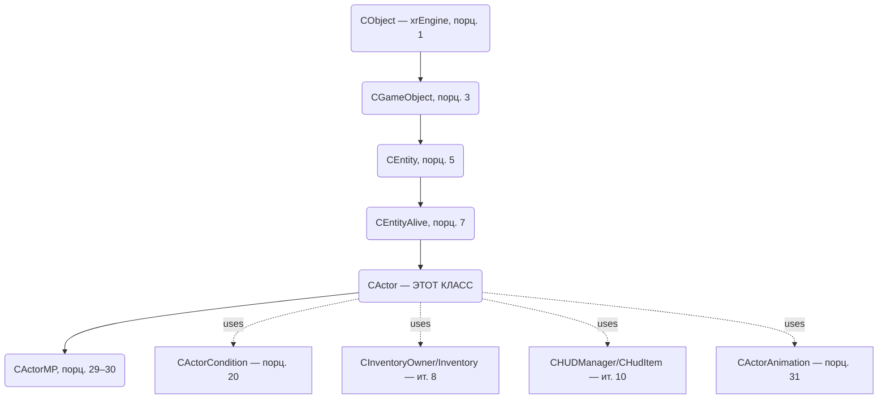
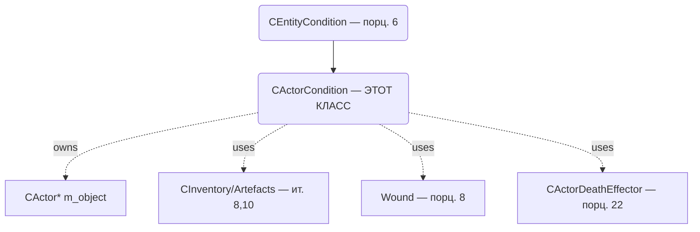

# CActor

> **Модуль:** `xrGame` · **Файлы:** `Actor.h` (922), `Actor.cpp` (3128), `Actor_*.cpp` (Movement/Input/Feel/Weapon/Network/Animation/HUD/Misc/Sleep/NightVision/Helmet/Backpack/Events), `ActorCondition.h` (216), `ActorCondition.cpp` (1110), `ActorCondition_script.cpp` (177), `actor_mp_*.cpp/h` (client/server/state) · **Порционы 19–34, итерация 5**
>
> **Страница:** каркас/условия/урон/смерть/движение/input/feel/holder/оружие/сеть/интерполяция/MP/анимация/HUD/инвентарь-события/сон/НВЗ/прочее. Порц. 19 — **каркас** (§3). Порц. 20 — **условия и статы** (§4). Порц. 21 — **Hit/PHHit и урон** (§5). Порц. 22 — **смерть** (§6, отдельная страница `actor-death.md`). Порц. 23 — **движение/физика** (§7), 24 — **input** (§8), 25 — **feel** (§9), 26 — **holder (транспорт)** (§10), 27 — **оружейная обвязка** (§11), 28 — **сеть/интерполяция** (§12), 29–30 — **MP** (§13–14, `actor-mp.md`), 31 — **анимация** (§15), 32 — **HUD/рендер** (§16), 33 — **инвентарь-события/артефакты на поясе** (§17), 34 — **сон/НВЗ/прочее** (§18).

## 1. Ответственность

`CActor` — **игрок** (singleplayer) и базовый класс для `CActorMP` (multiplayer). Ключевой `CEntityAlive` в иерархии (порц. 7): управляет камерой (1st/3rd person), вводом, физикой движения, здоровьем/условиями (через `CActorCondition`, порц. 20), взаимодействием с миром (feel), инвентарём/оружием, HUD, анимацией, сетью.

## 2. Место в архитектуре

- **Наследует:** `CEntityAlive` (порц. 7), реализует `IInputReceiver`, `Feel::Touch`, `CInventoryOwner`, `CPhraseDialogManager`, `CStepManager`, `Feel::Sound` (+ `pureRender` в DEBUG).
- **Использует:** `CActorCondition` (условия, порц. 20), `CInventory`/`CInventoryOwner` (ит. 8), `CCharacterPhysicsSupport` (ит. 7), `CHUDManager`/`CHudItem` (ит. 10), `CActorAnimation` (порц. 31), `Feel::Touch/Vision/Sound` (порц. 25, 41–42), `CScriptGameObject` (порц. 13–18), `CDamageManager` (порц. 5/8).
- **Создаётся:** фабрикой классов `CObjectFactory` (порц. 2). MP-версия — `CActorMP` (порц. 29).

## 3. CActor: каркас (порцион 19)

См. полный каркас в рамках порциона 19 (инициализация, боксы, камера, `shedule_Update/UpdateDefferedMessages`, жизненный цикл, геттеры/флаги, инвентарь-события каркас, оружейная обвязка каркас, анимация/коллбэки, сеть/save/load — каркас, связи). Детали по подсистемам ниже.

## 4. CActorCondition: условия и статы (порцион 20)

### 4.1 Ответственность

`CActorCondition` — класс состояний игрока, наследник `CEntityCondition` (порц. 6). Управляет:
- **Базовыми статами** актёра: здоровье/психика, сила (power), сытость (satiety), радиация, алкоголь, кровотечение, ожоги/раны, психическое воздействие.
- **Условиями движения**: хромота (`IsLimping`), неспособность ходить/бегать (`IsCantWalk`, `IsCantSprint`), перегруз по весу (`IsCantWalkWeight`, `MaxWalkWeight`, `GetCarryWeightBoost`).
- **Влияниями (boosters/medicine)**: бустеры параметров (`Boost*`), текущие влияния (`GetCurBoosterInfluences()`), применение `SMedicineInfluenceValues`/`SBooster` (`ApplyInfluence`, `ApplyBooster`).
- **Зонами/опасностями**: радиация/ядовитые материалы, опасности зон (`SetZoneDanger`, `GetZoneDanger`, `GetZoneMaxPower` по `ALife::EInfluenceType/EHitType`).
- **Удар/повреждения условий**: обработка `ConditionHit(SHit*)` (переопределение `CEntityCondition`), расчёт хромоты/блокировки спринта (`DisableSprint`, `PlayHitSound`, `HitSlowmo`), `PowerHit`, `ConditionJump/Walk/Stand`.
- **Обновление состояний**: `UpdateCondition()`, `UpdateBoosters()`, `UpdateSatiety()`, `UpdateRadiation()`, `UpdateTutorialThresholds()`.
- **Сон**: режим сна (`IsSleeping()`), отдельные коэффициенты сна (`V_Satiety()`, `V_SatietyPower()`, `V_SatietyHealth()`, `m_change_v_sleep`).
- **Psy-bar**: `GetPsyBar()`/`SetPsyBar(float)`, `GetPsy()` как `1.0f - GetPsyHealth()`.
- **Death-effector**: `m_death_effector` (`CActorDeathEffector*`) — создаётся/используется при смерти (связь с порц. 22).

### 4.2 Место в архитектуре

- **Наследует:** `CEntityCondition` (порц. 6).
- **Владеет/использует:** указатель на `CActor* m_object` (`ActorCondition.h:36`), `CActorDeathEffector* m_death_effector` (`ActorCondition.h:37`), `SMedicineInfluenceValues m_curr_medicine_influence`, `BOOSTER_MAP m_booster_influences` (базовый класс), `SConditionChangeV m_change_v_sleep` (`ActorCondition.h:137`).
- **Создаётся:** `CActor::create_entity_condition(CEntityConditionSimple*&)` (порц. 19) — создаёт `CActorCondition*` (`new CActorCondition(object)`), см. `ActorCondition.cpp:35–77` (ctor).
- **Lua-экспорт:** `ActorCondition_script.cpp` (177) — регистрация методов `CActorCondition` в скриптах (порц. 18/14 контекст).

### 4.3 Конструктор, деструктор, reinit

| Метод | Файл:строка | Назначение |
|---|---|---|
| `CActorCondition(CActor* object)` | `ActorCondition.cpp:35–77` | Инициализация полей: `m_fJumpPower/m_fStandPower/m_fWalkPower`, `m_fJumpWeightPower/m_fWalkWeightPower`, `m_fOverweightWalkK/m_fOverweightJumpK`, `m_fAccelK/m_fSprintK`, `m_fAlcohol=0.f`, `m_fSatiety=1.0f`, `m_fSatietyChange=0.f`, `m_MaxWalkWeight=50.f`, `m_CarryWeightBoost=0.f`, `m_object=object`, `m_condition_flags.zero()`, `m_death_effector=NULL`, `m_zone_max_power[...] = 1.0f` (infl_rad/fire/acid/psi/electra), `m_zone_danger[...] = 0.f`, `m_f_time_affected = Device.fTimeGlobal`, `m_max_power_restore_speed=0.f`, `m_max_wound_protection=0.f`, `m_max_fire_wound_protection=0.f`. Вызывает `inherited(object)`. |
| `~CActorCondition()` | `ActorCondition.cpp:79–82` | `xr_delete(m_death_effector)`. |
| `reinit()` | `ActorCondition.h:46`, `ActorCondition.cpp` | Переинициализация состояния (вызывается из `CActor::reinit()` — порц. 19). |
| `LoadCondition(LPCSTR section)` | `ActorCondition.h:45`, `ActorCondition.cpp:84–250+` | Загрузка параметров из INI. Читает `condition_sect` (fallback на `entity_section`), загружает `m_change_v_sleep.load(section, "_sleep")`, параметры движения (`jump_power`, `stand_power`, `walk_power`, `jump_weight_power`, `walk_weight_power`, `overweight_walk_k`, `overweight_jump_k`, `accel_k`, `sprint_k`), пороги хромоты (`limping_health_begin/end`, `limping_power_begin/end`), пороги `cant_walk`/`cant_sprint` (`cant_walk_power_begin/end`, `cant_sprint_power_begin/end`), утечка силы (`max_power_leak_speed`, `max_power_leak_speed_sleep`), а также satiety/radiation/psy/wound/boosters/thresholds (см. cpp). |

### 4.4 Флаги условий (m_condition_flags)

`enum` в `ActorCondition.h:21–32`:
- `eCriticalPowerReached` (1<<0)
- `eCriticalMaxPowerReached` (1<<1)
- `eCriticalBleedingSpeed` (1<<2)
- `eCriticalSatietyReached` (1<<3)
- `eCriticalRadiationReached` (1<<4)
- `eWeaponJammedReached` (1<<5)
- `ePhyHealthMinReached` (1<<6)
- `eCantWalkWeight` (1<<7)
- `eCantWalkWeightReached` (1<<8)

`Flags16 m_condition_flags` (`ActorCondition.h:34`) — битовые флаги критических состояний (используются в `UpdateCondition()`/проверках).

### 4.5 Движение, вес, хромота (cant_walk/cant_sprint/limping)

| Метод | Возврат | Файл/строка | Назначение |
|---|---|---|---|
| `IsLimping()` const | `bool` | `ActorCondition.h:79` | Хромание при потере сил/здоровья (пороговые значения из `LoadCondition`: `limping_health_begin/end`, `limping_power_begin/end`) |
| `IsCantWalk()` const | `bool` | `ActorCondition.h:80` | Неспособность ходить (по мощности) |
| `IsCantWalkWeight()` | `bool` | `ActorCondition.h:81` | Перегруз по весу (влияние на ходьбу) |
| `IsCantSprint()` const | `bool` | `ActorCondition.h:82` | Неспособность бегать (спринт) |
| `IsSleeping()` const | `bool` | `ActorCondition.h:83` | Режим сна |
| `ConditionJump(float weight)` | `void` | `ActorCondition.h:87` | Обновление условий прыжка (учёт веса) |
| `ConditionWalk(float weight, bool accel, bool sprint)` | `void` | `ActorCondition.h:88` | Обновление условий ходьбы (вес, ускорение, спринт) |
| `ConditionStand(float weight)` | `void` | `ActorCondition.h:89` | Обновление условий стояния |
| `MaxWalkWeight()` const | `float` | `ActorCondition.h:90` (`IC`) | Макс. допустимый вес для ходьбы |
| `SetMaxWalkWeight(float mww)` | `void` | `ActorCondition.h:91` (`IC`) | Установка макс. веса ходьбы |
| `GetCarryWeightBoost()` const | `float` | `ActorCondition.h:92` (`IC`) | Буст переносимого веса |
| `DisableSprint(SHit* pHDS)` | `bool` | `ActorCondition.h:127` | Блокировка спринта по удару/условиям |
| `HitSlowmo(SHit* pHDS)` | `float` | `ActorCondition.h:129` | Замедление времени при попадании (slow-mo) |

### 4.6 Сытость, алкоголь, психика (satiety/alcohol/psy)

| Метод | Возврат | Файл/строка | Назначение |
|---|---|---|---|
| `ChangeAlcohol(const float value)` | `virtual void` | `ActorCondition.h:54` | Изменение уровня алкоголя |
| `ChangeSatiety(const float value)` | `virtual void` | `ActorCondition.h:55` | Изменение сытости |
| `GetAlcohol()` | `float` | `ActorCondition.h:97` (`xr_stdcall`) | Текущий алкоголь |
| `GetPsy()` | `float` | `ActorCondition.h:98` (`xr_stdcall`) | Психика = `1.0f - GetPsyHealth()` |
| `GetSatiety()` | `virtual float` | `ActorCondition.h:99` | Текущая сытость |
| `SetSatiety(float satiety)` | `virtual void` | `ActorCondition.h:100` | Установка сытости |
| `GetSatietyPower()` const | `float` | `ActorCondition.h:101` (`IC`) | Мощность, связанная с сытостью: сон/не сон (`m_fV_SatietyPowerSleep*m_fSatiety` или `m_fV_SatietyPower*m_fSatiety`) |
| `SatietyCritical()` const | `float` | `ActorCondition.h:122` (`IC`) | Критический порог сытости |
| `V_Satiety()` const | `float const&` | `ActorCondition.h:119` (`IC`) | Коэффициент сытости (сон/не сон) |
| `V_SatietyPower()` const | `float const&` | `ActorCondition.h:120` (`IC`) | Коэффициент мощности по сытости (сон/не сон) |
| `V_SatietyHealth()` const | `float const&` | `ActorCondition.h:121` (`IC`) | Коэффициент здоровья по сытости (сон/не сон) |
| `GetPsyBar()` | `float` | `ActorCondition.h:94` | Значение психо-бара |
| `SetPsyBar(float psybar)` | `void` | `ActorCondition.h:95` | Установка психо-бара |
| `UpdateSatiety()` | `void` | `ActorCondition.cpp/h` | Обновление сытости (порц. 20) |

### 4.7 Урон, раны, попадания (Hit/ConditionHit)

| Метод | Возврат | Файл/строка | Назначение |
|---|---|---|---|
| `ConditionHit(SHit* pHDS)` | `virtual CWound*` | `ActorCondition.h:49` | Обработка попадания (переопределение `CEntityCondition`). Возвращает рану (`CWound*`) — связь с порц. 8 (`wounds-death.md`) |
| `PowerHit(float power, bool apply_outfit)` | `void` | `ActorCondition.h:85` | Удар по силе (power) с учётом одежды |
| `PlayHitSound(SHit* pHDS)` | `bool` | `ActorCondition.h:128` | Проигрывание звука попадания |
| `HitSlowmo(SHit* pHDS)` | `float` | `ActorCondition.h:129` | Slow-mo при попадании |
| `AffectDamage_InjuriousMaterialAndMonstersInfluence()` | `void` | `ActorCondition.h:103` | Влияние ядовитых материалов/монстров на урон |
| `GetInjuriousMaterialDamage()` | `float` | `ActorCondition.h:104` | Урон от ядовитых материалов |

### 4.8 Зоны, опасности, радиация

| Метод | Возврат | Файл/строка | Назначение |
|---|---|---|---|
| `UpdateRadiation()` | `virtual void` | `ActorCondition.h:40` | Обновление радиации |
| `SetZoneDanger(float danger, ALife::EInfluenceType type)` | `void` | `ActorCondition.h:106` | Установка опасности зоны по типу влияния |
| `GetZoneDanger()` const | `float` | `ActorCondition.h:107` | Текущая опасность зоны |
| `GetZoneMaxPower(ALife::EInfluenceType type)` const | `float` | `ActorCondition.h:124` | Макс. мощность зоны по типу влияния |
| `GetZoneMaxPower(ALife::EHitType hit_type)` const | `float` | `ActorCondition.h:125` | Макс. мощность зоны по типу урона |

### 4.9 Boosters/Medicine (влияния)

| Метод | Возврат | Файл/строка | Назначение |
|---|---|---|---|
| `UpdateBoosters()` | `void` | `ActorCondition.h:51` | Обновление бустеров |
| `GetBoosterValue(LPCSTR name, bool type)` | `float` | `ActorCondition.h:52` | Значение бустера |
| `BoostParameters(const SBooster& B)` | `void` | `ActorCondition.h:57` | Применение параметров бустера |
| `DisableBoostParameters(const SBooster& B)` | `void` | `ActorCondition.h:58` | Отключение параметров бустера |
| `BoostMaxWeight(float value)` | `void` | `ActorCondition.h:59` | Буст макс. веса |
| `BoostHpRestore(float value)` | `void` | `ActorCondition.h:60` | Буст восстановления здоровья |
| `BoostPowerRestore(float value)` | `void` | `ActorCondition.h:61` | Буст восстановления силы |
| `BoostRadiationRestore(float value)` | `void` | `ActorCondition.h:62` | Буст восстановления от радиации |
| `BoostBleedingRestore(float value)` | `void` | `ActorCondition.h:63` | Буст остановки кровотечения |
| `BoostBurnImmunity(float value)` | `void` | `ActorCondition.h:64` | Иммунитет к ожогам |
| `BoostShockImmunity(float value)` | `void` | `ActorCondition.h:65` | Иммунитет к шоку |
| `BoostRadiationImmunity(float value)` | `void` | `ActorCondition.h:66` | Радиационный иммунитет |
| `BoostTelepaticImmunity(float value)` | `void` | `ActorCondition.h:67` | Телепатический иммунитет |
| `BoostChemicalBurnImmunity(float value)` | `void` | `ActorCondition.h:68` | Иммунитет к хим. ожогам |
| `BoostExplImmunity(float value)` | `void` | `ActorCondition.h:69` | Иммунитет к взрыву |
| `BoostStrikeImmunity(float value)` | `void` | `ActorCondition.h:70` | Иммунитет к удару |
| `BoostFireWoundImmunity(float value)` | `void` | `ActorCondition.h:71` | Иммунитет к огн. ранениям |
| `BoostWoundImmunity(float value)` | `void` | `ActorCondition.h:72` | Иммунитет к ранениям |
| `BoostRadiationProtection(float value)` | `void` | `ActorCondition.h:73` | Защита от радиации |
| `BoostTelepaticProtection(float value)` | `void` | `ActorCondition.h:74` | Телепатическая защита |
| `BoostChemicalBurnProtection(float value)` | `void` | `ActorCondition.h:75` | Защита от хим. ожогов |
| `GetCurBoosterInfluences()` | `BOOSTER_MAP` | `ActorCondition.h:76` | Текущие влияния бустеров |
| `ApplyInfluence(const SMedicineInfluenceValues& V, const shared_str& sect)` | `virtual bool` | `ActorCondition.h:130` | Применение медицинского влияния |
| `ApplyBooster(const SBooster& B, const shared_str& sect)` | `virtual bool` | `ActorCondition.h:131` | Применение бустера |
| `GetMaxPowerRestoreSpeed()` | `float` | `ActorCondition.h:132` | Макс. скорость восстановления силы |
| `GetMaxWoundProtection()` | `float` | `ActorCondition.h:133` | Макс. защита от ран |
| `GetMaxFireWoundProtection()` | `float` | `ActorCondition.h:134` | Макс. защита от огн. ран |
| `m_curr_medicine_influence` | `SMedicineInfluenceValues` | `ActorCondition.h:139` | Текущее мед. влияние |
| `m_change_v_sleep` | `SConditionChangeV` | `ActorCondition.h:137` | Изменения условий во сне |

### 4.10 Обновление, сериализация, доступ к объекту

| Метод | Возврат | Файл/строка | Назначение |
|---|---|---|---|
| `UpdateCondition()` | `virtual void` | `ActorCondition.h:50` | Основной цикл обновления условий (порц. 20) |
| `UpdateTutorialThresholds()` | `void` | `ActorCondition.h:38` | Обновление туториальных порогов |
| `change_v()` | `virtual SConditionChangeV&` | `ActorCondition.h:47` | Доступ к вектору изменений условий (переопределение `CEntityCondition`) |
| `object()` const | `IC CActor&` | `ActorCondition.h:110–114` | Доступ к актёру-владельцу |
| `save(NET_Packet& output_packet)` | `virtual void` | `ActorCondition.h:116` | Сериализация состояния (ит. 12 — каркас) |
| `load(IReader& input_packet)` | `virtual void` | `ActorCondition.h:117` | Десериализация состояния (ит. 12 — каркас) |
| `m_object` | `CActor*` | `ActorCondition.h:36` | Указатель на актёра |
| `m_death_effector` | `CActorDeathEffector*` | `ActorCondition.h:37` | Эффектор смерти (порц. 22) |
| `m_fPsyBar` | `float` | `ActorCondition.h:140` | Психо-бар |
| `m_condition_flags` | `Flags16` | `ActorCondition.h:34` | Флаги критических состояний (enum 21–32) |

### 4.11 Примечания

- `CActorCondition` наследует `CEntityConditionSimple` (через `CEntityCondition`) — базовые статы/методы обновления берутся из `EntityCondition` (порц. 6).
- `LoadCondition` загружает как секцию актёра, так и `condition_sect` (переопределение/доп. параметры).
- `ActorCondition_script.cpp` (177) экспортирует методы класса в Lua (скриптовый доступ к условиям актёра) — относится к механике Lua-регистрации (порц. 18) и Lua API (ит. 14).
- Связь со смертью: `m_death_effector`, `ConditionHit`, пороги критических состояний — детали смерти актёра в порц. 22 (`actor-death.md`).
- Обновление `UpdateCondition()`/`UpdateBoosters()`/`UpdateSatiety()`/`UpdateRadiation()` — ключевые методы цикла (вызываются из `CEntityAlive`/`CActor` — каркас обновления).