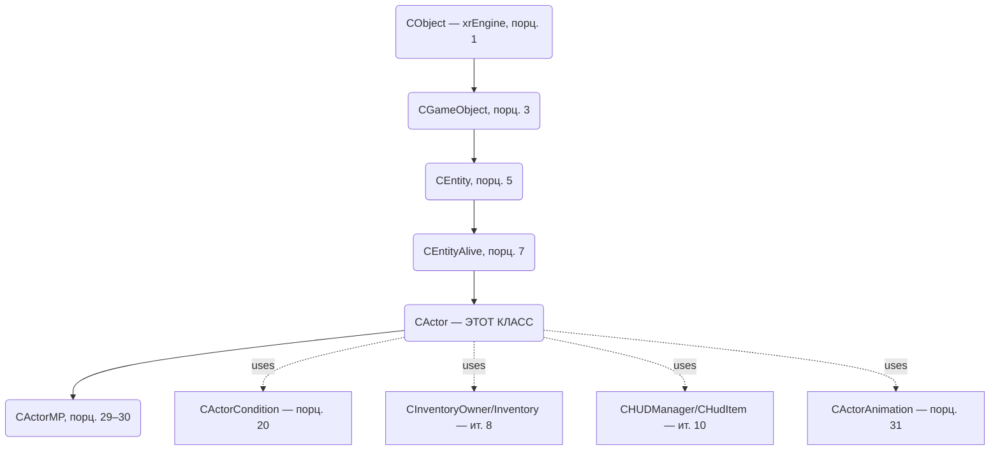

# CActor

> **Модуль:** `xrGame` · **Файлы:** `Actor.h` (922), `Actor.cpp` (3128), `Actor_*.cpp` (Movement/Input/Feel/Weapon/Network/Animation/HUD/Misc/Sleep/NightVision/Helmet/Backpack/Events), `ActorCondition.h` (216), `ActorCondition.cpp` (1110), `ActorCondition_script.cpp` (177), `actor_mp_*.cpp/h` (client/server/state) · **Порционы 19–34, итерация 5**
>
> **Страница:** каркас/условия/урон/смерть/движение/input/feel/holder/оружие/сеть/интерполяция/MP/анимация/HUD/инвентарь-события/сон/НВЗ/прочее. Порц. 19 — **каркас** (§3). Порц. 20 — **условия и статы** (§4). Порц. 21 — **Hit/PHHit и урон** (§5). Порц. 22 — **смерть** (§6, отдельная страница `actor-death.md`). Порц. 23 — **движение/физика** (§7), 24 — **input** (§8), 25 — **feel** (§9), 26 — **holder (транспорт)** (§10), 27 — **оружейная обвязка** (§11), 28 — **сеть/интерполяция** (§12), 29–30 — **MP** (§13–14, `actor-mp.md`), 31 — **анимация** (§15), 32 — **HUD/рендер** (§16), 33 — **инвентарь-события/артефакты на поясе** (§17), 34 — **сон/НВЗ/прочее** (§18).

## 1. Ответственность

`CActor` — **игрок** (singleplayer) и базовый класс для `CActorMP` (multiplayer). Ключевой `CEntityAlive` в иерархии (порц. 7): управляет камерой (1st/3rd person), вводом, физикой движения, здоровьем/условиями (через `CActorCondition`, порц. 20), взаимодействием с миром (feel), инвентарём/оружием, HUD, анимацией, сетью.

## 2. Место в архитектуре

- **Наследует:** `CEntityAlive` (порц. 7), реализует `IInputReceiver`, `Feel::Touch`, `CInventoryOwner`, `CPhraseDialogManager`, `CStepManager`, `Feel::Sound` (+ `pureRender` в DEBUG).
- **Использует:** `CActorCondition` (условия, порц. 20), `CInventory`/`CInventoryOwner` (ит. 8), `CCharacterPhysicsSupport` (ит. 7), `CHUDManager`/`CHudItem` (ит. 10), `CActorAnimation` (порц. 31), `Feel::Touch/Vision/Sound` (порц. 25, 41–42), `CScriptGameObject` (порц. 13–18), `CDamageManager` (порц. 5/8).
- **Создаётся:** фабрикой классов `CObjectFactory` (порц. 2). MP-версия — `CActorMP` (порц. 29).

## 3. CActor: каркас (порцион 19)

См. каркас в рамках порциона 19 (инициализация, боксы, камера, `shedule_Update/UpdateDefferedMessages`, жизненный цикл, геттеры/флаги, инвентарь-события каркас, оружейная обвязка каркас, анимация/коллбэки, сеть/save/load — каркас, связи).

## 4. CActorCondition: условия и статы (порцион 20)

### 4.1 Ответственность

`CActorCondition` — наследник `CEntityCondition` (порц. 6). Управляет статами актёра, условиями движения (limping/cant_walk/cant_sprint, перегруз), бустерами/медицинскими влияниями, зонами/опасностями, обработкой попаданий, режимом сна, death-effector'ом.

### 4.2 Место в архитектуре

- **Наследует:** `CEntityCondition` (порц. 6).
- **Связи:** владеет `m_object` (CActor*), `m_death_effector` (CActorDeathEffector*, порц. 22), использует `CWound` (порц. 8).
- **Создаётся:** `CActor::create_entity_condition(CEntityConditionSimple*&)` → `new CActorCondition(object)`.
- **Lua:** `ActorCondition_script.cpp` (177) — экспорт методов (порц. 18/ит. 14).

### 4.3 ctor/dtor/reinit/Load

| Метод | Файл:строка | Назначение |
|---|---|---|
| `CActorCondition(CActor* object)` | `ActorCondition.cpp:35–77` | Инициализация satiety=1.0, `zone_max_power[...] = 1.0f` (infl_rad/fire/acid/psi/electra), `zone_danger[...] = 0.f`, `m_f_time_affected = Device.fTimeGlobal`, дефолтные коэфф. движения, `m_death_effector=NULL`, `m_condition_flags.zero()`. |
| `~CActorCondition()` | `ActorCondition.cpp:79–82` | `xr_delete(m_death_effector)`. |
| `reinit()` | `ActorCondition.h:46` | Переинициализация состояния. |
| `LoadCondition(LPCSTR section)` | `ActorCondition.h:45`, `ActorCondition.cpp:84+` | Загружает `condition_sect` (fallback), `m_change_v_sleep.load(section,"_sleep")`, параметры движения, пороги хромоты/cant_walk/cant_sprint, утечку силы. |

### 4.4 Флаги условий

`m_condition_flags` (Flags16), enum `ActorCondition.h:21–32`:
- `eCriticalPowerReached`, `eCriticalMaxPowerReached`, `eCriticalBleedingSpeed`, `eCriticalSatietyReached`, `eCriticalRadiationReached`, `eWeaponJammedReached`, `ePhyHealthMinReached`, `eCantWalkWeight`, `eCantWalkWeightReached`.

## 5. CActor: Hit/PHHit и урон (порцион 21)

### 5.1 Ответственность

Обработка попаданий актёра: физический хит `PHHit(SHit&)` и общий хит `Hit(SHit*)`. Включает: проверку типа урона, звуки попаданий, slow-mo, блокировку спринта, hit-markers (эффекторы огненного попадания), backstab-логику в MP, инвок скриптового коллбэка `_G.CActor__BeforeHitCallback` (SP), применение `CScriptHit` (`ApplyScriptHit`), учёт артефактов на поясе (`HitArtefactsOnBelt`), вызов базового `CEntityAlive::Hit`, сетевую статистику взрывов (MP), обработку GodMode.

### 5.2 Методы

| Метод | Файл:строка | Назначение |
|---|---|---|
| `PHHit(SHit& H)` | `Actor.cpp:541–544` | Делегирует физике: `m_pPhysics_support->in_Hit(H,false)`. |
| `Hit(SHit* pHDS)` | `Actor.cpp:554–764` | Главный обработчик попадания. |
| `HitMark(float P, Fvector dir, CObject* who, s16 element, Fvector pos_in_bone_space, float impulse, ALife::EHitType hit_type_)` | `Actor.cpp:766–832` | Отображение hit-marker'а: вычисляет угол между направлением камеры и направлением попадания, выбирает сектор 0–7, добавляет эффектор `effFireHit` (`effector_fire_hit_%d`) при локальном игроке, живом, в 1st-person виде. |
| `HitSignal(float perc, Fvector& vLocalDir, CObject* who, s16 element)` | `Actor.cpp:834–862` | Анимационный отклик на попадание: вычисляет yaw/pitch локального направления попадания, выбирает damage-motion по ориентации (`m_anims->m_normal.m_damage[...]`, с учётом `r_model_yaw+r_model_yaw_delta`), проигрывает FX через `IKinematicsAnimated::PlayFX(motion_ID, power_factor)`. |
| `HitSector(CObject* who, CObject* weapon)` | `Actor.h:203` | Обработка hit-sector при огненном ранении в режиме камеры актёра (вызывается из `Hit`). |
| `SetHitInfo(CObject* who, CObject* weapon, s16 element, Fvector Pos, Fvector Dir)` | `Actor.h:750` | Установка информации о последнем попадании. |
| `OnHitHealthLoss(float NewHealth)`, `OnCriticalHitHealthLoss()`, `OnCriticalWoundHealthLoss()`, `OnCriticalRadiationHealthLoss()` | `Actor.h:752–755` | Коллбэки потери здоровья/критических состояний (порц. 21/8). |

### 5.3 Ключевые детали `Hit(SHit*)` (по коду)

- **Валидация типа урона:** проверка `hit_type < ALife::eHitTypeBurn || hit_type >= ALife::eHitTypeMax` → `R_ASSERT2` (`Actor.cpp:561–566`).
- **Флаг `b_initiated`:** берётся из `pHDS->aim_bullet` (физический удар полтергейста), затем сбрасывается в `false` (`Actor.cpp:556–558`).
- **GodMode (SP):** если `GodMode()` → `HDS.power = 0.0f`, `inherited::Hit(&HDS)`, возврат (`Actor.cpp:673–678`).
- **Инвок скриптового коллбэка перед применением (SP):** при `g_Alive()` получает `CScriptHit tLuaHit(&HDS)`, ищет functor `_G.CActor__BeforeHitCallback` через `ai().script_engine().functor`, если есть и возвращает `false` — досрочный выход; иначе вызывает `HDS.ApplyScriptHit(&tLuaHit)` (`Actor.cpp:683–693`).
- **Учёт артефактов:** `HDS.power = HitArtefactsOnBelt(HDS.damage(), HDS.hit_type)` (`Actor.cpp:693`, `754`).
- **Скриптовый callback `eHit`:** вызывает `callback(GameObject::eHit)(lua_game_object(), HDS.damage(), HDS.direction(), smart_cast<const CGameObject*>(HDS.who)->lua_game_object(), HDS.boneID)` (`Actor.cpp:697–704`).
- **Базовый вызов:** `inherited::Hit(&HDS)` (`Actor.cpp:705, 756`).
- **Звуки попаданий:** при наличии `sndHit[HDS.hit_type]` и `conditions().PlayHitSound(pHDS)` выбирает случайный звук; для `ALife::eHitTypeExplosion` при локальном контроле ставит `SndShockEffector` (если нет) с длительностью по длине звука и силой по `HDS.damage()`; играет только если нет уже играющего такого же типа (`playing_pred` по `s._feedback() != NULL`) (`Actor.cpp:610–638`).
- **Slow-mo:** `m_hit_slowmo = conditions().HitSlowmo(pHDS)` (`Actor.cpp:642`).
- **HitMark:** при локальном игроке, живом и `!m_disabled_hitmarks`, если `b_fireWound` или `b_initiated` (b_initiated истинно только для strike и `aim_bullet` исходно) — вызывает `HitMark(...)` (`Actor.cpp:662–669`).
- **Блокировка спринта:** если в спринте и `conditions().DisableSprint(pHDS)`, снимает флаг `mcSprint` (кроме специального случая `pHDS->who == this && pHDS->boneID == BI_NONE`) (`Actor.cpp:654–661`).
- **MP-логика backstab:** в `!IsGameTypeSingle()` вычисляет локальное направление попадания, сравнивает с `a={0,0,1}` (`dotproduct < -0.707`) при `hit_type == ALife::eHitTypeWound_2` и валидном backstab-элементе кости — выставляет `m_bWasBackStabbed = true`. Для backstab при нулевом уроне `hit_power = 100000.0f`, иначе `hit_power = HitArtefactsOnBelt(HDS.damage(), HDS.hit_type)` (`Actor.cpp:724–757`).
- **MP-статистика:** на сервере при смерти от взрыва (`OnServer() && !g_Alive() && HDS.hit_type == ALife::eHitTypeExplosion`) — `Game().m_WeaponUsageStatistic->OnExplosionKill(ps, HDS)` (`Actor.cpp:758–763`).
- **Инвинисибилити-визуал (MP):** при `!IsGameTypeSingle() && !g_dedicated_server` и флаге `GAME_PLAYER_FLAG_INVINCIBLE` у игрока — не играет звук попадания, но раз в кадр (`Device.dwFrame != last_hit_frame` и кость валидна) создаёт частицу щита (`invincibility_fire_shield_1st` при камере 1-го лица/локальный, иначе `invincibility_fire_shield_3rd`) и добавляет в `GamePersistent().ps_needtoplay` (`Actor.cpp:579–608`).
- **Хит-сектор при огненном ранении:** при локальном просмотре и `HDS.hit_type == ALife::eHitTypeFireWound` — вызывает `HitSector(pLastHitter, pLastHittingWeapon)` с последним хиттером/оружием (`Actor.cpp:645–652`).

### 5.4 HitMark (детали)

- Работает только при локальном игроке, живом, `Level().CurrentEntity() == this`.
- Вычисляет угол между `cam_dir` и `dir` (`angle_difference(cam_dir.getH(), dir.getH())`), определяет сторону по `crossproduct(cam_dir,dir).y > 0` (`bUp`).
- Сектора по углам `_s1=PI_DIV_8`, `_s2=_s1+PI_DIV_4`, `_s3=_s2+PI_DIV_4`, `_s4=_s3+PI_DIV_4` → id 0–7 (0 — прямо сзади, 1/3/5/7 — промежуточные, 2 — спереди).
- Добавляет эффектор: `AddEffector(this, effFireHit, sect_name="effector_fire_hit_%d", P*0.001f)` (`Actor.cpp:830`).

### 5.5 HitSignal (детали)

- Работает только `g_Alive()`.
- Трансформирует локальное направление `vLocalDir` в мировое `D`, берёт HP: `D.getHP(yaw,pitch)`.
- Получает `IKinematicsAnimated* tpKinematics` из `Visual()`.
- Выбирает motion по `iFloor(pK->LL_GetBoneInstance(element).get_param(1) + (angle_difference(r_model_yaw + r_model_yaw_delta, yaw) <= PI_DIV_2 ? 0 : 1))` из `m_anims->m_normal.m_damage[...]`.
- Вычисляет `power_factor = clamp(perc/100.f, 0,1)`, вызывает `tpKinematics->PlayFX(motion_ID, power_factor)`.
- Есть `#pragma todo` о некорректности направления импульса вперед-назад.

### 5.6 PHHit

`PHHit(SHit& H)` — минимальный делегат в физику: `m_pPhysics_support->in_Hit(H,false)` (`Actor.cpp:541–544`).

### 5.7 Связи

- **CActorCondition** (порц. 20): `conditions().PlayHitSound(pHDS)`, `conditions().HitSlowmo(pHDS)`, `conditions().DisableSprint(pHDS)`.
- **Артефакты на поясе/защита** (порц. 33): `HitArtefactsOnBelt(float hit_power, ALife::EHitType hit_type)` (`Actor.h:226`), `GetProtection_ArtefactsOnBelt(ALife::EHitType hit_type)` (`Actor.h:227`), `UpdateArtefactsOnBeltAndOutfit()` (`Actor.h:225`, `Actor.cpp:2089`).
- **CEntityAlive/CGameObject**: `inherited::Hit(&HDS)` (`Actor.cpp:705,756`), доступ к `lua_game_object()` (`Actor.cpp:688,698–703`).
- **Lua**: `_G.CActor__BeforeHitCallback` (функтор), `CScriptHit` (`#include "script_hit.h"`, используется `Actor.cpp:683,692`), коллбэк `GameObject::eHit` (порц. 13–18/44).
- **HUD/эффекторы**: `HUD().HitMarked(...)` (`Actor.cpp:778`), `AddEffector(this, effFireHit, ...)` (`Actor.cpp:830`), `SndShockEffector` (`Actor.h:242`, `Actor.cpp:623–628`).
- **Сеть/MP**: backstab-логика, `OnServer()`, `game_PlayerState`, `WeaponUsageStatistic->OnExplosionKill` (`Actor.cpp:758–763`), `m_bWasBackStabbed` (`Actor.h:746`), `last_hit_frame` (`Actor.cpp:607`), частицы invincibility (`Actor.cpp:594–603`).
- **Звуки**: `sndHit[ALife::eHitTypeMax]` (`Actor.h:243`), `m_sndShockEffector` (`Actor.h:242`), `m_HeavyBreathSnd/m_BloodSnd/m_DangerSnd` (`Actor.h:231–233`).
- **Движение/анимация**: `mstate_wishful &= ~mcSprint` (`Actor.cpp:659`), `PlayFX` через IKinematicsAnimated (`Actor.cpp:860`), `m_anims->m_normal.m_damage` (`Actor.cpp:854–856`), `r_model_yaw+r_model_yaw_delta` (`Actor.cpp:856`).
- **Информация о последнем ударе**: `m_iLastHitterID`, `m_iLastHittingWeaponID`, `m_s16LastHittedElement`, `m_vLastHitDir`, `m_vLastHitPos`, `m_fLastHealth`, `m_bWasHitted`, `m_bWasBackStabbed` (`Actor.h:739–747`), `SetHitInfo` (`Actor.h:750`).

### 5.8 Примечания

- `ActorCondition::PlayHitSound`/`HitSlowmo`/`DisableSprint` — см. порц. 20.
- `CScriptHit` и Lua-обвязка попаданий — порц. 44 (`script_hit`).
- HitMark использует только огненные ранения (`b_fireWound`) и инициированные strike-попадания (`b_initiated`) — логика ограничивает показ метки определёнными типами хита.
- В MP invincibility-эффект частиц создаётся только когда локальный игрок под invincibility и кость валидна; звук попадания при этом подавляется.
- Backstab: сравнение с вектором (0,0,1) в локальной системе координат (инвертированный XFORM) при `dotproduct < -0.707`.