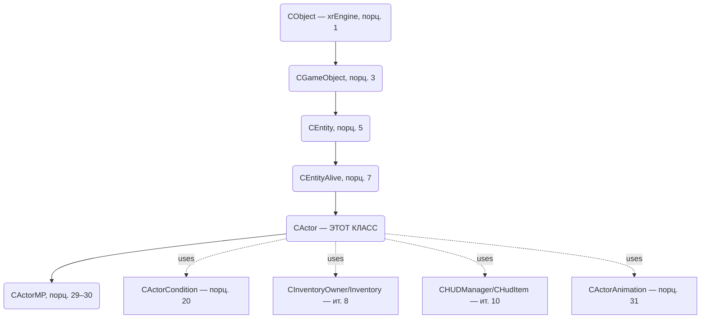

# CActor

> **Модуль:** `xrGame` · **Файлы:** `Actor.h` (922), `Actor.cpp` (3128), `Actor_*.cpp` (Movement/Input/Feel/Weapon/Network/Animation/HUD/Misc/Sleep/NightVision/Helmet/Backpack/Events), `ActorCondition*.cpp` (1110+177), `actor_mp_*.cpp/h` (client/server/state) · **Порционы 19–34, итерация 5**
>
> **Страница:** каркас/условия/урон/смерть/движение/input/feel/holder/оружие/сеть/интерполяция/MP/анимация/HUD/инвентарь-события/сон/НВЗ/прочее. Порц. 19 — **каркас** (§3). Порц. 20 — **условия и статы** (§4). Порц. 21 — **Hit/PHHit и урон** (§5). Порц. 22 — **смерть** (§6, отдельная страница `actor-death.md`). Порц. 23 — **движение/физика** (§7), 24 — **input** (§8), 25 — **feel** (§9), 26 — **holder (транспорт)** (§10), 27 — **оружейная обвязка** (§11), 28 — **сеть/интерполяция** (§12), 29–30 — **MP** (§13–14, `actor-mp.md`), 31 — **анимация** (§15), 32 — **HUD/рендер** (§16), 33 — **инвентарь-события/артефакты на поясе** (§17), 34 — **сон/НВЗ/прочее** (§18).

## 1. Ответственность

`CActor` — **игрок** (singleplayer) и базовый класс для `CActorMP` (multiplayer). Ключевой `CEntityAlive` в иерархии (порц. 7): управляет камерой (1st/3rd person), вводом, физикой движения, здоровьем/условиями (через `CActorCondition`, порц. 20), взаимодействием с миром (feel), инвентарём/оружием, HUD, анимацией, сетью.

## 2. Место в архитектуре

- **Наследует:** `CEntityAlive` (порц. 7), реализует интерфейсы ввода (`IInputReceiver` — см. [input](actor-input.md), порц. 24), рендера (`IRenderable`, `ISheduled`).
- **Использует:** `CActorCondition` (условия, порц. 20), `CInventory`/`CInventoryOwner` (ит. 8), `CCharacterPhysicsSupport` (ит. 7), `CHUDManager`/`CHudItem` (ит. 10), `CActorAnimation` (порц. 31), `Feel::Touch/Vision/Sound` (порц. 25, 41–42), `CScriptGameObject` (порц. 13–18), `CDamageManager` (порц. 5/8).
- **Создаётся:** фабрикой классов `CObjectFactory` (порц. 2), CLSID актёра (singleplayer). MP-версия — `CActorMP` (порц. 29).

## 3. CActor: каркас (порцион 19)

### 3.1 Ответственность каркаса

Каркас `CActor` (Actor.h 922, Actor.cpp 3128) задаёт:

- **Инициализацию/переинициализацию:** `Load` (INI), `reload`, `reinit`, фабрика `create_entity_condition()` → `CActorCondition` (порц. 20).
- **Геометрию/физические боксы:** `set_box`, `set_box_y_offset`, `set_actor_box_y_offset`, `set_state_box`.
- **Камеру:** `initFPCam`, `removeFPCam`, `HUDview`, `canRenderLegs`.
- **Планировщик:** `shedule_Update` (порядок вызовов, отложенные сообщения), `UpdateDefferedMessages`.
- **Жизненный цикл/состояния:** `On_SetEntity`, `OnDifficultyChanged`, `set_safemode`, `SwitchOutBorder`, `start_tutorial`.
- **Базовые геттеры/проверки:** `GetMass`, `is_on_ground`, `is_ai_obstacle`, `NeedToDestroyObject`, `GetRestoreSpeed`.
- **Инвентарь-события (каркас):** `OnItemTake`, `OnItemDrop`, `OnItemRuck`, `OnItemBelt` (детали — порц. 33).
- **Оружейно-камера/бросок:** `can_attach`, `use_center_to_aim`, `use_default_throw_force`, `missile_throw_force`, `unlimited_ammo`, `SetZoomRndSeed`, `SetShotRndSeed`, `GetMissileOffset`, `SetMissileOffset`.
- **Анимация/коллбэки:** `g_SetAnimation`, `g_SetSprintAnimation`, `SetCallbacks`, `ResetCallbacks`, `GetDefaultActionForObject`.

### 3.2 Иерархия/интерфейсы (каркас)

`CActor` наследует `CEntityAlive` (порц. 7). Ключевые виртуальные переопределения (каркас): `Load`, `reload`, `reinit`, `shedule_Update`, `UpdateCL` (порц. 28), `renderable_Render` (порц. 32), `Die` (порц. 22), `Hit`/`PHHit` (порц. 21), `net_Spawn`/`net_Destroy`/`net_Import`/`net_Export` (порц. 4, 28–30), `OnEvent` (порц. 4, 34), `Feel_*` (порц. 25), `OnItemTake/OnItemDrop/OnItemRuck/OnItemBelt` (порц. 33).

### 3.3 Ключевые поля (каркас, по `Actor.h`)

Каркас актёра содержит ~134 поля (Actor.h 922). Основные группы:

| Группа | Примеры полей | Назначение |
|---|---|---|
| Камера/FPC | `m_hud_camera`, `m_legs`, `m_camera_height`, `m_camera_position`, `m_fov`, `currentFOV` | Камера 1-го лица, ноги, FOV (порц. 32) |
| Физика/боксы | `m_box`, `m_box_y_offset`, `m_actor_box_y_offset`, `m_state_box`, `m_set_state_box` | Боксы коллизий/состояний (порц. 23) |
| Условия | `m_conditions` (`CActorCondition*`) | Условия актёра (порц. 20) |
| Движение/Input | `m_state`, `m_input_external_handler`, `m_input_external_handler_installed` | Состояние, внешний input-хэндлер (порц. 23–24) |
| Оружие/бросок | `m_use_center_to_aim`, `m_use_default_throw_force`, `m_missile_throw_force`, `m_unlimited_ammo`, `m_zoom_rnd_seed`, `m_shot_rnd_seed`, `m_missile_offset` | Прицел/бросок (порц. 27) |
| Holder/транспорт | `m_holder` (`CHolderCustom*`) | Транспорт/держатель (порц. 26) |
| Анимация/callbacks | `m_animation`, коллбэки `g_SetAnimation*` | Анимация (порц. 31) |
| Feel | `m_feel_touch`, `m_feel_vision`, `m_feel_sound` | Feel-системы (порц. 25, 41–42) |
| Сеть/интерполяция | `m_state_holder`, `m_interpolation_params` | Сетевой state, интерполяция (порц. 28–30) |
| Прочее | `m_safemode`, `m_bOutBorder`, `m_bWasSpawned`, `m_respawn_delay`, `m_time_to_respawn` | Режимы/спавн/респавн (порц. 22, 34) |

### 3.4 Жизненный цикл и инициализация (каркас)

| Метод | Назначение |
|---|---|
| `CActor()` / `~CActor()` | ctor/dtor, инициализация полей |
| `Load(LPCSTR section)` | Загрузка из INI (`box_*`, `ph_*`, `camera`, `sprint`, `jump`, …), переопределение `CEntityAlive::Load` |
| `reload(LPCSTR section)` | Перезагрузка параметров |
| `reinit()` | Глубокая переинициализация, `m_conditions->reinit()` (порц. 20) |
| `create_entity_condition(CEntityCondition*&)` | Фабрика → `CActorCondition*` (порц. 20) |
| `On_SetEntity()` | Установка сущности (жизненный цикл) |
| `OnDifficultyChanged()` | Смена сложности |
| `set_safemode(bool)` | Безопасный режим |
| `SwitchOutBorder(bool)` | «Вне границ» |
| `start_tutorial()` | Туториал (связь со смертью/спавном — порц. 22) |

### 3.5 Боксы, камера, рендер (каркас)

| Метод | Назначение |
|---|---|
| `set_box(const Fvector&, const Fvector&)` | Основной AABB-бокс |
| `set_box_y_offset(float)` / `set_actor_box_y_offset(float)` | Смещения Y |
| `set_state_box(const Fvector&, const Fvector&)` | State-бокс (движение) |
| `initFPCam()` / `removeFPCam()` | Камера 1-го лица |
| `HUDview()` | HUD-вид (порц. 32) |
| `canRenderLegs()` | Рендер ног (порц. 32) |
| `renderable_Render()` | Рендер (порц. 32) |

### 3.6 Планировщик, дефер-сообщения (каркас)

| Метод | Назначение |
|---|---|
| `shedule_Update(u32 dt)` | `ISheduled::shedule_Update`, порядок Update'ов, `UpdateDefferedMessages` |
| `UpdateDefferedMessages()` | Обработка отложенных сообщений |
| `NeedToDestroyObject()` | Флаг уничтожения объекта |

### 3.7 Базовые геттеры/флаги (каркас)

| Метод | Возврат | Назначение |
|---|---|---|
| `GetMass()` | `float` | Масса актёра |
| `is_on_ground()` | `bool` | «На земле» (физика) |
| `is_ai_obstacle()` | `bool` | AI-препятствие |
| `GetRestoreSpeed()` | `float` | Скорость восстановления |
| `GetDefaultActionForObject(CGameObject*)` | `EActionType` | Действие по умолчанию (интеракция) |

### 3.8 Инвентарь-события (каркас)

| Метод | Назначение |
|---|---|
| `OnItemTake(CInventoryItem*)`, `OnItemDrop(CInventoryItem*)`, `OnItemRuck(CInventoryItem*)`, `OnItemBelt(CInventoryItem*)` | События инвентаря (детали — порц. 33) |

### 3.9 Оружейная обвязка, бросок, RNG (каркас)

| Метод | Возврат | Назначение |
|---|---|---|
| `can_attach(CInventoryItem*)` | `bool` | Можно ли прикрепить (детали — порц. 33) |
| `use_center_to_aim()` | `bool` | Центр прицеливания |
| `use_default_throw_force()` | `bool` | Дефолтная сила броска (порц. 27) |
| `missile_throw_force()` | `float` | Сила броска (порц. 27) |
| `unlimited_ammo()` | `bool` | Бесконечные патроны (порц. 27) |
| `SetZoomRndSeed(s16)` / `SetShotRndSeed(s16)` | — | RNG-сиды зума/выстрела (порц. 27) |
| `GetMissileOffset()` / `SetMissileOffset(Fvector)` | `Fvector` / — | Смещение броска (порц. 27) |

### 3.10 Анимация, коллбэки (каркас)

| Метод | Назначение |
|---|---|
| `g_SetAnimation(LPCSTR)`, `g_SetSprintAnimation(LPCSTR)` | Установка анимаций (порц. 31) |
| `SetCallbacks(AnimationCallback,AnimationCallback)`, `ResetCallbacks()` | Коллбэки анимации (порц. 31) |

### 3.11 Сеть, save/load (каркас — ит. 12)

Детали импорта/экспорта — порционы 28–30. Здесь фиксируются только сигнатуры/назначение (решение #4 плана итерации 5):

| Метод | Назначение (каркас) |
|---|---|
| `net_Spawn(CSE_Abstract*)` | Сетевой спавн (порц. 4) |
| `net_Destroy()` | Сетевое уничтожение (порц. 4) |
| `net_Import(NET_Packet&)` / `net_Export(NET_Packet&)` | Импорт/экспорт состояния (порц. 28–30) |
| `net_ExportDeadBody(NET_Packet&)` | Экспорт мёртвого тела (порц. 22, 28) |
| `save(IWriter&)` / `load(IReader&)` | Save/load (каркас, ит. 12) |
| `net_Relcase(CObject* O)` | Relcase (каркас, ит. 12) |

### 3.12 Связи каркаса (ключевые)

- **`CActorCondition` (порц. 20):** `m_conditions`, `create_entity_condition()`, `reinit()`.
- **`CCharacterPhysicsSupport` (ит. 7):** физика, `is_on_ground()`, `GetMovementSpeed()` (порц. 23).
- **`CActorAnimation` (порц. 31):** анимации, коллбэки.
- **`Feel::Touch/Vision/Sound` (порц. 25, 41–42):** `m_feel_*`, `feel_*` (Actor_Feel.cpp).
- **`CInventoryOwner/Inventory` (ит. 8):** `OnItem*`, `can_attach` (порц. 33).
- **`CHUDManager/CHudItem` (ит. 10):** HUD, `HUDview`, `renderable_Render` (порц. 32).
- **`IInputReceiver` (порц. 24):** клавиатура/мышь (ActorInput.cpp).
- **`CScriptGameObject` (порц. 13–18):** Lua-обёртка, коллбэки (порц. 22).

> **Кратко (каркас):** `CActor` — центральный узел игрока: камера/ввод, условия (`CActorCondition`), физика, инвентарь-события, анимация, feel, HUD, сетевая обвязка (каркас). Детализация — порционы 20–34.
