# Пространства AI: ai_space, CAI_ObjectLocation, ai_obstacle, member_*

Модуль: `src/xrGame/` — `ai_space.h/.cpp/inline.h` (85+248+94 стр.), `ai_object_location.h/impl.h/inline.h` (43+63+29 стр.), `ai_obstacle.h/.cpp/inline.h` (68+289+55 стр.), `moving_objects.h` (124 стр.).
Порцион 26 (итерация 6).

## Чего не делает

- Не содержит `agent_location_manager`, `object_handler`, `object_actions` — ит. 11/12.
- Не содержит `member_corpse`/`member_order`/`member_enemy` — порц. 23.
- Не содержит `controlled_entity`/`controlled_actor` — ит. 11/12.
- Не управляет FSM — только пространство AI-объектов.

## §1. `CAI_Space` (ai_space*)

### Поля

| Поле | Тип | Назначение |
|---|---|---|
| `m_game_graph` | `CGameGraph*` | Игровой граф (не владеет) |
| `m_level_graph` | `CLevelGraph*` | Уровневый граф |
| `m_graph_engine` | `CGraphEngine*` | Движок графа |
| `m_ef_storage` | `CEF_Storage*` | Хранилище EF-функций |
| `m_alife_simulator` | `CALifeSimulator*` | ALife-симулятор |
| `m_cover_manager` | `CCoverManager*` | Менеджер покрытий |
| `m_script_engine` | `CScriptEngine*` | Lua-движок |
| `m_patrol_path_storage` | `CPatrolPathStorage*` | Хранилище патрульных путей |
| `m_moving_objects` | `moving_objects*` | Движущиеся объекты |
| `m_doors_manager` | `doors::manager*` | Менеджер дверей |

### `ai()` — глобальный singleton

```
IC CAI_Space& ai() {
    if (!g_ai_space) {
        g_ai_space = xr_new<CAI_Space>();
        g_ai_space->init();
    }
    return (*g_ai_space);
}
```

### `init()`

1. `g_dedicated_server` → return.
2. `#ifndef NO_SINGLE`:
   - `m_ef_storage = xr_new<CEF_Storage>()`.
   - `m_graph_engine = xr_new<CGraphEngine>(1024)`.
   - `m_cover_manager = xr_new<CCoverManager>()`.
   - `m_patrol_path_storage = xr_new<CPatrolPathStorage>()`.
   - `m_moving_objects = xr_new<::moving_objects>()`.
3. `m_script_engine = xr_new<CScriptEngine>()`, `script_engine().init()`.

### `load(level_name)`

1. `VERIFY(m_game_graph)`.
2. `unload(true)`.
3. `current_level = game_graph().header().level(level_name)`.
4. `m_level_graph = xr_new<CLevelGraph>()`.
5. `game_graph().set_current_level(current_level.id())`.
6. `R_ASSERT(cross_table().header().level_guid() == level_graph().header().guid())`.
7. `R_ASSERT(cross_table().header().game_guid() == game_graph().header().guid())`.
8. `m_graph_engine = xr_new<CGraphEngine>(max(game_vertex_count, level_vertex_count))`.
9. `R_ASSERT(current_level.guid() == level_graph().header().guid())`.
10. `#ifdef DEBUG`: `validate(current_level.id())`.
11. `level_graph().level_id(current_level.id())`.
12. `m_cover_manager->compute_static_cover()`.
13. `m_moving_objects->on_level_load()`.
14. `m_doors_manager = xr_new<doors::manager>(level_graph().header().box())`.

### `unload(reload)`

1. `g_dedicated_server` → return.
2. `script_engine().unload()`.
3. `xr_delete(m_doors_manager)`, `xr_delete(m_graph_engine)`, `xr_delete(m_level_graph)`.
4. `!reload && m_game_graph` → `m_graph_engine = xr_new<CGraphEngine>(game_vertex_count)`.

### `set_alife(alife_simulator)`

1. `VERIFY((!m_alife_simulator && alife_simulator) || (m_alife_simulator && !alife_simulator))`.
2. `m_alife_simulator = alife_simulator`.
3. `VERIFY(!alife_simulator || !m_game_graph)`.
4. Если `alife_simulator` → return.
5. `VERIFY(m_game_graph)`, `m_game_graph = 0`, `xr_delete(m_graph_engine)`.

### `game_graph(game_graph)`

1. `VERIFY(m_alife_simulator)`, `VERIFY(game_graph)`, `VERIFY(!m_game_graph)`.
2. `m_game_graph = game_graph`.
3. `xr_delete(m_graph_engine)`, `m_graph_engine = xr_new<CGraphEngine>(game_vertex_count)`.

### `cross_table()` / `get_cross_table()`

`game_graph().cross_table()`.

### `validate(level_id)` (DEBUG)

1. `VERIFY(level_vertex_count == cross_table.level_vertex_count)`.
2. Цикл по game vertices: если `level_id == vertex.level_id()` и (невалидный level_vertex || cross_table не соответствует || не inside) → `R_ASSERT(false)`.
3. Цикл по spawn points: `VERIFY(cross_table.vertex(level_vertex_id).game_vertex_id == i)`.

## §2. `CAI_ObjectLocation` (ai_object_location*)

### Поля

| Поле | Тип | Назначение |
|---|---|---|
| `m_level_vertex_id` | `u32` | ID вершины level graph |
| `m_game_vertex_id` | `_GRAPH_ID` | ID вершины game graph |

### `init()`

1. Если `ai().get_level_graph()` → `level_graph().set_invalid_vertex(m_level_vertex_id)`. Иначе `m_level_vertex_id = -1`.
2. Если `ai().get_game_graph()` → `game_graph().set_invalid_vertex(m_game_vertex_id)`. Иначе `m_game_vertex_id = -1`.

### `reinit()`

`init()`.

### `game_vertex(game_vertex)` / `game_vertex(game_vertex_id)`

`VERIFY(valid_vertex_id)`, `m_game_vertex_id = ...`.

### `game_vertex()` (getter)

`VERIFY(valid_vertex_id)`, `return game_graph().vertex(m_game_vertex_id)`.

### `level_vertex(level_vertex)` / `level_vertex(level_vertex_id)`

`VERIFY(valid_vertex_id)`, `m_level_vertex_id = ...`.

### `level_vertex()` (getter)

`VERIFY(valid_vertex_id)`, `return level_graph().vertex(m_level_vertex_id)`.

## §3. `ai_obstacle` (ai_obstacle*)

### Поля

| Поле | Тип | Назначение |
|---|---|---|
| `m_object` | `CGameObject*` | Владелец |
| `m_actual` | `bool` | Флаг актуальности |
| `m_area` | `AREA` | Область (vector of vertex_id) |
| `m_danger_area` | `AREA` | Опасная область (не используется) |
| `m_crc` | `u32` | CRC области |
| `m_box` | `CPlanes` | 6 плоскостей OBB |
| `m_min_box` | `MagicBox3` | Минимальный бокс (дефолт: 0.5×1×0.5, y+1) |

### `ai_obstacle(object)`

`m_crc = 0`, `m_object = object`, `m_actual = false`.
`m_min_box = MagicBox3(Fidentity, (0.5, 1, 0.5))`, `Center().y += 1`.

### `compute()`

`m_actual` → return. `m_actual = true`, `compute_impl()`.

### `compute_impl()`

1. `prepare_inside(min, max)`.
2. `correct_position(min)`, `correct_position(max)`.
3. `min_vertex_position = level_graph.vertex_position(min)`.
4. `max_vertex_position = level_graph.vertex_position(max)`.
5. `unpack_xz(min, x_min, z_min)`, `unpack_xz(max, x_max, z_max)`.
6. `m_area.clear()`.
7. Цикл `x = x_min..x_max`, `z = z_min..z_max`:
   - `xz = x * row_length + z`.
   - `lower_bound(B, E, xz)`.
   - Если `I == E` || `(*I).position().xz() != xz` → continue.
   - `predicate(*I)`.
   - Цикл `++I`: если `(*I).position().xz() != xz` → break. `predicate(*I)`.
8. `merge_predicate::operator()`: `inside(vertex_id)` → `m_area->push_back(vertex_id)`.
9. `m_area.empty()` → `m_crc = 0`, return.
10. `m_crc = crc32(&*m_area.begin(), m_area.size())`.

### `inside(position, radius)`

Цикл 6 плоскостей: `m_box.m_planes[i].classify(position) > radius` → false. Иначе true.

### `inside(position, radius, increment, step_count)`

Цикл `step_count`: `temp.y += increment`, `inside(temp, radius)` → true.

### `inside(vertex_id)`

1. `position = level_graph.vertex_position(vertex_id)`.
2. `offset = cell_size * 0.5 - EPS_L`.
3. Проверяет 5 точек: 4 угла + центр.
4. Каждая: `inside(construct_position(vertex_id, x±offset, z±offset), EPS_L, 0.3, 6)`.

### `prepare_inside(min, max)`

1. `min = (FLT_MAX)`, `max = (FLT_MIN)`.
2. `half_cell_size = (use_additional_radius ? 1 : 0) * cell_size * 0.5`.
3. `compute_matrix(matrix, half_size)`.
4. 8 точек: `matrix.transform_tiny(points[i], local_points[i])`.
5. `min/max` по точкам.
6. 6 плоскостей: `build(points[...], points[...], points[...])`.

### `compute_matrix(result, additional)`

1. `kinematics = smart_cast<IKinematics*>(m_object->Visual())`.
2. `bone_count = LL_BoneCount()`, `visible_bone_count = LL_VisibleBoneCount()`.
3. Если `!visible_bone_count` → `result.scale(0,0,0)`, return.
4. Цикл по bone'ам:
   - `!LL_GetBoneVisible(i)` → continue.
   - `obb = LL_GetData(i).obb`.
   - `fis_zero(obb.m_halfsize.square_magnitude())` → `--visible_bone_count`, continue.
   - `Mbox`: `obb.xform_get(Mbox)`.
   - `Mbone = LL_GetBoneInstance(i).mTransform`.
   - `X = Mbone * Mbox`.
   - `result = xform * X`.
   - `result.mulB_43(scale(obb.m_halfsize))`.
   - 8 точек: `result.transform_tiny(*I, local_points[i])`.
5. `visible_bone_count == 1`:
   - `result = before_scale_matrix * scale(last_half_size + additional)`.
6. Иначе:
   - `min_box = MagicMinBox(visible_bone_count * 8, points)`.
   - `min_box.ComputeVertices(points)`.
   - `result.identity()`.
   - `result.c = min_box.Center()`.
   - `result.i = normalize(points[3] - points[2])`.
   - `result.j = normalize(points[2] - points[1])`.
   - `result.k = normalize(points[2] - points[6])`.
   - `scale.x = points[3].distance_to(points[2]) * 0.5 + additional.x`.
   - `scale.y = points[2].distance_to(points[1]) * 0.5 + additional.y`.
   - `scale.z = points[2].distance_to(points[6]) * 0.5 + additional.z`.
   - `result.mulB_43(scale)`.

### `correct_position(position)`

`position = clamp(position, level_graph.header().box().min, max)`.

### `area()` / `crc()` / `danger_area()` / `min_box()`

`area()`: `compute()`, return `m_area`.
`crc()`: `compute()`, return `m_crc`.
`danger_area()`: return `m_danger_area` (не используется).
`min_box()`: return `m_min_box`.

### `on_move()`

`m_actual = false`.

### `distance_to(position)`

`position.distance_to(m_object->Position())`.

## §4. `moving_objects` (moving_objects.h)

### Типы

```
AREA = obstacles_query::AREA
NEAREST_MOVING = xr_vector<moving_object*>
COLLISION = std::pair<moving_object*, moving_object*>
COLLISION_ACTION = std::pair<possible_actions, COLLISION>
COLLISION_TIME = std::pair<float, COLLISION_ACTION>
COLLISIONS = xr_vector<COLLISION_TIME>
```

### `possible_actions`

```
possible_action_1_can_wait_2 = 1
possible_action_2_can_wait_1 = 2
possible_action_invalid = -1
```

### Поля

| Поле | Тип | Назначение |
|---|---|---|
| `m_tree` | `CQuadTree<moving_object>*` | Quadtree движущихся объектов |
| `m_nearest_static` | `NEAREST_STATIC` | Ближайшие статические |
| `m_nearest_moving` | `NEAREST_MOVING` | Ближайшие движущиеся |
| `m_collision_emitters` | `NEAREST_MOVING` | Излучатели коллизий |
| `m_visited_emitters` | `NEAREST_MOVING` | Посещённые излучатели |
| `m_collisions` | `COLLISIONS` | Коллизии |
| `m_previous_collisions` | `COLLISIONS` | Предыдущие коллизии |
| `m_spatial_objects` | `Spatials` | Пространственные объекты |

### Публичные методы

| Метод | Назначение |
|---|---|
| `register_object(moving_object*)` | Регистрация в quadtree |
| `unregister_object(moving_object*)` | Удаление из quadtree |
| `on_level_load()` | Загрузка уровня |
| `on_object_move(moving_object*)` | Объект переместился |
| `query_action_dynamic(moving_object*)` | Запрос динамического действия |
| `query_action_static(object, start, dest)` | Запрос статического действия |
| `query_action_static(object)` | Запрос статического действия |
| `collisions()` | Возврат `m_collisions` |
| `clear()` | Очистка |

### Частные методы

- `collided(object, position, radius)` — проверка коллизии.
- `collided_static(position, radius)` — статическая коллизия.
- `collided_static(object, dest_position)` — статическая коллизия.
- `fill_static(query, position, radius)` — заполнение статических.
- `fill_static(query)` — заполнение статических.
- `fill_all_static(object, dest_position)` — все статические.
- `fill_nearest_list(position, radius, object)` — список ближайших.
- `continuous_box(object0, position0, result, use_box_enlargement)` — непрерывный бокс.
- `resolve_collision_previous(current, object0, object1, action)` — разрешение коллизии (предыдущий).
- `resolve_collision_first(current, object0, object1, action)` — разрешение коллизии (первый).
- `resolve_collision(current, object0, position0, object1, position1, action)` — разрешение коллизии.
- `collided_dynamic(object0, position0, object1, position1, result)` — динамическая коллизия.
- `collided_dynamic(object0, position0, object1, position1)` — динамическая коллизия.
- `collided_dynamic(object0, position0, object1, position1, action)` — динамическая коллизия.
- `exchange_all(previous, next, collision_count)` — обмен.
- `fill_collisions(object, position, time_to_check)` — заполнение коллизий.
- `fill_nearest_moving(object)` — ближайшая движущаяся.
- `already_wait(object)` — уже ждёт.
- `generate_collisions(object)` — генерация коллизий.
- `remove_already_waited()` — удаление ожидающих.
- `generate_emitters()` — генерация излучателей.
- `resolve_collisions()` — разрешение коллизий.

## §5. Связи

```mermaid
graph TD
    CAI_Space[CAI_Space] --> CGameGraph[CGameGraph]
    CAI_Space --> CLevelGraph[CLevelGraph]
    CAI_Space --> CGraphEngine[CGraphEngine]
    CAI_Space --> CEF_Storage[CEF_Storage]
    CAI_Space --> CALifeSimulator[CALifeSimulator]
    CAI_Space --> CCoverManager[CCoverManager]
    CAI_Space --> CScriptEngine[CScriptEngine]
    CAI_Space --> CPatrolPathStorage[CPatrolPathStorage]
    CAI_Space --> moving_objects[moving_objects]
    CAI_Space --> doors_manager[doors manager]
    CAI_Space --> CGameLevelCrossTable[CGameLevelCrossTable]

    CAI_ObjectLocation[CAI_ObjectLocation] --> CGameGraph2[CGameGraph]
    CAI_ObjectLocation --> CLevelGraph2[CLevelGraph]

    ai_obstacle[ai_obstacle] --> CGameObject[CGameObject]
    ai_obstacle --> IKinematics[IKinematics]
    ai_obstacle --> CLevelGraph3[CLevelGraph]
    ai_obstacle --> MagicBox3[MagicBox3]

    moving_objects2[moving_objects] --> CQuadTree[CQuadTree moving_object]
    moving_objects2 --> obstacles_query[obstacles_query]
    moving_objects2 --> moving_object[moving_object]
```



## §6. Замечания к плану

- **`CAI_Space`** — singleton через `ai()`. `g_dedicated_server` — без AI. `#ifndef NO_SINGLE` — только client.
- **`CAI_Space::load`** — создаёт `CLevelGraph`, `CGraphEngine`, `doors::manager`. Проверяет GUID'ы.
- **`CAI_ObjectLocation`** — 2 ID (level + game). `init()` — невалидные вершины.
- **`ai_obstacle`** — OBB из bone'ов (MagicMinBox). 6 плоскостей. `inside(vertex_id)` — 5 точек (4 угла + центр).
- **`ai_obstacle::compute_matrix`** — `visible_bone_count == 1` → простой масштаб. Иначе `MagicMinBox`.
- **`moving_objects`** — quadtree + коллизии (static/dynamic). `possible_actions` — кто может ждать.
- **`use_additional_radius = true`** — глобальный флаг для `prepare_inside`.

## §7. Краткое резюме

- **`CAI_Space`** — singleton: `game_graph`, `level_graph`, `graph_engine`, `ef_storage`, `alife_simulator`, `cover_manager`, `script_engine`, `patrol_path_storage`, `moving_objects`, `doors_manager`. `init()`/`load()`/`unload()`.
- **`CAI_ObjectLocation`** — 2 ID (level + game vertex). `init()` — невалидные. Getters/setters.
- **`ai_obstacle`** — OBB из bone'ов (MagicMinBox), 6 плоскостей, `inside(vertex_id)` (5 точек), `compute()` (lazy), `crc32`.
- **`moving_objects`** — quadtree + коллизии (static/dynamic), `possible_actions`, `COLLISIONS`.

Порцион 26 (итерация 6). Далее: порц. 27 — `community.md` — `MONSTER_COMMUNITY` + relations ([community.md](community.md)).
