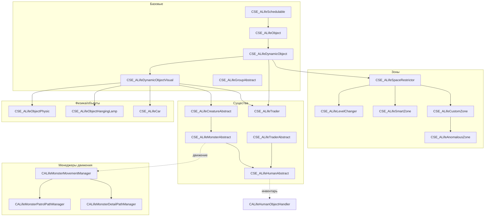

# Abstract-обёртки ALife

> Итерация 6, порцион 30.
> Источники: `src/xrServerEntities/xrServer_Objects_ALife.h` (~670 стр.), `xrServer_Objects_ALife_Monsters.h` (~590 стр.), `src/xrGame/alife_monster_patrol_path_manager.{h,inline.h}` (~100 стр.), `alife_monster_detail_path_manager.{h,inline.h}` (~100 стр.), `alife_monster_movement_manager.{h,inline.h}` (~80 стр.), `alife_human_object_handler.{h,inline.h}` (~60 стр.), `alife_human_object_handler_save.h` (~610 стр.), `alife_human_brain_save.h` (~80 стр.).

## Чего не делает / границы

- **Симулятор** — порц. 28; **регистры** — порц. 29.
- **Менеджеры** (update/interaction/time) — порц. 31–32.
- **Сеть** (`CSE_ALife*`, `net_Spawn`) — ит. 11/12; **Lua API** — ит. 14.
- **Пейтфиндинг** (`level_graph().path`, `CPatrolPath`) — ит. 7.

## 1. Базовые классы (`xrServer_Objects_ALife.h`)

### `CSE_ALifeSchedulable : IPureSchedulableObject`

`m_tpCurrentBestWeapon`, `m_tpBestDetector`, `m_schedule_counter`. Чистые: `tpfGetBestWeapon`, `tfGetActionType`, `bfActive`, `tpfGetBestDetector`. По умолчанию `natural_weapon()`/`natural_detector()` = true.

### `CSE_ALifeGraphPoint : CSE_Abstract`

`m_caConnectionLevelName`, `m_caConnectionPointName`, `m_tLocations[LOCATION_TYPE_COUNT]` — точка, ведущая на другой уровень. `match_configuration` = false.

### `CSE_ALifeObject : CSE_Abstract, CRandom`

| Поле | Назначение |
|------|------------|
| `m_tGraphID` | game-vertex |
| `m_fDistance` | дистанция до игрока |
| `m_bOnline` / `m_bDirectControl` | режим / прямой контроль |
| `m_tNodeID` | узел в level |
| `m_flags` | 13 флагов |
| `m_story_id`, `m_spawn_story_id` | story |

Флаги (`flUseSwitches` … `flCheckForSeparator`, биты 0–12): свитчи online/offline, `flInteractive`, `flVisibleForAI`/`flUsefulForAI`, `flOfflineNoMove`, `flUsedAI_Locations`, `flGroupBehaviour`, `flCanSave`, `flVisibleForMap`, `flUseSmartTerrains`, `flCheckForSeparator`. Геттеры/сеттеры: `used_ai_locations()`, `can_save()`, `can_switch_online/offline()`, `interactive()`, `move_offline()`, `visible_for_map()`, `alife()` (только game), `draw_level_position()`, `keep_saved_data_anyway()`.

### `CSE_ALifeGroupAbstract`

`m_tpMembers` (OBJECT_VECTOR), `m_bCreateSpawnPositions`, `m_wCount`, `m_tNextBirthTime`. Game-методы: `synchronize_location`, `try_switch_online/offline`, `switch_online/offline`, `redundant`.

`CSE_ALifeGroupTemplate<__A>` — миксин-шаблон: склеивает `__A` + `CSE_ALifeGroupAbstract`, делегирует `STATE_Read/Write`, `UPDATE_Read/Write`, `init`, `base`, `cast_abstract/group_abstract`, `switch_online/offline` и т.д. в `inherited1`/`inherited2`.

### `CSE_ALifeDynamicObject : CSE_ALifeObject`

`m_tTimeID`, `m_switch_counter`. Game: `on_spawn`, `on_before_register`, `on_register`, `on_unregister`, `synchronize_location`, `try_switch_online/offline`, `switch_online/offline`, `add_online`, `add_offline(saved_children)`, `redundant`, `attach(item, bALifeRequest, bAddChildren)`, `detach(item, I, bALifeRequest, bRemoveChildren)`, `clear_client_data`, `on_failed_switch_online`.

### `CSE_ALifeDynamicObjectVisual : CSE_ALifeDynamicObject, CSE_Visual`

Пустой миксин: добавляет `visual()` (→ `CSE_Visual`).

### `CSE_ALifePHSkeletonObject : CSE_ALifeDynamicObjectVisual, CSE_PHSkeleton`

`can_save`=true, `used_ai_locations`=false, `load(NET_Packet)`.

### `CSE_ALifeSpaceRestrictor : CSE_ALifeDynamicObject, CSE_Shape`

`m_space_restrictor_type` (u8). `shape()`, `can_switch_offline`=false, `used_ai_locations`=false.

### `CSE_ALifeLevelChanger : CSE_ALifeSpaceRestrictor`

`m_tNextGraphID`, `m_dwNextNodeID`, `m_tNextPosition`, `m_tAngles`, `m_caLevelToChange`, `m_caLevelPointToChange`, `m_bSilentMode`.

### `CSE_ALifeSmartZone : CSE_ALifeSpaceRestrictor, CSE_ALifeSchedulable`

`update()`, `detect_probability()`, `smart_touch(monster)`, `used_ai_locations`=true, `cast_smart_zone`. Game: `bfActive`, `tpfGetBestWeapon`, `tpfGetBestDetector`, `tfGetActionType` + дополнительные `enabled(object)`, `suitable(object)`, `register_npc`, `unregister_npc`, `task(object)`.

### `CSE_ALifeObjectPhysic : CSE_ALifeDynamicObjectVisual, CSE_PHSkeleton`

`type`, `mass`, `fixed_bones`; физ-сеть: `m_u8NumItems`, `freezed`/`prev_freezed`, `State` (SPHNetState); `Net_Relevant`, freeze-таймер.

### `CSE_ALifeObjectHangingLamp : CSE_ALifeDynamicObjectVisual, CSE_PHSkeleton`

Лампа: flags (flPhysic/flCastShadow/flR1/flR2/flTypeSpot/flPointAmbient/flVolumetric), `color`, `brightness`, `color_animator`, `light_texture`, `range`, `m_virtual_size`, `light_ambient_bone`, `light_main_bone`, `fixed_bones`, `spot_cone_angle`, `m_ambient_radius/power/texture`, `m_volumetric_quality/intensity/distance`, `glow_texture/radius`, `m_health`. `validate()`, `on_render`.

### `CSE_ALifeObjectProjector : CSE_ALifeDynamicObjectVisual [, CSE_PHSkeleton]`

Под `PROJECTOR_NEW` — с `CSE_PHSkeleton`, `load`, `can_save`, `data_load/data_save`.

### `CSE_ALifeHelicopter : CSE_ALifeDynamicObjectVisual, CSE_Motion, CSE_PHSkeleton`

`engine_sound`, `can_save`=true, `used_ai_locations`=false, `motion()`.

### `CSE_ALifeCar : CSE_ALifeDynamicObjectVisual, CSE_PHSkeleton`

`door_states` (SDoorState: open_state, health), `wheel_states` (SWheelState: health), `health`; `load`, `can_save`, `data_load/data_save`.

### `CSE_ALifeObjectBreakable : CSE_ALifeDynamicObjectVisual`

`m_health`; `used_ai_locations`=false, `can_switch_offline`=false.

### `CSE_ALifeObjectClimable : CSE_Shape, CSE_ALifeDynamicObject`

`material`; `shape()`, `can_switch_offline`=false, `set_additional_info` (editor).

### `CSE_ALifeMountedWeapon : CSE_ALifeDynamicObjectVisual` — пустой.

### `CSE_ALifeStationaryMgun : CSE_ALifeDynamicObjectVisual [, CSE_PHSkeleton]`

`m_bWorking`, `m_destEnemyDir`; под `STATIONARYMGUN_NEW`: `ammo_type`, `a_elapsed`, `m_barrels` (SBarrel), `get/set_ammo_*`, `load`, `can_save`, `data_load/data_save`.

### `CSE_ALifeTeamBaseZone : CSE_ALifeSpaceRestrictor` — `m_team` (u8).

### `CSE_ALifeInventoryBox : CSE_ALifeDynamicObjectVisual`

`m_can_take`, `m_closed`, `m_tip_text`; game: `add_offline`, `add_online`.

### `SFillPropData` (editor)

`locations[4]`, `level_ids`, `story_names`, `spawn_story_names`, `character_profiles`, `smart_covers`, `location_colors`, `counter`; `load/unload/inc/dec`.

## 2. Монстры и люди (`xrServer_Objects_ALife_Monsters.h`)

### `CSE_ALifeTraderAbstract`

Деньги/характер: `m_dwMoney`, `m_fMaxItemMass`, `m_trader_flags` (eTraderFlagInfiniteAmmo/NightVisionActive/Dummy), `m_community_index`, `m_reputation`, `m_rank`, `m_character_name(_str)`, `m_icon_name`, `m_deadbody_can_take/closed`, `m_sCharacterProfile`, `m_SpecificCharacter`, `m_CheckedCharacters`, `m_DefaultCharacters`. Game: `add_online/offline`, `vfInitInventory`, `spawn_supplies`, relation-методы (`Community`, `Rank`, `Reputation`, `SetRank`).

### `CSE_ALifeTrader : CSE_ALifeDynamicObjectVisual, CSE_ALifeTraderAbstract`

`interactive`=true, `natural_weapon/detector`=false. Game: `dwfGetItemCost`, `spawn_supplies`, `add_online/offline`.

### `CSE_ALifeCustomZone : CSE_ALifeSpaceRestrictor`

`m_tHitType`, `m_owner_id`, `m_enabled_time`, `m_disabled_time`, `m_start_time_shift`.

### `CSE_ALifeAnomalousZone : CSE_ALifeCustomZone`

`m_tpCurrentBestWeapon`, `m_offline_interactive_radius`, `m_artefact_position_offset`, `m_artefact_spawn_count`; `cast_anomalous_zone`, `ef_anomaly/weapon/creature_type`; game: `on_spawn`, `tpfGetBestWeapon`, `tfGetActionType`, `bfActive`, `tpfGetBestDetector`, `keep_saved_data_anyway`.

### `CSE_ALifeTorridZone : CSE_ALifeCustomZone, CSE_Motion` — `motion()`.

### `CSE_ALifeZoneVisual : CSE_ALifeAnomalousZone, CSE_Visual` — `attack_animation`, `visual()`.

### `CSE_ALifeCreatureAbstract : CSE_ALifeDynamicObjectVisual`

`fHealth` (private), `m_killer_id`, `s_team/s_squad/s_group`, `m_fMorale/Accuracy/Intelligence`, `timestamp`, `flags`, `o_model`, `o_torso`, `m_bDeathIsProcessed`, `m_dynamic_out/in_restrictions`, `m_ef_creature/weapon/detector_type`, `m_game_death_time`. Методы: `g_team/squad/group`, `get/set_health`, `get/set_killer_id`, `g_Alive`, `used_ai_locations`, `can_switch_online/offline`, `ef_*`; game: `on_death(killer)`, `on_spawn`.

### `CSE_ALifeMonsterAbstract : CSE_ALifeCreatureAbstract, CSE_ALifeSchedulable, CMovementManagerHolder`

`m_fMaxHealthValue`, `m_fRetreatThreshold`, `m_fEyeRange`, `m_fHitPower`, `m_tHitType`, `m_out/in_space_restrictors`, `m_fpImmunityFactors[eHitTypeMax]`, `m_smart_terrain_id`, `m_task_reached`, `m_rank`, `m_stay_after_death_time_interval`, `m_group_id`. `brain()` → `m_brain` (`CALifeMonsterBrain*`, private, `create_brain()`). Game: `update`, `tpfGetBestWeapon`, `tfGetActionType`, `bfActive`, `tpfGetBestDetector`, `vfDetachAll`, `vfCheckForPopulationChanges`, `add_online/offline`, `on_register/unregister`, `draw_level_position`, `redundant`, `on_location_change`, `get_object`. `kill()`, `has_detector()`.

### `CSE_ALifeCreatureActor : CSE_ALifeCreatureAbstract, CSE_ALifeTraderAbstract, CSE_PHSkeleton`

Физ-сеть: `mstate`, `accel`, `velocity`, `fRadiation`, `weapon`, `m_u16NumItems`, `m_holderID`, `m_AliveState` (SPHNetState), `m_BoneDataSize`, `m_DeadBodyData[1024]`. `can_save`=true, `natural_weapon/detector`=false; game: `spawn_supplies`, `add_online/offline`.

### `CSE_ALifeCreatureCrow`, `CSE_ALifeCreaturePhantom : CSE_ALifeCreatureAbstract`

Пустые; `used_ai_locations`=false.

### `CSE_ALifeMonsterRat : CSE_ALifeMonsterAbstract, CSE_ALifeInventoryItem`

Личные: `fEyeFov/Range`, `fMin/MaxSpeed`, `fAttackSpeed`, `fMaxPursuitRadius`, `fMaxHomeRadius`; мораль: `fMoraleSuccessAttack/Death/Fear/RestoreQuant`, `u16MoraleRestoreTimeInterval`, `fMoraleMin/Max/NormalValue`; атака: `fHitPower`, `u16HitInterval`, `fAttackDistance/Angle`, `fAttackSuccessProbability`. `bfUseful()`, `cast_inventory_item`.

### `CSE_ALifeMonsterZombie : CSE_ALifeMonsterAbstract`

Личные + атака (без морали): `fEyeFov/Range`, `fMin/MaxSpeed`, `fAttackSpeed`, `fMaxPursuitRadius`, `fMaxHomeRadius`, `fHitPower`, `u16HitInterval`, `fAttackDistance/Angle`.

### `CSE_ALifeMonsterBase : CSE_ALifeMonsterAbstract, CSE_PHSkeleton`

`m_spec_object_id`; `load`, `spawn_supplies` (пустые), game: `on_spawn`, `add_online/offline`.

### `CSE_ALifePsyDogPhantom : CSE_ALifeMonsterBase` — `bfActive`=false.

### `CSE_ALifeHumanAbstract : CSE_ALifeTraderAbstract, CSE_ALifeMonsterAbstract`

`brain()` → `m_brain` (`CALifeHumanBrain*`, private, `create_brain()`). `natural_weapon/detector`=false. Game: `update`, `tpfGetBestWeapon`, `bfPerformAttack`, `vfUpdateWeaponAmmo`, `vfProcessItems`, `vfAttachItems`, `tfGetActionType`, `tpfGetBestDetector`, `vfDetachAll`, `spawn_supplies`, `on_register/unregister`, `add_online/offline`.

### `CSE_ALifeHumanStalker : CSE_ALifeHumanAbstract, CSE_PHSkeleton` — `m_start_dialog`, `load`.

### `CSE_ALifeOnlineOfflineGroup : CSE_ALifeDynamicObject, CSE_ALifeSchedulable, CMovementManagerHolder`

`m_members` (associative_vector ID → MEMBER*), `m_brain` (`CALifeOnlineOfflineGroupBrain*`). Game: `get_current_task`, `brain()`, `tpfGetBestWeapon`, `tfGetActionType`, `bfActive`, `tpfGetBestDetector`, `update`, `need_update`, `register/unregister_member`, `notify_on_member_death`, `member(id, no_assert)`, `on_before_register`, `on_after_game_load`, `synchronize_location`, `try_switch_online/offline`, `switch_online/offline`, `redundant`, `on_location_change`, `get_object`, `commander_id`, `squad_members`, `npc_count`, `clear/add_location_type`, `force_change_position`, `on_failed_switch_online`.

## 3. Менеджеры движения монстра

### `CALifeMonsterPatrolPathManager` (`alife_monster_patrol_path_manager.{h,cpp,inline.h}`)

`m_object` (CMovementManagerHolder*), `m_path` (const CPatrolPath*), `m_start_type`/`m_route_type` (enum `PatrolPathManager::`), `m_use_randomness`, `m_start_vertex_index`; состояние: `m_actual`, `m_completed`, `m_current/previous_vertex_index`. Приватные: `select_nearest`, `actualize`, `location_reached`, `navigate`. Публичные: `update`, `path(name)`, `path(CPatrolPath*)`, `path(LPCSTR)`, `start_type/route_type` (get/set), `actual`, `completed`, `start_vertex_index`, `use_randomness`, `target_game/level_vertex_id`, `target_position`. `DECLARE_SCRIPT_REGISTER_FUNCTION`.

### `CALifeMonsterDetailPathManager` (`alife_monster_detail_path_manager.{h,cpp,inline.h}`)

`m_object`, `m_last_update_time`, `m_destination` (game_vertex_id + level_vertex_id + position), `m_walked_distance`, `m_speed`, `m_path` (PATH = xr_vector<u32>, **инвертирован**: старт — последний, финиш — первый; удаление с конца эффективно). Приватные: `actualize`, `setup_current_speed`, `follow_path(dt)`, `update(dt)`. Публичные: `target(game, level, pos)`, `target(game)`, `target(CALifeSmartTerrainTask&)`, `target(CALifeSmartTerrainTask*)`, `update`, `on_switch_online/offline`, `speed` (get/set), `completed`, `actual`, `make_inactual`, `failed`, `path`, `walked_distance`, `draw_level_position`. `DECLARE_SCRIPT_REGISTER_FUNCTION`.

### `CALifeMonsterMovementManager` (`alife_monster_movement_manager.{h,cpp,inline.h}`)

`m_object`, `m_detail` (CALifeMonsterDetailPathManager*), `m_patrol` (CALifeMonsterPatrolPathManager*), `m_path_type` (enum `MovementManager::EPathType`). Публичные: `object`, `detail`, `patrol`, `path_type` (get/set), `update`, `on_switch_online/offline`, `completed`, `actual`. `DECLARE_SCRIPT_REGISTER_FUNCTION`.

## 4. Обработчик человека

### `CALifeHumanObjectHandler` (`alife_human_object_handler.{h,cpp,inline.h}`)

`m_object` (CSE_ALifeHumanAbstract*). Методы: `get_available_ammo_count(weapon, objects/items)`, `attach_available_ammo`, `can_take_item`, `collect_ammo_boxes`, `detach_all(fictitious)`, `update_weapon_ammo`, `process_items`, `best_detector`, `best_weapon`, `choose_equipment/weapon/food/medikit/detector/valuables`, `choose_fast`, `choose_group`, `attach_items`.

Реальные алгоритмы — в `alife_human_object_handler_save.h` (закомментирован): `bfPerformAttack`, `tfGetActionType`, `vfChooseGroup` — в `alife_human_brain_save.h`.

## 5. Связи

## 6. Замечания к плану

- `CSE_ALifeObject` — **13 флагов** (биты 0–12): свитчи, interactive, visible/useful for AI, offline-no-move, used-AI-locations, group-behaviour, can-save, visible-for-map, smart-terrains, check-for-separator.
- `CSE_ALifeDynamicObject` — `attach`/`detach` с `bALifeRequest` и `bAddChildren`/`bRemoveChildren` — управление детьми.
- `CSE_ALifeMonsterAbstract` — `brain()` (`CALifeMonsterBrain*`), `create_brain()`; `CMovementManagerHolder` — держатель movement-менеджера.
- `CSE_ALifeHumanAbstract` — `brain()` (`CALifeHumanBrain*`); `natural_weapon/detector`=false (люди берут оружие).
- `CSE_ALifeOnlineOfflineGroup` — `m_members` (associative_vector), `m_brain` (`CALifeOnlineOfflineGroupBrain*`), `commander_id`, `squad_members`, `npc_count`.
- `CALifeMonsterDetailPathManager` — `m_path` **инвертирован** (старт — последний, финиш — первый).
- `CALifeHumanObjectHandler` — реальные алгоритмы в `*_save.h` (закомментированы).
- `SFillPropData` — editor-данные для fill-пропсов.
- `CSE_ALifeGroupTemplate<__A>` — миксин-шаблон для групп.

## 7. Краткое резюме

Abstract-обёртки ALife — `CSE_ALife*`-классы (`xrServer_Objects_ALife.h`/`_Monsters.h`): базовые (`CSE_ALifeSchedulable`, `CSE_ALifeObject`, `CSE_ALifeGroupAbstract`, `CSE_ALifeDynamicObject`, `CSE_ALifeDynamicObjectVisual`), зоны (`CSE_ALifeSpaceRestrictor`, `CSE_ALifeLevelChanger`, `CSE_ALifeSmartZone`, `CSE_ALifeCustomZone`, `CSE_ALifeAnomalousZone`), существа (`CSE_ALifeCreatureAbstract`, `CSE_ALifeMonsterAbstract`, `CSE_ALifeHumanAbstract`, `CSE_ALifeTrader`, `CSE_ALifeTraderAbstract`), физ-объекты (`CSE_ALifeObjectPhysic`, `CSE_ALifeObjectHangingLamp`, `CSE_ALifeCar`). Менеджеры движения: `CALifeMonsterPatrolPathManager`, `CALifeMonsterDetailPathManager` (инвертированный путь), `CALifeMonsterMovementManager`. Обработчик: `CALifeHumanObjectHandler`.
