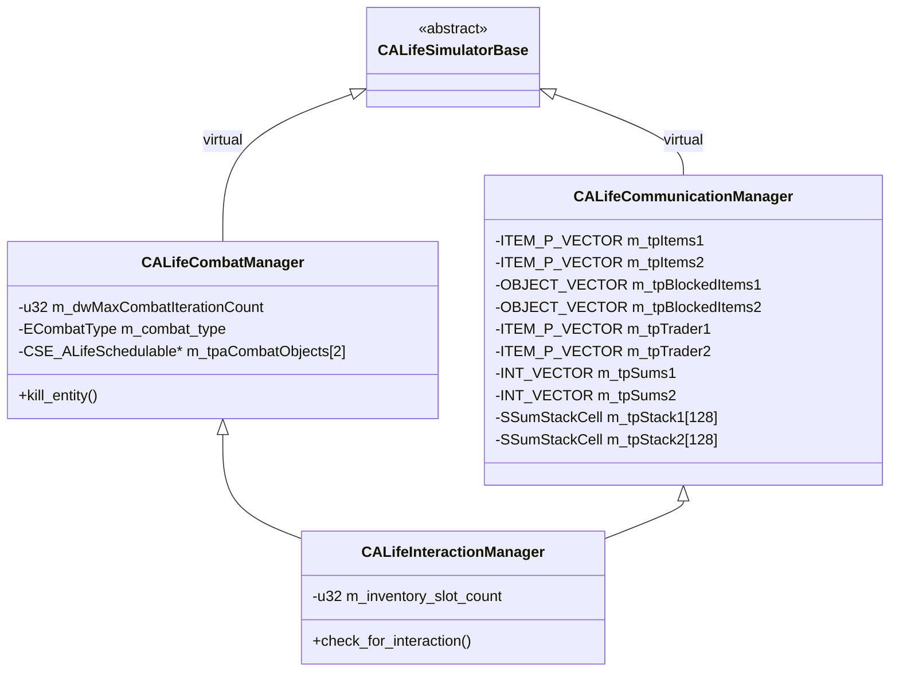

# Combat/communication managers

> Итерация 6, порцион 32.
> Источники: `src/xrGame/alife_combat_manager.{h,cpp,inline.h}` (~110 стр.), `alife_communication_manager.{h,cpp,inline.h}` (~990 стр.), `alife_interaction_manager.{h,cpp,inline.h}` (~240 стр.), `alife_human_object_handler.{h,cpp,inline.h}` (~190 стр.), `ai_sounds.cpp` (~30 стр.).

## Чего не делает / границы

- **Симулятор** (`CALifeSimulatorBase`) — порц. 28; **менеджеры-агрегаторы** (update/switch/surge/storage/time) — порц. 31.
- **Враги** (`CEnemyManager`, `CAgentEnemyManager`) — порц. 23; **память** — порц. 22.
- **Объекты ALife** (`CSE_ALife*`) — порц. 30; **регистры** — порц. 29.
- **Сеть** (`net_Spawn`, `M_CHANGE_LEVEL`) — ит. 11/12.
- **Lua API AI** — ит. 14.

## 1. Иерархия



`CALifeInteractionManager` — конретный класс, объединяющий combat и communication. Наследуется `CALifeSimulatorBase` трижды (через два промежуточных + напрямую) — виртуальное наследование гарантирует один экземпляр базового.

## 2. `CALifeCombatManager` — боевой менеджер

### 2.1. Поля

| Поле | Тип | Назначение |
|------|-----|------------|
| `m_dwMaxCombatIterationCount` | `u32` | Максимум итераций боя (настраивается в ini) |
| `m_combat_type` | `ECombatType` | Текущий тип боя |
| `m_tpaCombatObjects[2]` | `CSE_ALifeSchedulable*` | По одному объекту на сторону (для `vfFinishCombat`) |
| `m_tpaCombatGroups[2]` | `SCHEDULE_P_VECTOR` | По группе объектов на сторону |

### 2.2. Типы боя (`ECombatType`)

| Значение | Означание |
|----------|-----------|
| `eCombatTypeMonsterMonster` | Монстр vs монстр |
| `eCombatTypeMonsterAnomaly` | Монстр vs аномалия |
| `eCombatTypeAnomalyMonster` | Аномалия vs монстр |
| `eCombatTypeSmartTerrain` | Монстр vs smart-зона |

### 2.3. `bfCheckForInteraction` — определение типа и взаимного обнаружения

Вход: два `CSE_ALifeSchedulable`. Алгоритм:

1. Оба не активны → `false`.
2. Оба не монстры → `false`.
3. Один монстр, другой не монстр:
   - Если второй — `CSE_ALifeCustomZone` (аномалия) → `eCombatTypeAnomalyMonster` / `eCombatTypeMonsterAnomaly`.
   - Если второй — `CSE_ALifeSmartZone` → `eCombatTypeSmartTerrain`.
4. Оба монстры:
   - `relation_type()` → `eRelationTypeFriend` и оба `CSE_ALifeHumanAbstract` → **взаимодействие** (торговля), не бой.
   - Иначе → `eCombatTypeMonsterMonster`.
5. `bfCheckObjectDetection(1, 2)` → если обнаружил → `iCombatGroupIndex = 0`.
6. Инверсия типа (monster↔anomaly) для обратного направления.
7. `bfCheckObjectDetection(2, 1)` → если обнаружил:
   - Если уже `iCombatGroupIndex == 0` → `bMutualDetection = true`.
   - Иначе → `iCombatGroupIndex = 1`.
8. `iCombatGroupIndex < 0` → `false` (никто никого не обнаружил).

### 2.4. `bfCheckObjectDetection` — вероятность обнаружения

Использует `ai().ef_storage().alife_evaluation(true)` и паттерн-функции:

| Тип боя | Функция |
|---------|---------|
| `eCombatTypeMonsterMonster` | `m_pfEnemyDetectProbability` |
| `eCombatTypeAnomalyMonster` | `m_pfAnomalyInteractProbability` |
| `eCombatTypeMonsterAnomaly` | `m_pfAnomalyDetectProbability` |
| `eCombatTypeSmartTerrain` | `smart_zone->detect_probability()` (своя вероятность) |

`randF(100) < value` → обнаружил.

### 2.5. `choose_combat_action` — атака или отступление

Для `eCombatTypeMonsterMonster`:

1. Берёт `m_fRetreatThreshold` первого монстра группы как минимальную вероятность победы.
2. Двойной проход по членам группы vs врагам:
   - `m_pfVictoryProbability` → вероятность победы.
   - Если `probability > retreat_threshold` → накапливает произведение вероятностей.
   - Если произведение падает ниже порога → отступление.
3. Если все враги пройдены → `eCombatActionAttack`, иначе → `eCombatActionRetreat`.

Для аномалий: всегда `eCombatActionAttack` для монстра, `eCombatActionRetreat` для аномалии.

### 2.6. `vfPerformAttackAction` — выполнение атаки

Для каждого члена группы:
1. Берёт лучшее оружие (`tpfGetBestWeapon`).
2. `m_pfWeaponAttackTimes` → число выстрелов.
3. Для каждого выстрела:
   - `m_pfWeaponSuccessProbability` → попал?
   - Если попал: случайный враг, `randF(hitPower * 0.5, hitPower * 1.5)` → урон, умноженный на `m_fpImmunityFactors[hitType]`.
   - Если `fHealth <= 0` → удаляет из группы.
4. `bfPerformAttack()` → расход патрона; если нет патрона → стоп.

### 2.7. `vfFinishCombat` — завершение боя

1. Для обеих групп:
   - `vfUpdateWeaponAmmo()` → обновление боезапаса.
   - Для мёртвых: `append_item_vector`, `assign_death_position`, `vfDetachAll`, `register_object`, `kill_entity`.
2. Если есть трофеи и тип боя `eCombatTypeMonsterMonster`:
   - По результату (`ECombatResult`) определяет победителя.
   - Победитель → `vfAttachItems()` (забирает трофеи).

### 2.8. `relation_type`

- Оба `CSE_ALifeTraderAbstract` → `RELATION_REGISTRY().GetRelationBetween()`.
- Иначе: разный `g_team()` → `eRelationTypeEnemy`, одинаковый → `eRelationTypeNeutral`.

## 3. `CALifeCommunicationManager` — торговля

### 3.1. Поля

| Поле | Тип | Назначение |
|------|-----|------------|
| `m_tpItems1/2` | `ITEM_P_VECTOR` | Временные буферы предметов |
| `m_tpBlockedItems1/2` | `OBJECT_VECTOR` | Заблокированные предметы |
| `m_tpTrader1/2` | `ITEM_P_VECTOR` | Векторы торговцев |
| `m_tpSums1/2` | `INT_VECTOR` | Суммы комбинаций |
| `m_tpStack1/2[128]` | `SSumStackCell` | Стопки для генерации сумм |

### 3.2. `vfPerformTrading` — торговля между двумя NPC

Алгоритм:
1. Собирает предметы обоих NPC в `m_tpItems1/2`.
2. Вычисляет `m_dwTotalMoney` (стоимость предметов + деньги).
3. Если у обоих нет денег и ценных предметов → выход.
4. Отделяет всех (`vfDetachAll`).
5. Цикл по 8 типам предметов (пища, оружие, аптечка, детектор, снаряжение):
   - `vfRunFunctionByIndex` → `choose_*` из `brain().objects()`.
   - Если нет конфликтов → `vfAssignItemParents` (привязывает к владельцу).
   - Если конфликты → блокирует предметы, повторяет.
6. `vfAttachOwnerItems` → возвращает предметы владельцам.
7. `bfCheckIfCanNullTradersBalance` → выравнивает баланс (деньги + предметы).
8. Если не удалось → `vfRestoreItems` (откат).
9. `vfAttachGatheredItems` → финальная привязка.

### 3.3. `vfGenerateSums` — генерация сумм комбинаций

Рекурсивный проход по предметам торговца. Для каждого подмножества вычисляет сумму стоимости. Останавливается при `SUM_COUNT_THRESHOLD = 30`. Использует сток `SSumStackCell` (i1, i2, iCurrentSum).

### 3.4. `bfGetItemIndexes` — поиск индексов для суммы

По заданной сумме `iSum1` ищет подмножество предметов, дающих эту сумму. Возвращает индексы в `tpIndexes`.

### 3.5. `bfCheckForInventoryCapacity` — проверка вместимости

1. Временно переносит предметы между `children`.
2. `can_take_item(0)` для обоих.
3. Если не влезает → откат.
4. Если влезает → переводит деньги (разница сумм).

### 3.6. `bfCheckForTrade` — поиск удачной сделки

Двойной проход по `tpSums1` и `tpSums2`:
- Ищет пару сумм, где баланс можно выравнять деньгами.
- Условие: `sum1 + money1 >= balance` и `sum1 - sum2 - balance <= money2`.
- Если нашлась → `bfCheckForInventoryCapacity` с конкретными индексами.

### 3.7. `bfCheckIfCanNullTradersBalance` — выравнивание баланса

1. Если баланс = 0 → `true`.
2. Если баланс < 0 и у первого достаточно денег → перевод денег.
3. Если баланс > 0 и у второго достаточно денег → перевод денег.
4. Иначе → генерирует суммы (`vfGenerateSums`) и ищет сделку (`bfCheckForTrade`).

## 4. `CALifeInteractionManager` — точка входа

### 4.1. `check_for_interaction`

Вызывается из `CALifeUpdateManager::update_switch()` для каждого объекта на graph-точке.

1. `vfFillCombatGroup(object, 0)` → заполняет группу 0.
2. `graph().iterate_objects(graphID, CCheckForInteractionPredicate)` → обход всех объектов на точке.
3. Для каждого другого объекта:
   - `bfCheckForInteraction(0, 1)` → тип и обнаружение.
   - `vfFillCombatGroup(1, 1)` → заполняет группу 1.
   - `tfGetActionType` → тип действия:
     - `eMeetActionTypeAttack` → цикл боя (до `2 * m_dwMaxCombatIterationCount` итераций).
     - `eMeetActionTypeInteract` → `vfPerformCommunication()`.
     - `eMeetActionTypeIgnore` → выход.
     - `eMeetActionSmartTerrain` → `smart_zone->smart_touch(monster)`.

### 4.2. Цикл боя

```
for i in 0..2*maxIterations:
    action = choose_combat_action(groupIndex)
    if action == ATTACK:
        vfPerformAttackAction(groupIndex)
    else:
        if bfCheckIfRetreated(groupIndex):
            result = RETREAT
            break
    groupIndex ^= 1
    if group[groupIndex].empty():
        result = KILL
        break
vfFinishCombat(result)
```

## 5. `CALifeHumanObjectHandler` — обработчик предметов

### 5.1. Поля

| Поле | Тип | Назначение |
|------|-----|------------|
| `m_object` | `CSE_ALifeHumanAbstract*` | Указатель на NPC |

### 5.2. Методы

| Метод | Назначение |
|-------|------------|
| `get_available_ammo_count` | Счёт доступных патронов (возвращает 0 — заглушка) |
| `attach_available_ammo` | Прикрепить патроны (заглушка) |
| `can_take_item` | Можно ли взять предмет (возвращает false) |
| `collect_ammo_boxes` | Собрать коробки с патронами (заглушка) |
| `choose_equipment` | Выбрать снаряжение (возвращает -1) |
| `choose_weapon` | Выбрать оружие по приоритету (возвращает -1) |
| `choose_food` | Выбрать еду (возвращает -1) |
| `choose_medikit` | Выбрать аптечку (возвращает -1) |
| `choose_detector` | Выбрать детектор (возвращает -1) |
| `choose_valuables` | Выбрать ценные предметы (возвращает -1) |
| `choose_fast` | Быстрый выбор (возвращает false) |
| `choose_group` | Выбрать группу (заглушка) |
| `detach_all` | Отделить все предметы (заглушка) |
| `update_weapon_ammo` | Обновить боезапас (заглушка) |
| `process_items` | Обработать предметы (заглушка) |
| `best_detector` | Лучший детектор (возвращает 0) |
| `best_weapon` | Лучшее оружие (возвращает 0) |
| `attach_items` | Прикрепить предметы (заглушка) |

**Важно**: все методы — заглушки. Реальная логика в `brain().objects()` (порц. 12).

## 6. `ai_sounds` — типы звуков

Таблица `anomaly_type_token` — 22 типа звуков:

| Тип | Назначение |
|-----|------------|
| `SOUND_TYPE_ITEM_PICKING_UP` | Подбор предмета |
| `SOUND_TYPE_ITEM_DROPPING` | Бросание предмета |
| `SOUND_TYPE_ITEM_TAKING` | Захват предмета |
| `SOUND_TYPE_ITEM_HIDING` | Скрытие предмета |
| `SOUND_TYPE_ITEM_USING` | Использование предмета |
| `SOUND_TYPE_WEAPON_SHOOTING` | Выстрел |
| `SOUND_TYPE_WEAPON_EMPTY_CLICKING` | Пустой выстрел |
| `SOUND_TYPE_WEAPON_BULLET_HIT` | Попадание пули |
| `SOUND_TYPE_WEAPON_RECHARGING` | Перезарядка |
| `SOUND_TYPE_MONSTER_DYING` | Смерть NPC |
| `SOUND_TYPE_MONSTER_INJURING` | Ранение NPC |
| `SOUND_TYPE_MONSTER_STEP` | Шаг NPC |
| `SOUND_TYPE_MONSTER_TALKING` | Речь NPC |
| `SOUND_TYPE_MONSTER_ATTACKING` | Атака NPC |
| `SOUND_TYPE_MONSTER_EATING` | Еда NPC |
| `SOUND_TYPE_ANOMALY_IDLE` | Аномалия в покое |
| `SOUND_TYPE_WORLD_OBJECT_BREAKING` | Разрушение объекта |
| `SOUND_TYPE_WORLD_OBJECT_COLLIDING` | Столкновение |
| `SOUND_TYPE_WORLD_OBJECT_EXPLODING` | Взрыв |
| `SOUND_TYPE_WORLD_AMBIENT` | Фоновый звук |

## Связи

- `CALifeSimulatorBase` (порц. 28) — базовый класс.
- `CALifeUpdateManager::update_switch()` (порц. 31) → `check_for_interaction()`.
- `CSE_ALifeMonsterAbstract::tfGetActionType()` (порц. 30) — тип действия.
- `ai().ef_storage().alife_evaluation(true)` — паттерн-функции (ит. 5).
- `RELATION_REGISTRY()` (порц. 27) — отношения.
- `brain().objects()` (порц. 12) — выбор предметов.
- `CSE_ALifeSmartZone::smart_touch()` (порц. 30) — smart-зона.

## Замечания к плану

1. **`CALifeCombatManager` и `CALifeCommunicationManager`** — виртуальные базовые, не используются напрямую. Реальный класс — `CALifeInteractionManager`.
2. **`CALifeHumanObjectHandler`** — все методы заглушки. Реальная логика в `brain().objects()`.
3. **Торговля** — сложный алгоритм с генерацией сумм и поиском подмножеств. Оптимизация `FAST_OWNERSHIP` упрощает перенос предметов.
4. **Бой** — вероятностный, использует паттерн-функции. Максимум итераций ограничивает время расчёта.

## Краткое резюме

- **Иерархия**: `CALifeSimulatorBase` → `CALifeCombatManager` + `CALifeCommunicationManager` → `CALifeInteractionManager`.
- **`CALifeCombatManager`** — вероятностный бой: обнаружение, атака/отступление, урон, трофеи.
- **`CALifeCommunicationManager`** — торговля: генерация сумм, поиск подмножеств, выравнивание баланса.
- **`CALifeInteractionManager`** — точка входа: `check_for_interaction()` → бой или взаимодействие.
- **`CALifeHumanObjectHandler`** — заглушка, реальная логика в `brain().objects()`.
- **`ai_sounds`** — 22 типа звуков для NPC и мира.

---
Порцион 32 (итерация 6). Далее: порц. 33 — [index.md](index.md).
