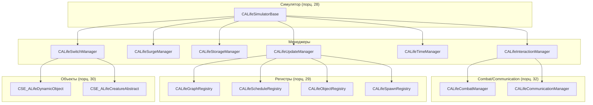

# Менеджеры ALife

> Итерация 6, порцион 31.
> Источники: `src/xrGame/alife_update_manager.{h,cpp,inline.h}` (~700 стр.), `alife_switch_manager.{h,cpp,inline.h}` (~300 стр.), `alife_surge_manager.{h,cpp,inline.h}` (~110 стр.), `alife_storage_manager.{h,cpp,inline.h}` (~300 стр.), `alife_time_manager.{h,cpp,inline.h}` (~100 стр.), `alife_interaction_manager.{h,cpp,inline.h}` (~40 стр.).

## Чего не делает / границы

- **Симулятор** (`CALifeSimulatorBase`) — порц. 28; **регистры** — порц. 29.
- **Combat/communication** — порц. 32.
- **Сеть** (`net_Spawn`, `M_CHANGE_LEVEL`) — ит. 11/12.

## 1. Иерархия

```
CALifeSimulatorBase (порц. 28)
├── CALifeSwitchManager (вирт.)
├── CALifeSurgeManager (вирт.)
├── CALifeStorageManager (вирт.)
│   └── CALifeUpdateManager (конкретный, ISheduled)
└── CALifeInteractionManager (вирт.)
    ├── CALifeCombatManager (порц. 32)
    └── CALifeCommunicationManager (порц. 32)
```

`CALifeUpdateManager` — единственный конкретный менеджер; он **агрегирует** switch/surge/storage через множественное наследование и реализует `ISheduled` (shedule_Update).

## 2. `CALifeTimeManager`

`m_game_time`, `m_time_factor`, `m_normal_time_factor`, `m_start_time`, `m_start_game_time`.

- `init(section)` — читает `start_time` (HH:MM:SS), `start_date` (DD.MM.YYYY), `time_factor`, `normal_time_factor`; `m_start_game_time = generate_time(...)`.
- `game_time()` = `m_game_time + time_factor * (Device.dwTimeGlobal - m_start_time)` — **текущее игровое время** (ускоренное).
- `set_time_factor` — сброс `m_game_time` к текущему, `m_start_time` к текущему.
- `change_game_time(value)` — сдвиг `m_game_time`.
- `save/load` — чанк `GAME_TIME_CHUNK_DATA`.

## 3. `CALifeSwitchManager` (вирт.)

`m_switch_distance`, `m_switch_factor`, `m_online_distance`, `m_offline_distance`, `m_saved_chidren`.

**Расчёт дистанций** (`set_switch_distance`):
- `m_online_distance = switch_distance * (1 - switch_factor)`
- `m_offline_distance = switch_distance * (1 + switch_factor)`

**`switch_object(I)`** — главный цикл:
1. Если `I->redundant()` → `release(I)`.
2. Если `!synchronize_location(I)` → return.
3. Если `I->m_bOnline` → `try_switch_offline(I)`, иначе → `try_switch_online(I)`.
4. Если `I->redundant()` → `release(I)`.

**`synchronize_location(I)`**:
- Если `!I->used_ai_locations()` → true.
- Если `I->ID_Parent != 0xffff` (прикреплён) → true.
- Если `!I->m_bOnline && !level_graph().valid_vertex_id(I->m_tNodeID)` → true.
- Иначе → `I->synchronize_location()`.

**`try_switch_online(I)`**:
- Если `I->ID_Parent != 0xffff` (прикреплён) → return (не переключаем).
- `I->try_switch_online()`.
- Если `!I->m_bOnline && !I->keep_saved_data_anyway()` → `I->clear_client_data()`.

**`try_switch_offline(I)`**:
- Если `I->ID_Parent != 0xffff` → return.
- `I->try_switch_offline()`.

**`add_online(object, update_registries)`**:
- `object->m_bOnline = true`.
- `server().entity_Destroy(l_tpAbstract)`.
- `object->s_flags.or(M_SPAWN_UPDATE)`.
- `server().Process_spawn(tNetPacket, clientID, FALSE, l_tpAbstract)`.
- `object->s_flags.and(u16(-1) ^ M_SPAWN_UPDATE)`.
- `object->add_online(update_registries)`.

**`remove_online(object, update_registries)`**:
- `object->m_bOnline = false`.
- Сохраняет `object->children` в `m_saved_chidren`.
- Удаляет из `m_saved_chidren` тех, у кого `m_bALifeControl == false` (client-only дети).
- `server().Perform_destroy(object, net_flags(TRUE,TRUE))`.
- `object->ID = server().PerformIDgen(object_id)` — **новый ID**.
- `object->add_offline(m_saved_chidren, update_registries)`.

## 4. `CALifeSurgeManager` (вирт.)

`m_temp_spawns`, `m_temp_spawned_objects`.

- `spawn_new_objects()`:
  1. `fill_spawned_objects()` — собирает `m_temp_spawned_objects` (spawn-типы уже в `objects()`).
  2. `spawns().fill_new_spawns(m_temp_spawns, time_manager().game_time(), m_temp_spawned_objects)` — заполняет `m_temp_spawns` (новые spawn-типы).
  3. `spawn_new_spawns()` — для каждого `m_temp_spawns` → `create(object, spawn, *I)`.

## 5. `CALifeStorageManager` (вирт.)

`m_save_name`, `m_section`.

- `save(save_name, update_name)`:
  1. `header().save(stream)`, `time_manager().save(stream)`, `spawns().save(stream)`, `objects().save(stream)`, `registry().save(stream)`.
  2. Сжатие `rtc_compress`.
  3. Запись в файл `$game_saves$/save_name`.
- `load(save_name)`:
  1. Чтение файла, `rtc_decompress`.
  2. `header().load`, `time_manager().load`, `spawns().load`, `graph().on_load()`, `objects().load`.
  3. `can_register_objects(false)` → регенерация ID (`server().PerformIDgen`) → `register_object`.
  4. `registry().load`, `can_register_objects(true)` → `on_register()` для всех.
  5. `groups().on_after_game_load()`.
- `save(NET_Packet&)` — сетевой save (через `prepare_objects_for_save`).
- `prepare_objects_for_save()` — `Level().ClientSend()`, `Level().ClientSave()`.

## 6. `CALifeUpdateManager` (конкретный)

Наследует `CALifeSwitchManager`, `CALifeSurgeManager`, `CALifeStorageManager`, `ISheduled`.

`m_first_time`, `m_max_process_time`, `m_update_monster_factor`, `m_objects_per_update`, `m_changing_level`.

**Конструктор**: читает `schedule_min`, `schedule_max`, `process_time`, `update_monster_factor`, `objects_per_update`; `shedule_register()`.

**`shedule_Update(dt)`**:
- `ISheduled::shedule_Update(dt)`.
- Если `!initialized()` → return.
- Если `!m_first_time && g_mt_config.test(mtALife)` → `Device.seqParallel.push_back(update)` (параллельный вызов).
- `m_first_time = false`.
- `update()`.

**`update()`**:
1. `update_switch()`.
2. `update_scheduled(false)`.

**`update_switch()`**:
- `init_ef_storage()`.
- `graph().level().update(CSwitchPredicate(this), Device.dwPrecacheFrame > 0)` — **обход level-граф-точки**, для каждой вызывает `switch_object`.

**`update_scheduled(init_ef)`**:
- Если `init_ef` → `init_ef_storage()`.
- `scheduled().update()` — **scheduled-объекты** (порц. 29).

**`new_game(save_name)`**:
- `unload()`, `reload(m_section)`.
- `spawns().load(save_name)`, `graph().on_load()`.
- `server().PerformIDgen(0x0000)`.
- `time_manager().init(m_section)`.
- `can_register_objects(false)` → `spawn_new_objects()` → `can_register_objects(true)`.
- `on_register()` для всех объектов.

**`load(game_name, no_assert, new_only)`**:
- Если `new_only || !CALifeStorageManager::load(game_name)` → `new_game(game_name)`.
- `Level().OnAlifeSimulatorLoaded()`.

**`change_level(net_packet)`**:
- Если `m_changing_level` → false.
- Lua-кабэк `_G.CALifeUpdateManager__on_before_change_level`.
- `Level().ClientSend()`.
- `m_changing_level = true`.
- Сохраняет safe-позицию актёра.
- `net_packet.r(...)` — читает новую позицию.
- `Level().ClientSave()`.
- Если актёр прикреплён → переносит holder.
- `save(autoave_name)` — **autosave**.
- Восстанавливает safe-позицию.

**`teleport_object(id, game_vertex_id, level_vertex_id, position)`**:
- Если `object->m_bOnline` → `switch_offline(object)`.
- `graph().change(object, object->m_tGraphID, game_vertex_id)`.
- `object->m_tNodeID = level_vertex_id`, `object->o_Position = position`.
- Если monster → `monster_abstract->m_tNextGraphID = object->m_tGraphID`.

**`add_restriction/remove_restriction/remove_all_restrictions`**:
- Управление `m_dynamic_out_restrictions` / `m_dynamic_in_restrictions` (порц. 30).

## 7. `CALifeInteractionManager` (вирт.)

Наследует `CALifeCombatManager`, `CALifeCommunicationManager` (порц. 32). Пустой миксин.

## 8. Связи



## 9. Замечания к плану

- **`CALifeUpdateManager`** — единственный конкретный менеджер; агрегирует switch/surge/storage через множественное наследование.
- **`shedule_Update`** — вызывается из shedule-системы; `mtALife` → параллельный вызов через `Device.seqParallel`.
- **`update_switch`** — обход level-граф-точки через `CSwitchPredicate`; для каждой точки → `switch_object`.
- **`update_scheduled`** — обновление scheduled-объектов (порц. 29).
- **`switch_object`** — главный цикл: redundant → synchronize_location → try_switch_online/offline → redundant.
- **`add_online`/`remove_online`** — спавн/дестрой через `server()`; `remove_online` регенерирует ID.
- **`change_level`** — autosave + перенос актёра.
- **`teleport_object`** — смена graph-точки + позиция; если monster → `m_tNextGraphID`.
- **`CALifeTimeManager`** — ускоренное игровое время (`time_factor`).
- **`CALifeStorageManager`** — save/load с сжатием `rtc_compress`.

## 10. Краткое резюме

Менеджеры ALife: `CALifeTimeManager` (игровое время), `CALifeSwitchManager` (online/offline), `CALifeSurgeManager` (spawn), `CALifeStorageManager` (save/load), `CALifeUpdateManager` (агрегатор, shedule), `CALifeInteractionManager` (combat/communication). `CALifeUpdateManager::update()` → `update_switch()` + `update_scheduled()`. `switch_object` — главный цикл переключения online/offline. `change_level` — autosave + перенос актёра.
