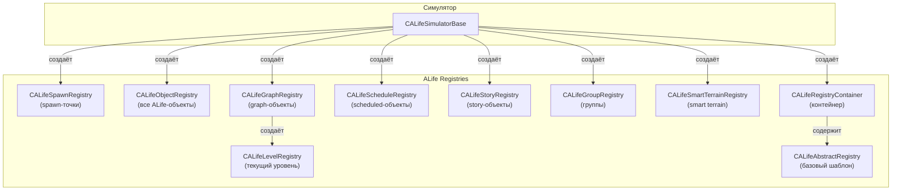

# Регистры ALife

> Итерация 6, порцион 29.
> Источники: `src/xrGame/alife_spawn_registry.{h,cpp,inline.h,spawn.cpp,header.*}` (~600 стр.), `src/xrGame/alife_object_registry.{h,cpp,inline.h}` (~220 стр.), `src/xrGame/alife_graph_registry.{h,cpp,inline.h}` (~350 стр.), `src/xrGame/alife_level_registry.{h,inline.h}` (~100 стр.), `src/xrGame/alife_schedule_registry.{h,cpp,inline.h}` (~150 стр.), `src/xrGame/alife_story_registry.{h,cpp,inline.h}` (~90 стр.), `src/xrGame/alife_group_registry.{h,cpp,inline.h}` (~80 стр.), `src/xrGame/alife_smart_terrain_registry.{h,cpp,inline.h}` (~80 стр.), `src/xrGame/alife_abstract_registry.{h,inline.h}` (~120 стр.), `src/xrGame/alife_registry_container.{h,cpp,inline.h}` (~150 стр.).

## Чего не делает / границы

- **Симулятор** — порц. 28.
- **Abstract-обёртки** (`CSE_ALife*`) — порц. 30.
- **Менеджеры** (update/interaction/time) — порц. 31–32.
- **Lua API** — ит. 14.
- **Сеть** — ит. 11/12.

## 1. `CALifeSpawnRegistry` — spawn-точки

Наследует `CRandom`. Хранит граф spawn-точек и артефактные позиции.

| Поле | Тип | Назначение |
|------|-----|------------|
| `m_header` | `CALifeSpawnHeader` | Версия, GUID, count |
| `m_spawns` | `SPAWN_GRAPH` | Граф spawn-точек |
| `m_artefact_spawn_positions` | `ARTEFACT_SPAWNS` | Позиции артефактов |
| `m_spawn_name` | `shared_str` | Имя spawn-файла |
| `m_spawn_roots` | `SPAWN_IDS` | Корневые spawn-точки |
| `m_spawn_story_ids` | `SPAWN_STORY_IDS` | Story-спавны |
| `m_file` | `IReader*` | Файл spawn |
| `m_chunk` | `IReader*` | Чанк |
| `m_game_graph` | `CGameGraph*` | Game graph |

**`CALifeSpawnHeader`:**
| Поле | Тип | Назначение |
|------|-----|------------|
| `m_version` | `u32` | Версия |
| `m_guid` | `xrGUID` | GUID spawn |
| `m_graph_guid` | `xrGUID` | GUID graph |
| `m_count` | `u32` | Количество |
| `m_level_count` | `u32` | Количество уровней |

**`load(file_stream, game_name)`:**
1. `find_chunk(SPAWN_CHUNK_DATA)`.
2. Чанк 0: `m_spawn_name`, `guid`.
3. `FS.r_open("$game_spawn$/m_spawn_name.spawn")`.
4. `load(*m_file, &guid)`.

**`load(file_stream, save_guid)`:**
1. Чанк 0: `m_header.load`.
2. `VERIFY(*save_guid == header().guid())`.
3. Чанк 1: `m_spawns.load`.
4. Чанк 2: `m_artefact_spawn_positions`.
5. Чанк 3: `ai().patrol_path_storage`.
6. Чанк 4: `m_game_graph = xr_new<CGameGraph>`, `ai().game_graph(m_game_graph)`.
7. `build_story_spawns()`, `build_root_spawns()`.

**`build_root_spawns()`:**
1. `m_temp0` — все vertex_id.
2. `m_temp1` — все edge vertex_id.
3. `process_spawns` (sort + unique).
4. `m_spawn_roots` — `set_difference(m_temp0, m_temp1)`.

**`build_story_spawns()`:**
1. Для каждого vertex: если `m_spawn_story_id != INVALID_SPAWN_STORY_ID` — `m_spawn_story_ids.insert`.

**`fill_new_spawns(spawns, game_time, objects)`:**
1. `process_spawns(objects)`.
2. Для каждого `m_spawn_roots` — `fill_new_spawns(vertex, spawns, game_time, objects)`.
3. `process_spawns(spawns)`.

**`fill_new_spawns(vertex, spawns, game_time, objects)`:**
1. `VERIFY(vertex)`.
2. `if (!can_spawn(vertex->data()->object(), game_time, objects)) return`.
3. Если `edges().empty()` — `spawns.push_back(vertex->data()->object().m_tSpawnID)`, return.
4. Если `flSpawnSingleItemOnly` — `fill_new_spawns_single(vertex, spawns, game_time, objects)`, return.
5. Для каждого edge: `if (randF(1.f) < (*I).weight())` — `fill_new_spawns(m_spawns.vertex((*I).vertex_id()), spawns, game_time, objects)`.

**`fill_new_spawns_single(vertex, spawns, game_time, objects)`:**
1. Если `flSpawnIfDestroyedOnly` и `spawned_item(vertex, objects)` — return.
2. `accumulator = sum(edge weights)`.
3. `probability = randF(accumulator)`.
4. `group_probability = 1.f`.
5. `if (probability >= accumulator * group_probability) return`.
6. Для каждого edge: `accumulator += (*I).weight() * group_probability`. `if (accumulator > probability)` — `fill_new_spawns(m_spawns.vertex((*I).vertex_id()), spawns, game_time, objects)`, return.

**`can_spawn(abstract, game_time, objects)`:**
```
return (
    enabled_spawn(abstract) &&
    !count_limit(abstract) &&
    !time_limit(abstract, game_time) &&
    !object_existance_limit(abstract, objects)
);
```

**`enabled_spawn(abstract)`:** `return (!!abstract.m_spawn_flags.is(CSE_Abstract::flSpawnEnabled))`.

**`count_limit(abstract)`:** `if (!!abstract.m_spawn_flags.is(CSE_Abstract::flSpawnInfiniteCount)) return (false); return (true);`.

**`time_limit(abstract, game_time)`:** `if (!!abstract.m_spawn_flags.is(CSE_Abstract::flSpawnOnSurgeOnly)) return (false); return (true);`.

**`spawned_item(abstract, objects)`:** `I = lower_bound(objects, abstract.m_tSpawnID); return ((I != objects.end()) && (*I == abstract.m_tSpawnID))`.

**`spawned_item(vertex, objects)`:** Если `edges().empty()` — `spawned_item(vertex->data()->object(), objects)`. Иначе — рекурсивно по edges.

**`object_existance_limit(abstract, objects)`:** `if (!abstract.m_spawn_flags.is(CSE_Abstract::flSpawnIfDestroyedOnly)) return (false); if (spawned_item(abstract, objects)) return (true); return (false);`.

**`assign_artefact_position(anomaly, object)`:**
1. `object->m_tGraphID = anomaly->m_tGraphID`.
2. `VERIFY(anomaly->m_artefact_spawn_count)`.
3. `index = anomaly->m_artefact_position_offset + anomaly->randI(anomaly->m_artefact_spawn_count)`.
4. `object->o_Position = m_artefact_spawn_positions[index].level_point()`.
5. `object->m_tNodeID = m_artefact_spawn_positions[index].level_vertex_id()`.
6. `object->m_fDistance = m_artefact_spawn_positions[index].distance()`.

**`spawn_id(spawn_story_id)`:** `VERIFY(I != m_spawn_story_ids.end()); return ((*I).second);`.

## 2. `CALifeObjectRegistry` — все ALife-объекты

Хранит все ALife-объекты по ID.

| Поле | Тип | Назначение |
|------|-----|------------|
| `m_objects` | `OBJECT_REGISTRY` | `xr_map<ALife::_OBJECT_ID, CSE_ALifeDynamicObject*>` |
| `max_id` | `ALife::_OBJECT_ID` | Максимальный ID |

**`add(object)`:**
1. `if (objects().find(object->ID) != objects().end())` — THROW.
2. `m_objects.insert(std::make_pair(object->ID, object))`.

**`remove(id, no_assert)`:**
1. `I = m_objects.find(id)`.
2. `if (I == m_objects.end())` — THROW.
3. `m_objects.erase(I)`.

**`object(id, no_assert)`:**
1. `I = objects().find(id)`.
2. `if (objects().end() == I)` — THROW.
3. `return ((*I).second)`.

**`save(memory_stream)`:**
1. `open_chunk(OBJECT_CHUNK_DATA)`.
2. `w_u32(u32(-1))` (placeholder).
3. Для каждого объекта: `if (!can_save()) continue; if (redundant()) continue; if (ID_Parent != 0xffff) continue;` — `save(memory_stream, object, object_count)`.
4. Запись `object_count`.
5. `close_chunk()`.

**`save(memory_stream, object, object_count)`:**
1. `++object_count`.
2. `Spawn_Write` — `w_u16(count)`, `w(data)`.
3. `UPDATE_Write` — `w_u16(count)`, `w(data)`.
4. Для каждого `children`: `if (!child->can_save()) continue;` — `save(memory_stream, child, object_count)`.

**`get_object(file_stream)`:**
1. `tNetPacket.B.count = file_stream.r_u16()`.
2. `file_stream.r(tNetPacket.B.data, tNetPacket.B.count)`.
3. `R_ASSERT(M_SPAWN == u_id)`.
4. `r_stringZ(s_name)`.
5. `F_entity_Create(s_name)`.
6. `Spawn_Read(tNetPacket)`.
7. `tNetPacket.B.count = file_stream.r_u16()`.
8. `file_stream.r(tNetPacket.B.data, tNetPacket.B.count)`.
9. `R_ASSERT(M_UPDATE == u_id)`.
10. `UPDATE_Read(tNetPacket)`.
11. `return tpALifeDynamicObject`.

**`load(file_stream)`:**
1. `find_chunk(OBJECT_CHUNK_DATA)`.
2. `m_objects.clear()`.
3. `count = file_stream.r_u32()`.
4. Для каждого: `tpSE_Abstract = get_object(file_stream); if (!tpSE_Abstract) continue; add(tpSE_Abstract);`.

## 3. `CALifeGraphRegistry` — graph-объекты

Хранит объекты по graph-точкам и текущий уровень.

| Поле | Тип | Назначение |
|------|-----|------------|
| `m_objects` | `GRAPH_REGISTRY` | `xr_vector<CGraphPointInfo>` |
| `m_terrain` | `TERRAIN_REGISTRY` | `[GameGraph::LOCATION_TYPE_COUNT][GameGraph::LOCATION_COUNT]` |
| `m_level` | `CALifeLevelRegistry*` | Текущий уровень |
| `m_actor` | `CSE_ALifeCreatureActor*` | Актор |
| `m_process_time` | `float` | Время обработки |
| `m_temp` | `xr_vector<CSE_ALifeDynamicObject*>` | Temp |

**`on_load()`:**
1. Для каждого `LOCATION_TYPE_COUNT`, `LOCATION_COUNT`: `m_terrain[i][j].clear()`.
2. Для каждого vertex: `m_terrain[i][ai().game_graph().vertex(j)->vertex_type()[i]].push_back(j)`.
3. `m_objects.resize(ai().game_graph().header().vertex_count())`.
4. Для каждого `m_objects`: `(*I).objects().clear()`.

**`update(object)`:**
1. `if (!object->m_bDirectControl) return`.
2. `if (object->s_flags.is(M_SPAWN_OBJECT_ASPLAYER))` — `m_actor = smart_cast<CSE_ALifeCreatureActor*>(object)`.
3. `if (m_actor && !m_level)` — `setup_current_level()`.
4. `if (!item || !item->attached())` — `add(object, object->m_tGraphID)`.

**`setup_current_level()`:**
1. `m_level = xr_new<CALifeLevelRegistry>(ai().game_graph().vertex(actor()->m_tGraphID)->level_id())`.
2. `level().set_process_time(m_process_time)`.
3. Для каждого vertex: `if (ai().game_graph().vertex(i)->level_id() == level().level_id())` — `level().add((*I).second)`.
4. Для каждого `m_temp`: `level().add(*I)`, `m_temp.clear()`.
5. `id = pApp->Level_ID(*(*I).second.name(), "1.0", true)`.
6. `VERIFY(id >= 0)`.
7. `ai().load(*(*I).second.name())`.

**`add(object, game_vertex_id, update)`:**
1. `if (!object->m_bOnline && object->used_ai_locations())` — `m_objects[game_vertex_id].objects().add(object->ID, object)`, `object->m_tGraphID = game_vertex_id`.
2. `else if (!m_level && update)` — `m_temp.push_back(object)`, `object->m_tGraphID = game_vertex_id`.
3. `if (update && m_level && ai().game_graph().valid_vertex_id(game_vertex_id))` — `level().add(object)`.

**`remove(object, game_vertex_id, update)`:**
1. `if (object->used_ai_locations())` — `m_objects[game_vertex_id].objects().remove(object->ID)`.
2. `if (update && m_level)` — `level().remove(object, ai().game_graph().vertex(game_vertex_id)->level_id() != level().level_id())`.

**`change(object, game_vertex_id, next_game_vertex_id)`:**
1. `VERIFY(object->used_ai_locations())`.
2. `remove(object, game_vertex_id)`.
3. `add(object, next_game_vertex_id)`.
4. `object->m_tGraphID = next_game_vertex_id`.
5. `object->o_Position = ai().game_graph().vertex(object->m_tGraphID)->level_point()`.
6. `object->m_tNodeID = ai().game_graph().vertex(object->m_tGraphID)->level_vertex_id()`.

**`assign(monster)`:**
1. `monster->m_tNextGraphID = monster->m_tPrevGraphID = monster->m_tGraphID`.
2. `monster->m_fDistanceToPoint = monster->m_fDistance`.
3. Для каждого edge: `if ((*i).distance() > monster->m_fDistance)` — `monster->m_fDistanceFromPoint = (*i).distance() - monster->m_fDistance`, break.

**`attach(object, item, game_vertex_id, alife_query, add_children)`:**
1. `if (alife_query)` — `remove(smart_cast<CSE_ALifeDynamicObject*>(item), game_vertex_id)`.
2. `else` — `level().remove(smart_cast<CSE_ALifeDynamicObject*>(item))`.
3. `dynamic_object->attach(item, alife_query, add_children)`.

**`detach(object, item, game_vertex_id, alife_query, remove_children)`:**
1. `if (alife_query)` — `add(smart_cast<CSE_ALifeDynamicObject*>(item), game_vertex_id)`.
2. `else` — `object->m_tGraphID = game_vertex_id`, `level().add(object)`.
3. `dynamic_object->detach(item, 0, alife_query, remove_children)`.

## 4. `CALifeLevelRegistry` — текущий уровень

Наследует `CSafeMapIterator<ALife::_OBJECT_ID, CSE_ALifeDynamicObject>`.

| Поле | Тип | Назначение |
|------|-----|------------|
| `m_level_id` | `GameGraph::_LEVEL_ID` | ID уровня |

**`add(object)`:**
1. `if (ai().game_graph().vertex(object->m_tGraphID)->level_id() != level_id()) return`.
2. `inherited::add(object->ID, object)`.

**`remove(object, no_assert)`:**
1. `inherited::remove(object->ID, no_assert)`.

**`update(predicate, iterate_as_first_time_next_time)`:**
1. `inherited::update(predicate, iterate_as_first_time_next_time)`.

**`object(id, no_assert)`:**
1. `I = objects().find(id)`.
2. `if (I == objects().end())` — THROW.
3. `return ((*I).second)`.

## 5. `CALifeScheduleRegistry` — scheduled-объекты

Наследует `CSafeMapIterator<ALife::_OBJECT_ID, CSE_ALifeSchedulable>`.

| Поле | Тип | Назначение |
|------|-----|------------|
| `m_objects_per_update` | `u32` | Объектов на обновление |

**`add(object)`:**
1. `schedulable = smart_cast<CSE_ALifeSchedulable*>(object)`.
2. `if (!schedulable) return`.
3. `if (!schedulable->need_update(object)) return`.
4. `inherited::add(object->ID, schedulable)`.

**`remove(object, no_assert)`:**
1. `schedulable = smart_cast<CSE_ALifeSchedulable*>(object)`.
2. `if (!schedulable) return`.
3. `inherited::remove(object->ID, no_assert || !schedulable->need_update(object))`.

**`update()`:**
1. `objects().empty() ? 0 : inherited::update(CUpdatePredicate(m_objects_per_update), false)`.

**`CUpdatePredicate`:**
| Поле | Тип | Назначение |
|------|-----|------------|
| `m_count` | `u32` | Количество |
| `m_current` | `u32` | Текущий |

**`operator()(_iterator& i, u64 cycle_count, bool)`:**
1. `if ((*i).second->m_schedule_counter == cycle_count) return (false)`.
2. `if (m_current >= m_count) return (false)`.
3. `++m_current`.
4. `(*i).second->m_schedule_counter = cycle_count`.
5. `return (true)`.

**`operator()(_iterator& i, u64 cycle_count)`:**
1. `START_PROFILE("ALife/scheduled/update")`.
2. `(*i).second->update()`.
3. `STOP_PROFILE`.

## 6. `CALifeStoryRegistry` — story-объекты

Хранит story-объекты по story ID.

| Поле | Тип | Назначение |
|------|-----|------------|
| `m_objects` | `STORY_REGISTRY` | `ALife::STORY_P_MAP` |

**`add(id, object, no_assert)`:**
1. `if (id == INVALID_STORY_ID) return`.
2. `I = m_objects.find(id)`.
3. `if (I != m_objects.end())` — THROW.
4. `m_objects.insert(std::make_pair(id, object))`.

**`remove(id, no_assert)`:**
1. `if (id == INVALID_STORY_ID) return`.
2. `I = m_objects.find(id)`.
3. `if (I == m_objects.end())` — THROW.
4. `m_objects.erase(I)`.

**`object(id, no_assert)`:**
1. `if (id == INVALID_STORY_ID) return (0)`.
2. `I = m_objects.find(id)`.
3. `if (I == m_objects.end())` — THROW.
4. `return ((*I).second)`.

## 7. `CALifeGroupRegistry` — группы

Хранит группы по ID.

| Поле | Тип | Назначение |
|------|-----|------------|
| `m_objects` | `OBJECTS` | `xr_map<ALife::_OBJECT_ID, CSE_ALifeOnlineOfflineGroup*>` |

**`add(object)`:**
1. `group = smart_cast<CSE_ALifeOnlineOfflineGroup*>(object)`.
2. `if (!group) return`.
3. `VERIFY(I == objects().end())`.
4. `m_objects.insert(std::make_pair(group->ID, group))`.

**`remove(object)`:**
1. `group = smart_cast<CSE_ALifeOnlineOfflineGroup*>(object)`.
2. `if (!group) return`.
3. `VERIFY(I != m_objects.end())`.
4. `m_objects.erase(I)`.

**`object(id)`:**
1. `I = objects().find(id)`.
2. `VERIFY(I != objects().end())`.
3. `return (*(*I).second)`.

**`on_after_game_load()`:**
1. Для каждого: `(*I).second->on_after_game_load()`.

## 8. `CALifeSmartTerrainRegistry` — smart terrain

Хранит smart zone по ID.

| Поле | Тип | Назначение |
|------|-----|------------|
| `m_objects` | `OBJECTS` | `xr_map<ALife::_OBJECT_ID, CSE_ALifeSmartZone*>` |

**`add(object)`:**
1. `zone = smart_cast<CSE_ALifeSmartZone*>(object)`.
2. `if (!zone) return`.
3. `VERIFY(I == objects().end())`.
4. `m_objects.insert(std::make_pair(object->ID, zone))`.

**`remove(object)`:**
1. `zone = smart_cast<CSE_ALifeSmartZone*>(object)`.
2. `if (!zone) return`.
3. `VERIFY(I != m_objects.end())`.
4. `m_objects.erase(I)`.

**`object(id)`:**
1. `I = objects().find(id)`.
2. `VERIFY(I != objects().end())`.
3. `return ((*I).second)`.

## 9. `CALifeAbstractRegistry` — базовый шаблон

Шаблон для abstract-регистров.

| Поле | Тип | Назначение |
|------|-----|------------|
| `m_objects` | `OBJECT_REGISTRY` | `xr_map<_index_type, _data_type>` |

**`add(index, data, no_assert)`:**
1. `I = objects().find(index)`.
2. `if (I != objects().end())` — THROW.
3. `m_objects.insert(std::make_pair(index, data))`.

**`remove(index, no_assert)`:**
1. `I = m_objects.find(index)`.
2. `if (I == objects().end())` — THROW.
3. `m_objects.erase(I)`.

**`object(index, no_assert)`:**
1. `I = m_objects.find(index)`.
2. `if (I == objects().end())` — THROW.
3. `return (&(*I).second)`.

**`save(memory_stream)`:** `save_data(m_objects, memory_stream)`.

**`load(file_stream)`:** `load_data(m_objects, file_stream)`.

## 10. `CALifeRegistryContainer` — контейнер регистров

Хранит все abstract-регистры.

| Поле | Тип | Назначение |
|------|-----|------------|
| `m_info_portions` | `CInfoPortionRegistry` | Info-порции |
| `m_character_relations` | `CRelationRegistry` | Отношения |
| `m_game_news` | `CGameNewsRegistry` | Новости |
| `m_specific_characters` | `CSpecificCharacterRegistry` | Специфические персонажи |
| `m_map_locations` | `CMapLocationRegistry` | Локации карты |
| `m_game_tasks` | `CGameTaskRegistry` | Задачи |
| `m_actor_statistics` | `CActorStatisticRegistry` | Статистика актёра |

**`get<T>()`:** `if constexpr (std::is_same_v<T, CInfoPortionRegistry>) return m_info_portions; ...`.

**`load(file_stream)`:**
1. `find_chunk(REGISTRY_CHUNK_DATA)`.
2. `m_info_portions.load(file_stream)`.
3. `m_character_relations.load(file_stream)`.
4. `m_game_news.load(file_stream)`.
5. `m_specific_characters.load(file_stream)`.
6. `m_map_locations.load(file_stream)`.
7. `m_game_tasks.load(file_stream)`.
8. `m_actor_statistics.load(file_stream)`.

**`save(memory_stream)`:**
1. `open_chunk(REGISTRY_CHUNK_DATA)`.
2. `m_info_portions.save(memory_stream)`.
3. `m_character_relations.save(memory_stream)`.
4. `m_game_news.save(memory_stream)`.
5. `m_specific_characters.save(memory_stream)`.
6. `m_map_locations.save(memory_stream)`.
7. `m_game_tasks.save(memory_stream)`.
8. `m_actor_statistics.save(memory_stream)`.
9. `close_chunk()`.

## 11. Связи



## 12. Замечания к плану

- **`CALifeSpawnRegistry`** — граф spawn-точек, артефактные позиции.
- **`CALifeObjectRegistry`** — все ALife-объекты по ID.
- **`CALifeGraphRegistry`** — объекты по graph-точкам, текущий уровень.
- **`CALifeLevelRegistry`** — текущий уровень.
- **`CALifeScheduleRegistry`** — scheduled-объекты, `CUpdatePredicate`.
- **`CALifeStoryRegistry`** — story-объекты по story ID.
- **`CALifeGroupRegistry`** — группы по ID.
- **`CALifeSmartTerrainRegistry`** — smart zone по ID.
- **`CALifeAbstractRegistry`** — базовый шаблон для abstract-регистров.
- **`CALifeRegistryContainer`** — контейнер всех abstract-регистров.

## 13. Краткое резюме

**`CALifeSpawnRegistry`** — граф spawn-точек. `load` — чтение spawn-файла, `build_root_spawns` — корневые spawn-точки, `build_story_spawns` — story-спавны. `fill_new_spawns` — заполнение новых spawn-точек. `can_spawn` — проверка возможности спавна. `assign_artefact_position` — позиция артефакта. `spawn_id` — ID spawn по story ID.

**`CALifeObjectRegistry`** — все ALife-объекты по ID. `add` / `remove` / `object` — добавление/удаление/поиск. `save` / `load` — save/load.

**`CALifeGraphRegistry`** — объекты по graph-точкам. `on_load` — инициализация. `update` — обновление. `setup_current_level` — настройка текущего уровня. `add` / `remove` / `change` — добавление/удаление/смена. `assign` — назначение монстра. `attach` / `detach` — attach/detach.

**`CALifeLevelRegistry`** — текущий уровень. `add` / `remove` / `update` / `object` — добавление/удаление/обновление/поиск.

**`CALifeScheduleRegistry`** — scheduled-объекты. `add` / `remove` / `update` — добавление/удаление/обновление. `CUpdatePredicate` — предикат обновления.

**`CALifeStoryRegistry`** — story-объекты по story ID. `add` / `remove` / `object` — добавление/удаление/поиск.

**`CALifeGroupRegistry`** — группы по ID. `add` / `remove` / `object` — добавление/удаление/поиск. `on_after_game_load` — после загрузки.

**`CALifeSmartTerrainRegistry`** — smart zone по ID. `add` / `remove` / `object` — добавление/удаление/поиск.

**`CALifeAbstractRegistry`** — базовый шаблон для abstract-регистров. `add` / `remove` / `object` — добавление/удаление/поиск. `save` / `load` — save/load.

**`CALifeRegistryContainer`** — контейнер всех abstract-регистров. `get<T>()` — получение регистра. `load` / `save` — save/load.

Порцион 29 (итерация 6). Далее: порц. 30 — `alife-abstract.md` — abstract-обёртки ALife ([alife-abstract.md](alife-abstract.md)).
