# CALifeSimulator + alife_simulator_base

> Итерация 6, порцион 28.
> Источники: `src/xrGame/alife_simulator.{h,cpp,inline.h}` (~155 стр.), `src/xrGame/alife_simulator_base.{h,cpp,base2.cpp,inline.h}` (~670 стр.), `src/xrGame/alife_simulator_header.{h,cpp,inline.h}` (~60 стр.), `src/xrGame/alife_simulator_script.cpp` (~740 стр.).

## Чего не делает / границы

- **Тик ALife** (update/interaction) — здесь только наследование от `CALifeUpdateManager` / `CALifeInteractionManager`; сам тик — порц. 31.
- **Регистры** (`CALifeObjectRegistry`, `CALifeSpawnRegistry`, ...) — порц. 29.
- **Abstract-обёртки** (`CSE_ALife*`) — порц. 30.
- **Lua brain-скрипты** (`alife_*_brain_script.cpp`) — ит. 14.
- **Сеть** (`CSE_ALife*`, `net_Spawn`) — ит. 11/12.
- **`CALifeRegistryContainer`** — порц. 29.

## 1. `CALifeSimulatorBase` — корневой класс

Наследует `IPureDestroyableObject`. Хранит **все** под-компоненты симулятора:

| Поле | Тип | Назначение |
|------|-----|------------|
| `m_server` | `xrServer*` | Сервер (ID generation, spawn) |
| `m_header` | `CALifeSimulatorHeader*` | Версия, save/load |
| `m_time_manager` | `CALifeTimeManager*` | Время суток |
| `m_spawns` | `CALifeSpawnRegistry*` | Spawn-точки |
| `m_objects` | `CALifeObjectRegistry*` | Все ALife-объекты |
| `m_graph_objects` | `CALifeGraphRegistry*` | Graph-объекты (монстры, актор) |
| `m_scheduled` | `CALifeScheduleRegistry*` | Scheduled-объекты |
| `m_story_objects` | `CALifeStoryRegistry*` | Story-объекты |
| `m_smart_terrains` | `CALifeSmartTerrainRegistry*` | Smart terrain |
| `m_groups` | `CALifeGroupRegistry*` | Группы |
| `m_registry_container` | `CALifeRegistryContainer*` | Контейнер всех регистров |
| `m_upgrade_manager` | `inventory::upgrade::Manager*` | Апгрейды инвентаря |
| `m_random` | `CRandom32` | Рандом (seed из QPC) |
| `m_initialized` | `bool` | Флаг инициализации |
| `m_can_register_objects` | `bool` | Флаг регистрации |
| `m_tpaCombatGroups[2]` | `ALife::SCHEDULE_P_VECTOR` | Temp combat groups |

**Accessors:** `header()`, `time()`, `spawns()`, `objects()`, `graph()`, `scheduled()`, `story_objects()`, `smart_terrains()`, `groups()`, `registry()`, `random()`, `server()`, `inventory_upgrade_manager()`, `level_name()`. Все `VERIFY(initialized())`.

## 2. Жизненный цикл

**Конструктор:** `m_initialized = false`, все указатели = 0, `random().seed(QPC & 0xffffffff)`, `m_can_register_objects = true`.

**`reload(section)`:** Создаёт все под-компоненты (`xr_new`), `m_initialized = true`.

**`destroy()` → `unload()`:** Уничтожает все под-компоненты (`xr_delete`), `m_initialized = false`, `Level().OnAlifeSimulatorUnLoaded()`.

**Деструктор:** `VERIFY(!m_initialized)`.

## 3. `CALifeSimulator` — клиентский симулятор

Наследует `CALifeUpdateManager`, `CALifeInteractionManager`, `CALifeSimulatorBase`.

**Конструктор:**
1. `restart_all()` — сброс Lua, MainMenu, object_factory, script_engine.
2. `ai().set_alife(this)` — регистрация в `CAI_Space`.
3. Проверка `m_game_or_spawn`, `m_alife == "alife"`, `m_game_type == "single"`.
4. Формирование `command_line`: `"game/spawn/single/alife"`.
5. Вызов Lua-каллаба `start_game_callback`.
6. `load(game_or_spawn, new_or_load == "load", new_or_load == "new")`.

**`destroy()`:** `CALifeUpdateManager::destroy()`, `ai().set_alife(0)`.

**`setup_simulator(object)`:** `object->m_alife_simulator = this`.

**`get_config(config)`:** LRU-кэш конфигов (`m_configs_lru`), поиск по `shared_str`, если нет — `FS.r_open("$game_config$/config")`.

**`restart_all()`:** Если нет `-keep_lua` — `destroy_lua_wpn_params()`, `MainMenu()->DestroyInternal(true)`, `xr_delete(g_object_factory)`, `ai().script_engine().init()`, `ai().moving_objects().clear()`.

## 4. `CALifeSimulatorHeader` — версия

| Поле | Тип | Назначение |
|------|-----|------------|
| `m_version` | `u32` | Версия ALife |

**`save(stream)`:** Чанк `ALIFE_CHUNK_DATA` → `w_u32(ALIFE_VERSION)`.

**`load(stream)`:** `find_chunk(ALIFE_CHUNK_DATA)`, `r_u32()`, `VERIFY(m_version >= ALIFE_VERSION)`.

**`valid(stream)`:** `find_chunk(ALIFE_CHUNK_DATA)`, `r_u32()`, `return version >= ALIFE_VERSION`.

## 5. Регистрация объектов

**`register_object(object, add_object)`:**
1. `object->on_before_register()`.
2. Если `add_object` — `objects().add(object)`.
3. `graph().update(object)`.
4. `scheduled().add(object)`.
5. `story_objects().add(object->m_story_id, object)`.
6. `smart_terrains().add(object)`.
7. `groups().add(object)`.
8. `setup_simulator(object)`.
9. Если объект — `CSE_ALifeInventoryItem` и `attached()` — добавляет в `children` родителя, `attach(item)`.
10. Если `can_register_objects()` — `object->on_register()`.

**`unregister_object(object, alife_query)`:**
1. `object->on_unregister()`.
2. Если `CSE_ALifeInventoryItem` и `attached()` — `graph().detach(...)`.
3. `objects().remove(object->ID)`.
4. `story_objects().remove(object->m_story_id)`.
5. `smart_terrains().remove(object)`.
6. `groups().remove(object)`.
7. Если `!m_bOnline` — `graph().remove(object)`, `scheduled().remove(object)`.
8. Если `m_bOnline` и `ID_Parent == 0xffff` — `graph().level().remove(object, !used_ai_locations())`.

## 6. Создание/уничтожение объектов

**`spawn_item(section, position, level_vertex_id, game_vertex_id, parent_id, registration)`:**
1. `F_entity_Create(section)`.
2. Заполнение `s_name`, `s_RP = 0xff`, `ID = PerformIDgen(0xffff)`, `ID_Parent`, `ID_Phantom = 0xffff`, `o_Position`, `m_wVersion = SPAWN_VERSION`.
3. Формирование `s_name_replace` (section + ID).
4. Если `CSE_ALifeItemWeapon` — `a_elapsed = get_ammo_magsize()` (полный магазин).
5. `m_tNodeID = level_vertex_id`, `m_tGraphID = game_vertex_id`, `m_tSpawnID = u16(-1)`.
6. Если `registration` — `register_object(dynamic_object, true)`.
7. `spawn_supplies()`, `on_spawn()`.

**`create(object, spawn_object, spawn_id)`:**
1. `F_entity_Create(*j->s_name)`.
2. `Spawn_Write` / `Spawn_Read` — копирование данных.
3. `UPDATE_Write` / `UPDATE_Read` — копирование состояния.
4. `m_tSpawnID = tSpawnID`.
5. Если `!graph().actor()` и `CSE_ALifeCreatureActor` — `ID = 0`, иначе `PerformIDgen(0xffff)`.
6. `register_object(i, true)`, `m_bALifeControl = true`.
7. Если `CSE_ALifeMonsterAbstract` — `graph().assign(monster)`.
8. Если `CSE_ALifeGroupAbstract` — создаёт членов группы.
9. `spawn_supplies()`, `on_spawn()`.

**`create(object)`:**
1. `smart_cast<CSE_ALifeDynamicObject*>`.
2. Если `!can_save()` — `m_bALifeControl = false`, return.
3. `VERIFY(m_bOnline)`.
4. Если `ID_Parent != 0xffff` — наследует `m_tGraphID`, `o_Position`, `m_tNodeID` от родителя, `register_object`, `ID_Parent = id`.
5. Иначе — `register_object`.

**`release(abstract, alife_query)`:**
1. `objects().object(abstract->ID)`.
2. Рекурсивно освобождает `children`.
3. `unregister_object(object, alife_query)`.
4. `m_bALifeControl = false`.
5. Если `alife_query` — `server().entity_Destroy(abstract)`.

## 7. Смерть

**`on_death(killed, killer)`:**
1. Если `CSE_ALifeCreatureAbstract` — `creature->on_death(killer)`.
2. Если `CSE_ALifeOnlineOfflineGroup::MEMBER` и `m_group_id != 0xffff` — `groups().object(m_group_id).notify_on_member_death(member)`.

**`assign_death_position(creature, graph_id, schedulable)`:**
1. `set_health(0.f)`.
2. Если `CSE_ALifeAnomalousZone` — `spawns().assign_artefact_position(...)`, `m_tPrevGraphID = m_tNextGraphID = m_tGraphID`, return.
3. Иначе — случайная death point на `graph_id`, `o_Position`, `m_tNodeID`, `m_fDistance`, `m_tPrevGraphID = m_tNextGraphID = m_tGraphID`.

## 8. Lua API (аласим)

**`alife()`:** `return ai().get_alife()`.

**`alife_object(self, id)`:** `self->objects().object(id, true)`.

**`valid_object_id(self, id)`:** `return id != 0xffff`.

**`alife_story_object(self, id)`:** `self->story_objects().object(id, true)`.

**`kill_entity(self, monster, graph_id)`:** `alife->kill_entity(monster, graph_id, 0)`.

**`add_in_restriction(self, monster, id)`:** `alife->add_restriction(monster->ID, id, eRestrictorTypeIn)`.

**`add_out_restriction(self, monster, id)`:** `alife->add_restriction(monster->ID, id, eRestrictorTypeOut)`.

**`remove_in_restriction(self, monster, id)`:** `alife->remove_restriction(monster->ID, id, eRestrictorTypeIn)`.

**`remove_out_restriction(self, monster, id)`:** `alife->remove_restriction(monster->ID, id, eRestrictorTypeOut)`.

**`get_level_id(self)`:** `self->graph().level().level_id()`.

**`CALifeSimulator__create(self, spawn_id)`:** `spawns().spawns().vertex(spawn_id)`, `create(object, spawn, spawn_id)`.

**`CALifeSimulator__spawn_item(self, section, position, level_vertex_id, game_vertex_id)`:** `spawn_item(section, position, level_vertex_id, game_vertex_id, 0xffff)`.

**`CALifeSimulator__spawn_item2(self, section, position, level_vertex_id, game_vertex_id, id_parent)`:** Если `id_parent != 0xffff` и `m_bOnline` — `NET_Packet`, `Spawn_Write`, `Process_spawn`. Иначе — `spawn_item`.

**`CALifeSimulator__spawn_item3(self, section, position, level_vertex_id, game_vertex_id, id_parent, reg)`:** Если `reg == true` — `CALifeSimulator__spawn_item2`. Иначе — `spawn_item` без регистрации.

**`CALifeSimulator__spawn_ammo(self, section, position, level_vertex_id, game_vertex_id, id_parent, ammo_to_spawn)`:** Если `id_parent != 0xffff` и `m_bOnline` — `NET_Packet`, `Spawn_Write`, `Process_spawn`. Иначе — `spawn_item`, `a_elapsed = ammo_to_spawn`.

**`CALifeSimulator__spawn_id(self, spawn_story_id)`:** `spawns().spawn_id(spawn_story_id)`.

**`CALifeSimulator__release(self, object)`:** Если `!m_bOnline` — `release(object, true)`. Иначе — `NET_Packet`, `GE_DESTROY`, `Send`.

**`get_level_name(self, level_id)`:** `ai().game_graph().header().level(level_id).name()`.

**`get_actor(self)`:** `self->graph().actor()`.

**`registry(self, id)`:** `self->registry().get<CInfoPortionRegistry>().object(id, true)`.

**`has_info(self, id, info_id)`:** `std::find_if(known_info->begin(), known_info->end(), CFindByIDPred(info_id))`.

**`dont_has_info(self, id, info_id)`:** `!has_info(self, id, info_id)`.

**`AlifeGiveInfo(self, id, info_id)`:** `known_info->push_back(info_id)`.

**`AlifeRemoveInfo(self, id, info_id)`:** `known_info->erase(std::find_if(...))`.

**`teleport_object(self, id, game_vertex_id, level_vertex_id, position)`:** `alife->teleport_object(id, game_vertex_id, level_vertex_id, position)`.

**`IterateInfo(self, id, functor)`:** `for (info : known_info) functor(id, info)`.

**`reprocess_spawn(self, object)`:** `NET_Packet`, `Spawn_Write`, `FreeID`, `F_entity_Destroy`, `Process_spawn`.

**`try_to_clone_object(self, object, section, position, level_vertex_id, game_vertex_id, id_parent, bRegister)`:** Если `CSE_ALifeItemWeaponMagazined` — `spawn_item`, копирование `wpn_flags`, `m_addon_flags`, `m_fCondition`, `ammo_type`, `m_upgrades`, `set_ammo_elapsed`.

**`set_objects_per_update(self, count)`:** `self->objects_per_update(count)`.

**`set_process_time(self, micro)`:** `self->set_process_time(micro)`.

**`force_update(self)`:** `self->update_scheduled(true)`.

**`CALifeSimulator__iterate_objects(self, functor)`:** `for (obj : objects().objects()) if (functor(obj)) break`.

**`CALifeSimulator__iterate_objects_without_actor(self, functor)`:** `for (obj : objects().objects()) if (obj.first != 0 && functor(obj)) break`.

**`CALifeSimulator__iterate_level_objects_of_clsid(self, clsid, functor)`:** `for (obj : level_reg.objects()) if (obj.second->m_script_clsid == clsid && functor(obj.second)) break`.

**`alife_object_iter(self)`:** Итератор по `objects().objects()`.

**`alife_object_without_actor_iter(self)`:** Итератор по `objects().objects()` без актёра.

**`alife_max_id(self)`:** `self->objects().max_id`.

**`alife_object_count(self)`:** `self->objects().objects().size()`.

**`alife_object_ids(self, keytable, withActor)`:** Lua-таблица с ID объектов.

**`alife_objects(self, keytable, withActor)`:** Lua-таблица с объектами.

**`get_children(self, object)`:** `return object->children`.

## 9. Связи

```mermaid
graph TB
    subgraph "ALife Simulator"
        CALifeSimulatorBase["CALifeSimulatorBase<br/>(корневой класс)"]
        CALifeSimulator["CALifeSimulator<br/>(клиентский симулятор)"]
        CALifeSimulatorHeader["CALifeSimulatorHeader<br/>(версия)"]
    end

    subgraph "Под-компоненты"
        CALifeTimeManager["CALifeTimeManager"]
        CALifeSpawnRegistry["CALifeSpawnRegistry"]
        CALifeObjectRegistry["CALifeObjectRegistry"]
        CALifeGraphRegistry["CALifeGraphRegistry"]
        CALifeScheduleRegistry["CALifeScheduleRegistry"]
        CALifeStoryRegistry["CALifeStoryRegistry"]
        CALifeSmartTerrainRegistry["CALifeSmartTerrainRegistry"]
        CALifeGroupRegistry["CALifeGroupRegistry"]
        CALifeRegistryContainer["CALifeRegistryContainer"]
        inventory_upgrade_manager["inventory::upgrade::Manager"]
    end

    subgraph "Наследование"
        CALifeUpdateManager["CALifeUpdateManager"]
        CALifeInteractionManager["CALifeInteractionManager"]
    end

    CALifeSimulator -- наследует --> CALifeUpdateManager
    CALifeSimulator -- наследует --> CALifeInteractionManager
    CALifeSimulator -- наследует --> CALifeSimulatorBase

    CALifeSimulatorBase -- создаёт --> CALifeTimeManager
    CALifeSimulatorBase -- создаёт --> CALifeSpawnRegistry
    CALifeSimulatorBase -- создаёт --> CALifeObjectRegistry
    CALifeSimulatorBase -- создаёт --> CALifeGraphRegistry
    CALifeSimulatorBase -- создаёт --> CALifeScheduleRegistry
    CALifeSimulatorBase -- создаёт --> CALifeStoryRegistry
    CALifeSimulatorBase -- создаёт --> CALifeSmartTerrainRegistry
    CALifeSimulatorBase -- создаёт --> CALifeGroupRegistry
    CALifeSimulatorBase -- создаёт --> CALifeRegistryContainer
    CALifeSimulatorBase -- создаёт --> inventory_upgrade_manager
    CALifeSimulatorBase -- создаёт --> CALifeSimulatorHeader
```

## 10. Замечания к плану

- **`CALifeSimulatorBase`** — корневой класс, хранит все под-компоненты.
- **`CALifeSimulator`** — клиентский симулятор, наследует `CALifeUpdateManager` / `CALifeInteractionManager`.
- **`CALifeSimulatorHeader`** — версия, save/load.
- **Регистрация:** `register_object` / `unregister_object` — добавление/удаление из всех регистров.
- **Создание:** `spawn_item` / `create` — создание объектов.
- **Уничтожение:** `release` — рекурсивное освобождение.
- **Смерть:** `on_death` / `assign_death_position` — обработка смерти.
- **Lua API:** `alife()` — доступ к симулятору, `alife_object` — доступ к объектам, `kill_entity` — убийство, `has_info` / `give_info` — info-порции.

## 11. Краткое резюме

**`CALifeSimulatorBase`** — корневой класс ALife-симулятора. Хранит все под-компоненты (регистры, time manager, upgrade manager, random). `reload` создаёт все под-компоненты, `unload` уничтожает. `register_object` / `unregister_object` — добавление/удаление из всех регистров. `spawn_item` / `create` — создание объектов. `release` — рекурсивное освобождение. `on_death` / `assign_death_position` — обработка смерти.

**`CALifeSimulator`** — клиентский симулятор. Наследует `CALifeUpdateManager` / `CALifeInteractionManager`. Конструктор: `restart_all`, `ai().set_alife(this)`, проверка `m_alife == "alife"`, `m_game_type == "single"`, `load`. `destroy`: `CALifeUpdateManager::destroy`, `ai().set_alife(0)`. `setup_simulator`: `object->m_alife_simulator = this`. `get_config`: LRU-кэш конфигов.

**`CALifeSimulatorHeader`** — версия. `save` / `load` / `valid` — чанк `ALIFE_CHUNK_DATA`, `u32` версия.

**Lua API** — `alife()` — доступ к симулятору. `alife_object` — доступ к объектам. `kill_entity` — убийство. `has_info` / `give_info` / `AlifeRemoveInfo` — info-порции. `teleport_object` — телепорт. `reprocess_spawn` — повторный spawn. `try_to_clone_object` — клонирование оружия. `set_objects_per_update` / `set_process_time` / `force_update` — управление тиком. `CALifeSimulator__iterate_objects` / `CALifeSimulator__iterate_objects_without_actor` / `CALifeSimulator__iterate_level_objects_of_clsid` — итерация. `alife_object_iter` / `alife_object_without_actor_iter` — итераторы. `alife_max_id` / `alife_object_count` / `alife_object_ids` / `alife_objects` — статистика. `get_children` — дети.

Порцион 28 (итерация 6). Далее: порц. 29 — `alife-registries.md` — регистры ALife ([alife-registries.md](alife-registries.md)).
