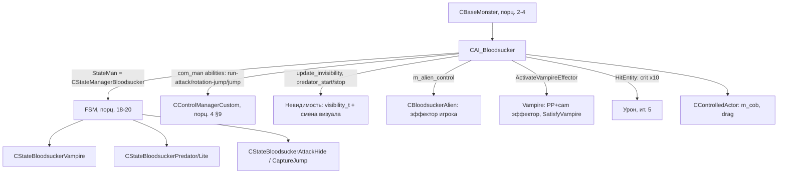

# CAI_Bloodsucker

> Источники: `src/xrGame/ai/monsters/bloodsucker/` (24 файла, 3 535 строк) — в основном
> `bloodsucker.h` (247), `bloodsucker.cpp` (959), плюс FSM-подсостояния `*_state_manager.h`,
> `*_vampire*.h`, `*_predator*.h`, `*_alien.h`. Порцион 5, итерация 6.

`CAI_Bloodsucker` («кровосос»/«болотная тварь») — **крупнейший и самый «особый» наследник
`CBaseMonster`**: невидимость с переключением визуала, «вампиризм» (пьёт кровь), «alien»
(телекинез-эффектор), «predator» (смена облика), критические удары с эффекторами камеры.
Показывает, **как конкретный вид расширяет каркас порц. 2–4** — через abilities, custom
abilities в `com_man()`, собственный `StateMan` и подсостояния.

## 1. Место в иерархии

```cpp
class CAI_Bloodsucker : public CBaseMonster, public CControlledActor   // bloodsucker.h:12
```

- `CBaseMonster` (порц. 2–4) — каркас, циклы, память, контроллеры.
- `CControlledActor` — «управляемый актёр» (механика, которой управляет другой объект —
  здесь сам кровосос умеет «владеть» другим существом, `m_cob`).
- **Ставит `StateMan`** (конструктор, bloodsucker.cpp:59): `xr_new<CStateManagerBloodsucker>`
  — порц. 3 §3 говорил, что FSM создаёт вид; здесь это видно вживую.

`get_monster_class_name() → "bloodsucker"` (bloodsucker.h:183).

## 2. Abilities (переопределённые)

Из блока порц. 2 §5 — кровосос включает:

| Метод | Дефолт (base) | Кровосос |
|---|---|---|
| `ability_invisibility()` | `false` | **`true`** |
| `ability_pitch_correction()` | `true` | **`false`** |
| `ability_can_drag()` | `false` | **`true`** (тащить труп/жертву) |

Кроме того — `use_center_to_aim() = true` (стрелять в центр, не в точку контакта) и
`in_solid_state() = true`.

## 3. `Load`: анимации + abilities + vampire-конфиг

`Load` (cpp:75) — **самый «мясной» `Load` в коде монстров**:

- **custom abilities** (cpp:84–87): `com_man().add_ability(eControlRunAttack)` (если не
  `is_friendly`), `eControlRotationJump`, `eControlJump`. Это те ability, которые
  `CControlManagerCustom::update_schedule` (порц. 4 §9) сам срабатывает.
- **Заменённые анимации** (cpp:93–97): `AddReplacedAnim(&m_bDamaged, eAnimRun, eAnimRunDamaged)`
  и т.д. — один и тот же `EAction` даёт другую анимацию в зависимости от флага (повреждён/
  поворот).
- **~25 `AddAnim`** (cpp:117–213) с fx-точками (`fx_run_f` и др.), упрощённая ветка `is_no_fx`
  без точек.
- **Transitions + LinkAction** (cpp:218–239): связки «действие → анимация» (ACT_ATTACK→
  eAnimAttack и т.д.).
- **Vampire-конфиг** (cpp:254–264): `vampire_effector` (PP-эффектор), `Vampire_Delay`,
  `Vampire_Want_Speed/Wound/GainHealth/Distance`, `Vampire_Sufficient_Hits`.
- **Invisibility** (cpp:249–252): `invisible_vel` + новая скорость `eVelocityParameterInvisible`
  в detail-path.
- **Visibility-радиусы** (cpp:272–281): `full_visibility_radius` (5), `partial_visibility_radius`
  (10), `visibility_state_change_min_delay` (1000).
- **`PostLoad`** в конце (cpp:285) — AOM/anti-aim (порц. 2 §7).

## 4. Невидимость: visibility states + predator (смена визуала)

Два связанных механизма:

**Visibility states** (bloodsucker.h:203, cpp:503–615) — `visibility_t { no_visibility=0,
partial_visibility=1, full_visibility=2 }`:

```cpp
void CAI_Bloodsucker::update_invisibility() {     // вызывается в UpdateCL (cpp:619)
    if (!g_Alive())                        set_visibility_state(full_visibility);
    else if (бежит от игрока (m_runaway_invisible_time)) set_visibility_state(partial/no);
    else if (enemy) {
        float d = dist2enemy;
        if (d <= full_radius)        set_visibility_state(full_visibility);
        else if (d <= partial_radius) set_visibility_state(partial_visibility);
        else                          set_visibility_state(no_visibility);
    }
    else set_visibility_state(full_visibility);
}
```

- `can_be_seen()` → `get_visibility_state() == full_visibility` (h:228).
- `GetTransparency()` (h:209) — 1.0 при `no_visibility` (HeatVision), 0 иначе.
- `renderable_Render()` (cpp:882) — **не рендерит** при `no_visibility` (кроме `ps_r2_heatvision>0`).
- `set_visibility_state` (cpp:523) — rate-limited (`m_visibility_state_change_min_delay`),
  `force_visibility_state` — принудительный (из Lua). При `full_visibility` →
  `stop_invisible_predator()`, при `partial` → `start_invisible_predator()`.

**Predator** (h:131–149, cpp:757–819) — **смена визуала** между обычным (`m_visual_default`) и
«невидимым» обликом (`m_visual_predator`): `predator_start()` ставит `cNameVisual_set(
m_visual_predator)`, `CParticlesPlayer::StartParticles(invisible_particle_name)`, звук
`eChangeVisibility`, перезапускает анимацию; `predator_stop()` — обратно. `m_vis_state`
(`0/1/-1`) — «ручной» override из Lua (`set_vis`/`set_invis`).

## 5. Вампиризм (vampire)

`m_vampire_want_value ∈ [0,1]` — «насыщенность/хочет пить», растёт в `UpdateCL`
(cpp:627–628: `m_vampire_want_value += m_vampire_want_speed * client_update_fdelta()`).
- `WantVampire()` → `fsimilar(value, 1.f)`.
- `SatisfyVampire()` (cpp:444) — `value=0`, `health += m_vampire_gain_health` (в пределах
  `max_health`).
- `ActivateVampireEffector()` (cpp:432) — `CVampireCameraEffector` + `CVampirePPEffector`
  (PP-данные из `LoadVampirePPEffector`, cpp:347) на камеру игрока.
- `m_time_last_vampire` (static), `m_vampire_min_delay` — кулдаун.

FSM-состояние `CStateBloodsuckerVampire` (vampire.h) — «пьёт кровь» (см. §8).

## 6. Alien (телекинез)

`CBloodsuckerAlien m_alien_control` (alien.h) — отдельный объект: `activate/deactivate`,
`m_effector`/`m_effector_pp` (`CAlienEffector`/`CAlienEffectorPP`), `m_crosshair_show`.
- `set_alien_control(bool)` (cpp:686). В `shedule_Update` (cpp:645): если активен — звук
  `eAlien` каждый кадр.
- Это «особая» способность кровососа — эффектор на игрока (отбрасывание/перекрестие).

## 7. Критические удары и хиты

- `HitEntity` (cpp:830) — **крит. шанс**: `if (rand() <= m_critical_hit_chance) impulse *= 10.f`
  (дефолт `0.25`, detail namespace cpp:38).
- `Hit` (cpp:848) — `if (!collision_hit_off) inherited::Hit` (флаг `collision_hit_off` из `Load`).
- `done_enough_hits_before_vampire()` (cpp:896) — `m_hits_before_vampire >= m_sufficient_hits_before_vampire + random` — «достаточно ли ударов, чтобы перейти к вампиризму».
- `on_attack_on_run_hit()` (cpp:902) — `++m_hits_before_vampire` (завязан на AOM, порц. 2 §8).

## 8. FSM: `CStateManagerBloodsucker` + подсостояния

`StateMan` — `CStateManagerBloodsucker` (state_manager.h), наследует
`CMonsterStateManager<CAI_Bloodsucker>` (порц. 18). Методы: `update`, `execute`, `drag_object`,
`check_vampire`. Подсостояния (все `CState<_Object>`, порц. 19–20):

| Состояние | Файл | Роль |
|---|---|---|
| `CStateBloodsuckerVampire` | vampire.h | «пьёт кровь» у жертвы (enemy), `check_vampire` в менеджере |
| `CStateBloodsuckerPredator` | predator.h | «охотник»: `select_camp_point`, `m_time_start_camp` |
| `CStateBloodsuckerPredatorLite` | predator_lite.h | упрощённая охота, `enemy_see_me`, `m_freezed` |
| `CStateBloodsuckerAttackHide` | attack_state.h | атака из засады |
| `CStateBloodsuckerCaptureJump` | state_capture_jump.h | «прыжок-захват» (drag) |

`drag_object()` в менеджере + `m_cob` (controlled object) + `start_drag`/`set_drag_jump`
(cpp:740–748) — механика «тащить жертву» (ability_can_drag). `animation_end_jump` (cpp:750) —
callback анимации: после «прыжка» → `set_invis` + `jump(...)`.

## 9. Связи



## 10. Замечания к плану

1. **Кровосос — `CBaseMonster + CControlledActor`** (не только CBaseMonster). `CControlledActor`
   даёт «управляемый объект» (`m_cob`) — это отдельная ветка, не описанная в порц. 2.
2. `m_time_last_vampire` — **static** (общий на все экземпляры вида), не член-экземпляра —
   кулдаун вампиризма глобальный.
3. **Невидимость — не флаг, а 3 состояния + смена визуала** (predator). `state_invisible` (порц. 2)
   здесь лишь часть: реальное «не видно» = `m_visibility_state == no_visibility` + `predator`
   (другой визуал + частицы). `GetTransparency`/`renderable_Render` — HeatVision-интеграция.
4. `Load` кровососа **длиннее, чем у любого другого монстра** (~210 строк только анимаций) —
   держит полный набор анимаций + fx-точки; упрощённая ветка `is_no_fx` для перформанса.
5. Крит. удары здесь — **шанс ×10 импульса** (`m_critical_hit_chance`), а не «крит. раны вида»
   (порц. 4 §6). Не путать: порц. 4 — раны **по частям тела** (head/torso/legs), здесь —
   «сильный удар».

## 11. Краткое резюме

`CAI_Bloodsucker` — эталон «как вид расширяет `CBaseMonster`»: abilities
(invisibility/drag/pitch), custom abilities в `com_man()` (run-attack/rotation-jump/jump),
собственный `CStateManagerBloodsucker` с 5 подсостояниями (vampire/predator/attack-hide/
capture-jump), 3-ступенчатая невидимость со сменой визуала (predator), вампиризм
(`m_vampire_want_value` + PP-эффектор + лечение), alien-телекинез и крит. удары ×10. Всё на
каркасе порц. 2–4, FSM — порц. 18–20, контроллеры — порц. 21.

---

*Порцион 5 (итерация 6). Далее: порц. 6 — `CAI_Burer` ([burer.md](burer.md)).*
