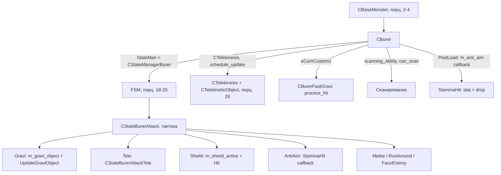

# CBurer

> **Истник**: `src/xrGame/ai/monsters/burer/` (21 файл, ~2 900 строк) — ключевые
> `burer.h` (179), `burer.cpp` (551), `burer_state_manager.cpp` (82),
> `burer_state_attack*.h` (9 подсостояний, inline ~1 100 строк),
> `burer_fast_gravi.cpp` (46). Порцион 7, итерация 6.

`CBurer` (бурер) — **монстр на базе `CBaseMonster` + `CTelekinesis`**. Три атаки:
**гравитация** (`CStateBurerAttackGravi` + `m_gravi_object` — сжатие пространства к
врагу с импульсом), **телекинез** (`CTelekinesis` + `CStateBurerAttackTele` — поднимает
объекты и швыряет во врага) и **ближний бой**. Защита — **щит** (`m_shield_active`,
`CStateBurerShield`), **anti-aim** (`CStateBurerAntiAim`, `StaminaHit`). Сканирование
(`scanning_ability`, `can_scan`), `CBurerFastGravi` (быстрый контроллер `eComCustom1`).
Каркас — порц. 2–4; FSM — порц. 18–20; `telekinesis`/`telekinetic_object` — порц. 26.

## 1. Место в иерархии

```cpp
class CBurer : public CBaseMonster,
               public CTelekinesis    // burer.h:11
```

- `CBaseMonster` (порц. 2–4) — каркас, память, контроллеры, настройки.
- `CTelekinesis : CPHUpdateObject` (telekinesis.h:13) — физический слой
  `CTelekineticObject*` (поднятые объекты), `activate/deactivate/fire/fire_all`,
  `schedule_update` (тикает в `shedule_Update`).
- **`StateMan`** (конструктор, burer.cpp:33): `xr_new<CStateManagerBurer>`.
- **`m_fast_gravi`** (burer.cpp:35-37): `CBurerFastGravi` на `ControlCom::eComCustom1`.

`get_monster_class_name()` — `"burer"` (burer.h:159). `static bool can_scan` (burer.h:20).

## 2. Abilities

По базе (порц. 2 §5): `ability_distant_feel()` = **`true`** (burer.h:158 — чувствует
дистанционно). Остальные — как в `CBaseMonster`. `need_shotmark()` = `!m_shield_active`
(burer.h:156).

## 3. `Load`: анимации + gravitation + tele + shield

`Load` (burer.cpp:87) — **самый «толстый» `Load`** (сравнить с bloodsucker порц. 5,
controller порц. 6):
- `accel_load` + `accel_chain_add(eAnimWalkFwd, eAnimRun)`;
  `AddReplacedAnim(&m_bRunTurnLeft/Right, eAnimRun, …)`.
- Партиклы: `particle_gravi_wave/prepare`, `particle_tele_object`, `particle_fire_shield`.
- Звуки: `sound_gravi_wave/scan/tele_hold/tele_throw` (`st_Effect`, `SOUND_TYPE_WORLD`).
- **Gravi** (burer.cpp:109-118): `m_gravi {cooldown, min/max_dist, speed, step,
  time_to_hold, radius, impulse_to_objects, impulse_to_enemy, hit_power}`.
- **Stamina/drop** (120-127): `m_weight_to_stamina_hit`, `m_weapon_drop_stamina_k`,
  `m_weapon_drop_velocity`.
- **Runaway** (123-125): `m_runaway_distance` (6), `m_normal_distance` (12),
  `m_max_runaway_time` (5000).
- **Shield** (129-132, 146): `m_shield_cooldown/time`, `m_shield_keep_particle`,
  `particle_fire_shield`.
- **Tele** (134-144): `m_tele_max_handled_objects/max_time/time_to_hold/object_min/max_mass/
  find_radius/min/max_distance/raise_speed/fly_velocity/object_height`.
- ~15 `AddAnim` (stand/walk/run/attack/die/shield/tele/gravi/run_turn), `LinkAction`,
  `set_force_gravi_attack(false)`. `PostLoad` (burer.cpp:228) — anti-aim callback
  `StaminaHit`.

## 4. `PostLoad` + `StaminaHit` (anti-aim)

`PostLoad` (burer.cpp:228): `m_anti_aim->set_callback(... &CBurer::StaminaHit)`.
`StaminaHit` (burer.cpp:245) — вызывается anti-aim-контроллером:
`stamina_hit = active_weapon->Weight() * m_weight_to_stamina_hit`;
`PowerHit(stamina_hit)`; если `GetPower < stamina_hit * m_weapon_drop_stamina_k` →
Lua-callback `_G.CBurer_BeforeWeaponDropCallback` (может отменить), затем
`SetActivationSpeedOverride(dir * m_weapon_drop_velocity)` + `kDROP`/`g_PerformDrop`.
(Сравнить: controller порц. 6 §9 — прямой hit в `HitEntity`; здесь — callback anti-aim.)

## 5. Gravi: `m_gravi_object` + `UpdateGraviObject`

Ядро гравитации (burer.cpp:288-410). `m_gravi_object` (`GraviObject`, burer.h:25-58):
`active`, `cur_pos/target_pos/from_pos`, `enemy`. `activate/deactivate`.
`UpdateGraviObject` вызывается из **`UpdateCL`** (burer.cpp:416, каждый кадр):
- Если `cur_pos` прошёл `from_pos` мимо `target_pos` → `deactivate`.
- Шаг: `dist = dt * m_gravi.speed / 1000`; если `< m_gravi.step` — return.
- `RayPick` к врагу: если попал и враг **виден** (`feel_vision_get`) → `HitEntity(enemy,
  m_gravi.hit_power, m_gravi.impulse_to_enemy, …)` + deactivate.
- Иначе двигает `cur_pos`, рендерит `particle_gravi_wave`, `GetNearest(radius)` →
  `applyImpulse(dir, m_gravi.impulse_to_objects * mass)` всем (кроме quest-items),
  играет `sound_gravi_wave`.

`StartGraviPrepare`/`StopGraviPrepare` (421-439) — партикл на акторе.

## 6. Tele: `CStateBurerAttackTele` + `CTelekinesis`

`CStateBurerAttackTele` (burer_state_attack_tele.h, inline 527 строк):
- `FindObjects`/`FindFreeObjects` — собирает `CPhysicsShellHolder*` в `tele_objects`,
  `selected_object`.
- `SCollisionHitCallback` — колбэк коллизии (если `cs > min_cs*0.5` — объект цель).
- `HandleGrenades`/`OnGrenadeDestroyed` — гранаты.
- `ExecuteTeleContinue`/`ExecuteTeleFire` — поднимает (`CTelekinesis::activate`) и
  `fire_all(enemy)`.
- `StartTeleObjectParticle`/`StopTeleObjectParticle` (burer.cpp:441-455).

`CTelekinesis` (telekinesis.h) — общий слой (порц. 26): `activate/deactivate`,
`fire/fire_all/fire_t`, `schedule_update` (в `shedule_Update`, burer.cpp:238).
`Die`/`net_Destroy` (burer.cpp:482-525): `CTelekinesis::remove_object_callbacks()` +
`deactivate()`, `ta_deactivate`.

## 7. Shield

`ActivateShield`/`DeactivateShield` (burer.cpp:77-85) — `m_shield_active`.
`Hit` (burer.cpp:457): если `m_shield_active` и `eHitTypeFireWound` (не тот же кадр) →
партикл `particle_fire_shield` на боне, **не** `inherited::Hit` (щит гасит); иначе
`inherited::Hit`. `CStateBurerShield` (inline 101 строк): `check_start_conditions`
(кулдаун `m_shield_time + m_shield_cooldown`, `enemy_see_me_now`), `check_completion`
(длительность, `actor_is_reloading_weapon`), анимация `eAnimShieldStart/Continue`,
keep-партикл.

## 8. FSM: `CStateManagerBurer` + подсостояния

`StateMan` = `CStateManagerBurer` (state_manager.cpp:8). Подсостояния:
`Rest`, `Panic`, `Attack` (→ `CStateBurerAttack`), `Eat`, `HearInt/DangerSound`,
`Hitted`, `BurerScanning` (→ `CStateMonsterCustomAction`, `ACT_LOOK_AROUND`,
`SCAN_STATE_TIME=4000`).

`execute` (state_manager.cpp:37-75): enemy → по `get_danger_type` (`eStrong`→`Panic`,
`eWeak`→`Attack`); `HitMemory` → `Hitted`; interesting/dangerous sound;
`time_last_scan + SCAN_STATE_TIME > now` → `BurerScanning`; `can_eat` → `Eat`;
иначе `Rest`. `setup_substates` (77) — данные для scanning.

`CStateBurerAttack` (burer_state_attack.h, inline 243 строк) — **тактический
менеджер**: подсостояния `Tele`, `Gravi`, `Melee`, `FaceEnemy`, `RunAround`, `Shield`,
`AntiAim`, `Attack_Run`, `MoveToRestrictor`. `execute` (inline:44-208): приоритет
`Gravi → Shield (если потерял hp) → AntiAim → Tele`; иначе по дистанции
(`m_runaway_distance`/`m_normal_distance`) — `RunAround` (с откатом
`m_next_runaway_allowed_tick`), `Attack_Run` (подойти), `FaceEnemy` (поворот).
`m_lost_delta_health` (порог `health_delta=0.01`) триггерит `Shield`/`RunAround`.
`check_control_start_conditions` (235): `eAntiAim` только при `m_allow_anti_aim`.

`CStateBurerFastGravi` (burer_fast_gravi.cpp, 46 строк) — контроллер `eComCustom1`:
`check_start_conditions` (не captured, есть enemy), `activate` (face_target,
subscribe `eventTAChange`), `process_hit` — `HitEntity(1.f, 100.f)`.

## 9. Связи



## 10. Замечания к плану

1. **`CBurer` — `CBaseMonster + CTelekinesis`** (не `CControlledActor` как bloodsucker/
   controller, порц. 5/6). `CTelekinesis` — физический слой (порц. 26).
2. **Три атаки** с разными механиками: gravi (сжатие `m_gravi_object` + импульс),
   tele (поднятие объектов), melee. `CStateBurerAttack` — тактический менеджер с
   приоритетом и дистанционным порогом.
3. `m_gravi_object` тикает в **`UpdateCL`** (не `shedule_Update`) — `UpdateGraviObject`
   каждый кадр, физика + партиклы.
4. **Shield = флаг** `m_shield_active`, гасит `Hit` (не `inherited::Hit` при fire-wound);
   `need_shotmark()` = `!m_shield_active`.
5. **Anti-aim → `StaminaHit`** — callback, а не прямой hit (сравнить controller порц. 6
   §9 — прямой). Lua-callback `_G.CBurer_BeforeWeaponDropCallback` может отменить drop.
6. `CStateBurerScanning` не отдельный класс — переиспользует `CStateMonsterCustomAction`
   (`ACT_LOOK_AROUND`), `SCAN_STATE_TIME=4000`.
7. `CBurerFastGravi` (`eComCustom1`) — быстрый one-shot удар, отдельно от FSM-состояний.

## 11. Краткое резюме

`CBurer` — «толстый» наследник `CBaseMonster + CTelekinesis`: гравитация
(`m_gravi_object` + `UpdateGraviObject` в `UpdateCL`), телекинез (`CTelekinesis` +
`CStateBurerAttackTele`), щит (`m_shield_active`, гасит `Hit`), anti-aim
(`StaminaHit` callback + Lua), сканирование (`can_scan`), `CBurerFastGravi`.
Тактика в `CStateBurerAttack` (приоритет gravi→shield→antiaim→tele + дистанция).
Каркас — порц. 2–4, FSM — порц. 18–20, `CTelekinesis` — порц. 26.

---

*Порцион 7 (итерация 6). Далее: порц. 8 — `CPoltergeist` ([poltergeist.md](poltergeist.md)).*
