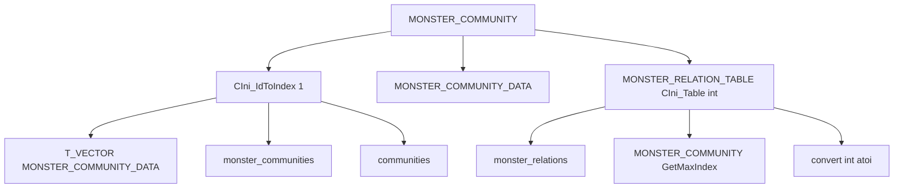

# MONSTER_COMMUNITY и relations

Модуль: `src/xrGame/` — `monster_community.h/.cpp` (64+86 стр.), `ini_id_loader.h` (179 стр.), `ini_table_loader.h` (141 стр.).
Порцион 27 (итерация 6).

## Чего не делает

- Не содержит community-менеджеры ALife — порц. 31–32.
- Не управляет FSM — только таблица отношений.
- Не знает про Lua API AI — ит. 14.
- Не содержит `CSE_ALife*` — ит. 11/12.

## §1. Типы и константы

```c
typedef int MONSTER_COMMUNITY_INDEX;
typedef shared_str MONSTER_COMMUNITY_ID;
#define NO_MONSTER_COMMUNITY_INDEX MONSTER_COMMUNITY_INDEX(-1)

#define MONSTER_RELATIONS_SECT  "monster_communities"
#define MONSTER_COMMUNITIES     "communities"
#define MONSTER_RELATIONS_TABLE "monster_relations"
```

## §2. `MONSTER_COMMUNITY_DATA`

| Поле | Тип | Назначение |
|---|---|---|
| `id` | `MONSTER_COMMUNITY_ID` | Текстовый ID |
| `index` | `MONSTER_COMMUNITY_INDEX` | Числовой индекс |
| `team` | `u8` | Команда (из ini) |

Конструктор: `MONSTER_COMMUNITY_DATA(index, id, team_str)`.

## §3. `MONSTER_COMMUNITY`

Наследует `CIni_IdToIndex<1, MONSTER_COMMUNITY_DATA, MONSTER_COMMUNITY_ID, MONSTER_COMMUNITY_INDEX, MONSTER_COMMUNITY>`.

### Поля

| Поле | Тип | Назначение |
|---|---|---|
| `m_current_index` | `MONSTER_COMMUNITY_INDEX` | Текущий индекс |
| `m_relation_table` | `MONSTER_RELATION_TABLE` (static) | Таблица отношений |

### `MONSTER_RELATION_TABLE`

`CIni_Table<int, MONSTER_COMMUNITY>` — квадратная таблица `int[N][N]`.

### `set(id)` / `set(index)`

`set(id)`: `m_current_index = IdToIndex(id)`.
`set(index)`: `m_current_index = index`.

### `id()` / `index()` / `team()`

`id()`: `IndexToId(m_current_index)`.
`index()`: `m_current_index`.
`team()`: `(*m_pItemDataVector)[m_current_index].team`.

### `relation(to)` / `relation(from, to)`

`relation(to)`: `relation(m_current_index, to)`.
`relation(from, to)`:
1. `VERIFY(from >= 0 && from < table_size)`.
2. `VERIFY(to >= 0 && to < table_size)`.
3. Return `m_relation_table.table()[from][to]`.

### `InitIdToIndex()`

`section_name = MONSTER_RELATIONS_SECT`.
`line_name = MONSTER_COMMUNITIES`.
`m_relation_table.set_table_params(MONSTER_RELATIONS_TABLE)`.

### `Reset()`

`m_relation_table.clear()`.

### `DeleteIdToIndexData()`

`m_relation_table.clear()`.
`inherited::DeleteIdToIndexData()`.

## §4. `CIni_IdToIndex` (ini_id_loader.h)

Шаблон: `CIni_IdToIndex<ITEM_REC_NUM, ITEM_DATA, T_ID, T_INDEX, T_INIT>`.

### Статические поля

| Поле | Тип | Назначение |
|---|---|---|
| `m_pItemDataVector` | `T_VECTOR*` | Вектор `ITEM_DATA` |
| `section_name` | `LPCSTR` | Имя секции |
| `line_name` | `LPCSTR` | Имя строки |

### `LoadItemData<1>(count, cfgRecord)`

Для `ITEM_REC_NUM = 1`:
```
for k = 0..count step 2:
    id_str = _GetItem(cfgRecord, k, buf)
    id_str_lwr = xr_strlwr(xr_strdup(id_str))
    rec1 = _GetItem(cfgRecord, k+1, buf1)
    item_data = ITEM_DATA(index, T_ID(id_str_lwr), rec1)
    m_pItemDataVector->push_back(item_data)
```

### `InitInternal()`

1. `VERIFY(!m_pItemDataVector)`.
2. `T_INIT::InitIdToIndex()`.
3. `m_pItemDataVector = xr_new<T_VECTOR>()`.
4. `VERIFY(section_name)`, `VERIFY(line_name)`.
5. `cfgRecord = pSettings->r_string(section_name, line_name)`.
6. `count = _GetItemCount(cfgRecord)`.
7. `LoadItemData<ITEM_REC_NUM>(count, cfgRecord)`.

### `GetById(str_id, no_assert)`

Линейный поиск по `m_pItemDataVector`. Если не найден → `VERIFY(no_assert)`, return NULL.

### `GetByIndex(index, no_assert)`

`index >= size` → `VERIFY(no_assert)` || `Debug.fatal`, return NULL. Иначе `m_pItemDataVector->at(index)`.

### `IdToIndex(str_id, default_index, no_assert)`

`item = GetById(str_id, no_assert)`. Return `item ? item->index : default_index`.

### `IndexToId(index, default_id, no_assert)`

`item = GetByIndex(index, no_assert)`. Return `item ? item->id : default_id`.

### `GetMaxIndex()`

`m_pItemDataVector->size() - 1`.

### `DeleteIdToIndexData()`

`xr_delete(m_pItemDataVector)`.

## §5. `CIni_Table` (ini_table_loader.h)

Шаблон: `CIni_Table<T_ITEM, T_INI_LOADER, TABLE_INDEX>`.

### Поля

| Поле | Тип | Назначение |
|---|---|---|
| `m_pTable` | `ITEM_TABLE*` | Двумерный вектор `T_ITEM` |
| `table_sect` | `LPCSTR` | Имя секции |
| `table_width` | `int` | Ширина (-1 = квадратная) |

### `set_table_params(sect, width)`

`table_sect = sect`, `table_width = width`.

### `table()`

1. Если `m_pTable` → return `*m_pTable`.
2. `m_pTable = xr_new<ITEM_TABLE>()`.
3. `VERIFY(table_sect)`.
4. `table_size = T_INI_LOADER::GetMaxIndex() + 1`.
5. `cur_table_width = (table_width == -1) ? table_size : table_width`.
6. `m_pTable->resize(table_size)`.
7. `table_ini = pSettings->r_section(table_sect)`.
8. `R_ASSERT(table_ini.Data.size() == table_size)`.
9. Цикл по строкам:
   - `cur_index = T_INI_LOADER::IdToIndex((*i).first, type_max)`.
   - Если `cur_index == type_max` → `Debug.fatal`.
   - `(*m_pTable)[cur_index].resize(cur_table_width)`.
   - Цикл по колонкам: `(*m_pTable)[cur_index][j] = convert<T_ITEM>(_GetItem(...))`.
10. Return `*m_pTable`.

### `convert<int>(str)`

`atoi(str)`.

### `convert<float>(str)`

`atof(str)`.

### `clear()`

`xr_delete(m_pTable)`.

## §6. Формат ini

```ini
[monster_communities]
communities = monster,1 stalker,2 controller,3 burer,4 poltergeist,5 chimera,6 flesh,7 fracture,8 snork,9 giant,10

[monster_relations]
monster = 1 1 1 1 1 1 1 1 1 1
stalker = 1 1 0 0 0 0 0 0 0 0
controller = 1 0 1 0 0 0 0 0 0 0
burer = 1 0 0 1 0 0 0 0 0 0
poltergeist = 1 0 0 0 1 0 0 0 0 0
chimera = 1 0 0 0 0 1 0 0 0 0
flesh = 1 0 0 0 0 0 1 0 0 0
fracture = 1 0 0 0 0 0 0 1 0 0
snork = 1 0 0 0 0 0 0 0 1 0
giant = 1 0 0 0 0 0 0 0 0 1
```

- `communities` — пары `id,team`.
- `monster_relations` — квадратная таблица: строка = `from`, колонка = `to`, значение = `int` (1 = враг, 0 = союзник).

## §7. Связи



## §8. Замечания к плану

- **`MONSTER_COMMUNITY`** — singleton-подобный (статические данные). `m_current_index` — текущий индекс.
- **`m_relation_table`** — static `CIni_Table<int, MONSTER_COMMUNITY>`. Квадратная таблица N×N.
- **`CIni_IdToIndex<1, ...>`** — `ITEM_REC_NUM = 1` (2 поля: id + team).
- **`LoadItemData<1>`** — пары `id,team` в строке `communities`.
- **`CIni_Table::table()`** — lazy load. `R_ASSERT(table_ini.Data.size() == table_size)`.
- **`relation(from, to)`** — `m_relation_table.table()[from][to]`. `int` (1 = враг, 0 = союзник).
- **`Reset()`** — `m_relation_table.clear()` (для перезагрузки).
- **`DeleteIdToIndexData()`** — `m_relation_table.clear()` + `inherited::DeleteIdToIndexData()`.

## §9. Краткое резюме

- **`MONSTER_COMMUNITY`** — таблица отношений монстров. `set(id/index)`, `id()`, `index()`, `team()`, `relation(from, to)`.
- **`CIni_IdToIndex`** — шаблон: текстовые ID → числовые индексы. `LoadItemData<1>` (id + team).
- **`CIni_Table`** — шаблон: квадратная таблица из ini. Lazy load. `convert<int>`.
- **Формат ini** — `[monster_communities]` (id,team), `[monster_relations]` (N×N, 1=враг, 0=союзник).

Порцион 27 (итерация 6). Далее: порц. 28 — `alife-simulator.md` — `CALifeSimulator` + `alife_simulator_base` ([alife-simulator.md](alife-simulator.md)).
