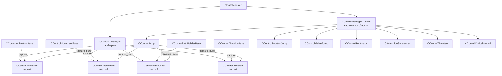

# Контроллеры CControl_*

> Итерация 6, порцион 21.
> Источники: `src/xrGame/ai/monsters/control_combase.h`, `control_manager.{h,cpp}`, `control_manager_custom.{h,cpp}`, `control_animation_base.{h,cpp}` (+`_load`/`_update`/`_accel`), `control_movement_base.{h,cpp}`, `control_path_builder_base.{h,cpp}` (+`_set`/`_path`/`_update`/`_inline`), `control_direction_base.{h,cpp}`, `control_animation.{h,cpp}`, `control_movement.{h,cpp}`, `control_path_builder.{h,cpp}`, `control_direction.{h,cpp}`, `control_jump.{h,cpp}`, `control_melee_jump.{h,cpp}`, `control_rotation_jump.{h,cpp}`, `control_run_attack.{h,cpp}`, `control_sequencer.{h,cpp}`, `control_threaten.{h,cpp}`, `control_critical_wound.{h,cpp}`.

## Чего не делает / границы

- **`CBaseMonster`** (каркас, abilities) — порц. 2; **FSM-цикл** — порц. 3.
- **Пейтфиндинг** (уровневый/детальный граф) — ит. 7.
- **Lua API** (`script_jump`, `script_capture`) — ит. 14.

## 1. Архитектура: две оси

Фреймворк контроллеров (`control_combase.h`) построен на двух осях:

| Ось | Класс | Назначение |
|-----|-------|------------|
| «Контролируемый» | `CControl_ComControlled<T>` | Хранит `capturer` (кто владеет), `locked`, `m_data` (блок данных `IComData`). Хуки: `on_capture`, `on_release`, `reset_data`, `data()`. |
| «Контролирующий» | `CControl_ComControlling` | Хуки: `on_start_control`, `on_stop_control`, `on_event`. Список контролируемых комов. |

Комбинации:

| Класс | Основа | Кто использует |
|-------|--------|----------------|
| `CControl_ComPure<T>` | Com + ControlledStorage<T> | Чистые исполнители (animation/movement/direction/path) |
| `CControl_ComBase` | Com + Controlling | Базовые контроллеры (решают, что делать) |
| `CControl_ComCustom<T>` | Com + ControlledStorage<T> + Controlling | Кастомные способности (jump, sequencer, …) |

## 2. `CControl_Manager` — арбитраж

Файл: `control_manager.{h,cpp}`.

| Поле | Тип | Назначение |
|------|-----|------------|
| `m_object` | `CBaseMonster*` | Монстр |
| `m_control_elems` | `CONTROLLERS_MAP` | Все контроллеры по `EControlType` |
| `m_base_elems` | `CONTROLLERS_MAP` | Базовые контроллеры (fallback) |
| `m_active_elems` | `COM_VEC` | Активные, не-locked |
| `m_animation/m_direction/m_movement/m_path` | указатели | Чистые исполнители |

**Ключевые методы:**

- `capture(who, type)` — предыдущий capturer получает `on_release`/`on_stop_control`, новый — `on_capture`/`on_start_control`.
- `release(who, type)` — если зарегистрирован base-controller для типа, он перехватывает; иначе чистый ком деактивируется.
- `capture_pure(com)` — захват всех 4 чистых типов (path+animation+movement+dir) сразу.
- `update_frame()` / `update_schedule()` — итерация по `m_active_elems`.
- `path_stop(com)` / `move_stop(com)` / `dir_stop(com)` — записывают stop в чистые данные.
- `build_path_line(com, target, node, vel_mask)` — делегирует в `path_builder().build_special(...)`.

## 3. `CControlManagerCustom` — кастомные способности

Файл: `control_manager_custom.{h,cpp}`. Наследует `CControl_ComBase`.

Хранит указатели на все кастом-контроллеры: `m_jump`, `m_rotation_jump`, `m_melee_jump`, `m_run_attack`, `m_threaten`, `m_critical_wound`, `m_sequencer`, `m_triple_anim`.

**Ленивая инициализация:** `add_ability(EControlType)` создаёт контроллер по запросу и регистрирует в `CControl_Manager`.

**`update_schedule()`** — периодические проверки:
- `check_threaten()` — если условия выполнены → захват + анимация угрозы.
- `check_attack_jump()` — если враг виден и `can_jump(target)` → прыжок с авто-прицелом.
- `check_rotation_jump()` — случайный поворот-рывок.
- `check_run_attack()` — рывок-атака.
- `check_melee_jump()` — короткий бросок ближнего боя.

**События:** `on_event` обрабатывает `eventJumpEnd`, `eventSequenceEnd`, `eventThreatenEnd`, `eventCriticalWoundEnd`, `eventRotationJumpEnd`, `eventMeleeJumpEnd`, `eventRunAttackEnd` → `release` соответствующего типа.

## 4. Базовые контроллеры (default-движок)

Каждый базовый контроллер **перманентно захватывает** свой чистый ком в `reinit()`:

### 4.1. `CControlAnimationBase` (→ чистый `CControlAnimation`)

- Хранит: `MOTION_ITEM_MAP m_tMotions` (анимации), `TRANSITION_ANIM_VECTOR`, `AA_VECTOR m_attack_anims` (параметры ударов), `REPLACED_ANIM`, accel-цепочки.
- **`select_animation()`** — выбор MotionID для текущего `EMotionAnim` (учитывая override, spec_id, случайный вариант). Записывает в `SControlAnimationData`.
- **`check_hit()`** — при `eAnimationHit` проверят дистанцию + FOV → `m_object->HitEntity(...)`.
- **`AA_reload(section)`** — парсит `attack_params` (дистанция, урон, импульс, FOV) и регистрирует аним-события.
- **`CheckTransition(from, to)`** — поиск переходной анимации → sequencer.
- **Accel** (`_accel.cpp`): цепочки ускорения/торможения (calm vs aggressive).

### 4.2. `CControlMovementBase` (→ чистый `CControlMovement`)

- Хранит: `VELOCITY_MAP m_velocities` (Stand, WalkFwd, RunFwd, Steal, Drag, RunAttack, …).
- **`update_frame()`** — записывает `m_velocity`/`m_accel` в `SControlMovementData`.
- **`set_velocity(val)`** — задаёт цель + accel (торможение или разгон).
- **`get_velocity_from_path()`** — скорость из текущего travel-пункта пути.

### 4.3. `CControlPathBuilderBase` (→ чистый `CControlPathBuilder`)

- Хранит: `STarget m_target_set/m_target_found`, state-машина (`eStatePathValid/NoPath/PathEnd/WaitNewPath/PathFailed`), cover-параметры.
- **`update_frame()`** — state-машина: определяет, нужен ли новый путь, находит целевой нод (`find_node`: LOS → vertex_id → covers → `find_nearest_vertex` 30 м), записывает в `SControlPathBuilderData`.
- **`set_target_point(pos, node)`** / **`set_retreat_from_point(pos)`** — задание цели.
- **`set_cover_params(min, max, dev, radius)`** — параметры поиска покрытия.
- Обработка: `on_path_built`, `on_path_end`, `on_path_updated`, `travel_point_changed`.

### 4.4. `CControlDirectionBase` (→ чистый `CControlDirection`)

- Хранит: `SAxis m_heading, m_pitch` (target, acceleration, speed_target).
- **`face_target(pos, delay, add_yaw)`** — расчёт yaw к цели, throttled по `delay`.
- **`use_path_direction(reversed)`** — направление из текущего сегмента detail-пути.
- **`update_frame()`** — копирует target в `SControlDirectionData`.

## 5. Чистые исполнители (Pure)

### 5.1. `CControlAnimation`

- Данные: `SControlAnimationData { _speed, global, legs, torso }` (каждый `SAnimationPart` = `{blend, actual, time_started, motion}`).
- **`update_frame()`**: `UpdateTracks` → `check_callbacks` (fire `eventAnimationEnd`) → `play()` (воспроизводит части с `actual=false` через `LL_PlayCycle`) → `check_events` (fire `eventAnimationSignal`).
- **`add_anim_event(MotionID, time_perc, id)`** — регистрация timed-события (hit/custom).
- **`freeze/unfreeze`** — нулевая скорость blend / восстановление.
- **`restart()`** — перепуск текущей анимации.

### 5.2. `CControlMovement`

- Данные: `SControlMovementData { velocity_target, acc }`.
- **`update_frame()`**: lerp `m_velocity_current` → `velocity_target` с `acc`, записывает в `m_object->m_fCurSpeed`, устанавливает desirable speed в path builder.
- **`real_velocity()`** — фактическая XZ-скорость из физики (clamp 0..15).

### 5.3. `CControlPathBuilder` (+ `CMovementManager`)

- Данные: `SControlPathBuilderData { target_position, target_node, enable, path_type, velocity_mask, … }`.
- **`update_schedule()`**: ждёт доступности цели, настраивает detail-path manager (smooth, dest orientation, masks, path type), для game-path — wandering, вызывает `update_path()` → `eventPathUpdated`.
- **`build_special(target, node, vel_mask)`** — одномоментная постройка пути для кастом-способностей.
- **`is_path_end(dist)`** — остаток пути.
- **`find_nearest_vertex(level_vertex_id, target, range)`** — статический поиск ближайшего вертекса.

### 5.4. `CControlDirection`

- Данные: `SControlDirectionData { heading{target_angle, target_speed}, pitch{…}, linear_dependency }`.
- **`update_frame()`**: `pitch_correction` (из следующего travel-пункта или плоскости), lerp heading/pitch, записывает в `m_body` path builder, применяет к `m_object->XFORM()` через `setHPB`. При достижении угла → `eventRotationEnd`.
- **`is_face_target(pos, eps)`** / **`angle_to_target(pos)`** / **`is_from_right(pos)`** — геометрические проверки.

## 6. Кастомные способности (Custom)

Все кастом-контроллеры следуют одному паттерну:
1. `check_start_conditions()` — проверка допустимости.
2. `activate()` → `m_man->capture_pure(this)` → subscribe events → `path_stop`/`move_stop`/`dir_stop` → заполнение чистых данных → запуск.
3. `on_event(eventAnimationEnd)` → notify `event*End`.
4. `on_release()` → `release_pure` → unsubscribe → reset.

### 6.1. `CControlJump` — прыжок-атака

- Данные: `SControlJumpData { target, position, force_factor, flags, state_prepare, state_prepare_in_move, state_glide, state_ground }`.
- Флаги: `ePrepareSkip`, `ePrepareInMove`, `eGlideOnPrepareFailed`, `eUseAutoAim`, `eDontUseVelocityBounce`, …
- **State-машина:** `eStatePrepare → eStateGlide → eStateGround` (с опциональным `eStatePrepareInMove`).
- **`can_jump(target)`** — дистанция (min/max, aggressive), угол, высота, доступность, feasibility prepare.
- **`update_frame()`**: auto-aim steering, `hit_test` (ray-pick + FOV → `HitEntityInJump`), `is_on_the_ground` → `grounding` (путь вперёд, Ground state).
- **`jump_intersect_geometry()`** — баллистическая траектория vs geometry.
- Cooldown: `m_delay_after_jump`.

### 6.2. `CControlRotationJump` — поворот-рывок

- Данные: `SControlRotationJumpData { anim_stop_ls/rs, anim_run_ls/rs, turn_angle, flags }`.
- **Две стадии:** `eStop` (замедление поворотом) → `eRun` (разгон рывком к врагу).
- **`check_start_conditions`**: враг есть, не в cooldown (3–5 с), не смотрит на врага (150°), скорость ≈ run-normal.
- **`build_line_first/second`** — построение locked-путя на дистанцию остановки/разгона.

### 6.3. `CControlMeleeJump` — ближний бросок

- Данные: `SControlMeleeJumpData { anim_ls, anim_rs }`.
- **`check_start_conditions`**: враг есть, cooldown (500–1000 мс), враг **не** впереди (165° — значит сбоку/сзади), дистанция < 4 м.
- **`activate`**: выбор анимации по `is_from_right`, forced angular speed, global motion.

### 6.4. `CControlRunAttack` — рывок-атака

- **`check_start_conditions`**: враг впереди (30°), дистанция [min, max], скорость ≈ run-normal, cooldown.
- **`activate`**: heading к врагу (speed 3), `"stand_attack_run_0"`.
- **`on_event(eventAnimationStart)`**: расчёт дистанции рывка = anim_time × run_velocity → locked path.

### 6.5. `CAnimationSequencer` — последовательность анимаций

- Данные: `SAnimationSequencerData { xr_vector<MotionID> motions }`.
- **`activate`**: index=0, `play_selected`.
- **`on_event(eventAnimationEnd)`**: index++, следующий motion; конец → `eventSequenceEnd`.
- Управляется через `CControlManagerCustom::seq_init/seq_add/seq_switch/seq_run`.

### 6.6. `CControlThreaten` — угроза

- Данные: `SControlThreatenData { animation, time }`.
- **`check_start_conditions`**: враг есть, смотрит на врага (30°).
- **`activate`**: heading к врагу (speed 1), анимация, custom-событие на `time`.
- **`on_event(eAnimationCustom)`**: `m_object->on_threaten_execute()` (game-logic hook).

### 6.7. `CControlCriticalWound` — критическая рана

- Данные: `SControlCriticalWoundData { animation }`.
- **`activate`**: анимация смерти/крит-раны.
- **`on_release`**: `m_object->critical_wounded_state_stop()`.
- Запускается через `CControlManagerCustom::critical_wound(anim)` (из `base_monster_feel.cpp`).

## 7. Связи

- **`CBaseMonster`** (порц. 2–4): `anim()`, `move()`, `path()`, `dir()`, `com_man()`.
- **FSM** (порц. 18–20): состояния вызывают `anim()->AddAnim(...)`, `path()->set_target_point(...)`, `dir()->face_target(...)`, `com_man().jump(...)`, `com_man().critical_wound(...)`.
- **Память** (порц. 22): `check_attack_jump` использует `m_object->get_memory()`.
- **Пейтфиндинг** (ит. 7): `CControlPathBuilder` → `CMovementManager` → level/detail path.

## Замечания к плану

1. **`CControlPathBuilder`** — единственный чистый контроллер, наследующий `CMovementManager` (движок пейтфиндинга). Конструируется с `CCustomMonster*`.
2. **Базовые контроллеры** перманентно захватывают чистые комы; кастомные временно перехватывают через `capture_pure`. При `release` управление возвращается базовому.
3. **`CControlJump`** — самый сложный кастом-контроллер (4 состояния, auto-aim, баллистика, hit-test в воздухе).
4. **`CControlManagerCustom::update_schedule`** — единственный источник периодических «импульсных» действий (jump/threaten/run_attack и т.д.); FSM-состояния не вызывают их напрямую.
5. **`check_jump_over_physics`** — закомментирован в `update_schedule` (неактивен).

## Краткое резюме

- **Двухосная архитектура**: «контролируемый» (хранит данные, capturer) × «контролирующий» (on_start/stop_control, on_event).
- **`CControl_Manager`** — арбитраж capture/release, 4 чистых исполнителя.
- **4 базовых контроллера** (Animation/Movement/PathBuilder/Direction) — default-движок, перманентный захват.
- **8 кастомных способностей** (Jump/RotationJump/MeleeJump/RunAttack/Sequencer/Threaten/CriticalWound + TripleAnim) — временный перехват через `capture_pure`.
- **`CControlManagerCustom`** — ленивая инициализация + периодические `check_*` в `update_schedule`.
- Паттерн: `check_start_conditions → activate (capture_pure + data) → on_event (end) → on_release (release_pure)`.

---
Порцион 21 (итерация 6). Далее: порц. 22 — `memory.md` — память монстров ([memory.md](memory.md)).
