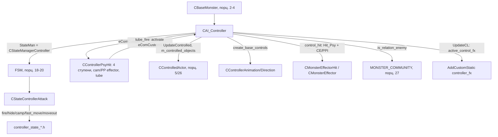

# CAI_Controller

> **Истник**: `src/xrGame/ai/monsters/controller/` (32 файла, 3 587 строк) — ключевые
> `controller.h` (184), `controller.cpp` (854), `controller_psy_hit.h/.cpp` (401),
> `controller_animation.cpp` (392), `controller_state_manager.cpp` (99),
> состояния `controller_state_*.h`. Порцион 6, итерация 6.

`CAI_Controller` (контролёр) — **монстр на базе `CBaseMonster` + `CControlledActor`**,
который **забирает врага под контроль** (`m_controlled_objects`) и **атакует «трубой»
(телепатический удар)** через контроллер `CControllerPsyHit` (`ControlCom::eComCustom1`).
Две базовые механики: **psy-hit** (удар по статы с эффекторами PP/cam + звук) и
**control** (забор врага в `m_controlled_objects` с задачей follow). Свой набор
custom-контроллеров (`CControllerAnimation`/`CControllerDirection`), aura-звук,
`EMentalState` (Idle/Danger). Каркас — порц. 2–4; FSM-цикл — порц. 18–20.

## 1. Место в иерархии

```cpp
class CController : public CBaseMonster,
                    public CControlledActor   // controller.h:13
```

- `CBaseMonster` (порц. 2–4) — каркас, память, контроллеры, настройки.
- `CControlledActor` — «управляемый актор» (как у `CAI_Bloodsucker`), но здесь
  `m_controlled_objects` — **список сущностей, взятых под контроль** (не один `m_cob`).
- **`StateMan`** (конструктор, controller.cpp:67): `xr_new<CStateManagerController>`.
- **psy-hit контроллер** (конструктор, controller.cpp:70-72):
  `m_psy_hit = xr_new<CControllerPsyHit>(); control().add(m_psy_hit, ControlCom::eComCustom1)`.

`get_monster_class_name()` — `"controller"` (controller.h:163).

## 2. Abilities

По базе (порц. 2 §5) переопределены:

| Ability | Base | Controller |
|---|---|---|
| `ability_pitch_correction()` | `true` | **`false`** (controller.h:96) |
| `use_center_to_aim()` | `false` | **`true`** (controller.h:159) |
| `run_home_point_when_enemy_inaccessible()` | `false` | **`false`** (controller.h:182) |

Остальные — как в `CBaseMonster`. `EMentalState m_mental_state` (controller.h:148-152) —
`eStateIdle`/`eStateDanger`, переключается `set_mental_state` → `on_switch_controller()`
в кастомной анимации (controller.cpp:740-747).

## 3. `create_base_controls` — свои анимация/направление

`create_base_controls` (controller.cpp:692-702) подменяет base-контроллеры на кастомные:
- `m_anim_base = m_custom_anim_base = xr_new<CControllerAnimation>()` (392 стр.,
  `on_switch_controller()`);
- `m_dir_base = m_custom_dir_base = xr_new<CControllerDirection>()` (128 стр.,
  `get_head_orientation()` — поворот головы, нужен для `can_psy_fire`);
- `m_move_base` / `m_path_base` — стандартные base.

`head_orientation()` (controller.cpp:680-683) возвращает поворот головы из
`m_custom_dir_base`.

## 4. `Load`: анимации + psy-hit effector + tube-конфиг

`Load` (controller.cpp:86) — **самый «толстый» `Load`** (сравнить с bloodsucker, порц. 5):
- `m_max_controlled_number` = `Max_Controlled_Count` (r_u8) + `reserve`.
- Звуки: `control_start_sound`/`control_hit_sound` (в голове врага), `m_sound_hit_fx`
  (tinnitus), aura-каналы L/R, tube-звуки (start/pull/hit/prepare).
- **Psy-hit effector** (controller.cpp:110-134): `m_control_effector`
  (`SAttackEffector`) — PPI (duality/gray/blur/noise/color_base) + CE (cam: period/power).
- ~20 `AddAnim` (stand/sit/eat/steal/check_corpse/die) + `AddReplacedAnim(&m_bDamaged, …)`,
  `LinkAction`, `AddTransition(PS_STAND/PS_SIT)`.
- `m_velocity_move_fwd/bkwd` (eAnimRun→`stand_walk_fwd_`), `load_friend_community_overrides`.
- **Tube-конфиг** (controller.cpp:245-266): `m_tube_damage`, `m_tube_at_once`,
  `tube_condition_see_duration/min_delay/min_distance`, `m_stamina_hit`
  (все через `READ_IF_EXISTS` с `detail::controller`-дефолтами).
- `particles_fire` = `Control_Hit`; `m_sound_*` tube. `PostLoad` (controller.cpp:268).

## 5. Control: забор врага под контроль

Ядро механики (controller.cpp:312-346):
- `UpdateControlled` (312) — каждый `shedule_Update` (controller.cpp:504): если враг
  — `CControlledEntityBase` и **не** под контролем, и `m_controlled_objects.size() <
  m_max_controlled_number` → `set_under_control(this)`, `set_task_follow(this)`,
  `push_back`.
- `set_controlled_task(task)` (332) — задаёт цель/задачу всем подконтрольным
  (`eTaskNone` → 0, `eTaskFollow` → `this`, иначе enemy).
- `HasUnderControl()` (controller.h:106), `TakeUnderControl` (h:107),
  `FreeFromControl` (532) — `free_from_control()` каждому + clear.
- `OnFreedFromControl` (539) — callback: убирает освободившуюся сущность из списка.
- `InitThink` (356) — собирает врагов подконтрольных монстров в `EnemyMemory`
  (монстр «знает», кого бьёт подконтрольный).

Связь: `CControlledActor`/`CControlledEntityBase` — общий слой с bloodsucker (порц. 5);
`controlled_entity` — порц. 26.

## 6. Psy-hit: `CControllerPsyHit` (контроллер tube)

`CControllerPsyHit : CControl_ComCustom<>` (controller_psy_hit.h:8) — **`eComCustom1`**,
управляется FSM (`controller_state_attack_*`). Состав (401 строк в cpp):
- `m_stage[4]` (MotionID) — 4 фазы анимации (prepare/pull/hit/…), `m_current_index`.
- Эффекторы: `m_effector_cam` (`CPsyHitEffectorCam`), `m_effector_pp` (`CPsyHitEffectorPP`).
- `ESoundState m_sound_state` (Prepare/Start/Pull/Hit/None).
- `m_time_last_tube` (кулдаун), `tube_ready()`, `m_blocked` (оружие спрятано).
- `on_death()`/`death_glide_start/end` — «скольжение» при смерти.

`tube_fire` (controller.cpp:643) → `control().activate(ControlCom::eComCustom1)`.
`can_tube_fire` (648): враг есть, `see_enemy_duration >= m_tube_condition_see_duration`,
`m_psy_hit->check_start_conditions()`, `dist >= m_tube_condition_min_distance`
(блок `if (0 && m_tube_at_once)` — закомменчен, «одномоментный» режим выключен).
`control_hit` (422): `Hit_Psy(enemy, 30.f)` + `CMonsterEffectorHit` (cam) +
`CMonsterEffector` (PP) + `play_control_sound_hit`.

## 7. Psy-fire (визуал)

`psy_fire` (587) → `draw_fire_particles` (552): партикл `particles_fire` от головы
контролёра к голове врага (только при `see_enemy_now`), `play_control_sound_hit`.
`can_psy_fire` (598): кулдаун `m_psy_fire_delay` (`_pmt_psy_attack_delay`), враг видим,
угол головы `custom_dir().get_head_orientation().current.yaw` к врагу <=
`_pmt_psy_attack_min_angle`. `set_psy_fire_delay_zero/default` (628/633).

## 8. `UpdateCL` / `shedule_Update`

- `UpdateCL` (447): `m_sndShockEffector->Update()` (SndShock, tinnitus) + **UI-флэш
  управления** (`active_control_fx`): `AddCustomStatic("controller_fx"/"controller_fx2")`
  — расходящееся/сходящееся окно на экране (150 мс, `TEXTURE_SIZE_PERCENT=2`).
- `shedule_Update` (498): `inherited` → `UpdateControlled()` + `can_tube_fire()→tube_fire()`.
- `reinit` (396): `m_mental_state=eStateIdle` **до** `inherited` (нужно `ControlAnimation`),
  `CControlledActor::reinit()` + `inherited::reinit()`, добавляет скорости
  `eControllerVelocityParameterMoveFwd/Bkwd` в detail-path, сбрасывает `m_psy_fire_*`.

## 9. `HitEntity` — удар по стате актора

`HitEntity` (749): если цель = `Actor()` и не GodMode → `PowerHit(m_stamina_hit)`;
если `GetPower < m_stamina_hit` → `kDROP` (бросить оружие, `g_PerformDrop`).
Потом `inherited::HitEntity`. (Сравнить с бьюром — порц. 7, там `StaminaHit` через
anti-aim callback, здесь — напрямую в `HitEntity`.)

## 10. Сообщество и отношения

- `is_relation_enemy` (731): `stalker_zombied` — не враг; `is_community_friend_overrides`
  — не враг; иначе base.
- `m_friend_community_overrides` (h:101), `load_friend_community_overrides` (271),
  `is_community_friend_overrides` (286) — по `CharacterInfo().Community().id()`.

## 11. FSM: `CStateManagerController` + подсостояния

`StateMan` = `CStateManagerController` (state_manager.cpp:28). Подсостояния:
`Rest`, `Panic`, `HearInt/DangerSound`, `Hitted`, `Attack` (→ `CStateControllerAttack`),
`Eat`, `Custom` (→ `CStateControlHide`). `execute` (65): enemy → `Attack`;
`HitMemory.is_hit()` → `Hitted`; interesting/dangerous sound; `can_eat` → `Eat`;
иначе `Rest`. `check_control_start_conditions` (41): `eAntiAim` только в `eStateAttack_Run`.

`CStateControllerAttack` (controller_state_attack.h, 133 стр. inline) — набор
атакующих подсостояний: `controller_state_attack_fire/hide/hide_lite/camp/fast_move/
moveout/control_hit/panic` — выбор тактики (fire = psy-fire, hide = укрыться,
control_hit = удар трубой, moveout = отойти).

## 12. Связи



## 13. Замечания к плану

1. **`CController` — `CBaseMonster + CControlledActor`** (как bloodsucker, порц. 5), но
   `m_controlled_objects` — **множественный** контроль (не один `m_cob`).
2. **Две механики**: psy-hit (удар по стате + effector, через `eComCustom1`) и
   control (забор врага). `tube_fire` = activate psy-hit; `can_tube_fire` — условия.
3. `m_controlled_objects` — `CEntity*`, но `InitThink`/`FreeFromControl` cast'ят в
   `CControlledEntityBase`/`CBaseMonster` (смешанные типы).
4. **`active_control_fx` в `UpdateCL`** — UI-флэш на экране игрока (не world-эффект);
   `m_control_effector` — PPI+CE конфиг, загруженный в `Load`.
5. `can_tube_fire` имеет **закомменченный** блок `if (0 && m_tube_at_once)` — «удар
   одномоментно» выключен; активный режим требует `see_enemy_duration` + min_distance.
6. `HitEntity` (стат-хит актора) ≠ `StaminaHit` бьюра (порц. 7) — здесь прямой hit,
   там callback от anti-aim.
7. `EMentalState` (Idle/Danger) переключает `CControllerAnimation::on_switch_controller`.

## 14. Краткое резюме

`CAI_Controller` — «толстый» наследник `CBaseMonster + CControlledActor`: множественный
control врага (`m_controlled_objects` + `UpdateControlled`), psy-hit «трубой» через
`CControllerPsyHit` (`eComCustom1`, 4 ступени анимации, cam/PP-эффекторы, tube-условия),
psy-fire партиклы, UI-флэш управления в `UpdateCL`, stat-хит актора в `HitEntity`,
свои анимация/направление, aura-звук, `EMentalState`, community-override. Каркас —
порц. 2–4, FSM — порц. 18–20, `CControlledActor`/`controlled_entity` — порц. 5/26,
`MONSTER_COMMUNITY` — порц. 27.

---

*Порцион 6 (итерация 6). Далее: порц. 7 — `CBurer` ([burer.md](burer.md)).*
