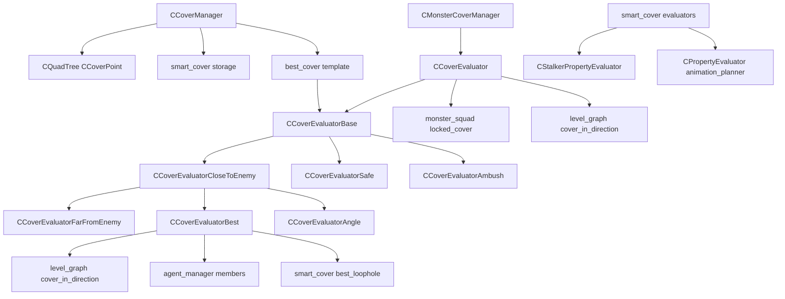

# Покрытия: cover_evaluators, smart_cover_evaluators, monster_cover_manager

Модуль: `src/xrGame/` — `cover_evaluators.h/.cpp/inline.h` (196+405+199 стр.), `smart_cover_evaluators.h/.cpp` (230+343 стр.), `cover_manager.h/inline.h` (89+133 стр.), `cover_point.h` (29 стр.); `ai/monsters/` — `monster_cover_manager.h/.cpp` (26+253 стр.).
Порцион 24 (итерация 6).

## Чего не делает

- Не содержит `smart_cover::cover`/`loophole` — ит. 12 (Level_*).
- Не содержит `stalker_movement_manager_smart_cover` — порц. 14.
- Не управляет FSM — только выбирает точку покрытия.
- `cover_evaluators.h` — 196 стр. (не 199k; inline 199 стр.).

## §1. Архитектура

```
CCoverManager (quadtree + smart_covers)
  └─ best_cover(position, radius, evaluator, restrictor)
       └─ evaluator.evaluate(cover_point, weight)
            └─ CCoverEvaluatorBase (m_selected, m_best_value, m_loophole)

CCoverPoint (m_position, m_level_vertex_id, m_is_smart_cover)

smart_cover::evaluators (11 классов, CStalkerPropertyEvaluator / CPropertyEvaluator<animation_planner>)

CMonsterCoverManager (на CBaseMonster, 1 evaluator)
```

## §2. `CCoverPoint` (cover_point.h)

| Поле | Тип | Назначение |
|---|---|---|
| `m_position` | `Fvector` | Позиция покрытия |
| `m_level_vertex_id` | `u32 : 31` | ID вершины level graph |
| `m_is_smart_cover` | `u32 : 1` | Флаг smart cover |

## §3. `CCoverManager` (cover_manager*)

### Поля

| Поле | Тип | Назначение |
|---|---|---|
| `m_covers` | `CQuadTree<CCoverPoint>*` | Quadtree всех cover points |
| `m_temp` | `xr_vector<bool>` | Временной буфер |
| `m_nearest` | `PointVector` | Кэш nearest |
| `m_smart_covers_storage` | `smart_cover::storage*` | Хранилище smart covers |
| `m_smart_covers` | `SmartCovers` | Список smart covers |
| `m_smart_covers_actual` | `bool` | Флаг актуальности |

### `best_cover(position, radius, evaluator, restrictor)`

1. `inertia(position, radius, evaluator, restrictor)`:
   - `!evaluator.inertia(position, radius)` → false.
   - `!evaluator.selected()` → true.
   - `!evaluator.accessible(selected->position())` → false.
   - `!restrictor(selected)` → false.
   - Иначе → true.
2. `evaluator.initialize(position)`.
3. Если `last` и `distance < 3*radius` и `accessible` и `restrictor` → `evaluator.evaluate(last, weight)`.
4. `covers().nearest(position, radius, m_nearest)`.
5. Цикл по `m_nearest`:
   - `radius_sqr < distance_sqr` → skip.
   - `abs(position.y - cover.y) > 3.f` → skip.
   - `!evaluator.accessible` → skip.
   - `!restrictor(cover)` → skip.
   - `evaluator.evaluate(cover, weight)`.
6. `evaluator.finalize()`, `restrictor.finalize(selected)`.
7. Return `evaluator.selected()`.

### `operator()` / `weight` / `finalize`

`operator()` → true (accept all). `weight` → 1.f. `finalize` → нет.

### `add_smart_cover` / `smart_cover`

`add_smart_cover(table_name, object, is_combat_cover, can_fire, loopholes)` → `Cover*`.
`smart_cover(cover_id)` → `Cover*`.

## §4. `CCoverEvaluatorBase` (cover_evaluators*)

### Поля

| Поле | Тип | Назначение |
|---|---|---|
| `m_selected` | `CCoverPoint const*` | Выбранное покрытие |
| `m_previous_selected` | `CCoverPoint const*` | Предыдущее |
| `m_last_update` | `u32` | Время последнего обновления |
| `m_inertia_time` | `u32` | Время инерции |
| `m_best_value` | `float` | Лучшее значение (дефолт flt_max) |
| `m_best_loophole_value` | `float` | Лучшее значение loophole |
| `m_initialized` | `bool` | Флаг инициализации |
| `m_start_position` | `Fvector` | Позиция старта |
| `m_object` | `CRestrictedObject*` | Владелец |
| `m_stalker` | `CAI_Stalker*` | Если владелец — сталкер |
| `m_actuality` | `bool` | Флаг актуальности |
| `m_last_radius` | `float` | Последний радиус |
| `m_loophole` | `smart_cover::loophole*` | Выбранный loophole |
| `m_use_smart_covers_only` | `bool` | Только smart covers |
| `m_can_use_smart_covers` | `bool` | Можно использовать smart covers |

### `inertia(position, radius)`

1. `radius_criteria = (m_last_radius + EPS_L) >= radius`.
2. `time_criteria = Device.dwTimeGlobal < m_last_update + m_inertia_time`.
3. `m_last_radius = radius`.
4. Если `time_criteria && radius_criteria` → true.
5. Если `!m_stalker` → false.
6. `cover = m_stalker->get_current_smart_cover()`. Если `!cover` → false.
7. `!m_stalker->get_current_loophole()` || `!cover->is_position_in_danger_fov(loophole, position)` → false.
8. `!m_stalker->can_fire_right_now()` → false.
9. Иначе → true.

### `initialize(start_position, fake_call)`

`m_start_position = start_position`, `m_previous_selected = m_selected`, `m_selected = 0`, `m_best_value = 1000.f`, `m_loophole = 0`. Если `!fake_call` → `m_last_update = Device.dwTimeGlobal`.

### `finalize()`

`m_initialized = false`, `m_actuality = true`.

### `setup()`

`m_initialized = true`.

### `evaluate(cover_point, weight)` — диспетчер

Если `!cover_point->m_is_smart_cover` → `evaluate_cover(cover_point, weight)`. Иначе (smart cover):
- `#ifndef MASTER_GOLD`: `!psAI_Flags.test(aiUseSmartCovers)` → return.
- `tmp = static_cast<smart_cover::cover const*>(cover_point)`.
- Если `tmp->is_combat_cover()` → `evaluate_smart_cover(tmp, weight)`.

## §5. `CCoverEvaluatorCloseToEnemy`

Поля: `m_enemy_position`, `m_min_distance`, `m_max_distance`, `m_current_distance`, `m_deviation`, `m_best_distance`.

### `setup(enemy_position, min, max, deviation)`

`m_enemy_position = enemy_position`. `m_actuality = m_actuality && fsimilar(...)`. Обновляет `m_min/max/deviation`.

### `initialize(start_position)`

`inherited::initialize`, `m_current_distance = m_start_position.distance_to(m_enemy_position)`.

### `evaluate_cover(cover_point, weight)`

1. `enemy_distance = m_enemy_position.distance_to(cover_point->position())`.
2. `(enemy_distance <= m_min) && (m_current > enemy_distance)` → return.
3. `(enemy_distance >= m_max) && (m_current < enemy_distance)` → return.
4. `enemy_distance >= m_current + m_deviation` → return.
5. `enemy_distance >= m_best_value` → return.
6. `m_selected = cover_point`, `m_best_value = enemy_distance`.

`evaluate_smart_cover` — пусто.

## §6. `CCoverEvaluatorFarFromEnemy`

Наследует `CCoverEvaluatorCloseToEnemy`.

### `evaluate_cover(cover_point, weight)`

1. `enemy_distance = m_enemy_position.distance_to(cover_point->position())`.
2. `(enemy_distance <= m_min) && (m_current > enemy_distance)` → return.
3. `(enemy_distance >= m_max) && (m_current < enemy_distance)` → return.
4. `enemy_distance <= m_current - m_deviation` → return.
5. `enemy_distance <= -m_best_value` → return.
6. `m_selected = cover_point`, `m_best_value = -enemy_distance`.

`evaluate_smart_cover` — пусто.

## §7. `CCoverEvaluatorBest`

Наследует `CCoverEvaluatorCloseToEnemy`.

### `threat_on_the_way(cover_position)`

1. `start_to_cover = cover_position - m_start_position`. Если `magnitude < EPS_L` → false.
2. `start_to_threat = m_enemy_position - m_start_position`.
3. `start_to_cover_direction = start_to_cover.normalize()`.
4. `projection = start_to_cover_direction.dotproduct(start_to_threat)`.
5. `cos_alpha = projection / start_to_threat.magnitude()`.
6. `angle = acosf(cos_alpha)`. Если `angle >= PI_DIV_6` (30°) → false.
7. `projection > start_to_cover_magnitude * 1.5` → false.
8. Иначе → true (угроза на пути).

### `evaluate_cover(cover_point, weight)`

1. `fis_zero(weight)` → return.
2. `m_use_smart_covers_only && !cover_point->m_is_smart_cover` → return.
3. `enemy_distance = m_enemy_position.distance_to(cover_point->position())`.
4. `(enemy_distance <= m_min) && (m_current > enemy_distance)` → return.
5. `(enemy_distance >= m_max) && (m_current < enemy_distance)` → return.
6. `threat_on_the_way(cover_point->position())` → return.
7. `direction = m_enemy_position - cover_point->position()`, `getHP(y, p)`, `y = angle_normalize(y)`.
8. `high_cover = level_graph().high_cover_in_direction(y, vertex)`.
9. `low_cover = level_graph().low_cover_in_direction(y, vertex)`.
10. `cover_value = min(high, low)`.
11. `value = cover_value`. Если `neighbour_in_direction(direction, vertex)` → `value += 10.f`.
12. **Теамат-бонус:** для каждого члена squad (кроме себя): если `distance_sqr < 2.25` (1.5 м) → `value += 1000.f`.
13. `value /= weight`.
14. `value > m_best_value` → return.
15. `(value == m_best_value) && (cover_point > m_selected)` → return.
16. `m_selected = cover_point`, `m_best_value = value`, `m_loophole = 0`.

### `evaluate_smart_cover(smart_cover, weight)`

1. `!m_can_use_smart_covers` → return.
2. `best_loophole = smart_cover->best_loophole(m_enemy_position, value, false, is_current_cover)`.
3. `!best_loophole` → return.
4. `value *= g_smart_cover_factor` (глоб. `float`, дефолт 1.f).
5. `value >= m_best_value` → return.
6. `m_best_value = value / weight`, `m_selected = smart_cover`, `m_loophole = best_loophole`.

## §8. `CCoverEvaluatorAngle`

Наследует `CCoverEvaluatorCloseToEnemy`.

Поля: `m_direction`, `m_best_direction`, `m_best_alpha`, `m_level_vertex_id`.

### `setup(enemy_position, min, max, level_vertex_id)`

`inherited::setup`, `m_actuality = m_actuality && (m_level_vertex_id == level_vertex_id)`.

### `initialize(start_position, fake_call)`

1. `inherited::initialize`.
2. `m_best_alpha = -1.f`.
3. `m_direction = m_start_position - m_enemy_position`, `normalize_safe()`.
4. Цикл `alpha = 0..2*PI, step = 2*PI/360`:
   - `high_value = level_graph().compute_high_square(alpha, PI/2, vertex)`.
   - `low_value = level_graph().compute_low_square(alpha, PI/2, vertex)`.
   - `value = max(high, low)`.
   - Если `value > best_value` → `best_value = value`, `m_best_angle = alpha`.
5. `m_best_direction.setHP(m_best_angle, 0)`.

### `evaluate_cover(cover_point, weight)`

1. `enemy_distance = m_enemy_position.distance_to(cover_point->position())`.
2. `(enemy_distance <= m_min) && (m_current > enemy_distance)` → return.
3. `(enemy_distance >= m_max) && (m_current < enemy_distance)` → return.
4. `direction = cover_point->position() - m_enemy_position`, `normalize_safe()`.
5. `cos_a = direction.dotproduct(m_best_direction)`.
6. `cos_a < m_best_alpha` → return.
7. `m_selected = cover_point`, `m_best_alpha = cos_a`.

`evaluate_smart_cover` — пусто.

## §9. `CCoverEvaluatorSafe`

Наследует `CCoverEvaluatorBase`.

Поле: `m_min_distance`.

### `setup(min_distance)`

`m_actuality = m_actuality && fsimilar(m_min_distance, min_distance)`.

### `evaluate_cover(cover_point, weight)`

1. `m_start_position.distance_to(cover_point->position()) <= m_min_distance` → return.
2. `high_cover = level_graph().vertex_high_cover(vertex)`.
3. `low_cover = level_graph().vertex_low_cover(vertex)`.
4. `cover_value = min(high, low)`.
5. `cover_value >= m_best_value` → return.
6. `m_selected = cover_point`, `m_best_value = cover_value`.

`evaluate_smart_cover` — пусто.

## §10. `CCoverEvaluatorAmbush`

Наследует `CCoverEvaluatorBase`.

Поля: `m_my_position`, `m_enemy_position`, `m_min_enemy_distance`.

### `setup(my_position, enemy_position, min_enemy_distance)`

`m_actuality = m_actuality && m_enemy_position.similar(enemy_position, 5.f)`.
`m_actuality = m_actuality && fsimilar(m_min_enemy_distance, min_enemy_distance)`.

### `evaluate_cover(cover_point, weight)`

1. `my_distance = m_my_position.distance_to(cover_point->position())`.
2. `my_distance <= m_min_enemy_distance` → return.
3. `direction = m_enemy_position - cover_point->position()`, `getHP(y, p)`, `y = angle_normalize(y)`.
4. `cover_from_enemy = min(high_cover_in_direction(y, vertex), low_cover_in_direction(y, vertex))`.
5. `direction = m_my_position - cover_point->position()`, `getHP(y, p)`, `y = angle_normalize(y)`.
6. `cover_from_myself = min(high_cover_in_direction(y, vertex), low_cover_in_direction(y, vertex))`.
7. `value = cover_from_enemy / cover_from_myself`.
8. `value >= m_best_value` → return.
9. `m_selected = cover_point`, `m_best_value = value`.

`evaluate_smart_cover` — пусто.

## §11. `smart_cover::evaluators` (smart_cover_evaluators*)

11 классов. Базовые: `CStalkerPropertyEvaluator` (`CAI_Stalker`) и `CPropertyEvaluator<animation_planner>`.

| Класс | База | `evaluate()` |
|---|---|---|
| `in_cover_evaluator` | `CStalkerPropertyEvaluator` | `!!movement().current_params().cover()` |
| `cover_actual_evaluator` | `CStalkerPropertyEvaluator` | `current.cover() == target.cover()` |
| `cover_entered_evaluator` | `CStalkerPropertyEvaluator` | `!!movement().current_params().cover()` |
| `loophole_actual_evaluator` | `CStalkerPropertyEvaluator` | `current.cover() == target.cover() && current.loophole() == target.loophole()` |
| `loophole_hit_long_ago_evaluator` | `CPropertyEvaluator<animation_planner>` | `(planner->time_object_hit() + m_time_to_wait) < Device.dwTimeGlobal` |
| `loophole_planner_const_evaluator` | `CPropertyEvaluator<animation_planner>` | `m_value` (константа) |
| `is_action_available_evaluator` | `CPropertyEvaluator<animation_planner>` | `cover && loophole && loophole->is_action_available(m_action_id)` |
| `loophole_exitable_evaluator` | `CStalkerPropertyEvaluator` | `cover_loophole() && cover_loophole()->exitable()` |
| `can_exit_loophole_with_animation` | `CStalkerPropertyEvaluator` | Если `current.cover() != target.cover()` или `current.loophole() != target.loophole()` → `current_transition().animation().has_animation()`, иначе false |
| `default_behaviour_evaluator` | `CPropertyEvaluator<animation_planner>` | `movement().default_behaviour() || movement().combat_behaviour()` |
| `can_fire_at_enemy_evaluator` | `CPropertyEvaluator<animation_planner>` | Если `!default_behaviour()` → true. Если `cover_fire_position()` → true. Если `!enemy_in_fov()` → false. Иначе true. |
| `idle_time_interval_passed_evaluator` | `CPropertyEvaluator<animation_planner>` | Если `!stay_idle()` → false. Если `current_time <= last_idle_time + m_time_interval` → `stay_idle(true)`, true. Иначе → `last_lookout_time(current)`, `m_time_interval = default_idle_interval()`, `stay_idle(false)`, false. |
| `lookout_time_interval_passed_evaluator` | `CPropertyEvaluator<animation_planner>` | Если `stay_idle()` → false. Если `current_time <= last_lookout_time + m_time_interval` → `stay_idle(false)`, true. Иначе → `last_idle_time(current)`, `m_time_interval = default_lookout_interval()`, `stay_idle(true)`, false. |

## §12. `CMonsterCoverManager` (monster_cover_manager*)

Поля: `m_object` (`CBaseMonster*`), `m_ce_best` (`CCoverEvaluator*`).

### Внутренний `CCoverEvaluator`

Наследует `CCoverEvaluatorBase`. Поля: `m_dest_position`, `m_min_distance`, `m_max_distance`, `m_current_distance`, `m_deviation`, `m_best_distance`, `m_object` (`CBaseMonster*`).

### `setup(object, position, min, max, deviation)`

`m_dest_position = position`. `m_actuality = m_actuality && fsimilar(...)`.

### `initialize(start_position)`

`inherited::initialize`, `m_current_distance = m_start_position.distance_to(m_dest_position)`.

### `evaluate_cover(cover_point, weight)`

1. `squad = monster_squad().get_squad(m_object)`. Если `squad->is_locked_cover(vertex)` → return.
2. `fis_zero(weight)` → return.
3. `dest_distance = m_dest_position.distance_to(cover_point->position())`.
4. `(dest_distance <= m_min) && (m_current > dest_distance)` → return.
5. `(dest_distance >= m_max) && (m_current < dest_distance)` → return.
6. `direction = m_dest_position - cover_point->position()`, `getHP(y, p)`.
7. `high_cover = level_graph().high_cover_in_direction(y, vertex)`.
8. `low_cover = level_graph().low_cover_in_direction(y, vertex)`.
9. `cover_value = min(high, low)`.
10. `value = cover_value`. Если `neighbour_in_direction(direction, vertex)` → `value += 10.f`.
11. `value /= weight`.
12. `value >= m_best_value` → return.
13. `m_selected = cover_point`, `m_best_value = value`.

`evaluate_smart_cover` — пусто.

### `find_cover(position, min, max, deviation)`

`m_ce_best->setup(m_object, position, min, max, deviation)`.
`point = ai().cover_manager().best_cover(m_object->Position(), 30.f, *m_ce_best)`.
Return `point`.

### `find_cover(src_pos, dest_pos, min, max, deviation)`

Аналогично, но `best_cover(src_pos, 30.f, ...)`.

### `less_cover_direction(dir)`

1. `angle = level_graph().vertex_high_cover_angle(vertex, deg(10), greater<float>())`.
2. `angle_from = angle - PI/2`, `angle_to = angle + PI/2`.
3. `trace_from = m_object->Center()`.
4. Цикл влево: `ang = angle..angle-PI/2, step = -deg(10)`. `RayPick(trace_from, direction, 3.f, rqtStatic)`. Если `range < 3.f` → `angle_from = ang`, break.
5. Цикл вправо: аналогично.
6. `angle = angle_normalize(angle_from + (angle_from - angle_to)/2)`.
7. `dir.setHP(angle, 0)`.

## §13. Связи



## §14. Замечания к плану

- `CCoverEvaluatorBase::m_best_value` дефолт `flt_max`, в `initialize` → 1000.f.
- `CCoverEvaluatorBest::evaluate_cover` — теамат-бонус +1000 если член squad ближе 1.5 м.
- `CCoverEvaluatorBest::evaluate_smart_cover` — `g_smart_cover_factor` (глоб. `float`, дефолт 1.f).
- `CCoverEvaluatorAmbush` — `value = cover_from_enemy / cover_from_myself` (чем меньше, тем лучше).
- `CCoverEvaluatorAngle::initialize` — 360 итераций по 1°.
- `CCoverManager::best_cover` — Y-фильтр `abs(position.y - cover.y) > 3.f`.
- `CMonsterCoverManager::less_cover_direction` — 2×10 лучей по 3 м, step 10°.
- `smart_cover::evaluators` — 13 классов (не 11; `idle_time_interval_passed` и `lookout_time_interval_passed` — 13-й и 14-й).

## §15. Краткое резюме

- **`CCoverPoint`** — позиция + vertex + smart cover flag.
- **`CCoverManager`** — quadtree + smart covers, `best_cover` (inertia → initialize → nearest → evaluate).
- **`CCoverEvaluatorBase`** — `m_selected`, `m_best_value`, `m_loophole`, `inertia` (time + radius + stalker cover).
- **6 оценщиков:** CloseToEnemy, FarFromEnemy, Best (threat_on_the_way + cover_value + teammate penalty), Safe (vertex cover), Ambush (cover_from_enemy/cover_from_myself), Angle (360° scan).
- **`CMonsterCoverManager`** — 1 evaluator, `find_cover` (30 м радиус), `less_cover_direction` (ray traces).
- **`smart_cover::evaluators`** — 13 классов для animation planner (idle/lookout/can_fire/exit_loophole).

Порцион 24 (итерация 6). Далее: порц. 25 — `steering-steps.md` — steering + `CStepManager` ([steering-steps.md](steering-steps.md)).
