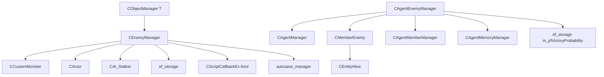

# Враги: CEnemyManager, CAgentEnemyManager

Модуль: `src/xrGame/` — `enemy_manager.h/.cpp/inline.h` (99+502+55 стр.), `agent_enemy_manager.h/.cpp` (66+781 стр.), `member_enemy.h/inline.h` (35+28 стр.), `object_manager.h/inline.h` (шаблон-база, 37+116 стр.).
Порцион 23 (итерация 6).

## Чего не делает

- Не содержит `CMonsterEnemyManager`/`CMonsterEnemyMemory` — порц. 22.
- Не содержит `visual_memory_manager`/`hit_memory_manager` — ит. 11/12.
- Не управляет FSM — только выбирает/распределяет цель.
- Не знает про Lua API AI (ит. 14) — только `_G.CAI_Stalker__OnEnemySelected`.

## §1. Архитектура: три уровня

```
CAgentEnemyManager (squad-уровень, на CAgentManager)
  └─ CMemberEnemy (описывает врага для squad: mask, distribute_mask, probability)
       └─ CEnemyManager (на каждого CCustomMonster: сталкер/монстр)
            └─ CObjectManager<const CEntityAlive> (база: m_objects + m_selected)
```

- **`CObjectManager<T>`** — базовый шаблон: `m_objects` (vector), `m_selected` (один), `add()` (фильтрует по `is_useful`), `do_evaluate()`, `update()` (берёт min), `reset()`.
- **`CEnemyManager`** — наследует `CObjectManager<const CEntityAlive>`. Один на каждого `CCustomMonster`. Выбирает **одного** врага.
- **`CAgentEnemyManager`** — на `CAgentManager` (squad). Распределяет врагов между членами squad, обрабатывает раненых.

## §2. `CObjectManager<T>` (object_manager*)

| Метод | Логика |
|---|---|
| `add(T*)` | `is_useful` → `std::find` → `push_back` |
| `is_useful(T*)` | `spatial.type & STYPE_VISIBLEFORAI` (переопределяется) |
| `do_evaluate(T*)` | `0.f` (переопределяется) |
| `update()` | `m_selected = 0`; цикл: `value = do_evaluate(*I)`; если `result > value` → `result = value`, `m_selected = *I` (min) |
| `reset()` | `m_objects.clear()` |
| `reinit()` | `m_objects.clear()`, `m_selected = 0` |

## §3. `CEnemyManager` (enemy_manager*)

### Поля

| Поле | Тип | Назначение |
|---|---|---|
| `m_object` | `CCustomMonster*` | Владелец |
| `m_stalker` | `CAI_Stalker*` | Если владелец — сталкер (`smart_cast`) |
| `m_ignore_monster_threshold` | `float` | Порог игнорирования монстров (дефолт 1.0) |
| `m_max_ignore_distance` | `float` | Макс. дистанция для игнора (дефолт 0) |
| `m_visible_enemy_bias_actor` | `float` | Bias для актёра (дефолт -1 → 900) |
| `m_visible_enemy_bias_npc` | `float` | Bias для NPC (дефолт -1 → 300) |
| `m_hit_redirect_max` | `float` | Макс. бонус за хит (дефолт -1 = выкл) |
| `m_hit_redirect_falloff` | `float` | Расстояние затухания (дефолт 60) |
| `m_ready_to_save` | `bool` | Флаг для autosave |
| `m_last_enemy_time` | `u32` | Время последнего врага |
| `m_last_enemy` | `CEntityAlive*` | Последний враг |
| `m_last_enemy_change` | `u32` | Время последнего переключения |
| `m_useful_callback` | `CScriptCallbackEx<bool>` | Lua-колбэк «полезен ли» |
| `m_enable_enemy_change` | `bool` | Разрешить переключение |
| `m_smart_cover_enemy` | `CEntityAlive*` | Принудительный враг (smart cover) |
| `m_useful_cache` | `xr_unordered_flat_map<u16, cached_useful>` | Кэш useful (jitter по ID) |

### Константы инерции

```
ENEMY_INERTIA_TIME_TO_SOMEBODY = 3000   // мс инерции при смене на «кого-то»
ENEMY_INERTIA_TIME_TO_ACTOR    = 0      // нет инерции при смене на актёра
ENEMY_INERTIA_TIME_FROM_ACTOR  = 6000   // мс инерции при уходе с актёра
```

### `useful()` — фильтр кандидатов

1. `!g_Alive()` → false.
2. `spatial.type & STYPE_VISIBLEFORAI` ≠ STYPE_VISIBLEFORAI → false.
3. `ID() == object->ID()` или `!is_relation_enemy(object)` → false.
4. Нет level graph или невалидный vertex → false.
5. **Игнор монстра:** `m_object->human_being()` && `!object->human_being()` && `!expedient(object)` && `evaluate(object) >= m_ignore_monster_threshold` && `distance >= m_max_ignore_distance` → false.
6. **Lua-колбэк с кэшем:** `enemy_manager_useful_cache_time` (глоб. `int`, дефолт 200 мс). Ключ — `object->ID()`. Jitter: `(ID % 97 + 1) * (ID & 1 ? -1 : 1)` мс. Если `cache_time < 0` — без кэша.

### `evaluate()` — оценка врага (чем ниже, тем лучше)

```
penalty = 10000.f

// если object — тот, кто нас хитнул:
if (object->ID() == memory().hit().last_hit_object_id()):
    if (m_hit_redirect_max >= 0):
        falloff2 = m_hit_redirect_falloff²
        if d2 < falloff2: penalty -= m_hit_redirect_max * (1 - d2/falloff2)
    elif distance < 30: penalty -= 5        // CQB: маленький бонус
    else: penalty -= 100                     // сред/дальний: aggro на снайпера

// если мы видим object:
if (memory().visual().visible_now(object)): penalty -= 1000

// если object видит нас:
if (actor): penalty -= (m_visible_enemy_bias_actor >= 0 ? m_visible_enemy_bias_actor : 900)
elif (monster && monster->memory().visual().visible_now(m_object)):
    penalty -= (m_visible_enemy_bias_npc >= 0 ? m_visible_enemy_bias_npc : 300)

// раненый сталкер:
if (stalker && stalker->wounded()):
    if (m_stalker && m_stalker->agent_manager().enemy().assigned_wounded(object, m_stalker)):
        return 0.f   // уже назначен другой группе
    return distance  // квадрат расстояния

// итог:
return penalty + d2 / 100.f
```

`m_ready_to_save = false` если object — `CActor` (autosave блокируется).

### `expedient()` — «удобен ли» враг

Заполняет `ef_storage().non_alife().member/enemy`. Если `m_pfExpediency->dwfGetDiscreteValue()` → true. Если `memory().hit().hit(enemy)` → true.

### `update()` → `try_change_enemy()`

1. Autosave: `dec_not_ready()` если `!m_ready_to_save`, затем `m_ready_to_save = true`.
2. `try_change_enemy()`:
   - `process_wounded(only_wounded)`: если все враги — раненые → `only_wounded = true`, не обновлять. Иначе `remove_wounded()` (удаляет раненых из `m_objects`).
   - `need_update(only_wounded)`:
     - `!selected()` → true.
     - `!selected()->g_Alive()` → true.
     - `!is_relation_enemy(selected())` → true.
     - `enable_enemy_change()` && `!visible_now(selected())` → true.
     - `only_wounded` → false.
     - `selected()` раненый → true.
     - Последний хит после смены врага и хитер — враг → true.
   - Если `need_update`: `inherited::update()` (min по `do_evaluate`).
   - Если `selected != previous_selected`: `on_enemy_change(previous)`, `m_object->on_enemy_change(previous)`, Lua `_G.CAI_Stalker__OnEnemySelected`.
3. Если `selected()`: `m_last_enemy_time = Device.dwTimeGlobal`, `m_last_enemy = selected()`.
4. Autosave: `inc_not_ready()` если `!m_ready_to_save`.

### `on_enemy_change(previous)` — инерция

- `previous->g_Alive()` false → `m_last_enemy_change = now`.
- `change_from_wounded(selected, previous)` (current не ранен, previous ранен) → `m_last_enemy_change = now`.
- `enemy_inertia(previous)`:
  - `m_selected` — `CActor` → `now <= m_last_enemy_change + 0` (нет инерции).
  - `previous` — `CActor` → `now <= m_last_enemy_change + 6000`.
  - Иначе → `now <= m_last_enemy_change + 3000`.
  - Если инерция → `m_selected = previous` (откат).
- `!visible_now(previous)` && `visible_now(selected)` → `m_last_enemy_change = now` (закрепляем новый).
- Иначе → `m_last_enemy_change = now`.

### `selected()` — с smart cover

Если `m_smart_cover_enemy && m_smart_cover_enemy->g_Alive()` → возвращает `m_smart_cover_enemy`. Иначе `inherited::selected()`.

### `set_enemy` / `invalidate_enemy`

`set_enemy(enemy)`: `VERIFY(enemy && enemy->g_Alive())`, `m_smart_cover_enemy = enemy`.
`invalidate_enemy()`: `m_smart_cover_enemy = 0`.

### `reload(section)`

Читает `ignore_monster_threshold`, `max_ignore_distance`. Сбрасывает `m_last_enemy_time`, `m_last_enemy`, `m_last_enemy_change`, `m_useful_callback`. `VERIFY(m_ready_to_save)`.

### `remove_links(object)`

Удаляет из `m_objects`, сбрасывает `m_last_enemy`/`m_selected` если совпадает.

## §4. `CAgentEnemyManager` (agent_enemy_manager*)

### Поля

| Поле | Тип | Назначение |
|---|---|---|
| `m_object` | `CAgentManager*` | Владелец (squad) |
| `m_enemies` | `xr_vector<CMemberEnemy>` | Враги squad |
| `m_wounded` | `WOUNDED_ENEMIES` | Раненые: `(enemy, (processor_id, processed))` |
| `m_only_wounded_left` | `bool` | Все враги — раненые |
| `m_is_any_wounded` | `bool` | Есть хотя бы один раненый |

### `CMemberEnemy` (member_enemy.h)

| Поле | Тип | Назначение |
|---|---|---|
| `m_object` | `const CEntityAlive*` | Враг |
| `m_mask` | `mask_type` | Какие члены squad видят этого врага |
| `m_distribute_mask` | `mask_type` | Кому назначен этот враг |
| `m_probability` | `float` | Вероятность победы (0..1) |
| `m_enemy_position` | `Fvector` | Позиция врага (для memory) |
| `m_level_time` | `u32` | Время уровня (для memory) |

`operator<` — по `m_probability` (descending, для sort).

### `distribute_enemies()` — главный цикл

1. `!combat_mask()` → return.
2. `fill_enemies()`:
   - `m_enemies.clear()`.
   - Для каждого combat member: `probability(1.f)`, `memory().fill_enemies(CEnemyFiller(&m_enemies, mask))`.
   - `CEnemyFiller`: `std::find` → если нет → `push_back(CMemberEnemy(enemy, mask))`; если есть → `m_mask.set(mask, TRUE)`.
   - Удаляет из `m_wounded` тех, кого нет в `m_enemies`.
   - Определяет `m_only_wounded_left`, `m_is_any_wounded`.
   - `memory().object_information()` для каждого врага.
   - Если `!m_only_wounded_left && m_is_any_wounded` → `remove_wounded` из `m_enemies`.
3. Если `m_enemies.empty()` → return.
4. Если `m_only_wounded_left` → `assign_wounded()`. Иначе:
   - `compute_enemy_danger()`: для каждого врага `best = max(evaluate(victim, member))` по combat members. Sort по `m_probability`.
   - `assign_enemies()`: жадное распределение. Цикл: ищет врага с максимальным `evaluate(member, enemy)` среди неassigned. Назначает, `member->probability(best)`, `enemy.m_probability *= (1 - best)`. Bubble sort для восстановления порядка.
   - `permutate_enemies()`:
     - Заполняет `member->enemies()` и `selected_enemy()` по `m_mask`/`m_distribute_mask`.
     - Итеративный обмен: если член ближе к чужому врагу, чем текущий владелец, и эффективность схожа → `exchange_enemies()`.
     - Финальный проход: `visible_now` или `last_hit_object_id` → `m_distribute_mask.assign(...)`.
5. `assign_enemy_masks()`:
   - `make_object_visible_somewhen()` для каждого врага.
   - `setup_mask()`: для visibles/sounds/hits — `m_squad_mask |= m_distribute_mask`.

### `assign_wounded()` — распределение раненых

- `VERIFY(m_only_wounded_left)`.
- Сохраняет предыдущие `m_wounded` в `_alloca`, очищает.
- Для каждого раненого: если член в пределах `wounded_enemy_reached_distance` (3 м) и не назначен → `wounded_processor(enemy, member_id)`, `m_distribute_mask.set(mask, TRUE)`.
- Цикл `while population(assigned) < combat_member_count`: ищет врага с минимальной `population(m_distribute_mask)` и ближайшего члена. `population` — попкорн-счётчик битов (bit population count).
- `if (!enemy)` → return (ситуация «враг ушёл оффлайн»).

### `wounded_processor` / `wounded_processed` / `assigned_wounded`

- `wounded_processor(object)` → `processor_id` или `-1`.
- `wounded_processor(object, id)` → `push_back((object, (id, false)))`.
- `wounded_processed(object, value)` → `VERIFY(value)`, `processed = true`.
- `wounded_processed(object)` → bool.
- `assigned_wounded(wounded, member)` → ищет в `m_enemies`, проверяет `m_distribute_mask.test(member_mask)`.

### `useful_enemy(enemy, member)`

- `!registered_in_combat(member)` → true.
- `enemy` не в `m_enemies` → true.
- Иначе `m_distribute_mask.test(member_mask)`.

### `remove_links(object)`

Удаляет из `m_wounded` по `wounded_predicate` (совпадение `first` или `second.first`).

### `update()` — пустой

## §5. `population` (popcount)

```c
u32 population(u32 b) {
    a = (a & 0x55555555) + ((a >> 1) & 0x55555555);
    a = (a & 0x33333333) + ((a >> 2) & 0x33333333);
    a = (a + (a >> 4)) & 0x0f0f0f0f;
    a = (a + (a >> 8)) & 0x00ff00ff;
    a = (a + (a >> 16)) & 0x0000003f;
    return a;
}
// u64: population((u32)b) + population(u32(b >> 32))
```

Используется в `assign_wounded()` для подсчёта назначенных членов.

## §6. Связи



## §7. Замечания к плану

- `CEnemyManager::useful()` — кэш Lua-колбэка (demonized). `enemy_manager_useful_cache_time` — глобальный `int` (200 мс). Jitter по ID.
- `CEnemyManager::evaluate()` — формула `penalty + d2/100`. Penalty: 10000 − хит-бонус − 1000 (видит) − 900/300 (видит нас).
- `ENEMY_INERTIA_TIME_TO_ACTOR = 0` — нет инерции при смене на актёра (мгновенная реакция).
- `CAgentEnemyManager::update()` — пустой. Все вычисления в `distribute_enemies()`.
- `m_smart_cover_enemy` — принудительная цель (smart cover), перекрывает `m_selected`.
- `m_pfVictoryProbability` — EF-функция для squad-распределения.
- `wounded_enemy_reached_distance = 3.f` — дистанция, на которой член «достигает» раненого.

## §8. Краткое резюме

- **`CObjectManager<T>`** — база: `m_objects` + `m_selected`, `add`/`is_useful`/`do_evaluate`/`update` (min).
- **`CEnemyManager`** — один на `CCustomMonster`. `useful()` (фильтр + Lua-кэш), `evaluate()` (penalty + d2/100), `update()` → `try_change_enemy()` (wounded, need_update, min, on_enemy_change с инерцией).
- **`CAgentEnemyManager`** — один на squad. `distribute_enemies()`: `fill_enemies` → `compute_enemy_danger` + `assign_enemies` + `permutate_enemies` (или `assign_wounded`). `wounded_processor`/`assigned_wounded`/`useful_enemy`.
- **`CMemberEnemy`** — враг для squad: `m_mask`, `m_distribute_mask`, `m_probability`.
- **`population`** — popcount для маск squad.

Порцион 23 (итерация 6). Далее: порц. 24 — `smart-terrain.md` — `smart_terrain` (smart-terrain: задачи, зоны) ([smart-terrain.md](smart-terrain.md)).
