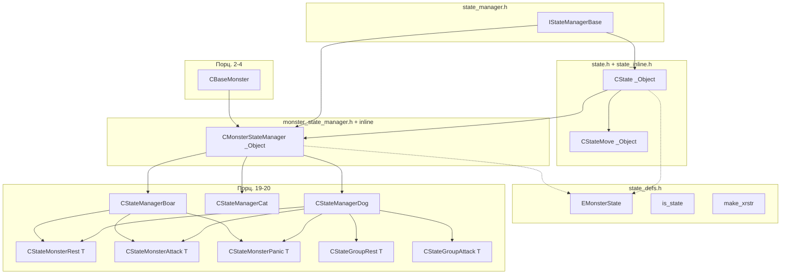

# FSM-фундамент: CState, EMonsterState, CMonsterStateManager

> **Модуль:** `src/xrGame/ai/monsters/` — FSM-ядро монстров
> **Файлы:** `state.h` (104), `state_inline.h` (235), `state_defs.h` (308), `state_manager.h` (30), `monster_state_manager.h` (44), `monster_state_manager_inline.h` (98)
> **Порцион 18 (итерация 6).**

## Чего НЕ делает и границы

- **Не описывает** конкретные `CStateMonster*` — порц. 19.
- **Не описывает** `CStateGroup*` — порц. 20.
- **Не описывает** `CControl_*` — порц. 21.
- **Не описывает** `CBaseMonster::Think`/`UpdateCL` — порц. 2–3.

---

## 1. `IStateManagerBase` — `state_manager.h` (30 стр.)

Абстрактный интерфейс:

| Метод | Назначение |
|---|---|
| `reinit()` | Пересоздать состояние (новый уровень) |
| `update()` | Тик FSM |
| `force_script_state(EMonsterState)` | Принудительно установить состояние из скрипта |
| `execute_script_state()` | Выполнить текущее состояние (без выбора) |
| `critical_finalize()` | Экстренное завершение (без cleanup) |
| `remove_links(CObject*)` | Разобрать ссылки при удалении объекта |
| `get_state_type()` → `EMonsterState` | Текущий тип состояния |
| `check_control_start_conditions(EControlType)` | Можно ли активировать контроллер |

---

## 2. `EMonsterState` — `state_defs.h` (308 стр.)

Иерархия битовых масок:

```
eGlobalState = 1 << 15 = 0x8000

Группа (<< 1..<< 15):
  eStateRest              = eGlobalState << 1  = 0x10000
  eStateEat               = eGlobalState << 2  = 0x20000
  eStateAttack            = eGlobalState << 3  = 0x40000
  eStatePanic             = eGlobalState << 4  = 0x80000
  eStateHitted            = eGlobalState << 5  = 0x100000
  eStateHearDangerousSound= eGlobalState << 6  = 0x200000
  eStateHearInterestingSound = eGlobalState << 7 = 0x400000
  eStateControlled        = eGlobalState << 8  = 0x800000
  eStateThreaten          = eGlobalState << 9  = 0x1000000
  eStateFindEnemy         = eGlobalState << 10 = 0x2000000
  eStateSquad             = eGlobalState << 11 = 0x4000000
  eStateCustom            = eGlobalState << 15 = 0x8000000

Субсостояния: группа | 1..N
```

### 2.1 Полная таблица

| Группа | Базовая | Субсостояния |
|---|---|---|
| **Rest** | `eStateRest` | WalkGraphPoint(1), Idle(2), Fun(3), Sleep(4), MoveToHomePoint(5), WalkToCover(6), LookOpenPlace(7) |
| **Eat** | `eStateEat` | CorpseApproachRun(1), CorpseApproachWalk(2), CheckCorpse(3), Eat(4), WalkAway(5), Rest(6), Drag(7) |
| **Attack** | `eStateAttack` | Run(1), Melee(2), RunAttack(3), RunAway(4), FindEnemy(5), Steal(6), AttackHidden(7), Hide(9), HideInCover(10), MoveOut(11), CampInCover(12), ControlFire(13), ControlTube(14), HideInCoverLite(15), **AttackCamp**(16, с подгруппой: Hide(17), Camp(18), StealOut(19)), **Psy**(20), **MoveToHomePoint**(21, с подгруппой: Hide(22), Camp(23), LookOpenPlace(24)), Attack_On_Run(25) |
| **Panic** | `eStatePanic` | Run(1), FaceUnprotectedArea(2), MoveToHomePoint(3), HomePoint_Hide(4), HomePoint_LookOpenPlace(5), HomePoint_Camp(6) |
| **Hitted** | `eStateHitted` | Hide(1), MoveOut(2), Home(3) |
| **HearDangerousSound** | `eStateHearDangerousSound` | Hide(1), FaceOpenPlace(2), StandScared(3), Home(4) |
| **HearInterestingSound** | `eStateHearInterestingSound` | MoveToDest(1), LookAround(2) |
| **HearHelpSound** | *(внутри Interesting)* | Base(3), MoveToDest(4), LookAround(5) |
| **Controlled** | `eStateControlled` | Follow(1), Attack(2), Follow_Wait(3), Follow_WalkToObject(4) |
| **Threaten** | `eStateThreaten` | — (нет субсостояний) |
| **FindEnemy** | `eStateFindEnemy` | Run(1), LookAround(2), Angry(3), WalkAround(4), LookAround_MoveToPoint(5), LookAround_LookAround(6), LookAround_TurnToPoint(7) |
| **Squad** | `eStateSquad` | Rest(1), RestFollow(2), Rest_Idle(3), Rest_WalkAroundLeader(4), RestFollow_Idle(5), RestFollow_WalkToPoint(6) |
| **Custom** | `eStateCustom` | BurerScanning(1), MoveToRestrictor(2), SmartTerrainTask(3, с подгруппой: GamePathWalk(4), LevelPathWalk(5), WaitCapture(6)) |

### 2.2 Custom attack states (пересечение Custom + Attack)

| Имя | Формула | Назначение |
|---|---|---|
| `eStateCustom_Vampire` | Custom \| Attack \| 1 | Кровосос: ApproachEnemy(2), Execute(3), RunAway(4), Hide(5) |
| `eStateBurerAttack_*` | Custom \| Attack \| 6..12 | Буер: Tele(6), Gravi(7), RunAround(8), FaceEnemy(9), Melee(10), Shield(11), AntiAim(12) |
| `eStatePredator_*` | Custom \| Attack \| 13..16 | Хищник: MoveToCover(13), LookOpenPlace(14), Camp(15), Predator(16) |

### 2.3 Утилиты

```cpp
#define is_state(state, type) (((state & type) == type) && (state != eStateUnknown))
```

`make_xrstr(EMonsterState)` → `xr_string` (switch, ~100 кейсов, для debug/лог).

---

## 3. `CState<_Object>` — `state.h` (104 стр.) + `state_inline.h` (235 стр.)

Шаблонный класс-база для всех состояний.

### 3.1 Поля

| Поле | Тип | Назначение |
|---|---|---|
| `object` | `_Object*` | Ссылка на монстра |
| `_data` | `void*` | Произвольные данные (конструктор) |
| `current_substate` | `u32` | Текущий sub-state id |
| `prev_substate` | `u32` | Предыдущий sub-state id |
| `time_state_started` | `u32` | Время входа в состояние |
| `substates` | `xr_map<u32, CSState*>` | Реестр sub-states |

### 3.2 Публичный API

| Метод | Назначение |
|---|---|
| `reinit()` | `critical_finalize()` текущего + `reinit()` всех substates + `reset()` |
| `initialize()` | `time_state_started = now`, `current_substate = prev_substate = -1` |
| `execute()` | См. §3.3 |
| `finalize()` | `reset()` |
| `critical_finalize()` | `critical_finalize()` текущего + `reset()` (без cleanup) |
| `reset()` | `current_substate = prev_substate = -1`, `time_state_started = 0` |
| `check_completion()` → `bool` | Завершилось ли состояние (по умолчанию `false`) |
| `check_start_conditions()` → `bool` | Можно ли войти (по умолчанию `true`) |
| `reselect_state()` | Пере-выбор sub-state (по умолчанию нет-оп) |
| `check_force_state()` | Проверка принудительного изменения (по умолчанию нет-оп) |
| `get_state(id)` → `CSState*` | Получить sub-state по id |
| `get_state_current()` → `CSState*` | Текущий sub-state (или `0`) |
| `get_state_type()` → `EMonsterState` | Тип текущего (или `eStateUnknown`) |
| `check_control_start_conditions(type)` → `bool` | Делегирование в текущий sub-state |
| `fill_data_with(ptr, size)` | `CopyMemory(_data, ptr, size)` |

### 3.3 `execute()` — цикл

```
1. VERIFY(object->g_Alive())
2. check_force_state()
3. Если current_substate == -1:
     reselect_state()
     [DEBUG: если всё ещё -1 → VERIFY]
4. state = get_state(current_substate)
5. state->execute()
6. prev_substate = current_substate
7. Если state->check_completion():
     state->finalize()
     current_substate = -1
```

### 3.4 `select_state(new_id)`

```
1. Если current_substate == new_id → return
2. Если current_substate != -1:
     get_state(current_substate)->critical_finalize()
3. current_substate = new_id
4. setup_substates()  // виртуальный хук
5. get_state(current_substate)->initialize()
```

### 3.5 `CStateMove<_Object>` — `state.h:82`

Наследник `CState`, переопределяет `initialize()`:
```cpp
void initialize() {
  inherited::initialize();
  object->path().prepare_builder();
}
```
Подготовка path-builder при входе в состояние движения.

---

## 4. `CMonsterStateManager<_Object>` — `monster_state_manager.h` (44 стр.) + inline (98 стр.)

Наследует `IStateManagerBase` + `CState<_Object>`.

### 4.1 Публичный API (сверх `CState`)

| Метод | Реализация |
|---|---|
| `update()` | Проверка `object_exists_in_alife_registry` + `g_Alive()` → `execute()` |
| `force_script_state(state)` | `select_state(state)` |
| `execute_script_state()` | `get_state_current()->execute()` |
| `critical_finalize()` | `inherited::critical_finalize()` |
| `get_state_type()` | `inherited::get_state_type()` |
| `check_control_start_conditions(type)` | `inherited::check_control_start_conditions(type)` |

### 4.2 Защищённые

| Метод | Реализация |
|---|---|
| `can_eat()` → `bool` | `CorpseMan.get_corpse() && check_state(eStateEat)` |
| `check_state(id)` → `bool` | См. ниже |

### 4.3 `check_state(id)`

```cpp
bool check_state(u32 state_id) {
  if (prev_substate == state_id) {
    // уже в этом состоянии → проверить completion
    if (!get_state_current()->check_completion()) return true;
  } else {
    // не в этом состоянии → проверить start conditions
    if (get_state(state_id)->check_start_conditions()) return true;
  }
  return false;
}
```

Логика: если монстр **уже** в данном состоянии → продолжать, пока не завершится. Если **не** в данном → войти, если условия позволяют.

### 4.4 `update()` — тик

```cpp
void update() {
  if (!detail::object_exists_in_alife_registry(object->ID())) return;
  if (!object->g_Alive()) return;
  execute();  // → CState::execute()
}
```

`object_exists_in_alife_registry` — helper из `alife_simulator.cpp` (проверка, что объект ещё в ALife-реестре).

---

## 5. Иерархия

```
IStateManagerBase (state_manager.h)
  └── CState<_Object> (state.h)
        ├── CStateMove<_Object> (state.h:82) — path().prepare_builder()
        └── CMonsterStateManager<_Object> (monster_state_manager.h)
              └── CStateManagerDog/Cat/Boar/... (по видам, порц. 16–17)
                    ├── add_state(eStateRest, new CStateMonsterRest<T>)
                    ├── add_state(eStateAttack, new CStateMonsterAttack<T>)
                    ├── ...
                    └── execute() { select_state(id); get_state_current()->execute(); }
```

### 5.1 Двухуровневая структура

**Уровень 1** — `CStateManager*::execute()`:
- Выбирает **группу** (Rest/Attack/Panic/...) по приоритету.
- `select_state(group_id)` → `CState::select_state` → `initialize()`.
- `get_state_current()->execute()` → `CState::execute()`.

**Уровень 2** — `CState::execute()` (внутри группы):
- `reselect_state()` → выбор **sub-state** (Run/Melee/Hide/...).
- `get_state(sub_id)->execute()` → конкретное `CStateMonster*`.
- `check_completion()` → `finalize()` + `current_substate = -1`.

---

## 6. `check_force_state` / `force_script_state`

- `check_force_state()` — виртуальный, по умолчанию нет-оп. Переопределяется в `CStateGroup*` (порц. 20) для принудительного перехода при внешних событиях.
- `force_script_state(EMonsterState)` — из Lua: `select_state(state)` без проверки `g_Alive`/registry.
- `execute_script_state()` — из Lua: выполнить текущее состояние напрямую.

---

## 7. Debug

`#ifdef DEBUG`:
- `CState::add_debug_info(text_tree&)` — строит дерево: для каждого sub-state → имя (`EMonsterState`), если текущий → рекурсивно в sub-state.
- `CMonsterStateManager::add_debug_info` → делегирует в `CState`.
- `CState::execute()` — если `reselect_state()` не выбрал sub-state → `VERIFY` с дампом дерева.

---

## Связи



---

## Замечания к плану

1. **`eStateHearHelpSound`** — не отдельная группа, а субсостояния `eStateHearInterestingSound` (3/4/5).
2. **`eStateAttackCamp`** — подгруппа внутри Attack (16–19), не отдельная группа.
3. **Custom attack states** (Vampire/Burer/Predator) — пересечение `eStateCustom | eStateAttack`, проверяются через `is_state`.
4. **`CStateMove`** — единственный наследник `CState` вне `CMonsterStateManager`. Используется `CStateZombieAttackRun` (порц. 16).
5. **`check_state`** — ключевой механизм: «уже здесь → completion; не здесь → start_conditions».

---

## Краткое резюме

Порц. 18 описывает FSM-ядро: `IStateManagerBase` (интерфейс), `CState<_Object>` (шаблон с `substates`-реестром, двухуровневый `execute`: `reselect_state` → `execute` → `check_completion`), `EMonsterState` (13 групп × ~8 субсостояний + Custom attack: Vampire/Burer/Predator), `CMonsterStateManager<_Object>` (`update` с alife-registry check, `check_state` completion/start_conditions, `can_eat`), `CStateMove` (`path().prepare_builder()`).

---

Порцион 18 (итерация 6). Далее: порц. 19 — `monster-states.md` — конкретные состояния (`states/`: attack, find_enemy, hitted, panic, rest, eat, …) ([monster-states.md](monster-states.md)).
