# Групповые состояния (group_states/)

Модуль: `src/xrGame/ai/monsters/group_states/` — 11 файлов-пар + `state_adapter.h`, ~3100 стр.
Порцион 20 (итерация 6).

## Чего не делает

- Не содержит FSM-ядро (порц. 18, `state.h` / `CMonsterStateManager`).
- Не содержит одиночных монстровых состояний (порц. 19, `states/`).
- Не управляет составом отряда — только читает `CMonsterSquad` и шлёт goals/commands (порц. 26, `ai_monster_squad*`).
- Не знает про Lua API AI (ит. 14).

## §1. Архитектура: группы как составные состояния

Групповое состояние — `CState<_Object>` с **несколькими под-состояниями** (`add_state`),
которое само решает, какое под-состояние активно. В отличие от одиночных состояний
(порц. 19, каждый класс = один атом), группа = мини-FSM внутри одного `EMonsterState`-слота.

Иерархия в FSM:

```
CMonsterStateManager
  └─ CStateGroup*        (группа: Rest, Attack, Eat, Panic, HearDangerousSound)
       └─ под-состояние  (CStateGroupAttackRun, CStateMonsterMoveToPoint, CStateGroupSquadMoveToRadius, …)
            └─ примитивы движения/действий (порц. 19)
```

Под-состояниями выступают как **новые group-классы** (`CStateGroupAttackRun`, `CStateGroupEating`,
`CStateGroupDrag`, `CStateGroupRestIdle`, `CStateGroupPanicRun`, `CStateGroupSquadMoveToRadius[Ex]`,
`CStateCustomGroup`), так и **обычные одиночные состояния** из `states/`
(`CStateMonsterAttackMelee`, `CStateMonsterHideFromPoint`, `CStateMonsterMoveToPoint` и т.д.).

## §2. `CMonsterStateAdapter` / `CMonsterStateInterface` (state_adapter.h)

`state_adapter.h:17-68`. Шаблонный адаптер «итерфейс-реализация»:

- `CMonsterStateInterface` (`state_adapter.h:17`) — абстрактный `impl`: `get_data()` (чистая виртуальная,
  но с пустым телом — особенность), `initialize`, `execute`, `check_completion`, поле `m_object` + `time_state_started`.
- `CMonsterStateAdapter<_Object>` (`state_adapter.h:46`) — обёртка `CState<_Object>`,
  конструктор принимает `Impl* p_impl` и передаёт `p_impl->get_data()` как data-блок в `CState`.
  Делегирует `initialize/execute/check_completion`. Утекает `m_impl` в деструкторе.

Назначение: позволять писать реализацию состояния без наследования от `CState`,
связывая её с FSM через тонкую обёртку. В самих `group_state_*` не используется —
в них наследование прямое.

## §3. `CStateGroupRest` (group_state_rest*)

`group_state_rest.h:8`. Поля: `time_for_life`, `time_for_sleep`.

**Под-состояния** (`group_state_rest_inline.h:23-28`):

| слот | класс | назначение |
|---|---|---|
| `eStateRest_Sleep` | `CStateMonsterRestSleep` | сон |
| `eStateCustomMoveToRestrictor` | `CStateMonsterMoveToRestrictor` | уйти за ограничитель |
| `eStateRest_MoveToHomePoint` | `CStateMonsterRestMoveToHomePoint` | вернуться домой |
| `eStateSmartTerrainTask` | `CStateMonsterSmartTerrainTask` | задание smart terrain |
| `eStateRest_Idle` | `CStateGroupRestIdle` | холостая прогулка (группа) |
| `eStateCustom` | `CStateCustomGroup` | кастомная анимация (группа) |

**`initialize`** (`:41`): `time_for_life = time() + m_min_life_time + rand(0..9)*m_min_life_time`;
активирует `object->anomaly_detector()`.

**`execute`** (`:62`) — цепочка приоритетов (первый прошедший выигрывает):

1. **SmartTerrainTask** — если в нём и не завершился, либо `check_start_conditions`.
2. **MoveToRestrictor** — аналогично.
3. **MoveToHomePoint** — аналогично.
4. **Анимационный переход при `saved_state == eStateRest_Sleep`** (`:108-141`):
   жёстко закодированные цепочки анимаций (8→13, 14→12, 12→7) — «пробуждение»/«засыпание».
   Если `b_state_check` → `eStateCustom`. Если ещё время сна (`time_for_sleep`) и анимация 13 → `eStateRest_Sleep`.
5. **Просыпание** (`:143-158`): после `time_for_sleep` — анимация 14, `eStateCustom`, пересчёт `time_for_life`.
6. **Усыпление** (`:162-173`): если `time > time_for_life` и в min_home — анимация 8,
   `eStateCustom`, `saved_state = eStateRest_Sleep`, `time_for_sleep = time() + m_min_sleep_time + rand(0..4)*m_min_sleep_time`.
7. **Продолжение анимации** (`:176-184`): анимации 8..11 → +1, `eStateCustom`.
8. **`b_state_check`** → `eStateCustom`; иначе → **`eStateRest_Idle`**.

## §4. `CStateGroupRestIdle` (group_state_rest_idle*)

`group_state_rest_idle.h:6`. Поля: `m_target_node`, `m_move_type`.

**Под-состояния** (`group_state_rest_idle_inline.h:18-21`):

| слот | класс |
|---|---|
| `eStateRest_WalkToCover` | `CStateMonsterMoveToPointEx` |
| `eStateRest_LookOpenPlace` | `CStateMonsterLookToPoint` |
| `eStateRest_WalkGraphPoint` | `CStateMonsterMoveToPointEx` |
| `eStateCustom` | `CStateMonsterCustomAction` |

**`initialize`** (`:25`): цель = `Home->get_place_in_min_home()` (если `b_end_state_eat`) или
`get_place_in_mid_home()`; фолбэк — `CoverMan->find_cover(…)`. `squad->lock_cover(m_target_node)`.

**`reselect_state`** (`:81`) — цикл: `WalkGraphPoint → WalkToCover → (Custom анимация) → …`.
При переходе в `Custom` ставит `random_anim()` (или анимацию 8 после еды).

**`setup_substates`** (`:116`): для `WalkGraphPoint`/`WalkToCover` — выбор action
`ACT_WALK_FWD` vs `ACT_HOME_WALK_SMELLING` по логике «нюханья»
(`m_start_smelling`, `m_smelling_count` — порция шагов, через сколько вернуться к нюху).
`LookOpenPlace` — взгляд в `less_cover_direction` (наименее укрытое направление), `time_out = 1000`.

**`finalize`/`critical_finalize`** — `squad->unlock_cover(m_target_node)`.

## §5. `CStateGroupAttack` (group_state_attack*)

`group_state_attack.h:7`. Поля: `m_enemy`, `m_time_next_run_away`, `m_time_start_check_behinder`,
`m_time_start_behinder`, `m_delta_distance` (`rand 0..3`), `m_time_start_drive_out`, `m_drive_out`.

**Под-состояния** (`group_state_attack_inline.h:25-37`):

| слот | класс | назначение |
|---|---|---|
| `eStateAttack_Run` | `CStateGroupAttackRun` | бег к врагу (группа) |
| `eStateAttack_Melee` | `CStateMonsterAttackMelee` | ближний бой |
| `eStateAttack_RunAttack` | `CStateMonsterAttackRunAttack` | атака на бегу |
| `eStateAttack_Attack_On_Run` | `CStateMonsterAttackOnRun` | атака на бегу (658 стр., порц. 19) |
| `eStateAttack_RunAway` | `CStateMonsterHideFromPoint` | отступление (behinder) |
| `eStateAttack_FindEnemy` | `CStateMonsterFindEnemy` | поиск врага |
| `eStateAttack_MoveToHomePoint` | `CStateGroupAttackMoveToHomePoint` | отход домой (группа) |
| `eStateCustom` | `CStateGroupSquadMoveToRadius` | «выпадение» из строя (группа) |
| `eStateAttack_AttackHidden` | `CStateGroupSquadMoveToRadius` | скрытая атака (группа) |
| `eStateAttack_Camp` | `CStateGroupSquadMoveToRadius` | засада (группа) |
| `eStateAttack_Steal` | `CStateGroupSquadMoveToRadiusEx` | подкрадывание (группа) |
| `eStateAttack_ControlFire` | `CStateCustomGroup` | «выгнать» врага (группа) |

**`initialize`** (`:46`): `MeleeChecker.init_attack()`; берёт `m_enemy = EnemyMan.get_enemy()`;
если есть squad — `SetLeader` (если монстр не в отряде), `set_squad_index(enemy)`,
`UpdateGoal(MG_AttackEnemy, enemy)`, `UpdateSquadCommands()`.

**`execute`** (`:108`) — логика агрессии:

- Определяет `aggressive`: если `Home->is_aggressive()` — всегда; иначе —
  враг не actor → агрессивен; враг в mid_home + `hear_dangerous_sound` → агрессивен;
  враг в max_home + дистанция ≤ 6 → агрессивен.
- `aggressive` → `squad->set_home_in_danger()`; если `squad->home_in_danger()` → `aggressive = true`.
- **`check_home_point()`** (`:346`) — если враг недоступен (см. §8) → `eStateAttack_MoveToHomePoint`.
- Иначе, если не `can_attack_on_move` и melee доступен:
  **`check_behinder()`** (`:473`) — враг за спиной дольше `TIME_CHECK_BEHINDER` (2000 мс) при угле
  > `ANGLE_START_CHECK_BEHINDER` (2π/3) и продолжает > `ANGLE_CONTINUE_CHECK_BEHINDER` (π/2)
  → `eStateAttack_RunAway`; иначе → `eStateAttack_Melee`.
- Иначе, если `aggressive`: `eStateAttack_Attack_On_Run` (если `can_attack_on_move`) или `eStateAttack_Run`.
- Иначе (не агрессивен) — **машина под-состояний** (`:240-318`):
  `Steal → AttackHidden → Custom → ControlFire` с порогами дистанции
  (`17 + delta`, `11 + delta`, `7 + delta`) и таймером `m_drive_out_time`.
- В конце — `squad->UpdateGoal(MG_AttackEnemy, …)`.

**`setup_substates`** (`:373`):
- `Steal`: `MoveToPointEx` к врагу, `ACT_RUN`, `completion_dist = 15 + delta`, `eAT_Aggressive`.
- `AttackHidden`: `ACT_WALK_FWD`, `completion_dist = 10 + delta`.
- `Custom`: `ACT_HOME_WALK_GROWL`, `completion_dist = 1` (если `m_drive_out`) или `6 + delta`,
  звук `eMonsterSoundThreaten`.
- `RunAway`: `HideFromPoint`, `distance = 20`, `ACT_RUN`, `time_out = 5000`, звук `eMonsterSoundAggressive`.

## §6. `CStateGroupAttackRun` (group_state_attack_run*)

`group_state_attack_run.h:6`. Поля: `m_time_path_rebuild`, `m_next_encircle_tick`,
`m_encircle_time`, `m_encircle_dir`, `m_intercept_tick`, `m_intercept_length`, `m_intercept`,
`m_memorized_tick`, `m_memorized_pos`, `m_predicted_vel`.

**`initialize`** (`:19`):
- `path().prepare_builder()`.
- **Интерцепт**: случайное направление `m_intercept`, длительность `3000 + rand()%4000`.
- **Предсказание**: запоминает позицию врага, `m_predicted_vel = 0`.
- **Обход (encirclement)**: `m_encircle_time = 2000 + rand()%4000`, следующий тик через `8000 + rand()%8000`.
  Если squad активен и команда `SC_ATTACK` — `m_encircle_dir` берётся из команды.

**`execute`** (`:70`) — **предсказание траектории врага**:

1. Обновляет интерцепт (случайный азимут) по таймеру.
2. Каждые `memory_update_ms = 250` мс пересчитывает `m_predicted_vel = (enemy_pos - memorized_pos) * dt`,
   ограничивает `clamp(10,10,10)`.
3. `prediction_time = dist / self_vel`, максимум `5000` мс.
4. **Линейное предсказание**: `linear_prediction = enemy_pos + predicted_vel * prediction_time`.
5. Определяет, идёт ли враг влево/вправо (`crossproduct(self2linear, self2enemy).z > 0`).
6. **Радиальное предсказание**: поворачивает вектор на `0.5 * prediction_time * |vel| / dist`.
7. `target = radial_prediction + m_intercept * dist * 0.5`.
8. `check_position_in_direction` → вершина; если невалидна — цель = позиция врага.
9. `ACT_RUN`, `eAT_Aggressive`, `set_try_min_time(dist >= 5)`.
10. **Обход**: если враг не в home или `time < time_state_started + m_encircle_time` —
    `set_use_dest_orient(true)`, `set_dest_direction(m_encircle_dir)`.

**`check_completion`** (`:230`): `dist < MeleeChecker.get_min_distance()`.
**`check_start_conditions`** (`:249`): `dist > MeleeChecker.get_max_distance()`.

## §7. `CStateGroupSquadMoveToRadius[Ex]` (group_state_squad_move_to_radius*)

Два класса в одном файле. Поля: `SStateDataMoveToPointEx data` (передаётся в `CState` как data-блок).

**`CStateGroupSquadMoveToRadius`** (`:30`):
- **`execute`** (`:105`): цель = точка на дистанции `data.completion_dist` **от врага в сторону монстра**
  (`to_direction = object->Position() - enemy_pos`). Если позиция не на level graph — цель = позиция врага.
  `set_distance_to_end(1.f)`, `set_cover_params(5,30,1,30)`.
- **`check_completion`** (`:143`): `dist(point, object) <= 1.f` или `time_out`.

**`CStateGroupSquadMoveToRadiusEx`** (`:6`):
- **`execute`** (`:21`): если монстр **в squad** и не лидер (`get_index != -1`) —
  вычисляет **радиальное смещение** от врага:
  `m_Angle = (PI - PI/2) / (count-1) * (index-1)` — равномерное раскладывание по дуге,
  `m_Delta_Angle = rand(PI/3 / (count-1))` — джиттер.
  Направление: `home_point - enemy_pos` (т.е. «за спину» врагу относительно дома).
  Цель = `enemy_pos + completion_dist * direction`.
  Если не в squad или лидер — цель = позиция врага.
  `set_distance_to_end(2.f)`.
- **`check_completion`** (`:79`): `dist_xz(enemy) < completion_dist - 2` или `dist(point, object) <= 2` или `time_out`.

Назначение: **формирование полукруга вокруг врага** — каждый член отряда занимает свою
позицию на дуге, чтобы окружать цель.

## §8. `CStateGroupAttackMoveToHomePoint` (group_state_home_point_attack*)

`group_state_home_point_attack.h:5`. Поля: `m_target_node`, `m_skip_camp`,
`m_first_tick_enemy_inaccessible`, `m_last_tick_enemy_inaccessible`, `m_state_started`.

**Под-состояния** (`group_state_home_point_attack_inline.h:35-36`):

| слот | класс |
|---|---|
| `eStateAttack_HomePoint_Hide` | `CStateMonsterMoveToPointEx` |
| `eStateAttack_HomePoint_LookOpenPlace` | `CStateMonsterLookToPoint` |

**`enemy_inaccessible()`** (`:82`): враг недоступен если:
- позиция врага ≠ позиция его вершины (> 1 м),
- враг не в home (`!Home->at_home(enemy_pos)`),
- позиция врага не на level graph,
- вершина врага невалидна.

**`check_start_conditions`** (`:110`):
- `!Home->at_home()` → `true` (монстр сам ушёл из дома).
- `enemy_inaccessible()` → `true`, но только если состояние непрерывно > `3000` мс
  (фильтр миганий: `m_first_tick` / `m_last_tick`).

**`check_completion`** (`:141`):
- если `m_skip_camp` и в camp-состоянии → `true`.
- если `!at_home` и не в camp → `false`.
- если `!enemy_inaccessible` и `time > m_state_started + 5000` → `true`.
- если на `m_target_node` и не движется → `true`.

**`reselect_state`** (`:175`): `Hide → LookOpenPlace → Hide → …`.

**`setup_substates`** (`:191`):
- `Hide`: цель = `get_place_in_max_home_to_direction(enemy2home)`; если `u32(-1)` →
  `get_place_in_min_home()` + `m_skip_camp = true`. `squad->lock_cover(target)`.
  `ACT_RUN`, `completion_dist = 1`, `eAT_Aggressive`, звук `eMonsterSoundAggressive`.
- `LookOpenPlace`: `less_cover_direction`, `ACT_STAND_IDLE`, `time_out = 2000`.

**`finalize`/`critical_finalize`** — `squad->unlock_cover(m_target_node)`.

## §9. `CStateGroupEat` (group_state_eat*)

`group_state_eat.h:6`. Поля: `corpse`, `m_time_last_eat`.

**Под-состояния** (`group_state_eat_inline.h:28-35`):

| слот | класс | назначение |
|---|---|---|
| `eStateEat_CorpseApproachRun` | `CStateMonsterMoveToPoint` | бег к трупу |
| `eStateEat_CorpseApproachWalk` | `CStateMonsterMoveToPoint` | ходьба к трупу |
| `eStateEat_CheckCorpse` | `CStateMonsterCustomAction` | осмотр трупа |
| `eStateEat_Eat` | `CStateGroupEating` | поедание (группа) |
| `eStateEat_WalkAway` | `CStateMonsterHideFromPoint` | уйти от трупа |
| `eStateEat_Rest` | `CStateMonsterCustomAction` | отдых после еды |
| `eStateEat_Drag` | `CStateGroupDrag` | перетаскивание (группа) |
| `eStateCustom` | `CStateCustomGroup` | кастомная анимация |

**`reselect_state`** (`:96`) — конвейер:
`(-1) → CorpseApproachWalk → [Drag если can_drag] → Eat → [WalkAway если не голоден] → Rest`.
Специальный путь: `saved_state == eStateEat_Eat` → `PHReleaseObject`, `eStateEat_Eat`.

**`setup_substates`** (`:206`):
- `CorpseApproachRun`/`Walk`: цель = `PHCaptureGetNearestElemPos(corpse)` (ближайшая кость),
  `completion_dist = db().m_fDistToCorpse`, `eAT_Calm`.
- `CheckCorpse`: `ACT_STAND_IDLE`, `time_out = 500`, звук `eMonsterSoundEat`.
- `WalkAway`: `HideFromPoint`, `distance = 15`, `cover_min_dist = 20`, `cover_max_dist = 30`,
  `cover_search_radius = 25`.
- `Rest`: `ACT_STAND_IDLE`, `time_out = 500`.

**`check_completion`** (`:324`): `corpse != EatedCorpse` или `!hungry()`.
**`check_start_conditions`** (`:333`): `EatedCorpse` задан ИЛИ
(`CorpseMan.get_corpse()` в home + `hungry()` + труп не заперт).
**`hungry()`** (`:345`): `m_time_last_eat == 0` или `m_time_last_eat + TIME_NOT_HUNGRY (20000) < time()`.

**`finalize`/`critical_finalize`** (`:59-92`): освобождает труп
(`set_lock_corpse(false)`, `m_use_timeout`), `PHReleaseObject()`, `EatedCorpse = NULL`,
`b_end_state_eat = true`.

## §10. `CStateGroupEating` (group_state_eat_eat*)

`group_state_eat_eat.h:5`. Поля: `corpse`, `time_last_eat`.

**`execute`** (`:28`): `ACT_EAT`, звук `eMonsterSoundEat`. Каждые `1000 / m_fEatFreq` мс:
`ChangeSatiety(m_fEatSlice)`, `corpse->m_fFood -= m_fEatSliceWeight`.

**`check_start_conditions`** (`:45`): `dist(nearest_bone, object) + 0.5 < m_fDistToCorpse`.

**`check_completion`** (`:66`):
- если в squad и не лидер и `dist < 5` к лидеру → `set_current_animation(6)`, `true`
  (лидер «отгоняет» от трупа).
- `TIME_TO_EAT = 20000` мс → `true`.
- `corpse != EatedCorpse` → `true`.
- `dist > m_fDistToCorpse + 0.5` → `true` (ушёл).

## §11. `CStateGroupDrag` (group_state_eat_drag*)

`group_state_eat_drag.h:9`. Поля: `m_cover_position`, `m_cover_vertex_id`, `m_failed`,
`m_corpse_start_position`.

**`initialize`** (`:26`):
- Читает секцию `capture_used_bones` из `Kinematics` трупа (bones, которые можно захватить).
- Создаёт `CPHCaptureBoneCallback` — фильтр: кость допустима, если её предок
  (по цепочке до root) входит в список `capture_used_bones`.
- `PHCaptureObject(corpse, &cb)` — физический захват трупа.
- Определяет `m_cover_vertex_id` = `get_place_in_min_home()`; фолбэк — `CoverMan->find_cover`.
- Если захват не удался → `m_failed = true`.

**`execute`** (`:132`): `ACT_DRAG`, `ASP_MOVE_BKWD`.
Цель = `m_cover_position` (если есть вершина) или `set_retreat_from_point(corpse_pos)`.

**`check_completion`** (`:174`):
- `m_failed` → `true`.
- Нет `PHCapture()` → `true` (труп отпущен).
- Если есть вершина: `dist < 2` к `m_cover_position` → `true`.
- Иначе: `dist(corpse_start, object) > min_radius` → `true` (оттащил достаточно).

**`finalize`/`critical_finalize`** — `PHReleaseObject()`.

## §12. `CStateGroupPanic` (group_state_panic*)

`group_state_panic.h:6`.

**Под-состояния** (`group_state_panic_inline.h:18-20`):

| слот | класс |
|---|---|
| `eStatePanic_Run` | `CStateGroupPanicRun` |
| `eStatePanic_FaceUnprotectedArea` | `CStateMonsterLookToUnprotectedArea` |
| `eStatePanic_MoveToHomePoint` | `CStateGroupAttackMoveToHomePoint` |

**`reselect_state`** (`:35`):
- Если `MoveToHomePoint->check_start_conditions()` → туда.
- Иначе чередует `Run ↔ FaceUnprotectedArea`.

**`check_force_state`** (`:69`): если в `FaceUnprotectedArea` и:
- видит врага сейчас (`enemy_time_last_seen == now`) → `Run`.
- получил hit в последние `5000` мс → `Run`.

**`setup_substates`** (`:48`): для `FaceUnprotectedArea` — `ACT_STAND_IDLE`,
`ASP_STAND_SCARED`, `time_out = 3000`, звук `eMonsterSoundPanic`.

## §13. `CStateGroupPanicRun` (group_state_panic_run*)

`group_state_panic_run.h:4`.

**`execute`** (`:21`): `ACT_RUN`, `eAT_Aggressive`, звук `eMonsterSoundPanic`.
Цель = `get_place_in_max_home_to_direction(home - enemy_pos)` — бегут от врага к дому.

**`check_completion`** (`:38`): `dist_to_enemy >= MIN_DIST_TO_ENEMY (15)` И
`time_since_last_seen >= MIN_UNSEEN_TIME (15000)` — враг далеко и давно не виден.

## §14. `CStateGroupHearDangerousSound` (group_state_hear_danger_sound*)

`group_state_hear_danger_sound.h:6`. Поле: `m_target_node`.

**Под-состояния** (`group_state_hear_danger_sound_inline.h:22-24`):

| слот | класс |
|---|---|
| `eStateHearDangerousSound_Hide` | `CStateMonsterMoveToPointEx` |
| `eStateSquad` | `CStateMonsterMoveToPoint` |
| `eStateHearDangerousSound_Home` | `CStateMonsterDangerMoveToHomePoint` |

**`reselect_state`** (`:34`):
1. Если `Home->check_start_conditions()` → `Home` (убежать домой).
2. Если squad активен и команда `SC_REST`:
   - не лидер → `eStateSquad` (подойти к лидеру).
   - лидер → `eStateHearDangerousSound_Hide`.
3. Иначе: `SetLeader(object)`, `UpdateGoal(MG_Rest, enemy)`, `eStateHearDangerousSound_Hide`,
   `UpdateSquadCommands()`.

**`setup_substates`** (`:72`):
- `eStateSquad`: цель = точка в радиусе `LEADER_RADIUS (20)` от лидера,
  `get_node_in_radius(leader_vertex, 8, 20, 5, vertex)`; `ACT_RUN`, `completion_dist = 3`.
- `eStateHearDangerousSound_Hide`: цель = `get_place_in_max_home_to_direction(home - sound_pos)`
  (убежать от звука вглубь дома); `ACT_RUN`, `completion_dist = 3`, `eAT_Aggressive`.

## §15. `CStateCustomGroup` (group_state_custom*)

`group_state_custom.h:6`. Единственное под-состояние: `eStateCustom` → `CStateMonsterCustomAction`.

**`execute`** (`:24`): `select_state(eStateCustom)`, `object->start_animation()`, execute.

**`check_completion`** (`:18`): `object->b_state_end` — заканчивается, когда объект
сам сообщил конец анимации (флаг ставится извне, например, из `UpdateCL`).

**`setup_substates`** (`:35`): `ACT_STAND_IDLE`, `time_out = 0`.
Звук зависит от анимации: 5 → `eMonsterSoundSteal`, 6 → `eMonsterSoundThreaten`,
иначе → `eMonsterSoundIdle`.

Назначение: «универсальный контейнер» для произвольных анимаций, встраиваемый
в группы Rest, Attack, Eat.

## §16. Сводная таблица

| Класс | Файл | Под-состояний | Роль в FSM |
|---|---|---|---|
| `CStateGroupRest` | `group_state_rest*` | 6 | Топ-группа: сон/прогулка/возврат |
| `CStateGroupRestIdle` | `group_state_rest_idle*` | 4 | Холостая прогулка + нюхание |
| `CStateGroupAttack` | `group_state_attack*` | 12 | Топ-группа: бой/подкрадывание/обход |
| `CStateGroupAttackRun` | `group_state_attack_run*` | 0 | Бег к врагу с предсказанием |
| `CStateGroupSquadMoveToRadius` | `group_state_squad_move_to_radius*` | 0 | Позиция на дуге вокруг врага |
| `CStateGroupSquadMoveToRadiusEx` | `group_state_squad_move_to_radius*` | 0 | То же, с раскладкой по индексу |
| `CStateGroupAttackMoveToHomePoint` | `group_state_home_point_attack*` | 2 | Отход домой при недоступном враге |
| `CStateGroupEat` | `group_state_eat*` | 8 | Топ-группа: конвейер поедания |
| `CStateGroupEating` | `group_state_eat_eat*` | 0 | Поедание (slice-цикл) |
| `CStateGroupDrag` | `group_state_eat_drag*` | 0 | Перетаскивание трупа |
| `CStateGroupPanic` | `group_state_panic*` | 3 | Топ-группа: паника |
| `CStateGroupPanicRun` | `group_state_panic_run*` | 0 | Бег от врага |
| `CStateGroupHearDangerousSound` | `group_state_hear_danger_sound*` | 3 | Реакция на звук |
| `CStateCustomGroup` | `group_state_custom*` | 1 | Контейнер для произвольной анимации |
| `CMonsterStateAdapter` | `state_adapter.h` | — | Адаптер impl→CState |

## Связи

```mermaid
graph TD
    subgraph "group_states/"
        GR[CStateGroupRest]
        GI[CStateGroupRestIdle]
        GA[CStateGroupAttack]
        GRU[CStateGroupAttackRun]
        GS[CStateGroupSquadMoveToRadius]
        GSX[CStateGroupSquadMoveToRadiusEx]
        GH[CStateGroupAttackMoveToHomePoint]
        GE[CStateGroupEat]
        GEAT[CStateGroupEating]
        GD[CStateGroupDrag]
        GP[CStateGroupPanic]
        GPR[CStateGroupPanicRun]
        GHS[CStateGroupHearDangerousSound]
        GC[CStateCustomGroup]
        AD[CMonsterStateAdapter]
    end

    subgraph "states/ (порц. 19)"
        S1[CStateMonsterAttackMelee]
        S2[CStateMonsterHideFromPoint]
        S3[CStateMonsterMoveToPoint]
        S4[CStateMonsterFindEnemy]
        S5[CStateMonsterAttackOnRun]
        S6[CStateMonsterRestSleep]
        S7[CStateMonsterCustomAction]
        S8[CStateMonsterMoveToPointEx]
        S9[CStateMonsterLookToPoint]
    end

    GA --> GRU
    GA --> S1
    GA --> S2
    GA --> S5
    GA --> S4
    GA --> GH
    GA --> GS
    GA --> GSX
    GA --> GC

    GR --> S6
    GR --> GI
    GR --> GC

    GI --> S8
    GI --> S9
    GI --> S7

    GE --> S3
    GE --> S7
    GE --> GEAT
    GE --> GD
    GE --> GC

    GP --> GPR
    GP --> GH

    GHS --> S8
    GHS --> S3

    AD -.->|обёртка| CState[CState<_Object>]
    GR -.-> CState
    GA -.-> CState
```



## Замечания к плану

- `CStateGroupAttack` — самый сложный класс: 12 под-состояний, машина агрессии,
  behinder-логика, squad-координация. 530 стр. в inline.
- `CStateGroupAttackRun` содержит **предсказание траектории** врага
  (линейное + радиальное) и **обход** (encirclement) — это ключевая
  «тактика» атаки на бегу.
- `CStateGroupSquadMoveToRadiusEx` — единственный класс, использующий
  `squad->get_index(object)` для раскладки членов по дуге. Без squad —
  просто идёт к врагу.
- `CMonsterStateAdapter` не используется в самих group_states — оставлен
  как утилита для внешнего использования.
- Анимационные числа (5, 6, 7, 8, 12, 13, 14, 15) жёстко закодированы
  в `group_state_rest`, `group_state_eat`, `group_state_custom`. Это
  «костяк» системы анимаций монстров.

## Краткое резюме

`group_states/` — 15 классов (14 состояний + 1 адаптер), формирующих
**три топ-группы** (Rest, Attack, Eat) и **две вспомогательные** (Panic,
HearDangerousSound). Каждая топ-группа содержит 6–12 под-состояний,
включающих как новые group-классы, так и одиночные состояния из `states/`.
Ключевые механики: предсказание траектории (AttackRun), раскладка по дуге
(SquadMoveToRadiusEx), физический захват трупа (Drag), конвейер поедания (Eat).

Порцион 20 (итерация 6). Далее: порц. 21 — `monster-home.md` — `monster_home.h` (зоны min/mid/max home, aggressive, home_point) ([monster-home.md](monster-home.md)).
