# Конкретные состояния монстров (states/)

> **Модуль:** `src/xrGame/ai/monsters/states/` — ~50 классов `CStateMonster*` + 6 примитивов
> **Файлы:** `monster_state_{rest,attack,eat,panic,hitted,find_enemy,controlled,hear_*,help_sound,home_point_*,steal,squad_rest*,smart_terrain_task*}.{h,inline.h}` (~25 пар), `state_{data,move_to_point,hide_from_point,look_point,look_unprotected_area,move_around_point,move_to_restrictor,custom_action,custom_action_look,hit_object,hide_from_point}.{h,inline.h}`, `state_test_{state,look_actor}.{h,inline.h}`
> **Порцион 19 (итерация 6).**

## Чего НЕ делает и границы

- **Не описывает** FSM-ядро (`CState`, `EMonsterState`, `CMonsterStateManager`) — порц. 18.
- **Не описывает** `CStateGroup*` (группы с приоритетом) — порц. 20.
- **Не описывает** `CControl_*` (контроллеры: rotation jump, anti-aim) — порц. 21.
- **Не описывает** `CBaseMonster::Think`/`UpdateCL` — порц. 2–3.
- **Не описывает** `CSE_ALife*` (серверная логика) — ит. 11/12.

---

## 1. Примитивные состояния (переиспользуемые)

Шесть базовых классов, которые **не являются группами** — их встраивают как sub-states в группы (§2–§12). Каждый хранит `SStateData*` и заполняется через `fill_data_with` в `setup_substates()`.

### 1.1 `CStateMonsterMoveToPoint` — `state_move_to_point.h:6`

```
execute():
  set_action(data.action.action)
  SetSpecParams(data.spec_params)
  path().set_target_point(data.point, data.vertex)
  path().set_generic_parameters()
  path().set_distance_to_end(data.completion_dist)
  if data.accelerated: accel_activate(data.accel_type), accel_set_braking(data.braking)
  if data.sound_type != -1: set_state_sound(...)

check_completion():
  if data.action.time_out != 0 и время вышло → true
  real_path_end = (completion_dist==0) ? (dist < cell_size) : true
  return is_path_end(completion_dist) && real_path_end
```

### 1.2 `CStateMonsterMoveToPointEx` — `state_move_to_point.h:30`

Расширение `MoveToPoint` с `time_to_rebuild` и `target_direction`:

```
execute():
  + path().set_rebuild_time(data.time_to_rebuild)
  + path().set_use_covers()
  + path().set_cover_params(5.f, 30.f, 1.f, 30.f)
  + if target_direction != 0: set_use_dest_orient(true), set_dest_direction(...)

check_completion():
  + если dist_to_target > completion_dist и прошло <200ms → false (анти-джиттер)
  + completion_dist = max(completion_dist, cell_size)
```

### 1.3 `CStateMonsterHideFromPoint` — `state_hide_from_point.h`

```
initialize(): path().prepare_builder()

execute():
  set_action(data.action.action)
  path().set_retreat_from_point(data.point)  // ← отход от точки
  path().set_generic_parameters()
  if data.accelerated: accel_activate(data.accel_type), accel_set_braking(data.braking)
  if data.action.sound_type != -1: set_state_sound(...)

check_completion():
  if data.action.time_out != 0 и время вышло → true
  (проверка по distance закомментирована)
```

### 1.4 `CStateMonsterCustomAction` — `state_custom_action.h`

```
execute():
  anim().m_tAction = data.action
  anim().SetSpecParams(data.spec_params)
  if data.sound_type != -1: sound().play(...)

check_completion():
  if data.time_out и время вышло → true
  return false  // иначе — бесконечно
```

### 1.5 `CStateMonsterLookToPoint` — `state_look_point.h`

```
execute():
  anim().m_tAction = data.action.action
  dir().face_target(data.point, data.face_delay)
  if data.sound_type != -1: sound().play(...)

check_completion():
  if data.action.time_out != 0 и время вышло → true
  else if !direction().is_turning() → true  // довернул
```

### 1.6 `CStateMonsterCustomActionLook` — `state_custom_action_look.h`

Аналог `CustomAction` + `dir().face_target(data.point)` (без `face_delay`).

### 1.7 `SStateData*` структуры — `state_data.h`

| Структура | Поля |
|---|---|
| `SStateDataAction` | `action` (EAction), `spec_params`, `time_out`, `sound_type`, `sound_delay` |
| `SStateDataMoveToPoint` | `point`, `vertex`, `target_direction`, `accelerated`, `braking`, `accel_type`, `completion_dist`, `action` |
| `SStateDataMoveToPointEx` | + `time_to_rebuild` |
| `SStateHideFromPoint` | `point`, `accelerated`, `braking`, `accel_type`, `distance`, `cover_min/max_dist`, `cover_search_radius`, `action` |
| `SStateDataLookToPoint` | `point`, `face_delay`, `action` |
| `SStateDataMoveAroundPoint` | `point`, `vertex`, `radius`, `accelerated`, `braking`, `accel_type`, `action` |
| `SStateDataActionLook` | `point` + `SStateDataAction` |

---

## 2. Rest — `CStateMonsterRest` (10 sub-states)

### 2.1 Конструктор — substates

| ID | Класс | Назначение |
|---|---|---|
| `eStateRest_Sleep` | `CStateMonsterRestSleep` | Сон |
| `eStateRest_WalkGraphPoint` | `CStateMonsterRestWalkGraph` | Прогулка по графу |
| `eStateRest_Idle` | `CStateMonsterRestIdle` | Ожидание (3 sub) |
| `eStateRest_Fun` | `CStateMonsterRestFun` | Игра с трупом |
| `eStateSquad_Rest` | `CStateMonsterSquadRest` | Отдых в группе (2 sub) |
| `eStateSquad_RestFollow` | `CStateMonsterSquadRestFollow` | Следование группе (2 sub) |
| `eStateCustomMoveToRestrictor` | `CStateMonsterMoveToRestrictor` | Выход из запрещённой зоны |
| `eStateRest_MoveToHomePoint` | `CStateMonsterRestMoveToHomePoint` | Возврат на home |
| `eStateSmartTerrainTask` | `CStateMonsterSmartTerrainTask` | Задание smart terrain (3 sub) |

### 2.2 `initialize()` / `finalize()`

```
initialize():
  time_idle_selected = Random.randI(2) ? 0 : time()
  anomaly_detector().activate()

finalize() / critical_finalize():
  anomaly_detector().deactivate()
```

### 2.3 `execute()` — приоритетный выбор

```
1. SmartTerrainTask (completion/start)
2. MoveToRestrictor (completion/start)
3. MoveToHomePoint (completion/start)
4. Squad: SC_REST → Squad_Rest, SC_FOLLOW → Squad_RestFollow
5. Иначе:
   if time_idle + 60s > now → Idle
   elif time_idle + 90s > now → WalkGraphPoint
   else → time_idle = now; Idle
```

Константы: `TIME_DELAY_FUN = 20000`, `TIME_IDLE = 60000`.

### 2.4 Sub-states

**Sleep** (`monster_state_rest_sleep_inline.h`):
```
initialize(): fall_asleep()
execute(): ACT_SLEEP, idle sound
finalize() / critical_finalize(): wake_up()
```

**WalkGraph** (`monster_state_rest_walk_graph_inline.h`):
```
execute():
  path().detour_graph_points()  // ← случайный обход графа
  ACT_WALK_FWD, idle sound
```

**Idle** (`monster_state_rest_idle_inline.h`) — 3 sub-states:

| Sub | Класс | Логика |
|---|---|---|
| `WalkToCover` | `MoveToPointEx` | Идёт к найденному укрытию (5–10m, затем 10–30m) |
| `LookOpenPlace` | `LookToPoint` | 2 сек смотрит в направление с меньшим укрытием |
| `Idle` | `CustomAction` | `ACT_REST`, без timeout (бесконечно) |

`initialize()`: ищет укрытие через `CoverMan->find_cover`, `lock_cover(node)`.
`finalize()` / `critical_finalize()`: `unlock_cover(node)`.

**Fun** (`monster_state_rest_fun_inline.h`):
```
execute():
  Бежит к трупу (dist < m_fDistToCorpse + 0.5)
  При контакте: applyImpulse на все элементы PhysicsShell трупа
  IMPULSE_TO_CORPSE = 15, MIN_DELAY = 100ms

check_start_conditions(): corpse != 0 && Home->at_home(corpse_pos)
check_completion(): !corpse || время > 8s
```

**SquadRest** (`monster_state_squad_rest_inline.h`) — 2 sub-states:

| Sub | Класс | Логика |
|---|---|---|
| `Idle` | `CustomAction` | `ACT_REST`, timeout 5–10s |
| `WalkAroundLeader` | `MoveToPoint` | Идёт к случайной точке в радиусе 20m от лидера |

`reselect_state()`: 50/50 Idle / WalkAroundLeader.

**SquadRestFollow** (`monster_state_squad_rest_follow_inline.h`) — 2 sub-states:

| Sub | Класс | Логика |
|---|---|---|
| `Idle` | `CustomAction` | `ACT_REST`, timeout 2–3s |
| `WalkToPoint` | `MoveToPointEx` | Идёт к `command.position` (из squad) |

`reselect_state()`: dist < random(2, 10) → Idle, иначе Walk.

**MoveToRestrictor** (`state_move_to_restrictor_inline.h`):
```
initialize():
  path().prepare_builder()
  node = restrictions().accessible_nearest(Position())
  if node valid: path().set_target_point(node_pos, node)

execute(): ACT_RUN, eAT_Aggressive, braking=true, idle sound

check_start_conditions(): !restrictions().accessible(Position())
check_completion(): restrictions().accessible(Position())
```

**MoveToHomePoint** (`monster_state_home_point_rest_inline.h`):
```
initialize(): m_target_node = Home->get_place_in_mid_home()

execute():
  path().set_target_point(vertex_pos, m_target_node)
  accel = is_aggressive ? eAT_Aggressive : eAT_Calm
  braking = true, rebuild=0, distance_to_end=0, use_covers=false
  action = is_aggressive ? ACT_RUN : ACT_WALK_FWD
  sound = aggressive ? Aggressive : Idle

check_start_conditions(): !Home->at_mid_home(Position())
check_completion(): vertex_id == m_target_node && !is_moving_on_path()
```

**SmartTerrainTask** — см. §12.

---

## 3. Attack — `CStateMonsterAttack` (10 sub-states)

### 3.1 Конструктор — 3 варианта

| Конструктор | Sub-states |
|---|---|
| `(obj)` | 10 шт. по умолчанию |
| `(obj, state_move2home)` | 9 по умолчанию + кастомный `MoveToHomePoint` |
| `(obj, state_run, state_melee)` | 8 по умолчанию + кастомные `Run`, `Melee` |

### 3.2 `initialize()`

```
MeleeChecker.init_attack()
m_time_next_run_away = 0
m_time_start_check_behinder = 0
m_time_start_behinder = 0
```

### 3.3 `execute()` — приоритетный выбор

```
can_attack_on_move = object->can_attack_on_move()

1. check_home_point()       → MoveToHomePoint
2. check_steal_state()      → Steal
3. check_camp_state()       → AttackCamp
4. check_find_enemy_state() → FindEnemy  (FIND_ENEMY_DELAY = 12000)
5. check_run_away_state()   → RunAway (HideFromPoint)
6. !can_attack_on_move && check_run_attack_state() → RunAttack
7. can_attack_on_move       → Attack_On_Run
8. Иначе:
   b_melee = (prev==Melee ? !completion : check_start_conditions)
   select_state(b_melee ? Melee : Run)

get_state_current()->execute()
prev_substate = current_substate

// Squad notification:
squad->UpdateGoal(object, {type=MG_AttackEnemy, entity=enemy})
```

### 3.4 Check-функции

| Функция | Логика |
|---|---|
| `check_home_point()` | `prev != MoveToHomePoint` ? `start_conditions` : `!completion` |
| `check_steal_state()` | `prev == -1` ? `start_conditions` : `!completion` |
| `check_camp_state()` | Аналогично steal |
| `check_find_enemy_state()` | `enemy_last_seen + 12000 < now` |
| `check_run_away_state()` | `prev == RunAway` ? `!completion` (и `next_run_away = now+10s` при завершении) : `enemy==Actor && Morale.is_despondent() && next_run_away < now` |
| `check_run_attack_state()` | `!ability_run_attack()` → false; `prev==Run` ? `start_conditions` : `!completion` |

### 3.5 `setup_substates()` — RunAway

```
SStateHideFromPoint data:
  point = enemy_position
  accelerated = true, braking = false, accel_type = eAT_Aggressive
  distance = 20.f
  action = ACT_RUN, sound = Aggressive, delay = db.m_dwAttackSndDelay, time_out = 5000
```

### 3.6 Sub-states

**AttackRun** (`monster_state_attack_run_inline.h`):
```
initialize(): path().prepare_builder()

execute():
  accel = eAT_Aggressive, braking = false
  target = enemy vertex (из level_graph)
  action = (same vertex ? ACT_STAND_IDLE : ACT_RUN)
  path: rebuild_time = get_attack_rebuild_time(), use_covers, cover_params(0.1, 30, 1, 30)
  try_min_time = false, extrapolate_path(true)
  Squad: if SC_ATTACK → use_dest_orient(true), set_dest_direction(command.direction)

finalize() / critical_finalize(): extrapolate_path(false)

check_start_conditions(): dist > MeleeChecker.get_max_distance()
check_completion(): dist < MeleeChecker.get_min_distance()
```

**AttackMelee** (`monster_state_attack_melee_inline.h`):
```
execute():
  ACT_ATTACK
  if is_face_target(enemy, 60°) → face_target(enemy, 800ms)
  else → face_target(enemy, 0, 15°)
  Aggressive sound

check_start_conditions(): MeleeChecker.can_start_melee(enemy) && see_enemy_now()
check_completion(): MeleeChecker.should_stop_melee(enemy)
```

**AttackRunAttack** (`monster_state_attack_run_attack_inline.h`):
```
initialize(): m_time_last_attack_success = 0

execute():
  ACT_RUN, ASP_ATTACK_RUN, Aggressive sound

check_start_conditions():
  dist > m_run_attack_start_dist → false
  dist < MeleeChecker.get_min_distance() → false
  !is_face_target(enemy, 30°) → false
  (path build закомментирован)
  → true

check_completion(): !is_moving_on_path() || m_time_last_attack_success != 0
```

**AttackOnRun** (`monster_state_attack_on_run_inline.h`) — **самое сложное состояние** (658 стр.):

Фазы:
```
go_close → бежит к врагу, атакует в движении
go_prepare → отходит на far_radius, готовится
```

| Метод | Логика |
|---|---|
| `initialize()` | `m_phaze = go_close`, `m_attack_side = random`, `choose_next_atack_animation()` (2 анимации: Left/Right, случайный вариант) |
| `set_movement_phaze()` | `go_prepare`: выбирает `m_prepare_side` (left/right) по перпендикуляру к врагу; `m_can_do_rotation_jump = random` |
| `calculate_predicted_enemy_pos()` | Предсказание позиции врага: `velocity * time_to_reach * prediction_factor`. Если `dist > 2*far_radius` → без предсказания |
| `update_movement_target()` | **go_prepare**: отходит на `far_radius` под углом 30°. **go_close**: 90°-треугольник (self, enemy, attack-point) + `attack2target_mag = 3`. Fallback: 8 точек сканирования вокруг врага |
| `update_attack()` | Итерация по `EnemyMemory`: `prepare_atack_dist = anim_hit_time * velocity`. `allowed = (prepare + melee_max) * 0.9`. `angle < 30°`. При атаке: `on_attack_on_run_hit()`, `set_override_animation(Left/Right)`, `m_attack_end_time = now + anim_length` |
| `update_aim_side()` | Переключает сторону атаки каждые `update_side_period` (5s) |
| `update_try_min_time()` | Случайный период 3–6s, `try_min_time = random` |
| `check_control_start_conditions()` | `eAntiAim`: `go_close && !attacking`; `eControlRotationJump`: `go_close && can_do_rotation_jump && dist < 10` |
| `check_start_conditions()` | `dist <= m_run_attack_start_dist && dist >= melee_min && is_face_target(enemy, 30°)` |
| `check_completion()` | Всегда `false` (выход только через переключение в другую группу) |
| `execute()` | `calculate_predicted_enemy_pos` → `update_movement_target` → `update_try_min_time` → `update_attack` → `update_aim_side` → `ACT_RUN`, `eAT_Aggressive`, `rebuild = attacking ? 20 : 150`, `extrapolate_path(true)` |

**AttackCamp** (`monster_state_attack_camp_inline.h`) — 3 sub-states:

| Sub | Класс | Логика |
|---|---|---|
| `Hide` | `MoveToPointEx` | Бежит к укрытию (10–30m от врага), `eAT_Aggressive` |
| `Camp` | `LookToPoint` | 10 сек смотрит в направлении с меньшим укрытием |
| `StealOut` | `CStateMonsterAttackCampStealOut` | Подкрадывается к последней видимой позиции врага |

```
check_start_conditions():
  !ability_distant_feel() → false
  !enemy → false
  dist < 20 → false
  cover = find_cover(enemy_pos, 10, 30) → false if !cover
  m_target_node = cover->level_vertex_id()
  → true

check_completion():
  StealOut → delegate
  Camp → see_enemy_now() || hit > time_started
  dist < 5 → true

reselect_state():
  -1 → Hide
  Hide → Camp
  Camp → StealOut.start ? StealOut : Hide
  StealOut → Camp
```

**AttackCampStealOut** (`monster_state_attack_camp_stealout_inline.h`):
```
check_start_conditions(): my_vertex_enemy_last_seen != -1 && !see_enemy_now()

execute():
  path → my_vertex_enemy_last_seen, rebuild=0, distance=0, no covers
  ACT_STEAL, no accel, Steal sound

check_completion():
  my_vertex == -1 → true
  see_enemy_now() → true
  hit > time_started → true
  время > 8s → true
  dist < 2 && is_path_end(0) → true
```

**AttackMoveToHomePoint** (`monster_state_home_point_attack_inline.h`):
```
select_target():
  5 попыток Home->get_place_in_cover() (skip self_node)
  5 попыток Home->get_place()
  Fallback: get_node_in_radius(self_node, 5, 25, 10)
  squad->lock_cover(node)

execute():
  if dist < 2 → select_target()
  if target == -1: ACT_STAND_IDLE, path → enemy
  else: ACT_RUN, path → target, rebuild=250, distance=1, covers(5,30,1,30)
  eAT_Aggressive, no braking, Aggressive sound

check_start_conditions():
  !at_home() → true
  !run_home_point_when_enemy_inaccessible() → false
  !enemy_accessible() → true

check_completion():
  !at_home() → false
  if run_home_point && !enemy_accessible() → false
  → true
```

**Steal** (`monster_state_steal_inline.h`):
```
initialize(): path().prepare_builder()

execute():
  ACT_STEAL, eAT_Calm, no braking
  path → enemy_position, enemy_vertex
  Steal sound

check_conditions():
  !see_enemy_now() → false
  enemies_count > 1 → false
  if stats ready:
    FLAG_ENEMY_GO_FARTHER_FAST → false
    !FLAG_ENEMY_DOESNT_KNOW_ABOUT_ME → false
  hear_dangerous_sound → false
  HitMemory.is_hit() → false
  dist < 4 || dist > 15 → false
  → true

check_start_conditions() = check_conditions()
check_completion() = !check_conditions()
```

Константы: `STEAL_MIN_DISTANCE = 4`, `STEAL_MAX_DISTANCE = 15`, `STEAL_MAX_PATH_ANGLE = PI/6`.

---

## 4. Eat — `CStateMonsterEat` (7 sub-states)

### 4.1 Конструктор

| ID | Класс | Назначение |
|---|---|---|
| `eStateEat_CorpseApproachRun` | `MoveToPoint` | Бежит к трупу |
| `eStateEat_CorpseApproachWalk` | `MoveToPoint` | Идёт к трупу |
| `eStateEat_CheckCorpse` | `CustomAction` | Осматривает труп |
| `eStateEat_Eat` | `CStateMonsterEating` | Ест |
| `eStateEat_WalkAway` | `HideFromPoint` | Уходит от трупа |
| `eStateEat_Rest` | `CustomAction` | Отдыхает после еды |
| `eStateEat_Drag` | `CStateMonsterDrag` | Таскает труп |

### 4.2 `initialize()` / `finalize()`

```
initialize():
  corpse = CorpseMan.get_corpse()
  squad->lock_corpse(corpse)

finalize() / critical_finalize():
  squad->unlock_corpse(corpse)

remove_links(object):
  if corpse == object → corpse = 0
```

### 4.3 `reselect_state()` — линейная цепочка

```
-1 → CorpseApproachRun
CorpseApproachRun → CheckCorpse
CheckCorpse → ability_can_drag() ? Drag : (Eat.start ? Eat : CorpseApproachWalk)
Drag → Eat.start ? Eat : CorpseApproachWalk
Eat → hungry() ? CorpseApproachWalk : WalkAway
CorpseApproachWalk → Eat.start ? Eat : CorpseApproachWalk
WalkAway → Rest
Rest → Rest  (бесконечно)
```

### 4.4 `check_start_conditions()` / `check_completion()`

```
check_start_conditions():
  corpse && Home->at_home(corpse_pos) && hungry() && !squad->is_locked_corpse(corpse)

check_completion():
  corpse != current_corpse → true
  !hungry() → true

hungry():
  m_time_last_eat == 0 || m_time_last_eat + 20000 < now
```

### 4.5 `setup_substates()` — ключевые данные

- **CorpseApproachRun**: `nearest_bone_pos` (из `PHCaptureGetNearestElemPos` или `Position()`), `ACT_RUN`, `eAT_Calm`, `braking=true`, `completion_dist = m_fDistToCorpse`
- **CheckCorpse**: `ACT_STAND_IDLE`, `time_out = 1500`, `eMonsterSoundEat`
- **WalkAway**: `point = corpse_pos`, `ACT_WALK_FWD`, `distance = 15`, `cover_min=20`, `cover_max=30`
- **Rest**: `ACT_REST`, `time_out = 8500`

### 4.6 `CStateMonsterEating` (`monster_state_eat_eat_inline.h`)

```
execute():
  if corpse != current → return
  ACT_EAT, eMonsterSoundEat
  if time_last_eat + (1000/m_fEatFreq) < now:
    ChangeSatiety(m_fEatSlice)
    corpse->m_fFood -= m_fEatSliceWeight
    time_last_eat = now

check_start_conditions():
  nearest_bone_pos (из PhysicsShell)
  dist + 0.5 < m_fDistToCorpse → true

check_completion():
  время > 20000 → true
  corpse != current → true
  dist > m_fDistToCorpse + 0.5 → true
```

### 4.7 `CStateMonsterDrag` (`monster_state_eat_drag_inline.h`)

```
initialize():
  PHCaptureObject(corpse)
  if !capture->Failed():
    cover = find_cover(10, 30)
    m_cover_vertex_id = cover ? vertex : -1
  else m_failed = true
  m_corpse_start_position = corpse->Position()
  path().prepare_builder()

execute():
  if m_failed → return
  ACT_DRAG, ASP_MOVE_BKWD
  if cover: path → cover
  else: path().set_retreat_from_point(corpse_pos)
  eAT_Calm

finalize() / critical_finalize():
  if PHCapture(): PHReleaseObject()

check_completion():
  m_failed → true
  !PHCapture() → true
  if cover: dist < 2 → true
  else: dist_from_start > 20 → true
```

---

## 5. Panic — `CStateMonsterPanic` (3 sub-states)

### 5.1 Sub-states

| ID | Класс | Назначение |
|---|---|---|
| `eStatePanic_Run` | `CStateMonsterPanicRun` | Бежит от врага |
| `eStatePanic_FaceUnprotectedArea` | `CStateMonsterLookToUnprotectedArea` | Смотрит в незащищённую зону |
| `eStatePanic_MoveToHomePoint` | `CStateMonsterAttackMoveToHomePoint` | Возврат на home |

### 5.2 `reselect_state()`

```
MoveToHomePoint.start → MoveToHomePoint
prev == Panic_Run → FaceUnprotectedArea
иначе → Panic_Run
```

### 5.3 `check_force_state()`

```
if current == FaceUnprotectedArea:
  if see_enemy_now (time_last_seen == now) → select Panic_Run
  if hit > 5s ago → select Panic_Run
```

### 5.4 `CStateMonsterPanicRun`

```
initialize(): path().prepare_builder()

execute():
  ACT_RUN, eAT_Aggressive, no braking
  path().set_retreat_from_point(enemy_position)
  Panic sound

check_completion():
  dist < 15 → false
  unseen_time < 15000 → false
  → true
```

### 5.5 `CStateMonsterLookToUnprotectedArea` — `state_look_unprotected_area.h`

```
initialize():
  angle = level_graph().vertex_high_cover_angle(vertex_id, PI/6, less)
  dir = (angle + PI, 0)  // ← противоположно укрытию
  target_point = Position + dir * 1

execute():
  anim().m_tAction = data.action
  dir().face_target(target_point)
  sound

check_completion():
  time_out ? (время вышло) : (!is_turning())
```

---

## 6. Hitted — `CStateMonsterHitted` (3 sub-states)

### 6.1 Sub-states

| ID | Класс | Назначение |
|---|---|---|
| `eStateHitted_Hide` | `CStateMonsterHittedHide` | Прячется от источника урона |
| `eStateHitted_MoveOut` | `CStateMonsterHittedMoveOut` | Отходит от точки удара |
| `eStateHitted_Home` | `CStateMonsterDangerMoveToHomePoint` | Возврат на home |

### 6.2 `reselect_state()`

```
Home.start → Home
-1 → Hide
Hide → MoveOut
иначе → Hide
```

### 6.3 `CStateMonsterHittedHide`

```
initialize(): path().prepare_builder()

execute():
  ACT_RUN, eAT_Aggressive, Panic sound
  path().set_retreat_from_point(HitMemory.get_last_hit_position())

check_start_conditions(): HitMemory.is_hit() && !EnemyMan.get_enemy()

check_completion():
  dist_to_hit < 15 → false
  hide_time < 3s → false
  → true
```

### 6.4 `CStateMonsterHittedMoveOut`

```
initialize(): select_target(), path().prepare_builder()

execute():
  if path_end(1.5) → select_target()
  if target.node != -1: path → target
  else: path → hit_position
  dist > 10 ? ACT_WALK_FWD : ACT_STEAL
  no accel, idle sound

check_completion():
  new_hit > time_started → true
  dist < 3 → true

select_target():
  GetCoverCloseToPoint(hit_pos, 10, 20, 0, 15, target.pos, target.node)
```

### 6.5 `CStateMonsterDangerMoveToHomePoint` — см. §7.

---

## 7. Home point (общие)

### 7.1 `CStateMonsterDangerMoveToHomePoint` — `monster_state_home_point_danger.h`

3 sub-states:

| ID | Класс | Логика |
|---|---|---|
| `Panic_HomePoint_Hide` | `MoveToPointEx` | Бежит к `Home->get_place_in_cover()`, `eAT_Aggressive` |
| `Panic_HomePoint_LookOpenPlace` | `LookToPoint` | 2 сек смотрит в направление с меньшим укрытием |
| `Panic_HomePoint_Camp` | `CustomAction` | `ACT_LOOK_AROUND`, 7 сек |

```
initialize():
  m_danger_pos = HitMemory.is_hit() ? hit_pos : SoundMemory.pos
  m_target_node = Home->get_place_in_cover()
  if -1: m_target_node = Home->get_place(), m_skip_camp = true
  squad->lock_cover(node)

check_start_conditions():
  !Home->at_home() && !Home->at_home(m_danger_pos)

check_completion():
  new_hit > time_started → true
  m_skip_camp && prev != -1 && prev != Hide → true

reselect_state():
  -1 → Hide
  Hide → LookOpenPlace
  иначе → Camp
```

---

## 8. FindEnemy — `CStateMonsterFindEnemy` (4 sub-states)

### 8.1 Sub-states

| ID | Класс | Назначение |
|---|---|---|
| `eStateFindEnemy_Run` | `CStateMonsterFindEnemyRun` | Бежит к последней позиции врага |
| `eStateFindEnemy_LookAround` | `CStateMonsterFindEnemyLook` | Осматривается (3 sub, 5 итераций) |
| `eStateFindEnemy_Angry` | `CStateMonsterFindEnemyAngry` | Стоит 4 сек, `ASP_THREATEN` |
| `eStateFindEnemy_WalkAround` | `CStateMonsterFindEnemyWalkAround` | Стоит на месте (бесконечно) |

### 8.2 `reselect_state()` — цикл

```
-1 → Run
Run → LookAround
LookAround → Angry
Angry → WalkAround
WalkAround → WalkAround  (бесконечно)
```

### 8.3 `CStateMonsterFindEnemyRun`

```
initialize():
  path().prepare_builder()
  target = enemy_position, enemy_vertex
  // пытается пройти на 10m дальше
  test_position = target + dir * 10
  if valid_vertex → target = test_position

execute():
  ACT_RUN, eAT_Aggressive, no braking
  path → target, rebuild=0, use_covers, cover_params(5,30,1,30)
  try_min_time = false, Aggressive sound

check_completion():
  vertex_id == target_vertex && !is_moving_on_path()
```

### 8.4 `CStateMonsterFindEnemyLook` — 3 sub-states, 5 итераций

| Sub | Класс | Логика |
|---|---|---|
| `MoveToPoint` | `MoveToPoint` | Бежит к случайной точке (4–5m), `eAT_Aggressive` |
| `LookAround` | `CustomAction` | `ACT_LOOK_AROUND`, 2 сек |
| `TurnToPoint` | `LookToPoint` | Поворачивается к точке |

```
initialize():
  look_right_side = random
  current_stage = 0
  current_dir = Direction()
  start_position = Position()

reselect_state():
  stage 1/3: поворачивает current_dir на ±120°, target = start + dir * random(4,5)
             → MoveToPoint или TurnToPoint (random)
  иначе → LookAround
  current_stage++

check_completion(): current_stage < 5 → false
```

### 8.5 `CStateMonsterFindEnemyAngry`

```
execute(): ACT_STAND_IDLE, ASP_THREATEN, Aggressive sound
check_completion(): время < 4000 → false
```

### 8.6 `CStateMonsterFindEnemyWalkAround`

```
execute(): ACT_STAND_IDLE, Aggressive sound  (бесконечно)
```

---

## 9. Controlled — `CStateMonsterControlled` (2 sub-states)

### 9.1 Sub-states

| ID | Класс | Назначение |
|---|---|---|
| `eStateControlled_Attack` | `CStateMonsterControlledAttack` | Атакует цель из `m_object` |
| `eStateControlled_Follow` | `CStateMonsterControlledFollow` | Следует за `m_object` |

### 9.2 `execute()`

```
switch (object->get_data().m_task):
  eTaskFollow → select Follow
  eTaskAttack:
    enemy = get_data().m_object
    if !enemy || getDestroy() || !g_Alive():
      m_object = get_controller()
      select Follow
    else:
      select Attack
  default: NODEFAULT

get_state_current()->execute()
prev_substate = current_substate
```

### 9.3 `CStateMonsterControlledAttack`

Наследует `CStateMonsterAttack`. Переопределяет:
```
initialize(): EnemyMan.force_enemy(get_enemy())
execute(): EnemyMan.force_enemy(get_enemy()); inherited::execute()
finalize() / critical_finalize(): EnemyMan.unforce_enemy()
```
`get_enemy()`: `smart_cast<CControlledEntityBase*>(object)->get_data().m_object`.

### 9.4 `CStateMonsterControlledFollow` — 2 sub-states

| Sub | Класс | Логика |
|---|---|---|
| `Follow_Wait` | `CustomAction` | `ACT_REST`, timeout 4–6s |
| `Follow_WalkToObject` | `MoveToPointEx` | Идёт к случайной точке в 10m от цели |

```
reselect_state():
  dist < random(2, 10) → Wait
  иначе → WalkToObject
```

Константы: `STOP_DISTANCE = 2`, `STAY_DISTANCE = 10`, `MIN_TIME_OUT = 4000`, `MAX_TIME_OUT = 6000`.

---

## 10. Hear sounds (3 состояния)

### 10.1 `CStateMonsterHearInterestingSound` — 2 sub-states

| Sub | Класс | Логика |
|---|---|---|
| `MoveToDest` | `MoveToPoint` | Идёт к источнику звука (или home, если звук не в home) |
| `LookAround` | `CustomActionLook` | `ACT_LOOK_AROUND` в направлении с меньшим укрытием |

```
reselect_state():
  -1 → MoveToDest.start ? MoveToDest : LookAround
  иначе → LookAround

get_target_position():
  snd_pos = SoundMemory.GetSound().position
  if !Home->has_home() → snd_pos
  if Home->at_home(snd_pos) → snd_pos
  → Home->get_place()  // home vertex
```

### 10.2 `CStateMonsterHearDangerousSound` — 4 sub-states

| Sub | Класс | Логика |
|---|---|---|
| `Hide` | `HideFromPoint` | Отходит от звука, `eAT_Aggressive`, `distance = 40` |
| `FaceOpenPlace` | `LookToUnprotectedArea` | Смотрит в незащищённую зону |
| `StandScared` | `CustomAction` | `ASP_STAND_SCARED` |
| `Home` | `CStateMonsterDangerMoveToHomePoint` | Возврат на home |

```
reselect_state():
  Home.start → Home
  -1 → Hide
  Hide → FaceOpenPlace
  иначе → StandScared
```

### 10.3 `CStateMonsterHearHelpSound` — 2 sub-states

| Sub | Класс | Логика |
|---|---|---|
| `MoveToDest` | `MoveToPointEx` | Бежит к `hear_help_sound_node()`, `eAT_Aggressive` |
| `LookAround` | `CustomAction` | `ACT_LOOK_AROUND`, 3 сек |

```
check_start_conditions():
  !hear_help_sound() → false
  Home->has_home() → Home->at_home(vertex_pos(hear_help_sound_node()))
  → true

check_completion():
  current_substate == -1 → true  // ← завершается при первом reselect
```

---

## 11. Squad rest — см. §2.4

---

## 12. SmartTerrainTask — `CStateMonsterSmartTerrainTask` (3 sub-states)

### 12.1 Sub-states

| ID | Класс | Назначение |
|---|---|---|
| `eStateSmartTerrainTaskGamePathWalk` | `CStateMonsterSmartTerrainTaskGraphWalk` | Проход по game-графу |
| `eStateSmartTerrainTaskLevelPathWalk` | `MoveToPointEx` | Проход по level-графу |
| `eStateSmartTerrainTaskWaitCapture` | `CustomAction` | Ждёт захвата (бесконечно) |

### 12.2 `initialize()`

```
monster = alife().objects().object(object->ID())  // CSE_ALifeMonsterAbstract
m_current_task = monster->brain().smart_terrain().task(monster)
```

### 12.3 `check_start_conditions()`

```
!alife() → false
phantom = smart_cast<CSE_ALifePsyDogPhantom*>(monster) → false  // Phantom не участвует
monster->brain().select_task()
m_smart_terrain_id == 0xffff → false  // нет доступных
m_task_reached → false
→ true
```

### 12.4 `check_completion()`

```
m_smart_terrain_id == 0xffff → true
m_task_reached → true
→ false
```

### 12.5 `reselect_state()`

```
-1 → GamePathWalk.start ? GamePathWalk : LevelPathWalk
GamePathWalk → LevelPathWalk
LevelPathWalk → WaitCapture
иначе → WaitCapture
```

### 12.6 `check_force_state()`

```
if m_smart_terrain_id == 0xffff || m_task_reached:
  select WaitCapture

task = brain().smart_terrain().task(monster)
if !task || m_current_task != task:
  critical_finalize() текущего
  current_substate = -1, prev_substate = -1
  m_current_task = task  // перезапуск
```

### 12.7 `CStateMonsterSmartTerrainTaskGraphWalk`

```
initialize():
  m_task = monster->brain().smart_terrain().task(monster)

check_start_conditions():
  m_smart_terrain_id == 0xffff → false
  game_vertex_id == m_task->game_vertex_id() → false  // уже на месте
  → true

check_completion():
  game_vertex_id == m_task->game_vertex_id() → true

execute():
  ACT_WALK_FWD, idle sound
  path().detour_graph_points(m_task->game_vertex_id())
```

### 12.8 `setup_substates()` — LevelPathWalk

```
SStateDataMoveToPointEx:
  vertex = m_current_task->level_vertex_id()
  point = vertex_position(vertex)
  ACT_WALK_FWD, time_out = 0, completion_dist = 0, rebuild = 0
  eAT_Calm, no braking, idle sound
```

---

## 13. MoveToRestrictor — см. §2.4

---

## 14. HitObject — `state_hit_object.h`

```
check_start_conditions():
  Level().ObjectSpace.GetNearest(objects, Position, Radius - 0.5)
  for each CPhysicsShellHolder:
    angle check (PI/6 в обе стороны)
    → target = obj, true

execute():
  ACT_STAND_IDLE, ASP_CHECK_CORPSE
  if !m_hitted && время > 500:
    m_hitted = true
    target->applyImpulse(dir, 20 * mass)

check_completion(): время > 1000 → true
```

Константы: `TEST_ANGLE = PI/6`, `TIME_OUT_STATE = 1000`, `TIME_POINTBREAK = 500`, `IMPULSE = 20`.

---

## 15. Test states (debug)

### 15.1 `CStateMonsterTestState` — `state_test_state.h`

1 sub-state: `eStateCustom` → `MoveToPointEx` к случайной точке в 20m от игрока, `ACT_RUN`, 20s.

### 15.2 `CStateMonsterTestCover` — `state_test_state.h:64`

2 sub-states:
- `eStateAttack_HideInCover` → `MoveToPointEx` к `m_last_node`
- `eStateAttack_CampInCover` → `CustomAction` `ACT_STAND_IDLE`

`check_force_state()`: если `m_target_node` изменился → `current_substate = -1` (перезапуск).

### 15.3 `state_test_look_actor.h`

- `CStateMonsterLookActor`: `ACT_STAND_IDLE`, `face_target(Actor, 1200ms)`
- `CStateMonsterTurnAwayFromActor`: отворачивается от игрока
- `CStateMonstertTestIdle`: `ACT_STAND_IDLE`

---

## 16. Сводная таблица всех состояний

| Группа | # sub | Класс | Примитивы |
|---|---|---|---|
| **Rest** | 10 | `CStateMonsterRest` | Sleep, WalkGraph, Idle(3), Fun, SquadRest(2), SquadRestFollow(2), MoveToRestrictor, MoveToHomePoint, SmartTerrainTask(3) |
| **Attack** | 10 | `CStateMonsterAttack` | Run, Melee, RunAttack, RunAway(HideFromPoint), FindEnemy(4), Steal, AttackCamp(3), MoveToHomePoint, AttackOnRun, StealOut |
| **Eat** | 7 | `CStateMonsterEat` | ApproachRun, ApproachWalk, CheckCorpse, Eating, WalkAway(HideFromPoint), Rest, Drag |
| **Panic** | 3 | `CStateMonsterPanic` | PanicRun, FaceUnprotectedArea, MoveToHomePoint(Attack) |
| **Hitted** | 3 | `CStateMonsterHitted` | HittedHide, HittedMoveOut, DangerMoveToHomePoint(3) |
| **FindEnemy** | 4 | `CStateMonsterFindEnemy` | FindEnemyRun, FindEnemyLook(3), FindEnemyAngry, FindEnemyWalk |
| **Controlled** | 2 | `CStateMonsterControlled` | ControlledAttack(→Attack), ControlledFollow(2) |
| **HearInteresting** | 2 | `CStateMonsterHearInterestingSound` | MoveToDest, LookAround(CustomActionLook) |
| **HearDangerous** | 4 | `CStateMonsterHearDangerousSound` | Hide(HideFromPoint), FaceOpenPlace, StandScared, Home(Danger) |
| **HearHelp** | 2 | `CStateMonsterHearHelpSound` | MoveToDest(MoveToPointEx), LookAround |
| **SquadRest** | 2 | `CStateMonsterSquadRest` | Idle, WalkAroundLeader |
| **SquadRestFollow** | 2 | `CStateMonsterSquadRestFollow` | Idle, WalkToPoint |
| **SmartTerrainTask** | 3 | `CStateMonsterSmartTerrainTask` | GraphWalk, LevelPathWalk(MoveToPointEx), WaitCapture |
| **DangerMoveToHome** | 3 | `CStateMonsterDangerMoveToHomePoint` | Hide(MoveToPointEx), LookOpenPlace, Camp |
| **HitObject** | 1 | `CStateMonsterHitObject` | — |
| **Test** | 1+2+3 | `CStateMonsterTestState/Cover/LookActor` | MoveToPointEx, CustomAction |

**Всего: ~30 конкретных классов + 7 примитивов.**

---

## Связи

```mermaid
graph TD
  subgraph Primitives["Примитивы (state_*.h)"]
    M2P[CStateMonsterMoveToPoint]
    M2PE[CStateMonsterMoveToPointEx]
    HF[CStateMonsterHideFromPoint]
    CA[CStateMonsterCustomAction]
    L2P[CStateMonsterLookToPoint]
    CAL[CStateMonsterCustomActionLook]
    LU[CStateMonsterLookToUnprotectedArea]
  end

  subgraph Groups["Группы (monster_state_*.h)"]
    Rest[CStateMonsterRest]
    Attack[CStateMonsterAttack]
    Eat[CStateMonsterEat]
    Panic[CStateMonsterPanic]
    Hitted[CStateMonsterHitted]
    FindEnemy[CStateMonsterFindEnemy]
    Controlled[CStateMonsterControlled]
    HearInt[CStateMonsterHearInterestingSound]
    HearDang[CStateMonsterHearDangerousSound]
    HearHelp[CStateMonsterHearHelpSound]
    SquadRest[CStateMonsterSquadRest]
    SquadFollow[CStateMonsterSquadRestFollow]
    STT[CStateMonsterSmartTerrainTask]
    DangerHome[CStateMonsterDangerMoveToHomePoint]
    HitObj[CStateMonsterHitObject]
  end

  subgraph Special["Специальные"]
    EatEat[CStateMonsterEating]
    EatDrag[CStateMonsterDrag]
    OnRun[CStateMonsterAttackOnRun]
    Steal[CStateMonsterSteal]
    CampSteal[CStateMonsterAttackCampStealOut]
    HPP[CStateMonsterAttackMoveToHomePoint]
    HPR[CStateMonsterRestMoveToHomePoint]
    Restrictor[CStateMonsterMoveToRestrictor]
  end

  subgraph Manager["Порц. 18"]
    CS[CState _Object]
    CSM[CMonsterStateManager]
  end

  CS --> Rest & Attack & Eat & Panic & Hitted & FindEnemy & Controlled
  CS --> HearInt & HearDang & HearHelp & SquadRest & SquadFollow & STT
  CS --> DangerHome & HitObj

  M2P & M2PE & HF & CA & L2P & CAL & LU --> Rest & Attack & Eat & Panic & Hitted
  M2P & M2PE & CA & L2P --> FindEnemy & Controlled & HearInt & HearDang & HearHelp
  M2PE & CA & L2P --> DangerHome & STT

  Eat --> EatEat & EatDrag
  Attack --> OnRun & Steal & CampSteal & HPP
  Panic --> HPP
  Hitted --> DangerHome
  Rest --> HPR & Restrictor
  Controlled --> Attack

  CSM --> CS
```



---

## Замечания к плану

1. **`CStateMonsterAttack`** имеет 3 конструктора — позволяет видам монстров переопределить `Run`/`Melee`/`MoveToHomePoint` (используется в `CStateManagerZombie`, порц. 16).
2. **`CStateMonsterAttackOnRun`** — 658 стр., самое сложное состояние. Фазы `go_close`/`go_prepare`, предсказание позиции врага, 2 анимации атаки (Left/Right), `check_control_start_conditions` для `eAntiAim` и `eControlRotationJump` (порц. 21).
3. **`CStateMonsterEating`** — `TIME_TO_EAT = 20000` (20 сек), ест по `m_fEatFreq` (раз в `1000/m_fEatFreq` мс), уменьшает `m_fFood` трупа.
4. **`CStateMonsterDrag`** — использует `PHCaptureObject`/`PHReleaseObject` (физический захват трупа), `ACT_DRAG` + `ASP_MOVE_BKWD`.
5. **`CStateMonsterSmartTerrainTask`** — единственный state, который напрямую обращается к `CSE_ALifeMonsterAbstract` (алайф). `CSE_ALifePsyDogPhantom` исключён.
6. **`CStateMonsterHearHelpSound::check_completion`** — возвращает `true` при `current_substate == -1`, т.е. завершается после первого `reselect_state`.
7. **`CStateMonsterMoveToPointEx`** — добавляет анти-джиттер: если `dist > completion_dist` и прошло <200ms → `false`.
8. **`CStateMonsterLookToUnprotectedArea`** — вычисляет направление через `vertex_high_cover_angle` (угол с максимальным укрытием) и смотрит **противоположно** (`angle + PI`).
9. **`CStateMonsterFindEnemyLook`** — 5 итераций, каждая: поворот на ±120°, движение к точке (4–5m) или поворот, 2 сек `ACT_LOOK_AROUND`.
10. **`CStateMonsterControlledAttack`** наследует `CStateMonsterAttack` и принудительно задаёт врага через `EnemyMan.force_enemy()`.

---

## Краткое резюме

Порц. 19 описывает все ~30 конкретных состояний монстров в `states/`: 7 примитивов (`MoveToPoint`, `MoveToPointEx`, `HideFromPoint`, `CustomAction`, `LookToPoint`, `CustomActionLook`, `LookToUnprotectedArea`), 13 групп (Rest, Attack, Eat, Panic, Hitted, FindEnemy, Controlled, Hear×3, SquadRest×2, SmartTerrainTask, DangerMoveToHomePoint, HitObject) и специальные состояния (`Eating`, `Drag`, `AttackOnRun` — 658 стр. с фазами `go_close`/`go_prepare` и предсказанием позиции врага, `Steal`, `CampStealOut`, `MoveToHomePoint` ×3). Ключевые механизмы: приоритетный выбор в `execute()`, линейные цепочки в `reselect_state()`, `lock_cover`/`lock_corpse` через squad, `PHCaptureObject` для Drag, обращение к `CSE_ALifeMonsterAbstract` в SmartTerrainTask.

---

Порцион 19 (итерация 6). Далее: порц. 20 — `monster-group-states.md` — `CStateGroup*`: группы с приоритетом и `check_force_state` ([monster-group-states.md](monster-group-states.md)).
