# Монстры-«животные»: Dog/PseudoDog/Cat/Boar/Tushkano/Zombie

> **Модуль:** `src/xrGame/ai/monsters/` — наследники `CBaseMonster` из порц. 2–4
> **Файлы:** `dog/dog.{h,cpp}` (67/449), `dog/dog_state_manager.{h,cpp}` (16/180), `cat/cat.{h,cpp}` (25/147), `cat/cat_state_manager.{h,cpp}` (18/89), `boar/boar.{h,cpp}` (38/213), `boar/boar_state_manager.{h,cpp}` (16/85), `tushkano/tushkano.{h,cpp}` (22/95), `tushkano/tushkano_state_manager.{h,cpp}` (16/85), `zombie/zombie.{h,cpp}` (70/250), `zombie/zombie_state_manager.{h,cpp}` (16/77), `zombie/zombie_state_attack_run.{h,inline.h}` (28/124), `controlled_entity.h` (79), `anim_triple.h` (52), `ai_monster_bones.h` (54), `ai_monster_squad.h` (238), `ai_monster_squad_manager.h` (40)
> **Порцион 16 (итерация 6).**

## Чего НЕ делает и границы

- **Не описывает** базовый цикл `CBaseMonster` (`Think`, `shedule_Update`, `UpdateCL`) — порц. 2–4.
- **Не описывает** FSM-состояния (`CStateMonster*`, `CStateGroup*`) — порц. 18–20.
- **Не описывает** squad-менеджер как отдельную систему (`CMonsterSquadManager::update`, `ProcessAttack`, `ProcessIdle`) — порц. 20. Здесь squad показан только как **потребитель** в `CStateManagerDog::execute` и `CStateZombieAttackRun::execute`.
- **Не описывает** `CSE_ALife*`-обёртки — ит. 11/12; Lua API — ит. 14.
- **Не описывает** `CAI_PseudoDog`/`psy_dog`/`pseudodog_psi_effector` — отдельный порц. 21 (психодог).

---

## 1. Общая картина

| Класс | Базовый | Контролируемый (`CControlledEntity<T>`) | FSM-менеджер | Особенности |
|---|---|---|---|---|
| `CAI_Dog` | `CBaseMonster` | ✅ | `CStateManagerDog` | 17 custom-анимаций, `EatedCorpse`-lock, squad `home_in_danger`, aggressive jump |
| `CCat` | `CBaseMonster` | ❌ | `CStateManagerCat` | 11 анимаций, `CStateMonsterLookActor` вместо `eStateThreaten`, без squad |
| `CAI_Boar` | `CBaseMonster` | ✅ | `CStateManagerBoar` | 17 анимаций + 4 FX-бона (`fx_stand_*`), `look_at_enemy`-bone callback, `eControlRunAttack` |
| `CTushkano` | `CBaseMonster` | ✅ | `CStateManagerTushkano` | 5 анимаций (без damage-вариантов), без eat/sleep, `hear_interesting \|\| hear_dangerous → HearDangerous` |
| `CZombie` | `CBaseMonster` | ✅ | `CStateManagerZombie` | Fake-death (`anim_triple`), `bonesManipulation` (spine+head), `GetHotness()=0` при `heat_vision_zombie_cold` |

Все пять — `CBaseMonster` + `DECLARE_SCRIPT_REGISTER_FUNCTION`. Тик: `Think()` → `StateMan->execute()` (через `UpdateCL` для Dog, напрямую для остальных).

---

## 2. `CAI_Dog` — `dog.{h,cpp}`

**Наследование:** `CBaseMonster`, `CControlledEntity<CAI_Dog>`.

### 2.1 Конструктор и `Load`

```
CAI_Dog() {
  StateMan = xr_new<CStateManagerDog>(this);
  min_move_dist = 5; max_move_dist = 7;
  m_start_smelling = -1;
  m_smelling_count = Random.randI(3);
  CControlled::init_external(this);
  com_man().add_ability(eControlJump);
  com_man().add_ability(eControlRotationJump);
}
```

`Load` читает из секции `l_settings`:

| Параметр | По умолчанию | Назначение |
|---|---|---|
| `anim_factor` | 50 | Вероятность (0–100) выбрать custom-анимацию при `random_anim()` |
| `corpse_use_timeout` | 5000 мс | Время, пока `EatedCorpse` остаётся заблокированным |
| `min_sleep_time` | 5000 мс | Мин. время сна |
| `min_life_time` | 10000 мс | Мин. время жизни |
| `drive_out_time` | 10000 мс | Время выгона |
| `min_move_dist` / `max_move_dist` | 5 / 7 | Дистанции для `Home->set_move_dists` |

Анимации (17): `stand_idle_`, `stand_turn_ls_`, `stand_turn_rs_`, `stand_eat_`, `lie_sleep_`, `lie_idle_`, `sit_idle_`, `stand_attack_`, `stand_walk_fwd_`, `stand_walk_dmg_`, `stand_run_`, `stand_run_dmg_`, `stand_run_turn_left_`, `stand_run_turn_right_`, `stand_check_corpse_`, `stand_drage_`, `stand_jump_left_`, `stand_walk_smelling_`, `stand_growl_walk_`, `stand_threaten_`, `sit_lie_down_`, `stand_sit_down_`, `sit_stand_up_`, `lie_to_sit_`.

Transitions: `PS_SIT↔PS_LIE` (через `sit_lie_down`/`lie_to_sit`), `PS_STAND↔PS_SIT` (через `stand_sit_down`/`sit_stand_up`, `SKIP_IF_AGGRESSIVE`).

### 2.2 Custom-анимации

`random_anim()` выбирает `0..3` или `4`/`5` (ночь):

```cpp
u32 CAI_Dog::random_anim() {
  if (m_anim_factor > u32(Random.randI(100))) {
    if (is_night()) return 5;  // howl
    return 4;                   // dig
  }
  return Random.randI(4);       // 0..3
}
```

`is_night()`: `hours <= 6 || hours >= 21`.

`get_current_animation()` — 17 кейсов (0–16):

| № | Анимация | Описание |
|---|---|---|
| 0 (default) | `stand_idle_1` | Нюхает вперёд |
| 1 | `stand_idle_smelling_up_0` | Нюхает вверх |
| 2 | `stand_idle_smelling_down_0` | Нюхает вниз |
| 3 | `stand_idle_smelling_look_around_0` | Нюхает по кругу |
| 4 | `stand_idle_dig_ground_0` | Роет землю |
| 5 | `stand_idle_howl_0` | Воет (ночь) |
| 6 | `stand_growl_idle_0` | Рычит стоя |
| 7 | `stand_idle_shake_0` | Отряхивается |
| 8 | `stand_sit_down_0` | Садится |
| 9 | `sit_idle_0` | Сидит |
| 10 | `sit_idle_1` | Чухается сидя |
| 11 | `sit_idle_2` | Оглядывается сидя |
| 12 | `sit_stand_up_0` | Встает |
| 13 | `sit_lie_down_0` | Ложится |
| 14 | `lie_to_sit_0` | Подымается |
| 15 | `stand_eat_0` | Отрывает куски |
| 16 | `stand_threaten_0` | Лает |

Механика: `start_animation()` → `com_man().script_capture(eControlAnimation)` + `PlayCycle(...)` → callback `animation_end` → `b_anim_end = true` → `UpdateCL` → `StateMan->update()`.

### 2.3 Агрессивный прыжок

```cpp
bool CAI_Dog::can_use_agressive_jump(const CObject* enemy) {
  float delta_y = 0.8f;
  if (enemy == Actor()) {
    if (Actor()->is_jump()) delta_y += 0.8f;  // игрок прыгает
  }
  return enemy->Position().y - Position().y > delta_y;
}
```

`check_start_conditions(eControlJump)`: если есть враг и `can_use_agressive_jump(enemy)` → `inherited::check_start_conditions`. Если нет врага, но есть squad и `GetLeader() != this` → `false` (только лидер прыгает).

`get_attack_rebuild_time()`: `100 + 25 * dist` (мс).

`HitEntityInJump`: `AA_GetParams("jump_ataka_02")` → `HitEntity(pEntity, hit_power, impulse, impulse_dir)`.

### 2.4 `EatedCorpse`-lock

`CStateManagerDog::execute()`:

```cpp
if (check_eat()) {
  state_id = eStateEat;
  if (!object->EatedCorpse) {
    object->EatedCorpse = object->CorpseMan.get_corpse();
    const_cast<CEntityAlive*>(object->EatedCorpse)->set_lock_corpse(true);
  }
}
```

`check_eat()`: если нет `CorpseMan.get_corpse()` и нет `EatedCorpse` → `false`. При выходе из `eStateEat` → `PHReleaseObject()`.

---

## 3. `CCat` — `cat.{h,cpp}`

**Наследование:** `CBaseMonster` (без `CControlledEntity`).

Конструктор: `StateMan = xr_new<CStateManagerCat>(this); com_man().add_ability(eControlJump);`

Анимации (11): `stand_idle_`, `stand_idle_dmg_`, `stand_turn_ls_`, `stand_turn_rs_`, `stand_walk_fwd_`, `stand_walk_dmg_`, `stand_run_fwd_`, `stand_run_dmg_`, `stand_check_corpse_`, `stand_eat_`, `stand_attack_`, `stand_look_around_`, `lie_idle_`, `lie_stand_up_`, `stand_drag_`, `stand_steal_`, `stand_lie_down_`, `stand_jump_ls_`, `stand_jump_rs_`.

`reinit`: `load_jump_data(0, "run_jamp_0", "run_jamp_1", "run_jamp_2", ...)`.

`CheckSpecParams`: `ASP_CHECK_CORPSE` → `seq_run(eAnimCheckCorpse)`. `ASP_ROTATION_JUMP` — закомментирован.

`HitEntityInJump`: `AA_GetParams("run_jamp_1")` → `HitEntity`.

**FSM-менеджер** (`CStateManagerCat::execute`):

| Приоритет | Условие | Состояние |
|---|---|---|
| 1 | Враг + `eStrong` | `eStatePanic` |
| 2 | Враг + `eWeak` | `eStateAttack` |
| 3 | `HitMemory.is_hit()` | `eStateHitted` |
| 4 | `check_state(eStateHearHelpSound)` | `eStateHearHelpSound` |
| 5 | `hear_dangerous_sound` | `eStateHearDangerousSound` |
| 6 | `hear_interesting_sound` | `eStateHearInterestingSound` |
| 7 | `can_eat()` | `eStateEat` |
| 8 | иначе | `eStateRest` |

Особенность: `eStateThreaten` → `CStateMonsterLookActor` (не `CStateGroupThreaten`).

---

## 4. `CAI_Boar` — `boar.{h,cpp}`

**Наследование:** `CBaseMonster`, `CControlledEntity<CAI_Boar>`.

Конструктор: `StateMan = xr_new<CStateManagerBoar>(this); CControlled::init_external(this);`

`Load`: если секция **не** содержит `is_friendly` → `add_ability(eControlRunAttack)`. Всегда: `add_ability(eControlRotationJump)`.

Анимации (17 + 4 FX-бона `fx_stand_f/b/l/r` на каждой): `stand_idle_`, `stand_turn_ls_`, `stand_turn_rs_`, `lie_sleep_` (×2: `eAnimLieIdle`+`eAnimSleep`), `stand_walk_fwd_`, `stand_walk_fwd_dmg_`, `stand_run_fwd_`, `stand_run_dmg_`, `stand_check_corpse_`, `stand_eat_`, `stand_attack_`, `stand_lie_down_`, `lie_stand_up_`, `lie_to_sleep_`, `stand_drag_`, `stand_idle_` (×2: `eAnimLookAround`+`eAnimDie`), `stand_steal_`, `stand_jump_left_`, `stand_jump_right_`, `stand_run_look_left_`, `stand_run_look_right_`.

Transitions: `eAnimStandLieDown→eAnimSleep` (через `lie_to_sleep`), `PS_STAND→eAnimSleep` (через `stand_lie_down`, `true`), `PS_STAND→PS_LIE`, `PS_LIE→PS_STAND` (`SKIP_IF_AGGRESSIVE`).

### 4.1 `look_at_enemy` — bone callback

```cpp
void CAI_Boar::BoneCallback(CBoneInstance* B) {
  CAI_Boar* P = static_cast<CAI_Boar*>(B->callback_param());
  if (!P->look_at_enemy) return;
  Fmatrix M;
  M.setHPB(0.0f, -P->_cur_delta, 0.0f);
  B->mTransform.mulB_43(M);
}
```

`net_Spawn`: ставит callback на `bip01_head` (если нет физ-шелла). `_cur_delta`/`_target_delta`/`_velocity` (=`PI`) — lerp-параметры.

`UpdateCL`: `angle_lerp(_cur_delta, _target_delta, _velocity, client_update_fdelta())`.

`CanExecRotationJump() → true`.

**FSM-менеджер** (`CStateManagerBoar::execute`):

| Приоритет | Условие | Состояние |
|---|---|---|
| 1 | Враг + `eStrong` | `eStatePanic` |
| 2 | Враг + `eWeak` | `eStateAttack` (с `CStateMonsterAttackMoveToHomePoint`) |
| 3 | `HitMemory.is_hit()` | `eStateHitted` |
| 4 | `check_state(eStateHearHelpSound)` | `eStateHearHelpSound` |
| 5 | `hear_interesting_sound` | `eStateHearInterestingSound` |
| 6 | `hear_dangerous_sound` | `eStateHearDangerousSound` |
| 7 | `can_eat()` | `eStateEat` |
| 8 | иначе | `eStateRest` |

Особенность: `eStateAttack` создаётся с дополнительным `CStateMonsterAttackMoveToHomePoint<CAI_Boar>`.

---

## 5. `CTushkano` — `tushkano.{h,cpp}`

**Наследование:** `CBaseMonster`, `CControlledEntity<CTushkano>`.

Конструктор: `StateMan = xr_new<CStateManagerTushkano>(this); CControlled::init_external(this);`

Анимации (5): `stand_idle_`, `stand_turn_left_`, `stand_turn_right_`, `stand_walk_fwd_`, `stand_run_`, `stand_attack_`. Без damage-вариантов, без eat/sleep/drag.

`CheckSpecParams`: полностью закомментирован.

**FSM-менеджер** (`CStateManagerTushkano::execute`):

| Приоритет | Условие | Состояние |
|---|---|---|
| 1 | Враг + `eStrong` | `eStatePanic` |
| 2 | Враг + `eWeak` | `eStateAttack` |
| 3 | `HitMemory.is_hit()` | `eStateHitted` |
| 4 | `check_state(eStateHearHelpSound)` | `eStateHearHelpSound` |
| 5 | `hear_interesting_sound \|\| hear_dangerous_sound` | `eStateHearDangerousSound` |
| 6 | `can_eat()` | `eStateEat` |
| 7 | иначе | `eStateRest` |

Особенность: `hear_interesting || hear_dangerous` → всегда `eStateHearDangerousSound` (не разделяет).

---

## 6. `CZombie` — `zombie.{h,cpp}`

**Наследование:** `CBaseMonster`, `CControlledEntity<CZombie>`.

### 6.1 Fake-death

Параметры из секции: `FakeDeathCount` (1 + random), `StartFakeDeathHealthThreshold`.

`FAKE_DEATH_TYPES_COUNT = 4`. `anim_triple_death[4]` — 4 трипleta (`SAnimationTripleData`), заполняются в `reload`:

```
fake_death_0_0, fake_death_0_1, fake_death_0_2  (skip_prepare=true, execute_once=false)
fake_death_1_0, fake_death_1_1, fake_death_1_2
fake_death_2_0, fake_death_2_1, fake_death_2_2
fake_death_3_0, fake_death_3_1, fake_death_3_2
```

`Hit()`:

```cpp
if (hit_type == eHitTypeFireWound && frame != last_hit_frame) {
  if (!ta_is_active() && (time_resurrect + 2000 < now) && (health < threshold)) {
    if (health < threshold - (fake_death_count - fake_death_left) * threshold / fake_death_count) {
      active_triple_idx = Random.randI(4);
      ta_activate(anim_triple_death[active_triple_idx]);
      move().stop();
      time_dead_start = now;
      fake_death_left--;
    }
  }
}
```

Логика: при каждом огневом попадании (1 раз за кадр) проверяется, что здоровье упало ниже **порога**, который **снижается** с каждым fake-death. После `TIME_FAKE_DEATH` (5000 мс) в `shedule_Update` → `ta_pointbreak()` → `time_resurrect = now` (2000 мс кулдаун).

`fake_death_fall_down()`: `ta_activate(random_triple)` + `move().stop()`.

`fake_death_stand_up()`: если какой-либо triple активен → `ta_pointbreak()`.

### 6.2 `bonesManipulation`

`vfAssignBones()`: `bone_spine` (`bip01_spine`), `bone_head` (`bip01_head`). `Bones.AddBone` на spine (X+Y+Z) и head (Y+Z). Callback закомментирован.

`GetHotness()`: если `heat_vision_zombie_cold` → `0.0f` (невидим в тепловизоре).

`use_center_to_aim() → true`. `ability_pitch_correction() → false`.

### 6.3 `CStateZombieAttackRun`

Собственное состояние атаки (вместо стандартного `CStateMonsterAttackMelee`):

- `check_start_conditions`: `dist > MeleeChecker.get_max_distance()`.
- `check_completion`: `dist < MeleeChecker.get_min_distance()`.
- `execute`: `path().set_distance_to_end(2.5f)`, `set_rebuild_time(100 + 50*dist)`, squad `SC_ATTACK` → `set_dest_direction(command.direction)`. `choose_action`: `is_hit() ? ACT_RUN : ACT_WALK_FWD`. Звук `eMonsterSoundAggressive`, `accel_activate(eAT_Aggressive)`.

**FSM-менеджер** (`CStateManagerZombie::execute`):

```
if (ta_is_active()) return;  // fake-death — не тикаем

| Приоритет | Условие | Состояние |
|---|---|---|
| 1 | Враг (любой danger) | `eStateAttack` (с `CStateZombieAttackRun` + `CStateMonsterAttackMelee`) |
| 2 | `check_state(eStateHearHelpSound)` | `eStateHearHelpSound` |
| 3 | `hear_interesting || hear_dangerous` | `eStateHearInterestingSound` |
| 4 | `can_eat()` | `eStateEat` |
| 5 | иначе | `eStateRest` |
```

Особенность: **нет** `eStatePanic`, **нет** `eStateHitted` — зомби всегда атакует при враге.

---

## 7. Squad (контекст для Dog/Zombie)

`CMonsterSquad` (`ai_monster_squad.h`, 238 стр.):

- **Лидер:** `SetLeader`/`GetLeader`.
- **Цели членов:** `SMemberGoal` (type + entity/position/node) → `UpdateGoal`/`GetGoal`.
- **Команды:** `SSquadCommand` (type + entity/position/node/direction) → `UpdateCommand`/`GetCommand`. `ESquadCommandType`: `SC_EXPLORE`, `SC_ATTACK`, `SC_THREATEN`, `SC_COVER`, `SC_FOLLOW`, `SC_FEEL_DANGER`, `SC_EXPLICIT_ACTION`, `SC_REST`, `SC_NONE`.
- **`home_in_danger`:** `set_home_in_danger()` → `m_home_danger_end_tick = now + m_home_danger_mode_time`. `home_in_danger()` → `now < m_home_danger_end_tick`.
- **Locked covers/corpses:** `lock_cover`/`unlock_cover`, `lock_corpse`/`unlock_corpse`.
- **`ProcessAttack`:** `m_enemy_map` (entity → members), `Attack_AssignTargetDir` (распределение направлений), `assign_monsters_target_dirs`/`calc_monster_target_dir`.
- **`ProcessIdle`:** `front`/`back`/`left`/`right` ( ENTITY_VEC), `Idle_AssignAction`.
- **`squad_grouping_behaviour`:** steering `cohesion`/`separate` с `max_separate_range`, итерует `m_commands`.

`CMonsterSquadManager` (`ai_monster_squad_manager.h`):

- Иерархия: `Team → Level → Squad` (векторы вложенности).
- `register_member(team_id, squad_id, group_id, entity)`, `remove_member(...)`.
- `get_squad(team_id, squad_id, group_id)` / `get_squad(entity)`.
- `update(entity)` — тикает squad-логику для конкретного монстра.
- Глобал: `IC CMonsterSquadManager& monster_squad()`.

**Использование в Dog:** `CStateManagerDog::execute` — если враг в `at_min_home` или `dist < 6.0` → `squad->set_home_in_danger()`. Если `squad->home_in_danger()` → `attack = true`. Если `eStatePanic` и `squad_alife_count() > 2` → деградация до `eStateAttack`.

**Использование в Zombie:** `CStateZombieAttackRun::execute` — `squad->GetCommand(object, command)`, если `SC_ATTACK` → `set_dest_direction(command.direction)`.

---

## 8. `CControlledEntity<T>` — общий механизм

`controlled_entity.h` (79 стр.):

- `ETask`: `eTaskFollow`, `eTaskAttack`, `eTaskNone`.
- `SControlledInfo`: `m_task`, `m_object`, `m_position`, `m_node`, `m_radius`.
- `CControlledEntityBase` (абстракт): `is_under_control`, `set_data`/`get_data`, `set_task_follow`/`set_task_attack`, `set_under_control(CController*)`/`free_from_control`, `on_reinit`/`on_die`/`on_destroy`.
- `CControlledEntity<T>` (шаблон): `m_data`, `saved_id` (team/squad/group), `m_object`, `m_controller`. `init_external(obj)`.

Подключаемые: `CAI_Dog`, `CAI_Boar`, `CTushkano`, `CZombie` (не `CCat`).

`CStateManager*::execute` проверяет `is_under_control()` → если `true` → `eStateControlled`.

---

## 9. `CAnimationTriple` — fake-death triple

`anim_triple.h` (52 стр.):

- `EStateAnimTriple`: `eStatePrepare`, `eStateExecute`, `eStateFinalize`, `eStateNone`.
- `SAnimationTripleData`: `MotionID pool[3]`, `skip_prepare`, `execute_once`, `capture_type`.
- `CAnimationTriple : CControl_ComCustom<SAnimationTripleData>` — FSM по 3-фазам (prepare → execute → finalize).
- `pointbreak()` — прерывает текущий triple.
- `ta_is_active()` / `ta_is_active(triple)` / `ta_activate(triple)` — через `com_man()`.
- `STripleAnimEventData` — event с `m_current_state`.

Используется только в `CZombie` (4 triples fake-death).

---

## 10. `bonesManipulation`

`ai_monster_bones.h` (54 стр.):

- `AXIS_X/Y/Z` (bit flags).
- `bonesAxis`: `cur_yaw`, `target_yaw`, `r_speed`, `dist_yaw`.
- `bonesBone`: `bone` + `params` + `axis`. `Set`, `NeedTurn`, `Turn(dt)`, `Apply`.
- `bonesManipulation`: `xr_vector<bonesBone>`, `freeze_time`, `in_return_state`, `bActive`. `Reset`, `AddBone`, `SetMotion`, `Update(bone, cur_time)`, `IsActive`, `IsReturn`, `GetBoneParams`.

Используется в `CZombie` (spine+head). Callback закомментирован.

---

## Связи

```mermaid
graph TD
  subgraph Base["Порц. 2-4"]
    BM[CBaseMonster]
    CCM[CCustomMonster]
  end

  subgraph Animals["Порц. 16"]
    Dog[CAI_Dog]
    Cat[CCat]
    Boar[CAI_Boar]
    Tush[CTushkano]
    Zom[CZombie]
  end

  subgraph StateManagers["CStateManager*"]
    SM_D[CStateManagerDog]
    SM_C[CStateManagerCat]
    SM_B[CStateManagerBoar]
    SM_T[CStateManagerTushkano]
    SM_Z[CStateManagerZombie]
  end

  subgraph States["Порц. 18-20"]
    S_Rest[CStateMonsterRest]
    S_Attack[CStateMonsterAttack]
    S_Panic[CStateMonsterPanic]
    S_Eat[CStateMonsterEat]
    S_Hit[CStateMonsterHitted]
    S_Ctrl[CStateMonsterControlled]
    S_Help[CStateMonsterHearHelpSound]
    S_Heard[CStateMonsterHearInterestingSound]
    S_HeardD[CStateMonsterHearDangerousSound]
    S_ZombieAttack[CStateZombieAttackRun]
  end

  subgraph Squad["Порц. 20"]
    MSQ[CMonsterSquad]
    MSM[CMonsterSquadManager]
  end

  subgraph Controlled["CControlledEntity"]
    CE[CControlledEntity T]
  end

  subgraph ZombieExtra["Zombie-specific"]
    AT[CAnimationTriple]
    BM_B[bonesManipulation]
  end

  BM --> Dog & Cat & Boar & Tush & Zom
  Dog --> SM_D
  Cat --> SM_C
  Boar --> SM_B
  Tush --> SM_T
  Zom --> SM_Z

  SM_D --> S_Rest & S_Attack & S_Panic & S_Eat & S_Hit & S_Ctrl & S_Help & S_Heard & S_HeardD
  SM_C --> S_Rest & S_Attack & S_Panic & S_Eat & S_Hit & S_Help & S_Heard & S_HeardD
  SM_B --> S_Rest & S_Attack & S_Panic & S_Eat & S_Hit & S_Ctrl & S_Help & S_Heard & S_HeardD
  SM_T --> S_Rest & S_Attack & S_Panic & S_Eat & S_Hit & S_Ctrl & S_Help & S_HeardD
  SM_Z --> S_Rest & S_Attack & S_Eat & S_Help & S_Heard & S_Ctrl
  SM_Z --> S_ZombieAttack

  Dog & Boar & Tush & Zom --> CE
  Dog --> MSQ
  Zom --> MSQ
  MSQ --> MSM

  Zom --> AT
  Zom --> BM_B
```



---

## Замечания к плану

1. **Порц. 17** — `CAI_PseudoDog`/`psy_dog` — психодог с `psy_dog_aura`, `pseudodog_psi_effector`, `psy_dog_state_psy_attack`. Отдельный порц. 21 по плану, но логически ближе к Dog.
2. **`CCat`** — единственный без `CControlledEntity` и без squad. Простейший FSM.
3. **`CTushkano`** — минимальный набор анимаций (5), без damage-вариантов.
4. **`CZombie`** — единственный с fake-death и `bonesManipulation`. Нет `eStatePanic`/`eStateHitted`.
5. **`CAI_Boar`** — `eControlRunAttack` при отсутствии `is_friendly` в секции.
6. **Squad** — здесь только потребитель. Полное описание — порц. 20.

---

## Краткое резюме

Порц. 16 описывает пять «животных»-наследников `CBaseMonster`: **Dog** (custom-анимации, `EatedCorpse`-lock, aggressive jump, squad `home_in_danger`), **Cat** (простейший FSM, без squad/control), **Boar** (FX-бона, `look_at_enemy`-callback, `eControlRunAttack`), **Tushkano** (минимальный, 5 анимаций), **Zombie** (fake-death через `CAnimationTriple`, `bonesManipulation`, `CStateZombieAttackRun`). Все используют `CStateManager<T>` с приоритетной цепочкой состояний. Dog/Zombie — с `CControlledEntity` и squad-интеграцией.

---

Порцион 16 (итерация 6). Далее: порц. 17 — `monsters-rare.md` — `CAI_Flesh`/`CFracture`/`CPseudoGigant`/`CSnork` ([monsters-rare.md](monsters-rare.md)).
