# Монстры редкие: Flesh/Fracture/PseudoGigant/Snork

> **Модуль:** `src/xrGame/ai/monsters/` — наследники `CBaseMonster` из порц. 2–4
> **Файлы:** `flesh/flesh.{h,cpp}` (31/165), `flesh/flesh_state_manager.{h,cpp}` (15/84), `fracture/fracture.{h,cpp}` (22/94), `fracture/fracture_state_manager.{h,cpp}` (16/73), `pseudogigant/pseudo_gigant.{h,cpp}` (65/446), `pseudogigant/pseudogigant_state_manager.{h,cpp}` (14/82), `pseudogigant/pseudo_gigant_step_effector.{h,cpp}` (16/51), `snork/snork.{h,cpp}` (47/321), `snork/snork_state_manager.{h,cpp}` (17/96), `snork/snork_jump.{h,cpp}` (32/0)
> **Порцион 17 (итерация 6).**

## Чего НЕ делает и границы

- **Не описывает** базовый цикл `CBaseMonster` — порц. 2–4.
- **Не описывает** FSM-состояния (`CStateMonster*`, `CStateGroup*`) — порц. 18–20.
- **Не описывает** `CControl_*`-контроллеры (`eControlThreaten`, `eControlRunAttack`, `eControlRotationJump`) — порц. 21.
- **Не описывает** `CSE_ALife*` — ит. 11/12; Lua API — ит. 14.
- **`CSnorkJump`** — полностью закомментирован (32 стр.), не активен.

---

## 1. Общая картина

| Класс | Базовый | `CControlledEntity<T>` | abilities | Особенности |
|---|---|---|---|---|
| `CAI_Flesh` | `CBaseMonster` | ✅ | — | `ConeSphereIntersection`, `eAnimAttackFromBack`, `eAnimScared`, `CStateMonsterAttackMoveToHomePoint` |
| `CFracture` | `CBaseMonster` | ❌ | — | Минимальный (без control/sound-help), `PS_SIT` transitions, `sit_eat_` |
| `CPseudoGigant` | `CBaseMonster` | ✅ | `eControlRunAttack`, `eControlThreaten`, `eControlRotationJump` | Earthquake (`event_on_step`), stomp-kick (`on_threaten_execute`), `CPseudogigantStepEffector`, PPI+CE, Lua callbacks |
| `CSnork` | `CBaseMonster` | ❌ | `eControlJump`, `eControlThreaten` | `ability_jump_over_physics`, `ability_distant_feel`, `find_geometry`/`trace`/`trace_geometry`, `CSnorkJump` (закомм.) |

---

## 2. `CAI_Flesh` — `flesh.{h,cpp}`

**Наследование:** `CBaseMonster`, `CControlledEntity<CAI_Flesh>`.

Конструктор: `m_fEyeShiftYaw = PI_DIV_6` (расширенный обзор), `CControlled::init_external(this)`.

### 2.1 Анимации (17)

`stand_idle_`, `stand_turn_ls_`, `stand_turn_rs_`, `lie_idle_` (×2: `eAnimLieIdle`+`eAnimSleep`), `stand_walk_fwd_`, `stand_walk_fwd_dmg_`, `stand_run_`, `stand_run_dmg_`, `stand_attack_`, `stand_attack_back_` (`eAnimAttackFromBack`), `stand_eat_` (×2: `eAnimCheckCorpse` + `eAnimEat`), `stand_die_`, `stand_lie_down_`, `lie_stand_up_`, `stand_crawl_` (`eAnimSteal`), `stand_drag_`, `stand_scared_` (`eAnimScared`), `stand_threaten_`.

Transitions: `PS_STAND→PS_LIE` (через `stand_lie_down`), `PS_LIE→PS_STAND` (через `lie_stand_up`, `SKIP_IF_AGGRESSIVE`).

### 2.2 `CheckSpecParams`

| Flag | Действие |
|---|---|
| `ASP_DRAG_CORPSE` | `SetCurAnim(eAnimDragCorpse)` |
| `ASP_CHECK_CORPSE` | `seq_run(eAnimCheckCorpse)` |
| `ASP_BACK_ATTACK` | `seq_run(eAnimAttackFromBack)` |
| `ASP_THREATEN` | `SetCurAnim(eAnimThreaten)` |

### 2.3 `ConeSphereIntersection`

Неограниченный конус (вершина + угол + направление) vs сфера (центр + радиус). Алгоритм:

1. `fInvSin = 1/sin(angle)`, `fCosSqr = cos²(angle)`.
2. `kCmV = sphereCenter - coneVertex`.
3. `kD = kCmV + coneDir * (radius / sin(angle))`.
4. Если `dot(kD, coneDir) > 0` и `dot² >= |kD|² * cos²` → сфера внутри конуса:
   - Проверка через `fSinSqr`: если `dot(-kCmV, coneDir) > 0` и `dot² >= |kCmV|² * sin²` → `|kCmV|² <= radius²`.
   - Иначе → `true`.
5. Иначе → `false`.

Комментарий: «определение пересечения копыта плоти с баунд-сферой крысы».

### 2.4 FSM

| Приоритет | Условие | Состояние |
|---|---|---|
| 1 | Враг + `eStrong` + **не** `is_hit()` | `eStatePanic` |
| 2 | Враг + (`eWeak` или `is_hit()`) | `eStateAttack` (с `CStateMonsterAttackMoveToHomePoint`) |
| 3 | `is_hit()` | `eStateHitted` |
| 4 | `check_state(eStateHearHelpSound)` | `eStateHearHelpSound` |
| 5 | `hear_interesting_sound` | `eStateHearInterestingSound` |
| 6 | `hear_dangerous_sound` | `eStateHearDangerousSound` |
| 7 | `can_eat()` | `eStateEat` |
| 8 | иначе | `eStateRest` |

Особенность: `eStrong` → Panic **только если не хитнут** (иначе Attack). `eStateAttack` с `MoveToHomePoint`.

---

## 3. `CFracture` — `fracture.{h,cpp}`

**Наследование:** `CBaseMonster` (без `CControlledEntity`).

Конструктор: `StateMan = xr_new<CStateManagerFracture>(this)`.

### 3.1 Анимации (16)

`stand_idle_`, `stand_idle_dmg_` (`eAnimStandDamaged`), `stand_turn_ls_`, `stand_turn_rs_`, `stand_walk_fwd_`, `stand_walk_fwd_dmg_`, `stand_run_`, `stand_run_dmg_`, `stand_attack_`, `stand_die_`, `stand_check_corpse_`, `stand_crawl_` (`eAnimSteal`), `sit_idle_`, `sit_stand_up_`, `stand_sit_down_`, `stand_look_around_`, `sit_eat_` (`eAnimEat`).

Transitions: `PS_STAND→PS_SIT` (через `stand_sit_down`), `PS_SIT→PS_STAND` (через `sit_stand_up`).

### 3.2 `CheckSpecParams`

| Flag | Действие |
|---|---|
| `ASP_CHECK_CORPSE` | `seq_run(eAnimCheckCorpse)` |
| `ASP_STAND_SCARED` | `SetCurAnim(eAnimLookAround)` |

### 3.3 FSM

| Приоритет | Условие | Состояние |
|---|---|---|
| 1 | Враг + `eStrong` | `eStatePanic` |
| 2 | Враг + `eWeak` | `eStateAttack` |
| 3 | `is_hit()` | `eStateHitted` |
| 4 | `hear_interesting \|\| hear_dangerous` | `eStateHearDangerousSound` |
| 5 | `can_eat()` | `eStateEat` |
| 6 | иначе | `eStateRest` |

**Нет:** `eStateControlled`, `eStateHearHelpSound`, `eStateHearInterestingSound`.

---

## 4. `CPseudoGigant` — `pseudo_gigant.{h,cpp}`

**Наследование:** `CBaseMonster`, `CControlledEntity<CPseudoGigant>`.

Глобалы: `pseudogiantCanDamageObjects = 1` (урон объектам), `pseudogiantDodgeWhileFalling = 0` (уход при падении).

Конструктор: `com_man().add_ability(eControlRunAttack)`, `add_ability(eControlThreaten)`, `add_ability(eControlRotationJump)`.

### 4.1 Анимации (15 + 4 FX-бона `fx_stand_f/b/l/r`)

`stand_idle_`, `stand_turn_ls_`, `stand_turn_rs_`, `stand_sleep_` (×2: `eAnimLieIdle`+`eAnimSleep`), `sit_idle_`, `stand_walk_fwd_` (×2: `eAnimWalkFwd`+`eAnimRun`), `stand_walk_fwd_dmg_` (×2: `eAnimWalkDamaged`+`eAnimRunDamaged`), `stand_eat_`, `stand_attack_`, `stand_idle_` (×2: `eAnimLookAround`+`eAnimDie`), `stand_steal_`, `stand_lie_down_`, `lie_to_sleep_`.

**Нет** отдельных `stand_run_`/`stand_run_dmg_` — run = walk.

### 4.2 `Load` — специфичные параметры

| Параметр | Секция | Назначение |
|---|---|---|
| `step_effector_time/amplitude/period_number` | section | Earthquake-камера |
| `threaten_effector` | → под-секция | PPI (duality, gray, blur, noise) + CE (time, amplitude, period, power) |
| `sound_threaten_hit` / `sound_threaten_start` | section | Звуки stomp |
| `HugeKick_Damage` | section | Урон пинка |
| `HugeKick_Particles` | section | Particles |
| `HugeKick_MinMaxDist` | section | `m_threaten_dist_min/max` |
| `HugeKick_MinMaxDelay` | section | `m_threaten_delay_min/max` |
| `HugeKick_Time_SlowDown` | section | `m_time_kick_actor_slow_down` |

### 4.3 `reinit`

```
m_time_next_threaten = 0;
move().load_velocity("Velocity_JumpPrepare", eGiantVelocityParameterJumpPrepare);
move().load_velocity("Velocity_JumpGround", eGiantVelocityParameterJumpGround);
com_man().add_rotation_jump_data("1", "2", "3", "4", PI_DIV_2);
com_man().set_threaten_data("stand_kick_0", 0.43f);
```

### 4.4 `event_on_step` — Earthquake

```cpp
void CPseudoGigant::event_on_step() {
  CActor* pActor = smart_cast<CActor*>(Level().CurrentEntity());
  if (pActor) {
    float dist_to_actor = pActor->Position().distance_to(Position());
    float max_dist = MAX_STEP_RADIUS;  // 60.f
    if (dist_to_actor < max_dist)
      Actor()->Cameras().AddCamEffector(xr_new<CPseudogigantStepEffector>(
        step_effector.time, step_effector.amplitude, step_effector.period_number,
        (max_dist - dist_to_actor) / (1.2f * max_dist)));
  }
}
```

`CPseudogigantStepEffector : CEffectorCam(eCEPseudoGigantStep)` — `ProcessCam`:
- `fLifeTime -= fTimeDelta`.
- `time_left_perc = fLifeTime / total`.
- `k = 1 - time_left_perc + EPS_L + (1 - power)`.
- `cur_amp = max_amp * (PI/180) / (10 * k²)`.
- `dangle.x = cur_amp/2 * sin(2π*N * (1 - perc))`.
- `dangle.y = cur_amp * cos(π*N * (1 - perc))`.
- `dangle.z = cur_amp/4 * sin(π/2*N * (1 - perc))`.
- Применяется через `R.setHPB(dangle)` → `mR = Mdef * R` → `info.d/n` обновлены.

### 4.5 `check_start_conditions`

```cpp
bool CPseudoGigant::check_start_conditions(ControlCom::EControlType type) {
  if (!inherited::check_start_conditions(type)) return false;
  if (type == eControlRunAttack) return true;
  if (type == eControlThreaten) {
    if (m_time_next_threaten > time()) return false;
    if (!EnemyMan.get_enemy()) return false;
    float dist = EnemyMan.get_enemy()->Position().distance_to(Position());
    if (dist > m_threaten_dist_max || dist < m_threaten_dist_min) return false;
  }
  return true;
}
```

### 4.6 `on_activate_control(eControlThreaten)`

1. `m_sound_start_threaten.play_at_pos(this, head_pos)`.
2. `m_time_next_threaten = time() + randI(delay_min, delay_max)`.
3. `Level().ObjectSpace.GetNearest(m_nearest, Position(), 15.f)`.
4. Для каждого объекта: Lua callback `_G.CPseudoGigant__OnStartStompAnimation(obj, this)`.

### 4.7 `on_threaten_execute` — Stomp Kick

1. **Разброс объектов** (радиус 15):
   - `CPhysicsShellHolder*` → `CInventoryItem*` (quest-item проверка).
   - Если `pseudogiantCanDamageObjects` и `obj->ID() != 0 && != ID()`:
     - `hit_value = m_kick_damage - m_kick_damage * dist / m_threaten_dist_max`, clamp [0,1].
     - `SHit HS` (GE_HIT, whoID=ID, dir=(0,1,0), power=hit_value, bone=root, impulse=6400 если alive).
     - Lua `_G.CPseudoGigant__BeforeHitCallback` → `doHit` → `obj->Hit(&HS)` → `_G.CPseudoGigant__HitCallback`.
   - Impulse: `dir = (obj.pos + (0,2,0) - this.pos).normalize()`, `applyImpulse(dir, 20 * mass)`.
2. **Звук:** `m_sound_threaten_hit.play_at_pos(this, pos.y+0.1)`.
3. **Grass FX:** `GrassBendersAddExplosion(ID, pos, (0,-99,0), 1.33, 5.0, ps_ssfx_grass_interactive.w, 20)`.
4. **Particles:** `PlayParticles(m_kick_particles, pos, Direction())`.
5. **Урон актёру:**
   - Если `mcJump` → return (не хитим прыгающего).
   - Если `pseudogiantDodgeWhileFalling && mcFall` → return.
   - `hit_value` по той же формуле.
   - `AddCamEffector(CMonsterEffectorHit(ce_time, ce_amp*hit, ce_period, ce_power*hit))`.
   - `AddPPEffector(CMonsterEffector(ppi, time, time_attack, time_release, hit))`.
   - Камера: `Move(kRIGHT/kLEFT, randF(0.3*hit))` + `Move(kUP/kDOWN, randF(0.3*hit))`.
   - `lock_accel_for(m_time_kick_actor_slow_down)`.
   - `SHit HS` → `Write_Packet` → `u_EventSend` (сетевой урон).

### 4.8 `TranslateActionToPathParams`

Для `ACT_RUN`/`ACT_WALK_FWD`:
- `vel_mask = m_bDamaged ? eVelocityParamsWalkDamaged : eVelocityParamsWalk`.
- `des_mask = m_bDamaged ? eVelocityParameterWalkDamaged : eVelocityParameterWalkNormal`.
- Если `m_force_real_speed` → `vel_mask = des_mask`.
- `path().set_velocity_mask / set_desirable_mask / enable_path`.

### 4.9 FSM

Стандартная цепочка (как Boar/Tushkano): Rest → Panic/Attack → Hitted → HelpSound → IntSound → DangerSound → Eat/Rest. `eStateAttack` без `MoveToHomePoint`.

---

## 5. `CSnork` — `snork.{h,cpp}`

**Наследование:** `CBaseMonster` (без `CControlledEntity`).

Конструктор: `com_man().add_ability(eControlJump)`, `add_ability(eControlThreaten)`.

### 5.1 Abilities

| Method | Return |
|---|---|
| `ability_jump_over_physics()` | `true` |
| `ability_distant_feel()` | `true` |
| `run_home_point_when_enemy_inaccessible()` | `false` |

### 5.2 Анимации (15 + 4 FX-бона `stand_fx_f/b/l/r`)

`stand_idle_`, `stand_idle_damaged_` (`eAnimStandDamaged`), `stand_walk_damaged_`, `stand_run_damaged_`, `stand_turn_ls_`, `stand_turn_rs_`, `stand_walk_fwd_`, `stand_run_`, `stand_attack_`, `stand_die_`, `stand_look_around_`, `stand_steal_`, `stand_eat_`, `stand_check_corpse_`, `stand_run_look_left_` (`eAnimRunTurnLeft`), `stand_run_look_right_` (`eAnimRunTurnRight`).

### 5.3 `reinit`

```
move().load_velocity("Velocity_JumpGround", eSnorkVelocityParameterJumpGround);
com_man().load_jump_data("stand_attack_2_0", 0, "stand_attack_2_1", "stand_somersault_0", -1,
                         eSnorkVelocityParameterJumpGround, 0);
start_threaten = false;
com_man().set_threaten_data("stand_threaten_0", 0.63f);
```

Jump-данные: prepare=`stand_attack_2_0`, execute=`stand_attack_2_1`, land=`stand_somersault_0`.

### 5.4 `find_geometry` / `trace` / `trace_geometry`

- `trace(dir)`: `RayPick` от `Center`, `rqtStatic`, `trace_dist = Radius + 30`.
- `trace_geometry(dir, range)`:
  1. Центральный ray → `Pc`.
  2. `angle = asin(1/range)`.
  3. Левый ray: `temp_p = Pc + i * Radius/2`, `dir = (temp_p - center).normalize()`.
  4. Правый ray: `temp_p = Pc - i * Radius/2`.
  5. Все 3 rays должны быть `< TRACE_RANGE (30)`.
  6. Проверка: `fsimilar(h1, h2, 0.1) && fsimilar(p1, p2, 0.1)` (плоскость).
- `find_geometry(dir)`: `trace_geometry` + `range < JUMP_DISTANCE (10)` → `true`.

### 5.5 `jump` / `HitEntityInJump`

- `jump(pos, factor)`: `com_man().script_jump(pos, factor)` + `sound().play(eMonsterSoundAggressive)`.
- `HitEntityInJump`: `AA_GetParams("stand_attack_2_1")` → `HitEntity`.

### 5.6 `check_start_conditions` / `on_activate_control`

- `eControlThreaten` → **всегда `false`** (закомментированная логика: `start_threaten` + 50% шанс).
- `on_activate_control(eControlThreaten)`: `sound().play(eMonsterSoundThreaten)`.

### 5.7 `CSnorkJump` — закомментирован

32 стр., весь код закомментирован. Поля: `m_object`, `m_cur_dist`, `m_specific_jump`, `m_target_object`, `m_velocity_mask`. Методы: `load`, `update_frame`, `try_to_jump`, `init_jump_normal/specific`, `try_jump_normal/specific`, `trace_current`.

### 5.8 FSM

| Приоритет | Условие | Состояние |
|---|---|---|
| 1 | Враг + `eStrong` | `eStatePanic` |
| 2 | Враг + `eWeak` | `eStateAttack` |
| 3 | `is_hit()` | `eStateHitted` |
| 4 | `check_state(eStateHearHelpSound)` | `eStateHearHelpSound` |
| 5 | `hear_dangerous_sound` | `eStateHearDangerousSound` |
| 6 | `hear_interesting_sound` | `eStateHearInterestingSound` |
| 7 | `can_eat()` | `eStateEat` |
| 8 | иначе | `eStateRest` |

Особенности:
- `eStateFindEnemy` → `CStateMonsterTestCover` (закомментирован в `execute`).
- При входе в `eStateAttack` (переход) → `start_threaten = true`.
- **Нет** `eStateControlled`.

---

## Связи

```mermaid
graph TD
  subgraph Base["Порц. 2-4"]
    BM[CBaseMonster]
  end

  subgraph Rare["Порц. 17"]
    Flesh[CAI_Flesh]
    Fracture[CFracture]
    PseudoG[CPseudoGigant]
    Snork[CSnork]
  end

  subgraph StateManagers["CStateManager*"]
    SM_F[CStateManagerFlesh]
    SM_Fr[CStateManagerFracture]
    SM_G[CStateManagerGigant]
    SM_S[CStateManagerSnork]
  end

  subgraph States["Порц. 18-20"]
    S_Rest[CStateMonsterRest]
    S_Attack[CStateMonsterAttack]
    S_Panic[CStateMonsterPanic]
    S_Eat[CStateMonsterEat]
    S_Hit[CStateMonsterHitted]
    S_Ctrl[CStateMonsterControlled]
    S_Help[CStateMonsterHearHelpSound]
    S_Heard[CStateMonsterHearInterestingSound]
    S_HeardD[CStateMonsterHearDangerousSound]
    S_Move2Home[CStateMonsterAttackMoveToHomePoint]
    S_TestCover[CStateMonsterTestCover]
  end

  subgraph Controls["Порц. 21"]
    C_RunAttack[CControlRunAttack]
    C_Threaten[CControlThreaten]
    C_RotJump[CControlRotationJump]
    C_Jump[CControlJump]
  end

  subgraph PseudoGExtra["PseudoGigant-specific"]
    StepEff[CPseudogigantStepEffector]
    EffHit[CMonsterEffectorHit]
    EffPP[CMonsterEffector]
  end

  subgraph SnorkExtra["Snork-specific"]
    SnorkJump[CSnorkJump - закомм.]
  end

  BM --> Flesh & Fracture & PseudoG & Snork
  Flesh --> SM_F
  Fracture --> SM_Fr
  PseudoG --> SM_G
  Snork --> SM_S

  SM_F --> S_Rest & S_Attack & S_Panic & S_Eat & S_Hit & S_Ctrl & S_Help & S_Heard & S_HeardD
  SM_F --> S_Move2Home
  SM_Fr --> S_Rest & S_Attack & S_Panic & S_Eat & S_Hit & S_HeardD
  SM_G --> S_Rest & S_Attack & S_Panic & S_Eat & S_Hit & S_Ctrl & S_Help & S_Heard & S_HeardD
  SM_S --> S_Rest & S_Attack & S_Panic & S_Eat & S_Hit & S_Help & S_Heard & S_HeardD
  SM_S --> S_TestCover

  PseudoG --> C_RunAttack & C_Threaten & C_RotJump
  Snork --> C_Jump & C_Threaten

  PseudoG --> StepEff & EffHit & EffPP
  Snork -.-> SnorkJump
```



---

## Замечания к плану

1. **`CPseudoGigant`** — самый сложный из «редких»: 3 контроллера, earthquake-камера, stomp-kick с PPI/CE/particles/Lua, сетевой урон.
2. **`CSnork`** — `ability_jump_over_physics` + `trace_geometry` (3-ray plane check) для прыжков через препятствия. `eControlThreaten` закомментирован. `CSnorkJump` мёртв.
3. **`CAI_Flesh`** — `ConeSphereIntersection` (конус-сфера) для проверки атаки. `eStrong` → Panic только без hit.
4. **`CFracture`** — минимальный: без control, без help-sound, без int-sound.
5. Все четыре — без squad-интеграции (в отличие от Dog/Zombie из порц. 16).

---

## Краткое резюме

Порц. 17 описывает четырёх «редких» монстров: **Flesh** (конус-сфера, back-attack, `MoveToHomePoint`), **Fracture** (минимальный, без control/sounds), **PseudoGigant** (earthquake-камера `CPseudogigantStepEffector`, stomp-kick с PPI+CE+particles+Lua+сетевым уроном, 3 контроллера), **Snork** (jump-over-physics, 3-ray `trace_geometry`, `eControlThreaten` закомментирован, `CSnorkJump` мёртв). Все — `CBaseMonster` + `CStateManager<T>`, без squad.

---

Порцион 17 (итерация 6). Далее: порц. 18 — `monster-fsm.md` — FSM-фундамент: `CState`, `EMonsterState`, `CMonsterStateManager` ([monster-fsm.md](monster-fsm.md)).
