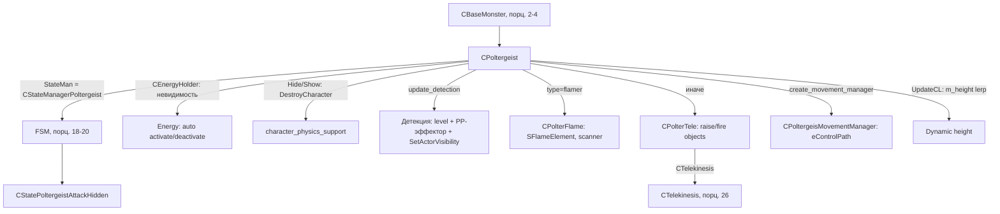

# CPoltergeist

> **Истник**: `src/xrGame/ai/monsters/poltergeist/` (13 файлов, ~2 850 строк) — ключевые
> `poltergeist.h` (336), `poltergeist.cpp` (526), `poltergeist_telekinesis.cpp` (340),
> `poltergeist_flame_thrower.cpp` (325), `poltergeist_movement.cpp` (126),
> `poltergeist_state_manager.cpp` (133). Порцион 8, итерация 6.

`CPoltergeist` (полтергейст) — **монстр на базе `CBaseMonster` + `CTelekinesis` +
`CEnergyHolder`**. Живёт **невидимым** (`state_invisible`, `CEnergyHolder` — «энергия
невидимости»), **детектирует** игрока по уровню `m_current_detection_level`
(дистанция + скорость + телепатический иммунитет), при детекте — `Hide()` (разрушает
характер-физика) / `Show()`. Атаки: **flame** (`CPolterFlame`, по типу) или **tele**
(`CPolterTele`, поднимает/швыряет объекты через `CTelekinesis`). Каркас — порц. 2–4;
FSM — порц. 18–20; `CTelekinesis` — порц. 26.

## 1. Место в иерархии

```cpp
class CPoltergeist : public CBaseMonster,
                     public CTelekinesis,
                     public CEnergyHolder    // poltergeist.h:16
```

- `CBaseMonster` (порц. 2–4) — каркас, память, контроллеры.
- `CTelekinesis : CPHUpdateObject` (telekinesis.h) — физический слой телекинеза (порц. 26).
- `CEnergyHolder` (`energy_holder.h`) — «энергия невидимости» (`set_auto_activate/deactivate`,
  `enable`, `get_value`, `reload(section, "Invisible_")`).
- **`StateMan`** (конструктор, poltergeist.cpp:27): `xr_new<CStateManagerPoltergeist>`.
- **Способности** (в `Load`): `m_flame` **или** `m_tele` (по `type`), `ability()` =
  `m_flame ? m_flame : m_tele` (h:88). `friend` — `CPoltergeisMovementManager`,
  `CPolterTele`, `CPolterFlame`.

`get_monster_class_name()` — `"poltergeist"` (h:80).

## 2. Невидимость: `Hide`/`Show` + `CEnergyHolder`

- `Hide` (cpp:288): `state_invisible=true`, `setVisible(false)`, запоминает
  `m_current_position`, **`DestroyCharacter()`** (разрушает характер-физика — объект
  «в воздухе»), `ability()->on_hide()`.
- `Show` (cpp:301): `state_invisible=false`, `setVisible(true)`, `seq_run(eAnimMiscAction_00)`
  («падает»), восстанавливает позицию + `CreateCharacter()`, `ability()->on_show()`.
- `is_hidden()` = `state_invisible` (h:91). `EnableHide`/`DisableHide` (`m_disable_hide`).
- `on_activate`/`on_deactivate` (cpp:448-463) — `Hide`/`Show` (если не `m_disable_hide`).
- `UpdateHeight` (cpp:435) — пока невидим: `target_height` случайно в
  `[m_height_min, m_height_max]`, интервал `[m_height_change_min_time, max]`;
  `UpdateCL` (cpp:329) — `def_lerp(m_height, target_height, …)`.
- `reinit` (cpp:260): `Energy::reinit/set_auto_activate/set_auto_deactivate/enable`,
  `state_invisible=true`, `setVisible(false)`, `DestroyCharacter`, `DisableHide`.

## 3. Детекция: `m_current_detection_level` + PP-эффектор

`update_detection` (cpp:184, из `UpdateCL` cpp:326) — ядро:
- Если игрок жив и `dist2actor < m_detection_far_range`:
  `range_factor` (интерп `near/far_range_factor` по `relative_range`),
  `speed = pow(1+raw_speed, speed_factor)-1`, `actor_psy_immunity =
  GetHitImmunity(eHitTypeTelepatic)`;
  `m_current_detection_level += dt * 0.03 * psy_immunity * range_factor * speed`.
- `m_current_detection_level -= dt * m_detection_loose_speed` (спад), clamp `[0, max_level]`.
- `SetActorVisibility(ID(), get_post_process_factor())` + PP-эффектор
  (`AddEffector` `m_detection_pp_effector_name`, коэффициент `get_post_process_factor`).
- `Hit` (cpp:423): если бьёт `Actor()` → `m_current_detection_level = m_detection_max_level`
  (игрок попался).
- `detected_enemy()` (cpp:249) = `level > m_fly_around_level` — триггер FSM (п. 7).
- Все `get_detection_*` — через `override_if_debug` (cpp:483-511).

## 4. Атаки: `CPolterFlame` / `CPolterTele`

`Load` (cpp:132-143): по `type`:
- **`"flamer"`** → `m_flame = xr_new<CPolterFlame>` (flame_thrower.cpp, 325 строк):
  `SFlameElement` (target/pos/dir/state `ePrepare/eFire/eStop`), `create_flame`,
  `get_valid_flame_position`, scanner (`m_scan_radius`, `SPPInfo` effector,
  `m_state_scanning`), `m_pmt_aura_radius`, `m_min/max_flame_dist/height`.
- **иначе** → `m_tele = xr_new<CPolterTele>` (telekinesis.cpp, 340 строк):
  `tele_find_objects`/`tele_raise_objects`/`tele_fire_objects`/`trace_object`,
  состояния `eStartRaiseObjects/eRaisingObjects/eFireObjects/eWait`, `m_pmt_*`
  (radius/mass/count/time_to_hold/distance/fly_velocity/…), использует `CTelekinesis`.

Общий базовый класс `CPolterSpecialAbility` (h:159): `m_particles_*` (hidden/damage/
death/idle), `m_sound_base`, `update_schedule/update_frame`, `on_hide/on_show/on_die/
on_hit`. `PhysicalImpulse`/`StrangeSounds` (cpp, h:95-96) — «пугающие» эффекты.

`CPolterFlame::load`, `update_schedule`, `on_destroy`, `on_die` — виртуалы (h:270-279).
`CPolterTele::load/update_schedule/update_frame` + `tele_*` (h:326-335).

## 5. Движение: `CPoltergeisMovementManager`

`create_movement_manager` (cpp:465) подменяет path-менеджер на
`CPoltergeisMovementManager : CControlPathBuilder` (movement.h, 26 строк; cpp 126 строк):
`move_along_path`, `CalculateRealPosition()` — учитывает `m_height`/`m_current_position`
(полёт на переменной высоте). Ставится на `ControlCom::eControlPath` +
`install_path_manager`.

## 6. `UpdateCL` / `shedule_Update` / сеть

- `UpdateCL` (cpp:324): `update_detection`, `def_lerp(m_height)`, `ability()->update_frame`,
  `MakeMeCrow` (если видим в радиусе 85). `renderable_Render` (318) —
  `hom_frame = dwFrame` (обновление хом-костей).
- `shedule_Update` (cpp:349): `inherited`, `CTelekinesis::schedule_update`,
  `Energy::schedule_update`, `UpdateHeight`, `ability()->update_schedule`.
- `net_Spawn` (cpp:366): `DestroyCharacter`, **спавнится невидимым**
  (`setVisible(false)` если `g_Alive`), `ability()->on_hide`.
- `Die` (cpp:395): `poltergeist_spawn_corpse_on_death || m_tele` → если невидим,
  `setVisible(true)` + восстанавливает позицию/трансформ; `CTelekinesis`/`Energy` off,
  `ability()->on_die`. `net_Destroy` (384): off tele/energy + `on_destroy`.
- `ForceFinalAnimation` (cpp:342): если невидим → `eAnimMiscAction_01` («улетает»).

## 7. FSM: `CStateManagerPoltergeist`

`StateMan` = `CStateManagerPoltergeist` (state_manager.cpp:15). Подсостояния:
`Rest` (`CPoltergeistStateRest`), `Eat`, `Attack_AttackHidden`
(`CStatePoltergeistAttackHidden`, hidden_inline 146 строк), `Panic`, `Hitted`,
`HearInt/DangerSound`.

`execute` (cpp:51): **упрощённый** — если `get_enemy() && detected_enemy()` →
`eStateAttack_AttackHidden`; иначе `eStateRest`. Большой блок (danger_type/hitted/
sound/eat + `Hide/Show`) — **закомменчен**; `polter_attack` (cpp:90, flame/tele/scare
по таймерам) — тоже **закомменчен** (атаки идут через `ability()->update_schedule`).

## 8. Связи



## 9. Замечания к плану

1. **Тройное наследование** `CBaseMonster + CTelekinesis + CEnergyHolder` — невидимость
   здесь = `CEnergyHolder` + `state_invisible` + `DestroyCharacter` (физика), а не
   visibility-состояния bloodsucker (порц. 5 §4).
2. **Детекция — уровень** `m_current_detection_level` (накопление по дистанции/скорости/
   телепат-иммунитет, спад `loose_speed`), не пороговый `can_be_seen`. `detected_enemy`
   = `> m_fly_around_level`. Удар по актору = `max_level` («попался»).
3. **`Hide`/`Show`** разрушают/восстанавливают характер-физика (`DestroyCharacter/
   CreateCharacter`) — объект «висит в воздухе» на `m_height`.
4. **Атаки — через `ability()`** (`CPolterFlame`/`CPolterTele`), `update_schedule` в
   `shedule_Update`; FSM-`execute` и `polter_attack` **закомменчены** (упрощённый FSM:
   AttackHidden/Rest).
5. **`type` в `Load`** выбирает способность (flamer → flame, иначе tele); `m_flame`
   и `m_tele` не живут одновременно.
6. `CPoltergeisMovementManager` — свой path-менеджер (`eControlPath`), учитывает
   `m_height`/`m_current_position` (полёт).
7. Спавн — **невидимым** (`net_Spawn` → `setVisible(false)` + `DestroyCharacter`).

## 10. Краткое резюме

`CPoltergeist` — «толстый» наследник `CBaseMonster + CTelekinesis + CEnergyHolder`:
невидимость через `CEnergyHolder` + `Hide/Show` (разрушение физика), детекция уровня
(дистанция/скорость/телепат-иммунитет + PP-эффектор), атаки через `CPolterFlame`/
`CPolterTele` (по `type`), динамическая высота, свой path-менеджер, упрощённый FSM
(AttackHidden/Rest, большая логика закомменчена). Каркас — порц. 2–4, FSM — порц. 18–20,
`CTelekinesis` — порц. 26.

---

*Порцион 8 (итерация 6). Далее: порц. 9 — `CChimera` ([chimera.md](chimera.md)).*
