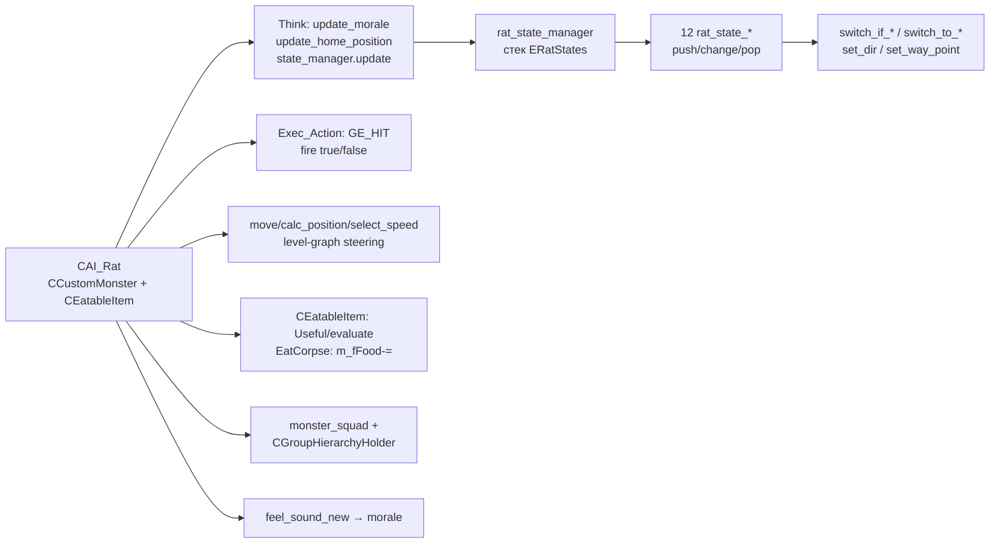

# CAI_Rat

> Модуль: **ALIFE — AI монстров** · `src/xrGame/ai/monsters/rats/` (~3700 стр., 14 файлов) + `src/xrGame/rat_state*.*` (12 состояний). Порцион 10, итерация 6.

`CAI_Rat : CCustomMonster + CEatableItem` — **самодостаточный** монстр-крыса: не наследует
`CBaseMonster` и не использует его FSM/abilities/`StepManager`. Свой FSM (стек состояний
`rat_state_manager`), своё движение (steering по level-graph), своё «стрельба»-hit
(сетевой `GE_HIT`), мораль, squad. Тело — съедобный предмет (`CEatableItem`), труп можно
поесть.

## 1. Наследование и границы

`ai_rat.h:28` — `class CAI_Rat : public CCustomMonster, public CEatableItem`.

- **Нет `CBaseMonster`**: нет `CStepManager`, нет `com_man().abilities()`, нет
  `CStateManager`/`CAI_FSMState*` (порц. 2–4), нет `m_eCurrentState`-FSM из `base-monster`.
  Состояния — собственные `rat_state_*` (§5).
- **`CCustomMonster`** даёт `Think()` (переопределён — §4), `movement()`, `memory()`,
  `sound()`, `feel_*`. **`CEatableItem`** даёт `m_fFood`, `OnH_*`, `Useful()`, `net_Spawn`
  (§6).
- **Альтернатива FSM из порц. 3**: вместо `CStateManager`-дерева — плоский стек
  `xr_stack<ERatStates>` + `associative_vector<u32, rat_state_base*>` (§5).
- **Мост с `CBaseMonster`-веткой**: только общие подсистемы (`memory()`, `movement()`,
  `sound()`, level-graph, `ai_monster_squad`). Движение не через `StepManager`.

| | `CBaseMonster` (порц. 2) | `CAI_Rat` |
|---|---|---|
| FSM | `CStateManager` + `CAI_FSMState*` | `rat_state_manager` (стек) |
| Abilities | `com_man()` | нет |
| Движение | `CStepManager` | собственный steering (`move`/`calc_position`) |
| Атака | `Hit`-события/abilities | сетевой `GE_HIT` в `Exec_Action` |
| Еда | нет | `CEatableItem` |

## 2. Поля и структура

`ai_rat.h` — 461 стр. Ключевые группы полей:

- **Состояния**: `enum ERatStates` (12: `aiRatDeath/FreeActive/FreePassive/AttackRange/
  AttackMelee/UnderFire/Retreat/Pursuit/FreeRecoil/ReturnHome/EatCorpse/NoWay`),
  `m_eCurrentState/m_ePreviousState`, `m_tStateStack` (стек), `m_state_manager` (§5).
- **Движение**: `m_fSpeed/m_fMinSpeed/m_fMaxSpeed/m_fAttackSpeed`, `m_tGoalDir/
  m_tSpawnPosition/m_home_position`, `m_fASpeed` (угловая), `m_bNoWay`, `m_tHPB`.
- **Morale**: `m_fMorale` + `Min/Max/Normal`, `m_fMoraleDeath/Fear/SuccessAttack/RestoreQuant`,
  `m_dwMoraleRestoreTimeInterval/LastUpdateTime`, `m_fMoraleDeathDistance`.
- **Атака**: `m_fHitPower`, `m_dwHitInterval`, `m_fAttackDistance/Angle`,
  `m_fAttackSuccessProbability`, `m_dwActionRefreshRate`, `m_bFiring`, `m_tAction`
  (`eRatActionAttackBegin/End`), `m_attack_rebuild`.
- **Home/патруль**: `m_home_position`, `m_current_graph_point/m_next_graph_point`,
  `m_time_to_change_graph_point`, `m_walk_on_way`, `m_path` (`CPatrolPath`),
  `m_current_way_point`.
- **Eatable**: `m_bEatMemberCorpses/m_bCannibalism/m_dwEatCorpseInterval`.
- **Звук**: `SSimpleSound m_tLastSound` (типы, `tpEntity`, `tSavedPosition`),
  `m_fSoundThreshold`.
- **Squad/группа**: `m_squad_count`, `m_bActive/m_bStanding` (учёт в `CGroupHierarchyHolder`).

`SNormalGlobalAnimations` (`ai_rat.h:151`) — анимации: `tpaDeath[2]`, `tpaAttack[3]`,
`tpaIdle[2]`, `tWalk/tRun` (`SAnimState`), `tRunAttack`, `tpTurnLeft/Right`.

## 3. Инициализация

- **Конструктор** (`ai_rat.cpp:48`) — `init()` + закомменченный `steering_behaviour::manager`
  (cohesion/separation/alignment выключены). `m_behaviour_manager(0)`.
- **`init()`** (`ai_rat.cpp:63`) — нули, случайный `m_tGoalDir`, `time_to_next_attack=2000`.
- **`reinit()`** (`ai_rat.cpp:120`) — `inherited::reinit()` + `CEatableItem::reinit()` +
  `init()` + `init_state_manager()`.
- **`init_state_manager()`** (`ai_rat.cpp:98`) — `xr_new<rat_state_manager>()`, `construct(this)`,
  `add_state` для всех 12 `ERatStates` → `xr_new<rat_state_*>()`, `push_state(aiRatFreeActive)`.
- **`Load(section)`** (`ai_rat.cpp:166`) — `init()` + `inherited::Load` + `CEatableItem::Load`,
  ~25 параметров: active/passive (`ChangeActiveStateProbability`, `Active/PassiveSchedule`,
  `*CountPercent`), константы (`LostMemory/RecoilTime`, `UnderFireDistance`, `Retreat*`,
  `StableDistance`, `Wall*TurnValue`), `AngleSpeed/GoalChangeDelta/GoalVariation`,
  `MaxHealthValue`, `SoundThreshold`, `EatMemberCorpses/Cannibalism/EatCorpseInterval`,
  угловые скорости (`Angular*Speed`, ÷180·π), `corp_mass`, active-schedule.
- **`reload(section)`** (`ai_rat.cpp:128`) — `inherited` + `CEatableItem` + 5 звуков
  (`sound_death/hit/attack/voice/eat`) с `bone_head`, маски `eRatSoundMask*`.
- **`net_Spawn(CSE_ALifeMonsterRat*)`** (`ai_rat.cpp:223`) — `inherited` + `CEatableItem`,
  `monster_squad().register_member`, чтение всех параметров из SE (мораль, скорость,
  radii, hit), `m_tSpawnPosition` = позиция лидера squad (или своя), `push aiRatFreeActive`,
  `add_active_member(true)`, `load_animations()`, `FCanTake=FALSE`, чит `patrol/way`
  (задаёт `m_walk_on_way`/`m_path`).

## 4. Тик — `Think` (активный FSM)

`ai_rat_behaviour.cpp:46` — **активный** FSM (в отличие от закомменченных switch-состояний
в `ai_rat_fsm.cpp`, см. §7):

```
void CAI_Rat::Think() {
    update_morale();
    update_home_position();
    m_state_manager->update();
}
```

- `update_morale()` (`ai_rat_fire.cpp:123`) — clamp `[Min,Max]`, по таймеру восстанавливает
  к `NormalValue` (зависит от текущего состояния).
- `update_home_position()` (`ai_rat_behaviour.cpp:17`) — home = home лидера squad; по
  `m_time_to_change_graph_point` выбирает новый game-vertex → `select_next_home_position()`.
- **`m_state_manager->update()`** — ядро FSM (§5).

`shedule_Update` (`ai_rat.cpp:473`) — только «если лидер мёртв — стать лидером» +
`inherited`. `UpdateCL` (`ai_rat.cpp:482`) — `CreateSkeleton` при смерти,
`CEatableItem::UpdateCL` / physics, squad-leader, `draw_way` (DEBUG).
`UpdatePositionAnimation` (`ai_rat.cpp:530`) — `move(bCanAdjustSpeed, bStraightForward)`
+ `SelectAnimation` (§8). `Exec_Action` (§6) вызывается из `CCustomMonster`-цикла.

> **Важно**: `ai_rat_fsm.cpp` (756 стр.) — **закомменченный/архивный** switch-FSM
> (`Think` с `do{switch(m_eCurrentState)}while(!m_bStopThinking)`, методы `Death/
> FreeHuntingActive/...`). Его `Think` **не вызывается** — реальный `Think` в
> `ai_rat_behaviour.cpp`. Методы из `fsm.cpp` не используются (артефакт).

## 5. FSM — `rat_state_manager` + `rat_state_*`

- **`rat_state_base`** (`rat_state_base.h:16`) — `construct(CAI_Rat*)`, виртуальные
  `initialize()/execute()/finalize()`, `object()`.
- **`rat_state_manager`** (`rat_state_manager.h:18`) — `associative_vector<u32,
  rat_state_base*> m_states`, `xr_stack<u32> m_stack`, `m_last_state_id`;
  `add_state/push_state/pop_state/change_state` (=pop+push)/`update()`.
- **12 состояний** (`rat_states.h`) — `struct rat_state_<name> : rat_state_base`,
  реализация `src/xrGame/rat_states.cpp` (530 стр.).

Механика: `update()` вызывает `execute()` текущего; состояния сами делают
`push_state/change_state/pop_state` на другие (стек — «возврат» в `free_active`).

Переходы (из `execute()` в `rat_states.cpp`):

| Состояние | Переходит в (условие) |
|---|---|
| `free_active` | `NoWay` (`m_walk_on_way`); `AttackMelee` (враг в radii); `UnderFire` (мораль низкая); `FreeRecoil` (пугающий звук); `EatCorpse` (есть труп) |
| `free_passive` | `NoWay` (way); иначе `activate_state_free_passive` (может `add_active_member`→`FreeActive`) |
| `attack_range` | `pop_state` (нет врага); `NoWay` (не может встать / не в зоне / не поворот); иначе `activate_state_attack_range` (fire) |
| `attack_melee` | `get_state()!=AttackMelee` → `get_state()` (DW `dwfChooseAction`: `AttackMelee`/`Retreat`); `switch_to_attack_melee` (pursuit+home) |
| `under_fire` | (мораль восстановилась → prev) |
| `retreat` | (враг мёртв/далеко → prev; иначе атака/отход) |
| `pursuit` | (потерял врага → prev; `AttackRun`; `UnderFire`; `FreeRecoil`) |
| `free_recoil` | (есть враг → prev; прошло время → prev; `Pursuit`) |
| `return_home` | (враг близко → `AttackMelee`; в доме/нет врага → prev) |
| `eat_corpse` | (враг/мораль → prev; `FreeRecoil`) |
| `death` | — (destroy при `m_fFood<=0`) |
| `no_way` | — (патруль по `m_path`) |

Переключатели — `switch_if_*` / `switch_to_*` / `get_*` / `set_*` (`rat_state_switch.cpp`,
338 стр.): `switch_if_enemy/home/position/diff/dist_angle/dist_no_angle/porsuit/
lost_time/lost_rtime/alife/no_enemy`, `switch_to_free_recoil/eat/attack_melee`,
`get_morale/if_dw_time/if_tp_entity/alife`, `set_dir/m/sp/way_point/home_pos/rew_*`,
`sub_rotation`, `can_stand_here/can_stand_in_position`.
`set_dir` (switch:130) — **распределение squad** вокруг врага (`squad_alife_count`,
`get_index`, угловой `delta`), чтобы крысы окружали.

`ai_rat_fsm.cpp` (архив) содержит эквивалентные методы `Death/FreeHuntingActive/...`
(§4) — не вызываются.

## 6. Атака и «стрельба» — `Exec_Action`

`ai_rat_fire.cpp:20` — `Exec_Action`:

- `m_tAction == eRatActionAttackBegin` (задаётся `fire(true)` → `activate_state_attack_range`):
  звук `eRatSoundAttack`; если враг жив и `> m_dwHitInterval` с `m_dwStartAttackTime` —
  **сетевой hit**: `SHit HS; HS.GenHeader(GE_HIT, id_to); HS.whoID/weaponID=ID();
  HS.dir; HS.power=m_fHitPower; HS.hit_type=eHitTypeWound; u_EventSend`.
  (Прямой `entity_alive->Hit` закомменчен — всегда через сеть.)
- `eRatActionAttackEnd` — `m_bActionStarted=false`.

`fire(bool)` (`ai_rat_templates.cpp:45`) — только `m_bFiring` + `m_tAction`.
`Hit(SHit*)` (`ai_rat.cpp:548`) — `inherited::Hit`; если нет physics-shell — сохраняет
impulse/pos/dir/type (`m_saved_*`), иначе `CEatableItem::Hit`.
`HitSignal` (`ai_rat_fire.cpp:76`) — сохраняет направление, играет `eRatSoundInjuring`.

## 7. Поедание — `CEatableItem`

- **`Useful()`** (`ai_rat.cpp:611`) — `!g_Alive() ? CEatableItem::Useful() : false`
  (еда только труп).
- **`useful/evaluate`** (`ai_rat_fire.cpp:91/106`) — труп съедобен если `!g_Alive()`,
  `< m_dwEatCorpseInterval` от смерти, `m_fFood>0`, `m_bEatMemberCorpses` или чужой
  отряд, `m_bCannibalism` или не свой CLS; оценка `m_fFood²·distance`.
- **`EatCorpse`-состояние** (`activate_state_eat`, `rat_state_activation.cpp:157`) —
  к `Center()` трупа; в радиусе+угол → `corpse->m_fFood -= m_fHitPower/10` (по
  `m_dwHitInterval`), `eRatSoundEat`, `m_bFiring`. Иначе идёт.
- **`Death`** (`Die`, `ai_rat.cpp:145`) — `FCanTake=TRUE` (можно подобрать), `eRatSoundDie`,
  `update_morale_broadcast(m_fMoraleDeathQuant, m_fMoraleDeathDistance)` (страх группы),
  `--m_dwAliveCount`, состояние `aiRatDeath`. Труп уничтожается `rat_state_death::execute`
  (`GE_DESTROY`) когда `m_fFood<=0` (`rat_states.cpp:25`).
- `OnH_B_Chield` — hide/disable + `Deactivate` shell; `OnH_B_Independent` — show/enable +
  `activate_physic_shell`.

## 8. Движение — собственный steering

`ai_rat_templates.cpp` (596 стр.) — **не** `CStepManager`:

- **`select_speed()`** (`:66`) — по углу к `m_tGoalDir` и текущей скорости выбирает
  `Min/Max/Attack` + угловую скорость; проверка выхода за AI-карту
  (`bfCheckIfOutsideAIMap`) → деградация скорости.
- **`calc_position()`** (`:225`) — вычисляет новое положение: pitch по высоте цели
  (clamp ±0.8), `m_fDHeading` (сглаживание поворота, `StraightForward`-режим),
  проекция на contour level-graph → `m_newPitch`; возвращает `Position + dir·speed·dt`.
- **`move(bCanAdjustSpeed, bStraightForward)`** (`:340`) — `select_speed`; большой
  поворот → `make_turn`; `calc_position` + `calc_node` (проверка level-graph); если
  путь не проходим — `m_bNoWay=true`, через `TIME_TO_RETURN` разворот на 180°.
- **`make_turn()`** (`:173`) — stop, `movement().m_body.speed=2π`, `XFORM().setHPB`.
- **`calc_node`** (`:200`) — валидность нового узла level-graph.
- `vfChangeGoal/bfCheckIfGoalChanged/vfChooseNewSpeed/vfUpdateTime` (`ai_rat_inline.h`) —
  случайная смена цели, выбор скорости.
- **`get_custom_pitch_speed`** (`ai_rat.cpp:690`) — pitch-скорость по типу скорости
  (`Min→π/4`, `Max→π/3`, `Attack→π/2`, `0→π/6`).

## 9. Ощущения — `feel_*`

`ai_rat_feel.cpp` (57 стр.):

- **`feel_vision_isRelevant`** — только чужие живые `CEntityAlive`.
- **`feel_sound_new`** — порог `m_fSoundThreshold` (шут = `power=1`); запоминает
  `m_tLastSound` (тип, время, `tpEntity`, позиция); **влияет на мораль**:
  `SOUND_TYPE_MONSTER_DYING` → `+m_fMoraleDeathQuant`;
  `SOUND_TYPE_WEAPON_SHOOTING` (без врага) → `+m_fMoraleFearQuant`;
  `SOUND_TYPE_MONSTER_ATTACKING` → `+m_fMoraleSuccessAttackQuant`.
- `bfCheckIfSoundFrightful` (`ai_rat_impl.h:69`) — звук выстрела/попадания.

`feel_touch_new` — пустой. `feel_touch_on_contact` — `inherited`.

## 10. Squad и hierarchy

- **`monster_squad()`** (`ai_monster_squad_manager`) — `register_member/remove_member`
  в `net_Spawn/net_Destroy`; `shedule_Update` — «лидер мёртв → я лидер»; `set_dir`
  (switch:130) — распределение индексов squad для окружения врага.
- **`CGroupHierarchyHolder`** (через `seniority_holder().team→squad→group`) —
  `m_dwActiveCount/StandingCount/AliveCount`; `add_active_member/vfRemoveActiveMember/
  vfAddStandingMember/vfRemoveStandingMember` (`ai_rat_impl.h`) — учёт «активных/стоящих»
  по процентам (`ActiveCountPercent/StandingCountPercent`); смена `active↔passive`
  меняет `shedule.t_min/t_max` (`ActiveSchedule/PassiveSchedule`).
- **`update_morale_broadcast`** (`ai_rat_impl.h:75`) — всем живым членам группы
  `m_fMorale += fValue` (страх при смерти).

## 11. Звук и анимация

- **Звуки** (`ai_rat_space.h`) — `ERatSounds`: `eRatSoundDie/Injuring/Attack/Voice/Eat`;
  маски `eRatSoundMask*` (bitmask). Регистрация в `reload` (§3). Игра: `sound().play`
  (attack/eat/voice/injuring/die).
- **Анимации** — `load_animations` (`ai_rat_animations.cpp:18`): `norm_death[2]`,
  `attack_1..3`, `norm_idle_1..2`, `norm_turn_ls/rs`, `norm_walk/run`, `norm_run_fwd_1`;
  старт `norm_idle_1`. `SelectAnimation` (`:44`): смерть → death; `m_bFiring` → `attack[2]`;
  маленький поворот + скорость → idle (standing → `idle[1]`)/`runAttack`/`run`/`walk`;
  большой поворот → `turn_left/right`.

## 12. Связи



Связанные страницы:
- [base-monster.md](base-monster.md) — `CBaseMonster` (в отличие от крысы: FSM/abilities/`StepManager`).
- [base-monster-fsm.md](base-monster-fsm.md) — `CStateManager` (архитектура, которую крыса **не** использует).
- [base-monster-settings.md](base-monster-settings.md) — `ai_monsters.ini` (общие настройки; у крысы свой `Load`).
- [index.md](index.md) — обзор ALIFE.
- `CEatableItem` — ит. 5 (инвентарь/еды); `CSE_ALifeMonsterRat` — ит. 11/12; Lua API — ит. 14.

## 13. Замечания к плану

1. **Два `Think`** — реальный `CAI_Rat::Think` в `ai_rat_behaviour.cpp:46` (мораль + home +
   `state_manager->update`); `ai_rat_fsm.cpp:50` — **архивный** switch-`Think`
   (не вызывается), его методы (`Death/FreeHuntingActive/...`) мёртвый код.
2. **Нет `CBaseMonster`** — свой FSM (стек), свой steering (level-graph), свой hit (сетевой
   `GE_HIT`), своя мораль, свой squad-учёт. Единственная общая точка — `CCustomMonster` +
   `CEatableItem`.
3. **`switch_if_porsuit`** — опечатка `pursuit` в имени (код `rat_state_switch.cpp:121`).
4. **`aiRatAttackRange/Melee`** — «дальнобойный» и «ближний» бой: range = fire (сетевой hit),
   melee = `dwfChooseAction` (DW-выбор `AttackMelee`/`Retreat`).
5. **`m_walk_on_way`/`m_path`** — патруль по `CPatrolPath` (`patrol/way` из spawn ini);
   при активном режиме → состояние `NoWay` (движение по way-point'ам).
6. **Труп как предмет** — `CEatableItem`: `Useful` только мёртвый, `evaluate` по `m_fFood`,
   `EatCorpse` уменьшает `m_fFood`, при 0 — `GE_DESTROY`.

## 14. Краткое резюме

`CAI_Rat` — **самодостаточный** монстр (не `CBaseMonster`): `CCustomMonster +
CEatableItem`. Тик `Think` = мораль + home + **свой FSM-стек** `rat_state_manager`
(12 `rat_state_*` с `switch_if_*/switch_to_*`-переключателями). Атака — сетевой `GE_HIT`
в `Exec_Action`. Движение — собственный steering по level-graph (`move/calc_position/
select_speed`), не `CStepManager`. Тело — съедобный предмет (`CEatableItem`): труп можно
поесть (`EatCorpse`, `m_fFood`), при 0 — `GE_DESTROY`. Squad через `monster_squad` +
`CGroupHierarchyHolder`; мораль влияет на переходы и распространяется на группу.

Порцион 10 (итерация 6). Далее: порц. 11 — `trader-crow-phantom.md` — `CAI_Trader` / `CAI_Crow` / `CPhantom` ([trader-crow-phantom.md](trader-crow-phantom.md)).
