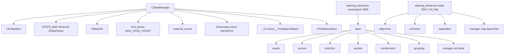

# Steering + CStepManager

Модуль: `src/xrGame/` — `step_manager.h/.cpp` (60+365 стр.), `step_manager_defs.h` (47 стр.), `steering_behaviour.h/.cpp` (372+347 стр.), `steering_behaviour_base.h` (41 стр.), `steering_behaviour_manager.h` (46 стр.), `steering_behaviour_{alignment,cohesion,separation}.h` (по 33 стр.).
Порцион 25 (итерация 6).

## Чего не делает

- Не содержит `monster_velocity_space` — ит. 11/12.
- Не управляет FSM — только по-step звук/анимация и steering-ускорения.
- `steering_behaviour.h/.cpp` (2008, Lain) — общий namespace `steering_behaviour` (evade/pursue/restrictor/wander/containment/grouping/manager).
- `steering_behaviour_base.h` (2007, Iassenev) — `CAI_Rat`-специфичный `base` + `alignment`/`cohesion`/`separation` + `manager` (другой API).

## §1. `CStepManager` (step_manager*)

### Поля

| Поле | Тип | Назначение |
|---|---|---|
| `m_legs_count` | `u8` | Число ног (1–4) |
| `m_steps_map` | `STEPS_MAP` | `associative_vector<MotionID, SStepParam>` |
| `m_step_info` | `SStepInfo` | Текущая информация о шаге |
| `m_object` | `CEntityAlive*` | Владелец |
| `m_foot_bones` | `u16[MAX_LEGS_COUNT]` | ID костей ног |
| `m_blend` | `CBlend*` | Текущий blend |
| `m_step_sound` | `material_sound` | Состояние звука шага |
| `m_time_anim_started` | `u32` | Время старта анимации |

### `SStepParam` (step_manager_defs.h)

| Поле | Тип | Назначение |
|---|---|---|
| `step[MAX_LEGS_COUNT].time` | `float` | Время шага (доля цикла) |
| `step[MAX_LEGS_COUNT].power` | `float` | Сила шага (громкость) |
| `cycles` | `u8` | Число циклов в анимации |

### `SStepInfo`

| Поле | Тип | Назначение |
|---|---|---|
| `activity[MAX_LEGS_COUNT].handled` | `bool` | Обработан ли шаг |
| `activity[MAX_LEGS_COUNT].cycle` | `u8` | Цикл обработки |
| `params` | `SStepParam` | Параметры |
| `disable` | `bool` | Флаг отключения |
| `cur_cycle` | `u8` | Текущий цикл (1-based) |

### `ELegType`

```
eFrontLeft, eFrontRight, eBackRight, eBackLeft
```

### `_construct()`

`m_object = smart_cast<CEntityAlive*>(this)`.

### `reload(section)`

1. `m_legs_count = r_u8(section, "LegsCount")`.
2. `anim_section = r_string(section, "step_params")`.
3. `VERIFY(m_legs_count >= MIN && <= MAX)`.
4. Цикл по строкам `anim_section`:
   - `cycles = atoi(cur_elem)`.
   - Для каждой ноги: `step[j].time`, `step[j].power`.
   - `motion_id = skeleton_animated->ID_Cycle_Safe(anim_name)`.
   - `m_steps_map.insert(motion_id, param)`.
5. `reload_foot_bones()`.

### `on_animation_start(motion_id, blend)`

1. `m_blend = blend`.
2. `character_ik_controller()->PlayLegs(blend)`.
3. `m_time_anim_started = Device.dwTimeGlobal`.
4. `m_step_info.params = m_steps_map[motion_id]`.
5. `m_step_info.cur_cycle = 1`.
6. Для каждой ноги: `handled = false`, `cycle = 1`.

### `update(b_hud_view)`

1. `m_step_info.disable` || `!m_blend` → return.
2. `dist = Position().distance_to(vCameraPosition)`. `b_play = dist < 50.f`.
3. `cycle_anim_time = get_blend_time() / step.cycles`.
4. Цикл по ногам:
   - `handled && cycle == cur_cycle` → skip.
   - `offset_time = m_time_anim_started + 1000 * (cycle_anim_time * (cur_cycle - 1) + cycle_anim_time * step[i].time)`.
   - Если `offset_time <= cur_time`:
     - `mtl_pair = material().get_current_pair()`.
     - Если `b_play && is_on_ground()`:
       - `ID() == 0` (actor): Lua `_G.CActor__FootstepCallback` → `m_step_sound.play_next(...)`.
       - Иначе: `m_step_sound.play_next(...)`, `object->FootStepCallback(...)`.
     - Партиклы: `mtl_pair->CollideParticles` → `CParticlesObject::Create`, `get_foot_position(ELegType(i))`.
     - `event_on_step()`.
     - `handled = true`, `cycle = cur_cycle`.
5. `cur_cycle = 1 + (cur_time - m_time_anim_started) / (1000 * cycle_anim_time)`.
6. Если `!m_blend->stop_at_end && time_anim_end < cur_time`:
   - `m_time_anim_started = time_anim_end`.
   - `cur_cycle = 1`.
   - Сброс `handled` для всех ног.

### `get_foot_position(leg_type)`

`bone_transform = pK->LL_GetBoneInstance(m_foot_bones[leg_type]).mTransform`.
`global_transform.mul_43(m_object->XFORM(), bone_transform)`.
Return `global_transform.c`.

### `reload_foot_bones()`

1. `ini = pK->LL_UserData()`. Если `ini->section_exist("foot_bones")` → `load_foot_bones(ini->r_section("foot_bones"))`.
2. Иначе: `pSettings->line_exist(cNameSect, "foot_bones")` → `load_foot_bones(pSettings->r_section(pSettings->r_string(cNameSect, "foot_bones")))`.
3. `VERIFY(count == m_legs_count)`.

### `material_sound::play_next(mtl_pair, object, volume, b_hud_mode)`

1. `mtl_pair->StepSounds.empty()` → return.
2. `sound_pos = object->Position()`, `y += 0.5`.
3. Если `last_mtl_pair != mtl_pair` || `m_last_step_sound_played == -1`:
   - `m_last_step_sound_played = Random.randI(StepSounds.size())`.
4. Иначе:
   - `new_played = (m_last_step_sound_played + 1 + Random.randI(StepSounds.size() - 1)) % StepSounds.size()`.
5. `vol = b_hud_mode ? volume * psHUDStepSoundVolume : volume`.
6. Если `b_hud_mode`: `sound_pos = (0,0,0)`.
7. `StepSounds[m_last_step_sound_played].play_no_feedback(object, b_hud_mode ? sm_2D : 0, 0, &sound_pos, &vol)`.

## §2. `steering_behaviour` namespace (steering_behaviour.h/.cpp, 2008)

### `base`

| Поле | Тип | Назначение |
|---|---|---|
| `m_p_params` | `params*` | Параметры |

### `base::params`

| Поле | Тип | Назначение |
|---|---|---|
| `enabled` | `bool` | Флаг |
| `factor` | `vec` | Фактор (x, y/r, z/r²) |
| `min_factor_dist` | `float` | Мин. дистанция (дефолт 1) |

### `calc_dist_factor(dist)`

```
r = min(dist, min_factor_dist)
r2 = r * r
return factor.x + factor.y / r + factor.z / r2
```

### `evade`

Поля `params`: `pos`, `dest`, `max_evade_range`, `pf_random_dir`.

`calc_acceleration()`:
1. `dest2pos = dest - pos`.
2. `dist = max(magnitude(dest2pos), near_zero)`.
3. `dist > max_evade_range` → zero.
4. `pos2dest_norm = dest2pos / magnitude` (или random если 0).
5. Return `pos2dest_norm * calc_dist_factor(dist)`.

### `pursue`

Поля `params`: `pos`, `dest`, `min_range2dest`, `change_vel_range`, `arrive_vel`, `arrive_range`, `vel`.

`calc_acceleration()`:
1. `pos2dest = dest - pos`.
2. `dist = magnitude(pos2dest)`.
3. `dist < arrive_range` → zero.
4. `pos2dest_norm = pos2dest / dist`.
5. Если `dist <= change_vel_range`:
   - `vel = params->vel`, `arrive_vel = params->arrive_vel`.
   - `sum_vel = vel + arrive_vel`.
   - `sum_vel < near_zero` → zero.
   - `path_time = 2 * dist / sum_vel`.
   - Return `pos2dest_norm * ((arrive_vel - vel) / path_time)`.
6. Иначе: `pos2dest_norm * calc_dist_factor(dist)`.

### `restrictor`

Поля `params`: `pos`, `restrictor_pos`, `max_allowed_range`.

`calc_acceleration()`:
1. `pos2rest = restrictor_pos - pos`.
2. `dist = magnitude(pos2rest)`.
3. `dist <= max_allowed_range` → zero.
4. `pos2rest_norm = pos2rest / dist`.
5. Return `pos2rest_norm * calc_dist_factor(dist)`.

### `wander`

Поля `params`: `plane` (xy/xz/yz), `conservativeness`, `angle_change`, `dir`.

Поле: `m_wander_angle`.

`calc_acceleration()`:
1. `m_wander_angle += (rand() % 2 ? +1 : -1) * angle_change`.
2. `proj_dir = (proj_x(dir), proj_y(dir), 0)`.
3. `proj_dir_mag < near_zero` → zero.
4. `cosa = cos(m_wander_angle)`, `sina = sin(m_wander_angle)`.
5. `res = (proj_dir.x * cosa - proj_dir.y * sina, proj_dir.x * sina + proj_dir.y * cosa, 0)`.
6. `res = normalize(res) + dir * conservativeness`.
7. Return `normalize(res) * factor.x`.

### `containment`

Поля `params`: `pos`, `dir`, `up`, `turn_factor`, `thrust_factor`, `probes` (vector of vec).

`calc_acceleration()`:
1. `dir = normalize(params->dir)`, `up = normalize(params->up)`, `right = normalize(crossproduct(dir, up))`.
2. Цикл по `probes`:
   - `probe = (dot(local, right), dot(local, up), dot(local, dir))`.
   - `test_obstacle(probe, point_on_obstacle, normal)`.
   - `dist = magnitude(point_on_obstacle - pos)`.
   - `dist_factor = calc_dist_factor(dist)`.
   - `thrust = dir * (-dist_factor)`.
   - `turn = right * dot(normalize(normal), right) * turn_factor * dist_factor`.
   - `steer += thrust + turn`.
3. Return `steer`.

### `grouping`

Поля `params`: `pos`, `cohesion_factor`, `separation_factor`, `max_separate_range`, `pf_random_dir`.

Виртуальные: `first_nearest(v)`, `nomore_nearest()`, `next_nearest(v)`.

`calc_acceleration()`:
1. Цикл по nearest:
   - `point2pos = pos - cur_nearest`.
   - `point2pos_mag < max_separate_range`:
     - `pos2dest_norm = point2pos / magnitude` (или random).
     - `steer += pos2dest_norm * calc_dist_factor(separation_factor, point2pos_mag)`.
   - `sum_nearest += cur_nearest`, `num_nearest++`.
2. `num_nearest == 0` → zero.
3. `center = sum_nearest / num_nearest`.
4. `pos2center = center - pos`.
5. `pos2center_mag > near_zero`:
   - `steer += normalize(pos2center) * calc_dist_factor(cohesion_factor, pos2center_mag)`.
6. Return `steer`.

### `manager`

Поля: `m_behaviours` (`std::set<base*>`), `m_schedule_remove` (`std::set<base*>`).

| Метод | Логика |
|---|---|
| `calc_acceleration()` | `remove_scheduled()`. Цикл: `p_params->update()` → если false → `schedule_remove`. Если `enabled` → `v += calc_acceleration()`. Return `v`. |
| `add(behaviour)` | `m_behaviours.insert(behaviour)`. |
| `schedule_remove(behaviour)` | `m_schedule_remove.insert(behaviour)`. |
| `clear()` | `for_each(deleter)`, `m_behaviours.clear()`, `m_schedule_remove.clear()`. |
| `remove_scheduled()` | Цикл по `m_schedule_remove`: `find` в `m_behaviours`, `deleter`, `erase`. `m_schedule_remove.clear()`. |
| `deleter(p)` | `delete(p)`. |

## §3. `steering_behaviour` namespace (steering_behaviour_base.h, 2007, CAI_Rat)

### `base` (другой API)

| Поле | Тип | Назначение |
|---|---|---|
| `m_object` | `CAI_Rat const*` | Владелец |
| `m_enabled` | `bool` | Флаг |

Виртуальный: `direction()` → `Fvector`.

### `alignment` / `cohesion` / `separation`

Наследуют `base`. Виртуальный `direction()` → `Fvector`. Реализации — в `.cpp` (не в этом модуле).

### `manager` (steering_behaviour_manager.h)

| Поле | Тип | Назначение |
|---|---|---|
| `m_behaviours` | `xr_map<base*, float>` | Поведения с факторами |

| Метод | Логика |
|---|---|
| `add(behaviour, factor)` | Вставка в map. |
| `remove(behaviour)` | Удаление из map. |
| `new_position(time_delta)` | Вычисление новой позиции. |
| `clear()` | Очистка map. |

## §4. Связи



## §5. Замечания к плану

- **Два разных `steering_behaviour` namespace:**
  - `steering_behaviour.h/.cpp` (2008, Lain) — `base::params` + `calc_acceleration()`, `manager` (set).
  - `steering_behaviour_base.h` (2007, Iassenev) — `base(CAI_Rat*)` + `direction()`, `manager` (map с факторами).
- `CStepManager::update` — звук шага (50 м), партиклы, `event_on_step()`.
- `CStepManager::get_blend_time()` — `m_blend->timeTotal / m_blend->speed`.
- `steering_behaviour::detail::random_vec()` — нормализованный случайный вектор.
- `steering_behaviour::base::calc_dist_factor` — `factor.x + factor.y/r + factor.z/r²`.
- `wander::proj_x/proj_y` — зависит от `plane` (xy/xz/yz).
- `containment` — пробы в локальном (dir, up) пространстве, `test_obstacle` виртуальный.
- `grouping` — separation (ближе `max_separate_range`) + cohesion (центр).
- `manager::calc_acceleration` — `update()` → если false → `schedule_remove`.

## §6. Краткое резюме

- **`CStepManager`** — по-step звук/анимация: `STEPS_MAP` (MotionID → SStepParam), `SStepInfo` (activity, cur_cycle), `reload` (LegsCount, step_params), `on_animation_start`, `update` (50 м, звук, партиклы, event_on_step), `get_foot_position` (bone transforms).
- **`steering_behaviour` (2008)** — 6 поведений (evade, pursue, restrictor, wander, containment, grouping) + `manager` (set). `calc_dist_factor` = `x + y/r + z/r²`.
- **`steering_behaviour` (2007, CAI_Rat)** — `base` + `alignment`/`cohesion`/`separation` + `manager` (map с факторами). Другой API.

Порцион 25 (итерация 6). Далее: порц. 26 — `ai-space.md` — пространства AI: `ai_space`, `CAI_ObjectLocation`, `ai_obstacle`, `member_*` ([ai-space.md](ai-space.md)).
