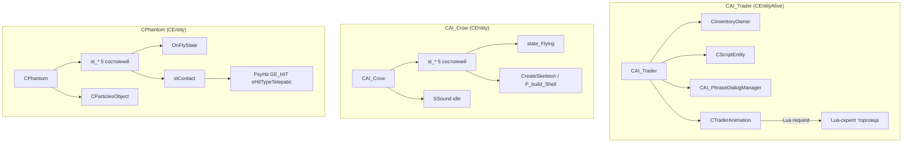

# CAI_Trader / CAI_Crow / CPhantom

> Модуль: `src/xrGame/ai/trader/` + `src/xrGame/ai/crow/` + `src/xrGame/ai/phantom/`
> Файлы: `ai_trader.*` (150+405+14 стр.), `trader_animation.*` (48+137), `ai_crow.*` (158+574), `phantom.*` (98+438)
> Порцион 11 (итерация 6).

Три короткие AI-ветки, **не использующие** `CBaseMonster`/`CActionPlannerScript` и не входящие в общий ALIFE-стек монстров. Каждая — самостоятельный `CEntity`/`CEntityAlive` со своим примитивным state-машином и своим сетевым форматом.

## Чего не делает / границы

- **Не ALIFE-монстры**: нет `CSE_ALife*`-логик в этих классах, нет `CStepManager`, нет `MonsterSpace`, нет squad/morale/aura. Сетевые объекты (`CSE_ALifeTrader`, `CSE_ALifeCreaturePhantom`) — ит. 11/12.
- **Не враги**: ни один не наследует `CAI_BaseMonster`; `crow`/`phantom` вообще не `CEntityAlive` (только `CEntity`).
- Lua-скрипты (`ai_crow_script.cpp` — в ит. 5), `CParticlesObject` (ит. 4), `CEntity`/`CEntityAlive` (ит. 5, порц. 5–7) — не раскрываются здесь.

## 1. Иерархия и назначение

| Класс | Базы | Суть |
|---|---|---|
| `CAI_Trader` | `CEntityAlive, CInventoryOwner, CScriptEntity, CAI_PhraseDialogManager` | НПС-торговец: инвентарь, торговля, анимации головы/тела, диалоги |
| `CAI_Crow` | `CEntity` (не `CEntityAlive`!) | Ворон: полёт по случайным целям, труп падает физикой |
| `CPhantom` | `CEntity` | Призрак (фантом): рождается, летит к актору, кусает (psy-hit), исчезает |

Все три — `DECLARE_SCRIPT_REGISTER_FUNCTION`, доступны из Lua.

## 2. CAI_Trader — инвентарь и торговля

`ai_trader.cpp:117` `net_Spawn`: читает `CSE_ALifeTrader`, ставит деньги (`set_money(l_tpTrader->m_dwMoney)`), вешает **bone-callback** на `bip01_head` → `BoneCallback` → `LookAtActor` (поворот головы на игрока, `ai_trader.cpp:96`).

Торг = сетевые события `OnEvent` (`ai_trader.cpp:167`):
- `GE_TRADE_BUY` / `GE_OWNERSHIP_TAKE` → `inventory().Take`; при отказе шлёт `GE_OWNERSHIP_REJECT`.
- `GE_TRADE_SELL` / `GE_OWNERSHIP_REJECT` → `inventory().DropItem` (флаг `dont_create_shell` при продаже).
- `feel_touch_new` (`:213`) — подбирать полезный предмет (`useful_for_NPC`) шлёт `GE_OWNERSHIP_TAKE`.

Особенности: `AllowItemToTrade` запрещает торговать **PDA** (`:386`); `can_attach`/`use_bolts`/`natural_*` = false; `ffGetFov()=150`, `ffGetRange()=30`. `HitSignal`/`HitImpulse` пустые (торговец «незатратный»).

### 2.1 Анимации и звук — `CTraderAnimation`

`trader_animation.cpp`: два независимых цикла — **global** (тело) и **head** (голова), каждый `PlayCycle(..., cb)`; callback инвалидирует `m_motion_*`. `update_frame` (вызывается из `CAI_Trader::UpdateCL`, `ai_trader.cpp:287`) управляет звуком: звук активен → позиция; закончился → callback `eTraderSoundEnd` + `remove_sound`. Если глобальная/головная анимация закончилась → callback `eTraderGlobalAnimationRequest` / `eTraderHeadAnimationRequest` — **Lua решает, что дальше**. `external_sound_start/stop` (диалоговые реплики) идут через `dialog_sound_start/stop` (`ai_trader.cpp:397`).

## 3. CAI_Trader — тик

`shedule_Update` (`ai_trader.cpp:244`):
1. `inherited::shedule_Update(dt)` + `UpdateInventoryOwner(dt)`;
2. `if (GetScriptControl()) ProcessScripts(); else Think();` — но `Think()` **пустой** (`:272`). Всё поведение торговца — в **Lua-скриптах** (`CScriptEntity`), а `CAI_Trader` лишь контейнер для инвентаря/анимаций/звучков.

`UpdateCL` (`:287`): `inherited::UpdateCL` → `sound().update` → если нет script-control и нет script-animation → `animation().update_frame()`.

`Die`/`save`/`load`/`spawn_supplies` — агрегируют `CEntityAlive` + `CInventoryOwner`.

## 4. CAI_Crow — тик и полёт

`ai_crow.cpp:364` `shedule_Update`:
1. `spatial.type &= ~STYPE_VISIBLEFORAI` (ворон не виден AI);
2. `inherited::shedule_update`;
3. **state-машина** (5 состояний, `ai_crow.h:20`): `eDeathFall, eDeathDead, eFlyIdle, eFlyUp` (+ `eUndef`). Переход по `st_target≠st_current` → `switch2_*` (запуск цикла анимации);
4. по `st_current`: `eFlyIdle` → если растёт `y` → `eFlyUp`; `eFlyUp` → если падает → `eFlyIdle`; `eDeathFall` → `state_DeathFall()`;
5. для живых (`≠death`): случайная смена цели `fGoalChangeTime` → `GetNearest` в радиусе 300, выбор **трупа NPC** (`deadNPCs`) или `Actor()`; рейкаст `GetPickResult` на актора и по направлению — обход препятствий; цель = точка + `fMinHeight` + `vVarGoal`-шум;
6. `fIdleSoundTime` — периодический `idle`-звук; `m_Sounds.m_idle.SetPosition(Position())`.

`UpdateWorkload` (`:327`) — **на кадр рендера**: `state_Flying(dt)` (кинематика полёта: pitch к цели, yaw по dot/cross, `XFORM().setHPB`, `Position().mad(...)`) или `state_DeathFall` (падение). Вызывается и из `renderable_Render` (`:356`), и из `shedule_Update`, с фрейм-дедупликацией `o_workload_frame`/`o_workload_rframe`.

`net_Spawn` (`:145`): здоровье >0 → `eFlyIdle` + `processing_deactivate()` (UpdateCL только на HIT); иначе уже мёртв → `eDeathFall` + `processing_activate()` + `CreateSkeleton()`.

### 4.1 Смерть и физика

`HitSignal` (`:526`): `SetfHealth(0)`, `st_target = eDeathFall`. `Hit` (`:555`): `impulse/100`, callback `eHit`. `Die` (`:316`): `processing_activate()` **до** `CreateSkeleton()` (иначе underflow), callback `eDeath`. `switch2_DeathFall` — цикл `death` с callback `OnHitEndPlaying` → `bPlayDeathIdle=true`. `state_DeathFall` (`:293`): гравитация `-10`, по `m_pPhysicsShell->get_LinearVel` когда `velocity.y>-0.001` → `st_target=eDeathDead`; затем `death_idle`. `CreateSkeleton` (`:546`): `P_build_Shell(this,false,0)` — физическая оболочка. Труп ворона «съедобен»: `switch2_DeathDead` ставит `STYPE_VISIBLEFORAI` (`:224`).

## 5. CAI_Crow — анимации и звук

`net_Spawn` грузит 5 наборов `SAnim` (`:156`): `death`, `death_drop` (`m_death_dead`), `death_idle`, `fly_fwd` (`m_fly`), `fly_idle` (`m_idle`). `SAnim::Load` (`:26`): `prefix` + `prefix_0..7` (до `MAX_ANIM_COUNT=8`), `GetRandom()` — случайный. `SSound::Load` (`:40`): `$game_sounds$/monsters/crow/idle[_0..7].ogg`. `SSound::SetPosition` обновляет позицию только у активного `_feedback()`.

`renderable_ShadowGenerate/Receive = FALSE`, `IsVisibleForHUD/Zones = false`, `UsedAI_Locations = FALSE`, `create_physic_shell()` — **пустой** («do not delete»).

## 6. CPhantom — цикл жизни

`phantom.cpp:59` `net_Spawn`: `CSE_ALifeCreaturePhantom`, случайный визуал (`GE_CHANGE_VISUAL`), `SetfHealth(0.001)`, `m_enemy = Level().CurrentEntity()`, ориентация на врага (`XFORM().k`), 4 цикла `birth_0/fly_0/contact_0/shoot_0` (требуют `esmStopAtEnd` для birth/contact/shoot), `SwitchToState_internal(m_TgtState)`.

Состояния (`phantom.h:12`): `stIdle, stBirth, stFly, stContact, stShoot` (+ `stInvalid`). Переходы:
- `animation_end_callback` (`:131`): `stBirth`→`stFly`; `stContact`→`stIdle`; `stShoot`→`stIdle`.
- `SwitchToState_internal` (`:146`): «before» — старт частиц/звука/цикла, bind `UpdateEvent` (`OnFlyState`/`OnDeadState`/`OnIdleState`); «after» — для `stContact`: если враг в `Radius()` → `PsyHit(m_enemy, fContactHit)`; для `stShoot` — частицы; для `stIdle` — стоп звука, `Destroy(m_fly_particles)`.

`OnFlyState` (`:238`): `UpdateFlyMedia()`; при сближении (`< _sqr(Radius()+enemy->Radius())`) → `stContact` + прямой `Hit(&HDS)` (power 1000, `eHitTypeFireWound`). `OnDeadState` — только `UpdateFlyMedia`. `OnIdleState` — `DestroyObject()`.

### 6.1 Движение и урон

`UpdatePosition` (`:333`): `angle_lerp` на hp врага, `XFORM().rotateY(-vHP.x)`, `Position().mad(..., fSpeed*dt)`. `UpdateFlyMedia` (`:263`): позиция частиц/звука следуют за врагом.

`Hit` (`:304`): если `m_TgtState==stFly` → `SwitchToState(stShoot)` (попытка стрелять); затем `inherited::Hit`.

**`PsyHit`** (`:350`): генерирует сетевой `SHit` с `GE_HIT`, `hit_type = eHitTypeTelepatic` (psy-hit), `power=fContactHit`, `whoID=weaponID=ID()` — **телепатический урон** по актору при контакте.

## 7. Sеть (общий формат)

У `CAI_Crow`/`CPhantom` — **свой** `net_Export/Import` (не стандартный ALIFE): health + `timeServer`/`dwTimeGlobal` + `flags` + позиция + HPB (yaw дублируется дважды — артефакт формата) + team/squad/group. `CAI_Trader` — стандартный: `net_Export` пишет `TotalWeight`+`m_dwMoney` (часть закомменчена), `net_Import` читает dummy+money, ставит `visible/enabled`. `save/load` у crow/phantom — пустые (состояние не сейвится), у trader — агрегат `CEntityAlive`+`CInventoryOwner`.

## 8. Замечания к плану

1. **`CAI_Crow` и `CPhantom` — не `CEntityAlive`**, а голое `CEntity`. У них нет инвентаря/здоровья в общем смысле: health лишь поле `CEntity` (`GetfHealth`), а «жизнь» — чисто визуальная. Не путать с ALIFE-тварями.
2. **`CAI_Trader::Think()` пуст** — вся логика торговца в Lua (`CScriptEntity`); C++ лишь инфраструктура (инвентарь, анимации, звук, деньги).
3. У crow `create_physic_shell()` пустой — физика создаётся вручную в `CreateSkeleton` (`P_build_Shell`), не через виртуал.
4. У phantom `save/load` закомменчены — состояние фантома не сериализуется в сейв (рождается заново).
5. Формат `net_Export/Import` у crow/phantom — «ручной» и не совпадает с ALIFE-монстрами; `yaw` пишется/читается дважды (совместимость).
6. У trader `HitSignal`/`HitImpulse` — пустые: торговец не реагирует на удары физикой (урон — через `CEntityAlive::Hit`).

## Связи

- Иерархия: `CEntity`/`CEntityAlive` (ит. 5, порц. 5–7).
- `CSE_ALifeTrader`/`CSE_ALifeCreaturePhantom` — ит. 11/12.
- `CParticlesObject` — ит. 4. Lua-скрипты (торговец, `ai_crow_script`) — ит. 5/14.

## Краткое резюме

`CAI_Trader` — NПС-торговец на `CEntityAlive`+`CInventoryOwner`: пустой C++-`Think`, вся логика в Lua; торговля через `OnEvent` (`GE_TRADE_BUY/SELL`, `GE_OWNERSHIP_TAKE/REJECT`), голова-на-игрока через bone-callback, анимации/звук через `CTraderAnimation` с Lua-request. `CAI_Crow` — ворон на голом `CEntity`: 5 состояний, полёт по случайным целям (трупы NPC/актор) с рейкаст-обходом, труп падает физической оболочкой. `CPhantom` — призрак на `CEntity`: birth→fly→contact/shoot→idle, летит к актору, кусает телепатическим `PsyHit` (`GE_HIT`/`eHitTypeTelepatic`), затем `DestroyObject`. Ни один не входит в ALIFE-стек монстров и не использует `CBaseMonster`.

Порцион 11 (итерация 6). Далее: порц. 12 — `stalker.md` — `CAI_Stalker`: класс, feel, события ([stalker.md](stalker.md)).
