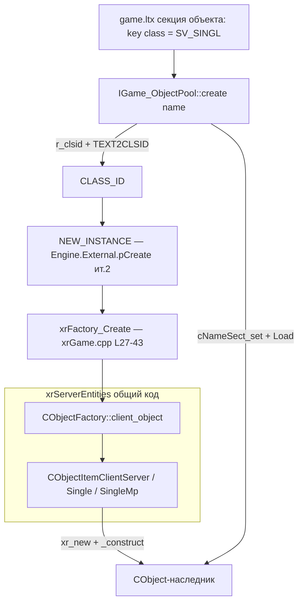
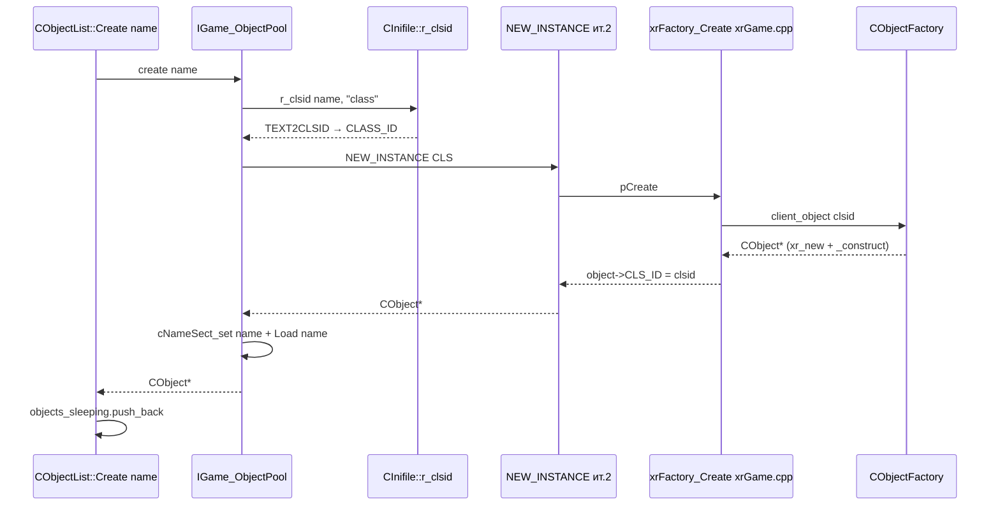

# Фабрика и регистр классов

Механизм, который отвечает на вопрос «какой C++-класс создать по имени из `game.ltx`»: **регистр всех классов мира** (client/server-пары, скриптовые CLSID), точка входа `NEW_INSTANCE` в игровой DLL и путь `имя → класс → экземпляр → Load()`.

## 1. Ответственность

- **Регистр классов** — `CObjectFactory` (`src/xrServerEntities/object_factory.h`): вектор записей `CObjectItemAbstract*`, каждая связывает `CLASS_ID` ↔ C++-класс(ы) ↔ скриптовое имя.
- **Создание/уничтожение** — `client_object(clsid)` / `server_object(clsid, section)`: фабрика возвращает «новый, сконструированный» объект (client — через `_construct()`, server — через `init()`).
- **Скриптовые ID** — `script_clsid(clsid)` = **индекс в отсортированном векторе** (порядко-зависимый ID, который Lua-скрипты используют как тип объекта).
- **Точка входа движка** — `NEW_INSTANCE(CLS)` ([api](../xr-engine/api.md), ит. 2) → `CEngineAPI::pCreate` → `xrFactory_Create` в `xrGame.cpp` (L27–43): спрашивает `object_factory().client_object(clsid)`, проставляет `object->CLS_ID = clsid`.
- **Имя → класс** — `IGame_ObjectPool::create(name)` ([object-pool](../xr-engine/object-pool.md), ит. 2): `pSettings->r_clsid(name, "class")` читает key `class` секции объекта в `game.ltx` как текст CLSID → `TEXT2CLSID` → `NEW_INSTANCE`.

Ключевой факт: **`CGameObject` сам не зарегистрирован** — в реестре только конкретные наследники (монстры, оружие, зоны, предметы). Исторический предок `CGO` (legacy) в текущей кодовой базе не найден (поиск `class CGO` — нет совпадений в `src/xrGame/`); упоминается здесь и в порц. 30 только как предок `CGameObject`.

## 2. Место в архитектуре

Между конфигом (`game.ltx`: секция объекта = имя, key `class` = текст CLSID) и иерархией `CObject` ([xr-object](../xr-engine/xr-object.md)). Код фабрики лежит в **`src/xrServerEntities/`** — общий для клиентской и dedicated-server сборок (клиентские классы под `#ifndef NO_XR_GAME`, dedicated-guard'ы).

## 3. Публичный API

- `const CObjectFactory& object_factory()` — ленивый синглтон (`object_factory_inline.h` L14–22): при первом обращении создаёт `CObjectFactory` (→ `register_classes()`) и вызывает `init()` (→ `register_script_classes()`). Глобал `g_object_factory` (def в `object_factory.cpp` L13).
- `CObjectFactory::client_object(clsid)` — `item(clsid).client_object()` (client build).
- `CObjectFactory::server_object(clsid, section)` — `item(clsid).server_object(section)`; dedicated-вариант принимает `no_assert` и возвращает `0` при промахе.
- `CObjectFactory::script_clsid(clsid)` — индекс записи в отсортированном векторе.
- `CObjectItemAbstract` (`object_item_abstract.h`): поля `CLASS_ID m_clsid` + `shared_str m_script_clsid`, чистые виртуальные `client_object()` / `server_object(section)`.
- Шаблоны `add<_client_type,_server_type>(clsid, script_clsid)` и `add<_unknown_type>(clsid, script_clsid)` (`object_factory_impl.h` L24–55) — создают `CObjectItemClientServer` / `CObjectItemSingle` и вызывают `add(item)`.
- `TEXT2CLSID` / `CLSID2TEXT` (`src/xrCore/clsid.h/.cpp`) — `CLASS_ID` = `u64` из 8 ASCII-байт (макрос `MK_CLSID`); `TEXT2CLSID` дополняет строку пробелами до 8, `VERIFY3(strlen <= 8, "Beer from creator CLASS_ID:")`. Константы — `src/xrServerEntities/clsid_game.h` (`CLSID_GAME_*`, `CLSID_AI_*`, `CLSID_WPN_*`…).
- `game_GameState::getCLASS_ID(game_type_name, isServer)` (`src/xrGame/game_base.cpp` L221–271): `ParseStringToGameType` → `TEXT2CLSID("SV_SINGL")` / `"CL_SINGL"` / `"SV_DM"` / `"CL_DM"` / `"SV_TDM"` / `"CL_TDM"` / `"SV_AHUNT"` / `"CL_AHUNT"` / `"SV_CTA"` / `"CL_CTA"`; `default` → `TEXT2CLSID("")`. Выше — закомментированный старый путь: Lua-фабрика из `script.ltx` key `common/game_type_clsid_factory`.

## 4. Внутреннее устройство

**Хранилище.** `mutable OBJECT_ITEM_STORAGE m_clsids` (`xr_vector<CObjectItemAbstract*>`) + `mutable bool m_actual` (`object_factory.h` L60–61). `actualize()` (inline L128–135): при первом обращении после добавлений сортирует вектор по `clsid()` (ленивая сортировка, флаг-guard). `item(clsid)` (inline L61–67): `actualize()` + `std::lower_bound` + `VERIFY((I != end) && (*I)->clsid() == clsid)` → `**I`.

**`add(CObjectItemAbstract*)`** (inline L81–100): `VERIFY` отсутствия дубликата clsid (`find_if` + `VERIFY2(0, "clsid is duplicated : %s")` через `CLSID2TEXT`) и, **только в client build** (`#ifndef NO_XR_GAME`), `VERIFY` отсутствия дубликата `script_clsid`. Ставит `m_actual=false`, `push_back`.

**Три типа записей** (все — шаблоны, реализация — `xr_new<TYPE>()` + `_construct()`/`init()`):

| Тип | Шаблоны | Когда |
|-----|---------|-------|
| `CObjectItemSingle<type, is_client>` | `add<_unknown_type>` | один класс на обе/одну сторону: client-only (`CLevel`, `CGamePersistent`, `CHUDManager`, `game_sv_*`/`game_cl_*`, `CUIGame*`, физика) или dedicated-only (`CSE_ALife*` под `NO_XR_GAME`) |
| `CObjectItemClientServer<client, server>` | `add<_client,_server>`, макрос `ADD` | обычный случай: один класс-пара на CLSID (монстры, оружие, зоны, предметы) |
| `CObjectItemClientServerSingleMp<cl_sp, cl_mp, sv_sp, sv_mp>` | `ADD_MP`, **только для `CActor`** (register L235) | у MP-актора **отдельные C++-классы на стороне**: `IsGameTypeSingle()` (L445 `Level.h`: `g_pGamePersistent->GameType() == eGameIDSingle`) → `xr_new<CActor>/CSE_ALifeCreatureActor`, иначе `CActorMP`/`CSE_ActorMP` (детали — порц. 23 / 19) |

**Компиляторные проверки.** `STATIC_CHECK` в `add<...>`: клиентский тип наследуется от `ObjectFactory::CLIENT_BASE_CLASS`, серверный — от `SERVER_BASE_CLASS` (typedef'ы в `object_factory_space.h`).

**Таблица регистрации.** `CObjectFactory::register_classes()` (`object_factory_register.cpp` L198–476) — ~120 записей макросами:
- `#define ADD(a,b,c,d) add<a,b>(c,d)` (client) / `add<b>(c,d)` (dedicated, `NO_XR_GAME`).
- Секции: client-only (`CLevel`, `CGamePersistent`, `CHUDManager`, game-типы `game_sv_*`/`game_cl_*`, HUD `CUIGameSP/DM/TDM/AHunt/CTA`) → `CActor` (`ADD_MP` L235) → ALife-серверные (`CSE_ALifeGroupTemplate`, `CSE_ALifeGraphPoint`, `CSE_ALifeOnlineOfflineGroup` под `NO_SINGLE`) → пары клиент/сервер: монстры (`CAI_Flesh`…`CWeaponStatMgun`), артефакты (14 `CSE_ALifeItemArtefact`), оружие (`CWeaponFN2000`…`CWeaponSSRS`), патроны (**один `CWeaponAmmo` под 4 CLSIDs**: `CLSID_OBJECT_AMMO`/`A_VOG25`/`A_OG7B`/`A_M209`), навески, инвентарь (включая `ADD(CInventoryItemObject, CSE_ALifeItem, CLSID_IITEM_ATTACH, "obj_attachable")` L353 — здесь зарегистрирован **сам `CInventoryItemObject`** как абстрактная «прицепляемая» вещь), обмундирование, гранаты, ракеты (`CExplosiveRocket` → `CSE_Temporary`), зоны (`CCustomZone`…`CZoneCampfire`, `CSmartZone`), детекторы, устройства, физические объекты, `CInventoryBox`, `smart_cover::object`, форк-классы (`CWeaponSSRS`).
- **Build-guard'ы**: `NO_SINGLE` (single-player классы), `BENCHMARK_BUILD` (MP game-типы, `CLevelChanger`), `NO_XR_GAME` (dedicated), `DEDICATED_SERVER_ONLY`.
- **Dedicated-server-only блок** (L438–475, guard `if (!g_dedicated_server) return;` — то есть выполняется **только** в dedicated): серверные дубли тех же C++-классов под **другими CLSID**'ами (`SCRPTART`, `TORCH_S`, `WP_AK74`…`SPC_RS_S`, `_WP_SSRS`, `_S_SEARC`, `_S_STMGU`) — коммент: «because we do not have scripts and script functionality is not needed here».

**Скриптовая регистрация.** `init()` → `register_script_classes()` (`object_factory_script.cpp` L71–77: в client — `ai()`, в dedicated — no-op). `register_script_class` (L18–65) — Lua-вызов `object_factory:register(...)`: берёт `luabind::object` конструктора(ов), оборачивает в `CObjectItemScript` → `add()`. `register_script()` (L85–107): `actualize()` + экспорт в Lua — `enum clsid._clsid` (`script_clsid` → индекс) и глобальная таблица `clsid_table` (`имя → индекс`).

## 5. Взаимодействие

- **`CObjectList`** (`src/xrEngine/xr_object_list.h/.cpp`, в `IGame_Level::Objects`, [ит.2](../xr-engine/xr-object.md)): `Create(name)` (L460–466) — `g_pGamePersistent->ObjectPool.create(name)` + push в `objects_sleeping`; `Destroy(O)` (L468–533) — `net_Unregister`, учёт crows, erase из active/sleeping (FATAL «! Unregistered object being destroyed» если нет в обоих) → `ObjectPool.destroy(O)`.
- **`IGame_ObjectPool`** ([object-pool](../xr-engine/object-pool.md), ит. 2, `g_pGamePersistent->ObjectPool`): `create`/`destroy`/`prefetch` — см. §6.
- **`CInifile::r_clsid`** (`src/xrCore/Xr_ini.cpp` L1799–1802) — `r_string(S, L)` → `TEXT2CLSID` ([inifile](../xr-core/inifile.md), ит. 3).
- **`CObject`** — `CLS_ID`-член ставится в `xrFactory_Create` (client) после создания; `Load(name)` читает секцию из `game.ltx` ([xr-object](../xr-engine/xr-object.md)).
- **Скриптовая сторона** — `CObjectItemScript`, `CScriptGameObject` (механика — порц. 13, полный API — итерация 14).
- **Сеть** — `net_Spawn` с `CSE_Abstract*`-аргументом (ит. 12; ALife-сущности — ит. 11).

## 6. Потоки создания и уничтожения

**Prefetch** (старт уровня): `IGame_ObjectPool::prefetch()` (`IGame_ObjectPool.cpp` L16–40) — секция `"prefetch_objects_" + m_game_type` в `game.ltx`, по каждому key: `r_clsid` → `NEW_INSTANCE` → `Load` → `m_PrefetchObjects` (удаляются `clear()` — L42–50; dtor `R_ASSERT(m_PrefetchObjects.empty())`). `m_game_type` — из командной строки (`IGame_Persistent::params`, `/`-разделено, lower-case).

**Уничтожение**: `CObjectList::Destroy` (см. §5) → `IGame_ObjectPool::destroy(O)` → **`xr_delete(O)`** — реального пуллинга нет (L61–64; ниже — большой закомментированный блок старой реализации с `map_POOL`, L66–140, мёртвый код).

## 7. Конфигурация

- **`game.ltx`**: секция объекта = его имя; key `class = <текст CLSID>` (8 ASCII-символов). Prefetch: секция `prefetch_objects_<game_type>`, key'и = имена объектов.
- **`clsid_game.h`** — константы `MK_CLSID(...)` / `TEXT2CLSID(...)`; `CLASS_ID` = `u64` (`src/xrCore/clsid.h`).
- **`m_game_type`** — командная строка (`/`-разделено, lower-case, `IGame_Persistent::params` L31–61) — определяет game-типы и prefetch-секцию.

## 8. Известные ограничения / дебаг

- **Нет реального пуллинга**: `IGame_ObjectPool::destroy` — `xr_delete`; пул-реализация закомментирована (L66–140) и мертва.
- **Дубликат CLSID = VERIFY-crash** (dev build): `add()` — `"clsid is duplicated : %s"`; дубликат `script_clsid` — только client build.
- **`script_clsid` = индекс в отсортированном векторе** — порядко-зависимый ID: изменение порядка/состава таблицы регистрации сдвигает скриптовые ID (отсюда ленивая сортировка `actualize()` с `mutable`).
- **Dedicated-server CLSID-дубли**: один C++-класс под двумя CLSID (обычный + `_s`-суффикс, L441–474) — intentional, «no scripts» в dedicated.
- **`CActor`-форк MP**: `CActor`/`CActorMP` — выбор в runtime по `IsGameTypeSingle()` (детали — порц. 23 / 19).
- **`CGameObject` не в реестре** — только наследники; `CInventoryItemObject` — исключение (зарегистрирован как «attachable»-базис, L353).
- **DEBUG quirk**: `xrFactory_Create` при `NULL` (неизвестный clsid) → `return 0` (L31–34), не assert.
- **`TEXT2CLSID`** — `VERIFY3` «Beer from creator CLASS_ID» при длине > 8; короче 8 дополняется пробелами в хвосте.
