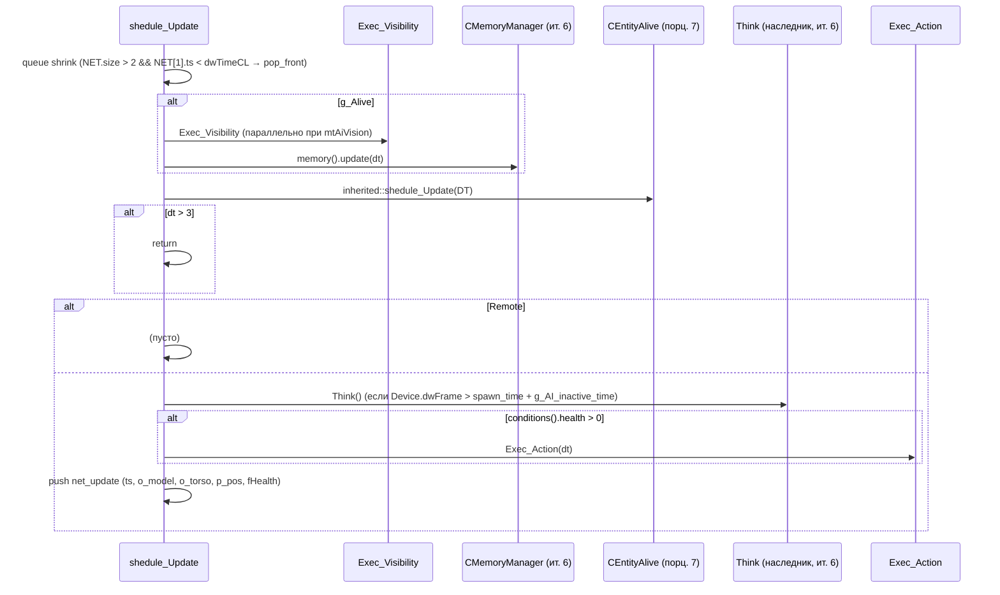
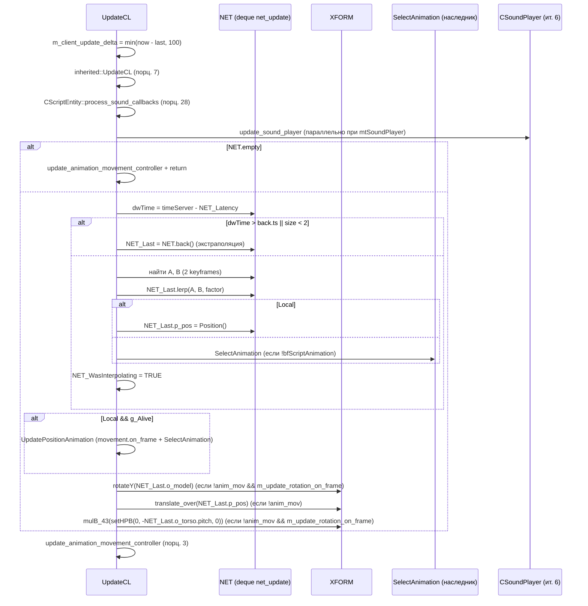
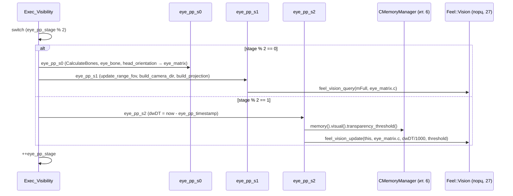

# CCustomMonster: мост в AI

> **Модуль:** `xrGame` · **Файлы:** `src/xrGame/CustomMonster.h` (362 стр.), `src/xrGame/CustomMonster.cpp` (1453 стр.), `src/xrGame/CustomMonster_inline.h` (111 стр.), `src/xrGame/CustomMonster_VCPU.cpp` (42 стр.) · **Порцион 9/30, итерация 5**

**Границы:** внутренности `ai/` (state-менеджеры, `CMemoryManager`/`CMovementManager`/`CSoundPlayer` в подробностях) — итерация 6; `CWeapon` и наследники — итерация 8 (здесь только место в дереве); `Level_*`/сетевой транспорт — итерация 12 (здесь — сигнатуры `net_*` и формат `net_update`); полный Lua API `CScriptGameObject` — итерация 14 (механика — [порц. 13](script-game-object.md)); `CSE_ALife*` — итерация 11; `Feel::Vision/Touch/Sound` (xrEngine) — [порц. 27](feel.md).

## 1. Ответственность

`CCustomMonster` — слой «мост в AI» объектной модели: то, что делает из живого существа (порц. 7) существа, у которого есть **память, движение и звук**. Наследник `CEntityAlive` + `CScriptEntity` + `Feel::Vision`/`Feel::Sound`/`Feel::Touch`; выше — конкретные монстры (`CAI_Flesh`, `CBurer`, `CSnork`, …) и сталкер (`CAI_Stalker`, ит. 6). Класс отвечает за:

- **AI-менеджеры**: ленивое создание `CMemoryManager` (память: visual/sound/enemy/item/danger), `CMovementManager` (движение по level/game graph), `CSoundPlayer` (звуки монстра) в `_construct`; доступ через `memory()`/`movement()`/`sound()`;
- **кадровый цикл AI**: `shedule_Update` — 2-хступенчатое зрение (`Exec_Visibility`), `memory().update(dt)`, **`Think()`** (чисто виртуальный, реализуют наследники; вызов gated на `Device.dwFrame > spawn_time() + g_AI_inactive_time`), `Exec_Action(dt)`;
- **клиентское обновление**: `UpdateCL` — **интерполяция/экстраполяция** сетевых ключевых кадров `NET` (deque `net_update`), применение `NET_Last` к `XFORM`, `SelectAnimation` (чисто виртуальный);
- **зрение для AI**: `eye_pp_s0/s1/s2` (матрица глаза из `eye_bone` + `head_orientation()`, frustum-query, ray-тесты с троттлингом по `eye_pp_timestamp`), `update_range_fov` (fog/far-plane факторы), `feel_visible_isRelevant` (свой отряд — невидим);
- **сеть**: `net_Spawn`/`net_Destroy`, `net_Export`/`net_Import` (формат `net_update`: health, timestamp, pos, model yaw, torso yaw/pitch/roll, team/squad/group), `moving_object*` (создание/уничтожение);
- **критические раны**: аккумулятор `update_critical_wounded(bone_id, power)` с time-decay, тип раны из `m_bones_body_parts`, хуки `critical_wounded_state_start()`/`critical_wound_external_conditions_suitable()` (no-op в базе);
- **feel-мосты**: `feel_touch_on_contact`/`feel_touch_contact` (сферы внутри `CCustomZone`), `feel_sound_new` → `memory().sound()`, `feel_vision_mtl_transp` → `memory().visual()`;
- **интерфейс «полезность» для AI-менеджеров**: `useful`/`evaluate` × 3 пары (item/enemy/danger) — делегирование в `memory()`.

**Что НЕ делает:** не планирует поведение (`Think()` — чисто виртуальный, логика — в `ai/`, ит. 6); не реализует сами менеджеры (ит. 6); не владеет транспортом сети (ит. 12 — здесь только `net_*` сигнатуры и формат кадра); не анимирует (порц. 20); не считает статы (порц. 6–8).

## 2. Место в архитектуре

```
CObject (xrEngine)                       — xr-object.md
└─ CGameObject                           — game-object.md
   └─ CEntity                            — entity.md
      └─ CEntityAlive                    — entity-alive.md (порц. 7)
         ├─ CCustomMonster               — ЭТОТ класс (порц. 9)
         │  ├─ CAI_Flesh, CBurer, CSnork, ... (конкретные монстры — ит. 6)
         │  └─ CAI_Stalker (мост на CActor — ит. 6)
         └─ CActor                       — порц. 14–23
```

Наследование (CustomMonster.h L34–39): `class CCustomMonster : public CEntityAlive, public CScriptEntity, public Feel::Vision, public Feel::Sound, public Feel::Touch`. `typedef CEntityAlive inherited` (L42). Чисто виртуальные: `Think()` (L85), `SelectAnimation` (L165).

**Зависит от:** `CMemoryManager`/`CMovementManager`/`CSoundPlayer`/`CSound_UserDataVisitor` (ит. 6 — здесь только фабрики и accessors), `CSE_ALifeMonsterAbstract` (ит. 11 — как аргумент `net_Spawn`), `moving_object` (moving_object.h — «движущийся объект», spatial-обёртка), `ai()` (AI-спейс: level/game graph, restrictions — ит. 6), `CLevelGraph` (contour для `PitchCorrection`), `Feel::Vision/Sound/Touch` (xrEngine, порц. 27), `CCustomZone` (порц. 25 — `inside()`), `CScriptEntity` (порц. 28 — sound callbacks, `GetScriptControl`/`ProcessScripts`), `CCharacterPhysicsSupport` (ит. 7), `NET_Packet`/`Level().timeServer()` (ит. 12).

## 3. Публичный API

### Ядро, жизненный цикл

| Метод                 | Сигнатура                                                                  | Назначение                                                                      |
| --------------------- | -------------------------------------------------------------------------- | ------------------------------------------------------------------------------- |
| `cast_custom_monster` | `CCustomMonster* ()`                                                       | down-cast (h L224)                                                              |
| `_construct`          | `virtual DLL_Pure* ()`                                                     | фабрики memory/movement/sound, §4.2                                             |
| `net_Spawn`           | `virtual BOOL (CSE_Abstract* DC)`                                          | memory/movement init, spatial-типы, AI-локации, 2 seed-кадра `NET`, §4.3        |
| `net_Destroy`         | `virtual void ()`                                                          | inherited + CScriptEntity + sound/movement unload, delete `moving_object`, §4.4 |
| `net_Relcase`         | `virtual void (CObject*)`                                                  | inherited + `memory().remove_links`                                             |
| `shedule_Update`      | `virtual void (u32 dt)`                                                    | зрение → memory → inherited → **`Think()`** → `Exec_Action` → push `NET`, §4.5  |
| `UpdateCL`            | `virtual void ()`                                                          | клиентский delta-цикл: интерполяция/экстраполяция, §4.6                         |
| `Think`               | `virtual void () = 0`                                                      | **чисто виртуальный** — AI-логика наследника (ит. 6)                            |
| `SelectAnimation`     | `virtual void (const Fvector& view, const Fvector& move, float speed) = 0` | **чисто виртуальный** — выбор анимации (ит. 6)                                  |
| `Die`                 | `virtual void (CObject* who)`                                              | inherited + `SetActorVisibility(ID(), 0.f)`                                     |
| `Hit`                 | `virtual void (SHit*)`                                                     | `invulnerable()` gate → inherited (порц. 7)                                     |
| `HitSignal`           | `virtual void (float, Fvector&, CObject*)`                                 | **пустой**                                                                      |
| `OnEvent`             | `virtual void (NET_Packet&, u16)`                                          | только inherited (порц. 4–5)                                                    |
| `save` / `load`       | `virtual void (NET_Packet&)` / `(IReader&)`                                | inherited + `memory().save/load` если alive                                     |
| `net_SaveRelevant`    | `virtual BOOL ()`                                                          | inherited (CEntityAlive → TRUE)                                                 |
| `UsedAI_Locations`    | `virtual BOOL ()`                                                          | всегда `TRUE`                                                                   |
| `set_ready_to_save`   | `virtual void ()`                                                          | inherited + `memory().enemy().set_ready_to_save()`                              |

### Зрение (eyes)

| Метод                                   | Сигнатура                                                                     | Назначение                                                            |
| --------------------------------------- | ----------------------------------------------------------------------------- | --------------------------------------------------------------------- |
| `ffGetFov` / `ffGetRange`               | `virtual float () const`                                                      | `eye_fov` / `eye_range` (реализация чисто виртуальных `CEntityAlive`) |
| `set_fov` / `set_range`                 | `void (float)`                                                                | `VERIFY(>0 / >1)` + запись                                            |
| `Exec_Visibility`                       | `void __stdcall ()`                                                           | 2-хступенчатое зрение, §4.7                                           |
| `eye_pp_s0` / `eye_pp_s1` / `eye_pp_s2` | `virtual void ()` / `void ()` ×2                                              | матрица глаза / frustum / ray-тесты, §4.7                             |
| `update_range_fov`                      | `virtual void (float& range, float& fov, float start_range, float start_fov)` | fog/far-plane коэффициенты, §4.7                                      |
| `feel_visible_isRelevant`               | `virtual BOOL (CObject*)`                                                     | не-CEntityAlive / свой отряд → FALSE                                  |
| `feel_vision_mtl_transp`                | `virtual float (CObject*, u32)`                                               | → `memory().visual()`                                                 |
| `UpdateCamera`                          | `virtual void ()`                                                             | DEBUG: `g_pGameLevel->Cameras().Update` (eye-матрица)                 |

### Feel (звук, контакт)

| Метод                   | Сигнатура                                                                 | Назначение                                  |
| ----------------------- | ------------------------------------------------------------------------- | ------------------------------------------- |
| `dcast_FeelSound`       | `virtual Feel::Sound* ()`                                                 | `this`                                      |
| `feel_sound_new`        | `virtual void (CObject*, int, CSound_UserDataPtr, const Fvector&, float)` | alive + !destroy → `memory().sound()`       |
| `feel_touch_on_contact` | `virtual bool (CObject*)`                                                 | `CCustomZone::inside(sphere R=EPS_L)`, §4.8 |
| `feel_touch_contact`    | `virtual bool (CObject*)`                                                 | `CCustomZone::inside(sphere R=0)`, §4.8     |

### AI-интерфейс (менеджеры, «полезность»)

| Метод                                  | Сигнатура                                                                                                                                     | Назначение                                          |
| -------------------------------------- | --------------------------------------------------------------------------------------------------------------------------------------------- | --------------------------------------------------- |
| `memory`                               | `IC CMemoryManager& () const`                                                                                                                 | `*m_memory_manager` (VERIFY)                        |
| `movement`                             | `IC CMovementManager& () const`                                                                                                               | `*m_movement_manager` (VERIFY)                      |
| `sound`                                | `IC CSoundPlayer& () const`                                                                                                                   | `*m_sound_player` (VERIFY)                          |
| `sound_user_data_visitor`              | `IC CSound_UserDataVisitor* () const`                                                                                                         | VERIFY                                              |
| `visual_memory`                        | `virtual CVisualMemoryManager* () const`                                                                                                      | `&memory().visual()` (override `CEntityAlive`)      |
| `useful` / `evaluate` × 3              | `(const CItemManager*, const CGameObject*)` / `(const CEnemyManager*, const CEntityAlive*)` / `(const CDangerManager*, const CDangerObject&)` | делегирование в `memory().item()/enemy()/danger()`  |
| `on_enemy_change`                      | `virtual void (const CEntityAlive*)`                                                                                                          | **пустой**                                          |
| `on_restrictions_change`               | `virtual void ()`                                                                                                                             | `memory()` + `movement()`                           |
| `panic_threshold`                      | `IC float () const`                                                                                                                           | `m_panic_threshold` (ini)                           |
| `is_base_monster_with_enemy`           | `virtual bool ()`                                                                                                                             | по умолчанию `false`                                |
| `bfExecMovement`                       | `virtual bool ()`                                                                                                                             | по умолчанию `false`                                |
| `get_custom_pitch_speed`               | `virtual float (float def_speed)`                                                                                                             | по умолчанию `def_speed`                            |
| `head_orientation`                     | `virtual const MonsterSpace::SBoneRotation& () const`                                                                                         | `movement().m_body`                                 |
| `Orientation`                          | `virtual const SRotation () const`                                                                                                            | `movement().m_body.current`                         |
| `PitchCorrection`                      | `virtual void ()`                                                                                                                             | pitch из contour-плоскости level graph, §4.9        |
| `predict_position` / `target_position` | `virtual Fvector (float) const` / `() const`                                                                                                  | через `movement()` (override `CEntityAlive`)        |
| `spatial_sector_point`                 | `virtual Fvector ()`                                                                                                                          | inherited + `Radius()*0.5f` вверх, §4.10            |
| `spatial_move`                         | `virtual void ()`                                                                                                                             | inherited + `get_moving_object()->on_object_move()` |
| `get_moving_object`                    | `IC moving_object* () const`                                                                                                                  | VERIFY2                                             |
| `update_sound_player`                  | `void __stdcall ()`                                                                                                                           | `sound().update(client_update_fdelta())`            |
| `Exec_Action` / `Exec_Look`            | `virtual void (float dt)`                                                                                                                     | base: пустой / VCPU: angle-lerp взгляда, §4.11      |
| `mk_orientation` / `mk_rotation`       | `void (Fvector&, Fmatrix&)` / `void (Fvector&, SRotation&)`                                                                                   | dir → ориентация (VCPU: yaw/pitch)                  |

### Критические раны

| Метод                                         | Сигнатура                                       | Назначение                                                |
| --------------------------------------------- | ----------------------------------------------- | --------------------------------------------------------- |
| `update_critical_wounded`                     | `bool (const u16& bone_id, const float& power)` | аккумулятор + time-decay, §4.12                           |
| `critically_wounded`                          | `IC bool ()`                                    | `m_critical_wound_type != u32(-1)`                        |
| `critical_wound_type`                         | `IC const u32& () const`                        | тип (u32)                                                 |
| `critical_wounded_state_stop`                 | `IC void ()`                                    | тип → `u32(-1)`                                           |
| `load_critical_wound_bones`                   | `virtual void ()`                               | **пустой** хук (наследник заполняет `m_bones_body_parts`) |
| `critical_wound_external_conditions_suitable` | `virtual bool ()`                               | по умолчанию `true`                                       |
| `critical_wounded_state_start`                | `virtual void ()`                               | **пустой** хук                                            |

### Прочее

| Метод                                                                      | Сигнатура                                                      | Назначение                                                         |
| -------------------------------------------------------------------------- | -------------------------------------------------------------- | ------------------------------------------------------------------ |
| `invulnerable`                                                             | `IC void (const bool&)` / `IC bool () const`                   | флаг неуязвимости (gate `Hit`)                                     |
| `already_dead`                                                             | `IC const bool& () const`                                      | `m_already_dead`                                                   |
| `use_simplified_visual`                                                    | `virtual bool () const`                                        | по умолчанию `false` (закомм. `(already_dead())`)                  |
| `should_wait_to_use_corspe_visual`                                         | `virtual bool ()`                                              | по умолчанию `true` (опечатка «corspe»)                            |
| `human_being`                                                              | `virtual bool () const`                                        | по умолчанию `false` (override `CEntityAlive`)                     |
| `create_anim_mov_ctrl` / `destroy_anim_mov_ctrl`                           | `virtual void (CBlend*, Fmatrix*, bool)` / `void ()`           | disable/enable `movement()`, §4.13                                 |
| `ForceTransform`                                                           | `virtual void (const Fmatrix&)`                                | физика + `BlockDamageSet` (non-Single), §4.14                      |
| `g_WeaponBones`                                                            | `virtual void (int&, int&, int&)`                              | **пустой** override (реализация чисто виртуального `CEntityAlive`) |
| `load_killer_clsids` / `is_special_killer`                                 | `void (LPCSTR)` / `bool (CObject*)`                            | ini `killer_clsids` (TEXT2CLSID-список)                            |
| `angle_lerp_bounds` / `vfNormalizeSafe`                                    | `IC bool (float&, float, float, float)` / `IC void (Fvector&)` | утилиты (inline.h), `left_angle`                                   |
| `client_update_fdelta` / `client_update_delta` / `last_client_update_time` | `IC float () const` / `IC const u32& () const` ×2              | дельта клиентского обновления                                      |
| `net_Export` / `net_Import`                                                | `virtual void (NET_Packet&)` ×2                                | экспорт/импорт `net_update`, §4.3                                  |

### Поля (public)

| Поле                                                             | Тип                                                 | Назначение                                           |
| ---------------------------------------------------------------- | --------------------------------------------------- | ---------------------------------------------------- |
| `eye_matrix`                                                     | `Fmatrix`                                           | матрица «глаз» (матрица камеры зрения)               |
| `eye_bone`                                                       | `int`                                               | bone головы (ini `bone_head`)                        |
| `eye_fov` / `eye_range`                                          | `float`                                             | FOV / дальность зрения (ini)                         |
| `eye_pp_stage` / `eye_pp_timestamp`                              | `u32`                                               | стадия 2-хступенчатого зрения / время последнего s2  |
| `m_tEyeShift` / `m_fEyeShiftYaw`                                 | `Fvector` / `float`                                 | сдвиг глаза (используется `CAI_Stalker`, ит. 6)      |
| `m_fCurSpeed`                                                    | `float`                                             | текущая скорость (AI, ит. 6)                         |
| `NET`                                                            | `xr_deque<net_update>`                              | очередь сетевых ключевых кадров                      |
| `NET_Last`                                                       | `net_update`                                        | последний интерполированный/экстраполированный кадр  |
| `NET_WasInterpolating` / `NET_WasExtrapolating`                  | `BOOL`                                              | режим последнего обновления                          |
| `NET_Time`                                                       | `u32`                                               | server time последнего обновления                    |
| `m_client_update_delta` / `m_last_client_update_time`            | `u32`                                               | delta (capped 100 мс) / время последнего `UpdateCL`  |
| `m_fTimeUpdateDelta` / `m_dwLastUpdateTime` / `m_dwCurrentTime`  | `float` / `u32`                                     | dt `Think`, время последнего/текущего обновления     |
| `tWatchDirection`                                                | `Fvector`                                           | направление взгляда (используется ит. 6)             |
| `m_panic_threshold`                                              | `float`                                             | порог паники (ini)                                   |
| `m_far_plane_factor` / `m_fog_density_factor`                    | `float`                                             | коэффициенты зрения в тумане (ini, дефолты 1 / 0.05) |
| `m_critical_wound_threshold` / `m_critical_wound_decrease_quant` | `float`                                             | порог/скорость затухания крит. раны (ini)            |
| `m_critical_wound_accumulator` / `m_critical_wound_type`         | `float` / `u32`                                     | аккумулятор / активный тип раны                      |
| `m_last_hit_time`                                                | `u32`                                               | время последнего хита (для time-decay)               |
| `m_bones_body_parts`                                             | `associative_vector<u16, u32>`                      | bone → тип крит. раны                                |
| `m_update_rotation_on_frame`                                     | `bool`                                              | применять yaw/torso в `UpdateCL` (destr. true)       |
| `m_invulnerable` / `m_already_dead`                              | `bool`                                              | неуязвимость / уже мёртв                             |
| `m_killer_clsids`                                                | `xr_vector<CLASS_ID>`                               | «особые убийцы» (ini)                                |
| `m_jump_picks` / `m_jump_collide_tris` (DEBUG)                   | `xr_vector<trajectory_pick>` / `xr_vector<Fvector>` | отладка прыжков (VCPU)                               |

### `net_update` (h L93–114)

| Поле            | Тип                                      | Назначение                                                     |
| --------------- | ---------------------------------------- | -------------------------------------------------------------- |
| `dwTimeStamp`   | `u32`                                    | server(game) timestamp                                         |
| `o_model`       | `float`                                  | model yaw                                                      |
| `o_torso`       | `SRotation`                              | torso в мировых координатах (yaw/pitch/roll)                   |
| `p_pos`         | `Fvector`                                | позиция в мире                                                 |
| `fHealth`       | `float`                                  | здоровье                                                       |
| `lerp(A, B, f)` | `void (net_update&, net_update&, float)` | `angle_lerp` yaw/pitch, `lerp` pos, линейный health (L421–429) |

## 4. Внутреннее устройство

### 4.1 Конструктор/деструктор (L94–128)

ctor: `Feel::Vision(cast_game_object())` (non-polymorphic call, коммент L95–96 — «just to remove warning C4355»); нули: `m_sound_user_data_visitor/m_memory_manager/m_movement_manager/m_sound_player = 0`, `m_already_dead = m_invulnerable = false`, `m_moving_object = 0`. dtor: delete visitor/memory/movement/sound; **Lain-добавление**: `g_pGameLevel->SoundEvent_OnDestDestroy(this)`; DEBUG: `Msg("dumping client spawn manager stuff for object with id %d")` + `Level().client_spawn_manager().dump(ID())` (не dedicated) + `clear(ID())`.

### 4.2 `_construct` (L1045–1055) — фабрики

`m_memory_manager = create_memory_manager()` (`xr_new<CMemoryManager>(this, create_sound_visitor())`, L1030–1033); `m_movement_manager = create_movement_manager()` (`xr_new<CMovementManager>(this)`, L1020–1023); `m_sound_player = xr_new<CSoundPlayer>(this)`; затем `inherited::_construct()` (CEntityAlive → фабрика `CEntityCondition`, порц. 7) + `CScriptEntity::_construct()`. Все три — **виртуальные фабрики** (L253–255), наследники (ит. 6) могут подменить. `CSound_UserDataVisitor` создаётся лениво в `create_memory_manager`.

### 4.3 `net_Spawn` (L743–836)

`memory().reload(*cNameSect())` + `memory().reinit()` → `movement().net_Spawn(DC)` → `inherited::net_Spawn(DC)` (порц. 7 → порц. 5/4) → `CScriptEntity::net_Spawn(DC)`. `smart_cast<ISpatial*>` → `spatial.type |= STYPE_VISIBLEFORAI` + `STYPE_REACTTOSOUND` (только `g_Alive()`). `smart_cast<CSE_ALifeMonsterAbstract*>` (ит. 11): `SetfHealth(E->get_health())`, `!g_Alive()` → `set_death_time()` (закомм. Msg). **AI-локации** (L773–806): `ai().get_level_graph() && UsedAI_Locations() && (e->ID_Parent == 0xffff)` → `ai_location().game_vertex(E->m_tGraphID)`; `m_tNextGraphID` (valid + тот же level + `movement().restrictions().accessible(level_vertex_id)`) → `movement().set_game_dest_vertex`; `accessible(ai_location().level_vertex_id())` → `set_level_dest_vertex`, иначе `accessible_nearest(...)` → `set_level_dest_vertex` + `movement().detail().set_dest_position`. `eye_bone = LL_BoneID(pSettings->r_string(cNameSect(), "bone_head"))` (L809). `Local()` → **2 seed-кадра `NET`** (timestamp `timeServer() - NET_Latency`, yaw = `-E->o_torso.yaw`, второй +`NET_Latency`), `setVisible/setEnabled(TRUE)`. `shedule.t_min = 100; t_max = 250` (коммент «This equaltiy is broken by Dima :-( // 30 * NET_Latency / 4»). `m_moving_object = xr_new<moving_object>(this)` (L833).

### 4.4 `net_Destroy` (L860–887)

`inherited::net_Destroy()` (порц. 7) → `CScriptEntity::net_Destroy()` → `sound().unload()` → `movement().net_Destroy()` → `Device.remove_from_seq_parallel` × 2 (`update_sound_player`, `Exec_Visibility`) — снятие с параллельного пула; DEBUG `DBG().on_destroy_object(this)`; `xr_delete(m_moving_object)`; `SetActorVisibility(ID(), 0.0f)`.

### 4.5 `shedule_Update` (L324–419)

`VERIFY(!g_Alive() || processing_enabled())`; **queue shrink**: `dwTimeCL = timeServer() - NET_Latency`, `while ((NET.size() > 2) && (NET[1].dwTimeStamp < dwTimeCL)) NET.pop_front()`. `dt = DT/1000`. `g_Alive()`: **`Exec_Visibility`** — параллельно (`Device.seqParallel.push_back`) при `g_mt_config.test(mtAiVision)` (не DEBUG); DEBUG-особый случай: `!psAI_Flags.test(aiStalker) || smart_cast<CActor*>(Level().CurrentEntity())` → параллельно, иначе синхронно; иначе синхронно. `memory().update(dt)`. `inherited::shedule_Update(DT)` (порц. 7). **`if (dt > 3) return;`** (защита от больших dt). `Remote()` → пусто; иначе: `m_fTimeUpdateDelta = dt`; `Device.Statistic->AI_Think/TEST1.Begin()`; `GetScriptControl()` → `ProcessScripts()` (Lua), иначе **`if (Device.dwFrame > spawn_time() + g_AI_inactive_time) Think();`** (глобал `g_AI_inactive_time`, extern L66); `Exec_Action(dt)` **только `conditions().health() > 0`**; push `net_update` (timestamp = `timeServer()`, `o_model`/`o_torso` = `movement().m_body.current`, `p_pos`, `fHealth`) — **в обеих ветках** (alive/dead). Закомм. `feel_touch_update` (pragma todo «Oles to all AI guys»).

### 4.6 `UpdateCL` (L436–577) — клиентский цикл

`m_client_update_delta = min(Device.dwTimeGlobal - m_last_client_update_time, 100)` (cap 100 мс), `m_last_client_update_time = now`. DEBUG: `animation_movement()->DBG_verify_position_not_chaged()` (×5 по коду). `inherited::UpdateCL()` (порц. 7). `CScriptEntity::process_sound_callbacks()` (порц. 28). Закомм. «hack just to skip CalculateBones». `g_mt_config.test(mtSoundPlayer)` → `seqParallel.push_back(update_sound_player)`, иначе sync `sound().update(client_update_fdelta())`. **Интерполяция/экстраполяция** (L476–529): `NET.empty()` → `update_animation_movement_controller()` + return; `dwTime = timeServer() - NET_Latency`; `dwTime > NET.back().dwTimeStamp || NET.size() < 2` → **экстраполяция** (`NET_Last = NET.back()`); иначе **интерполяция**: найти два ключевых кадра (`NET[id].dwTimeStamp <= dwTime <= NET[id+1].dwTimeStamp`), `factor = (dwTime - A.ts) / (B.ts - A.ts)`, `NET_Last.lerp(A, B, factor)`; `Local()` → `NET_Last.p_pos = Position()` (локальный — не трогаем позицию), иначе `!bfScriptAnimation()` → `SelectAnimation(XFORM().k, movement().detail().direction(), movement().speed())`; `NET_WasInterpolating = TRUE`, `NET_Time = dwTime`. `Local() && g_Alive()` → `UpdatePositionAnimation()` (L579–589: `movement().on_frame(...)` + `SelectAnimation`; pragma todo «this is FAKE, network is not supported here!»). Применение `NET_Last` к `XFORM` (L544–557): `!animation_movement_controlled() && m_update_rotation_on_frame` → `XFORM().rotateY(NET_Last.o_model)`; `!animation_movement_controlled()` → `XFORM().translate_over(NET_Last.p_pos)`; `!animation_movement_controlled() && m_update_rotation_on_frame` → `XFORM().mulB_43(setHPB(0, -NET_Last.o_torso.pitch, 0))`. DEBUG: `IsMyCamera()` → `UpdateCamera()`. `update_animation_movement_controller()` (порц. 3).

### 4.7 Зрение (eyes)

**`Exec_Visibility`** (L704–721): `!g_Alive()` → return; `switch (eye_pp_stage % 2)`: 0 → `eye_pp_s0()` + `eye_pp_s1()`, 1 → `eye_pp_s2()`; `++eye_pp_stage` — **2-хступенчатый** цикл (frustum/ray чередуются).

**`eye_pp_s0`** (L599–627): `IKinematics* V = smart_cast<IKinematics*>(Visual())` → `CalculateBones()`; `Fmatrix mEye = V->LL_GetTransform(eye_bone)`; `X = XFORM * mEye`; `rotation = head_orientation()` (= `movement().m_body`); `eye_matrix.setHPB(-rotation.current.yaw + m_fEyeShiftYaw, -rotation.current.pitch, 0)`; форк `HOLDERCUSTOM_NEW`: `cast_stalker() && Holder()` → `eye_matrix.setHPB(Direction().getH() + m_fEyeShiftYaw, Direction().getP(), 0)`; `eye_matrix.c += m_tEyeShift`.

**`eye_pp_s1`** (L670–691): `new_range/new_fov = eye_range/eye_fov`; `g_Alive()` → `update_range_fov(new_range, new_fov, human_being() ? memory().visual().current_state().m_max_view_distance * eye_range : eye_range, eye_fov)` (форк `USE_STALKER_VISION_FOR_MONSTERS`: всегда ×`m_max_view_distance`); `mView.build_camera_dir(eye_matrix.c, k, j)`; `mProject.build_projection(deg2rad(new_fov), 1, 0.1f, new_range)`; `mFull = mProject * mView`; `feel_vision_query(mFull, eye_matrix.c)` (xrEngine, порц. 27).

**`eye_pp_s2`** (L693–702): `dwDT = timeServer() - eye_pp_timestamp`, `eye_pp_timestamp = now`; `feel_vision_update(this, eye_matrix.c, dwDT/1000, memory().visual().transparency_threshold())` (xrEngine, порц. 27) — ray-тесты с троттлингом по времени.

**`update_range_fov`** (L629–668): `standard_far_plane = eye_range`; `current_fog_density/far_plane` из `GamePersistent().Environment().CurrentEnv`; форк `HOLDERCUSTOM_NEW`+`STATIONARYMGUN_NEW`: `cast_stalker() && Holder()` → `CWeaponStatMgun::OverrideRangeFOV` (ит. 8); `new_fov = start_fov`; `new_range = start_range * min(m_far_plane_factor * current_far_plane, standard_far_plane) / standard_far_plane * 1 / (1 + m_fog_density_factor * current_fog_density)`.

**`feel_visible_isRelevant`** (L591–597): `smart_cast<CEntityAlive*>` → NULL → FALSE; `E->g_Team() == g_Team()` → FALSE (свой отряд невидим); TRUE.

### 4.8 Feel: звук и контакт

**`feel_touch_on_contact`** (L920–933): `smart_cast<CCustomZone*>` → NULL → TRUE; `Fsphere{Position(), EPS_L}` → `custom_zone->inside(sphere)` → TRUE/FALSE (порц. 25). **`feel_touch_contact`** (L935–948): то же, `R = 0.f`. **`feel_sound_new`** (L975–988): `!g_Alive()` или `getDestroy()` → return (Lain-добавление); `memory().sound().feel_sound_new(who, type, user_data, position, power)` (ит. 6). **`feel_vision_mtl_transp`** (L970–973): → `memory().visual().feel_vision_mtl_transp(O, element)`.

### 4.9 `PitchCorrection` (L894–918)

`ai().level_graph().contour(contour, ai_location().level_vertex_id())` → `Fplane P(contour.v1, v2, v3)`; `P.project(position_on_plane, Position())`; `dir_point = position_on_plane + Direction()` → `P.project(proj_point, dir_point)`; `target_dir = proj_point - position_on_plane`; `target_dir.getHP(yaw, pitch)`; `movement().m_body.target.pitch = -pitch`.

### 4.10 `spatial_sector_point` (L1435–1453)

`inherited::spatial_sector_point().add(Fvector(0, Radius() * 0.5f, 0))` — точка сектора поднята на полрадиуса. Закомм. альтернатива: `bip01_spine` bone (L1443–1452).

### 4.11 `Exec_Action` / `Exec_Look` (VCPU)

**`Exec_Action`** (L844–846): **пустой** в базе (наследники — ит. 6). **`Exec_Look`** (CustomMonster_VCPU.cpp L25–42): `animation_movement_controlled()` → return; normalize_signed × 4 (current/target yaw/pitch); `pitch_speed = get_custom_pitch_speed(movement().m_body.speed)`; `angle_lerp_bounds(current.yaw, target.yaw, speed, dt)` + `angle_lerp_bounds(current.pitch, target.pitch, pitch_speed, dt)`; `XFORM().setHPB(-NET_Last.o_model, -NET_Last.o_torso.pitch, 0)` (позиция сохраняется/восстанавливается). **`mk_rotation`** (VCPU L5–23): `DYaw = (dir.x, 0, dir.z)` normalize + clamp `±0.9999999f`; `yaw = DYaw.x >= 0 ? acosf(DYaw.z) : 2*PI - acosf(DYaw.z)`; `pitch = -asinf(dir.y)`. **`mk_orientation`** (L255–269): `dir.y = 0`, normalize, `mR.rotation(dir, up)`.

### 4.12 Критические раны

**`reinit`** (L201–236): `CScriptEntity::reinit()` + `CEntityAlive::reinit()`; `character_physics_support()` → `material().reinit()`; `movement().reinit()` + `sound().reinit()`; `m_client_update_delta = 0`, `m_last_client_update_time = now`; `eye_pp_stage = 0`, `m_dwLastUpdateTime = 0xffffffff`, `m_tEyeShift.set(0,0,0)`, `m_fEyeShiftYaw = 0`, `NET_WasExtrapolating = FALSE`; **critical wounds**: `m_critical_wound_type = u32(-1)`, `m_last_hit_time = 0`, `m_critical_wound_accumulator = 0`, `m_critical_wound_threshold = pSettings->r_float(cNameSect(), "critical_wound_threshold")`, `m_critical_wound_decrease_quant = pSettings->r_float(cNameSect(), "critical_wound_decrease_quant")`; `threshold >= 0` → `load_critical_wound_bones()`; `m_update_rotation_on_frame = true`, `m_movement_enabled_before_animation_controller = true`.

**`reload`** (L238–253): `sound().reload(section)` + `CEntityAlive::reload(section)`; `character_physics_support()` → `material().reload`; `movement().reload(section)`; `load_killer_clsids(section)`; `m_far_plane_factor = READ_IF_EXISTS(r_float, "far_plane_factor", 1.f)`; `m_fog_density_factor = READ_IF_EXISTS(r_float, "fog_density_factor", 0.05f)`; `m_panic_threshold = r_float("panic_threshold")`.

**`Load`** (L130–199): `inherited::Load(section)` (порц. 7); `character_physics_support()` → `material().Load` + `movement()->Load`; `memory().Load(section)` + `movement().Load(section)`; большой закомм. блок `m_PhysicMovementControl` (BOX/FOOT/CrashSpeed/Frictions); `Position().y += EPS_L`; `eye_fov = r_float("eye_fov")`, `eye_range = r_float("eye_range")`.

**`update_critical_wounded`** (L1110–1157): `VERIFY(m_critical_wound_type == u32(-1))` (не должно быть уже ранено); `VERIFY(Device.dwTimeGlobal >= m_last_hit_time)`; `threshold < 0` → return false; `time_delta = m_last_hit_time ? (now - m_last_hit_time)/1000 : 0`; `m_critical_wound_accumulator += power - m_critical_wound_decrease_quant * time_delta`; `clamp(0, threshold)`; `m_last_hit_time = now`; `< threshold` → return false; сброс `m_last_hit_time = 0`, accumulator = 0; `critical_wound_external_conditions_suitable()` → `m_bones_body_parts.find(bone_id)` → end → return false; `m_critical_wound_type = (*I).second`; `critical_wounded_state_start()`; return true. Закомм. DEBUG-лог (`#if 0`).

### 4.13 `create/destroy_anim_mov_ctrl` (L1396–1425)

**create**: `already_initialized = animation_movement_controlled()`; `inherited::create_anim_mov_ctrl` (порц. 7 → порц. 3); `already_initialized` → return; `m_movement_enabled_before_animation_controller = movement().enabled()`; `movement().enable_movement(false)`. **destroy**: `inherited::destroy_anim_mov_ctrl()`; `movement().enable_movement(m_movement_enabled_before_animation_controller)`; `XFORM().getHPB(movement().m_body.current.yaw, pitch, roll)`; `yaw *= -1`, `pitch *= -1`; `target = current`; `NET_Last.o_model = current.yaw`, `NET_Last.o_torso.pitch = current.pitch` (синхронизация с `NET_Last`).

### 4.14 `ForceTransform` (L1427–1433)

`character_physics_support()->ForceTransform(m)` (ит. 7); `block_damage_time_seconds = 2.f`; `!IsGameTypeSingle()` → `character_physics_support()->movement()->BlockDamageSet(u64(2.f / fixed_step))` — в MP после форс-трансформа блок урона на 2 сек.

### 4.15 Прочее

**`Die`** (L736–741): `inherited::Die(who)` (порц. 7); закомм. `Level().RemoveMapLocationByID(this->ID())`; `SetActorVisibility(ID(), 0.f)` (extern L65 — глобал, ит. 6). **`Hit`** (L849–853): `!invulnerable()` → `inherited::Hit(pHDS)` (порц. 7). **`HitSignal`** (L732–734): **пустой**. **`OnEvent`** (L855–858): только `inherited` (порц. 4–5). **`save`/`load`** (L1095–1107): `inherited` (порц. 7) + `g_Alive()` → `memory().save/load(packet)` (ит. 6). **`net_Relcase`** (L1057–1061): `inherited` + `memory().remove_links(object)`. **`set_ready_to_save`** (L950–954): `inherited` + `memory().enemy().set_ready_to_save()`. **`load_killer_clsids`** (L956–963): `pSettings->r_string(section, "killer_clsids")` → `_GetItemCount`/`_GetItem` → `TEXT2CLSID` → push. **`is_special_killer`** (L965–968): `std::find(m_killer_clsids, obj->CLS_ID) != end`. **`useful`/`evaluate`** (L990–1018): 6 методов → `memory().item()/enemy()/danger().useful/evaluate` (ит. 6). **`on_restrictions_change`** (L1075–1079): `memory().on_restrictions_change()` + `movement().on_restrictions_change()`. **`visual_memory`** (L1090–1093): `&memory().visual()` (override `CEntityAlive`, порц. 7). **`set_fov`/`set_range`** (L1063–1073): `VERIFY(>0 / >1)`. **`on_enemy_change`** (L1086–1088): **пустой**. **`visual_name`** (L1081–1084): inherited. **`UpdateCamera`** (L723–730): `g_Alive()` → `update_range_fov`; `g_pGameLevel->Cameras().Update(eye_matrix.c, k, j, new_fov, 0.75f, new_range, 0)` (Lain). **`spatial_move`** (L1379–1384): `inherited` + `get_moving_object()->on_object_move()`. **`predict_position`/`target_position`** (L1386–1394): `movement().predict_position/target_position` (override `CEntityAlive`, порц. 7). **`Orientation`** (L1035–1038): `movement().m_body.current`. **`head_orientation`** (L1040–1043): `movement().m_body`.

### 4.16 `OnRender` (DEBUG, L1164–1376)

DEBUG-отладка AI: level path (magenta boxes, radius 0.075), detail path (2×: key points + path, colors по `i`), dest vertex (red box 0.5×1×0.5, +1y), enemy/danger (black boxes 1×1×1, +1y), frustum (`psAI_Flags.test(aiFrustum)` → `dbg_draw_frustum(new_fov, new_range, 1, eye_matrix.c, k, j)`), motion (`psAI_Flags.test(aiMotion)` → `character_physics_support()->movement()->dbg_Draw()`), kinematics (`bDebug` → `Visual()->DebugRender(XFORM())`). Закомм. `#if 0`-блок: jump-trajectory picks (`trajectory_intersects_geometry` + `m_jump_picks`/`m_jump_collide_tris` + text_tree). Живой код: отрисовка `m_jump_picks` (OBB-линии: z/x/y axes, colors) + `m_jump_collide_tris` (white triangles). `OnHUDDraw` (L838–842): **пустой**.

## 5. Взаимодействие

**Кто вызывает меня:**

- `CGameObject` (порц. 3–4): `shedule_Update` (кадр), `UpdateCL` (клиент), `net_Spawn`/`net_Destroy`/`net_Relcase`, `save`/`load`, `OnEvent`, `spatial_move`, `create/destroy_anim_mov_ctrl`, `spatial_sector_point`.
- `Feel::Vision/Sound/Touch` (xrEngine, порц. 27): `feel_vision_query`/`feel_vision_update`/`feel_vision_mtl_transp` (s1/s2/override), `feel_sound_new`, `feel_touch_on_contact`/`feel_touch_contact`, `feel_visible_isRelevant`.
- AI (ит. 6): `Think()`, `SelectAnimation`, `Exec_Action`, `memory()`/`movement()`/`sound()`, `useful`/`evaluate`, `head_orientation()`, `Orientation()`, `predict_position`/`target_position`, `panic_threshold()`, `visual_memory()`, `on_enemy_change`, `on_restrictions_change`, `is_special_killer`, `m_killer_clsids`, `m_fCurSpeed`, `tWatchDirection`, `m_tEyeShift`/`m_fEyeShiftYaw`.
- `CSE_ALifeMonsterAbstract` (ит. 11): `net_Spawn` (health, torso).
- `moving_object` (moving_object.h): `on_object_move` (spatial_move), создание/уничтожение в `net_Spawn`/`net_Destroy`.
- `CCharacterPhysicsSupport` (ит. 7): `movement()` (PHMovementControl), `ForceTransform`, `BlockDamageSet`, `in_Die` (через `CEntityAlive::Die`).
- `CScriptEntity` (порц. 28): `process_sound_callbacks`, `GetScriptControl`/`ProcessScripts` (Lua), `net_Spawn`/`net_Destroy`.
- `CLevelGraph`/`ai()` (ит. 6): `level_graph().contour` (PitchCorrection), `level_graph().vertex_position/plane_y` (OnRender), `game_graph()`, `restrictions()`.
- `CCustomZone` (порц. 25): `inside(Fsphere)` (feel_touch).
- `GamePersistent().Environment()` (ит. 6): `fog_density`/`far_plane` (update_range_fov).
- `g_pGameLevel->Cameras()` (Lain): `Update` (UpdateCamera, DEBUG).
- `SetActorVisibility` (extern, ит. 6): `Die`/`net_Destroy`.
- `g_AI_inactive_time` (extern, ит. 6): gate `Think()` в `shedule_Update`.

**Кого вызываю:**

- `CMemoryManager` (ит. 6): `Load`/`reinit`/`reload`/`update`/`save`/`load`/`remove_links`/`on_restrictions_change`/`set_ready_to_save`/`visual()`/`sound()`/`item()`/`enemy()`/`danger()`.
- `CMovementManager` (ит. 6): `Load`/`reinit`/`reload`/`net_Spawn`/`net_Destroy`/`m_body`/`detail()`/`level_path()`/`level_dest_vertex_id`/`restrictions()`/`set_game_dest_vertex`/`set_level_dest_vertex`/`accessible`/`accessible_nearest`/`predict_position`/`target_position`/`on_frame`/`enable_movement`/`enabled`/`speed`/`on_restrictions_change`.
- `CSoundPlayer` (ит. 6): `reinit`/`reload`/`update`/`unload`.
- `CSound_UserDataVisitor` (ит. 6): создание в `create_memory_manager`.
- `CEntityAlive` (порц. 7): `inherited` — `Load`/`reinit`/`reload`/`shedule_Update`/`UpdateCL`/`Hit`/`Die`/`OnEvent`/`net_Spawn`/`net_Destroy`/`save`/`load`/`spatial_move`/`spatial_sector_point`/`create/destroy_anim_mov_ctrl`/`PHGetSync*`/`PHFreeze/UnFreeze`.
- `CScriptEntity` (порц. 28): `reinit`/`_construct`/`net_Spawn`/`net_Destroy`/`process_sound_callbacks`/`GetScriptControl`/`ProcessScripts`/`bfScriptAnimation`.
- `Feel::Vision` (xrEngine, порц. 27): ctor (`cast_game_object()`), `feel_vision_query`/`feel_vision_update`/`feel_vision_mtl_transp`.
- `ai()` (ит. 6): `get_level_graph`/`level_graph()`/`game_graph()`/`restrictions()`.
- `Level()` (ит. 12): `timeServer()`, `NET_Latency`, `CurrentEntity()`, `client_spawn_manager()`.
- `Device` (xrEngine): `dwFrame`, `dwTimeGlobal`, `seqParallel`, `Statistic` (AI_Think/TEST1/AI_Vis/AI_Vis_Query/AI_Vis_RayTests), `remove_from_seq_parallel`.
- `pSettings`/`GamePersistent()` (ит. 6): ini, Environment.
- `IKinematics` (ит. 3): `CalculateBones`, `LL_GetTransform`, `LL_BoneID`, `DebugRender`.
- `::DRender` (xrRender, DEBUG): `OnFrameEnd`.
- `Level().debug_renderer()` (DEBUG): `draw_aabb`/`draw_line`.
- `moving_object` (moving_object.h): `xr_new`/`xr_delete`, `on_object_move`.
- `character_physics_support()` (ит. 7): `movement()`, `ForceTransform`, `dbg_Draw`.
- `CLevelGraph` (ит. 6): `contour`, `vertex_position`, `vertex_plane_y`.
- `CCustomZone` (порц. 25): `inside`.
- `g_pGameLevel` (Lain): `SoundEvent_OnDestDestroy`, `Cameras().Update`.
- `SetActorVisibility` (extern, ит. 6): `Die`/`net_Destroy`.
- `CSE_ALifeMonsterAbstract` (ит. 11): `smart_cast` в `net_Spawn`.

## 6. Потоки

**`shedule_Update` (AI-цикл):**



**`UpdateCL` (интерполяция/экстраполяция):**



**Зрение (2-хступенчатое):**



## 7. Конфигурация

**Секция объекта (`Load`):**

| Ключ        | Тип    | Назначение                               |
| ----------- | ------ | ---------------------------------------- |
| `eye_fov`   | float  | FOV зрения                               |
| `eye_range` | float  | дальность зрения                         |
| `bone_head` | string | bone головы (→ `eye_bone` в `net_Spawn`) |

**Секция объекта (`reinit`):**

| Ключ                            | Тип   | Назначение                         |
| ------------------------------- | ----- | ---------------------------------- |
| `critical_wound_threshold`      | float | порог крит. раны (< 0 → отключено) |
| `critical_wound_decrease_quant` | float | скорость затухания аккумулятора    |

**Секция объекта (`reload`):**

| Ключ                 | Тип                 | Назначение                        |
| -------------------- | ------------------- | --------------------------------- |
| `far_plane_factor`   | float (опц., 1.f)   | коэффициент far-plane             |
| `fog_density_factor` | float (опц., 0.05f) | коэффициент тумана                |
| `panic_threshold`    | float               | порог паники                      |
| `killer_clsids`      | string (список)     | CLSID «особых убийц» (TEXT2CLSID) |

**Глобальные:**

- `g_AI_inactive_time` (extern, ит. 6) — delay до первого `Think()` (в кадрах).
- `g_pGameLevel` (Lain) — `SoundEvent_OnDestDestroy`, `Cameras()`.
- `SetActorVisibility` (extern, ит. 6) — видимость сталкера.
- `psAI_Flags` (L68–70, `#ifndef MASTER_GOLD`) — дефолт `aiObstaclesAvoiding | aiUseSmartCovers`; биты: `aiFrustum`, `aiMotion`, `aiStalker`, `aiSerialize` (OnRender).
- `g_mt_config` (mt_config.h, ит. 6): `mtAiVision` (параллельное зрение), `mtSoundPlayer` (параллельный sound player).

**Константы:** `NET_Latency` (ит. 12); `shedule.t_min = 100`, `t_max = 250` (net_Spawn); cap `m_client_update_delta = 100` мс (UpdateCL); `block_damage_time_seconds = 2.f` (ForceTransform); `Radius() * 0.5f` (spatial_sector_point).

**Defines:** `HOLDERCUSTOM_NEW` (stalker-форк: eye_matrix, update_range_fov, mgun override), `STATIONARYMGUN_NEW` (CWeaponStatMgun::OverrideRangeFOV), `USE_STALKER_VISION_FOR_MONSTERS` (eye_pp_s1: всегда ×m_max_view_distance), `MASTER_GOLD` (psAI_Flags), `DEBUG` (OnRender, OnHUDDraw, m_jump_picks, DBG_verify_position_not_chaged, client_spawn_manager dump).

## 8. Ограничения и дебаг

- **`Think()`/`SelectAnimation` — чисто виртуальные** (h L85, L165): базовый класс не абстрактный только благодаря override'ам `CEntityAlive`; логика — в наследниках (ит. 6).
- **`HitSignal`/`on_enemy_change`/`Exec_Action` — пустые** (L732–734, L1086–1088, L844–846): хуки для наследников.
- **`OnEvent` — только `inherited`** (L855–858): нет собственных сетевых событий.
- **`g_WeaponBones` — пустой override** (h L154–156): реализация чисто виртуального `CEntityAlive` (порц. 7).
- **`feel_touch_on_contact`/`feel_touch_contact`** — только `CCustomZone` (smart_cast → NULL → TRUE): другие объекты не учитываются.
- **`feel_sound_new`** — Lain-добавление: `!g_Alive()` или `getDestroy()` → return (защита от мёртвых).
- **`use_simplified_visual`** — по умолчанию `false` (закомм. `(already_dead())`): опечатка/намеренно.
- **`should_wait_to_use_corspe_visual`** — опечатка «corspe» (L273).
- **`m_fCurSpeed`/`tWatchDirection`** — public-поля, **не инициализируются** в ctor (используются ит. 6).
- **`m_client_update_delta`** — cap 100 мс (UpdateCL L439): большие паузы не накапливаются.
- **`dt > 3` → return** (shedule_Update L355): защита от больших dt (freeze/hang).
- **`Think()` gated**: `Device.dwFrame > spawn_time() + g_AI_inactive_time` — монстр не думает первые `g_AI_inactive_time` кадров после spawn.
- **`Exec_Visibility` DEBUG**: `psAI_Flags.test(aiStalker)` + `CurrentEntity()` = CActor → синхронно (иначе параллельно) — особый случай для отладки сталкера.
- **`update_range_fov`** — `HOLDERCUSTOM_NEW`+`STATIONARYMGUN_NEW`: `CWeaponStatMgun::OverrideRangeFOV` (ит. 8) — сталкер с mgun имеет свой FOV.
- **`eye_pp_s0`** — `HOLDERCUSTOM_NEW`: `cast_stalker() && Holder()` → `eye_matrix` из `Direction()` (иначе из `head_orientation()`).
- **`net_Spawn`** — `shedule.t_min = 100`, `t_max = 250` (коммент «This equaltiy is broken by Dima :-( // 30 * NET_Latency / 4»).
- **`net_Spawn`** — 2 seed-кадра `NET` (Local): timestamp `timeServer() - NET_Latency` и `+ NET_Latency` — стартовая интерполяция.
- **`UpdateCL`** — pragma todo «this is FAKE, network is not supported here!» (L538): `Local() && g_Alive()` → `UpdatePositionAnimation` (не поддерживается).
- **`UpdateCL`** — `!animation_movement_controlled()` — все применения `NET_Last` к XFORM gated на отсутствие аним-контроллера.
- **`create/destroy_anim_mov_ctrl`** — disable/enable `movement()` + sync `NET_Last` (yaw/pitch ×−1).
- **`ForceTransform`** — `BlockDamageSet(2s / fixed_step)` только `!IsGameTypeSingle()` (MP).
- **`spatial_sector_point`** — закомм. альтернатива: `bip01_spine` bone (L1443–1452).
- **`PitchCorrection`** — только `ai().level_graph()` (dedicated: NULL → crash? нет, `UsedAI_Locations()` = TRUE, но `ai_location()` VERIFY).
- **`update_critical_wounded`** — `VERIFY(m_critical_wound_type == u32(-1))`: повторный вызов при активной ране → crash в DEBUG.
- **`update_critical_wounded`** — `VERIFY(Device.dwTimeGlobal >= m_last_hit_time)`: «multiple updates during last hit» защита.
- **`update_critical_wounded`** — `m_bones_body_parts.find(bone_id)` → end → return false: bone не в списке → нет раны.
- **`OnRender`** (DEBUG) — `#if 0`-блок: jump-trajectory picks (закомм.).
- **`OnHUDDraw`** (DEBUG) — **пустой** (L838–842).
- **`Load`** — большой закомм. блок `m_PhysicMovementControl` (BOX/FOOT/CrashSpeed/Frictions, L145–186).
- **`Die`** — закомм. `Level().RemoveMapLocationByID(this->ID())` (L739).
- **`shedule_Update`** — закомм. `feel_touch_update` (pragma todo «Oles to all AI guys: perf/logical problem»).
- **`TorsoSpinCallback`** (L81–88) — **закомментирован** (CBoneInstance callback для torso spin).
- **`m_sound_user_data_visitor`** — создаётся лениво в `create_memory_manager` (не в ctor).
- **`_construct`** — фабрики memory/movement/sound **до** `inherited::_construct()` (порц. 7).
- **dtor** — Lain: `g_pGameLevel->SoundEvent_OnDestDestroy(this)` + DEBUG `client_spawn_manager().dump/clear`.
- **`m_killer_clsids`** — `TEXT2CLSID` (порц. 2): имена в ini → CLSID (8 ASCII-байт).
- **`angle_lerp_bounds`** (inline.h L3–14): `c * d >= angle_difference(a, b)` → `a = b` + true; иначе `angle_lerp(a, b, c, d)` + false.
- **`vfNormalizeSafe`** (inline.h L16–31): magnitude > EPS_L → normalize; иначе (1, 0, 0).
- **`left_angle`** (inline.h L33–36): `_sin(y1)*_cos(y2) - _sin(y2)*_cos(y1) <= 0` (free function, не метод).
- **`mk_rotation`** (VCPU) — clamp `±0.9999999f` (защита acosf/asinf).
- **`Exec_Look`** (VCPU) — `XFORM().setHPB(-NET_Last.o_model, -NET_Last.o_torso.pitch, 0)` — позиция сохраняется/восстанавливается.

## 9. Ссылки

- [CObject](../xr-engine/xr-object.md) — базовый каркас
- [CGameObject](game-object.md) — порц. 3: `create/destroy_anim_mov_ctrl`, `animation_movement_controlled`, `ai_location`
- [CGameObject: сеть](game-object-net.md) — порц. 4: `net_Spawn`/`net_Destroy`, `OnEvent`
- [CEntity](entity.md) — порц. 5: `Hit`/`Die`/`KillEntity`/`CDamageManager`
- [EntityCondition](entity-condition.md) — порц. 6: `CEntityCondition`, `health()`
- [CEntityAlive](entity-alive.md) — порц. 7: `inherited` — `Load`/`reinit`/`reload`/`shedule_Update`/`UpdateCL`/`Hit`/`Die`/`OnEvent`/`net_Spawn`/`net_Destroy`/`save`/`load`/`spatial_move`/`spatial_sector_point`/`PHGetSync*`
- [Травмы и смерть](wounds-death.md) — порц. 8: `CWound` (крит. раны — здесь, §4.12)
- [CActor](actor.md) — порц. 14+: `human_being` (true), `visual_memory`, `ffGetFov`
- [Feel](feel.md) — порц. 27: `Feel::Vision/Sound/Touch` (xrEngine)
- [script_entity / script_hit](script-entity.md) — порц. 28: `CScriptEntity`, `process_sound_callbacks`, `SHit`
- [script_game_object](script-game-object.md) — порц. 13: `CScriptGameObject` (механика)
- [Зоны](zones-custom.md) — порц. 25: `CCustomZone::inside`
- [Физика](physics.md) — ит. 7: `CCharacterPhysicsSupport`, `PHMovementControl`
- [AI](alife/index.md) — ит. 6: `CMemoryManager`/`CMovementManager`/`CSoundPlayer`, `Think()`, `SelectAnimation`, `g_AI_inactive_time`, `psAI_Flags`
- [Оружие](weapons.md) — ит. 8: `CWeaponStatMgun` (HOLDERCUSTOM_NEW)
- [Сеть](../xr-engine/xr-object.md) — ит. 12: `NET_Packet`, `Level().timeServer()`, `NET_Latency`
- [СЕР-объекты](../xr-engine/xr-object.md) — ит. 11: `CSE_ALifeMonsterAbstract`
- [Модель объектов](../../architecture/object-model.md) — обновляется в порц. 2 и 30
- [Граф связей](../../architecture/dependencies.md)

## 10. Источник

- `src/xrGame/CustomMonster.h` (362 стр.)
- `src/xrGame/CustomMonster.cpp` (1453 стр.)
- `src/xrGame/CustomMonster_inline.h` (111 стр.)
- `src/xrGame/CustomMonster_VCPU.cpp` (42 стр.) — `mk_rotation`, `Exec_Look`
- `src/xrGame/Entity.h` (144 стр.) — `CEntity` (порц. 5)
- `src/xrGame/entity_alive.h/.cpp` — `CEntityAlive` (порц. 7)
- `src/xrGame/GameObject.h/.cpp` — `CGameObject` (порц. 3)
- `src/xrGame/ai/` — `CMemoryManager`/`CMovementManager`/`CSoundPlayer`/`CSound_UserDataVisitor` (полный разбор — ит. 6)
- `src/xrGame/ai_space.h` — `ai()` (ит. 6)
- `src/xrGame/level_graph.h` — `CLevelGraph` (ит. 6)
- `src/xrGame/game_graph.h` — `CGameGraph` (ит. 6)
- `src/xrGame/moving_object.h` — `moving_object`
- `src/xrGame/CustomZone.h` — `CCustomZone` (порц. 25)
- `src/xrGame/CharacterPhysicsSupport.h` — `CCharacterPhysicsSupport` (ит. 7)
- `src/xrGame/EntityCondition.h` — `CEntityCondition` (порц. 6)
- `src/xrGame/mt_config.h` — `g_mt_config` (ит. 6)
- `src/xrEngine/Feel_Vision.cpp/.h` — `Feel::Vision` (порц. 27)
- `src/xrEngine/Feel_Sound.cpp/.h` — `Feel::Sound` (порц. 27)
- `src/xrEngine/Feel_Touch.cpp/.h` — `Feel::Touch` (порц. 27)
- `src/xrEngine/xr_object.h/.cpp` — `CObject` (порц. 1)
- `src/xrServerEntities/xrserver_objects_alife_monsters.h` — `CSE_ALifeMonsterAbstract` (ит. 11)
- `src/xrGame/trajectories.h` — `trajectory_pick` (DEBUG)
