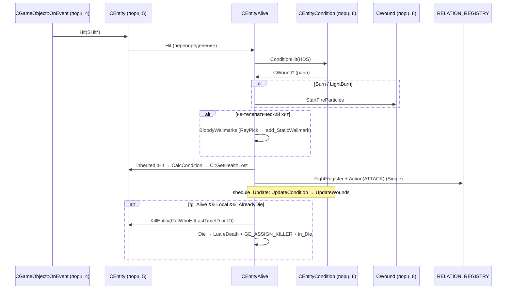
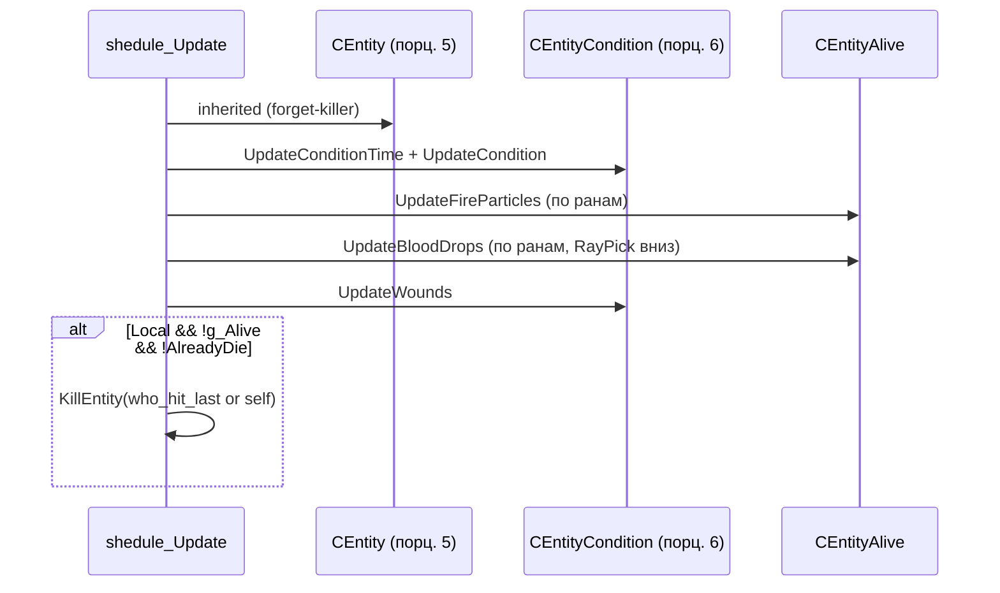

# CEntityAlive: живое существо

> **Модуль:** `xrGame` · **Файлы:** `src/xrGame/entity_alive.h` (219 стр.), `src/xrGame/entity_alive.cpp` (994 стр.), `src/xrGame/entity_alive_inline.h` (27 стр.) · **Порцион 7/30, итерация 5**

**Границы:** статы/условия (`CEntityCondition`) — [порц. 6](entity-condition.md); раны, ожоги, смерть от хита — [порц. 8](wounds-death.md); AI-внутренности (`ai/`) — итерация 6 (мост `CCustomMonster` — [порц. 9](custom-monster.md)); оружие — итерация 8; `Level_*`/сетевой транспорт — итерация 12; полный Lua API `CScriptGameObject` — итерация 14 (механика — [порц. 13](script-game-object.md)).

## 1. Ответственность

`CEntityAlive` — слой «живое существо» в объектной модели: то, что бегает, видит, ест, истекает кровью и вступает в отношения. Наследник `CEntity` (здоровье/урон — [entity.md](entity.md)); выше — `CActor` (порц. 14–23) и `CCustomMonster` (порц. 9). Класс отвечает за:

- **жизненный цикл**: `Load`/`reload`/`reinit`, `net_Spawn`/`net_Destroy`/`net_Relcase`, `shedule_Update` (тикает `CEntityCondition`, частицы огня/крови, раны; **убийство по истечении статов**);
- **урон и смерть**: переопределённые `Hit` (раны через `conditions().ConditionHit`, кровавые следы, `FightRegister`/`Action`), `Die` (Lua-колбэк `eDeath`, `GE_ASSIGN_KILLER`, снятие `STYPE_REACTTOSOUND`, `in_Die`), `CalcCondition` (через `CEntityCondition`);
- **визуальные следы урона**: кровавые wallmarks на стенах (`BloodyWallmarks`/`PlaceBloodWallmark`), капли крови с ран (`UpdateBloodDrops`), частицы огня (`StartFireParticles`/`UpdateFireParticles`);
- **отношения**: `MONSTER_COMMUNITY` (вид → community → `ERelationType`), `tfGetRelationType`/`is_relation_enemy`;
- **эффекторы**: `ef_creature_type`/`ef_weapon_type`/`ef_detector_type` (форк: типы для «электронных фильтров»);
- **физика-мост**: делегирование в `CCharacterPhysicsSupport` (PH-sync, freeze, IK, sound player, collision callbacks, anim movement control) — [ит. 7](physics.md);
- **видимость для AI-зрения**: `get_new_local_point_on_mesh`/`get_last_local_point_on_mesh` — выбор точки на кинематике, взвешенный по площади поверхности костей; `predict_position`/`target_position`.

**Что НЕ делает:** не считает статы (голод/радиация/травмы — `CEntityCondition`, порц. 6–8); не реализует AI (ит. 6, порц. 9); не владеет физикой персонажа (ит. 7 — `CCharacterPhysicsSupport`); не шлёт транспорт (ит. 12); не анимирует (порц. 20).

## 2. Место в архитектуре

```
CObject (xrEngine)                 — xr-object.md
└─ CGameObject                     — game-object.md
   └─ CEntity                      — entity.md (+ CDamageManager, CPhysicsShellHolder)
      └─ CEntityAlive              — ЭТОТ класс
         ├─ CActor                 — порц. 14–23
         ├─ CCustomMonster         — порц. 9 (мост в AI, ит. 6)
         └─ ... (машины с «жизнью»? нет — CEntity без Alive; Alive = только живые)
```

Наследование (entity_alive.h L18): `class CEntityAlive : public CEntity`, `typedef CEntity inherited`, `cast_entity_alive()` (L24).

**Зависит от:** `CEntityCondition` (порц. 6, фабрика `create_entity_condition`), `CWound` (порц. 8), `MONSTER_COMMUNITY` (monster_community.h — таблица видов, ит. 6), `RELATION_REGISTRY` (relation_registry.h — отношения персонажей), `CCharacterPhysicsSupport` (ит. 7), `CMaterialManager` (material_manager.h — физ. материалы), `CParticlesPlayer` (ит. 4), `IKinematics`/`CBoneInstance`/`SBoneShape` (ит. 3, использование), `CScriptGameObject` (порц. 13), `Level().ObjectSpace` (статический RayPick), `::Render->add_StaticWallmark`.

## 3. Публичный API

### Ядро, жизненный цикл

| Метод | Сигнатура | Назначение |
|-------|-----------|------------|
| `cast_entity_alive` | `CEntityAlive* ()` | down-cast (h L24) |
| `Load` | `virtual void (LPCSTR section)` | inherited + статы, `ph_mass`, wallmarks, fire particles, species |
| `reload` | `virtual void (LPCSTR section)` | inherited + `ef_*_type`, `ph_mass` |
| `reinit` | `virtual void ()` | inherited + `m_fAccuracy = m_fIntelligence = 25.f` |
| `save` / `load` | `virtual void (NET_Packet&)` / `(IReader&)` | inherited + `conditions().save/load` |
| `net_Spawn` | `virtual BOOL (CSE_Abstract* DC)` | `conditions().reinit()`, inherited, restart fire particles (сигнатура сети — ит. 12) |
| `net_Destroy` | `virtual void ()` | только `inherited::net_Destroy()` |
| `net_SaveRelevant` | `virtual BOOL ()` | всегда `TRUE` |
| `net_Relcase` | `virtual void (CObject*)` | inherited + `conditions().remove_links(O)` |
| `shedule_Update` | `virtual void (u32 dt)` | тик статов/ран/частиц + убийство по статам |

### Урон и смерть

| Метод | Сигнатура | Назначение |
|-------|-----------|------------|
| `Hit` | `virtual void (SHit*)` | конвейер урона живого существа, §4.4 |
| `HitImpulse` | `virtual void (float, Fvector&, Fvector&)` | **пустой** (весь импульс в `CCharacterPhysicsSupport`) |
| `Die` | `virtual void (CObject* who)` | inherited + Lua `eDeath` + `GE_ASSIGN_KILLER` + `in_Die` |
| `CalcCondition` | `virtual float (float hit)` | `conditions().UpdateCondition()` + `GetHealthLost()` |
| `OnEvent` | `virtual void (NET_Packet&, u16)` | только inherited (`GE_DIE` — в `CEntity`) |
| `g_WeaponBones` | `virtual void (int& L, int& R1, int& R2) = 0` | **чисто виртуальный** — кости под оружие (наследник обязан) |
| `OnHitHealthLoss` / `OnCriticalHitHealthLoss` / `OnCriticalWoundHealthLoss` / `OnCriticalRadiationHealthLoss` | `virtual void (float)` / `void ()` ×4 | **пустые** хуки (h L177–188) |
| `set_lock_corpse` / `is_locked_corpse` | `void (bool)` / `bool ()` | «труп занят» (поедание монстрами), §4.8 |

### Статы, радиация

| Метод | Сигнатура | Назначение |
|-------|-----------|------------|
| `conditions` | `IC CEntityCondition& () const` | `*m_entity_condition` (VERIFY) |
| `material` | `IC CMaterialManager& () const` | `*m_material_manager` (VERIFY) |
| `g_Radiation` / `SetfRadiation` | `float () const` / `float (float)` | через `conditions()`, ×100/÷100 |
| `ef_creature_type` / `ef_weapon_type` / `ef_detector_type` | `virtual u32 () const` | поля `m_ef_*`; weapon/detector — `VERIFY(≠ -1)` |

### Видимость, отношения, прочее

| Метод | Сигнатура | Назначение |
|-------|-----------|------------|
| `ffGetFov` / `ffGetRange` | `virtual float () const = 0` ×2 | **чисто виртуальные** — FOV/дальность зрения (наследник) |
| `human_being` | `virtual bool () const` | по умолчанию `false` (CActor → true) |
| `predict_position` / `target_position` | `virtual Fvector (float) const` / `() const` | оба = `Position()` (CCustomMonster переопределяет через `movement()`) |
| `is_agresive` / `is_start_attack` | `IC bool const& () const` / `IC void (bool const&)` ×2 | getters/setters флага атакующести (inline.h) |
| `tfGetRelationType` | `virtual ERelationType (const CEntityAlive*) const` | через `MONSTER_COMMUNITY::relation` |
| `is_relation_enemy` | `virtual bool (const CEntityAlive*) const` | Enemy или WorstEnemy |
| `visual_memory` | `virtual CVisualMemoryManager* () const` | по умолчанию `0` (CActor/CCustomMonster — свои) |
| `PHGetSyncItemsNumber` / `PHGetSyncItem` | `virtual u16 ()` / `virtual CPHSynchronize* (u16)` | делегирование в `character_physics_support()` |
| `PHUnFreeze` / `PHFreeze` | `virtual void ()` ×2 | movement()->Freeze/UnFreeze, fallback `m_pPhysicsShell` |
| `PHGetLinearVell` | `virtual void (Fvector&)` | через support, иначе inherited |
| `ph_sound_player` / `character_ik_controller` | `virtual CPHSoundPlayer* ()` / `virtual CIKLimbsController* ()` | через support |
| `get/set_collision_hit_callback` | `virtual ICollisionHitCallback* ()` / `virtual void (ICollisionHitCallback*)` | через support |
| `create_anim_mov_ctrl` / `destroy_anim_mov_ctrl` | `virtual void (CBlend*, Fmatrix*, bool)` / `void ()` | inherited + `cs->on_create/destroy_anim_mov_ctrl` |
| `get_new_local_point_on_mesh` | `virtual Fvector (u16&) const` | точка на кинематике для AI-зрения, §4.10 |
| `get_last_local_point_on_mesh` | `virtual Fvector (Fvector const&, u16) const` | точка в мире по bone |
| `OnChangeVisual` | `virtual void ()` | inherited + сброс кэша площадей костей |

### Поля (public)

| Поле | Тип | Назначение |
|------|-----|------------|
| `m_bMobility` | `bool` | подвижность (используется наследниками) |
| `m_fAccuracy` | `float` | точность (AI-стрельба), дефолт 0, `reinit` → 25 |
| `m_fIntelligence` | `float` | «интеллект» (AI), дефолт 0, `reinit` → 25 |
| `m_use_timeout` | `u32` | таймаут «занятости» трупа, дефолт 5000 мс |
| `m_squad_index` | `u8` | индекс в отряде монстров, дефолт `u8(-1)`; пишется `CMonsterSquad` (ит. 6) |
| `monster_community` | `MONSTER_COMMUNITY*` | вид существа (public-указатель, `xr_new` в ctor) |

### Статика

| Поле/метод | Назначение |
|-----------|------------|
| `m_pBloodMarksVector` / `m_pBloodDropsVector` | `FactoryPtr<IWallMarkArray>*` — текстурные wallmarks (стены / капли) |
| `m_fBloodMarkSizeMin/Max` / `m_fBloodMarkDistance` / `m_fNominalHit` | параметры следов крови |
| `m_fStartBloodWoundSize` / `m_fStopBloodWoundSize` / `m_fBloodDropSize` | пороги капающей крови (0.3 / 0.1 / 0.03) |
| `m_dwMinBurnTime` / `m_fStartBurnWoundSize` / `m_fStopBurnWoundSize` / `m_pFireParticlesVector` | параметры огня (10000 мс / 0.3 / 0.1) |
| `LoadBloodyWallmarks` / `UnloadBloodyWallmarks` | статическая загрузка секции `bloody_marks` |
| `LoadFireParticles` / `UnloadFireParticles` | статическая загрузка секции `entity_fire_particles` |

## 4. Внутреннее устройство

### 4.1 Поля и ctor/dtor

**private:** `m_used_time` (u32), `m_is_agresive`, `m_is_start_attack` (bool), `m_entity_condition` (`CEntityCondition*`), `m_material_manager` (`CMaterialManager*`), `b_eating` (bool), `m_hit_bone_surface_areas` (`mutable xr_vector<std::pair<u16,float>>`), `m_hit_bones_random` (`mutable CRandom`), `m_hit_bone_surface_areas_actual` (`mutable bool`).

**protected:** `m_ef_creature_type` / `m_ef_weapon_type` / `m_ef_detector_type` (u32).

**ctor** (cpp L54–75): `m_bMobility=false`, `m_fAccuracy=m_fIntelligence=0`, `m_entity_condition=NULL` (создаст `CEntity::_construct` через фабрику), `monster_community = xr_new<MONSTER_COMMUNITY>()`, `m_ef_weapon_type = m_ef_detector_type = u32(-1)`, `b_eating=false`, `m_is_agresive=m_is_start_attack=false`, `m_use_timeout=5000`, `m_used_time=Device.dwTimeGlobal`, `m_squad_index=u8(-1)`, `m_material_manager=0`, `m_hit_bone_surface_areas_actual=false`.

**dtor** (L77–81): `xr_delete(monster_community)`, `xr_delete(m_material_manager)`. `m_entity_condition` — НЕ здесь: владеет и удаляет `CEntity` (порц. 5/6).

`_construct()` (L646–652): `inherited::_construct()` (→ создаёт `m_entity_condition` фабрикой) → `if (character_physics_support()) m_material_manager = xr_new<CMaterialManager>(this, character_physics_support()->movement())`.

### 4.2 `Load` / `reload` / `reinit`

`Load(section)` (L83–100): `CEntity::Load(section)`; `conditions().LoadCondition(section)`; `conditions().LoadImmunities(pSettings->r_string(section,"immunities_sect"), pSettings)`; `m_fFood = 100 * pSettings->r_float(section,"ph_mass")` (**здесь инициализируется «мусор» из порц. 5**); ленивая статическая `LoadBloodyWallmarks("bloody_marks")` и `LoadFireParticles("entity_fire_particles")` (первый раз); `monster_community->set(pSettings->r_string(section,"species"))`.

`reload(section)` (L199–209): `CEntity::reload(section)`; `m_ef_creature_type = r_u32(section,"ef_creature_type")`; `m_ef_weapon_type`/`m_ef_detector_type` — `READ_IF_EXISTS(..., u32(-1))` (опциональные); `m_fFood = 100 * ph_mass` (повторно).

`reinit()` (L191–197): inherited + `m_fAccuracy = m_fIntelligence = 25.f`.

### 4.3 `shedule_Update` (L211–239)

```
1. inherited::shedule_Update(dt)   — CEntity: «забыть убийцу» (порц. 5)
2. conditions().UpdateConditionTime(); conditions().UpdateCondition()  — тик статов (порц. 6)
3. UpdateFireParticles()           — §4.6
4. UpdateBloodDrops()              — §4.7
5. conditions().UpdateWounds()     — тик ран (порц. 8)
6. if (Local() && !g_Alive() && !AlreadyDie())
     → KillEntity(conditions().GetWhoHitLastTime() ? GetWhoHitLastTimeID() : ID())
```

Точка 6 — **смерть от статов** (кровь/радиация/голод), а не от хита (хитовая смерть — в `CEntity::Hit`, порц. 5). Убийца — «кто бил в последний раз», если нет — сам себя (`ID()`).

### 4.4 `Hit(SHit*)` (L275–314)

```
1. HDS = *pHDS (копия)
2. eHitTypeWound_2 → eHitTypeWound
3. CDamageManager::HitScale(HDS.boneID, conditions().hit_bone_scale(),
                            conditions().wound_bone_scale(), pHDS->aim_bullet)
   — бонусы по кости (CDamageManager — порц. 5; hit/wound_bone_scale из CEntityCondition — порц. 6)
4. pWound = conditions().ConditionHit(&HDS)   — применение урона/рана (порц. 6/8)
   if (pWound && !pWound->GetDestroy() && (Burn || LightBurn)) StartFireParticles(pWound)
5. if (hit_type != Telepatic && != Radiation && != Burn && != LightBurn && != ChemicalBurn)
     if (!use_simplified_visual()) BloodyWallmarks(HDS.damage(), HDS.dir, HDS.bone(), HDS.p_in_bone_space)
6. conditions().SetConditionDeltaTime(0)
7. inherited::Hit(&HDS)   — конвейер CEntity: impulse → CalcCondition → HitSignal → death (порц. 5)
8. if (g_Alive() && IsGameTypeSingle())
     EA = smart_cast<CEntityAlive*>(HDS.who)
     if (EA && EA->g_Alive() && EA->ID() != ID())
       RELATION_REGISTRY().FightRegister(EA->ID(), ID(), tfGetRelationType(EA), HDS.damage())
       RELATION_REGISTRY().Action(EA, this, ATTACK)
```

Отличие от `CEntity::Hit`: `HitImpulse` здесь пустой (импульс обрабатывает физика-персонажа, ит. 7), а `CalcCondition` идёт через `CEntityCondition` (статы, а не «health -= hit»).

### 4.5 `Die` (L321–343)

```
1. if (IsGameTypeSingle()) RELATION_REGISTRY().Action(smart_cast<CEntityAlive*>(who), this, KILL)
2. inherited::Die(who)            — set_death_time, SetfHealth(-1), deregister из команд (порц. 5)
3. callback(GameObject::eDeath)(lua_game_object(), who_object ? who_object->lua_game_object() : 0)
   — Lua-хук смерти (механика callback — порц. 13; CScriptGameObject — ит. 14)
4. if (!getDestroy() && GameID() == eGameIDSingle)
     u_EventGen(P, GE_ASSIGN_KILLER, ID()); P.w_u16(u16(who->ID())); u_EventSend(P)
5. smart_cast<ISpatial*>(this)->spatial.type &= ~STYPE_REACTTOSOUND   — «не реагирует на звук»
6. if (character_physics_support()) character_physics_support()->in_Die()
```

### 4.6 Огонь (L459–512)

`StartFireParticles(CWound*)`: если `pWound->TypeSize(eHitTypeBurn) > m_fStartBurnWoundSize` (0.3) → `CParticlesPlayer::GetNearestBone(V, bone)` (VERIFY `< 64 || BI_NONE`) → `pWound->SetParticleBoneNum/Name` (имя — случайное из `m_pFireParticlesVector`) → `CParticlesPlayer::StartParticles(name, bone, Fvector(0,1,0), ID(), m_dwMinBurnTime * randF(0.5,1.5), false)` (или без bone, если `BI_NONE`).

`UpdateFireParticles()`: по всем ранам: нет имени/`bone==BI_NONE` → skip; `burn_size < m_fStopBurnWoundSize` (0.1) **или** `!g_Alive()` → `CParticlesPlayer::AutoStopParticles(name, bone, m_dwMinBurnTime * randF(0.5,1.5))`.

Вызывается из `net_Spawn` (рестарт после загрузки) и `shedule_Update`.

### 4.7 Кровавые следы и капли

`BloodyWallmarks(P, dir, element, position_in_object_space)` (L382–411): `BI_NONE` → return; позиция в пространстве кости → `V->LL_GetBoneInstance(element).mTransform.transform_tiny` → `XFORM().transform_tiny` (в мир); `small_entity = 1.f` (0.5, если `Radius() < SMALL_ENTITY_RADIUS` (0.6)); `wallmark_size = m_fBloodMarkSizeMax * (P / m_fNominalHit) * small_entity`, clamp `[min,max]`; `PlaceBloodWallmark(dir, pos, m_fBloodMarkDistance, size, m_pBloodMarksVector)`.

`PlaceBloodWallmark(dir, start, dist, size, wallmarks)` (L413–456): `Level().ObjectSpace.RayPick(start, dir, dist, rqtBoth, result, this)` → `reach_wall = result && !result.O` (статика, не объект); если стена: `CDB::TRI*` + `SGameMtl*` из `GMLib`; **`pMaterial->Flags.is(SGameMtl::flBloodmark)`** — только «пачкающиеся» материалы; точка `end_point = start + dir*range`; `::Render->add_StaticWallmark(pwallmarks_vector, end_point, size, pTri, pVerts)`.

`UpdateBloodDrops()` (L541–583): `static float m_fBloodDropTimeMax/Min = pSettings->r_float("bloody_marks", "blood_drop_time_max"/"_min")` (запоминаются **один раз** — static инициализация); `!g_Alive()` → return; по ранам: `bone==BI_NONE` → skip; `blood_size = pWound->BloodSize()`, `< m_fStopBloodWoundSize` (0.1) → skip; если `pWound->m_fDropTime < Device.fTimeGlobal` → пересчёт `m_fDropTime = now + (Max - (Max-Min)*size_k) * randF(0.8,1.2)` (где `size_k = clamp(blood_size - StopSize, <1)`), `pos = CParticlesPlayer::GetBonePos(this, bone, 0) + random_dir()*0.15` → `PlaceBloodWallmark(Fvector(0,-1,0), pos, dist, m_fBloodDropSize (0.03), m_pBloodDropsVector)`.

Статическая загрузка (L102–189): `LoadBloodyWallmarks("bloody_marks")` — `wallmarks` (список через запятую → `AppendMark`), `min_size`/`max_size`/`dist`/`nominal_hit`, `blood_drops`, `start_blood_size`/`stop_blood_size`/`blood_drop_size`; `LoadFireParticles("entity_fire_particles")` — `fire_particles`, `start_burn_size`/`stop_burn_size`/`min_burn_time`. `Unload*` — `xr_delete`.

### 4.8 Труп: `set_lock_corpse` / `is_locked_corpse` (L681–700)

Механика «труп занят» (поедание монстрами — ит. 6): `b_eating` + таймер `m_used_time`/`m_use_timeout` (5000 мс).

- `set_lock_corpse(true)`: `b_eating = true`.
- `set_lock_corpse(false)`: если было `b_eating` → `m_used_time = now`; `b_eating = false`.
- `is_locked_corpse()`: если `b_eating` → `true`; иначе `true` ещё `m_use_timeout` мс после снятия.

Потребители — AI: `CStateManagerDog::execute` (dog_state_manager.cpp L132–135: `set_lock_corpse(true)`), `CStateGroupEatAbstract::finalize/critical_finalize` (group_state_eat_inline.h L64–86: `m_use_timeout = object->m_corpse_use_timeout; set_lock_corpse(false)`) — ит. 6.

### 4.9 Отношения (L514–539)

`tfGetRelationType(tp)`: `int relation = MONSTER_COMMUNITY::relation(this->monster_community->index(), tp->monster_community->index())` → switch: `1 → eRelationTypeFriend`, `0 → Neutral`, `-1 → Enemy`, `-2 → WorstEnemy`, `default → eRelationTypeDummy`.

`is_relation_enemy(tp)`: `tfGetRelationType == Enemy || WorstEnemy`.

`MONSTER_COMMUNITY` (monster_community.h): `CIni_IdToIndex`-таблица видов (id → index/team) + статическая `MONSTER_RELATION_TABLE` (инициализация из ini, ит. 6); `set(MONSTER_COMMUNITY_ID)` — по имени вида; `team()` (255 = none — порц. 5).

### 4.10 AI-зрение: `get_new_local_point_on_mesh` (L848–976)

**Глобальный флаг `BOOL g_ai_use_old_vision = 0`** (L846, cpp-scope) — `true` → `inherited` (базовый `CObject`: случайная точка в шаре 0.7, bone_id = -1).

Новая логика (по умолчанию):
1. `kinematics = smart_cast<IKinematics*>(Visual())`; нет/нет костей → inherited.
2. Ленивый `fill_hit_bone_surface_areas()` (L798–844): по `LL_BoneCount()` — `SBoneShape` (не `stNone`, не `sfNoPickable`), площадь: box `2*(x*(y+z)+y*z)`, sphere `4*PI*R²`, cylinder `2*PI*R*(R+h)`; сортировка по площади убыванию; кэш сбрасывается в `OnChangeVisual` (L791–796).
3. `hit_bones_surface_area` — сумма площадей **видимых** (`LL_GetBoneVisible`) костей (VERIFY2 > 0, «m_hit_bone_surface_areas[%d]»); `selected_area = m_hit_bones_random.randF(hit_bones_surface_area)`; накопительный обход → выбранная кость (`bone_id = i.first`); если accumulator не дошёл до selected → Msg ERROR + inherited (L900–904).
4. Точка на shape: **box** — случайное направление (3 оси × знак, `randI(6)`), `shape.box.xform_full`; **sphere** — `random_dir()*R + P`; **cylinder** — `total_square = h + R`, случайное: боковая поверхность (`rand < h` → `height = v - h/2`, `radius = R`) или торцы (`normalized_value < R/2` → задний торец, иначе передний), поворот `Fmatrix().rotation(dir, normal)` + `rotateY(angle)`.

`get_last_local_point_on_mesh(last, bone)` (L978–994): `bone==u16(-1)` → inherited; иначе `kinematics->Bone_GetAnimPos(transform, bone, u8(-1), false)` → `transform.transform_tiny(result, last)` → `XFORM().transform_tiny`.

Потребитель — `Feel::Vision` (`src/xrEngine/Feel_Vision.cpp` L65–75, L199–203, L298–303): `o_new`/`o_trace` — выбор/пересчёт точки видимости. (Полный разбор Feel — порц. 27.)

### 4.11 Физика-мост (CCharacterPhysicsSupport, ит. 7)

Все PH-методы делегируют в `character_physics_support()` (mixin из `CEntity`/`CPhysicsShellHolder`):

- `PHGetSyncItemsNumber`/`PHGetSyncItem` (L355–365) — **без null-check** (`character_physics_support()->...`);
- `PHUnFreeze`/`PHFreeze` (L367–377) — `movement()->CharacterExist()` → `movement()->UnFreeze/Freeze`, иначе `m_pPhysicsShell->UnFreeze/Freeze`;
- `PHGetLinearVell` (L671–679) — через support, иначе inherited;
- `ph_sound_player`/`character_ik_controller` (L702–724) — через support, иначе NULL;
- `get/set_collision_hit_callback` (L726–738) — через support (null-safe);
- `create_anim_mov_ctrl` (L756–763) — `b_animation_movement_controlled = animation_movement_controlled()` **до** `inherited::create_anim_mov_ctrl` (она может создать/сменить контроллер); `!controlled && cs` → `cs->on_create_anim_mov_ctrl()`; `destroy_anim_mov_ctrl` (L765–771) — `cs->on_destroy_anim_mov_ctrl()` без условий.

`CCharacterPhysicsSupport` (CharacterPhysicsSupport.h): `CPHSkeleton + CPHDestroyable`, `EType` {etActor, etStalker, etBitting (опечатка «bitten»/«biting»?)}, `EState` {esDead, esAlive, esRemoved}; владеет `CPHMovementControl*`, `CIKLimbsController*`, `CPHSoundPlayer`, `character_hit_animation_controller`, `death_anims`, `interactive_motion/animation`, `physics_shell_animated`, `xr_vector<CODEGeom*>` (коллизии оружия), `SHit m_sv_hit`; методы `in_Die`, `on_create/destroy_anim_mov_ctrl`, `KillHit`, `FlyTo`, `CreateIKController` и т.д. — полный разбор **ит. 7**.

### 4.12 `net_Spawn` / `net_Destroy` / `net_Relcase` / `net_SaveRelevant`

`net_Spawn(DC)` (L241–262): **закомментированный блок** L243–245 (`monster_community->team() != 255 → id_Team` — теперь в `CEntity::net_Spawn`, порц. 5); `conditions().reinit()`; `res = inherited::net_Spawn(DC)`; по всем ранам (кроме `GetDestroy()`) → `StartFireParticles(pWound)` (рестарт огня после загрузки).

`net_Destroy` (L264–267): только `inherited::net_Destroy()`.

`net_Relcase(O)` (L740–744): inherited + `conditions().remove_links(O)`.

`net_SaveRelevant()` (L597–600): всегда `TRUE`.

`save`/`load` (L585–595): inherited + `conditions().save/load`.

### 4.13 `predict_position` / `target_position` (L746–754)

Оба возвращают `Position()` (без предсказания). `CCustomMonster::predict_position/target_position` (CustomMonster.cpp L1386–1394) переопределяет через `movement()` (CPHMovementControl — ит. 6/7). `CActor` — порц. 19.

### 4.14 `CalcCondition` (L346–352)

`conditions().UpdateCondition()`; `return conditions().GetHealthLost();` — **не** `inherited::CalcCondition` (коммент: «it will be meaningless»). Потребитель — `CEntity::Hit` (шаг 3, порц. 5).

### 4.15 `ef_*_type` (L654–669)

`ef_creature_type` — просто возвращает поле; `ef_weapon_type`/`ef_detector_type` — `VERIFY(≠ u32(-1))` + return. Наследники: `CWeapon::ef_weapon_type` (Weapon.cpp L2991), `CMissile::ef_weapon_type` (Missile.cpp L797), `CCustomZone::ef_weapon_type` (CustomZone.cpp L1422, порц. 25), `CCustomDetector::ef_detector_type` (CustomDetector.h L134–138, `return 1`). Базовый `CGameObject::ef_*` — `R_ASSERT3(false, "not properly overridden!")` (порц. 3).

## 5. Взаимодействие

**Кто вызывает меня:**
- `CEntity::Hit` (порц. 5) → `HitImpulse`/`CalcCondition` (виртуальные).
- `GE_HIT`/`GE_DIE` → `CGameObject::OnEvent`/`CEntity::OnEvent` (порц. 4–5).
- `Feel::Vision` (xrEngine) → `get_new/last_local_point_on_mesh` (порц. 27).
- AI (ит. 6): `cast_entity_alive()`, `m_squad_index`, `set_lock_corpse`/`is_locked_corpse`, `visual_memory()`, `tfGetRelationType`, `predict_position`.
- `RELATION_REGISTRY` (relation_registry.h) — `FightRegister`/`Action`/`GetRelationBetween` (Lua-обёртка `CRelationRegistryWrapper` — порц. 13).
- `CMonsterSquad` (ит. 6) — пишет `m_squad_index` (ai_monster_squad.cpp L220).

**Кого вызываю:**
- `CEntityCondition` (порц. 6) — статы/раны/иммунитеты.
- `CWound` (порц. 8) — `TypeSize`, `BloodSize`, `SetParticleBoneNum/Name`.
- `CParticlesPlayer` (ит. 4) — `StartParticles`/`AutoStopParticles`/`GetNearestBone`/`GetBonePos`/`LoadParticles`.
- `MONSTER_COMMUNITY` (ит. 6) — виды/отношения.
- `RELATION_REGISTRY` — отношения персонажей.
- `CCharacterPhysicsSupport` (ит. 7) — вся физика персонажа.
- `CMaterialManager` (material_manager.h) — материалы.
- `IKinematics`/`CBoneInstance` (ит. 3) — `LL_BoneCount`, `LL_GetData`, `LL_GetBoneInstance`, `LL_GetBoneVisible`, `Bone_GetAnimPos`.
- `Level().ObjectSpace` — `RayPick`, `GetStaticTris`, `GetStaticVerts`.
- `::Render->add_StaticWallmark` (xrRender).
- `CScriptGameObject` (порц. 13) — `lua_game_object()`, `callback(GameObject::eDeath)`.
- `CSE_Abstract*` (ит. 11) — как аргумент `net_Spawn`.

## 6. Потоки

**Удар → рана → кровь/огонь → смерть:**



**Тик `shedule_Update`:**



## 7. Конфигурация

**Секция объекта (`Load`):**

| Ключ | Тип | Назначение |
|------|-----|------------|
| `ph_mass` | float | `m_fFood = 100 * ph_mass` |
| `immunities_sect` | string | секция иммунитетов → `conditions().LoadImmunities` (порц. 6) |
| `species` | string | вид → `monster_community->set` |

**Секция объекта (`reload`):** `ef_creature_type` (u32), `ef_weapon_type` (u32, опц., -1), `ef_detector_type` (u32, опц., -1), `ph_mass`.

**Глобальные секции (статические, загружаются один раз):**

`[bloody_marks]`: `wallmarks` (список textur), `min_size`, `max_size`, `dist`, `nominal_hit`, `blood_drops` (список), `start_blood_size` (0.3), `stop_blood_size` (0.1), `blood_drop_size` (0.03), `blood_drop_time_max`, `blood_drop_time_min`.

`[entity_fire_particles]`: `fire_particles` (список имён), `start_burn_size` (0.3), `stop_burn_size` (0.1), `min_burn_time` (10000 мс).

**Константы:** `SMALL_ENTITY_RADIUS = 0.6f`, `BLOOD_MARKS_SECT = "bloody_marks"`; дефолты статик: `m_fStartBloodWoundSize=0.3`, `m_fStopBloodWoundSize=0.1`, `m_fBloodDropSize=0.03`, `m_dwMinBurnTime=10000`, `m_fStartBurnWoundSize=0.3`, `m_fStopBurnWoundSize=0.1`; `m_use_timeout=5000` мс (ctor); `reinit`: `m_fAccuracy=m_fIntelligence=25.f`.

## 8. Ограничения и дебаг

- **`HitImpulse` — пустой** (L269–273): комментарий с формулой `Q = 2*amount/mass` закомментирован; импульс обрабатывает `CCharacterPhysicsSupport` (ит. 7).
- **`OnEvent` — только `inherited`** (L316–319): нет собственных сетевых событий (смерть — `GE_ASSIGN_KILLER` в `Die`).
- **`OnHitHealthLoss`/`OnCritical*HealthLoss` — 4 пустых виртуала** (h L177–188): хуки для наследников (CActor/CCustomMonster).
- **`g_WeaponBones` — чисто виртуальный** (h L66): наследник обязан реализовать.
- **`ffGetFov`/`ffGetRange` — чисто виртуальные** (h L81–82).
- **`Hit` копирует `SHit`** (L277): `HDS = *pHDS` — изменения (HitScale, Wound_2) не попадают в оригинал.
- **`eHitTypeWound_2 → eHitTypeWound`** (L279–280): молчаливая нормализация.
- **`Hit`**: `BloodyWallmarks` только `!use_simplified_visual()` (монстры с упрощённым visual не пачкают стены).
- **`Hit`**: `FightRegister`/`Action(ATTACK)` только `g_Alive() && IsGameTypeSingle()` (MP — нет).
- **`Die`**: `GE_ASSIGN_KILLER` — только `!getDestroy() && GameID()==eGameIDSingle`; `who->ID()` пишется даже если `who == this` (самоубийство → killer = self).
- **`shedule_Update` смерть**: `GetWhoHitLastTime()` — если «кто бил» уже уничтожен, `GetWhoHitLastTimeID()` может быть невалиден (порц. 6 — детали).
- **`PHGetSyncItemsNumber`/`PHGetSyncItem` без null-check** (L355–365): падение, если `character_physics_support() == NULL`.
- **`ef_weapon_type`/`ef_detector_type` — `VERIFY(≠ -1)`** (L659–669): вызов до `reload` (где читается ini) → crash в DEBUG.
- **`UpdateBloodDrops` — `static` ini-значения** (L543–544): читаются **один раз** (первый вызов); смена `blood_drop_time_*` в рантайме не работает.
- **`m_fBloodDropTimeMax/Min`** — static-локальные, не поля класса (называются как поля).
- **`PlaceBloodWallmark`**: `reach_wall = result && !result.O` — только статические триангулы (не объекты); материалы без `flBloodmark` — нет следов.
- **`StartFireParticles`**: `VERIFY(particle_bone < 64 || BI_NONE == particle_bone)` — костные частицы ограничены 64 костями.
- **`get_new_local_point_on_mesh`**: `g_ai_use_old_vision` (глобал, L846) — переключатель на старый алгоритм (`CObject`: случайная точка в шаре 0.7).
- **`get_new_local_point_on_mesh`**: ERROR-ветка (L900–904) — `Msg` + fallback inherited (потеря точности, если накопитель не достиг selected_area).
- **`m_hit_bone_surface_areas` — `mutable`**: кэш площади костей, сброс `OnChangeVisual`; `m_hit_bones_random` — `mutable CRandom`.
- **`SMALL_ENTITY_RADIUS = 0.6f`** — магическая константа (уменьшение размера wallmark вдвое для «маленьких»).
- **`reinit`**: `m_fAccuracy = m_fIntelligence = 25.f` — хардкод.
- **`Load`**: `m_fFood = 100 * ph_mass` — инициализация «мусорного» поля из `CEntity` (порц. 5).
- **`net_Spawn`**: закомментированный блок L243–245 (`monster_community->team() → id_Team`) — логика переехала в `CEntity::net_Spawn` (порц. 5).
- **`_construct`**: `m_material_manager` создаётся **только** если `character_physics_support()` — у существ без физики `material()` → VERIFY-crash.
- **`b_eating`/`set_lock_corpse`**: опечатка/название «eating» на самом деле про «занятость трупа» (поедание монстрами).
- **`CharacterPhysicsSupport::EType::etBitting`** — опечатка («bitting» вместо «biting»/«bitten»).
- **`CreateIKController`/`DestroyIKController`** (CharacterPhysicsSupport.h L197–198) — private; полный разбор — ит. 7.

## 9. Ссылки

- [CObject](../xr-engine/xr-object.md) — базовый каркас (`get_new/last_local_point_on_mesh` — базовые)
- [CGameObject](game-object.md) — `ef_*_type` базовые, `callback`, `lua_game_object`
- [CGameObject: сеть](game-object-net.md) — `GE_*`, `u_Event*`
- [CEntity](entity.md) — порц. 5: `Hit`/`Die`/`KillEntity`/`CDamageManager`
- [EntityCondition](entity-condition.md) — порц. 6: `CEntityCondition`, статы, `ConditionHit`, `GetWhoHitLastTime`
- [Травмы и смерть](wounds-death.md) — порц. 8: `CWound`, раны/ожоги
- [CCustomMonster](custom-monster.md) — порц. 9: мост в AI
- [CActor](actor.md) — порц. 14+: `human_being`, `visual_memory`, `ffGetFov`
- [Feel](feel.md) — порц. 27: `Feel::Vision` (потребитель mesh-точек)
- [script_entity / script_hit](script-entity.md) — порц. 28: полный `SHit`
- [script_game_object](script-game-object.md) — порц. 13: `callback(eDeath)`, `lua_game_object()`
- [Физика](physics.md) — ит. 7: `CCharacterPhysicsSupport`
- [Модель объектов](../../architecture/object-model.md) — обновляется в порц. 2 и 30
- [Граф связей](../../architecture/dependencies.md)

## 10. Источник

- `src/xrGame/entity_alive.h` (219 стр.)
- `src/xrGame/entity_alive.cpp` (994 стр.)
- `src/xrGame/entity_alive_inline.h` (27 стр.)
- `src/xrGame/Entity.h` (144 стр.) — `CEntity` (порц. 5)
- `src/xrGame/monster_community.h` (64 стр.) — `MONSTER_COMMUNITY` (полный разбор — ит. 6)
- `src/xrGame/relation_registry.h` (137 стр.) — `RELATION_REGISTRY`
- `src/xrGame/CharacterPhysicsSupport.h` (207 стр.) — `CCharacterPhysicsSupport` (полный разбор — ит. 7)
- `src/xrGame/EntityCondition.h` — `CEntityCondition` (порц. 6)
- `src/xrGame/wound.h` — `CWound` (порц. 8)
- `src/xrEngine/Feel_Vision.cpp` L65–75, L199–203, L298–303 — `Feel::Vision` (порц. 27)
- `src/xrEngine/xr_object.cpp` L508–524 — базовые `get_new/last_local_point_on_mesh`
- `src/xrGame/CustomMonster.cpp` L1090–1093, L1386–1394 — `visual_memory`, `predict/target_position` (порц. 9)
- `src/xrGame/ai/monsters/ai_monster_squad.cpp` L220–222, L243–253 — `m_squad_index`, `is_locked_corpse` (ит. 6)
- `src/xrGame/ai/monsters/dog/dog_state_manager.cpp` L132–135 — `set_lock_corpse` (ит. 6)
