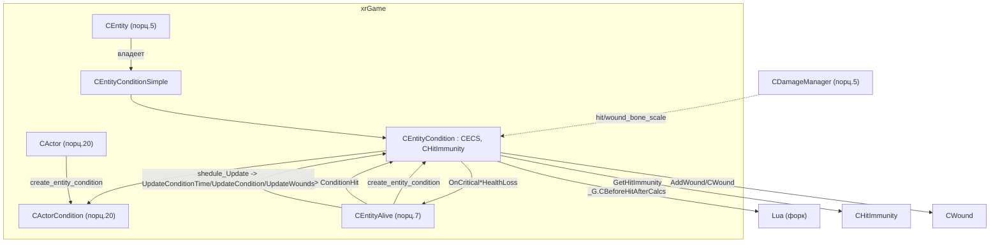

# EntityCondition: статы и состояние здоровья (порцион 6)

> **Модуль:** `xrGame` · **Файлы:** `EntityCondition.h` (308) + `EntityCondition.cpp` (828), `hit_immunity.h` (26) + `.cpp` (53), `hit_immunity_space.h` (5), `Wound.h` (59) + `Wound.cpp` (102), регистрация — `ActorCondition_script.cpp` (177) · **Порцион 6, итерация 5**
>
> **Страница:** `CEntityCondition` — «состояние» живого объекта: не только здоровье, но и сила (`power`), радиация, `psy_health`, мораль (`morale`), кровотечение и раны. Это **данные + правила их изменения во времени**. Базой идёт `CEntityConditionSimple` (только `health`/`max_health`), полный класс добавляет иммунитеты (`CHitImmunity`), накопление изменений (`m_fDelta*`) и их применение раз в тик (`UpdateCondition`), расчёт урона по типу хита (`ConditionHit`), систему ран (`CWound`), бустеры (`SBooster`) и эффект медикаментов (`SMedicineInfluenceValues`). Связи: `CEntity` (владение — порц. 5), `CEntityAlive` (владение + `Hit`/`shedule_Update` — порц. 7), `CActorCondition` (наследник-актёр — порц. 20), `CDamageManager` (`bone_scale` — порц. 5), `_G.CBeforeHitAfterCalcs`-хук (форк) — [script-entity.md §17](script-entity.md).

**Чего это не делает**: не владеет объектом (указатель `m_object` — только back-reference; владелец — `CEntity`/`CEntityAlive`, порц. 5/7); не реализует урон/смерть сам — `CEntity::Hit`/`Die` (порц. 5) и `CEntityAlive::Hit` (порц. 7) вызывают `ConditionHit` как **под-шаг**; актёрская специфика (`satiety`/`thirst`/`hunger`/`alcohol`/сон/вес) — `CActorCondition` (порц. 20); регенерация от бустеров-объектов (артефакты) — `CArtefact`/`Boosters` (итерация 10), здесь только `ApplyBooster`-заглушка; сетевой формат — итерация 12 (здесь сигнатуры `save`/`load`); `CWound`-частицы/кровь (wallmarks) — порц. 7/8.

## 1. Место в иерархии

```
                     CEntityConditionSimple   (health / max_health)
                              ▲
              ┌───────────────┴───────────────┐
              │                               │
   CEntity : ... мультинаследует?  CEntityCondition : CEntityConditionSimple, CHitImmunity
   (владеет m_entity_condition)     ▲
                              ┌─────┴─────┐
                        CEntityCondition   CActorCondition  (порц. 20)
                              ▲                  ▲
                     CEntityAlive              CActor
```

- **`CEntityConditionSimple`** (`h:87–100`) — минимальная база: два `float` — `m_fHealth`, `m_fHealthMax`. Её держит **`CEntity`** (`Entity.h:24 m_entity_condition`), поэтому даже объекты без «жизни» (ящики, двери) имеют `GetfHealth()` (всегда `1.0f`).
- **`CEntityCondition : public CEntityConditionSimple, public CHitImmunity`** (`h:102`) — полное состояние. Держит `CEntityAlive` (`entity_alive.cpp:60 m_entity_condition`, создаётся в `create_entity_condition` L602–610 → `xr_new<CEntityCondition>(this)`).
- **`CActorCondition`** (порц. 20) — наследник с актёрской спецификой.
- **`CHitImmunity`** (`hit_immunity.h`) — коэффициенты урона по 10 типам хита; база и для `CEntityCondition`, и для защитных костюмов (`CCustomOutfit`/`CHelmet`, порц. 33–34).

**Три уровня владения**: `CEntity` (simple) → `CEntityAlive` (full, порц. 7) → `CActor` (actor-condition, порц. 20). Виртуальная фабрика `create_entity_condition(CEntityConditionSimple* ec)` пробрасывает уже созданный объект вверх по цепочке (`Entity.cpp:41–48` → `entity_alive.cpp:602–610` → `Actor.cpp:2832–2839`).

## 2. `CEntityConditionSimple` (`h:87–100`)

| Член | Тип | Назначение |
| --- | --- | --- |
| `m_fHealth`, `m_fHealthMax` | `float` | здоровье и его максимум |
| `GetHealth()` / `SetHealth(v)` | `IC` | чтение/запись здоровья |
| `GetMaxHealth()` / `max_health()` | `IC` | максимум (по ссылке/по значению) |
| `health()` | `IC const float&` | ссылка на здоровье (чтение) |

Ctor (`cpp:31–35`): `max_health() = MAX_HEALTH (1.0f)`, `SetHealth(1.0f)`. Dtor пуст. **Никаких виртуалов, кроме dtor** — база «просто данные».

## 3. Константы и `SConditionChangeV` (`cpp:20–26`, `h:234–245`)

| Макро | Значение | Где | Смысл |
| --- | --- | --- | --- |
| `MAX_HEALTH` | `1.0f` | cpp:20 | стартовое/максимальное здоровье |
| `MIN_HEALTH` | `-0.01f` | cpp:21 | нижний кламп (`clamp(l_health, MIN_HEALTH, max_health())`) |
| `MAX_POWER` | `1.0f` | cpp:24 | максимум силы |
| `MAX_RADIATION` | `1.0f` | cpp:25 | максимум дозы |
| `MAX_PSY_HEALTH` | `1.0f` | cpp:26 | максимум psy-здоровья |

Глобальные (не `const`!) `f_power_loss_bias = 0.25f`, `f_power_loss_factor = 0.5f` (cpp:28–29) — коэффициенты `HitPowerEffect`.

**`SConditionChangeV`** (`h:234–245`) — «скорости» изменения параметров (в единицах/сек), загружаются из `.ltx` **по префиксу** функцией `load(sect, prefix)` (cpp:726–745). Ключи: `radiation_v`, `radiation_health_v`, `morale_v`, `psy_health_v`, `bleeding_v`, `wound_incarnation_v`, `health_restore_v` (+`prefix`). Шаблон позволяет иметь два набора (например, «нормальный» и «сонный» — используется `CActorCondition`). Cinor: `m_fV_Circumspection = 0.01f` (cpp:729).

## 4. Данные `CEntityCondition` (`h:210–294`)

| Группа | Поля |
| --- | --- |
| Текущие значения (0..1) | `m_fPower`, `m_fRadiation`, `m_fPsyHealth`, `m_fEntityMorale`, `m_fBleedSpeedK` |
| Максимумы | `m_fPowerMax`, `m_fRadiationMax`, `m_fPsyHealthMax`, `m_fEntityMoraleMax` |
| Накопленные дельты (сбрасываются в `UpdateCondition`) | `m_fDeltaHealth`, `m_fDeltaPower`, `m_fDeltaRadiation`, `m_fDeltaPsyHealth`, `m_fDeltaCircumspection`, `m_fDeltaEntityMorale` |
| Раны | `m_WoundVector` (`DEFINE_VECTOR(CWound*, …)`), `m_fMinWoundSize`, `m_bIsBleeding` |
| Части хита | `m_fHealthHitPart` (1.0), `m_fPowerHitPart` (0.5) |
| Иммунитеты-бусты | 12 полей `m_fBoost*Immunity` / `m_fBoost*Protection` |
| «Последний шанс» (двуххитка) | `m_fKillHitTreshold`, `m_fLastChanceHealth`, `m_fInvulnerableTime`, `m_fInvulnerableTimeDelta` |
| Время | `m_iLastTimeCalled` (`u64`), `m_fDeltaTime`, `m_bTimeValid` |
| Автор хита | `m_pWho` (`CObject*`), `m_iWhoID` (`u16`) |
| Масштабы костей (из `CDamageManager`) | `m_fHitBoneScale`, `m_fWoundBoneScale` |
| Прочее | `m_fHealthLost`, `m_health_restore_boost`, `m_limping_threshold`, `m_bCanBeHarmed`, `m_booster_influences` (`BOOSTER_MAP`), `m_use_limping_state` |
| Back-reference | `m_object` (`CEntityAlive*`) |

Ctor (`cpp:41–102`): `m_use_limping_state=false`, `m_fPowerMax=1`, `m_fRadiationMax=1`, `m_fPsyHealthMax=1`, `m_fEntityMorale=m_fEntityMoraleMax=1`, `m_fPower=1`, `m_fRadiation=0`, `m_fPsyHealth=1`, `m_fMinWoundSize=0.00001f`, `m_fHealthHitPart=1.0f`, `m_fPowerHitPart=0.5f`, все `m_fBoost*=0`, дельты 0, `m_fHitBoneScale=m_fWoundBoneScale=1`, `m_bIsBleeding=false`, `m_bCanBeHarmed=true`. Dtor (`cpp:104–107`): `ClearWounds()`.

## 5. Загрузка из конфига

`LoadCondition(entity_section)` (cpp:118–135): секция берётся как `condition_sect` из `entity_section` (или сама `entity_section`), затем:

| Ключ | Поле | Дефолт |
| --- | --- | --- |
| `min_wound_size` | `m_fMinWoundSize` | — (обязателен) |
| `health_hit_part` | `m_fHealthHitPart` | — |
| `power_hit_part` | `m_fPowerHitPart` | — |
| `use_limping_state` | `m_use_limping_state` | `FALSE` |
| `limping_threshold` | `m_limping_threshold` | `0.5` |
| `killing_hit_treshold` | `m_fKillHitTreshold` | `0.0` |
| `last_chance_health` | `m_fLastChanceHealth` | `0.0` |
| `invulnerable_time` | `m_fInvulnerableTimeDelta` | `0.0 / 1000` (**мс → сек**) |
| `bleed_speed_k` | `m_fBleedSpeedK` | `1.0` |

`LoadTwoHitsDeathParams(section)` (cpp:137–142) — только три «последнего шанса»-ключа (`killing_hit_treshold`/`last_chance_health`/`invulnerable_time`); вызывается из `CActor::reload` (`Actor.cpp:2888`) для режима «двух хитов».

## 6. Применение состояния во времени

**`UpdateConditionTime()`** (cpp:247–274): источник времени — `Level().GetGameTime()` (Single) или `Level().timeServer()` (MP). Если время валидно и продвинулось — `SetConditionDeltaTime((cur − last)/1000)`, иначе `0`. При первой валидной установке (`!m_bTimeValid`) — сбрасывает дельты. Сохраняет `m_iLastTimeCalled = cur`.

**`UpdateCondition()`** (cpp:277–344) — вызывается раз в тик из `CEntityAlive::shedule_Update` (`entity_alive.cpp:216–217`). Порядок:

1. Ранний выход при `GetHealth() <= 0`.
2. **Critical-hit-детект** (до обновления): если `m_fDeltaHealth + health <= 0` → `m_object->OnCriticalHitHealthLoss()` (иначе `OnHitHealthLoss`).
3. `UpdateHealth()` — кровотечение + регенерация.
4. Повторный детект после `UpdateHealth` → `OnCriticalWoundHealthLoss()`.
5. `UpdatePower()` (в базе **пусто** — заглушка), `UpdateRadiation()`.
6. Детект после радиации → `OnCriticalRadiationHealthLoss()`.
7. `UpdatePsyHealth()`, `UpdateEntityMorale()`.
8. **«Последний шанс»**: если `Device.fTimeGlobal > m_fInvulnerableTime` и `health > m_fKillHitTreshold` и `health + delta < 0` → `SetHealth(m_fLastChanceHealth)` + `m_fInvulnerableTime = now + delta`; иначе `SetHealth(health + delta)`.
9. Применяет дельты `m_fPower/m_fPsyHealth/m_fEntityMorale/m_fRadiation`, обнуляет все дельты.
10. Клампы: health `[MIN_HEALTH, max_health]`, power/radiation/morale/psy `[0, max]`.

Под-функции:
- **`UpdateHealth()`** (cpp:637–646): `bleeding_speed = BleedingSpeed()*dt*m_fV_Bleeding`; `m_bIsBleeding = !fis_zero(...)`; `m_fDeltaHealth -= CanBeHarmed()? bleeding_speed : 0`; `+= dt*(m_fV_HealthRestore + health_restore_boost)`; `ChangeBleeding(m_fV_WoundIncarnation*dt)`.
- **`UpdatePower()`** (cpp:648–650) — **пустое тело** (в базе; актёр переопределяет концептуально через `CActorCondition`).
- **`UpdatePsyHealth()`** (cpp:652–655): `+= m_fV_PsyHealth*dt`.
- **`UpdateRadiation()`** (cpp:657–666): если `m_fRadiation > 0` — распад дозы `m_fDeltaRadiation -= m_fV_Radiation*dt` и урон `m_fDeltaHealth -= m_fV_RadiationHealth*m_fRadiation*dt`.
- **`UpdateEntityMorale()`** (cpp:668–674): рост морали к максимуму, если ниже.
- **`UpdateWounds()`** (cpp:234–245): `erase(remove_if(...))` с предикатом `RemoveWoundPred` — удаляет раны с `GetDestroy()`.
- **`reinit()`** (cpp:144–174): полный сброс к старту (health/power/radiation/psy/morale, дельты, `ClearWounds`).

## 7. Изменение состояния (delta-API)

Все `Change*` **накапливают** дельту (применяется в `UpdateCondition`):

| Метод | cpp | Особенность |
| --- | --- | --- |
| `ChangeHealth(v)` | 181–185 | `+= (CanBeHarmed() || v>0) ? v : 0` — **лечение проходит всегда**, урон — только если можно вредить |
| `ChangePower(v)` | 187–190 | `+= v` |
| `ChangeRadiation(v)` | 192–195 | `+= v` |
| `ChangePsyHealth(v)` | 197–200 | `+= v` |
| `ChangeCircumspection(v)` | 202–205 | `+= v` |
| `ChangeEntityMorale(v)` | 207–210 | `+= v` |
| `ChangeBleeding(percent)` | 213–222 | **лечит раны**: `Incarnation(percent, m_fMinWoundSize)` каждой, `TotalSize()==0` → `SetDestroy(true)` |
| `ChangeSatiety`/`ChangeAlcohol` | h:135/143 | **виртуальные заглушки** (актёр — порц. 20) |
| `MaxPower()` / `SetMaxPower(v)` | h:147/148 | `SetMaxPower` клампит `[0.1, 1]` |
| `SetCanBeHarmedState(b)` / `CanBeHarmed()` | h:176/177 | `CanBeHarmed = OnServer() && m_bCanBeHarmed` — **только на сервере** |

## 8. `ConditionHit` — расчёт урона по типу (`cpp:444–622`)

Вызывается из `CEntityAlive::Hit` (`entity_alive.cpp:286`) **до** `CPhysicsShellHolder`/`CDamageManager`. Шаги:

1. Запоминает `m_pWho = pHDS->who`, `m_iWhoID = who->ID()`.
2. `bAddWound = pHDS->add_wound`.
3. `hit_power = HitOutfitEffect(damage, hit_type, boneID, armor_piercing, bAddWound)` — модификация бронёй (костюм+шлем, см. §9).
4. Достаёт Lua-хук `_G.CBeforeHitAfterCalcs` (`ai().script_engine().functor(...)`).
5. `switch(hit_type)` — по каждому типу: домножает на `GetHitImmunity(type) − m_fBoost*` и защитный вычет `m_fBoost*Protection` (для Telepatic/ChemicalBurn/Radiation — со срезом в 0), вызывает хук `applyBeforeHitAfterCalcsCallback(...)`, накапливает `m_fHealthLost`/`m_fDeltaHealth`/`m_fDeltaPower`.

| Тип хита | Особенность |
| --- | --- |
| `eHitTypeTelepatic` | вычет `m_fBoostTelepaticProtection`, `ChangePsyHealth(-hit_power)`, `bAddWound=false` |
| `eHitTypeLightBurn` / `Burn` | ×`GetHitImmunity(eHitTypeBurn)` (**LightBurn наследует Burn**), `bAddWound=false` |
| `eHitTypeChemicalBurn` | вычет `m_fBoostChemicalBurnProtection`, `bAddWound=false` |
| `eHitTypeShock` | `bAddWound=false` |
| `eHitTypeRadiation` | вычет `m_fBoostRadiationProtection`, `m_fDeltaRadiation += hit_power`, **`return NULL`** (рана не создаётся) |
| `eHitTypeExplosion` | — |
| `eHitTypeStrike` | — (`eHitTypePhysicStrike` закомментирован) |
| `eHitTypeFireWound` | `×m_fHitBoneScale` |
| `eHitTypeWound` | `×m_fHitBoneScale` |
| `default` | `R_ASSERT2(0, "unknown hit type")` |

6. DEBUG-лог (`bDebug && !is_special_hit_2_self`) с именем кости.
7. **Раны** добавляются только живому: `if (bAddWound && GetHealth() > 0) return AddWound(hit_power*m_fWoundBoneScale, type, boneID);` иначе `NULL`.

**Lua-хук (форк, cpp:16–18, 426–442):** `applyBeforeHitAfterCalcsCallback` создаёт `CScriptHit` из `pHDS`, выставляет `m_fPower` (с временным домножением на `hit_part` — «часть хита», `m_fHealthHitPart` или `×m_fHitBoneScale`), вызывает Lua-функтор `funct(&tLuaHit, target->lua_game_object(), pHDS->boneID)`, затем `pHDS->ApplyScriptHit(&tLuaHit)` и переносит `m_fPower` обратно — **скрипт может изменить силу хита** (документировано в [script-entity.md §17](script-entity.md)).

## 9. Броня и сила: `HitOutfitEffect` / `HitPowerEffect`

- **`HitOutfitEffect`** (cpp:347–370): только для `CInventoryOwner`. Надевает `CCustomOutfit` (OUTFIT_SLOT) и `CHelmet` (HELMET_SLOT); если оба отсутствуют — возврат. `new_hit_power = outfit->HitThroughArmor(...)`, затем `helmet->HitThroughArmor(...)`. HTTP-логика брони — порц. 33–34.
- **`HitPowerEffect`** (cpp:372–391): `power_loss * factor`, где `factor = clamp(bias + f_power_loss_factor * avg(outfit/helmet/backpack m_fPowerLoss), 0, 1)`; отсутствующие предметы дают `EPS`. `bias=0.25`, `factor=0.5` (глобалы).

## 10. `AddWound` / `BleedingSpeed` (`cpp:393–424`, `625–634`)

- **`AddWound(hit_power, type, element)`**: `VERIFY(element < 64 || BI_NONE)` (лимит 64 кости). Ищет существующую рану по `GetBoneNum()==element`; нет — `xr_new<CWound>(element)` + `push_back`; есть — переиспользует. В обоих случаях `pWound->AddHit(hit_power * Random.randF(0.5, 1.5), type)` (**разброс силы раны ×0.5..×1.5**).
- **`BleedingSpeed()`**: сумма `TotalSize()` всех ран ×`m_fBleedSpeedK`, `clamp [0, 10]`.
- **`ClearWounds()`** (cpp:109–116): `xr_delete` каждой раны, `clear`, `m_bIsBleeding=false`.
- `Wound.h/.cpp` (59/102) — сам `CWound` (тип `HitTypeSizeVector`, `AddHit`, `Incarnation`, `TotalSize`, `TypeSize`, `BloodSize`, кость/particle-bone, `SetDestroy`) — регистрируется в Lua (см. §12); подробности ран/крови — порц. 8.

## 11. Иммунитеты (`hit_immunity.h/.cpp`)

`CHitImmunity` (`h:10–26`): `HitImmunity::HitTypeSVec` = `svector<float, ALife::eHitTypeMax>` (`hit_immunity_space.h:4`), инициализируется `1.0f` для всех типов (cpp:9–14). `LoadImmunities` (cpp:21–36) читает 9 ключей (`burn_/strike_/shock_/wound_/radiation_/telepatic_/chemical_burn_/explosion_/fire_wound_immunity`); **`LightBurn` наследует `Burn`** (cpp:35). `PhysicStrike` закомментирован. `AddImmunities` (cpp:38–52) — **прибавляет** к текущим (для апгрейдов). `GetHitImmunity`/`SetHitImmunity`/`AffectHit` — inline-доступ. Загрузка вызывается из `CEntityAlive::Load` (`entity_alive.cpp:87`: `conditions().LoadImmunities(r_string(section,"immunities_sect"), pSettings)`).

## 12. Бустеры и медикаменты

- **`SBooster`** (`h:55–65`): `fBoostTime` (ctor `-1.0f`), `fBoostValue`, `m_type` (`EBoostParams`). `Load(sect, type)` (cpp:786–827) читает `boost_time` + ключ по типу.
- **`EBoostParams`** (`h:12–32`): 17 значений (`eBoostHpRestore`…`eBoostWoundImmunity`) + `eBoostMaxCount`; соответствие именам секций — `ef_boosters_section_names[]` (`h:34–53`).
- **`BOOSTER_MAP`** = `xr_map<EBoostParams, SBooster>` (`h:184`), хранится в `m_booster_influences`.
- **`SMedicineInfluenceValues`** (`h:67–85`): `fHealth/fPower/fSatiety/fRadiation/fWoundsHeal/fMaxPowerUp/fAlcohol/fTimeTotal/fTimeCurrent`; `InProcess()` = `fTimeCurrent > 0`. `Load` (cpp:773–784) — ключи `eat_health/eat_power/eat_satiety/eat_radiation/wounds_heal_perc` (кламп `[0,1]`) + `eat_max_power/eat_alcohol/apply_time_sec` (дефолт `-1`).
- **`ApplyInfluence(V, sect)`** (cpp:756–766): применяет все поля медикамента (ChangeHealth/Power/Satiety/Radiation/Bleeding + `SetMaxPower(+V.fMaxPowerUp)` + ChangeAlcohol), возвращает `true`.
- **`ApplyBooster(B, sect)`** (cpp:768–771) — в **базе заглушка** (`return true`); реальная логика — `CActorCondition` (порц. 20).

## 13. Сеть и ссылки

- **`save(NET_Packet&)`** (cpp:684–700): пишет `u8 is_alive` (`health > 0`); если жив — `m_fPower`/`m_fRadiation`/`m_fEntityMorale`/`m_fPsyHealth` + `u8 count` ран + каждая `CWound::save`.
- **`load(IReader&)`** (cpp:702–724): `m_bTimeValid=false`; читает `is_alive`, 4 флоата, `ClearWounds`, `resize(count)`, каждая `CWound::load`. **Формат — сигнатуры, точный wire — итерация 12.**
- **`remove_links(const CObject*)`** (cpp:747–754): если `m_pWho == object` — обнуляет на себя (`m_pWho = m_object`, `m_iWhoID = m_object->ID()`). Защита от dangling «автора хита».

## 14. Lua-поверхность (`ActorCondition_script.cpp`)

Классы `CEntityCondition` (L74–117) и `CActorCondition` (L119–176) экспортируются **одним `script_register`**; `EntityCondition_script.cpp` **не существует**.

- **`CWound`** (L60–72): `TypeSize`/`BloodSize`/`AddHit`/`Incarnation`/`TotalSize`/`SetBoneNum`/`GetBoneNum`/`GetParticleBoneNum`/`SetParticleBoneNum`/`SetDestroy`/`GetDestroy` (ctor закомментирован).
- **`SBooster`** (L54–58): ctor + rw `fBoostTime`/`fBoostValue`/`m_type`.
- **`CEntityCondition`** (L74–117): `AddWound`/`ClearWounds`/`GetWhoHitLastTimeID`/`GetPower`/`SetPower`/`GetRadiation`/`GetPsyHealth`/`GetSatiety`/`GetEntityMorale`/`GetHealthLost`/`IsLimping`/`ChangeSatiety`/`ChangeHealth`/`ChangePower`/`ChangeRadiation`/`ChangePsyHealth`/`ChangeAlcohol`/`SetMaxPower`/`GetMaxPower`/`ChangeEntityMorale`/`ChangeBleeding`/`BleedingSpeed` + enum `EBoostParams` (17 значений). ctor **закомментирован**; `CActorCondition` объявлен как `class_<CActorCondition, CEntityCondition>`.
- Свободные функции: `BoosterForEach`/`ClearAllBoosters`/`WoundForEach`/`ApplyBooster_script` (L8–47) — доступ к `BOOSTER_MAP`/`WOUND_VECTOR`. `GetWhoHitLastTime` (объект, не ID) **в Lua не экспортируется** — только `...ID`.

## 15. Связи



**Кто вызывает `CEntityCondition`:** `CEntityAlive::Hit` → `ConditionHit` (`entity_alive.cpp:286`); `CEntityAlive::shedule_Update` → `UpdateConditionTime`/`UpdateCondition`/`UpdateWounds` (L216–223); `CEntityAlive::Load` → `LoadCondition`/`LoadImmunities` (L86–87); `CActor::reload` → `LoadTwoHitsDeathParams` (`Actor.cpp:2888`); `CActorCondition` — переопределения (`ActorCondition.cpp:84/513`).

**Кого вызывает `CEntityCondition`:** `m_object->OnCriticalHitHealthLoss/OnHitHealthLoss/OnCriticalWoundHealthLoss/OnCriticalRadiationHealthLoss` (порц. 7); `HitOutfitEffect` → `CCustomOutfit`/`CHelmet` (порц. 33–34); `HitPowerEffect` → `CBackpack`; Lua-хук `_G.CBeforeHitAfterCalcs`; `Random.randF` (глобал).

**Связи с другими страницами:** `CEntity`/`CEntityAlive` — [entity.md](entity.md) (порц. 5), [entity-alive.md](entity-alive.md) (порц. 7); раны/кровь/смерть — [wounds-death.md](wounds-death.md) (порц. 8); актёрские статы — [actor.md](actor.md) (порц. 20); костюмы — [actor-misc.md](actor-misc.md) (порц. 33–34); Lua-хук BeforeHit — [script-entity.md §17](script-entity.md); сеть — итерация 12.

## 16. Замечания к плану

1. **`entity-condition.md` в плане — «порцион 6 ✅»**, но фактически страница оставалась **заглушкой (3 строки)** — заполнена сейчас. `CActorCondition`/`ActorCondition_script.cpp` отнесены планом к порц. 20 — здесь они упомянуты только как регистрация/наследник.
2. **`EntityCondition_script.cpp` не существует** — Lua-регистрация `CEntityCondition`/`CActorCondition`/`CWound`/`SBooster` целиком в `ActorCondition_script.cpp` (177 строк).
3. **`UpdatePower()` — пустое тело** в базе (cpp:648–650): сила меняется не здесь, а через дельты из `ConditionHit`/`ApplyInfluence` и `CActorCondition::UpdateCondition`.
4. **`ApplyBooster` — заглушка** (`return true`, cpp:768–771); реальная реализация — актёр (порц. 20).
5. **`m_fV_Circumspection` — единственное поле `SConditionChangeV`, не читаемое из ini** (жестко `0.01f`, cpp:729).
6. **`LightBurn` = `Burn`-иммунитет** (`hit_immunity.cpp:35`), `PhysicStrike` закомментирован.
7. **`ChangeHealth` смягчает урон только при `CanBeHarmed()`** (`OnServer() && m_bCanBeHarmed`), но **лечение (`v > 0`) проходит всегда** (cpp:184).
8. **Размеры**: `EntityCondition.h` = 308, `.cpp` = 828; `hit_immunity.h` = 26/`.cpp` = 53; `Wound.h` = 59/`.cpp` = 102. План размеров не приводил.
9. **`MIN_HEALTH = -0.01f`** (не 0): здоровье может уйти в лёгкий минус — «мёртв», но не `0` (порц. 5/7 опираются на `g_Alive()`/`>0`).
10. Форк-хук `_G.CBeforeHitAfterCalcs` и `applyBeforeHitAfterCalcsCallback` — **расширение Monolith**, план его не называл.

## 17. Краткое резюме

`CEntityCondition` — «сердце» живого объекта: `health`/`power`/`radiation`/`psy_health`/`morale`/раны. Строится через `CEntityConditionSimple` (только health, для всех `CEntity`) и полный класс (для `CEntityAlive`), с виртуальной фабрикой `create_entity_condition`, пробрасывающей объект вверх по цепочке (Entity → EntityAlive → Actor). Изменения **накапливаются** в дельтах и применяются раз в тик (`UpdateCondition`) с детектом критических порогов (`OnCritical*HealthLoss`), «последним шансом» (двуххитка) и клампами. Урон считается в `ConditionHit` по типу хита с иммунитетами (`CHitImmunity`), бронёй (`HitOutfitEffect`) и **Lua-хуком-форком** `_G.CBeforeHitAfterCalcs` (скрипт может изменить силу). Раны — `CWound` + `AddWound`/`BleedingSpeed`; бустеры — `SBooster`/`EBoostParams`; медикаменты — `SMedicineInfluenceValues`/`ApplyInfluence`. Сеть — `save`/`load` (сигнатуры). Lua-поверхность (`CEntityCondition`/`CActorCondition`/`CWound`/`SBooster`) регистрируется из `ActorCondition_script.cpp`.

*Порцион 6 (итерация 5) · далее: [порц. 7 — CEntityAlive](entity-alive.md).*
