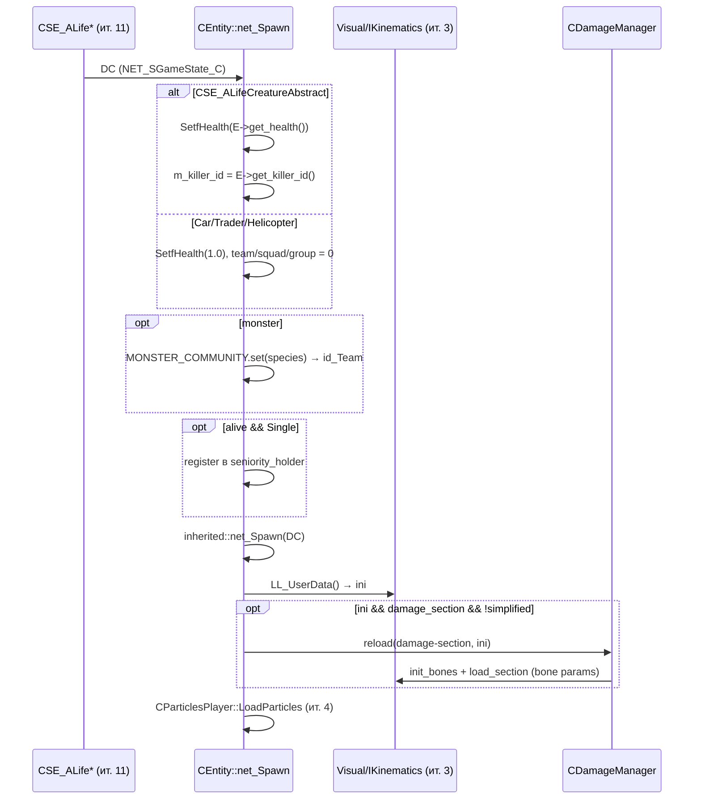

# CEntity: здоровье и урон

> **Модуль:** `xrGame` · **Файлы:** `src/xrGame/Entity.h` (144 стр.), `src/xrGame/Entity.cpp` (443 стр.), `src/xrGame/damage_manager.h` (33 стр.), `src/xrGame/damage_manager.cpp` (150 стр.) · **Порцион 5/30, итерация 5**

**Границы:** статы/условия (`CEntityCondition`) — [порц. 6](entity-condition.md); `CEntityAlive` — [порц. 7](entity-alive.md); раны/травмы — [порц. 8](wounds-death.md); полный разбор `SHit` — [порц. 28](script-entity.md); оружие — итерация 8; сеть/транспорт — итерация 12; AI — итерация 6.

## 1. Ответственность

`CEntity` — слой «то, что можно ранить» в объектной модели. Сверху `CGameObject` (каркас, [game-object](game-object.md)), снизу — все живые и неживые существа уровня: `CEntityAlive` (порц. 7) и «железо» (машины, трейдеры, вертолёты через `CSE_ALife*`). Класс отвечает за: здоровье (`GetfHealth`/`SetfHealth` через `CEntityConditionSimple`), конвейер урона `Hit` (импульс → расчёт потери → сигнал на кость → триггер смерти), смерть (`Die`/`KillEntity`, событие `GE_DIE`, «забыть убийцу» по таймеру), сетевые `net_Spawn`/`net_Destroy` (здоровье и убийца из `CSE_ALifeCreatureAbstract`), команду/отряд/группу (`id_Team/Squad/Group` + регистрация в `seniority_holder`), и параметры урона на кости через `CDamageManager`.

**Что НЕ делает:** не считает статы/радиацию/голод/травмы (это `CEntityCondition`, порц. 6–8); не анимирует и не двигает (порц. 7, 16); не реализует AI (ит. 6); не шлёт пакеты в транспорт (формат событий `GE_*` — [game-object-net](game-object-net.md), транспорт — ит. 12); не владеет физикой (наследование `CPhysicsShellHolder` — ит. 7, здесь только как граница).

## 2. Место в архитектуре

```
CObject (xrEngine)                — xr-object.md
└─ CGameObject (xrGame)           — game-object.md
   └─ CEntity                     — ЭТОТ класс (+ CDamageManager)
      └─ CEntityConditionSimple*  — порц. 6 (фабрика create_entity_condition)
      └─ CEntityAlive             — порц. 7
         ├─ CActor                — порц. 14–23
         └─ CCustomMonster        — порц. 9 (мост в AI)
```

Наследование (Entity.h L17–19): `class CEntity : public CPhysicsShellHolder, public CDamageManager`, `friend class CEntityCondition`. `CPhysicsShellHolder` (физическая оболочка — ит. 7) и `CDamageManager` (параметры урона на кости — §4.7) — два mixin'а поверх `CGameObject`.

**Зависит от:** `CEntityConditionSimple` (порц. 6), `SHit` (порц. 28), `CSE_ALifeCreatureAbstract` и `CSE_ALifeCar/Trader/Helicopter` (ит. 11), `MONSTER_COMMUNITY` (ит. 6), `seniority_holder`/командная иерархия, `IKinematics`/`CBoneInstance` (ит. 3, использование: `LL_UserData`, `LL_BoneCount`, `LL_GetBoneInstance`, `set_param`), `CParticlesPlayer` (ит. 4).

## 3. Публичный API

### Здоровье и жизнь

| Метод | Сигнатура | Назначение |
|-------|-----------|------------|
| `GetfHealth` / `SetfHealth` | `float (GetfHealth)()` / `void (float)` | здоровье через `m_entity_condition` |
| `GetMaxHealth` / `SetMaxHealth` | `float (GetMaxHealth)()` / `void (float)` | максимальное здоровье |
| `g_Alive` | `bool ()` | `GetfHealth() > 0` |
| `AlreadyDie` | `bool ()` | `m_level_death_time != 0` (смерть уже зарегистрирована) |
| `set_death_time` | `void ()` | фиксирует `m_level_death_time` (глобальное время) и `m_game_death_time` (игровое время, через `ai().alife().time_manager().game_time()`, если AI жив, иначе `Level().GetGameTime()`) |
| `GetLevelDeathTime` / `GetGameDeathTime` | `u32 ()` / `_TIME_ID ()` | время смерти (уровень / игра) |
| `set_ready_to_save` | `virtual void ()` | пустой виртуал, переопределяется наследниками (сохранение при смерти) |
| `in_solid_state` | `virtual bool ()` | по умолчанию `true`; `false` — выстрелы проходят насквозь (Entity.h L100) |
| `Hit` | `void (SHit*)` | конвейер урона, §4.3 |
| `HitSignal` / `HitImpulse` | `virtual void (float, const Fvector&, CObject*, int)` / `virtual void (float, const Fvector&, const Fvector&)` | чисто виртуальные: реакция на урон/импульс на кость — порц. 7–8 |

### Смерть

| Метод | Сигнатура | Назначение |
|-------|-----------|------------|
| `Die` | `void (CObject* who)` | фиксация смерти локально (health = -1, регистрация разрыва команд) |
| `KillEntity` | `void (u16 whoID, BOOL bypass_actor_check = FALSE)` | сетевая смерть: `GE_DIE` + killer; `ACTOR_BEFORE_DEATH_CALLBACK` (форк) |

### Сеть, загрузка

| Метод | Сигнатура | Назначение |
|-------|-----------|------------|
| `OnEvent` | `void (NetPacket&)` | поверх `CGameObject::OnEvent` обрабатывает `GE_DIE` |
| `net_Spawn` | `virtual void (NET_SGameState_C*)` | здоровье/killer/team из `CSE_ALife*`, damage-секция из visual |
| `net_Destroy` | `virtual void ()` | deregister из команд, `inherited::net_Destroy()`, `set_ready_to_save()` |
| `Load` | `virtual void (CInifile&, const char* section)` | team/squad/group, morale, body_remove_time |
| `reload` | `virtual void (const char*, CInifile&)` | inherited + `CDamageManager::reload(section, "damage", pSettings)` |

### Команда, состояние, прочее

| Метод | Сигнатура | Назначение |
|-------|-----------|------------|
| `ChangeTeam` | `void (int team, int squad, int group)` | смена команды с deregister/register в иерархии |
| `g_Team` / `g_Squad` / `g_Group` | `int ()` | доступ к ID |
| `IsFocused` / `IsMyCamera` | `bool ()` | «это текущая камера/сущность уровня» |
| `IsVisibleForHUD` | `bool ()` | `g_Alive()` |
| `use_simplified_visual` | `virtual bool () const` | по умолчанию `false`; наследники (монстры, `ai_stalker`) переопределяют — пропускает загрузку damage-секции |
| `g_State` | `virtual bool (SEntityState&)` | по умолчанию `FALSE`; состояние (прыжок/присед/бег) читает `g_pGameLevel` |
| `cast_entity` | `CEntity* ()` | возвращает `this` |
| `GetHotness` | `float ()` | форк: «жаркость» для теплового зрения (§4.8) |
| `GetGlowing` | `int ()` | форк: свечение (перегрев глушителя активного оружия, ит. 8) |

## 4. Внутреннее устройство

### 4.1 Поля

| Поле | Тип | Назначение |
|------|-----|------------|
| `m_entity_condition` | `CEntityConditionSimple*` (private) | создано в `_construct()` через виртуальную фабрику `create_entity_condition(NULL)` (порц. 6) |
| `m_dwBodyRemoveTime` | `ALife::_TIME_ID` | «время, через которое мёртвое тело уберётся с уровня»; дефолт `BODY_REMOVE_TIME = 600000` мс (10 мин) |
| `m_fMorale` | `float` (public) | хардкод `66.f` в `Load` + `#pragma todo("Jim to Dima: no specific figures or comments needed")` |
| `id_Team` / `id_Squad` / `id_Group` | `int` (public) | команда/отряд/группа |
| `m_fFood` | `float` (public) | **нигде не инициализируется в `CEntity`** (grep: только объявление в Entity.h L58) |
| `SEntityState` | struct (L48–56) | `bJump/bCrouch/bFall/bSprint` (bitfields) + `fVelocity`/`fAVelocity`; используется `g_State` в наследниках |
| `m_level_death_time` | `u32` (public) | глобальное время смерти |
| `m_game_death_time` | `ALife::_TIME_ID` (public) | игровое время смерти |
| `m_killer_id` | `ALife::_OBJECT_ID` (private) | ID убийцы; `-1` = нет убийцы |
| `m_registered_member` | `bool` (private) | зарегистрирован ли в `seniority_holder` (только Single) |

`_construct()` (L352–358): `inherited::_construct(); CDamageManager::_construct(); m_entity_condition = create_entity_condition(NULL);`.

### 4.2 Конвейер урона — `Hit(SHit*)` (L103–135)

```
1. VERIFY(pHDS->dir.magnitude() > EPS)          — направление обязано быть нормализовано
2. Импульс: инверсия XFORM → dir в локальных координатах → vLocalDir.invert()
   if (pHDS->impulse) HitImpulse(impulse, dir, vLocalDir)   [чисто виртуальный]
3. lost_health = CalcCondition(pHDS->damage())
   — только если Local() && g_Alive(): вычитает урон, клемп >= -1000
4. if (pHDS->bone() != BI_NONE)
     HitSignal(lost_health, vLocalDir, pHDS->who, pHDS->boneID)  [чисто виртуальный]
5. Триггер смерти (локально):
   Local() && !g_Alive() && !AlreadyDie() && m_killer_id == -1
   → KillEntity(pHDS->whoID)
6. inherited::Hit(pHDS)   — «must be last!!! @slipch»
   (CDamageManager-часть; базовый CGameObject::Hit пустой)
```

`in_solid_state()` (`false` — удары проходят насквозь, `Hit` не вызывается).

### 4.3 Смерть

**`Die(CObject* who)`** (L75–88): если `!AlreadyDie()` → `set_death_time()`; `set_ready_to_save()`; `SetfHealth(-1.f)`; в Single: `VERIFY(m_registered_member)` + deregister из `team().squad().group()` в `Level().seniority_holder()`.

**`KillEntity(u16 whoID, BOOL bypass_actor_check=FALSE)`** (L263–312):
- `#ifdef ACTOR_BEFORE_DEATH_CALLBACK` (форк Anomaly): если Single + это actor + не bypass → `Actor()->use_HolderEx(NULL, false)`, `Actor()->callback(GameObject::eActorBeforeDeath)(whoID)` и `return` — скрипт может предотвратить смерть (или вызвать `db.actor:kill(..., true)`).
- Если `whoID != ID()`: DEBUG-блок: если `m_killer_id != -1` → Msg «уже есть убийца» + `VERIFY(m_killer_id == -1)` — **в DEBUG падает всегда** при втором убийце (закомментированный early-return L293–297 показывает намерение).
- `m_killer_id = whoID; set_death_time();`
- Если `!getDestroy()`: пакет `u_EventGen(P, GE_DIE, ID()); P.w_u16(u16(whoID)); P.w_u32(0);` и `if (OnServer()) u_EventSend(P, net_flags(TRUE, TRUE, FALSE, TRUE))`.

**`OnEvent` → `case GE_DIE`** (L51–73): поверх `inherited::OnEvent` (GE_HIT — [game-object-net](game-object-net.md)); читает `u16 id; u32 cl;` (cl не используется), `net_Find(id)` → Msg «%s killed by %s ...» / «%s dies himself ...» (не Single) → `Die(who)`.

**«Забыть убийцу»** — `shedule_Update` (L362–376): если `!getDestroy() && !g_Alive() && m_killer_id != u16(-1)` и прошло `FORGET_KILLER_TIME` (180000 мс = 3 мин) от `m_level_death_time` → `m_killer_id = u16(-1)` + пакет `GE_ASSIGN_KILLER` с `u16(-1)`, **только в Single**.

### 4.4 net_Spawn / net_Destroy

`net_Spawn` (L156–247): сброс `m_level_death_time/m_game_death_time/m_killer_id`; `smart_cast<CSE_ALifeCreatureAbstract*>` из `DC`:
- существо: `SetfHealth(E->get_health())`, `m_killer_id = E->get_killer_id()` (если убийца при живом → Msg + сброс в -1; `R_ASSERT2` закомментирован L170–172);
- иначе (машина/трейдер/вертолёт): `R_ASSERT2(C || T || H, "Invalid entity (no inheritance from CSE_CreatureAbstract, CSE_ALifeItemCar and CSE_ALifeTrader and CSE_ALifeHelicopter)!")` → `SetfHealth(1.0f)`, `id_Team/id_Squad/id_Group = 0`;
- монстр: `MONSTER_COMMUNITY monster_community; monster_community.set(pSettings->r_string(*cNameSect(), "species")); if (monster_community.team() != 255) id_Team = monster_community.team();` — **перезаписывает team сервера**;
- если `g_Alive() && IsGameTypeSingle()`: регистрация в `seniority_holder` + `++m_dwAliveCount`;
- если `!g_Alive()`: `m_game_death_time = E->m_game_death_time` (+ level-время);
- `inherited::net_Spawn(DC)`;
- **damage-параметры**: `IKinematics* pKinematics = smart_cast<IKinematics*>(Visual()); CInifile* ini = pKinematics->LL_UserData();` — если `ini && section_exist("damage_section") && !use_simplified_visual()` → `CDamageManager::reload(pSettings->r_string("damage_section", "damage"), ini)`; затем `CParticlesPlayer::LoadParticles(pKinematics)` (ит. 4).

`net_Destroy` (L249–261): если `m_registered_member` → deregister (Single); `inherited::net_Destroy()`; `set_ready_to_save()`.

### 4.5 Load / reload

`Load` (L137–154): `inherited::Load`, `setVisible(FALSE)`, `id_Team/id_Squad/id_Group = READ_IF_EXISTS(pSettings, r_s32, section, "team"/"squad"/"group", -1)`, `m_fMorale = 66.f`, `m_dwBodyRemoveTime = READ_IF_EXISTS(..., "body_remove_time", BODY_REMOVE_TIME)`.

`reload` (L325–330): `inherited::reload` + `if (!use_simplified_visual()) CDamageManager::reload(section, "damage", pSettings)`.

### 4.6 Команда/отряд/группа

`ChangeTeam(team, squad, group)` (L386–407): no-op при совпадении; `VERIFY2(g_Alive(), "Try to change team of a dead object")`; Single: `VERIFY(m_registered_member)`; `on_before_change_team()` (пустой виртуал) → deregister старой → установка ID → register новой → `on_after_change_team()` (пустой виртуал).

Иерархия: `Level().seniority_holder().team(id).squad(id).group(id).register_member/unregister_member` — holders в `team_hierarchy_holder.h` / `squad_hierarchy_holder.h` / `group_hierarchy_holder.h` / `seniority_hierarchy_holder.h` (без отдельной страницы; `m_dwAliveCount` — счётчик живых в holder).

### 4.7 CDamageManager (bone-параметры урона)

`CDamageManager` (damage_manager.h/.cpp) — mixin, подмешанный в `CEntity`. Поля: `m_default_hit_factor`, `m_default_wound_factor` (по 1.0), `m_object` (`CObject*` = `smart_cast<CObject*>(this)`, VERIFY в `_construct`).

**Формат ini** (в `LL_UserData()` visual'а, секция, названная в `damage_section.damage`):

```ini
[damage]
default = 1.0, 0.0, 1.0        ; hit_scale, (неисп.), wound_scale
bone_name_0 = 0.5, 1, 2.0, 0.8 ; hit, wound_flag, wound, aim_bullet (4-й опц.)
```

**`reload(section, ini)`**: строка `default` (3 значения через запятую, используются 0 и 2) → `init_bones` (ставит параметры на **все** кости kinematics visual'а: param0=hit_factor, param1=1.0, param2=wound_factor) → `load_section` (по-кость: param0=hit, param1=wound-флаг, param2=wound, param3=aim-bullet — если значений <4, берётся param0; `BI_NONE` → `Debug.fatal`; корневая кость (0) с нулевыми hit/wound → `R_ASSERT2 "hit_scale and wound_scale for root bone cannot be zero"`).

**`reload(section, line, ini)`**: непрямая — читает `line` из `section` как имя реальной damage-секции → `reload(она, ini)`; fallback `reload(section, 0)` (nullptr ini — глобальный `pSettings`, только default'ы + `init_bones`, кинематика при этом не требуется).

**`HitScale(bone_num, hit_scale&, wound_scale&, aim_bullet=false)`**: `BI_NONE` → дефолты; `aim_bullet` → param3 (fallback param0 при 0); hit_scale=param0, wound_scale=param2.

Параметры хранятся на `CBoneInstance` через `kinematics->LL_GetBoneInstance(i).set_param(0..3)` — использование кинематики уровня ит. 3 (полный разбор — ит. 3 порц. 8). Потребитель `HitScale` — `CEntityCondition::ConditionHit` (порц. 6/8).

### 4.8 Форк Anomaly («--DSR--»)

- **`GetHotness()`** (L415–419): если консольный `heat_vision_cooldown` (int, дефолт 1) и (`AlreadyDie() || !g_Alive()`) → `1.0f - clampU(dwTimeGlobal - m_level_death_time, 0, heat_vision_cooldown_time) / heat_vision_cooldown_time` — труп «остывает» за `heat_vision_cooldown_time` мс (дефолт 20000); иначе 1.0f.
- **`OnChangeVisual()`** (L421–426): inherited + `renderable.visual->MarkAsHot(true)` — маркировка для теплового зрения; `MarkAsHot` — `FBasicVisual`/`FHierrarhyVisual` (xrRender, рекурсивно по иерархии).
- **`GetGlowing()`** (L430–442): `smart_cast<CInventoryOwner*>(this)` → `inventory().ActiveItem()` → `smart_cast<CWeapon*>` → `weapon->GetGlowing()` (перегрев глушителя — ит. 8).

Консольные переменные: `heat_vision_cooldown` (0–1) и `heat_vision_cooldown_time` (0–300000) — `xrRender_console.cpp` L276–277, команды L1610–1611.

## 5. Взаимодействие

**Кто вызывает меня:**
- `GE_HIT` → `CGameObject::OnEvent` → `Hit(SHit*)` — [game-object-net](game-object-net.md); `SHit` формируется оружием (ит. 8) и зонами (порц. 24–26).
- `CDamageManager::HitScale` ← `CEntityCondition::ConditionHit` (порц. 6/8).
- `seniority_holder` ← HUD/интерфейсы (ит. 10) — команда/отряд/группа.
- `net_Spawn` ← сервер-сторона `CSE_ALife*` (ит. 11).
- `KillEntity` ← локальный `Hit` (смерть) и `GE_DIE`-обработка.

**Кого вызываю:**
- `CObject::net_Find`, `u_EventGen`/`u_EventSend` (формат — [game-object-net](game-object-net.md), транспорт — ит. 12).
- `CEntityConditionSimple` (порц. 6) — здоровье.
- `seniority_holder` иерархия — команды.
- `MONSTER_COMMUNITY` (ит. 6) — team по `species`.
- `IKinematics`/`CBoneInstance` (ит. 3) — bone-параметры, `LL_UserData`.
- `CParticlesPlayer::LoadParticles` (ит. 4).
- `FBasicVisual::MarkAsHot` (xrRender) — тепловое зрение.
- `CWeapon::GetGlowing` (ит. 8) — свечение.

## 6. Потоки

**Удар → смерть (локальный игрок):**

```mermaid
sequenceDiagram
    participant W as Оружие (ит. 8)
    participant GO as CGameObject::OnEvent
    participant E as CEntity
    participant C as CEntityConditionSimple (порц. 6)
    participant S as Наследник (HitSignal/HitImpulse, порц. 7–8)

    W->>GO: GE_HIT (SHit)
    GO->>E: Hit(pHDS)
    E->>E: HitImpulse (локальный dir)
    E->>C: CalcCondition(damage)
    C-->>E: lost_health (health -=, >= -1000)
    E->>S: HitSignal(lost, dir, who, boneID)
    alt health <= 0 && !AlreadyDie && killer == -1
        E->>E: KillEntity(whoID)
        E->>E: m_killer_id = whoID; set_death_time()
        E-->>GO: GE_DIE пакет (OnServer)
        GO->>E: OnEvent GE_DIE → Die(who)
        E->>C: SetfHealth(-1)
        E->>E: deregister из команд (Single)
    end
```

**Спаун (клиент/сервер):**



## 7. Конфигурация

**Ini (секция объекта, `Load`):**

| Ключ | Тип | Дефолт | Назначение |
|------|-----|--------|------------|
| `team` / `squad` / `group` | s32 | -1 | ID команды/отряда/группы |
| `body_remove_time` | s32 | 600000 (мс) | время жизни трупа на уровне |
| `damage` | string | — | имя damage-секции (через `reload`) |
| `damage_section` (в `LL_UserData` visual'а) | string | — | имя damage-секции при `net_Spawn` |

**Damage-секция** (в `LL_UserData()` visual'а): `default = hit,_,wound` + по-кость `bone = hit,flag,wound[,aim_bullet]`; корневая кость с нулевыми scale → assert.

**Консольные:** `heat_vision_cooldown` (int, 0–1, дефолт 1), `heat_vision_cooldown_time` (float, 0–300000 мс, дефолт 20000) — `xrRender_console.cpp`.

**Префикс:** `ACTOR_BEFORE_DEATH_CALLBACK` — включает скриптовый хук перед смертью актора (форк Anomaly).

**Константы:** `BODY_REMOVE_TIME = 600000` мс (10 мин), `FORGET_KILLER_TIME = 180000` мс (3 мин).

## 8. Ограничения и дебаг

- **`m_fFood`** объявлен public, но нигде в `CEntity` не инициализируется — значение мусор, до тех пор пока наследник не запишет.
- **`m_fMorale = 66.f`** — хардкод с `#pragma todo("Jim to Dima: no specific figures or comments needed")` в `Load`.
- **DEBUG-блок в `KillEntity`**: при втором убийце (m_killer_id уже != -1) — Msg + `VERIFY(m_killer_id == -1)`, который **всегда срабатывает** в DEBUG (закомментированный early-return L293–297 — намерение не реализовать).
- **`OnEvent GE_DIE`**: `u32 cl` читается из пакета, но не используется.
- **`set_ready_to_save()`** — пустой виртуал в базовом классе.
- **`R_ASSERT2(C || T || H, ...)`** в `net_Spawn` — машина/трейдер/вертолёт — единственные не-существующие сущности.
- **`KillEntity`**: `u_EventGen` строит пакет всегда, но `u_EventSend` только `if (OnServer())`.
- **«Забыть убийцу»** — только в Single (`IsGameTypeSingle()`).
- **`vLocalDir.invert()`** перед `HitSignal` — направление в локальных координатах инвертируется (конвенция: «откуда летит» → «куда направлено»).
- **`CalcCondition`** клемпает здоровье `>= -1000` (не 0).
- **Monster community** может перезаписать `id_Team` сервера (species → team, 255 = без команды).
- **`CDamageManager::load_section`**: `BI_NONE`-кость в секции → `Debug.fatal`; нулевые hit/wound scale на корне → `R_ASSERT2`.
- **`use_simplified_visual()`** — gate для загрузки damage-секции и частиц: монстры/сталкер переопределяют (ит. 6/14).

## 9. Ссылки

- [CObject](../xr-engine/xr-object.md) — базовый каркас
- [CGameObject](game-object.md) — родитель
- [CGameObject: сеть](game-object-net.md) — `GE_HIT`/`OnEvent`, формат `u_Event*`
- [EntityCondition](entity-condition.md) — порц. 6: статы, `CEntityConditionSimple`
- [CEntityAlive](entity-alive.md) — порц. 7
- [Травмы и смерть](wounds-death.md) — порц. 8
- [CCustomMonster](custom-monster.md) — порц. 9
- [CActor](actor.md) — порц. 14+
- [script_entity / script_hit](script-entity.md) — порц. 28: полный `SHit`
- [Модель объектов](../../architecture/object-model.md) — обновляется в порц. 2 и 30
- [Граф связей](../../architecture/dependencies.md)

## 10. Источник

- `src/xrGame/Entity.h` (144 стр.)
- `src/xrGame/Entity.cpp` (443 стр.)
- `src/xrGame/damage_manager.h` (33 стр.)
- `src/xrGame/damage_manager.cpp` (150 стр.)
- `src/xrGame/EntityCondition.h` L87–100 (`CEntityConditionSimple`)
- `src/xrGame/Hit.h` (89 стр.) — `SHit` (полный разбор — порц. 28)
- `src/Layers/xrRender/xrRender_console.cpp` L276–277, L1610–1611 — heat-vision консоль
- `src/xrServerEntities/xrMessages.h` L98–119 — enum `GE_*`
- `src/xrGame/team_hierarchy_holder.h`, `squad_hierarchy_holder.h`, `group_hierarchy_holder.h`, `seniority_hierarchy_holder.h` — командная иерархия
