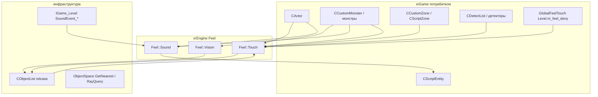

# Feel: Touch / Vision / Sound (порционы 41–42)

> **Модуль:** `xrEngine` + `xrGame` · **Файлы:** `xrEngine/Feel_Touch.h` (44), `xrEngine/Feel_Touch.cpp` (108), `xrEngine/Feel_Vision.h` (78), `xrEngine/Feel_Vision.cpp` (319), `xrEngine/Feel_Sound.h` (15), `xrGame/GlobalFeelTouch.hpp` (19) + `.cpp` (56), `xrGame/Actor_Feel.cpp` (397), `xrGame/CustomDetector.h` (153, сводка — [порц. 11](misc-items.md)) · **Порционы 41–42, итерация 5**

> **Страница:** карта feel-системы с точки зрения использования. Порцион 41: `Feel::Touch` (база, алгоритм `feel_touch_update`), `CGameObject::feel_touch_on_contact` (game-object-виртуальная), `GlobalFeelTouch` (`Level().m_feel_deny` — глобальные запреты касания), `CDetectList<K>`/`CAfList`/`CZoneList` (сводка), детальный разбор `Actor_Feel.cpp` (§1–7). Порцион 42: `Feel::Vision` (база), реализации `feel_vision_isRelevant`/`feel_vision_mtl_transp` в xrGame, `Feel::Sound` (маркер), `feel_sound_new`-наследники, `process_sound_callbacks` (§8–12).

**Полный разбор механики** (алгоритмы `feel_touch_update`/`feel_vision_query`/`feel_vision_update`/`o_trace`, `pure_relcase`, `feel_vision_callback`, sequence-диаграммы, ограничения) — в [xrEngine → Feels](../xr-engine/feel.md). Здесь — **фиксация базы + xrGame-сторона**: кто наследует, кто реализует виртуальные, как устроены запреты касания и pickup-конвейер актёра.

**Чего это не делает**: не содержит игровых решений «что делать при касании/зрении/звуке» — это в наследниках (монстры/stalker — итерация 6, зоны — [порц. 37–40](zones-custom.md)); не диспетчеризует звуки — это `IGame_Level::SoundEvent_*` ([Уровень](../xr-engine/level.md)).

## 1. Назначение и границы

`namespace Feel` (xrEngine) — три микросмешания, дающих `CObject`-наследнику «сенсоры»:

- **Touch** — что вокруг (pickup, артефакты, зоны, детекторы);
- **Vision** — что видно (fuzzy-зрение AI/актёра);
- **Sound** — что услышано (звуковая память).

Наследование — всегда **поверх** игрового класса (`CActor : ..., Feel::Touch, Feel::Sound`; `CCustomMonster : ..., Feel::Vision, Feel::Sound, Feel::Touch`). Конструкторы `Touch()`/`Vision()` регистрируют relcase в `g_pGameLevel->Objects` (`pure_relcase`) — **создавать нельзя до загрузки уровня**, уничтожать нужно **до** него (см. [xr-engine/feel.md](../xr-engine/feel.md) §«Известные ограничения»).

## 2. Feel::Touch — базовый класс (xrEngine)

`src/xrEngine/Feel_Touch.h` (44) / `Feel_Touch.cpp` (108), `private pure_relcase`.

| Поле/тип | Тип | Описание |
| --- | --- | --- |
| `feel_touch` | `xr_vector<CObject*>` | объекты **в контакте** сейчас |
| `q_nearest` | `xr_vector<CObject*>` | scratch-результат последнего `GetNearest` (`clear_not_free()`) |
| `feel_touch_disable` (protected) | `xr_vector<DenyTouch>` | запреты: `{ CObject* O; DWORD Expire; }` по `Device.dwTimeGlobal` |
| `DenyTouch` | структура (h:12–16) | запись запрета |

| Метод | Где | Описание |
| --- | --- | --- |
| `Touch()` | cpp:7–9 | регистрация `pure_relcase(&Touch::feel_touch_relcase)` |
| `~Touch()` | cpp:11–13 | отрегистрация relcase |
| `feel_touch_contact(CObject*)` | cpp:15–18 | виртуальный фильтр «есть ли контакт»; база — `true` |
| `feel_touch_update(Fvector&, float)` | cpp:28–92 | **главный вход**, кадровый: см. алгорitm ниже |
| `feel_touch_deny(CObject*, DWORD)` | cpp:20–26 | `Expire = dwTimeGlobal + T` (мс), push в `feel_touch_disable` |
| `feel_touch_new/delete(CObject*)` | h:36–42 | события входа/выхода; база — пустые |
| `feel_touch_relcase(CObject*)` | cpp:94–108 | relcase: erase из `feel_touch` (+`feel_touch_delete`) и из `feel_touch_disable` |

**Алгоритм `feel_touch_update(C, R)`** (полный — [xr-engine/feel.md](../xr-engine/feel.md)): ① вычистить истёкшие `DenyTouch`; ② `g_pGameLevel->ObjectSpace.GetNearest(q_nearest, C, R, NULL)`; ③ **NEW**: для каждого из `q_nearest` — пропуск `getDestroy()`, пропуск `!feel_touch_contact(O)`, если `O` нет в `feel_touch` — проверка на deny, иначе `push_back` + `feel_touch_new(O)`; ④ **DELETE**: по `feel_touch` — `getDestroy() || !contact || нет в q_nearest` → erase + `feel_touch_delete(O)`.

Безопасность сырых указателей — **только** `feel_touch_relcase` (уничтожение объекта вычищает оба вектора).

## 3. feel_touch_on_contact — game-object-виртуальная

**Расхождение с планом:** `feel_touch_on_contact` — **не** метод `Feel::Touch`, а виртуальный метод `CGameObject` (`src/xrGame/GameObject.h:98`, дефолт `{ return TRUE; }`). Механика: объект, которого «потрогали», сам решает, считать ли контакт настоящим.

| Реализация | Где | Поведение |
| --- | --- | --- |
| `CActor::feel_touch_on_contact` | `Actor_Feel.cpp:54–67` | для `CCustomZone`: сфера `{Position(), R=0.1}` должна быть **внутри** зоны (`custom_zone->inside(sphere)`); для остальных — `true` |
| `CCustomMonster` / `CBaseMonster` / `CAI_Rat` | `CustomMonster.cpp:920`, `base_monster.cpp:626`, `ai_rat_feel.cpp:54` | делегируют `inherited::` (дефолт `true`) |
| `CAI_Stalker::feel_touch_on_contact` | `ai_stalker_feel.cpp:88–104` | спрашивает игрока: `game_object->feel_touch_on_contact(this)` (L85) — т.е. стalker-нашлушник учитывает решение актёра |
| `CZoneList`-потребители: `CCustomZone::feel_touch_on_contact` | `CustomZone.cpp:1577–1582` | `inherited::` (дефолт) |
| `CSmartCoverObject` | `smart_cover_object.h:32` | **всегда `FALSE`** — умные укрытия не «трогаются» |

**Кто спрашивает**: `CCustomZone::feel_touch_contact` → `object->feel_touch_on_contact(this)` (`CustomZone.cpp:767`) — зона проверяет каждого попавшего в её радиус; то же в `RadioactiveZone.cpp:101`.

## 4. GlobalFeelTouch: глобальный список запретов

`xrGame/GlobalFeelTouch.hpp` (19) / `.cpp` (56): `class GlobalFeelTouch : public Feel::Touch` — по комментарию в hpp, **«implements only denial functionality»**.

- **`feel_touch_update(P, R)` переопределён** (cpp:33–42): аргументы `P`/`R` **игнорируются** — вместо кадрового поиска выполняется только `std::remove_if` по истёкшим `DenyTouch` (`delete_predicate_by_time`, cpp:13–21). Т.е. объект-поиск здесь **не идёт**.
- **`is_object_denied(CObject const*)`** (cpp:44–56): `find_if` по `O` (`objects_ptrs_equal`) — есть ли активный запрет.

**Единственный экземпляр** — `CLevel::m_feel_deny` (`Level.h:172`), обновляется **раз в кадр** в `CLevel::OnFrame` (`Level.cpp:986–987`: `m_feel_deny.feel_touch_update(temp_vector, 0.f)`).

**Источники запретов** (пушат через `Level().m_feel_deny.feel_touch_deny(O, T)`):

| Где | Срок | Контекст |
| --- | --- | --- |
| `Actor_Events.cpp:137–138` | 1000 мс | `OnEvent`: взятие/дроп предмета (внутренний `feel_touch_deny` закомментирован — Lain-паттерн) |
| `game_cl_base.cpp:438` | 1000 мс | событие игры |
| `ai_stalker_events.cpp:113` | 2000 мс | **собственный** `feel_touch_deny` сталкера (наследника), не глобальный |

**Потребители `is_object_denied`** — pickup-конвейер актёра, все три в `Actor_Feel.cpp`: `PickupModeUpdate` (L131), `PickupModeUpdate_COD` (L231), `Check_for_AutoPickUp` (L301) — см. §6.

## 5. CDetectList<K> / CAfList / CZoneList (сводка, порц. 11)

Детекторный слой `Feel::Touch` — в `xrGame/CustomDetector.h` (153 строк, **не 58** — см. §14), полный разбор — [misc-items.md](misc-items.md) (порц. 11):

- `ITEM_TYPE` (h:13–20): `freq (min,max)`, `detect_snds`, `zone_map_location`, `nightvision_particle` — описание типа обнаруживаемого объекта.
- `ITEM_INFO` (h:23–34): `curr_ref → ITEM_TYPE`, `snd_time`, `curPeriod`, `pParticle` — состояние обнаружения конкретного объекта.
- `CDetectList<K> : Feel::Touch` (h:36–107): `m_TypesMap (sect → ITEM_TYPE)`, `m_ItemInfos (K* → ITEM_INFO)`; `feel_touch_new` (h:49–57) — `R_ASSERT` что секция есть в `m_TypesMap`, инициализация `curr_ref`; `feel_touch_delete` (h:59–64) — erase; `load(sect, prefix)` (h:80–106) — читает `prefix_class_N` / `prefix_freq_N` / `prefix_sound_N_` из `pSettings`.
- `CAfList : CDetectList<CArtefact>` (h:109–119) — фильтр по `m_af_rank`; `CZoneList : CDetectList<CCustomZone>` (h:146–153) — зоны для `CScientificDetector`. Владелец — `CCustomDetector::m_artefacts` (h:143).

## 6. Actor_Feel.cpp (397): детали порц. 25

`actor-input.md` (§4.3, порц. 25) даёт **каркас** feel-обвязки актёра; здесь — детальный разбор файла.

### 6.1 Touch-контакты и счётчик персонажей

| Метод | Строки | Действие |
| --- | --- | --- |
| `feel_touch_new/delete(CObject*)` | 24–28 / 30–34 | если объект — `CPhysicsShellHolder` **с** `character_physics_support()` → `m_feel_touch_characters ±= 1` (счётчик чужих персонажей в радиусе; используется в `UpdateCL` для `UpdateObjectBox`) |
| `feel_touch_contact(CObject*)` | 36–52 | `true` если: `CInventoryItem::Useful()` **и** `!H_Parent()` (свободный полезный предмет); **или** `CInventoryOwner`, не являющийся самим актёром |
| `feel_touch_on_contact(CObject*)` | 54–67 | см. §3 — для зон: актёр «в зоне», если его сфера R=0.1 внутри `custom_zone->inside` |

### 6.2 Видимость pickup-подсказок: `CanPickItem` + `info_trace_callback`

- `info_trace_callback` (69–97, статический `ICF BOOL`): ray query по миру; объект-перекрытие → если `STYPE_OBSTACLE` — `bOverlaped = TRUE` (сам актёра игнорируется); статический треугольник → если материал **`flPassable`** — пропуск, иначе `bOverlaped = TRUE` и стоп (`return FALSE`).
- `CanPickItem(frustum, from, item)` (99–120): `getVisible`, `testSphere_dirty` по frustum (`FRUSTUM_P_LRTB | FRUSTUM_P_FAR`), затем `RayQuery(RD, info_trace_callback, ..., exclude item)` — `TRUE` = **не перекрыт**.

### 6.3 Pickup-конвейер

| Метод | Строки | Что делает |
| --- | --- | --- |
| `PickupModeUpdate()` → `pickup_result_t {allow_pickup, callback_handled}` | 122–155 | вход: `m_bPickupMode` и **только SP** (`IsGameTypeSingle()`); если `m_pObjectWeLookingAt` — инвентарный предмет, `Useful()`, у `m_pUsableObject` `nonscript_usable()`, и `!Level().m_feel_deny.is_object_denied(...)` → Lua-хук `bind_stalker_ext.actor_on_item_before_pickup` (может запретить — возврат `{false, true}`), иначе `use(this)` + `Game().SendPickUpEvent`; затем **`feel_touch_update(Position(), m_fPickupInfoRadius)`** — радиус подбора; отрисовка подсказок (`DrawPickupItems`, если PDA-меню не открыто, иначе `m_bDelayDrawPickupItems = true`) |
| `DrawPickupItems()` | 157–167 | frustum экрана → по всему `feel_touch` → `CanPickItem` → `PickupInfoDraw(O)` |
| `PickupModeUpdate_COD(pickup_result)` | 171–275 | режим CoP-pickup (`rsCODPickup`, жив, `eacFirstEye`, текущий view-entity): `q_frustum(STYPE_COLLIDEABLE)` → фильтры (`CanTake`, нет родителя, не `CExplosiveRocket`, `CGrenade`/`CMissile` → только `Useful()`, `dist² ≤ 4` от актёра, боковой зазор `len² ≤ 1` относительно дольного луча камеры) → ближайший по `len²` → `CanPickItem` → `is_object_denied` → `getVisible` → `UIMainIngameWnd->SetPickUpItem`; Lua `_G.CPickupModeUpdate_COD` (L:244); повторный Lua-хук before-pickup (если не обработан в `PickupModeUpdate`), `use()` для `CUsableScriptObject`, сброс `m_bPickupMode` без `AF_MULTI_ITEM_PICKUP`, `SendPickUpEvent` |
| `Check_for_AutoPickUp()` | 277–321 | **только MP**: `AF_AUTOPICKUP`, не SP, `CurrentControlEntity()==this`, жив; `q_box(STYPE_COLLIDEABLE)` по AABB (`m_AutoPickUp_AABB` вокруг `Position()+offset`) → `CanTake`, `!is_object_denied`, не граната; `APU_Box.Pick`; в DM/TDM — пропуск, если слот `INV_SLOT_2/3` занят; `SendPickUpEvent` |
| `PickupInfoDraw(CObject*)` | 324–352 | проекция `item->NameItem()` через `Device.mFullTransform*XFORM` → экранные XY; отбраковка по `z<0/w<0/NDC`; шрифт `pFontLetterica16Russian`, центр, цвет `PICKUP_INFO_COLOR` (`0xFFDDDDDD`), глобальный флаг `drawPickupItemNames` (L323) |

### 6.4 Звук и гранаты

- **`feel_sound_new(...)`** (354–358): `if (who == this) m_snd_noise = _max(m_snd_noise, power)` — актёр слышит **свой** шум (потребитель — шум-детектор/стелс-механики).
- **`Feel_Grenade_Update(float rad)`** (360–397): **только SP**; свой `q_nearest` через `ObjectSpace.GetNearest(Center, rad)`; фильтр — `CGrenade`, `Initiator() != ID()`, `!Useful()`, `time_from_begin_throw() ≥ m_fFeelGrenadeTime` → `HUD().AddGrenade_ForMark(grn)` (метка в HUD), затем `HUD().Update_GrenadeView(pos)`.

## 7. Карта потребителей Feel::Touch (xrGame)

| Наследник | Где объявлен | Роль |
| --- | --- | --- |
| `CActor` | `Actor.h:76` | pickup (§6), PDA-контакты, счётчик персонажей |
| `CCustomMonster` | `CustomMonster.h:37–39` | зонные контакты монстра (+ `Vision`/`Sound`) |
| `CCustomZone` | `CustomZone.h:38` | объекты в зоне (порц. 37 — `feel_touch_*` в `shedule_Update`) |
| `CScriptZone` | `script_zone.h:18` | Lua-зона `eZoneEnter/eZoneExit` (порц. 40) |
| `CTeamBaseZone` | `team_base_zone.h:14` | MP-база (порц. 39) |
| `CLevelChanger` | `level_changer.h:15` | переход между уровнями |
| `CPda` | `PDA.h:18` | PDA-контакты (порц. 12) |
| `CDetectList<K>` | `CustomDetector.h:37` | детекторы (§5, порц. 11) |
| `CPsyAura` | `ai/monsters/psy_aura.h:7` | psy-аура (ит. 6) |
| `BastArtifact` / `BlackGraviArtifact` | `BastArtifact.h:19`, `BlackGraviArtifact.h:14` | артефакты-искусители (ит. 10) |
| `GlobalFeelTouch` | `GlobalFeelTouch.hpp:7` | глобальный deny-список (§4) |

---

# Порцион 42: Vision и Sound

## 8. Feel::Vision — базовый класс (xrEngine)

`Feel_Vision.h` (78) / `Feel_Vision.cpp` (319), `private pure_relcase`, ctor `Vision(CObject const* owner)`.

**Константы** (h:13–16): `fuzzy_update_vis = 1000.f`, `fuzzy_update_novis = 1000.f`, `fuzzy_guaranteed = 0.001f`, `lr_granularity = 0.1f`.

**Состояние**: приватные `seen`/`query`/`diff`/`RQR`/`r_spatial`/`m_owner` + публичное `feel_visible` (`xr_vector<feel_visible_Item>`, h:48) — h:35–46:

```cpp
struct feel_visible_Item {
    collide::ray_cache Cache;   // кэш последнего ray (P, D, f)
    Fvector cp_LP;              // локальная точка на меше
    Fvector cp_LR_src, cp_LR_dst;
    Fvector cp_LAST;            // последняя «видимая» точка
    CObject* O;
    float fuzzy;                // комментарий (-1..1), clamp [-0.5..1]
    float Cache_vis;
    u16 bone_id;
};
```

| Метод | Описание |
| --- | --- |
| `feel_vision_clear()` | очистка `seen`/`query`/`diff`/`feel_visible` |
| `feel_vision_query(mFull, P)` | шаг 1: frustum → `g_SpatialSpace->q_frustum(STYPE_VISIBLEFORAI)` → фильтр `feel_vision_isRelevant` → дедуп (`sort+unique`) |
| `feel_vision_update(parent, P, dt, vis_threshold)` | шаг 2: diff `seen`/`query` → `o_new`/`o_delete`, затем `o_trace` (ray-casts, кэш, fuzzy) |
| `feel_vision_relcase(O)` | relcase: erase из всех буферов |
| `feel_vision_get(R)` | заполнить `R` объектами с `fuzzy > 0` |
| `feel_vision_get_vispoint(O)` | `cp_LAST` объекта; нет объекта → `VERIFY2` + `(flt_max,flt_max,flt_max)` |
| **`feel_vision_isRelevant(CObject*) = 0`** | **pure**: фильтр «интересен ли объект» (xrGame) |
| **`feel_vision_mtl_transp(CObject*, u32 element) = 0`** | **pure**: прозрачность материала элемента (xrGame) |

Полный алгоритм (`o_new`/`o_delete`/`o_trace`, `feel_vision_callback`, `#ifdef SPATIAL_CHANGE`) — [xr-engine/feel.md](../xr-engine/feel.md) §«Внутреннее устройство».

## 9. Реализации Feel::Vision в xrGame

**`feel_vision_isRelevant`** (pure):

| Класс | Где |
| --- | --- |
| `CActorMemory` | `actor_memory.cpp:25` (зрительная память актёра, порц. 30) |
| `CAI_Stalker` | `ai/stalker/ai_stalker_feel.cpp:24` (ит. 6) |
| `CBaseMonster` | `ai/monsters/basemonster/base_monster_feel.cpp:216` (ит. 6) |
| `CAI_Rat` | `ai/monsters/rats/ai_rat_feel.cpp:15` (ит. 6) |
| `car_memory` | `car_memory.cpp:37` (память транспорта) |

**`feel_vision_mtl_transp`** (pure): `CCustomMonster` (`CustomMonster.cpp:970` — порц. 9), `vision_client` (`vision_client.cpp:116`), `CVisualMemoryManager` (`visual_memory_manager.cpp:611`) — latter два используются памятью (ит. 6).

**Связанные поля `CCustomMonster`** (порц. 9, не дублируются): двухступенчатое зрение `eye_pp_s0/s1/s2`, `update_range_fov` (fog/far-plane), вызов `feel_vision_query`/`feel_vision_update` в `shedule_Update`.

## 10. Feel::Sound — маркер (xrEngine)

`Feel_Sound.h` (**15 строк** — весь файл):

```cpp
class ENGINE_API Sound {
public:
    virtual void feel_sound_new(CObject* who, int type, CSound_UserDataPtr user_data,
                                const Fvector& Position, float power) {};
};
```

- **Нет** ни конструктора-регистрации, ни `pure_relcase` (в отличие от Touch/Vision): регистрация — пространственный флаг **`STYPE_REACTTOSOUND`** + `dcast_FeelSound()` в `IGame_Level::SoundEvent_Register` (см. [Уровень](../xr-engine/level.md) и [xr-engine/feel.md](../xr-engine/feel.md)).
- Уничтожение: `IGame_Level::SoundEvent_OnDestDestroy(Feel::Sound*)` вычищает делегаты из очереди `snd_Events` (вызывается в dtor наследника, напр. `CCustomMonster`).
- **Расхождение с планом**: `feel_sound_delete`/`feel_sound_update` в коде **отсутствуют** — только `feel_sound_new` (см. §14).

## 11. Реализации feel_sound_new и диспетчеризация

| Класс | Где | Действие |
| --- | --- | --- |
| `CActor` | `Actor_Feel.cpp:354–358` | `m_snd_noise = max(power)` только для `who == this` (§6.4) |
| `CCustomMonster` | `CustomMonster.cpp:975` | передача в `sound()` / звуковую память (порц. 9, менеджеры — ит. 6) |
| `CBaseMonster` | `base_monster_feel.cpp:29` | → `CSoundMemoryManager::feel_sound_new` (`sound_memory_manager.cpp:128`) |
| `CAI_Rat` | `ai_rat_feel.cpp:23` | свои реакции + `inherited::feel_sound_new` (L51) |

**Полка `dcast_FeelSound()`** (возвращает `this` как `Feel::Sound*`): `CCustomMonster` (см. таблицу в [custom-monster.md](custom-monster.md) §down-cast), `CActor` (`Actor.h:133`).

**Поток** (sequence — [xr-engine/feel.md](../xr-engine/feel.md) §«Потоки данных»): `SoundEvent_Register` → `q_box(STYPE_REACTTOSOUND)` → `dcast_FeelSound` → `Power = (1 - dist/max_ai_distance) * volume * occlusion` → `snd_Events` → `SoundEvent_Dispatch()` → `feel_sound_new(who, type, user_data, position, power)`.

## 12. CScriptEntity::process_sound_callbacks (указатель, порц. 43)

`script_entity.h:119` / `script_entity.cpp:753` — перекачивает накопленные звуковые события в Lua (`CScriptEntity`-обёртка). Вызывается из `CCustomMonster::UpdateCL` (`CustomMonster.cpp:456`), накапливаются они в `sound_callback` из `CSoundMemoryManager` (`sound_memory_manager.cpp:150`). Полный разбор класса — порц. 43, [script-entity.md](script-entity.md).

## 13. Связи



- **База и алгоритмы** — [xr-engine/feel.md](../xr-engine/feel.md); диспетчеризация звука — [xr-engine/level.md](../xr-engine/level.md).
- **Touch-потребители**: pickup актёра — [actor-input.md](actor-input.md) (порц. 25, каркас) и §6; зоны — [zones-custom.md](zones-custom.md) (порц. 37, `feel_touch_*` в `shedule_Update`), [zones-anomaly.md](zones-anomaly.md) (порц. 40 — `CScriptZone`, `CRadioactiveZone`); детекторы — [misc-items.md](misc-items.md) (порц. 11).
- **Vision-потребители**: `CCustomMonster` — [custom-monster.md](custom-monster.md) (порц. 9), зрительная память — [actor-mp.md](actor-mp.md) (порц. 30, `vision_client`), остальные — итерация 6.
- **Sound-потребители**: звуковая память монстров — итерация 6; Lua-колбэки — порц. 43 ([script-entity.md](script-entity.md)).
- Сетевая сторона (`net_*` касаний) отсутствует — `Feel` полностью клиентский/уровневый механизм.

## 14. Замечания к плану

1. **`feel_touch_on_contact` отсутствует в `Feel::Touch`** — план (блок 41) перечисляет его среди методов `xrEngine/Feel_Touch`. Фактически это `CGameObject::feel_touch_on_contact` (`GameObject.h:98`, дефолт `TRUE`), xrGame-виртуальная (§3).
2. **`Feel_Sound.h` не содержит `feel_sound_delete`/`feel_sound_update`** — план (блок 42) их упоминает; в файле (15 строк) только `feel_sound_new`.
3. **`CustomDetector.h` = 153 строки**, в плане и в шапке `misc-items.md` указано 58 (там, видимо, имелся в виду фрагмент классов без `CDetectList`).
4. **Устаревшая нумерация Feel = «порц. 27»**: так feel.md всё ещё обозначен в `entity-alive.md` (L239/283/414/432), `custom-monster.md` (L5/35/267/288/493/523–524), `misc-items.md` (L196), `alife/base-monster-settings.md` (L12) и др. Актуальный план — **порц. 41–42** (`actor-input.md` уже ссылается на 41–42). Таблица порционов в `game/index.md` (30 строк, Feel = 27, статусы ⬜) — тоже старая, обновляется в порц. 48.
5. Размеры `Feel_Vision.cpp` (319) и `script_entity.h/.cpp` (127/769) совпали с планом.
6. `CDetectList`/`CAfList`/`CZoneList`/`ITEM_TYPE`/`ITEM_INFO` и `m_artefacts` отработаны в порц. 11 (`misc-items.md`) — здесь только сводка (§5).

## 15. Краткое резюме

**Порцион 41 (Touch):** `Feel::Touch` — кадровый «щуп» радиуса `R` вокруг точки `C` с тремя виртуальными точками расширения (`feel_touch_contact` — фильтр, `feel_touch_new/delete` — события) и списком временных запретов `feel_touch_disable`; безопасность сырых указателей — через `pure_relcase`. `CGameObject::feel_touch_on_contact` — отдельная xrGame-виртуальная: объект сам подтверждает контакт (актёр — «сфера R=0.1 внутри зоны», smart-cover — всегда нет). `GlobalFeelTouch` (`Level().m_feel_deny`) — глобальный deny-список, его `feel_touch_update` **не ищет объекты**, а только чистит истёкшие записи; запреты ставят события предметов/игры (1–2 с), проверяет pickup-конвейер актёра. `Actor_Feel.cpp` — весь pickup: контакт-фильтр (свободные `Useful`-предметы и чужие владельцы), подсветка (`CanPickItem` + ray-фильтр `flPassable`/`STYPE_OBSTACLE`), `PickupModeUpdate` (SP, Lua-запрет before-pickup), `PickupModeUpdate_COD` (ближайший в целе), автоподбор (MP), HUD-метки гранат и `m_snd_noise`.

**Порцион 42 (Vision/Sound):** `Feel::Vision` — двухшаговый конвейер (`feel_vision_query` во frustum → `feel_vision_update` с diff и ray-casts) с fuzzy-состоянием `feel_visible`; две pure-виртуальные (`isRelevant`, `mtl_transp`) реализуются в xrGame (память актёра/сталкера/монстров, `vision_client`, `CCustomMonster`). `Feel::Sound` — пустой маркер с единственным `feel_sound_new`; регистрация — через `STYPE_REACTTOSOUND` + `dcast_FeelSound`, диспетчер — `IGame_Level::SoundEvent_*`; актёр в `feel_sound_new` копит свой шум, монстры — звуковую память. Lua-перекачка звуков — `CScriptEntity::process_sound_callbacks` (порц. 43).

*Порционы 41–42 (итерация 5) · следующие: порц. 43 `script-entity.md`.*
