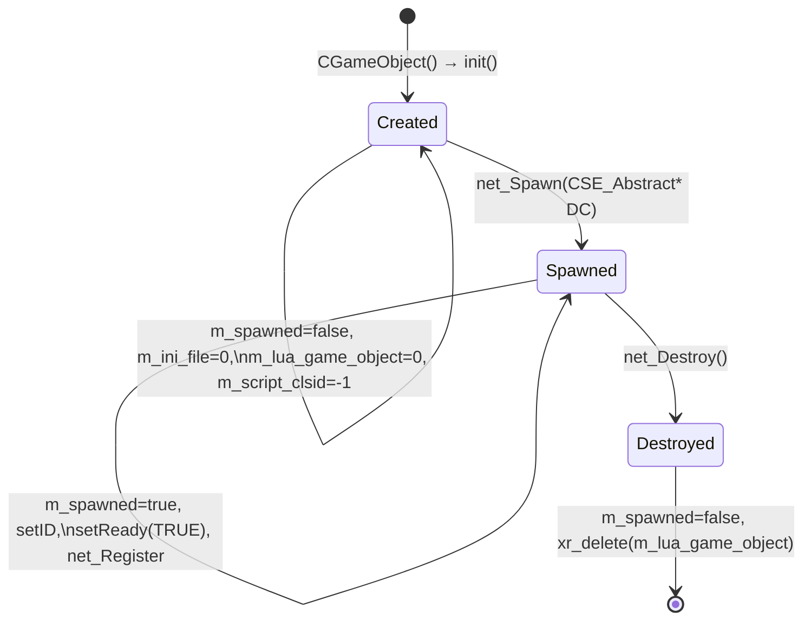
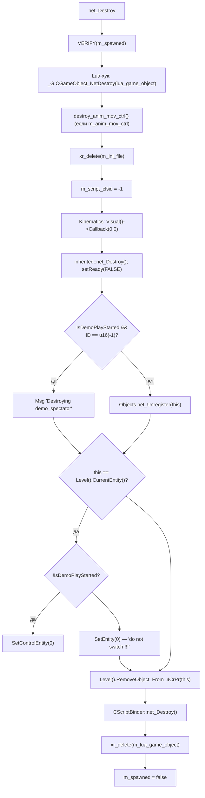
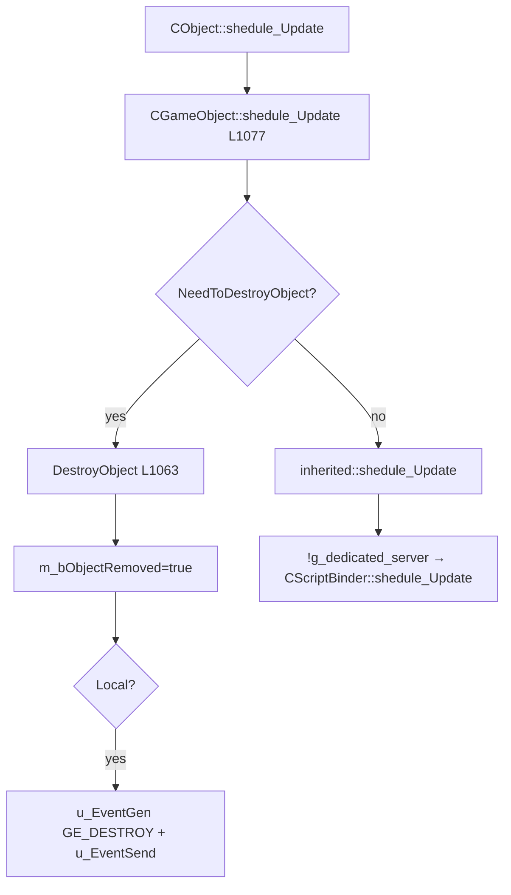

# CGameObject: сеть и жизненный цикл

> Итерация 5, порцион 4. Сетевой слой и жизненный цикл `CGameObject`: `net_Spawn` / `net_Destroy`, `OnEvent`, сериализация `net_Save`/`net_Load`, `spawn_supplies()`, путь удаления объекта. Всё, что НЕ сетевое (поля, down-cast'ы, AI-локации, attachments, visual-callback'и, CrPr, анимации, рендер), — в [game-object.md](game-object.md).

## 1. Ответственность

`CGameObject` — базовый «настоящий» игровой объект. Эта страница описывает, **как объект появляется и исчезает в мире игры** и **как он переживает сетевые события**:

- **жизненный цикл**: конструктор → `init()` → `net_Spawn` (готов, в реестре) → `net_Destroy` → деструктор; флаги `m_spawned` / `setLocal` / `setReady` / `setDestroy`;
- **`net_Spawn(CSE_Abstract* DC)`** (L267–481) — полный разбор по шагам: инициализация из сетевого описания объекта, визуал с fallback, имена, ID, XFORM, ALife-данные, регистрация в уровне, серверные флаги, скрипт-биндинг, клиентские данные, AI-локации, `spawn_supplies()`;
- **`net_Destroy()`** (L114–167) — полный разбор по шагам: Lua-хук, очистка ресурсов, deregistration, сброс текущего сущности, освобождение Lua-обёртки;
- **`OnEvent(NET_Packet&, u16)`** (L169–263) — обработка сетевых событий: `GE_HIT`/`GE_HIT_STATISTIC` (получение урона), `GE_DESTROY` (удаление по команде);
- **сериализация**: `net_Save`/`net_Load` (L483–542), `save`/`load` (L544–550, **пустые в базовом классе**), `net_SaveRelevant()`;
- **`spawn_supplies()`** (L552–621) — спавн «наполнения» (вещей) из спавн-ини в момент `net_Spawn`;
- **путь удаления**: `NeedToDestroyObject()` → `DestroyObject()` → `u_EventGen(GE_DESTROY)` + `u_EventSend`.

**Чего здесь НЕТ** (см. §2 «Границы»):

- внутренности `NET_Packet`/`Level_*`/`CSE_*` — итерация 11 (сете́вые объекты) и 12 (`Level_*`); здесь — только сигнатуры и «как `CGameObject` их использует»;
- механика `CScriptBinder`/`CScriptGameObject` — порц. 13 (механика обёртки) и итерация 14 (полный Lua API); здесь — только вызовы «со стороны `CGameObject`»;
- `CSE_ALife*`-детали — только как аргументы `net_Spawn` и поля, читаемые из них.

## 2. Границы с другими итерациями/порционами

| Тема | Где | Здесь |
|---|---|---|
| `CObject` (xrEngine): `net_Register`, `net_Unregister`, `net_Find`, `PositionStack`, `setReady`/`getReady`, `setDestroy`/`getDestroy`, `setLocal`/`getLocal` | [xr-object.md](../xr-engine/xr-object.md) | используется, сигнатуры |
| Фабрика и регистр классов (`object_factory()`, `script_clsid`, CLSID'ы) | [class-registry.md](class-registry.md) | `reload()` → `script_clsid(CLS_ID)` |
| `CSE_Abstract`/`CSE_Visual`/`CSE_ALifeObject`/`CSE_Temporary` | итерация 11 | аргументы `net_Spawn`, `smart_cast` |
| `Level_*`: `Objects.net_Find/Register/Unregister`, `spawn_item`, `Send`, `CurrentEntity`, `SetEntity/SetControlEntity`, `IsDemoPlay*`, `timeServer`, `RemoveObject_From_4CrPr` | итерация 12 | сигнатуры, «здесь будет сеть» |
| `NET_Packet`: `w_begin`/`w_u32`/`w_u16`, `w_chunk_open16`/`w_chunk_close16`, `w_tell` | итерация 12 | сигнатуры |
| `CScriptBinder` (механика) | порц. 13 | вызовы со стороны `CGameObject` |
| `CScriptGameObject` (Lua API) | итерация 14 | `m_lua_game_object` как «обёртка» |
| `ai()`: `get_level_graph`, `level_graph`, `game_graph`, `script_engine` | итерация 6 | `validate_ai_locations`, вершины |
| `SHit` (структура удара) | итерация 12 / порц. 28 | `Read_Packet_Cont`, `who`/`bone` |

## 3. Жизненный цикл

### 3.1 Фазы и флаги

Флаги, управляющие фазой:

- **`m_spawned`** (`bool`, L59) — «объект прошёл `net_Spawn`». `VERIFY(!m_spawned)` в начале `net_Spawn`, `VERIFY(m_spawned)` в начале `net_Destroy`, `VERIFY(!m_spawned)` в деструкторе. Ставится `true` в самом начале `net_Spawn` (L270), сбрасывается в конце `net_Destroy` (L166).
- **`m_spawn_time`** (L59, `u32`) — кадр `Device.dwFrame`, в котором объект спавнился; читается в `net_Spawn` (L271) и в `ps_Element` (см. [game-object.md §4.13](game-object.md)).
- **`setLocal` / `getLocal`** (CObject) — «локальный ли объект для этого клиента». Ставится из `E->s_flags.is(M_SPAWN_OBJECT_LOCAL)` в `net_Spawn` (L364), принудительно `FALSE` для demo (кроме spectator). `net_Relevant()` (L122) возвращает `getLocal()` — «нужна ли сериализация».
- **`setReady` / `getReady`** (CObject) — «готов ли объект к работе». `setReady(TRUE)` в `net_Spawn` (L373), `setReady(FALSE)` в `net_Destroy` (L139). `Ready()` (L124) — обёртка над `getReady()`.
- **`setDestroy` / `getDestroy`** (CObject) — «объект должен быть удалён». Ставится `TRUE` в `OnEvent` на `GE_DESTROY` (L258) и проверяется в `DestroyObject()` (L1063–1075).
- **`m_bObjectRemoved`** (L66) — «объект уже удалён» (идемпотентность `DestroyObject`). Сбрасывается `false` в конце `net_Spawn` (L456).
- **`m_script_clsid`** — CLSID скриптовой обёртки, ставится в `reload()` (L109–112) из `object_factory().script_clsid(CLS_ID)`; сбрасывается `-1` в `init()` (L82) и `net_Destroy()` (L134).

### 3.2 Конструктор / деструктор / init

- **`CGameObject()`** (L51–65): `m_ai_obstacle = 0`; `init()`; `m_bCrPr_Activated = false`, `m_dwCrPr_ActivationStep = 0`, `m_spawn_time = 0`; **`m_ai_location = !g_dedicated_server ? xr_new<CAI_ObjectLocation>() : 0`** — на dedicated-сервере AI-локация **NULL**; `m_server_flags.one()`; `m_callbacks = xr_new<CALLBACK_MAP>()`; `m_anim_mov_ctrl = 0`.
- **`~CGameObject()`** (L67–77): `VERIFY(!animation_movement())`, `VERIFY(!m_ini_file)`, `VERIFY(!m_lua_game_object)`, `VERIFY(!m_spawned)` — все ресурсы должны быть освобождены `net_Destroy`'ом; затем `xr_delete(m_ai_location)`, `xr_delete(m_callbacks)`, `xr_delete(m_ai_obstacle)`, `delete_data(m_script_attachments)`.
- **`init()`** (L79–85): `m_lua_game_object = 0`, `m_script_clsid = -1`, `m_ini_file = 0`, `m_spawned = false`.
- **`reinit()`** (L99–107): `m_visual_callback.clear()`; если `!g_dedicated_server` — `ai_location().reinit()`; очистка всех callback-ов в `m_callbacks`.
- **`reload(LPCSTR section)`** (L109–112): `m_script_clsid = object_factory().script_clsid(CLS_ID)` — см. [class-registry.md](class-registry.md).

## 4. `net_Spawn(CSE_Abstract* DC)` — полный разбор (L267–481)

Вход: `CSE_Abstract* DC` — сетевое описание объекта (ит. 11). Возвращает `BOOL` — `TRUE` если спавн успешен, `FALSE` если объект с таким ID уже существует (форк-изменение «Alundaio», см. §8.1).

```mermaid
flowchart TD
    A[net_Spawn CSE_Abstract* E] --> B["VERIFY(!m_spawned); m_spawned=true;<br/>m_spawn_time=Device.dwFrame;<br/>m_ai_obstacle = xr_new ai_obstacle"]
    B --> C["CSE_Visual* visual = smart_cast(E)<br/>visual_name → cNameVisual_set<br/>fallback: models_Exists? + line_exist 'visual'"]
    C --> D["flObstacle → spatial.type |= STYPE_OBSTACLE"]
    D --> E["Имена: cName_set(E->s_name),<br/>cNameSect_set, name_replace"]
    E --> F{"IsDemoPlayStarted &&<br/>ID == u16(-1)?"}
    F -->|да| G["demo_spectator=true<br/>(Msg)"]
    F -->|нет| H{"net_Find(E->ID) != NULL?"}
    H -->|да| I["Msg ERROR 'ID already exists'<br/>return false"]
    H -->|нет| J["setID(E->ID)"]
    G --> J
    J --> K["XFORM: setXYZ(o_Angle),<br/>Position=o_Position<br/>VERIFY(_valid), VERIFY(!fis_zero(DET))"]
    K --> L{"CSE_ALifeObject* O &&<br/>m_ini_string не пусто?"}
    L -->|да| M["m_ini_file = xr_new CInifile<br/>(IReader из m_ini_string, $game_config$)"]
    L -->|нет| N["m_story_id = O->m_story_id<br/>(иначе -1)"]
    M --> N
    N --> O1["setLocal(M_SPAWN_OBJECT_LOCAL)<br/>demo (не spectator) → setLocal(FALSE)"]
    O1 --> P["setReady(TRUE);<br/>net_Register (кроме spectator)"]
    P --> Q["m_server_flags = O->m_flags<br/>flVisibleForAI → STYPE_VISIBLEFORAI"]
    Q --> R["reload(*cNameSect())<br/>+ CScriptBinder::reload (не dedicated)"]
    R --> S["reinit()<br/>+ CScriptBinder::reinit (не dedicated)"]
    S --> T{"E->client_data не пусто?"}
    T -->|да| U["net_Load(IReader из client_data)"]
    T -->|нет| V["AI-локации (см. §4.1)"]
    U --> V
    V --> W["inherited::net_Spawn(DC);<br/>m_bObjectRemoved=false"]
    W --> X["spawn_supplies()"]
    X --> Y["DEBUG: CGameObject_NetSpawn-функтор + tracked-obj Msg<br/>CScriptBinder::net_Spawn(DC)"]
    Y --> Z[return]
```

### 4.1 AI-локации в `net_Spawn` (L412–453)

Блок `if (ai().get_level_graph())` — только если есть level graph:

- **`E->ID_Parent == 0xffff`** («родителя нет»):
  - берёт вершину level graph: из `CSE_ALifeObject::m_tNodeID` (если валидна) или из `CSE_Temporary::m_tNodeID` (fallback);
  - `ai_location().game_vertex(m_tGraphID)` из `CSE_ALifeObject` (если валидна в game graph);
  - `validate_ai_locations(false)`;
  - **валидация позиции**: если `UsedAI_Locations()` && `level_graph().inside(vertex, Position())` && `can_validate_position_on_spawn()` — «привязка» Y к плоскости вершины: `Position().y = EPS_L + level_graph().vertex_plane_y(*level_vertex, x, z)`.
- **иначе** (`ID_Parent != 0xffff` — есть родитель): `ai_location().level_vertex(m_tNodeID)` + `game_vertex(m_tGraphID)` из `CSE_ALifeObject`.

Подробности `CAI_ObjectLocation`/`validate_ai_locations` — в [game-object.md §4.6](game-object.md).

## 5. `net_Destroy()` — полный разбор (L114–167)

Особые моменты:

- **Lua-хук** `_G.CGameObject_NetDestroy` (L123–127) — вызывается **до** освобождения ресурсов, чтобы скрипт мог «прощально» отреагировать.
- **`Kinematics Callback(0, 0)`** (L135–136) — сброс kinematics-колбэков визуала.
- **`SetEntity(0)`** (L156) — комментарий «do not switch !!!» — текущая сущность не переключается на другую, а просто сбрасывается (иначе игрок «переселся бы» в другой объект).
- **`RemoveObject_From_4CrPr`** (L159) — удаление из CrPr-системы (Correction-Prediction, см. [game-object.md §4.12](game-object.md)).

## 6. `OnEvent(NET_Packet& P, u16 type)` — сетевые события (L169–263)

Два типа событий:

### 6.1 `GE_HIT` / `GE_HIT_STATISTIC` (L173–239)

- `SHit HDS; HDS.PACKET_TYPE = type; HDS.Read_Packet_Cont(P);` — чтение структуры удара из пакета (структура `SHit` — итерация 12 / порц. 28; в закомментированном блоке L176–202 показан «старый» ручной парсинг: `id, weapon_id, dir, power, element, position_in_bone_space, impulse, hit_type, ap` для `eHitTypeFireWound`).
- `CObject* Hitter = Level().Objects.net_Find(HDS.whoID);` — поиск наносящего удар; если `NULL` — `Msg("! ERROR: hitter object [%d] is NULL on client.")`.
- `CObject* Weapon = Level().Objects.net_Find(HDS.weaponID);`
- `HDS.who = Hitter;`
- **`GE_HIT_STATISTIC`** (L217–221): если `GameID() != eGameIDSingle` — `Game().m_WeaponUsageStatistic->OnBullet_Check_Request(&HDS)` (статистика оружия, MP).
- **общее**: `SetHitInfo(Hitter, Weapon, HDS.bone(), HDS.p_in_bone_space, HDS.dir);` + `Hit(&HDS);` — базовые `Hit`/`SetHitInfo` пустые в `CGameObject` (L134–141, см. [game-object.md §4.13](game-object.md)), переопределяются в `CEntity` (порц. 5).
- **MP-статистика** (L231–237): `Game().m_WeaponUsageStatistic->OnBullet_Check_Result(false);` + `game_cl_mp* mp_game = smart_cast<game_cl_mp*>(&Game());` → `mp_game->get_reward_generator()->OnBullet_Hit(Hitter, this, Weapon, HDS.boneID);`.

### 6.2 `GE_DESTROY` (L241–260)

- Если `H_Parent()` — `Msg("! ERROR (GameObject): GE_DESTROY arrived to object ... that has parent ...")` + **`break`** — объект НЕ уничтожается, ждёт `H_Parent::Destroy` или `H_Parent::Reject` (комментарий L249–251: «!!! it is necessary to be check!»).
- Иначе: `#ifdef MP_LOGGING` — `Msg("--- Object: GE_DESTROY of ...")`; `setDestroy(TRUE);` (закомментировано `MakeMeCrow()`).

## 7. Сериализация

### 7.1 `net_Save` / `net_Load` (L483–542)

- **`net_Save(NET_Packet&)`** (L483–510): `net_packet.w_chunk_open16(position);` → `save(net_packet);` → `CScriptBinder::save(net_packet);` → `net_packet.w_chunk_close16(position);`. В DEBUG при `psAI_Flags.test(aiSerialize)` — лог позиции пакета до/после `CScriptBinder::save`.
- **`net_Load(IReader&)`** (L512–542): зеркально — `load(ireader);` → `CScriptBinder::load(ireader);` + DEBUG-лог.
- **`save()` / `load()`** (L544–550): **пустые в базовом классе**. Фактический payload в базовом классе — только `CScriptBinder::save/load` (Lua-состояние). Наследники (`CEntity`, `CActor` и др.) добавляют свои данные в `save`/`load`.
- **`net_SaveRelevant()`** (L1095–1098): `return CScriptBinder::net_SaveRelevant();` — «нужна ли сериализация».
- **`net_Relevant()`** (L122, inline в `.h`): `return getLocal();` — локальный объект сериализуется.

### 7.2 Путь удаления объекта

- **`NeedToDestroyObject()`** (L1058–1061): `return getDestroy();` — «нужно ли удалить объект».
- **`DestroyObject()`** (L1063–1075): если `m_bObjectRemoved` — return (идемпотентно); если `!getDestroy()` — return; `m_bObjectRemoved = true`; если `Local()` — `u_EventGen(GE_DESTROY)` + `u_EventSend` (уведомление других клиентов).
- **`u_EventGen(NET_Packet& P, u32 type, u32 dest)`** (L956–962): `P.w_begin(M_EVENT); P.w_u32(Level().timeServer()); P.w_u16(type & 0xffff); P.w_u16(dest & 0xffff);`.
- **`u_EventSend(NET_Packet& P, u32 dwFlags = DPNSEND_GUARANTEED)`** (L964–967): `Level().Send(P, dwFlags);`.

## 8. `spawn_supplies()` (L552–621)

Вызывается в конце `net_Spawn` (L458). Спавн «наполнения» (вещей) из спавн-ини.

- **Предусловия**: `spawn_ini()` не NULL и `!ai().get_alife()` — иначе return. Секция `"spawn"` в `m_ini_file` — иначе return.
- **Формат**: секция `"spawn"`, строки `N=V` где:
  - `N` — секция вещи в `pSettings` (например `weapons_h&k`);
  - `V` — список через `_GetItemCount`/`_GetItem(0)` — первый элемент = количество `j`;
  - опциональные параметры в строке через `strstr+5`: `prob=` (вероятность 0..1), `cond=` (состояние вещи), `scope`/`silencer`/`launcher` (флаги насадок оружия).
- **Для каждого из `j`**: если `::Random.randF(1.f) < p` — `Level().spawn_item(N, Position(), level_vertex_id, ID(), true)`; `smart_cast<CSE_ALifeInventoryItem*>` → `m_fCondition = f_cond`; `smart_cast<CSE_ALifeItemWeapon*>` → ставит `eWeaponAddonScope/Silencer/GrenadeLauncher` по `m_scope_status`/`m_silencer_status`/`m_grenade_launcher_status` == `ALife::eAddonAttachable`; `A->Spawn_Write(P, TRUE)` + `Level().Send(P, net_flags(TRUE))` + `F_entity_Destroy(A)`.

Подробности `CSE_ALifeInventoryItem`/`CSE_ALifeItemWeapon` — итерация 11; `Level().spawn_item`/`Send` — итерация 12.

## 9. Взаимодействие

**Кто вызывает `CGameObject` (сетевые методы):**

- **Сетевой слой** (`Level_*`, ит. 12) → `net_Spawn` / `net_Destroy` / `OnEvent` / `net_Save` / `net_Load`.
- **`CObject::shedule_Update`** → `CGameObject::shedule_Update` (L1077–1093) → `NeedToDestroyObject` → `DestroyObject`.
- **`CObject::UpdateCL`** → `CGameObject::UpdateCL` (L1095–1100) — см. [game-object.md §4.13](game-object.md).

**Кого вызывает `CGameObject` (сетевые методы):**

- **`CObject`** (xrEngine): `inherited::net_Spawn`, `inherited::net_Destroy`, `setID`, `setReady`, `setLocal`, `setDestroy`, `getDestroy`, `Local`, `H_Parent`, `net_Find`, `net_Register`, `net_Unregister`.
- **`CSE_Abstract`/`CSE_Visual`/`CSE_ALifeObject`/`CSE_Temporary`** (ит. 11): `smart_cast`, чтение полей (`s_name`, `s_flags`, `ID`, `o_Angle`, `o_Position`, `ID_Parent`, `m_ini_string`, `m_story_id`, `m_tNodeID`, `m_tGraphID`, `flags`).
- **`Level()`** (ит. 12): `Objects.net_Find/net_Register/net_Unregister`, `spawn_item`, `Send`, `CurrentEntity()`, `SetEntity/SetControlEntity`, `IsDemoPlayStarted/IsDemoPlay`, `timeServer`, `timeServer_Delta`, `RemoveObject_From_4CrPr`.
- **`NET_Packet`** (ит. 12): `w_begin`, `w_u32`, `w_u16`, `w_chunk_open16`, `w_chunk_close16`, `w_tell`.
- **`CScriptBinder`** (порц. 13): `reload`, `reinit`, `net_Spawn`, `net_Destroy`, `save`, `load`, `net_SaveRelevant`.
- **`ai()`** (ит. 6): `get_level_graph`, `level_graph`, `game_graph`, `script_engine` (для Lua-хуков `CGameObject_NetSpawn`/`CGameObject_NetDestroy`).
- **`object_factory()`** (порц. 2): `script_clsid(CLS_ID)` в `reload()`.
- **`pSettings`**: `line_exist`, `r_string`, `section_exist` в `net_Spawn` / `spawn_supplies`.
- **`Render`**: `models_Exists` в `net_Spawn` (fallback модели).
- **`Game()`** (`game_cl_mp`): `m_WeaponUsageStatistic`, `get_reward_generator()` в `OnEvent`.

## 10. Потоки данных/управления

### 10.1 Spawn

См. [game-object.md §6.1](game-object.md) (упрощённая диаграмма) и §4.1 выше (полный flowchart).

### 10.2 Destroy

См. [game-object.md §6.3](game-object.md) (упрощённая диаграмма) и §5 выше (полный flowchart).

### 10.3 Update (кадр) — сетевая часть

## 11. Конфигурация

- **`game.ltx` / `levels/*.ltx`**: секция объекта (по `cNameSect()`) — `visual` (fallback-модель), `script_binding` (Lua-функтор для `CScriptBinder::reload`).
- **`m_ini_file`** (спавн-ини): секция `"spawn"` — строки `N=V` — см. §8.
- **`CSE_ALifeObject::m_ini_string`**: сериализованный INI, принятый в `net_Spawn` и распарсенный в `CInifile`.
- **`CSE_ALifeObject::m_story_id`**: `ALife::_STORY_ID`, копируется в `m_story_id`.
- **`CSE_Visual::flObstacle`**: флаг → `spatial.type |= STYPE_OBSTACLE` в `net_Spawn`.
- **`E->s_flags.is(M_SPAWN_OBJECT_LOCAL)`**: → `setLocal(...)`.
- **`E->client_data`**: байты → `net_Load(IReader)`.
- **`E->ID_Parent`**: `0xffff` — «нет родителя», иначе `CSE_ALifeObject::m_tNodeID` / `m_tGraphID`.
- **`g_dedicated_server`**: глобальный (xrEngine), управляет `m_ai_location`, `CScriptBinder::reload/reinit/shedule_Update`.
- **`PS`-флаги** (DEBUG): `psAI_Flags.test(aiDestroy)`, `psAI_Flags.test(aiSerialize)` — логирование.
- **`ph_dbg_draw_mask1`** (DEBUG): `ph_m1_DbgTrackObject` + `PH_DBG_ObjectTrackName` — трекинг позиции объекта в `net_Spawn`/`net_Load`.

## 12. Известные ограничения / дебаг

### 12.1 Форк-изменения (Alundaio)

- **L308–326** — «Alundaio»: вместо `R_ASSERT(net_Find == NULL)` (закомментировано L316) — `Msg ERROR` + `return false` при дубликате ID. Это **изменение форка**: в оригинале — assertion, здесь — мягкий отказ со спамом в лог. **Не «чинить»**.

### 12.2 Мёртвый / закомментированный код

- **L176–202** — закомментированный «старый» ручной парсинг `SHit` из `OnEvent` (заменён на `HDS.Read_Packet_Cont(P)`).
- **L259** — `// MakeMeCrow();` — закомментировано в `GE_DESTROY`.
- **L161** — `//. Parent = 0;` — закомментировано в `net_Destroy`.
- **L330–331** — закомментированный DEBUG-лог в `net_Spawn` (setID).
- **L403, L409** — закомментированные DEBUG-логи в `net_Spawn` (client_data).
- **L365** — `//&& OnClient()` — закомментировано в условии demo.

### 12.3 Магические числа

- **`EPS_L`** — в валидации позиции AI-локаций (L441).
- **`0xffff`** — «нет родителя» (`E->ID_Parent`).
- **`u16(-1)`** — ID demo-spectator.
- **`0.5` / `0.8`** — дефолтные `prob`/`cond` в `spawn_supplies` (если не заданы в строке).

### 12.4 Логирование

- **`Msg`** (не DEBUG): `* Spawning demo spectator ...` (L311), `~WARNING : Failed to load '%s', falling back to '%s'` (L285), `ERROR: CGameObject:net_spawn() Object with ID already exists!` (L320), `! ERROR: hitter object [%d] is NULL on client.` (L212), `! ERROR (GameObject): GE_DESTROY arrived to object ... that has parent` (L245), `Destroying demo_spectator object` (L143).
- **`#ifdef MP_LOGGING`**: `--- Object: GE_DESTROY of ...` (L255).
- **`#ifdef DEBUG`**: `psAI_Flags.test(aiDestroy)` — `Destroying client object` (L118); `psAI_Flags.test(aiSerialize)` — лог позиции пакета в `net_Save`/`net_Load`; `ph_m1_DbgTrackObject` — трекинг позиции в `net_Spawn`/`net_Load`.

## 13. Ссылки

- [game-object.md](game-object.md) — каркас `CGameObject`: поля, down-cast'ы, AI-локации, attachments, visual-callback'и, CrPr, эффекторы, рендер.
- [class-registry.md](class-registry.md) — `object_factory()`, `script_clsid`, CLSID'ы.
- [xr-object.md](../xr-engine/xr-object.md) — `CObject`: `net_Register`, `net_Unregister`, `net_Find`, `setReady`/`getReady`, `setDestroy`/`getDestroy`, `setLocal`/`getLocal`, `PositionStack`.
- Итерация 11: `CSE_Abstract`/`CSE_Visual`/`CSE_ALifeObject`/`CSE_Temporary` — сетевые объекты.
- Итерация 12: `Level_*`, `NET_Packet` — сетевой транспорт.
- Итерация 6: `ai()` — AI-планирование, level/game graph.
- Порц. 13: `CScriptBinder` — механика Lua-обёртки.
- Итерация 14: `CScriptGameObject` — полный Lua API.
- Порц. 5: `CEntity` — `Hit`/`SetHitInfo` (переопределены).
- Порц. 28: `script_entity` + `script_hit` — Lua-обёртка ударов.

## 14. Источник

- `src/xrGame/GameObject.h` — L53–352 (класс `CGameObject`).
- `src/xrGame/GameObject.cpp` — L51–65 (ctor/dtor/init), L87–112 (Load/reinit/reload), L114–167 (`net_Destroy`), L169–263 (`OnEvent`), L267–481 (`net_Spawn`), L483–550 (`net_Save`/`net_Load`/`save`/`load`), L552–621 (`spawn_supplies`), L956–967 (`u_EventGen`/`u_EventSend`), L1058–1075 (`NeedToDestroyObject`/`DestroyObject`), L1077–1093 (`shedule_Update`).
- `src/xrGame/script_binder.h` — L15–37 (класс `CScriptBinder`).
- `src/xrGame/script_binder.cpp` — L22–276 (реализация `CScriptBinder`).
