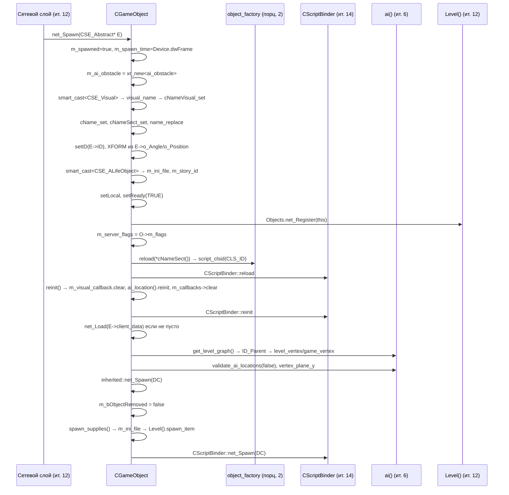
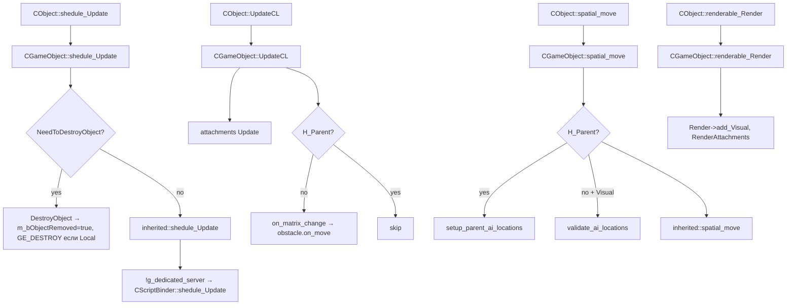
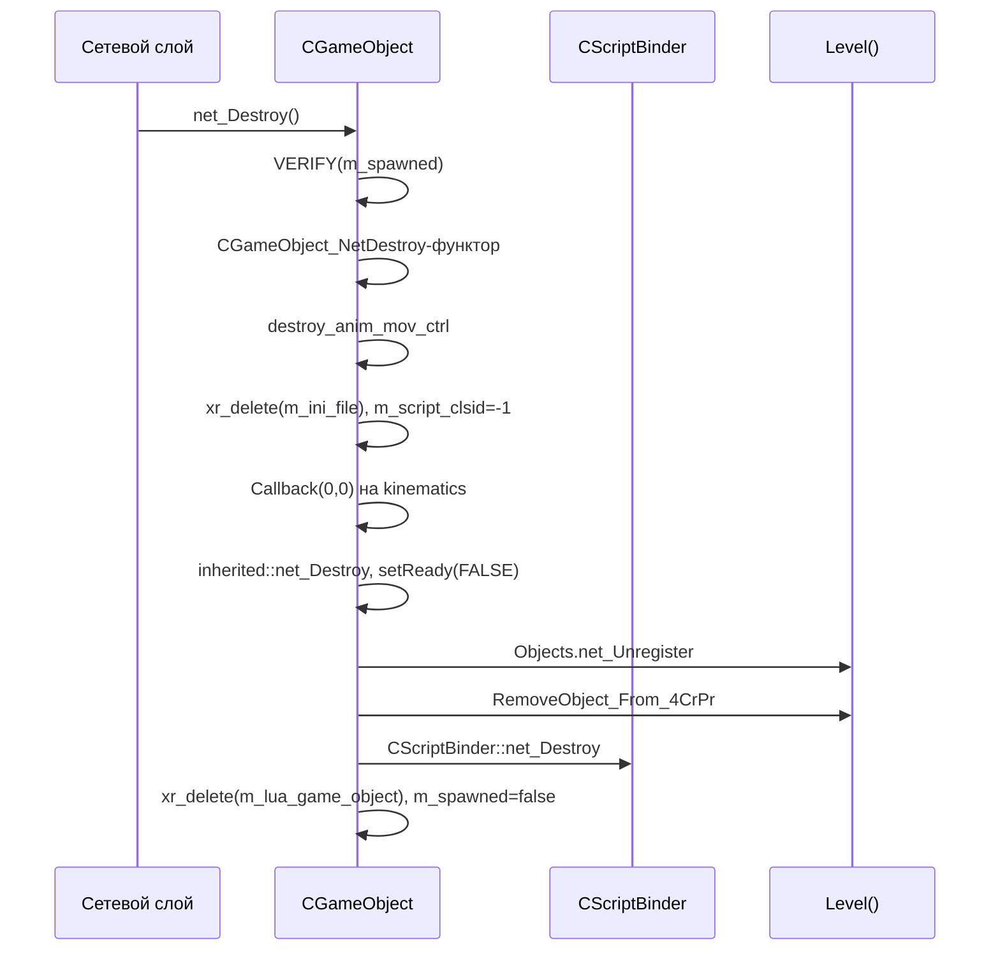

# CGameObject: каркас

> **Модуль:** `xrGame` · **Файлы:** [GameObject.h](../../../src/xrGame/GameObject.h) (352 стр.), [GameObject.cpp](../../../src/xrGame/GameObject.cpp) (1415 стр.) · **Порцион 3/30, итерация 5**
>
> Сетевые методы (`net_Spawn`/`net_Destroy`/`net_Save`/`OnEvent`) — только на уровне сигнатур; полный разбор — [game-object-net.md](game-object-net.md) (порц. 4).

## 1. Ответственность

`CGameObject` — «настоящий» игровой объект: базовый класс всего, что существует в мире игры. Он добавляет к каркасу `CObject` (xrEngine) три слоя: (а) **игровую идентичность** — имя, секция конфига, CLSID, `m_server_flags`; (б) **взаимодействие с Lua** — ленивая обёртка `CScriptGameObject` (`lua_game_object()`), `clsid()`, карта скриптовых колбэков; (в) **обвязку с AI** — `ai_location()` (вершина level/game graph), `ai_obstacle`, анимационный контроллер движения. Плюс — механизм down-cast'ов (`cast_*`), attachments, visual-callback'и на kinematics, CrPr-хуки и «эффекторы» (`ef_*`) для систем зон/чувств.

**Чего НЕ делает**: не владеет здоровьем/уроном (`CEntity`, порц. 5–6), инвентарём, движением игрока (`CActor`, порц. 14–23), AI-планированием (итерация 6), оружием (итерация 8) и сетевым транспортом (`Level_*`, итерация 12). Вещь, тварь, игрок, зона — всё это наследники `CGameObject`, и каждый «наслаивает» свою ответственность сверху.

## 2. Место в архитектуре

```
CObject (xrEngine) ── CUsableScriptObject ── CScriptBinder
        \                     \                   /
         └───────────────── CGameObject ────────────────┘
                                 │
              ┌──────────┬───────┼──────────────┬─────────────┐
         CEntity   CInventoryItemObject  CSpaceRestrictor  ...
            │            (порц. 10)           │
    CEntityAlive      ...            CCustomZone (порц. 24–26)
      ┌───────┐
  CActor  CCustomMonster (порц. 14–23 / 9)
```

- **Наследование:** `class CGameObject : public CObject, public CUsableScriptObject, public CScriptBinder` (GameObject.h L53–57). `CUsableScriptObject` — интерфейс `use()` для Lua; `CScriptBinder` — сериализация/жизненный цикл Lua-объекта (обещание ит. 14, здесь только точки связки).
- **Кто наследуется:** вся остальная объект-модель `xrGame` — см. [index.md](index.md) и [object-model.md](../../architecture/object-model.md) (обновляется в порц. 30).
- **Зависимости:** `xrServer_Space.h` (`CSE_Abstract`, `CSE_Visual`, `CSE_ALifeObject` — только как аргументы, ит. 11), `alife_space.h`, `ai_space.h` (`CAI_ObjectLocation`, `ai_obstacle` — ит. 6), `script_game_object.h` (`CScriptGameObject` — ит. 14), `script_attachment_manager.h` (порц. 29), `animation_movement_controller.h`.
- **Каркас `CObject`** (crow, spatial, parent, net ID, position stack) — [xr-object.md](../xr-engine/xr-object.md), здесь не повторяется.

## 3. Публичный API

### Класс `CGameObject`

| Группа | Методы | Назначение |
|--------|--------|------------|
| Down-cast'ы | `cast_game_object()`, `cast_entity()`, `cast_actor()`, `cast_custom_monster()`, `cast_weapon()` и ещё 17 | Виртуальные «узнающие» down-cast'ы, избегающие `smart_cast` |
| Жизненный цикл | `init()`, `reinit()`, `reload(section)`, `NeedToDestroyObject()`, `DestroyObject()` | Инициализация/перезапуск/удаление (см. §4.2) |
| Идентичность | `Name()`, `clsid()`, `story_id()`, `TestServerFlag(f)`, `UsedAI_Locations()` | Имя, CLSID, flags из `CSE_ALifeObject` |
| AI-локации | `ai_location()`, `setup_parent_ai_locations()`, `validate_ai_locations()`, `on_matrix_change()` | Привязка к level/game graph |
| Аним. движение | `create_anim_mov_ctrl()`, `destroy_anim_mov_ctrl()`, `animation_movement()`, `animation_movement_controlled()` | Контроллер анимационного движения |
| Attachments | `add_attachment()`, `get_attachment()`, `remove_child()`, `remove_attachment()`, `iterate_attachments()` | Скриптовые вложения (порц. 29) |
| Visual-callback'и | `add/remove_visual_callback()`, `visual_callbacks()`, `OnChangeVisual()` | Хуки на обновление kinematics |
| Lua-связь | `lua_game_object()`, `callback(type)`, `spawn_ini()`, `spawn_time()` | Точки входа для Lua (порц. 13) |
| Эффекторы | `ef_creature_type()`, `ef_equipment_type()`, `ef_main_weapon_type()`, `ef_anomaly_type()`, `ef_weapon_type()`, `ef_detector_type()`, `natural_weapon()`, `natural_detector()`, `use_center_to_aim()` | Типы для систем feel/зон (порц. 27) |
| CrPr | `make_Interpolation()`, `PH_B/I/A_CrPr()`, `CrPr_Set/IsActivated()`, `CrPr_GetActivationStep()` | Хуки физкоррекции (пустые по умолчанию) |
| Прочее | `Orientation()`, `MoveTo()`, `ps_Element()`, `u_EventGen/Send()`, `FootStepCallback()` | Утилиты |

Сетевые методы (сигнатуры, разбор — порц. 4): `net_Spawn(CSE_Abstract*)`, `net_Destroy()`, `net_Relcase(CObject*)`, `net_Save(NET_Packet&)`, `net_Load(IReader&)`, `net_SaveRelevant()`, `save()`/`load()` (пустые в базовом классе), `OnEvent(NET_Packet&, u16)`.

## 4. Внутреннее устройство

### 4.1 Поля

| Поле | Тип | Назначение |
|------|-----|------------|
| `m_spawned` | `bool` | Флаг «спавнен по сети»; `lua_game_object()` REFUSES работать до spawn |
| `m_server_flags` | `Flags32` | `CSE_ALifeObject::m_flags`, скопированные при `net_Spawn` |
| `m_ai_location` | `CAI_ObjectLocation*` | Вершины level/game graph; `NULL` на dedicated server (GameObject.cpp L60) |
| `m_story_id` | `ALife::_STORY_ID` | ID «сюжетного» объекта, `-1` если не сюжетный |
| `m_anim_mov_ctrl` | `animation_movement_controller*` | Контроллер анимационного движения |
| `m_bObjectRemoved` | `bool` | Флаг удаления (`DestroyObject` идемпотентен) |
| `m_script_attachments` | `xr_map<shared_str, script_attachment*>` | Скриптовые вложения по имени |
| `m_ini_file` | `CInifile*` | Спавн-ини, принятый от сервера (`spawn_ini()`) |
| `m_bCrPr_Activated`, `m_dwCrPr_ActivationStep` | — | CrPr-состояние (по умолчанию выключено, step 0) |
| `m_lua_game_object` | `mutable CScriptGameObject*` | Ленивая Lua-обёртка |
| `m_script_clsid` | `int` | CLSID из `object_factory()`; `-1` до `reload()`; `clsid()` THROW в DEBUG если < 0 |
| `m_spawn_time` | `u32` | `Device.dwFrame` момента `net_Spawn` |
| `m_ai_obstacle` | `ai_obstacle*` | AI-препятствие; создаётся в `net_Spawn` (L272) |
| `m_previous_matrix` | `Fmatrix` | Прежний XFORM для `on_matrix_change` |
| `m_visual_callback` | `CALLBACK_VECTOR` = `svector<visual_callback*, 6>` | Колбэки на kinematics |
| `m_callbacks` | `CALLBACK_MAP*` | `xr_map<ECallbackType, CScriptCallbackExVoid>` — скриптовые колбэки |

### 4.2 Down-cast'ы (L73–95)

23 виртуальных метода `cast_*()` возвращают `NULL` по умолчанию; каждый наследник переопределяет свой:

```cpp
virtual CGameObject* cast_game_object() { return this; }  // L79
virtual CEntity* cast_entity() { return NULL; }           // L76
virtual CActor* cast_actor() { return NULL; }             // L78
// + cast_attachment_owner, cast_inventory_owner/item,
// cast_entity_alive, cast_custom_zone, cast_physics_shell_holder,
// cast_input_receiver, cast_particles_player, cast_artefact,
// cast_custom_monster, cast_stalker, cast_script_entity,
// cast_weapon, cast_missile, cast_flashlight, cast_explosive,
// cast_restrictor, cast_attachable_item, cast_holder_custom,
// cast_base_monster
```

Цель (комментарий L72): «functions used for avoiding most of the smart_cast» — вызывается через виртуальный указатель, без RTTI. `cast_game_object()` — единственный, который возвращает `this`.

### 4.3 Конструктор / деструктор / init

**`CGameObject()`** (L51–65): нитирует `m_ai_obstacle`, вызывает `init()`, затем инициализирует CrPr-поля (`false`, 0), `m_spawn_time = 0`, `m_ai_location` — **только если не dedicated server** (`!g_dedicated_server ? xr_new<CAI_ObjectLocation>() : 0`), `m_server_flags.one()`, `m_callbacks = xr_new<CALLBACK_MAP>()`, `m_anim_mov_ctrl = 0`.

**`~CGameObject()`** (L67–77): VERIFY'и — `!animation_movement()`, `!m_ini_file`, `!m_lua_game_object`, `!m_spawned`; затем `xr_delete(m_ai_location)`, `xr_delete(m_callbacks)`, `xr_delete(m_ai_obstacle)`, `delete_data(m_script_attachments)`.

**`init()`** (L79–85): `m_lua_game_object = 0; m_script_clsid = -1; m_ini_file = 0; m_spawned = false;`.

**`reinit()`** (L99–107): `m_visual_callback.clear()`; если не dedicated — `ai_location().reinit()`; затем обходит `m_callbacks` и делает `it->second.clear()` по каждому.

**`reload(section)`** (L109–112): `m_script_clsid = object_factory().script_clsid(CLS_ID);` — привязывает CLSID из [фабрики](class-registry.md).

### 4.4 `Load` / `Load`-поток

**`Load(section)`** (L87–97): вызывает `inherited::Load(section)` (читает секцию из `game.ltx`/`levels`), затем через `smart_cast<ISpatial*>(this)` снимает флаг `STYPE_REACTTOSOUND` (комментарий L93: `#pragma todo("to Dima: All objects are visible for AI ???")` — `STYPE_VISIBLEFORAI` не ставится в `Load`, а ставится в `net_Spawn` по `CSE_ALifeObject::flVisibleForAI`).

### 4.5 Жизненный цикл (не-сетевая часть)

- **`NeedToDestroyObject()`** (L1058–1061): `return false;` — по умолчанию объект сам себя не уничтожает; переопределяется наследниками (например, `CActor` при смерти).
- **`DestroyObject()`** (L1063–1075): если `m_bObjectRemoved` — return; ставит `m_bObjectRemoved = true`; если `getDestroy()` уже стоит — return; если `Local()` — генерирует `GE_DESTROY` через `u_EventGen` + `u_EventSend` (идемпотентность через флаг).
- **`shedule_Update(dt)`** (L1077–1093): если `NeedToDestroyObject()` — `DestroyObject()` (в не-MASTER_GOLD с Msg); `inherited::shedule_Update(dt)`; если не dedicated — `CScriptBinder::shedule_Update(dt)`.
- **`shedule_Needed()`** (L1210–1213): `return (!getDestroy());` — объект «нужен» в shedule пока не помечен к удалению.

### 4.6 AI-локации

- **`ai_location()`** (L275–279): `VERIFY(m_ai_location); return (*m_ai_location);` — доступ к `CAI_ObjectLocation` (вершины level/game graph).
- **`setup_parent_ai_locations(assign_position=true)`** (L623–663): требует `H_Parent()`; если `assign_position && use_parent_ai_locations()` — копирует `Position()` родителя; затем если `UsedAI_Locations()` и level graph есть — берёт `level_vertex_id` родителя (или `validate_ai_locations(false)` если невалиден); `game_vertex` — из `game_graph()` или через `cross_table()`.
- **`validate_ai_locations(decrement_reference=true)`** (L690–699): если нет level graph или `!UsedAI_Locations()` — return; иначе `update_ai_locations(decrement_reference)`.
- **`update_ai_locations(decrement_reference)`** (L674–688): вычисляет `new_level_vertex_id()` (L665–672: `Center` с X/Z от `Position()`), VERIFY валидности; если `decrement_reference` и ID не изменился — return; ставит `level_vertex`, затем через `cross_table()` ставит `game_vertex`.
- **`spatial_move()`** (L701–709): если есть `H_Parent()` — `setup_parent_ai_locations()`; иначе если есть `Visual()` — `validate_ai_locations()`; затем `inherited::spatial_move()`.
- **`on_matrix_change(previous)`** (L1297–1300): `obstacle().on_move();` — уведомляет `ai_obstacle` о сдвиге.
- **`is_ai_obstacle()`** (L1198–1201): `return (false);` — по умолчанию объект не препятствие для AI; переопределяется.
- **`obstacle()`** (L341–345): `VERIFY(m_ai_obstacle); return (*m_ai_obstacle);`.

### 4.7 Анимационный контроллер движения

- **`create_anim_mov_ctrl(CBlend* b, Fmatrix* start_pose, bool local_animation)`** (L1215–1255): если `animation_movement_controlled()` — `NewBlend` на существующем контроллере; иначе — `xr_new<animation_movement_controller>(&XFORM(), *start_pose, K, b)` где `K = Visual()->dcast_PKinematics()`. В DEBUG VERIFY'ит `start_pose` и отсутствие активного контроллера.
- **`destroy_anim_mov_ctrl()`** (L1257–1260): `xr_delete(m_anim_mov_ctrl)`.
- **`update_animation_movement_controller()`** (L1184–1196): если нет контроллера — return; если активен — `OnFrame()`; иначе `destroy_anim_mov_ctrl()`.
- **`animation_movement_controlled()`** (L1179–1182): `!!animation_movement() && animation_movement()->IsActive()`.
- **`OnChangeVisual()`** (L1203–1208): `inherited::OnChangeVisual();` + `destroy_anim_mov_ctrl()` — смена визуала сбрасывает контроллер.

### 4.8 Attachments

- **`add_attachment(name, att)`** (L865–882): `R_ASSERT(att)`; `remove_child(name, true)` (заменяет); если `m_script_attachments` было пустое — `add_visual_callback(update_visbox)` (и в DEBUG-определении `ATTACHMENT_HUD_VISBOX` — `update_visbox_hud` на `CHudItem`); `emplace(name, att)`.
- **`get_attachment(name)`** (L884–894): `find` в `m_script_attachments`, `nullptr` если нет.
- **`remove_child(name, destroy=false)`** (L896–916): `get_attachment`; если `destroy` — `xr_delete(attachment)`; `erase(name)`; если стало пусто — `remove_visual_callback(update_visbox)` (+ HUD-вариант).
- **`remove_attachment(script_attachment* child)`** (L918–929): ищет по `child->GetName()`, сравнивает указатель, вызывает `remove_child(name, true)`.
- **`iterate_attachments(functor)`** (L931–939): обход `m_script_attachments`, останавливается если `functor(name, att)` вернул `true`.

`update_visbox` (L783–822) и `update_visbox_hud` (L824–863) — статические колбэки, которые на `NeedUCalc()` пересчитывают `Fbox`/`Fsphere` визуала, включая bounding box'ы attachments (тип `eSA_World` / `eSA_HUD`). Под `DEBUG_VISBOX` рисуют OBB через `CDebugRenderer`.

### 4.9 Visual-callback'и

- **`add_visual_callback(cb)`** (L999–1006): требует `smart_cast<IKinematics*>(Visual())`; dedup через `std::find`; если было пусто — `SetKinematicsCallback(true)`.
- **`remove_visual_callback(cb)`** (L1008–1015): аналогично, при опустошении — `SetKinematicsCallback(false)`.
- **`SetKinematicsCallback(set)`** (L1017–1024): `smart_cast<IKinematics*>(Visual())->Callback(set ? VisualCallback : 0, this)`.
- **`VisualCallback(IKinematics*)`** (L1026–1042): глобальный (не метод), берёт `CObject*` из `GetUpdateCallbackParam()`, кастует в `CGameObject*`, обходит `visual_callbacks()` и вызывает каждый.
- **`OnChangeVisual()`** (L1203–1208): см. 4.7.

### 4.10 Lua-связь (точки связки; порц. 13 — механика, ит. 14 — API)

- **`lua_game_object()`** (L1044–1056): если `!m_spawned` — Msg «trying to use a destroyed object» + `print_stack()`, return NULL; если `!m_lua_game_object` — `xr_new<CScriptGameObject>(const_cast<CGameObject*>(this))`; return.
- **`clsid()`** (L257–263): в DEBUG `THROW(m_script_clsid >= 0)`; return `m_script_clsid`.
- **`callback(ECallbackType type)`** (L1167–1170): `return ((*m_callbacks)[type]);` — ленивая запись в `xr_map` (оператор `[]` создаёт).
- **`FootStepCallback(power, b_play, b_on_ground, b_hud_view)`** (L1302–1305): `callback(eOnFootStep)(lua_game_object(), power, b_play, b_on_ground, b_hud_view)`.
- **`spawn_ini()`** (L266–269): return `m_ini_file` (спавн-ини из `CSE_ALifeObject::m_ini_string`, см. 4.12).
- **`spawn_time()`** (L285–289): `VERIFY(m_spawned); return m_spawn_time;`.
- **`story_id()`** (L291–294): return `m_story_id`.

### 4.11 Эффекторы

Шесть виртуальных `ef_*_type()` (L1106–1155) по умолчанию делают `R_ASSERT3(false, "... not properly overridden!", CLSID2TEXT(CLS_ID))` и возвращают `u32(-1)` — это «заглушки», которые наследники **обязаны** переопределить:

```cpp
u32 ef_creature_type() const;   // L1106
u32 ef_equipment_type() const;  // L1114 (комментарий L1120: // return (6);)
u32 ef_main_weapon_type() const;// L1123 (L1129: // return (5);)
u32 ef_anomaly_type() const;    // L1132
u32 ef_weapon_type() const;     // L1140 (L1146: // return (u32(0));)
u32 ef_detector_type() const;   // L1149
```

Плюс булевы (L303–305): `natural_weapon() { return true; }`, `natural_detector() { return true; }`, `use_center_to_aim() { return false; }`.

### 4.12 CrPr (Correction-Prediction)

По умолчанию **все пусты**:

```cpp
virtual void make_Interpolation() {};  // L197
virtual void PH_B_CrPr() {};           // L200
virtual void PH_I_CrPr() {};           // L203
virtual void PH_A_CrPr() {};           // L210
#ifdef DEBUG
virtual void PH_Ch_CrPr() {};          // L207
#endif
```

Флаги (L213–216): `CrPr_SetActivationStep(u32)`, `CrPr_GetActivationStep()`, `CrPr_SetActivated(bool)`, `CrPr_IsActivated()`. Инициализация в конструкторе: `m_bCrPr_Activated = false; m_dwCrPr_ActivationStep = 0;`.

### 4.13 Прочее

- **`Orientation()`** (L218–226): `XFORM().getHPB(h, p, b); rotation.yaw = h; rotation.pitch = p;` — roll не используется.
- **`MoveTo(position)`** (L307–309): пустой inline, комментарий `[12.11.07] Alexander Maniluk: added this method for moving object`.
- **`ps_Element(ID)`** (L948–954): `VERIFY(ID < ps_Size())`; берёт `PositionStack[ID]`, `SP.dwTime += Level().timeServer_Delta();` — смещение времени для интерполяции.
- **`u_EventGen(P, type, dest)`** (L956–962): `P.w_begin(M_EVENT); P.w_u32(Level().timeServer()); P.w_u16(type & 0xffff); P.w_u16(dest & 0xffff);`.
- **`u_EventSend(P, dwFlags = DPNSEND_GUARANTEED)`** (L964–967): `Level().Send(P, dwFlags)`.
- **`Name()`** (L1101–1104): `return (*cName());` — «игровое имя» (отличается от `cNameSect()`).
- **`visual_name(server_entity)`** (L1172–1177): `smart_cast<const CSE_Visual*>(server_entity)`, `VERIFY`, return `visual->get_visual()`.
- **`TestServerFlag(f)`** (L994–997): `m_server_flags.test(f)`.
- **`UsedAI_Locations()`** (L989–992): `m_server_flags.test(CSE_ALifeObject::flUsedAI_Locations)`.
- **`OnH_B_Chield()`** (L971–975): `inherited::OnH_B_Chield();` + закомментировано `///PHSetPushOut();???`.
- **`OnH_B_Independent(just_before_destroy)`** (L977–987): `inherited::OnH_B_Independent(...)`; `setup_parent_ai_locations(false)`; берёт `CGameObject* parent = smart_cast<CGameObject*>(H_Parent())`, VERIFY; если level graph и валидный `level_vertex_id` родителя — `validate_ai_locations(false)`.
- **`feel_touch_on_contact(CObject*)`** (L98): `return TRUE;`.
- **`use(CGameObject* who_use)`** (L99): `return CUsableScriptObject::use(who_use);`.
- **`Hit(SHit*)` / `SetHitInfo(...)` / `BonePassBullet(int)`** (L134–141): пустые inline; `BonePassBullet` return `FALSE`.
- **`IsVisibleForZones()`** (L151): `return true;`.
- **`On_B_NotCurrentEntity()`** (L324–326): пустой inline.
- **`net_Relcase(CObject* O)`** (L1157–1165): `inherited::net_Relcase(O);` + закомментировано `CScriptBinder::net_Relcase` (комментарий demonized: «Causes more allocations for lua gc. Pretty much all scripts never use this and should never.»).

### 4.14 Сетевые методы (сигнатуры; порц. 4)

- **`net_Spawn(CSE_Abstract* DC)`** (L267–481): полный разбор — [game-object-net.md](game-object-net.md). Ключевые шаги: `VERIFY(!m_spawned)`, `m_spawned = true`, `m_spawn_time = Device.dwFrame`, `m_ai_obstacle = xr_new<ai_obstacle>(this)`; `smart_cast<CSE_Visual*>` + `visual_name` + fallback на `pSettings->line_exist(cNameSect(), "visual")` если модель не существует; `cName_set(E->s_name)`, `cNameSect_set`, `name_replace` если задан; `setID(E->ID)`; XFORM из `E->o_Angle`/`E->o_Position`; `smart_cast<CSE_ALifeObject*>` → `m_ini_file` из `m_ini_string` (если не пусто), `m_story_id`; `setLocal(E->s_flags.is(M_SPAWN_OBJECT_LOCAL))` (с исключением для demo-spectator); `setReady(TRUE)`, `net_Register` (кроме demo-spectator); `m_server_flags = O->m_flags` (если `O`), `STYPE_VISIBLEFORAI` по `flVisibleForAI`; `reload(*cNameSect())` + `CScriptBinder::reload` (если не dedicated); `reinit()` + `CScriptBinder::reinit`; `net_Load` из `E->client_data` если не пусто; если `ai().get_level_graph()` — обработка `ID_Parent` (вершины из `CSE_ALifeObject`/`CSE_Temporary`), `validate_ai_locations(false)`, валидация позиции через `vertex_plane_y`; `inherited::net_Spawn(DC)`; `m_bObjectRemoved = false`; `spawn_supplies()`; `CScriptBinder::net_Spawn(DC)` (в DEBUG с `CGameObject_NetSpawn`-функтором).
- **`net_Destroy()`** (L114–167): `VERIFY(m_spawned)`; `CGameObject_NetDestroy`-функтор; `destroy_anim_mov_ctrl()`; `xr_delete(m_ini_file)`; `m_script_clsid = -1`; `Callback(0,0)` на kinematics; `inherited::net_Destroy()`, `setReady(FALSE)`; `net_Unregister` (кроме demo-spectator); если `this == Level().CurrentEntity()` — `SetControlEntity(0)` + `SetEntity(0)`; `Level().RemoveObject_From_4CrPr(this)`; `CScriptBinder::net_Destroy()`; `xr_delete(m_lua_game_object)`, `m_spawned = false`.
- **`net_Save` / `net_Load`** (L483–542): chunk'и + `save`/`load` + `CScriptBinder::save`/`load`; DEBUG-лог по `psAI_Flags.test(aiSerialize)`.
- **`save()` / `load()`** (L544–550): **пустые** в базовом классе.
- **`net_SaveRelevant()`** (L1095–1098): `return CScriptBinder::net_SaveRelevant();`.
- **`net_Relevant()`** (L122): `return getLocal();` — inline в заголовке.
- **`Ready()`** (L124): `return getReady();` — inline.
- **`OnEvent(P, type)`** (L169–263): `GE_HIT`/`GE_HIT_STATISTIC` — `SHit HDS; HDS.Read_Packet_Cont(P);` + `net_Find` для `whoID`/`weaponID`, `SetHitInfo` + `Hit(&HDS)`, `m_WeaponUsageStatistic` (если `GameID() != eGameIDSingle`), `OnBullet_Hit` у `reward_generator`; `GE_DESTROY` — если есть `H_Parent()` — Msg «GE_DESTROY arrived to object ... that has parent» + break (ждёт `H_Parent::Destroy` или `Reject`); иначе `setDestroy(TRUE)`.

### 4.15 `spawn_supplies()` (L552–621)

Вызывается в конце `net_Spawn`. Если `!spawn_ini()` или `ai().get_alife()` — return. Читает секцию `"spawn"` из `m_ini_file`: для каждой строки `N=V` — `VERIFY(xr_strlen(N))`, `pSettings->section_exist(N)`; парсит `V` как список через `_GetItemCount`/`_GetItem` (первый элемент — количество `j`), `prob=` — вероятность, `cond=` — состояние; флаги `scope`/`silencer`/`launcher` через `strstr`. Для каждого из `j`: если `::Random.randF(1.f) < p` — `Level().spawn_item(N, Position(), ai_location().level_vertex_id(), ID(), true)`; `smart_cast<CSE_ALifeInventoryItem*>` → `m_fCondition = f_cond`; `smart_cast<CSE_ALifeItemWeapon*>` → ставит `eWeaponAddonScope/Silencer/GrenadeLauncher` по `m_scope_status`/`m_silencer_status`/`m_grenade_launcher_status` == `ALife::eAddonAttachable`; `A->Spawn_Write(P, TRUE)` + `Level().Send(P, net_flags(TRUE))` + `F_entity_Destroy(A)`.

## 5. Взаимодействие

**Кто вызывает `CGameObject`:**

- **`CObject::shedule_Update`** (xrEngine) → `CGameObject::shedule_Update` → `CScriptBinder::shedule_Update`.
- **`CObject::spatial_move`** (при перемещении) → `CGameObject::spatial_move` → `setup_parent_ai_locations` / `validate_ai_locations`.
- **`CObject::UpdateCL`** → `CGameObject::UpdateCL` → attachments `Update()` + `on_matrix_change` → `obstacle().on_move()`.
- **`CObject::renderable_Render`** → `CGameObject::renderable_Render` → `Render->add_Visual(Visual())` + `RenderAttachments()`.
- **Сетевой слой** (`Level_*`, ит. 12) → `net_Spawn` / `net_Destroy` / `net_Save` / `net_Load` / `OnEvent`.
- **Родитель** (`H_Parent()`) → `OnH_B_Chield` / `OnH_B_Independent` / `setup_parent_ai_locations`.
- **AI** (`CAI_ObjectLocation`, `ai_obstacle`, ит. 6) → читает `ai_location()`, `obstacle()`.
- **Lua** (`CScriptGameObject`, ит. 14) → `lua_game_object()`, `callback()`, `clsid()`.
- **Системы feel/зон** (порц. 27) → `ef_*_type()`, `natural_*()`, `use_center_to_aim()`.
- **Attachments** (порц. 29) → `add/get/remove/iterate_attachments`, `update_visbox`.

**Кого вызывает `CGameObject`:**

- **`CObject`** (xrEngine): `inherited::Load`, `inherited::shedule_Update`, `inherited::spatial_move`, `inherited::UpdateCL`, `inherited::renderable_Render`, `inherited::net_Spawn`, `inherited::net_Destroy`, `inherited::net_Relcase`, `inherited::OnChangeVisual`, `inherited::OnH_B_Chield`, `inherited::OnH_B_Independent`, `PositionStack` (`ps_Element`).
- **`CUsableScriptObject`**: `use()`.
- **`CScriptBinder`**: `reload`, `reinit`, `shedule_Update`, `net_Spawn`, `net_Destroy`, `save`, `load`, `net_SaveRelevant` (закомментировано `net_Relcase`).
- **`object_factory()`** (порц. 2): `script_clsid(CLS_ID)` в `reload()`.
- **`ai()`** (ит. 6): `get_level_graph()`, `level_graph()`, `game_graph()`, `cross_table()`, `get_alife()`, `script_engine()`.
- **`Level()`** (ит. 12): `Objects.net_Find/net_Register/net_Unregister`, `spawn_item`, `Send`, `CurrentEntity()`, `SetEntity/SetControlEntity`, `RemoveObject_From_4CrPr`, `timeServer/timeServer_Delta`, `IsDemoPlayStarted/IsDemoPlay`.
- **`CSE_Abstract` / `CSE_Visual` / `CSE_ALifeObject` / `CSE_Temporary`** (ит. 11): аргументы `net_Spawn`, `smart_cast`.
- **`CScriptGameObject`** (ит. 14): `xr_new` в `lua_game_object()`, `xr_delete` в `net_Destroy`.
- **`IKinematics` / `CVisual`** (ит. 3 порц. 8): `Visual()->dcast_PKinematics()`, `Callback(...)`, `getVisData()`, `NeedUCalc`, `GetBox`, `dcast_RenderVisual`.
- **`animation_movement_controller`**: `xr_new`/`xr_delete`, `OnFrame`, `IsActive`, `NewBlend`.
- **`ai_obstacle`**: `xr_new` в `net_Spawn`, `on_move()` в `on_matrix_change`, `xr_delete` в деструкторе.
- **`script_attachment`** (порц. 29): `add/get/remove/iterate`, `GetType`, `Render`, `RenderUI`, `Box`, `BoneTransform`, `GetOffset`.
- **`CDebugRenderer`** (DEBUG): `draw_obb`, `draw_ellipse` в `dbg_DrawSkeleton`, `OnRender`, `update_visbox`.
- **`CInifile`** (`m_ini_file`): `section_exist`, `r_line` в `spawn_supplies`.
- **`pSettings`**: `line_exist`, `r_string`, `section_exist` в `net_Spawn` / `spawn_supplies`.
- **`::Render`**: `set_Transform`, `add_Visual`, `get_generation` в `renderable_Render` / `RenderAttachments`.
- **`g_pGamePersistent->AttachmentUIsToRender`**: push в `RenderAttachments` при `GENERATION_R1`.
- **`Game()`** (`game_cl_mp`): `m_WeaponUsageStatistic`, `get_reward_generator()` в `OnEvent`.

## 6. Потоки данных/управления

### 6.1 Spawn (упрощённо; полный — порц. 4)



### 6.2 Update (кадр)



### 6.3 Destroy



## 7. Конфигурация

- **`game.ltx` / `levels/*.ltx`**: секция объекта (по `cNameSect()`) читается в `Load(section)`; `visual` — fallback-модель в `net_Spawn` если `Render->models_Exists(visualName)` ложь.
- **`m_ini_file`** (спавн-ини): секция `"spawn"` — строки `N=V` где `N` — секция вещи, `V` — `count[, prob=0.5, cond=0.8, scope, silencer, launcher]`; парсится в `spawn_supplies()`.
- **`m_server_flags`**: `CSE_ALifeObject::m_flags` — `flVisibleForAI`, `flUsedAI_Locations` и др.
- **`CSE_ALifeObject::m_ini_string`**: сериализованный INI, принятый в `net_Spawn` и распарсенный в `CInifile`.
- **`CSE_ALifeObject::m_story_id`**: `ALife::_STORY_ID`, копируется в `m_story_id`.
- **`CSE_Visual::flObstacle`**: флаг → `spatial.type |= STYPE_OBSTACLE` в `net_Spawn`.
- **`E->s_flags.is(M_SPAWN_OBJECT_LOCAL)`**: → `setLocal(...)`.
- **`E->client_data`**: байты → `net_Load(IReader)`.
- **`E->ID_Parent`**: `0xffff` — «нет родителя», иначе `CSE_ALifeObject::m_tNodeID` / `m_tGraphID`.
- **`g_dedicated_server`**: глобальный (xrEngine), управляет `m_ai_location`, `CScriptBinder::reload/reinit/shedule_Update`.
- **`PS`-флаги** (DEBUG): `psAI_Flags.test(aiDestroy)`, `psAI_Flags.test(aiSerialize)` — логирование.
- **`PH_DBG_ObjectTrackName` / `ph_dbg_draw_mask1.test(ph_m1_DbgTrackObject)`** (DEBUG): трассировка позиции конкретного объекта по имени.

## 8. Известные ограничения / дебаг

### DEBUG-only

- **`OnRender()`** (L1390–1415): рисует OBB визуала (синий, без padding) + OBB с padding'ом на `half_cell_size` level graph (зелёный) через `render_box` (L1309–1388: обход видимых костей, `LL_GetBoneVisible`, `LL_GetData(i).obb`, `LL_GetBoneInstance(i).mTransform`, сбор 8 точек на кость, `MagicMinBox` → общий OBB). Второй блок (`if (0)`) — мёртвый код.
- **`dbg_DrawSkeleton()`** (L711–745): `smart_cast<CCF_Skeleton*>(collidable.model)`, `_dbg_refresh()`, обход `SBoneShape::stBox` (зелёный OBB), `stCylinder` (голубой OBB), `stSphere` (зелёный эллипс).
- **`update_visbox` / `update_visbox_hud`** под `DEBUG_VISBOX` (L779, 811, 852): рисуют OBB боксов attachments (зелёный / жёлтый).
- **`ATTACHMENT_HUD_VISBOX`** (L874, 911): опциональный HUD-вариант visbox.
- **`clsid()` THROW** (L259–261): в DEBUG `THROW(m_script_clsid >= 0)` — защита от доступа до `reload()`.
- **`VERIFY`-ы**: `net_Spawn` — `!m_spawned`; `net_Destroy` — `m_spawned`; `~CGameObject` — `!animation_movement()`, `!m_ini_file`, `!m_lua_game_object`, `!m_spawned`; `ps_Element` — `ID < ps_Size()`; `spawn_time` — `m_spawned`; `ai_location` — `m_ai_location`; `obstacle` — `m_ai_obstacle`; `visual_name` — `smart_cast<CSE_Visual>` не NULL.

### Мёртвый/закомментированный код

- **`Load`** L93–94: `#pragma todo("to Dima: All objects are visible for AI ???")` + закомментировано `self->spatial.type |= STYPE_VISIBLEFORAI;` — флаг ставится только в `net_Spawn`.
- **`OnH_B_Chield`** L974: `///PHSetPushOut();???` — закомментировано.
- **`net_Relcase`** L1160–1164: `CScriptBinder::net_Relcase` закомментирован (demonized: lua gc allocations).
- **`ef_equipment_type`** L1120: `// return (6);` — закомментированное значение.
- **`ef_main_weapon_type`** L1129: `// return (5);`.
- **`ef_weapon_type`** L1146: `// return (u32(0));`.
- **`renderable_Ambient`** (L941–946, cpp): закомментирован, возвращал `level_vertex()->light()/15.f`.
- **`OnRender`** L1404: `if (0) { ... }` — мёртвый блок.
- **`OnH_A_Independent`** (L147, h): закомментирован в заголовке.
- **`setup_parent_ai_locations`** L634–639: закомментированный альтернативный вариант `assign_position` с `cast_attachable_item()->enabled()`.
- **`net_Spawn`** L316: `R_ASSERT(Level().Objects.net_Find(E->ID) == NULL)` закомментирован (заменён на мягкий `Msg` + `return false`, L317–324).

### Магические числа

- **`m_visual_callback`** = `svector<visual_callback*, 6>` (L235, h) — inline-емкость 6.
- **`u_EventGen`** L960–961: `type & 0xffff`, `dest & 0xffff` — урезание до `u16`.
- **`spawn_supplies`** L582, 587: `strstr(V, "prob=") + 5`, `strstr(V, "cond=") + 5` — жёсткокопированная длина ключей.
- **`ps_Element`** L952: `SP.dwTime += Level().timeServer_Delta()` — смещение времени для интерполяции (см. [xr-object.md](../xr-engine/xr-object.md) §position stack).
- **`Orientation()`** L218–226: roll из `getHPB` не используется.
- **`net_Spawn`** L441: `Position().y = EPS_L + ai().level_graph().vertex_plane_y(...)` — `EPS_L` + плоскость вершины.

### Логирование

- **`Msg`**: `net_Spawn` — `* Spawning demo spectator ...`, `ERROR: CGameObject:net_spawn() Object with ID already exists!`, `~WARNING : Failed to load '%s', falling back to '%s'`; `net_Destroy` — `Destroying client object`, `Destroying demo_spectator object`; `OnEvent` — `! ERROR: hitter object [%d] is NULL on client.`, `! ERROR (GameObject): GE_DESTROY arrived to object ...`; `shedule_Update` — `--NeedToDestroyObject for [%d][%d]` (не-MASTER_GOLD); `lua_game_object` — `! you are trying to use a destroyed object [%i]` + `print_stack()`.
- **`#ifdef MP_LOGGING`** (L254–256): `--- Object: GE_DESTROY of [%d][%s]`.
- **`#ifdef DEBUG`** + `psAI_Flags.test(aiSerialize)` (L490–504, 517–533): `>> **** Save/Load script object [%s] *****`, `>> Before/After save :: packet position = [%u]`.

## 9. Ссылки

- [xr-object.md](../xr-engine/xr-object.md) — `CObject` (каркас).
- [class-registry.md](class-registry.md) — `CObjectFactory`, `script_clsid`, `game.ltx`.
- [game-object-net.md](game-object-net.md) — порц. 4: `net_Spawn`/`net_Destroy`/`net_Save`/`OnEvent` подробно.
- [script-game-object.md](script-game-object.md) — порц. 13: механика `CScriptGameObject`.
- [script-attachment.md](script-attachment.md) — порц. 29: attachments.
- [entity.md](entity.md), [entity-alive.md](entity-alive.md), [actor.md](actor.md) — порц. 5, 7, 14.
- [object-model.md](../../architecture/object-model.md) — обновляется в порц. 30.
- [dependencies.md](../../architecture/dependencies.md) — граф связей.

## 10. Источник

- [src/xrGame/GameObject.h](../../../src/xrGame/GameObject.h) — 352 стр.
- [src/xrGame/GameObject.cpp](../../../src/xrGame/GameObject.cpp) — 1415 стр.
- [src/xrGame/UsableScriptObject.h](../../../src/xrGame/UsableScriptObject.h)
- [src/xrGame/script_binder.h](../../../src/xrGame/script_binder.h)
- [src/xrGame/Hit.h](../../../src/xrGame/Hit.h)
- [src/xrGame/game_object_space.h](../../../src/xrGame/game_object_space.h)
- [src/xrGame/animation_movement_controller.h](../../../src/xrGame/animation_movement_controller.h)
- [src/xrGame/ai_obstacle.h](../../../src/xrGame/ai_obstacle.h)
- [src/xrGame/script_attachment_manager.h](../../../src/xrGame/script_attachment_manager.h)
- [src/xrGame/object_factory.h](../../../src/xrGame/object_factory.h)
