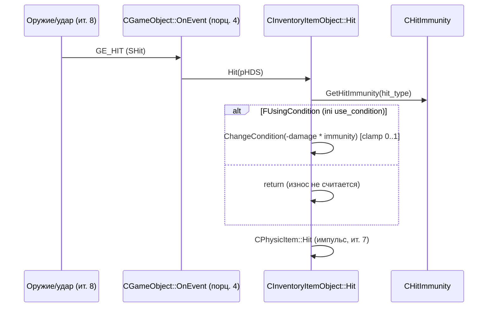

# CInventoryItemObject

> **Модуль:** `xrGame` · **Файлы:** `src/xrGame/inventory_item_object.h` (88 стр.), `src/xrGame/inventory_item_object.cpp` (211 стр.), `src/xrGame/inventory_item.h` (371 стр.), `src/xrGame/inventory_item.cpp` (1538 стр.), `src/xrGame/physic_item.h` (42 стр.), `src/xrGame/physic_item.cpp` (211 стр.), `src/xrGame/attachable_item.h` (73 стр.), `src/xrGame/attachable_item.cpp` (229 стр.), `src/xrGame/hit_immunity.h` (26 стр.), `src/xrServerEntities/xrServer_Objects_ALife_Items.h` (304 стр.) · **Порцион 10/30, итерация 5**

**Границы:** `CWeapon` и вся иерархия оружия — итерация 8 (здесь только место в дереве: `cast_weapon() → 0`); `Level_*`/сетевой транспорт — итерация 12 (здесь — сигнатуры `net_*`/`save`/`load` и формат `net_update_IItem`); `CSE_ALife*` (серверные сущности) — итерация 11; физический шелл/`CPHSynchronize` (ит. 7 — только использование); `CInventory`/`CInventoryOwner` как системы (белт/рюкзак/слоты) — итерация 8; UI-страницы предметов — итерация 10.

## 1. Ответственность

`CInventoryItemObject` — базовый «предмет мира» объектной модели: всё, что можно подобрать, держать, носить и что лежит на земле как физическое тело. Это **композиция двух mixin'ов** — `CInventoryItem` (логика вещи: данные из `game.ltx`, состояние, трейд/взятие, апгрейды, «вещь-родитель» для attach) и `CPhysicItem` (физический шелл, интерполяция тела) — с множественным наследованием от `CGameObject`. Сам класс-факад тонкий: почти все методы — делегирование в обе ветки.

Слой отвечает за:

- **данные вещи** из ini-секции (`game.ltx`): имя/описание/веса/цена/слот/флаги (`Load`, inventory_item.cpp L94–143),
- **жизненный цикл в мире**: независимость/зачисление к носителю (`OnH_A/B_Independent/Chield`), авто-уничтожение брошенных вещей в MP (`NeedToDestroyObject`, `ITEM_REMOVE_TIME`),
- **физика тела вещи**: шелл (`CPhysicItem`), активация при spawn/attach, `InterpolateGlobalTransform` в `UpdateCL` (physic_item.cpp L104–115),
- **сеть**: `net_Spawn`/`net_Destroy`/`net_Export`/`net_Import`/`save`/`load` — состояние `SPHNetState` (pos/quat/vel) для независимых вещей, линейная интерполяция между 2 сетевыми кадрами (`Interpolate`, L1151–1216),
- **attach к носителю** (через `CAttachableItem`): позиция на кости (`attach_bone_name`/`attach_angle_offset`/`attach_position_offset`), `enable/disable`, `UpdateXForm` (позиция в руке),
- **износ и урон**: `m_fCondition` + `CHitImmunity` (`Hit` → `ChangeCondition`),
- **апгрейды**: `m_upgrades` (вектор `shared_str`), `install_upgrade`/`verify_upgrade` (инсталляция — в Single при `net_Spawn`),
- **интерфейс для AI**: `useful_for_NPC`, `Useful` (`CanTake`), `can_kill`/`can_make_killing` (по умолчанию `false`/`0` — переопределяет оружие, ит. 8),
- **корневые down-cast'ы**: `cast_physics_shell_holder`/`cast_inventory_item`/`cast_attachable_item` → `this`; `cast_weapon`/`cast_missile`/`cast_flashlight`/`cast_hud_item`/`cast_weapon_ammo`/`cast_food_item` → `0` (ветку оружия — ит. 8).

**Что НЕ делает:** не реализует оружие (ит. 8: `CWeapon` — наследник, здесь только `cast_weapon() → 0` и место в дереве); не реализует UI инвентаря (ит. 10); не реализует транспорт сети (ит. 12 — здесь только формат кадра); не владеет `CInventory`/слотами как системой (ит. 8); не планирует использование (`ActivateItem`/`Action` — нетиповые виртуалы с дефолтом `false`/пусто).

## 2. Место в архитектуре

```
CObject (xrEngine)                       — xr-object.md
└─ CGameObject                           — game-object.md
   ├─ CEntity — порц. 5 → CEntityAlive — порц. 7 → CActor (14–23) / CCustomMonster (9)
   └─ CInventoryItemObject               — ЭТОТ класс (порц. 10)
      = CInventoryItem (mixin: вещь) + CPhysicItem (mixin: физика)
         ├─ CWeapon* (CWeaponAK74, …)     — итерация 8
         ├─ CFoodItem, CFlashlight, CMissile, CExplosiveRocket — ит. 8 / порц. 11
         └─ CCustomDevice, CDetector, PDA, Dosimeter, Medkit… — порц. 11–12
```

Наследование (inventory_item_object.h L14–17): `class CInventoryItemObject : public CInventoryItem, public CPhysicItem`. Две ветки сходятся в `CGameObject` (общий предок: `CInventoryItem : CAttachableItem, CHitImmunity` (inventory_item.h L63–65), `CPhysicItem : CPhysicsShellHolder, CPHShellSimpleCreator` (physic_item.h L15–17), а `CAttachableItem` и `CPhysicsShellHolder` оба над `CGameObject`).

**Зависит от:** `CSE_ALifeInventoryItem` (ит. 11 — `m_fCondition`, `m_upgrades`, `mask_inv_num_items`), `SPHNetState`/`CPHSynchronize` (физика, ит. 7 — только `get_State`/`set_State`/`get_State`), `CInventory`/`CInventoryOwner` (ит. 8 — `m_pInventory`, `AllowItemToTrade`, `attached`), `CAttachmentOwner` (attach — порц. 29/ит. 8), `CHitImmunity` (hit_immunity.h — коэффициенты по `ALife::EHitType`), `IKinematics` (ит. 3 — `CalculateBones`, `LL_GetTransform`, `dcast_PKinematics`).

## 3. Публичный API

### Down-cast'ы (h L24–33)

| Метод                                                                                        | Возвращает | Примечание                |
| -------------------------------------------------------------------------------------------- | ---------- | ------------------------- |
| `cast_physics_shell_holder`                                                                  | `this`     | —                         |
| `cast_inventory_item`                                                                        | `this`     | —                         |
| `cast_attachable_item`                                                                       | `this`     | —                         |
| `cast_weapon`                                                                                | `0`        | ветка — ит. 8             |
| `cast_food_item` / `cast_missile` / `cast_flashlight` / `cast_hud_item` / `cast_weapon_ammo` | `0`        | наследники переопределяют |
| `cast_game_object`                                                                           | `this`     | —                         |

### Данные вещи (CInventoryItem, inventory_item.h L99–224)

| Метод                                                                   | Сигнатура                                                | Назначение                                                                                                           |
| ----------------------------------------------------------------------- | -------------------------------------------------------- | -------------------------------------------------------------------------------------------------------------------- |
| `Load`                                                                  | `virtual void (LPCSTR section)`                          | загрузка всех ini-ключей, §4.3                                                                                       |
| `NameItem` / `NameShort`                                                | `LPCSTR ()`                                              | `m_name` / `m_nameShort` (из `inv_name`/`inv_name_short`, через `CStringTable`)                                      |
| `ItemDescription`                                                       | `shared_str ()`                                          | `m_Description`                                                                                                      |
| `GetBriefInfo`                                                          | `virtual bool (II_BriefInfo&)`                           | по умолчанию `false` (переопределяют PDA/док, порц. 12)                                                              |
| `CanTake` / `SetCanTake`                                                | `bool ()` / `void (BOOL)`                                | флаг `FCanTake`                                                                                                      |
| `CanTrade` / `AllowTrade` / `DenyTrade`                                 | `bool ()` / `void ()` ×2                                 | трейд: `m_can_trade` + `FCanTrade` + `!IsQuestItem` + `inventory_owner().AllowItemToTrade` (L1447–1455, pragma todo) |
| `Cost` / `Weight` / `SetWeight`                                         | `u32 ()` / `float ()` / `void (float)`                   | `m_cost`, `m_weight`                                                                                                 |
| `GetCondition` / `SetCondition` / `ChangeCondition`                     | `float ()` / `void (float)` / `void (float)`             | `m_fCondition`, clamp 0..1 (L145–149)                                                                                |
| `IsUsingCondition`                                                      | `virtual bool ()`                                        | флаг `FUsingCondition` (ini `use_condition`, форк Axel)                                                              |
| `GetLowestBatteryCharge`                                                | `IC float ()`                                            | `m_fLowestBatteryCharge` (ini `power_critical`, дефолт `.03f`)                                                       |
| `BaseSlot` / `CurrSlot` / `CurrPlace`                                   | `u16 ()` ×3                                              | `m_ItemCurrPlace` (слот/белт/рюкзак)                                                                                 |
| `Belt` / `Ruck` / `RuckDefault`                                         | `bool ()` / `bool ()` / `bool ()`                        | флаги `Fbelt`/`Fruck`/`FRuckDefault`                                                                                 |
| `IsQuestItem`                                                           | `bool ()`                                                | флаг `FIsQuestItem` (ini `quest_item`)                                                                               |
| `IsInvalid`                                                             | `BOOL ()`                                                | `getDestroy()                                                                                                        |     | GetDropManual()` (L1498–1501) |
| `SetDropManual`                                                         | `void (BOOL)`                                            | флаг + в MP: `DenyTrade`/`AllowTrade`, DEBUG-Msg (L1513–1533)                                                        |
| `GetDropManual`                                                         | `BOOL ()`                                                | флаг `FdropManual`                                                                                                   |
| `IsNecessaryItem`                                                       | `virtual bool (CInventoryItem*)` / `(const shared_str&)` | по секции вещи, по умолчанию `false`                                                                                 |
| `GetIconName` / `GetInvGridRect` / `GetUpgrIconRect` / `GetKillMsgRect` | —                                                        | иконки/прямоугольники UI (ит. 10; кэши `m_inv_grid_rect`/`m_upgr_icon_rect`, отрицательные → ini)                    |
| `highlight_equipped`                                                    | `bool` (поле)                                            | ini `highlight_equipped`                                                                                             |

### Использование и attach

| Метод                                           | Сигнатура                                                            | Назначение                                                          |
| ----------------------------------------------- | -------------------------------------------------------------------- | ------------------------------------------------------------------- |
| `ActivateItem` / `DeactivateItem`               | `virtual bool ()` / `virtual void ()`                                | дефолт `false`/пусто — «Переопределить» (L111, L123–124)            |
| `Action`                                        | `virtual bool (u16 cmd, u32 flags)`                                  | дефолт `false`                                                      |
| `DiscardState`                                  | `virtual void ()`                                                    | пусто                                                               |
| `Attach` / `Detach` / `CanAttach` / `CanDetach` | `virtual bool (PIItem, bool)` / `(PIItem)` / `(PIItem)` / `(LPCSTR)` | дефолт `false`; `Detach(const char*, bool)` — реализован (L294–337) |
| `HandDependence` / `IsSingleHanded`             | `virtual EHandDependence ()` / `virtual bool ()`                     | дефолт `hd1Hand`/`true` (L21–26)                                    |
| `IsSprintAllowed`                               | `virtual bool ()`                                                    | флаг `FAllowSprint`                                                 |
| `GetControlInertionFactor`                      | `virtual float ()`                                                   | `m_fControlInertionFactor`                                          |
| `modify_holder_params`                          | `virtual void (float& range, float& fov) const`                      | `range/fov *= m_holder_range/fov_modifier` (L1418–1422)             |
| `use_parent_ai_locations`                       | `virtual bool () const` (protected)                                  | → `CAttachableItem` (h L82–85): `!enabled()`                        |
| `useful_for_NPC`                                | `IC bool () const`                                                   | `Useful() && FUseful_for_NPC` (inline L11–14)                       |
| `ef_weapon_type`                                | `virtual u32 () const`                                               | **`0`** (object.cpp L198–201)                                       |

### Апгрейды (h L316–350)

| Метод                                         | Сигнатура                                | Назначение                         |
| --------------------------------------------- | ---------------------------------------- | ---------------------------------- |
| `has_any_upgrades`                            | `IC bool ()`                             | `m_upgrades.size() != 0`           |
| `has_upgrade` / `has_upgrade_group`           | `bool (const shared_str&)` ×2            | поиск id/группы                    |
| `add_upgrade`                                 | `void (const shared_str&, bool loading)` | push + `install_upgrade`           |
| `get_upgrades_str`                            | `bool (string2048&) const`               | строка для Lua/отладки             |
| `equal_upgrades`                              | `bool (Upgrades_type const&) const`      | сравнение множеств                 |
| `verify_upgrade` / `install_upgrade`          | `bool (LPCSTR section)` ×2               | проверка/установка по секции       |
| `pre_install_upgrade`                         | `void ()`                                | хук перед установкой               |
| `upgardes`                                    | `IC Upgrades_type const& ()`             | опечатка в имени (без «e»)         |
| `net_Spawn_install_upgrades`                  | `virtual void (Upgrades_type)`           | вызывается из `net_Spawn` (Single) |
| `install_upgrade_impl` / `install_upgrade_ui` | `bool (LPCSTR, bool test)` ×2            | ядро установки                     |

### Сеть, жизненный цикл, физика

| Метод                                                  | Сигнатура                                                  | Назначение                                                                          |
| ------------------------------------------------------ | ---------------------------------------------------------- | ----------------------------------------------------------------------------------- |
| `net_Spawn`                                            | `virtual BOOL (CSE_Abstract* DC)`                          | §4.4                                                                                |
| `net_Destroy`                                          | `virtual void ()`                                          | VERIFY «не в инвентаре» (L378–387)                                                  |
| `net_Export` / `net_Import`                            | `virtual void (NET_Packet&)` ×2                            | `SPHNetState` + маска, §4.5                                                         |
| `save` / `load`                                        | `virtual void (NET_Packet&)` / `(IReader&)`                | place+condition+`PHSaveState`/`PHLoadState`, L389–404, L780–800                     |
| `net_SaveRelevant`                                     | `virtual BOOL ()`                                          | всегда `TRUE` (h L53, L137)                                                         |
| `net_Export_PH_Params` / `net_Import_PH_Params`        | `void (NET_Packet&, SPHNetState&, mask_inv_num_items&)` ×2 | force/torque/pos/quat/vels + маска null (L528–637)                                  |
| `OnEvent`                                              | `virtual void (NET_Packet&, u16)`                          | `GE_ADDON_ATTACH`/`GE_ADDON_DETACH`/`GE_CHANGE_POS`, §4.6                           |
| `UpdateCL`                                             | `virtual void ()`                                          | DEBUG-рендер + `Interpolate` (не Single), §4.7                                      |
| `Interpolate` / `interpolate_states`                   | `virtual void ()` / `float (net_update_IItem const&, …)`   | линейная интерполяция 2 кадров, §4.7                                                |
| `make_Interpolation`                                   | `virtual void ()`                                          | **пустой** (h L227–229) — spline-версия закомментирована (cpp L961–1149)            |
| `PH_B_CrPr` / `PH_I_CrPr` / `PH_A_CrPr` / `PH_Ch_CrPr` | `virtual void ()` ×4                                       | B/I — **пустые** (весь код закомментирован, L803–884); A — «just after spawn», §4.8 |
| `activate_physic_shell` / `on_activate_physic_shell`   | `virtual void ()` ×2                                       | §4.9; в object — делегирование (см. ограничение 10)                                 |
| `NeedToDestroyObject`                                  | `virtual bool () const`                                    | MP-авто-удаление, §4.10                                                             |
| `TimePassedAfterIndependant`                           | `virtual ALife::_TIME_ID () const`                         | `timeServer - m_dwItemIndependencyTime` (L1439–1445)                                |
| `has_network_synchronization`                          | `virtual bool () const`                                    | `false` (L1535–1538)                                                                |
| `can_kill` ×3 / `can_make_killing` / `ready_to_kill`   | `bool ()` / `CInventoryItem* ()` ×2 / `bool ()`            | все по умолчанию `false`/`0` (L1232–1255)                                           |
| `Useful`                                               | `virtual bool () const`                                    | `CanTake()` (L193–196)                                                              |
| `Hit`                                                  | `virtual void (SHit*)`                                     | `IsUsingCondition` → `ChangeCondition(-power*immunity)`, §4.2                       |
| `OnH_B_Independent` / `OnH_A_Independent`              | `virtual void (bool)` / `virtual void ()`                  | §4.11                                                                               |
| `OnH_B_Chield` / `OnH_A_Chield`                        | `virtual void ()` ×2                                       | `RemoveObject_From_4CrPr` / пусто                                                   |
| `renderable_Render`                                    | `virtual void ()`                                          | `set_Transform(&XFORM)` + `add_Visual` (attachable L68–72)                          |
| `render_item_ui` / `render_item_ui_query`              | `virtual void ()` / `virtual bool ()`                      | пусто/`false` (UI — ит. 10)                                                         |
| `reinit`                                               | `virtual void ()`                                          | `m_pInventory=NULL`, place=Undefined (L1226–1230)                                   |
| `reload`                                               | `virtual void (LPCSTR section)`                            | `holder_range/fov_modifier` (L1219–1224)                                            |
| `object_id` / `parent_id`                              | `u16 ()` ×2                                                | `ID()` / `H_Parent()->ID()`                                                         |

### CPhysicItem (physic_item.h L20–40)

| Метод                            | Сигнатура                         | Назначение                                                                                   |
| -------------------------------- | --------------------------------- | -------------------------------------------------------------------------------------------- |
| `m_ready_to_destroy`             | `bool` (public)                   | gate в `OnH_B_Independent`                                                                   |
| `reinit`                         | `virtual void ()`                 | `m_ready_to_destroy = false`                                                                 |
| `OnH_B_Independent`              | `virtual void (bool)`             | `setVisible/setEnabled(TRUE)`, `activate_physic_shell` (кроме `just_before_destroy`), L55–67 |
| `OnH_B_Chield`                   | `virtual void ()`                 | `setVisible/setEnabled(FALSE)`, `deactivate_physics_shell`, L69–77                           |
| `net_Spawn`                      | `virtual BOOL (CSE_Abstract* DC)` | `CalculateBones`, шелл при `ID_Parent==0xffff`, L79–97                                       |
| `UpdateCL`                       | `virtual void ()`                 | `InterpolateGlobalTransform(&XFORM)` (независимое тело), L104–115                            |
| `activate_physic_shell`          | `virtual void ()`                 | `XFORM = parent XFORM`, `CalculateBones`, L117–130                                           |
| `setup_physic_shell`             | `virtual void ()`                 | inherited + `CalculateBones`, L132–143                                                       |
| `create_box_physic_shell`        | `virtual void ()`                 | OBB из `getVisData().box`, density 2000, L145–161                                            |
| `create_box2sphere_physic_shell` | `virtual void ()`                 | box + 2 сферы (макс-ось), density 2000, air resistance, L163–205                             |
| `create_physic_shell`            | `virtual void ()`                 | → inherited (`CPhysicsShellHolder`, ит. 7)                                                   |

### CAttachableItem (attachable_item.h L14–71)

| Метод                                          | Сигнатура                                        | Назначение                                                                 |
| ---------------------------------------------- | ------------------------------------------------ | -------------------------------------------------------------------------- |
| `item` / `object`                              | `CInventoryItem& ()` / `CPhysicsShellHolder& ()` | `m_item` = `this` (см. ограничение 1)                                      |
| `reload`                                       | `virtual void (LPCSTR)`                          | `load_attach_position` → `enable(false)` (L38–46)                          |
| `load_attach_position`                         | `bool (LPCSTR)`                                  | `attach_angle_offset`/`attach_position_offset`/`attach_bone_name` (L48–59) |
| `OnH_A_Chield`                                 | `virtual void ()`                                | если owner `attached(&item())` → `setVisible(true)` (L61–66)               |
| `OnH_A_Independent`                            | `virtual void ()`                                | `enable(false)` (L74–77)                                                   |
| `renderable_Render`                            | `virtual void ()`                                | рендер через `object().XFORM()` (L68–72)                                   |
| `can_be_attached`                              | `bool () const`                                  | `m_pInventory` + `IsBeltUseful` + `eItemPlaceBelt` (L112–124)              |
| `afterAttach` / `afterDetach`                  | `virtual void ()` ×2                             | `processing_activate`/`processing_deactivate` (L126–140)                   |
| `bone_name` / `bone_id` / `offset` / `enabled` | —                                                | accessors                                                                  |
| `enable`                                       | `virtual bool (bool value)`                      | attach/detach через `CAttachmentOwner` родителя (L79–110)                  |
| `use_parent_ai_locations`                      | `virtual bool () const = 0`                      | `!enabled()` (чисто виртуальный, h L49–52)                                 |

## 4. Внутреннее устройство

### 4.1 Поля CInventoryItem (h L90–225, L255–364)

- **Флаги** `Flags16 m_flags` (L90): `FdropManual`(0), `FCanTake`(1), `FCanTrade`(2), `Fbelt`(3), `Fruck`(4), `FRuckDefault`(5), `FUsingCondition`(6), `FAllowSprint`(7), `Fuseful_for_NPC`(8), `FInInterpolation`(9), `FInInterpolate`(10), `FIsQuestItem`(11), `FIsHelperItem`(12) (L73–88). Ctor (cpp L43–69): `Fbelt=false`, `Fruck=true`, `FRuckDefault=true`, `FCanTake=true`, `FCanTrade=m_can_trade(true)`, `FUsingCondition=false`, `FIsHelperItem=false`, `m_fCondition=1.0f`, place=`eItemPlaceUndefined`/`NO_ACTIVE_SLOT`.
- **Данные**: `m_pInventory` (public, `CInventory*`, NULL), `m_section_id`, `m_name`/`m_nameShort`/`m_nameComplex`, `m_kind`, `m_highlight_equipped`, `m_ItemCurrPlace` (`SInvItemPlace`), `m_cost`, `m_weight`, `m_fCondition`, `m_Description`, `m_dwItemIndependencyTime`, `m_fControlInertionFactor`, `m_icon_name`, `m_inv_grid_rect`/`m_upgr_icon_rect` (качи UI, `-1,-1,-1,-1`).
- **Сеть**: `net_updateInvData* m_net_updateData` (лениво, `NetSync()` L36–41: `xr_new`), `m_just_after_spawn`, `m_activated`, `m_fLowestBatteryCharge`.
- **Attach/holder**: `m_holder_range_modifier`/`m_holder_fov_modifier` (reload), `CPhysicsShellHolder* m_object` (private, в `_construct` = `smart_cast<CPhysicsShellHolder*>(this)` L1411–1416), `m_upgrades` (`Upgrades_type`).

### 4.2 `Hit` (inventory_item.cpp L152–160)

`IsUsingCondition() == false` → return. `hit_power = pHDS->damage() * GetHitImmunity(pHDS->hit_type)` → `ChangeCondition(-hit_power)` (clamp 0..1). Иммунитеты — из `CHitImmunity::LoadImmunities` (ini `immunities_sect`, hit_immunity.h L23–25). В object (L53–57) — делегирование в `CPhysicItem::Hit` + `CInventoryItem::Hit` (физический импульс + износ).

### 4.3 `Load` (L94–143)

| Ключ                                                             | Тип             | Дефолт          | Поле/флаг                                 |
| ---------------------------------------------------------------- | --------------- | --------------- | ----------------------------------------- |
| `immunities_sect`                                                | string          | —               | `CHitImmunity::LoadImmunities`            |
| `inv_name` / `inv_name_short`                                    | string          | —               | `m_name`/`m_nameShort` (`CStringTable`)   |
| `kind`                                                           | string          | NULL (Log)      | `m_kind`                                  |
| `inv_weight`                                                     | float           | — (R_ASSERT ≥0) | `m_weight`                                |
| `cost`                                                           | u32             | —               | `m_cost`                                  |
| `slot`                                                           | u32             | —               | `base_slot_id = (sl == -1) ? 0 : sl+1`    |
| `description`                                                    | string          | —               | `m_Description`                           |
| `belt`                                                           | bool            | FALSE           | `Fbelt`                                   |
| `can_trade`                                                      | bool            | TRUE            | `m_can_trade` + `FCanTrade`               |
| `can_take`                                                       | bool            | TRUE            | `FCanTake`                                |
| `quest_item`                                                     | bool            | FALSE           | `FIsQuestItem`                            |
| `use_condition`                                                  | bool            | FALSE           | `FUsingCondition` (форк Axel)             |
| `highlight_equipped`                                             | bool            | FALSE           | `m_highlight_equipped`                    |
| `default_to_ruck` / `sprint_allowed` / `control_inertion_factor` | bool/bool/float | —               | только если `BaseSlot() != NO_ACTIVE_SLOT |     | Belt()` |
| `icon_name`                                                      | string          | NULL            | `m_icon_name`                             |
| `power_critical`                                                 | float           | .03f            | `m_fLowestBatteryCharge`                  |

Плюс: `self->spatial.type |= STYPE_VISIBLEFORAI` (L98–99), `m_section_id._set(section)`.

### 4.4 `net_Spawn` (L340–376)

`VERIFY(!m_pInventory)`; сброс `FInInterpolation/FInInterpolate`; `Fuseful_for_NPC = true` (override из `CSE_ALifeObject::flUsefulForAI` если есть); `smart_cast<CSE_ALifeInventoryItem*>(DC)` → NULL → `return TRUE` (предмет без ALife-сущности — ничего не читает); `m_fCondition = pSE->m_fCondition`; Single → `net_Spawn_install_upgrades(pSE->m_upgrades)`; не Single → `object().processing_activate()`; `m_dwItemIndependencyTime = 0`, `m_just_after_spawn = true`, `m_activated = false`.

### 4.5 `net_Export`/`net_Import` (L406–637)

**Export** (L639–778): `H_Parent() || IsGameTypeSingle()` → `w_u8(0)` + return (зачисленные вещи и Single — не синхронизируются). Иначе `SPHNetState` из `PHGetSyncItem(0)->get_State` (или `Position()`); `mask_inv_num_items` (`num_items:5`, `mask:3` — из `CSE_ALifeInventoryItem`, ит. 11): `inventory_item_state_enabled`(1), `inventory_item_angular_null`(2), `inventory_item_linear_null`(4); `R_ASSERT(temp < (u16(1) << 5))`; `w_u8(num_items.common)`, 0 → DEBUG Msg + return; `net_Export_PH_Params` (force/torque/pos/quat 4×float/vels); `w_u8(1/0)` — shell enabled/freezed. Блок L695–777 — **закомментированная старая версия** (с `w_float_q8` и clamp'ами).

**Import** (L406–526): `r_u8` (NumItems), 0 → return; `mask_inv_num_items.common = NumItems`; `net_Import_PH_Params` (pos/quat/vels по маске); `r_u8()` (active — **не используется дальше**); `Local()` → return; `NetSync()`: `AddObject_To_4CrPr`, push `N` в `NET_IItem`, **deque держит ≤ 2** (pop_front, L450–453); если `!m_activated` → DEBUG Msg «Activating object … before interpolation starts» + `processing_activate()`. Блок L463–525 — **закомментированная старая версия** (CrPr-активация).

### 4.6 `OnEvent` (L254–289)

`GE_ADDON_ATTACH`: `r_u16(ItemID)` → `net_Find` → `Attach(ItemToAttach, true)` (реализуют наследники, ит. 8); `GE_ADDON_DETACH`: `r_stringZ(i_name)` → `Detach(i_name, true)`; `GE_CHANGE_POS`: `r_vec3(p)` → `PHGetSyncItem(0)->get_State` → `state.position = previous_position = p` → `set_State`.

### 4.7 `UpdateCL` + `Interpolate` (L233–252, L1151–1216)

`UpdateCL` (L233–252): DEBUG — `bDebug` + `dbg_net_Draw_Flags.test(dbg_draw_invitem)` → Remove/Add в `seqRender`, иначе Remove; `!IsGameTypeSingle()` → `Interpolate()`. В object (L84–88) — `CPhysicItem::UpdateCL` (`InterpolateGlobalTransform(&XFORM)` для активного шелла) + `CInventoryItem::UpdateCL`.

`Interpolate` (L1151–1185): gate `!H_Parent() && getVisible() && m_pPhysicsShell && !OnServer() && NET_IItem.size()`; `newState = front().State`; `size >= 2` → `interpolate_states(front, back, newState)`: `factor = (CurTime - last.ts)/(last.ts - first.ts)` (CurTime = `Device.dwTimeGlobal`), clamp 0..1; **ret_val = factor до clamp**; `>= 1.f` → `pop_front` + если `m_activated` → DEBUG Msg + `processing_deactivate()`; `set_State(newState)`.

### 4.8 `PH_A_CrPr` — «just after spawn» (L887–959)

`m_just_after_spawn`: `VERIFY(Visual())`, `K = Visual()->dcast_PKinematics()`; нет шелла → Msg + `VERIFY2(0, "physical shell is NULL")` + return; `!isFullActive()` → `CalculateBones`; `GetGlobalTransformDynamic(&XFORM())`; `CalculateBones`; `spatial_move()`; `m_just_after_spawn = false`; `VERIFY(!OnServer())`; `get_ElementByStoreOrder(0)->Fix()` + `SetIgnoreStatic()`. Остаток L932–958 — **закомментированный spline-интерполятор** (CrPr: `CalculateInterpolationParams`/`make_Interpolation` — закомментирован весь блок L961–1149, в т.ч. `g_cl_lvInterp`, `SCoeff`-сплайны). `PH_B_CrPr`/`PH_I_CrPr`/`PH_Ch_CrPr` — тела полностью закомментированы (L803–884).

### 4.9 `activate_physic_shell` (L1257–1269)

`E = smart_cast<CEntityAlive*>(H_Parent())`: нет → `on_activate_physic_shell()` (в object — делегирование в `CPhysicItem::activate_physic_shell`, см. ограничение 10) + return; есть → `UpdateXForm()` + `CPhysicsShellHolder::activate_physic_shell` (ит. 7).

### 4.10 `NeedToDestroyObject` (L1424–1437)

Single / CTA → `false`; `Remote()` → `false`; `TimePassedAfterIndependant() > ITEM_REMOVE_TIME` (30000 мс, cpp L34) → `true`. Вызывается из `CGameObject::shedule_Update` (порц. 3) → `DestroyObject`.

### 4.11 `OnH_B_Independent`/`OnH_A_Independent` (L207–218)

B: `UpdateXForm()`, place=`eItemPlaceUndefined` (+ `CPhysicItem`: `setVisible/Enabled(TRUE)`, `activate_physic_shell` если не `just_before_destroy`). A: `m_dwItemIndependencyTime = Level().timeServer()`, place=Undefined, `inherited` (= `CAttachableItem::OnH_A_Independent` → `enable(false)`).

### 4.12 `Detach(const char*, bool)` (L294–337)

Только `!OnClient()` (иначе `true`). `F_entity_Create(section)` → `CSE_ALifeDynamicObject` (R_ASSERT); `m_tNodeID = dedicated ? -1 : level_vertex_id()`; `s_name = section`, `ID = 0xffff`, `ID_Parent` = родителя (Single) или родителя/`0xffff` (MP, коммент «i'm not sure this is right … simplest way to avoid exception in MP BuyWnd… [Satan]»); `o_Position = Position()`, `s_flags = M_SPAWN_OBJECT_LOCAL`; `Spawn_Write(P, TRUE)` + `Level().Send(P, net_flags(TRUE))`; `F_entity_Destroy(D)`. Коммент L291–293: процесс = «спаун новой вещи в инвентаре и установка флагов в родителе, функция должна быть переопределена».

### 4.13 `UpdateXForm` (L1271–1327)

Позиция вещи в руке: `H_Parent()` → `CEntityAlive* E` → `cast_base_monster()` → return; `use_simplified_visual()` → return; `parent->attached(this)` → return; `V->CalculateBones()` (`#pragma todo("TO ALL: serious performance problem")` L1298); `E->g_WeaponBones(boneL, boneR, boneR2)`, `boneR == -1` → return; `D = mL.c - mR.c` (normalize); нулевой → `mRes = E->XFORM()`, `c = mR.c`; иначе `R = mR.j × D`, `N = D × R` (normalize), `mRes = (R, N, D, mR.c)`, `mulA_43(E->XFORM())`; `object().Position() = mRes.c`.

### 4.14 `OnRender` (DEBUG, L1332–1408)

`bDebug && Visual()` + `dbg_net_Draw_Flags.is_any(dbg_draw_invitem)` → OBB из `getVisData().box` синим. Весь остальной блок (цвета по `processing_enabled`/`m_bInInterpolation`, траектория `LastVisPos`, сплайн `SCoeff`) — **закомментирован** (L1343–1406).

### 4.15 Прочее

- `CanTrade` (L1447–1455): `m_pInventory` → `inventory_owner().AllowItemToTrade(this, place)` (`#pragma todo("Dima to Andy : why CanTrade … no owner?")`); итог `res && FCanTrade && !IsQuestItem()`.
- `SetDropManual` (L1513–1533): MP → `DenyTrade`/`AllowTrade`; DEBUG Msg «! WARNING: trying to set drop manual flag…».
- `IsInvalid` (L1498–1501): `getDestroy() || GetDropManual()`.
- `TimePassedAfterIndependant` (L1439–1445): `!H_Parent() && m_dwItemIndependencyTime != 0` → delta, иначе 0.
- `Useful` (L193–196): `CanTake()`. `useful_for_NPC` (inline L11–14): `Useful() && Fuseful_for_NPC`.
- `modify_holder_params` (L1418–1422): `range *= m_holder_range_modifier; fov *= m_holder_fov_modifier`.
- `object_id`/`parent_id` (L1503–1511). `can_kill` ×3/`can_make_killing`/`ready_to_kill` — `false`/`0` (L1232–1255).
- `save`/`load` (L389–404, L780–800): `w_u16(m_ItemCurrPlace.value)`, `w_float(m_fCondition)` (upgrades — закомм. L393/L785); `H_Parent()` → `w_u8(0)` + return; иначе `PHSaveState`/`PHLoadState` (+ `setup_physic_shell` + `Disable()` при load).
- `dtor` (L71–92): `delete_data(m_net_updateData)`; `#ifndef MASTER_GOLD` — проверка `m_pInventory->m_all` (item не должен числиться в инвентаре при уничтожении) → Msg «! ERROR item_id[%d] H_Parent=[%s][%d]».

## 5. Взаимодействие

**Кто вызывает:**

- `CGameObject::shedule_Update` → `NeedToDestroyObject` → `DestroyObject` (порц. 3) — авто-удаление брошенных вещей в MP;
- `CGameObject::OnEvent` (порц. 4) → `GE_HIT` → `Hit` (через `CSE_Abstract`-путь), `GE_ADDON_*`/`GE_CHANGE_POS` → `OnEvent` (§4.6);
- `CInventory`/`CInventoryOwner` (ит. 8): `m_pInventory`, `AllowItemToTrade`, `attached`, слоты/белт/рюкзак;
- `CAttachmentOwner` (ит. 8): `enable` → `attach`/`detach` (§4 CAttachableItem);
- AI (`CMemoryManager`, ит. 6): `useful_for_NPC`, `Useful`, `can_kill`/`can_make_killing` (переопределяет оружие, ит. 8);
- `CActor` (порц. 14–23): `ActivateItem`/`Action`/`HandDependence`/`IsSprintAllowed`/`GetControlInertionFactor`/`modify_holder_params` (обвязка оружия — порц. 18);
- Lua (`CScriptGameObject`, ит. 14): `DECLARE_SCRIPT_REGISTER_FUNCTION` (h L368) — экспорт в скрипты.

**Кого вызываю:**

- `CSE_ALifeInventoryItem` (ит. 11): `m_fCondition`, `m_upgrades`, `mask_inv_num_items`, `flUsefulForAI` (`CSE_ALifeObject`) — как аргумент `net_Spawn`;
- `CPHSynchronize`/`CPhysicsShell` (ит. 7): `get_State`/`set_State`, `PHSaveState`/`PHLoadState`, `InterpolateGlobalTransform`, `Fix`, `SetIgnoreStatic`, `GetGlobalTransformDynamic`;
- `Level()`: `timeServer`, `AddObject_To_4CrPr`/`RemoveObject_From_4CrPr`, `Send`, `InterpolationDisabled` (закомм.);
- `IKinematics` (ит. 3): `CalculateBones`, `LL_GetTransform`, `dcast_PKinematics`;
- `F_entity_Create`/`F_entity_Destroy`, `Level().Objects.net_Find` (порц. 2/12).

## 6. Потоки

**Бросок вещи → MP-интерполяция → авто-удаление:**

```mermaid
sequenceDiagram
    participant A as CActor (порц. 18)
    participant I as CInventoryItemObject
    participant S as CSE_ALifeInventoryItem (ит. 11)
    participant P as CPHSynchronize (ит. 7)
    participant G as CGameObject (порц. 3)

    A->>I: OnH_A_Independent (бросили)
    I->>I: m_dwItemIndependencyTime = timeServer(); place = Undefined
    I->>I: enable(false) (CAttachableItem)
    loop каждый кадр (UpdateCL)
        I->>I: InterpolateGlobalTransform(&XFORM) (физ. шелл)
        Note over I: MP: net_Import → push NET_IItem (deque ≤ 2)
        I->>P: set_State(interpolate_states(front, back))
    end
    Note over S,I: MP: сервер шлёт SPHNetState (pos/quat/vels)
    G->>I: shedule_Update → NeedToDestroyObject
    I-->>G: timeServer - m_dwItemIndependencyTime > 30000 → DestroyObject
```

**Урон по вещи (износ):**



## 7. Конфигурация

**Ini (секция объекта в `game.ltx`, `Load`):** см. таблица §4.3 (16 ключей). **Attach** (`reload`/`load_attach_position`): `attach_angle_offset` (vec3), `attach_position_offset` (vec3), `attach_bone_name` (string) — наличие `attach_angle_offset` → `enable(false)` (начало «отключенной» вещью). **Reload**: `holder_range_modifier`, `holder_fov_modifier` (float, дефолт 1.f).

**Сетевая маска** (`mask_inv_num_items`, xrServer_Objects_ALife_Items.h L32–41): `num_items : 5`, `mask : 3` — `inventory_item_state_enabled`(1), `inventory_item_angular_null`(2), `inventory_item_linear_null`(4).

**Константы:** `ITEM_REMOVE_TIME = 30000` мс (inventory_item.cpp L34); density шелла `2000.f` (physic_item.cpp L160, L203); `power_critical` дефолт `.03f`; `base_slot_id`: `slot == -1 → 0`, иначе `slot + 1`.

**Defines:** `DEBUG` (OnRender, PH_Ch_CrPr, attach-adjust `m_dbgItem`/`attach_adjust_mode_keyb`/`attach_draw_adjust_mode`, L142–229 attachable.cpp), `MASTER_GOLD` (dtor-проверка), `GAME_OBJECT_EXTENDED_EXPORTS` (`get_upgrades` — форк Alundaio, h L328–330), `HOLDERCUSTOM_NEW`/`STATIONARYMGUN_NEW` (форки — ит. 8/6).

## 8. Ограничения и дебаг

- **(1) `CAttachableItem::_construct`** (attachable.cpp L26–32): `m_item = smart_cast<CInventoryItem*>(this)` — `CAttachableItem` **не наследуется от `CInventoryItem`**, связь устанавливается в рантайме через down-cast; `object()` = `item().object()` (цепочка на `CPhysicsShellHolder`-подкласс).
- **(2) `CInventoryItem::activate_physic_shell` vs object** (object.cpp L149–157): `activate_physic_shell` → делегирует в `CInventoryItem::activate_physic_shell`, а `on_activate_physic_shell` → делегирует в **`CPhysicItem::activate_physic_shell`** (не в inherited `CInventoryItem::on_activate_physic_shell`, который — `R_ASSERT2(0, "failed call of virtual function!")`, inventory_item.h L285–288). Асимметричный форк.
- **(3) `net_Import`**: `r_u8()` (active/freezed) читается, но **не используется** (L429); `CrPr_SetActivated`/`CrPr_SetActivationStep` — закомментированы (L445–446).
- **(4) `net_Export`/`net_Import`/`OnRender`** — большие **закомментированные блоки** старых реализаций (L695–777, L463–525, L1343–1406); `make_Interpolation`/`CalculateInterpolationParams` — spline-интерполятор целиком закомментирован (L961–1149), живой — только линейный `Interpolate`.
- **(5) `PH_B_CrPr`/`PH_I_CrPr`/`PH_Ch_CrPr`** — тела полностью закомментированы (L803–884); жив только `PH_A_CrPr` (just-after-spawn блок).
- **(6) `interpolate_states`** возвращает factor **до clamp** (ret_val, L1189–1216), а `Interpolate` сравнивает `ret_val >= 1.f` — т.е. pop_front происходит и при factor > 1.
- **(7) `interpolate_states`**: `CurTime = Device.dwTimeGlobal` (клиентское время), а `dwTimeStamp` в `net_Import` тоже `Device.dwTimeGlobal` — интерполяция по клиентским штампам, не `timeServer`.
- **(8) `NET_IItem` — deque ≤ 2** (L450–453) — ровно 2 кадра; `size < 2` → нет интерполяции (просто `set_State(front)`).
- **(9) `NeedToDestroyObject`**: CTA (`eGameIDCaptureTheArtefact`) — явно `false` (вещи не удаляются); Single — `false`.
- **(10) `UpdateXForm`**: `#pragma todo("TO ALL: serious performance problem")` (L1298) — `CalculateBones` каждый кадр; `cast_base_monster()`/`use_simplified_visual()`/`attached(this)` → early-return.
- **(11) `CanTrade`**: `#pragma todo("Dima to Andy : why CInventoryItem::CanTrade can be called for the item, which doesn't have owner?")` (L1450).
- **(12) `Detach`** (L294–337): коммент «i'm not sure this is right» (MP-ветка `ID_Parent`); `M_SPAWN_OBJECT_LOCAL`; только `!OnClient()`.
- **(13) `ef_weapon_type`** в object — `0` (L198–201), а не `R_ASSERT` как у `CGameObject::ef_*` (порц. 3) — здесь «не оружие» — нормальное значение.
- **(14) `upgardes()`** (inline L16) — опечатка в имени (без «e»), форк-объявление `get_upgrades` под `GAME_OBJECT_EXTENDED_EXPORTS` (h L328–330).
- **(15) dtor** (L71–92): `#ifndef MASTER_GOLD` — если item числится в `m_pInventory->m_all` при уничтожении → Msg «! ERROR item_id…»; `m_pInventory` **не обнуляется** (строка L386 закомментирована).
- **(16) `m_fCondition`** — и в `CInventoryItem` (клиент, ini/Hit), и в `CSE_ALifeInventoryItem` (сервер, ит. 11); синхронизация — только `net_Spawn` (L361) и `save/load`.
- **(17) `m_upgrades`** — синхронизация только Single (`net_Spawn_install_upgrades`, L363–366); в `save/load` — закомментировано (L393, L785–786).
- **(18) `NetSync()`** — ленивый `xr_new<net_updateInvData>`, утечки нет только через `delete_data` в dtor.
- **(19) `CPhysicItem::create_physic_shell`** — закомментирован `create_box_physic_shell` (L209), идёт в inherited `CPhysicsShellHolder::create_physic_shell` (ит. 7).
- **(20) attach-adjust** (DEBUG, attachable.cpp L142–229): `attach_adjust_mode_keyb` — `m_dbgItem` + LShift/ALT + Z/X/C — ручная подстройка `attach_position_offset`/`attach_angle_offset` в рантайме.

## 9. Ссылки

- [CObject](../xr-engine/xr-object.md) — базовый каркас
- [CGameObject](game-object.md) — общий предок, `shedule_Update`/`OnEvent`
- [CGameObject: сеть](game-object-net.md) — `GE_*`, формат событий
- `CSE_ALife*` (ит. 11) — `CSE_ALifeInventoryItem`, `mask_inv_num_items`
- [Физика](physics.md) — ит. 7: `CPhysicsShellHolder`, `CPHSynchronize`, `SPHNetState`
- [Оружие](weapons.md) — ит. 8: `CWeapon`-ветка (наследник), `CInventory`/`CInventoryOwner`
- [Инвентарь](inventory.md) — ит. 8: слоты/белт/рюкзак
- [Скриптовые attachments](script-attachment.md) — порц. 29: `CAttachmentOwner`
- [CActor: оружие-обвязка](actor-weapon.md) — порц. 18: `ActivateItem`/`Action`/`modify_holder_params`
- [Misc-предметы](misc-items.md) — порц. 11: Torch/Flashlight/Detectors (наследники)
- [Medical-предметы](medical-items.md) — порц. 12: PDA/Dosimeter/Antirad/Medkit
- [Модель объектов](../../architecture/object-model.md) — обновляется в порц. 2 и 30

## 10. Источник

- `src/xrGame/inventory_item_object.h` (88 стр.), `src/xrGame/inventory_item_object.cpp` (211 стр.), `src/xrGame/inventory_item_object_inline.h` (9 стр. — пустой)
- `src/xrGame/inventory_item.h` (371 стр.), `src/xrGame/inventory_item.cpp` (1538 стр.), `src/xrGame/inventory_item_inline.h` (61 стр.)
- `src/xrGame/physic_item.h` (42 стр.), `src/xrGame/physic_item.cpp` (211 стр.), `src/xrGame/physic_item_inline.h` (9 стр.)
- `src/xrGame/attachable_item.h` (73 стр.), `src/xrGame/attachable_item.cpp` (229 стр.), `src/xrGame/attachable_item_inline.h` (65 стр.)
- `src/xrGame/hit_immunity.h` (26 стр.) — `CHitImmunity`
- `src/xrServerEntities/xrServer_Objects_ALife_Items.h` (304 стр.) — `CSE_ALifeInventoryItem`, `mask_inv_num_items` (ит. 11)
- `src/xrGame/gameobject.h` L235 (`CActor`-форк) — контекст `cast_*` (порц. 2–3)
