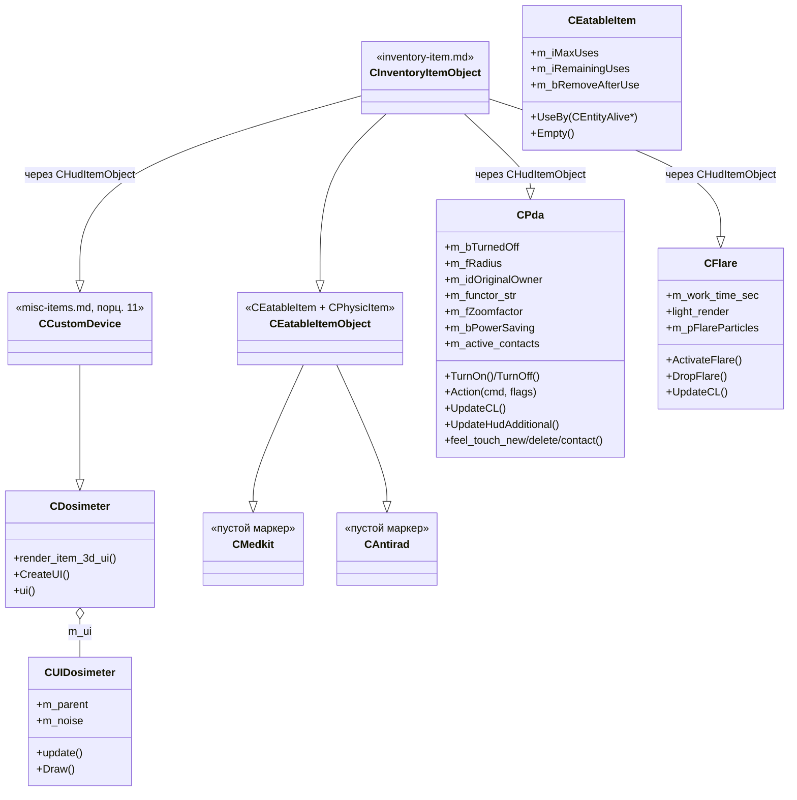
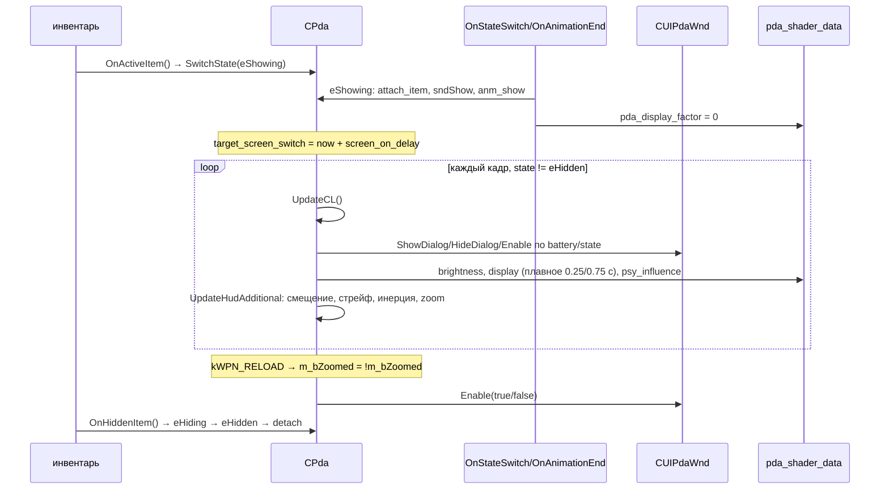
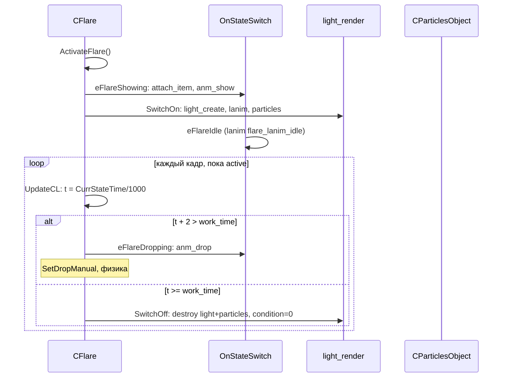

# PDA / Dosimeter / Antirad / Medkit

> **Модуль:** `xrGame` · **Файлы:** `src/xrGame/PDA.h` (133 стр.), `src/xrGame/PDA.cpp` (1095 стр.), `src/xrGame/Dosimeter.h` (17 стр.), `src/xrGame/Dosimeter.cpp` (23 стр.), `src/xrGame/UIDosimeter.h` (35 стр.), `src/xrGame/UIDosimeter.cpp` (120 стр.), `src/xrGame/flare.h` (37 стр.), `src/xrGame/flare.cpp` (215 стр.), `src/xrGame/medkit.h` (19 стр.), `src/xrGame/medkit.cpp` (16 стр.), `src/xrGame/antirad.h` (19 стр.), `src/xrGame/antirad.cpp` (17 стр.) · **Порцион:** 5.12

## 1. Ответственность и границы

Порцион покрывает «медицинские» и служебные предметы инвентаря — четыре очень разных по объёму класса:

- **`CPda`** — персональный цифровой ассистент (PDA). Крупнейший класс порциона: HUD-устройство с собственным FSM, зумом, инерцией, «жидким» экраном (яркость/видимость/psy-глич), состоянием батареи (condition), тактильным контактом с другими носителями PDA (`Feel::Touch` — обмен PDA в MP) и Lua-крюками (`pda.on_low_battery`, `play_function`). Наследник `CHudItemObject` (порц. 10) + `Feel::Touch`.
- **`CDosimeter`** — дозиметр: минимальный наследник `CCustomDevice` (порц. 11), вся логика — в UI-объекте `CUIDosimeter` (цифры дозы, индикатор «работы», шум).
- **`CFlare`** — сигнальная ракета (форк-добавление, зарегистрирован как `device_flare`): HUD-предмет с FSM, динамическим светом, частицами и «время жизни» по condition.
- **`CMedkit`** / **`CAntirad`** — **пустые маркер-классы**: наследники `CEatableItemObject` без собственного кода (конструктор/деструктор). Вся логика применения («аптечка лечит», «антирад выводит радиацию») живёт в Lua-скриптах.

**Границы.** `CInventoryItemObject` / `CEatableItem` / `CPhysicItem` — порц. 10 (только как базовые классы). `CCustomDevice` — порц. 11 (базовый класс дозиметра). `CUIPdaWnd` / PDA-меню / UI-система — итерация 10 (только взаимодействие). `CEntity`-статы (`g_Radiation`, condition) — порц. 5–6. Сетевой код (`CSE_ALifeItemPDA`, `Level_*`) — итерация 12 (только сигнатуры). `CWeapon`-иерархия — итерация 8.

## 2. Место в архитектуре

Иерархия классов (см. `inventory-item.md` — порц. 10, `misc-items.md` — порц. 11):

```
CObject → CGameObject (game-object.md)
  └─ CInventoryItemObject (inventory-item.md)
      ├─ CHudItemObject (CInventoryItemObject + CHudItem)
      │   ├─ CPda : CHudItemObject, Feel::Touch      — PDA
      │   ├─ CFlare : CHudItemObject                 — сигнальная ракета (форк)
      │   └─ CCustomDevice (misc-items.md)
      │       └─ CDosimeter                           — дозиметр (весь код в CUIDosimeter)
      └─ CEatableItemObject (CEatableItem + CPhysicItem)
          ├─ CMedkit                                  — пустой маркер
          ├─ CAntirad                                 — пустой маркер
          ├─ CFoodItem / CBottleItem                  — итерация 8 (не покрывается)
          └─ CExplosiveItem                           — итерация 8 (не покрывается)
```



Регистрация фабрики (`class-registry.md`, порц. 2) — `src/xrServerEntities/object_factory_register.cpp`:

| Класс      | CLSID                 | Секция         | Сеть (CSE)                |
| ---------- | --------------------- | -------------- | ------------------------- |
| `CPda`     | `CLSID_DEVICE_PDA`    | `device_pda`   | `CSE_ALifeItemPDA` (L404) |
| `CFlare`   | `CLSID_DEVICE_FLARE`  | `device_flare` | `CSE_ALifeItem` (L405)    |
| `CMedkit`  | `CLSID_IITEM_MEDKIT`  | `obj_medkit`   | `CSE_ALifeItem` (L344)    |
| `CMedkit`  | `CLSID_IITEM_BANDAGE` | `obj_bandage`  | `CSE_ALifeItem` (L345)    |
| `CAntirad` | `CLSID_IITEM_ANTIRAD` | `obj_antirad`  | `CSE_ALifeItem` (L346)    |

`CMedkit` зарегистрирован **дважды** (medkit + bandage) — один класс, два CLSID. `CAntirad`/`CMedkit` используют базовый `CSE_ALifeItem` (без специфичных полей); у `CPda` — отдельный `CSE_ALifeItemPDA` с `m_original_owner` / `m_specific_character` / `m_info_portion` (`xrServer_Objects_ALife_Items.h` L253–261).

Выгрузка в Lua (`src/xrGame/torch_script.cpp` L17–18): `CPda` — `class_<CPda, CGameObject>("CPda")` **без методов** (только конструктор-заглушка; реальный доступ — через общий API `CScriptGameObject`, ит. 14). `CMedkit`/`CAntirad` — в `script_game_object.h` доступны только через `cast_Medkit` / `cast_Antirad` (L993–994).

## 3. Публичный API

### `CPda` (`PDA.h`)

| Метод                                                                                                           | Назначение                                                                                                            |
| --------------------------------------------------------------------------------------------------------------- | --------------------------------------------------------------------------------------------------------------------- |
| `TurnOn()` / `TurnOff()` / `IsOn()` / `IsOff()` / `IsActive()`                                                  | Логическое включение PDA (не «выдран из руки», а «принадлежит ли текущему владельцу оригиналу»)                       |
| `bool Action(u16 cmd, u32 flags)`                                                                               | Диспетчеризация команд: `kQUIT`, `kWPN_RELOAD` (zoom), `kWPN_ZOOM`/`kWPN_FIRE` (вкл. меню), `kWPN_FUNC`, `kINVENTORY` |
| `void OnStateSwitch(u32 S, u32 oldState)` / `OnAnimationEnd(u32 state)`                                         | FSM: `eShowing` / `eHiding` / `eHidden` / `eIdle` / `eEmptyBattery` (7)                                               |
| `void UpdateCL()`                                                                                               | Состояние экрана PDA: видимость/яркость/psi-глич, батарея, deferred-enable, показ/скрытие `CUIPdaWnd`                 |
| `void UpdateHudAdditional(Fmatrix& trans)`                                                                      | HUD-смещение, стрейф-инерция, зум (≈370 строк, см. §4)                                                                |
| `void shedule_Update(u32 dt)`                                                                                   | Позиция = позиция родителя; при `IsOn()` и владелец = текущая сущность — `feel_touch_update` + контакты               |
| `void OnH_A_Chield()` / `OnH_B_Independent(bool)`                                                               | Включение при переходе к оригинальному владельцу; выключение/деташ при освобождении                                   |
| `void OnMoveToRuck(const SInvItemPlace&)`                                                                       | Скрытие PDA при переносе в рюкзак                                                                                     |
| `void OnActiveItem()` / `OnHiddenItem()`                                                                        | `SwitchState(eShowing)` / `SwitchState(eHiding)`                                                                      |
| `void OnMovementChanged(ACTOR_DEFS::EMoveCommand cmd)`                                                          | Спринт отключает зум/меню PDA                                                                                         |
| `float GetNearWallOffset()` / `Fmatrix RayTransform()`                                                          | HUD-корректировки (смещение у стены, ray-матрица = camera basis)                                                      |
| `void feel_touch_new(CObject*)` / `feel_touch_delete(CObject*)` / `bool feel_touch_contact(CObject*)`           | Тактильные контакты: `NewPdaContact`/`LostPdaContact` на владельце (MP-обмен PDA)                                     |
| `CInventoryOwner* GetOriginalOwner()` / `CObject* GetOwnerObject()` / `u16 GetOriginalOwnerID()`                | «Чей» PDA (по `m_idOriginalOwner`)                                                                                    |
| `void ActivePDAContacts(xr_vector<CPda*>& res)` / `CPda* GetPdaFromOwner(CObject*)` / `u32 ActiveContactsNum()` | Список PDA-контактов (для UI/MP)                                                                                      |
| `void PlayScriptFunction()` / `bool CanPlayScriptFunction()`                                                    | Вызов Lua-функции `m_functor_str` (из ini `play_function`)                                                            |
| `void save(NET_Packet&)` / `void load(IReader&)` / `net_Spawn` / `net_Destroy`                                  | Сериализация `m_sFullName`; сеть (ит. 12): `m_original_owner`, `m_specific_character`                                 |
| `static _BCL JoystickCallback(CBoneInstance* B)`                                                                | Bone-callback: вращение/нажатие виртуального джойстика PDA                                                            |

### `CDosimeter` (`Dosimeter.h`) + `CUIDosimeter` (`UIDosimeter.h`)

| Метод                                         | Назначение                                                             |
| --------------------------------------------- | ---------------------------------------------------------------------- |
| `void CreateUI()` (protected)                 | Создаёт `CUIDosimeter` из `ui_dosimeter.xml`                           |
| `CUIDosimeter& ui()` (protected)              | Прямой доступ к UI-объекту                                             |
| `void render_item_3d_ui()`                    | `ui().Draw()` + `inherited::render_item_3d_ui()`                       |
| `void update()` (`CUIDosimeter`)              | Числовой индикатор: `g_Radiation × 38.7 + noise`, 4 сегмента `green_N` |
| `void Draw()` / `void construct(CDosimeter*)` | Рендер в world-space (bone `cover` + `ui_p`/`ui_r` из ini), сборка UI  |

### `CFlare` (`flare.h`)

| Метод                                           | Назначение                                                                 |
| ----------------------------------------------- | -------------------------------------------------------------------------- |
| `void ActivateFlare()` / `bool IsFlareActive()` | Вкл. (FSM `eFlareShowing`), активность = `IsAttachedToHUD` && `eFlareIdle` |
| `void DropFlare()`                              | `SwitchState(eFlareDropping)` (если не `eFlareHidden`)                     |
| `void UpdateCL()`                               | Яркость/цвет/позиция света, частицы, таймер `m_work_time_sec`              |
| `void OnStateSwitch` / `OnAnimationEnd`         | FSM: `eFlareHidden/Showing/Idle/Hiding/Dropping`                           |
| `void Load(LPCSTR section)`                     | `work_time_sec`                                                            |

### `CMedkit` / `CAntirad` (`medkit.h` / `antirad.h`)

Публичный API — только конструктор/деструктор и `DECLARE_SCRIPT_REGISTER_FUNCTION`. **Никакого собственного кода** (`.cpp` — 16–17 строк). Поведение «лечение»/«вывод радиации» — в Lua (`CEatableItem::UseBy` вызывается из скриптов).

## 4. Внутреннее устройство

### `CPda`

Поля (`PDA.h`): `m_bTurnedOff` (логическое выключение), `m_fRadius` (радиус `Feel::Touch`), `m_idOriginalOwner` (NET-ID «родного» владельца, из `CSE_ALifeItemPDA`), `m_SpecificChracterOwner` (специфичный NPC-владелец), `m_sFullName` (сериязуется: `NameItem + " " + Name()`, создаётся в `OnH_A_Chield` при первом переходе к оригинальному владельцу), `m_functor_str` (Lua-функция `play_function`), `m_fZoomfactor` (0–1, плавно), `m_fDisplayBrightnessPowerSaving` (0.6 def), `m_fPowerSavingCharge` (0.15 def), `m_screen_on_delay`/`m_screen_off_delay`, `m_thumb_rot[2]`, `m_nearwall_zoomed_range` (0.1 def), `m_joystick_bone`/`joystick` (bone ID), `m_fLR_CameraFactor`/`m_fLR_MovingFactor`/`m_fLR_InertiaFactor`/`m_fUD_InertiaFactor` (инерция HUD), `m_bNoticedEmptyBattery`, `m_LastMBZoom`, `m_bZoomed`, `m_eDeferredEnable` (`eDefault/eDisable/eEnable/eEnableZoomed`), `m_bPowerSaving`, `m_psy_factor`, `m_PdaEnabled` (глобальный вкл.), `m_active_contacts` (`CObject*`), `m_hud_offset[2]` (текущее смещение HUD).

`ePDAState`: `eEmptyBattery = 7` (привязан к `CHudItem`-FSM-номенклатуре, номер 7).

**FSM** (`OnStateSwitch`/`OnAnimationEnd`):

- `eShowing`: `attach_item` в `g_player_hud`, звук (`sndShow`/`sndShowEmpty`), анимация `anm_show`/`anm_show_empty`, `pda_display_factor = 0`, `SetPending(TRUE)`, `target_screen_switch = now + m_screen_on_delay`.
- `eHiding`: звук + анимация hide, `m_bZoomed = false`, отключает `CUIPdaWnd`, `reset_thumb`, `ResetJoystick`, сброс bone-callback джойстика, `target_screen_switch = now + m_screen_off_delay`.
- `eHidden`: `m_fZoomfactor = 0`; если `CUIPdaWnd` видна — либо `Enable(true)` (без `AF_3D_PDA`), либо `HideDialog()` (с флагом); `reset_thumb(true)`, `ResetJoystick(true)`.
- `eIdle`: `PlayAnimIdle()`; ленивая установка `joystick` (по имени bone из ini) + `set_callback(bctCustom, JoystickCallback, this)`.
- `eEmptyBattery`: звук `sndEmptyBattery`, анимация `anm_empty`, `m_bNoticedEmptyBattery = true`.

После `eShowing` → `OnAnimationEnd`: если `!hasEnoughBatteryPower() && !m_bNoticedEmptyBattery` → `eEmptyBattery`, иначе → `eIdle`.

**`UpdateCL()`** (ядро экрана PDA):

- Early-return если `!ParentIsActor()` или PDA не активный предмет.
- `pda->m_power = GetCondition()` (иконка батареи в UI).
- Если `!psActorFlags.test(AF_3D_PDA)` — PDA не 3D-модель: `Activate(NO_ACTIVE_SLOT)` и return (только UI).
- Если `CUIPdaWnd` видна:
  - при `!enoughBatteryPower || state == eHidden` → `HideDialog()`, `m_bZoomed = false`, при `eIdle` → `SwitchState(eEmptyBattery)`;
  - иначе: если меню не вкл. — `Update()` + при `m_eDeferredEnable == eEnable/eEnableZoomed` и `cam_freelook == eflDisabled` → `Enable(true)` (с учётом zoom);
  - при `condition < m_fPowerSavingCharge` (и `IsUsingCondition()`) → разовый Lua-вызов `pda.on_low_battery` + `m_bPowerSaving = true`; при заряде выше — `m_bPowerSaving = false`.
- Если `CUIPdaWnd` не видна и `!IsMainMenuActive() && state != eHiding/eHidden && enoughBatteryPower` → `ShowDialog(false)`, сброс `m_bNoticedEmptyBattery`, deferred-enable → `eDefault` либо `Enable(false)`.
- Если `state != eHidden`: плавная яркость (`pda_displaybrightness`: при power-saving — снижение до `m_fDisplayBrightnessPowerSaving` за 0.25 c), `pda_psy_influence = m_psy_factor` (видимый «глич» экрана), прозрачность экрана `pda_display_factor`: после `target_screen_switch` — плавный 0.75 c включение / 0.25 c выключение.

**`UpdateHudAdditional(trans)`** (~370 строк, PDA.cpp L540–915) — самый большой метод порциона:

1. При `cam_freelook != eflDisabled` или `script_anim_part != u8(-1)` — отключает меню, ставит `m_eDeferredEnable = eEnable/eEnableZoomed` (востановление после выхода из freelook).
2. Выбор целевого смещения: `m_adjust_mode` (режим калибровки) — `m_adjust_offset[*][5/1]`, иначе `m_hands_offset[0/1][5/1]` (индекс 5 = от бедра, 1 = прицел; выбор по `m_bZoomed`).
3. Плавное доведение `m_hud_offset[0/1]` к цели: `factor = fTimeDelta / 0.2` × 2.5; при близости `< 0.02` — сброс `SetPending(FALSE)` (если zoom) + `m_LastMBZoom = m_bZoomed`.
4. Применение: `trans.mulB_43(hud_rotation)`, где `hud_rotation` = rotXYZ(`m_hud_offset[1]`) + translate(`m_hud_offset[0]`).
5. Плавный `m_fZoomfactor` (0.25 c на полный диапазон).
6. Если `inertion_allowed()`:
   - Стрейф от поворота камеры (yaw): `m_fLR_CameraFactor` — накопление при `|fYMag| > fStrafeMinAngle` (lerp по `m_fZoomfactor`), затухание при покое (ускорение `fCamReturnSpeedMod = 1.5` при `!m_bZoomed`); clamp `±fCamLimitBlend`.
   - Стрейф от боковой ходьбы: `m_fLR_MovingFactor` по `MovingState() & mcLStrafe/mcRStrafe` (×3 при смене направления), возврат к 0 при прямой ходьбе; clamp `[-1, 1]`.
   - Итоговый `fLR_Factor = m_fLR_MovingFactor + (m_fLR_CameraFactor if !freelook)`; применяется к `m_strafe_offset[0/1/2/3][idx]` (2 набора: от бедра / прицел, блендинг по `m_fZoomfactor`).
   - Инерция: `m_fLR_InertiaFactor` / `m_fUD_InertiaFactor` — накопление от `fYMag/fPMag` (×2 при движении в противоположную сторону), экспоненциальное затухание (`clampr(1 - dt*fInertiaReturnSpeedMod, 0, 1)`) + линейный возврат при покое (`fRetSpeedMod = fInertiaReturnSpeedMod * 0.075`); clamp `[-1, 1]`; применение — смещение `vIOffsets.x/y/z/w` (L/R/U/D, lerp по zoom).

**`JoystickCallback`** (bone-callback, static): EMA-сглаживание `fAvgTimeDelta`, доведение `joystickrot` к `target_joystickrot` (за 0.1 c), доведение `buttonpress` к `target_buttonpress` (звук `sndButtonPress`/`sndButtonRelease` на переходе через 0), применение rotXYZ + translate(press) к `B->mTransform`.

**`shedule_Update`**: позиция = позиция `H_Parent`; при `IsOn()` и `Level().CurrentEntity()->ID() == H_Parent()->ID()` (только текущий игрок): `g_Alive()`-проверка родителя (иначе `TurnOff()`), `feel_touch_update(Position(), m_fRadius)` + `UpdateActiveContacts()`.

**`UpdateActiveContacts`**: из `feel_touch` — живые `CEntityAlive` без `cast_base_monster()` (т.е. только «люди», не монстры) → `m_active_contacts`.

**`feel_touch_contact`**: монстры — всегда `true`; `CInventoryOwner` — `true` только если **не** его собственный PDA; иначе `false`.

**`Action`** (диспетчер команд): `kQUIT`/`kACTIVE_JOBS` — закрыть PDA (если видно или не kQUIT); `kWPN_RELOAD` — toggle zoom (при zoom — `StopSprint`); `kWPN_ZOOM`/`kWPN_FIRE` — `Enable(true)` + `StopSprint`; `kWPN_FUNC` — toggle меню (только если не `AF_SIMPLE_PDA`); `kINVENTORY` — закрыть PDA + `ShowActorMenu()`.

**`OnH_A_Chield`**: `VERIFY(IsOff())`; включение (`TurnOn()`) только если `H_Parent()->ID() == m_idOriginalOwner`; при первом включении — `m_sFullName = NameItem + " " + Name()`. `OnH_B_Independent` — `TurnOff()`, звук hide, `SwitchState(eHidden)`, reset thumb/joystick, `detach_item`.

**`hasEnoughBatteryPower`**: `!IsUsingCondition() || (m_PdaEnabled && IsUsingCondition() && GetCondition() > m_fLowestBatteryCharge)` (последний — базовое поле `CInventoryItem`, порц. 10).

### `CDosimeter`

`Dosimeter.cpp` — 23 строки: `CreateUI` (assert `!m_ui`, `xr_new<CUIDosimeter>`, `construct(this)`), `ui()` (cast `m_ui`), `render_item_3d_ui` (`ui().Draw()` + inherited).

`CUIDosimeter` (`UIDosimeter.cpp`):

- `construct`: XML `ui_dosimeter.xml` (окно `dosimeter` + 4 `seg*` + `wrk_area` + `work`), `m_map_attach_offset` из ini `ui_p`/`ui_r` (градусы → радианы, HPB + translate).
- `update`: `rad = Actor()->g_Radiation() * 38.7f + m_noise`, clamp `MAX_RAD = 5000.f`; `sprintf_s("%05.0lf", rad)` → 4 сегмента `green_<цифра>` из `hud\p3d` (атлас 7-сегментного дисплея); индикатор «работы» мигает раз в `WORK_PERIOD = 1000` мс (при `rad >= MAX_RAD` — постоянно включён); шум `m_noise = 0.5 * Random.randF()` раз в `NOISE_PERIOD = 3000` мс.
- `Draw`: world-space — `CacheSetXformWorld(LM)` (LM = `m_item_transform × cover_bone × m_map_attach_offset`), `CUIWindow::Draw()`, `ScreenFrustumLIT().Clear()`.

### `CFlare`

Поля: `light_lanim` (`CLAItem*`), `light_render` (`ref_light`), `m_pFlareParticles` (`CParticlesObject*`), `m_work_time_sec`.

FSM: `eFlareHidden` → `eFlareShowing` (`ActivateFlare`: `attach_item`, `anm_show`, `SwitchOn`) → `eFlareIdle` (lanim `flare_lanim_idle`, `PlayAnimIdle`) → `eFlareHiding` (`anm_hide`) → `eFlareHidden`; параллельно `eFlareDropping` (`anm_drop` → `SetDropManual(TRUE)` → `eFlareHidden` + `processing_activate()` — физика).

`SwitchOn`: `light_create` (POINT, с тенью), lanim `flare_lanim_showing`, `CParticlesObject::Create(working_particles)`. `SwitchOff`: `SetCondition(0)`, destroy light + particles, `processing_deactivate()`.

`UpdateCL`: `t = CurrStateTime()/1000`; при `t >= m_work_time_sec` — `SwitchOff`; при `t + 2 > m_work_time_sec` — `DropFlare()` (за 2 c до конца); `fBrightness = 1 - pow(t/work, 4)`; `SetCondition(1 - t/work)`; цвет — из lanim (`CalculateBGR`), **но затем override `fclr.set(1,1,1,1)`** (цвет lanim не применяется — форк-заглушка); позиция — `FirePoint` (firedeps при HUD / bone `flare_point` вне HUD); частицы — `UpdateParent(ParticlesMatrix(...))`.

### `CMedkit` / `CAntirad`

Пустые классы. Всё поведение — в `CEatableItem` (`m_iMaxUses`/`m_iRemainingUses`/`m_bRemoveAfterUse`/`m_fWeightFull`/`m_fWeightEmpty`, `UseBy(CEntityAlive*)`, `Empty()`, `CanDelete()`, `Weight()`) + Lua-скрипты. Различие «аптечка vs антрад» — только в `section_name` (CLSID) и в данных секции ini, которые скрипты читают через `CScriptGameObject` (ит. 14).

## 5. Взаимодействие

- **`CInventoryItemObject` / `CEatableItem` / `CPhysicItem`** (порц. 10, `inventory-item.md`) — базовые классы всех четырёх типов; события `OnMoveToRuck`/`OnH_*`, condition/uses.
- **`CHudItem` / `CHudItemObject`** (порц. 10) — `CPda`/`CFlare`: FSM (`eShowing`/`eHiding`/`eIdle`/`eHidden`), `HudItemData()`, `PlayHUDMotion`, `firedeps`.
- **`CCustomDevice`** (порц. 11, `misc-items.md`) — базовый класс `CDosimeter` (`CreateUI`, `render_item_3d_ui`, `UpdateCL`-обвязка).
- **`Feel::Touch`** (порц. 27, `feel.md`) — `CPda`: наполнение `m_active_contacts`, обмен PDA в MP.
- **`CInventoryOwner`** (порц. 10) — `NewPdaContact`/`LostPdaContact` (реализация в `CActor`, порц. 14–23), `GetPDA()`.
- **`CActor`** (порц. 14–23) — носитель: `g_Radiation()` (дозиметр), `cam_freelook`, `MovingState()`, `fFPCamYaw/PitchMagnitude`, `inventory()`, `StopSprint`.
- **`CUIPdaWnd`** (ит. 10, UI) — `GetPdaMenu()`: `ShowDialog/HideDialog/Enable/IsEnabled/IsShown`, `target_joystickrot`/`joystickrot`/`target_buttonpress`/`buttonpress`, `ResetJoystick`, `m_power`.
- **`g_player_hud`** (порц. 21) — `attach_item`/`detach_item`, `reset_thumb`, `m_adjust_mode`/`m_adjust_offset`, `inertion_allowed()`, `attached_item(0)`.
- **`g_pGamePersistent->pda_shader_data`** (порц. 14) — `pda_display_factor`, `pda_displaybrightness`, `pda_psy_influence` (передаются в PDA-шейдер).
- **`CParticlesObject`** (ит. 4) — `CFlare::SwitchOn`/`SwitchOff`.
- **`LALib`** (`LightAnimLibrary`, порц. 10 ит. 2) — `flare_lanim_idle`/`flare_lanim_showing` у `CFlare`.
- **Lua** (ит. 14) — `pda.on_low_battery` (разовый при первом входе в power-saving), `play_function` (`m_functor_str` из ini), `CEatableItem::UseBy` — применение аптечки/антрада.
- **Сеть** (ит. 12) — `CSE_ALifeItemPDA`: `m_original_owner`, `m_specific_character`, `m_info_portion`; `CPda::save/load` — `m_sFullName`. `CFlare`/`CMedkit`/`CAntirad` — базовый `CSE_ALifeItem`.

## 6. Потоки

### PDA: показ → экран → зум



### PDA: тактильный контакт (MP-обмен)

```mermaid
sequenceDiagram
    participant Sched as shedule_Update
    participant Touch as Feel::Touch
    participant Pda as CPda
    participant Owner as CInventoryOwner (H_Parent)
    loop каждый кадр, IsOn и владелец = CurrentEntity
        Sched->>Pda: shedule_Update(dt)
        Pda->>Touch: feel_touch_update(Position(), m_fRadius)
        Touch->>Pda: feel_touch_new(CObject*)
        Pda->>Owner: NewPdaContact(CInventoryOwner*)
        Touch->>Pda: feel_touch_delete(CObject*)
        Pda->>Owner: LostPdaContact(CInventoryOwner*)
        Pda->>Pda: UpdateActiveContacts() → m_active_contacts
    end
    Note over Pda: feel_touch_contact: монстры — true; чужие PDA — true; свой — false
```

### Дозиметр: цикл UI

```mermaid
sequenceDiagram
    participant Dev as CDosimeter
    participant UI as CUIDosimeter
    participant Actor as CActor
    loop каждый кадр (device shown)
        Dev->>UI: update()
        UI->>Actor: g_Radiation() * 38.7 + noise
        UI->>UI: 4 сегмента green_N (hud\p3d)
        UI->>UI: work-индикатор (1 c период)
        Dev->>UI: Draw() (render_item_3d_ui)
        UI->>UI: world-space: item_transform × cover_bone × ui_p/ui_r
    end
```

### Сигнальная ракета: жизненный цикл



## 7. Конфигурация

Секции `lts_alife/lts_alife_devices` / `lts_alife/lts_alife_items` (ключи по `Load`):

- **`device_pda`** (`CPda::Load`): `radius` → `m_fRadius`, `play_function` → `m_functor_str` (Lua-функция), `power_saving_brightness` (def 0.6), `power_saving_charge` (def 0.15), `joystick_bone` (имя bone), звуки `snd_draw`/`snd_holster`/`snd_draw_empty`/`snd_holster_empty`/`snd_btn_press`/`snd_btn_release`/`snd_empty`, `screen_on_delay`/`screen_off_delay`, `thumb_rot_x`/`thumb_rot_y`, `nearwall_zoomed_range` (def 0.1).
- **`device_flare`** (`CFlare::Load`): `work_time_sec` (время горения), `working_particles` (имя particle-системы).
- **`obj_medkit`** / **`obj_bandage`** / **`obj_antirad`** (`CEatableItem::Load` + `CPhysicItem::Load`): `max_uses`, `remaining_uses`, `remove_after_use`, `weight_full`, `weight_empty` (+ физика: `ph_type` и т.п. — порц. 10). Конкретные «лечебные» параметры (сколько здоровья/радиации) — **не в C++**, а в Lua-скриптах (читают секцию через `CScriptGameObject`).
- **`ui_p` / `ui_r`** (секция предмета, для `CUIDosimeter::construct`): позиция/ориентация цифрового индикатора относительно bone `cover`.
- **`ui_dosimeter.xml`** (`$ui_ltrs$`, `CUIDosimeter::construct`): раскладка окна дозиметра (`dosimeter:wrk_area`, `seg1..4`, `work`).

## 8. Ограничения и дебаг

- **`CMedkit`/`CAntirad` — пустые маркеры.** Если «аптечка не лечит» — проблема не в C++, а в Lua-скриптах (ит. 14) или в данных секции ini. C++-классы несут только uses/condition/физика.
- **`CPda::m_idOriginalOwner`** — PDA «включается» только у оригинального владельца (`OnH_A_Chield`). При смене владельца PDA остаётся выключенным (до передачи оригиналу). `m_SpecificChracterOwner` — для привязки к конкретному NPC.
- **`CFlare::UpdateCL`** — цвет lanim вычисляется, но **override `fclr.set(1,1,1,1)`** (L162) — свет всегда белый (форк-заглушка, lanim-цвет не применяется).
- **`CPda::UpdateCL`** — при `!AF_3D_PDA` (PDA без 3D-модели) — `Activate(NO_ACTIVE_SLOT)` + return: вся 3D-обвязка (зум, инерция) не работает, только UI.
- **`CPda::UpdateHudAdditional`** — самый объёмный метод порциона (~370 строк); при отладке HUD-сдвигов PDA смотреть именно его. Параметры инерции — в `m_measures.m_inertion_params` (ini предмета, порц. 10).
- **`CUIDosimeter`** — `MAX_RAD = 5000` (clamp), `g_Radiation * 38.7` — магический множитель (мКв → условные единицы); шум `0.5 * randF()` раз в 3 c.
- **Сеть**: `CPda` реплицирует `m_sFullName` (`save/load`) + `m_original_owner`/`m_specific_character` через `CSE_ALifeItemPDA` (ит. 12). Состояние экрана/зум/инерция — **клиентские** (не реплицируются).
- **`CFlare`** не экспортируется в Lua (в `torch_script.cpp` только `CTorch`, `CPda`, детекторы).
- **`CMedkit` зарегистрирован дважды** (`obj_medkit` + `obj_bandage`) — один C++-класс, два CLSID; различие только в данных секций.

## 9. Ссылки

- [inventory-item.md](inventory-item.md) — `CInventoryItemObject`, `CEatableItem`, `CPhysicItem` (порц. 10)
- [misc-items.md](misc-items.md) — `CCustomDevice` (базовый класс дозиметра), `CTorch`/`CFlashlight` (порц. 11)
- [game-object.md](game-object.md) — `CGameObject` (порц. 3)
- [class-registry.md](class-registry.md) — регистрация фабрики (порц. 2)
- [feel.md](feel.md) — `Feel::Touch` (порц. 27)
- [entity.md](entity.md) — `CEntity::g_Radiation`, condition (порц. 5)
- [actor.md](actor.md) — `CActor`: `NewPdaContact`/`LostPdaContact`, `cam_freelook`, `MovingState` (порц. 14)
- [actor-hud.md](actor-hud.md) — `g_player_hud` (порц. 21)
- [script-game-object.md](script-game-object.md) — Lua-доступ `CMedkit`/`CAntirad`/`CPda` (порц. 13, ит. 14)
- [architecture/object-model.md](../../architecture/object-model.md) — обновляется в порц. 30

## 10. Источник

| Файл                                                  | Строк              | Классы                                                                            |
| ----------------------------------------------------- | ------------------ | --------------------------------------------------------------------------------- |
| `src/xrGame/PDA.h`                                    | 133                | `CPda`, `PDA_LIST`                                                                |
| `src/xrGame/PDA.cpp`                                  | 1095               | `CPda`                                                                            |
| `src/xrGame/Dosimeter.h`                              | 17                 | `CDosimeter`                                                                      |
| `src/xrGame/Dosimeter.cpp`                            | 23                 | `CDosimeter`                                                                      |
| `src/xrGame/UIDosimeter.h`                            | 35                 | `CUIDosimeter`                                                                    |
| `src/xrGame/UIDosimeter.cpp`                          | 120                | `CUIDosimeter`                                                                    |
| `src/xrGame/flare.h`                                  | 37                 | `CFlare`                                                                          |
| `src/xrGame/flare.cpp`                                | 215                | `CFlare`                                                                          |
| `src/xrGame/medkit.h`                                 | 19                 | `CMedkit`                                                                         |
| `src/xrGame/medkit.cpp`                               | 16                 | `CMedkit`                                                                         |
| `src/xrGame/antirad.h`                                | 19                 | `CAntirad`                                                                        |
| `src/xrGame/antirad.cpp`                              | 17                 | `CAntirad`                                                                        |
| `src/xrGame/eatable_item.h/.cpp`                      | 53+190             | `CEatableItem` (база: uses, weight, `UseBy`)                                      |
| `src/xrGame/eatable_item_object.h/.cpp`               | 83+211             | `CEatableItemObject` (композиция `CEatableItem` + `CPhysicItem`)                  |
| `src/xrGame/eatable_item_script.cpp`                  | 24                 | Lua-регистрация `CEatableItem`                                                    |
| `src/xrGame/torch_script.cpp`                         | L17–18             | Lua-регистрация `CPda`                                                            |
| `src/xrServerEntities/object_factory_register.cpp`    | L344–346, L404–405 | Регистрация фабрики (medkit/bandage/antirad; pda/flare)                           |
| `src/xrServerEntities/xrServer_Objects_ALife_Items.h` | L253–261           | `CSE_ALifeItemPDA` (`m_original_owner`, `m_specific_character`, `m_info_portion`) |
