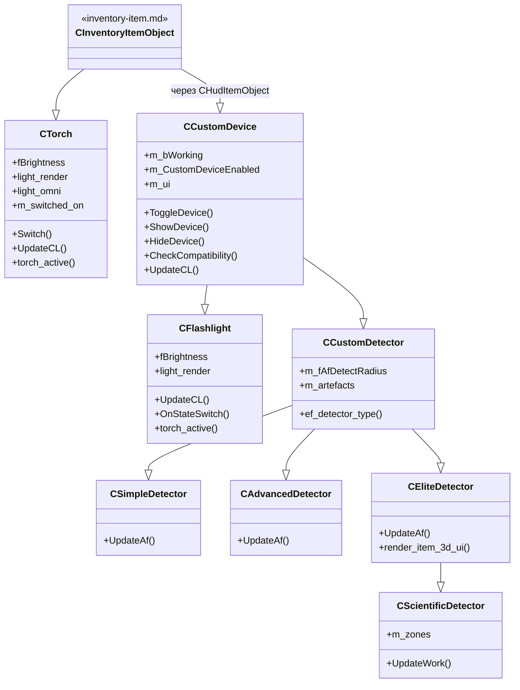
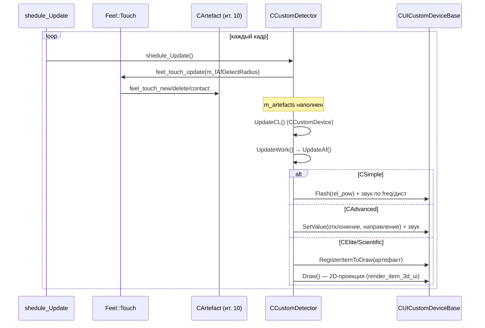
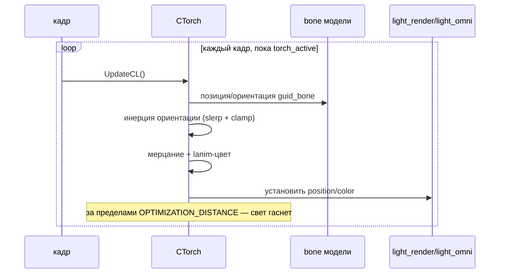
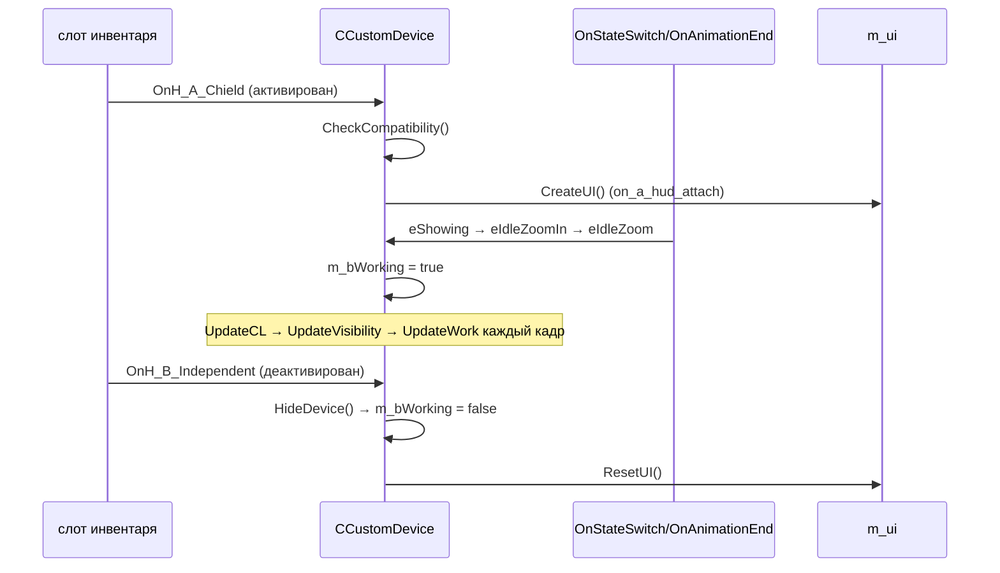

# Torch / Flashlight / CustomDevice / Detectors

> **Модуль:** `xrGame` · **Файлы:** `src/xrGame/Torch.h` (100 стр.), `src/xrGame/Torch.cpp` (561 стр.), `src/xrGame/Flashlight.h` (52 стр.), `src/xrGame/Flashlight.cpp` (319 стр.), `src/xrGame/CustomDevice.h` (73 стр.), `src/xrGame/CustomDevice.cpp` (952 стр.), `src/xrGame/CustomDetector.h` (58 стр.), `src/xrGame/CustomDetector.cpp` (266 стр.), `src/xrGame/SimpleDetector.h` (26 стр.), `src/xrGame/SimpleDetector.cpp` (173 стр.), `src/xrGame/AdvancedDetector.h` (26 стр.), `src/xrGame/AdvancedDetector.cpp` (173 стр.), `src/xrGame/EliteDetector.h` (57 стр.), `src/xrGame/EliteDetector.cpp` (555 стр.) · **Порцион:** 5.11

## 1. Ответственность и границы

Порцион покрывает «оборудование», которое игрок (и NPC) носят как предметы инвентаря, но которое не является оружием:

- **`CTorch`** — фонарик-факел: динамический свет, привязанный к модели, с инерцией ориентации и мерцанием. Наследник `CInventoryItemObject` (порц. 10) напрямую.
- **`CFlashlight`** — «флешлайт»: HUD-устройство на базе `CCustomDevice`, свет позиционируется через fire-deps (как у оружия).
- **`CCustomDevice`** — базовый класс «устройств» (HUD-устройства): механизм показа/скрытия в слоте, совместимость со слотами, UI-обвязка, зум, бросок, батарея.
- **`CCustomDetector`** и наследники **`CSimpleDetector`** / **`CAdvancedDetector`** / **`CEliteDetector`** / **`CScientificDetector`** — детекторы артефактов: обнаружение через `Feel::Touch`, звук по частоте/расстоянию, UI-отображение (простой «миг», стрелка, 2D-проекция, научный с зонами).

**Границы.** `CWeapon`-иерархия — ит. 8 (только взаимодействие: проверка зума/состояния оружия в `CheckCompatibility`). Сетевой код — ит. 12 (только сигнатуры `net_*`). `CHudItem`/HUD-система — порц. 18/21. `CArtefact` — ит. 10 (только `GetAfRank`/`CanBeInvisible`/`SwitchVisibility`). `CCustomZone` — порц. 24–26 (только `Position()`/`cNameSect()` в `CScientificDetector`).

## 2. Место в архитектуре

Иерархия классов (см. `inventory-item.md` — порц. 10):

```
CObject → CGameObject (game-object.md)
  └─ CInventoryItemObject (inventory-item.md)
      ├─ CTorch                          — фонарик (свой свет, не CCustomDevice)
      └─ CHudItemObject (CInventoryItemObject + CHudItem)
          └─ CCustomDevice               — базовое «устройство»
              ├─ CFlashlight             — флешлайт
              └─ CCustomDetector         — базовый детектор артефактов
                  ├─ CSimpleDetector     — m_af_rank = 1
                  ├─ CAdvancedDetector   — m_af_rank = 2
                  └─ CEliteDetector      — m_af_rank = 3
                      └─ CScientificDetector  — + зоны (m_zones)
```



Регистрация фабрики (`class-registry.md`, порц. 2) — `src/xrServerEntities/object_factory_register.cpp` L394–443:

| Класс                 | CLSID                       | Секция                       |
| --------------------- | --------------------------- | ---------------------------- |
| `CSimpleDetector`     | `CLSID_DETECTOR_SIMPLE`     | `device_detector_simple`     |
| `CAdvancedDetector`   | `CLSID_DETECTOR_ADVANCED`   | `device_detector_advanced`   |
| `CEliteDetector`      | `CLSID_DETECTOR_ELITE`      | `device_detector_elite`      |
| `CScientificDetector` | `CLSID_DETECTOR_SCIENTIFIC` | `device_detector_scientific` |
| `CTorch`              | `CLSID_DEVICE_TORCH`        | `device_torch`               |
| `CFlashlight`         | `CLSID_DEVICE_FLASHLIGHT`   | `device_flashlight`          |
| `CCustomDevice`       | `TEXT2CLSID("D_CUSTOM")`    | `device_custom`              |

Выгрузка в Lua (`src/xrGame/torch_script.cpp` L11–28): `CTorch`, `CPda`, `CScientificDetector`, `CEliteDetector`, `CAdvancedDetector`, `CSimpleDetector`. **`CFlashlight` в этот список не входит** — как класс Lua не экспортируется (скрипты могут получить только через общий API `CScriptGameObject`, ит. 14).

## 3. Публичный API

### `CTorch` (`Torch.h`)

| Метод                                                                              | Назначение                                                          |
| ---------------------------------------------------------------------------------- | ------------------------------------------------------------------- |
| `bool Switch()` / `void Switch(bool)`                                              | Вкл/выкл фонарика; `torch_active()` — текущее состояние             |
| `void SwitchLightOnly()`                                                           | Только переключить рендер-свет (без состояния)                      |
| `void SetLanim()` / `ResetLanim()`                                                 | Вкл/выкл анимацию цвета света (`lanim`)                             |
| `void UpdateCL()`                                                                  | Позиционирование света, инерция, мерцание, lanim-цвет (каждый кадр) |
| `void Load(LPCSTR section, ...)`                                                   | Чтение секции `device_torch`                                        |
| `bool can_be_attached()`                                                           | Можно ли прикрепить (активный предмет в руке)                       |
| `void enable(bool)`                                                                | Вкл/выкл обновление                                                 |
| `void create()/activate()/setup_physic_shell()`                                    | Создание/активация объекта и физического shell                      |
| `void afterAttach()/afterDetach()`                                                 | Колбэки прикрепления к руке                                         |
| `void renderable_Render()`                                                         | Рендер объекта (в т.ч. glow)                                        |
| `void net_Spawn/CSE_ALifeItemTorch*` / `net_Destroy` / `net_Export` / `net_Import` | Сеть (ит. 12): биты `eTorchActive`/`eNightVisionActive`/`eAttached` |
| `OnMoveToSlot` / `OnMoveToRuck` / `OnH_A_Chield` / `OnH_B_Independent`             | События инвентаря (порц. 10)                                        |

### `CFlashlight` (`Flashlight.h`)

| Метод                                                          | Назначение                                                                 |
| -------------------------------------------------------------- | -------------------------------------------------------------------------- |
| `UpdateCL()`                                                   | Позиционирование света по fire-deps (`vLastFP`), freelook, мерцание, lanim |
| `OnStateSwitch()` / `OnAnimationEnd()` / `OnMotionMark()`      | FSM-состояния `eShowing`/`eHiding` — создание/уничтожение света            |
| `bool torch_active()`                                          | `return m_bWorking;`                                                       |
| `void TurnDeviceInternal()`                                    | Вкл/выкл + фактор отображения на PDA                                       |
| `bool can_use_dynamic_lights()`                                | Разрешён ли динамический свет                                              |
| `void Load(LPCSTR section, ...)` / `net_Spawn(CSE_ALifeItem*)` | Чтение секции + сеть (ит. 12)                                              |

### `CCustomDevice` (`CustomDevice.h`)

| Метод                                                                                | Назначение                                                                                           |
| ------------------------------------------------------------------------------------ | ---------------------------------------------------------------------------------------------------- |
| `void ToggleDevice()` / `ShowDevice()` / `HideDevice()` / `ForceHide()`              | Управление видимостью устройства                                                                     |
| `bool IsWorking()`                                                                   | `m_bWorking && H_Parent == CurrentViewEntity`                                                        |
| `bool CheckCompatibility()` / `CheckCompatibilityInt()`                              | Совместимость со слотом (`INV_SLOT_2`, `KNIFE_SLOT`, `BOLT_SLOT`), проверки состояния оружия (ит. 8) |
| `void UpdateCL()`                                                                    | `UpdateVisibility` + логика батареи + `UpdateWork`                                                   |
| `void UpdateHudAdditional()`                                                         | Смещения HUD, инерция, стрейф, блендинг зума (~400 строк)                                            |
| `void UpdateWork()`                                                                  | `m_ui->update()` (переопределяется в детекторах)                                                     |
| `void on_a_hud_attach()`                                                             | `CreateUI()` при привязке к HUD                                                                      |
| `void OnStateSwitch()` / `OnAnimationEnd()`                                          | FSM: `eIdleZoom*`, `eIdleThrow*` (enum `EDeviceStates`)                                              |
| `void OnActiveItem()` / `OnHiddenItem()` / `OnMoveToRuck()`                          | События инвентаря                                                                                    |
| `void render_item_3d_ui()` / `render_item_3d_ui_query()`                             | 3D-UI устройства (переопределяется в `CEliteDetector`)                                               |
| Виртуальные: `CreateUI` / `ResetUI` / `TurnDeviceInternal` / `CheckCompatibilityInt` | Точки расширения для наследников                                                                     |

### `CCustomDetector` и наследники (`CustomDetector.h` и др.)

| Метод                                 | Назначение                                                          |
| ------------------------------------- | ------------------------------------------------------------------- |
| `void UpdateWork()` (базовый)         | `UpdateAf()` + `CCustomDevice::UpdateWork()`                        |
| `int ef_detector_type()`              | `return 1;` (тип для `entity-alive.md`, порц. 7)                    |
| `void shedule_Update()`               | `feel_touch_update(m_fAfDetectRadius)` — наполнение `m_artefacts`   |
| `m_af_rank` (по классу)               | 1/2/3 — минимальный ранг артефакта, который детектор видит          |
| `CSimpleDetector::UpdateAf()`         | Ближайший артефакт → звук по частоте/расстоянию, `ui().Flash()`     |
| `CAdvancedDetector::UpdateAf()`       | Ближайший артефакт → звук, `ui().SetValue(отклонение, направление)` |
| `CEliteDetector::UpdateAf()`          | Все артефакты → `ui().RegisterItemToDraw`                           |
| `CEliteDetector::render_item_3d_ui()` | `ui().Draw()` — 2D-проекция артефактов                              |
| `CScientificDetector::UpdateWork()`   | Рисует и артефакты, и зоны (`m_zones`)                              |

## 4. Внутреннее устройство

### `CTorch`

Ключевые поля (`Torch.h`): `fBrightness` (яркость), `lanim`/`def_lanim`/`def_clr` (анимация цвета), `guid_bone` (bone модели для привязки света), `light_trace_bone`, `light_render`/`light_omni` (`ref_light`), `glow_render` (`ref_glow`), `m_torch_offset`/`m_omni_offset` (`Fvector`), константы инерции `m_torch_inertion_speed_max/min`, `m_torch_inertion_clamp`, `m_bUseInertion`, поля мерцания, `m_sounds` (`HUD_SOUND_COLLECTION_LAYERED`), `m_switched_on`, `m_light_section`.

Константы: `TORCH_INERTION_CLAMP = PI_DIV_6`, `TORCH_INERTION_SPEED_MAX = 7.5f`, `TORCH_INERTION_SPEED_MIN = 0.5f`, `OPTIMIZATION_DISTANCE = 100.f` (за пределами света гаснет).

`UpdateCL()` — ядро: берёт позицию/ориентацию bone → применяет инерцию ориентации (slerp с ограничением `clamp`) → мерцание → lanim-цвет → обновляет `light_render`/`light_omni`/`glow_render`.

### `CFlashlight`

Поля: `fBrightness`, `lanim`/`def_lanim`/`def_color`, `light_trace_bone`, поля мерцания, `light_render`/`light_omni`, `glow_render`, `m_light_section`.

Отличие от `CTorch`: свет не привязан к bone модели, а позиционируется в `UpdateCL()` через fire-deps (`vLastFP`) с учётом freelook. Создание/уничтожение света — в FSM: `OnStateSwitch`/`OnAnimationEnd` при `eShowing`/`eHiding`.

### `CCustomDevice`

Поля: `m_bWorking` (вкл), `m_CustomDeviceEnabled` (разрешён вообще), `m_bFastAnimMode`, `m_bNeedActivation`, `m_bCanBeZoomed`/`m_bOldZoom`/`m_bZoomed`/`m_fZoomfactor`/`m_LastMBZoom` (зум), `m_bThrowAnm` (анимация броска), `m_hud_offset[2]`, `m_ui` (`CUICustomDeviceBase*` — UI-объект, создаётся в `CreateUI`).

`EDeviceStates`: `eIdleZoom` = 5, `eIdleZoomIn`, `eIdleZoomOut`, `eIdleThrowStart`, `eIdleThrow`, `eIdleThrowEnd`.

`UpdateCL()`: `UpdateVisibility()` (лестница/зум оружия/бросок) → батарея → `UpdateWork()`. `UpdateHudAdditional()` — самая большая часть: смещение HUD при стрейфе, инерция, блендинг зума (детали HUD-системы — порц. 18/21).

### `CCustomDetector`

Поля: `m_fAfDetectRadius` (радиус обнаружения), `m_fAfVisRadius` (радиус видимости для UI), `m_artefacts` (`CAfList`).

`CAfList : CDetectList<CArtefact>` — наследует от `Feel::Touch` (см. `feel.md`, порц. 27): `feel_touch_new/delete/contact` наполняют список. `m_af_rank` — фильтр по рангу.

Шаблон `CDetectList<K> : Feel::Touch`: `m_TypesMap` (`xr_map<shared_str, ITEM_TYPE>`), `m_ItemInfos` (`xr_map<K*, ITEM_INFO>`). `load(sect, prefix)` читает `prefix_class_N` / `prefix_freq_N` / `prefix_sound_N_`.

`ITEM_TYPE`: `freq` (`Fvector2` min/max), `detect_snds` (`HUD_SOUND_ITEM`), `zone_map_location`, `nightvision_particle`. `ITEM_INFO`: `curr_ref`, `snd_time`, `cur_period`, `pParticle`.

`CZoneList : CDetectList<CCustomZone>` — аналогичный список для зон (`CScientificDetector`).

## 5. Взаимодействие

- **`CInventoryItemObject`** (порц. 10, `inventory-item.md`) — родитель всех классов порциона; события `OnMoveToSlot`/`OnMoveToRuck`/`OnH_*` приходят оттуда.
- **`CActor`** (порц. 14–23) — носитель: `CurrentViewEntity`, слоты, `H_Parent`.
- **`Feel::Touch`** (порц. 27, `feel.md`) — механизм наполнения `m_artefacts`/`m_zones` в детекторах.
- **`CArtefact`** (ит. 10) — цель обнаружения: `GetAfRank`, `CanBeInvisible`, `SwitchVisibility`.
- **`CCustomZone`** (порц. 24–26) — цель для `CScientificDetector`: `Position()`, `cNameSect()`.
- **HUD-система / `CHudItem`** (порц. 18/21) — `m_ui`, `CreateUI`, `render_item_3d_ui`, `UpdateHudAdditional`.
- **`CWeapon`** (ит. 8) — `CheckCompatibility` проверяет состояние оружия в слоте; зум оружия влияет на `UpdateVisibility`.
- **Сеть** (ит. 12) — `CTorch`: `CSE_ALifeItemTorch` (`Net_Relevant` при `m_attached`, `UPDATE_Read/Write` — бит-маска `EStats`). Детекторы: `CSE_ALifeItemDetector` (ит. 11/12). `CFlashlight`/`CCustomDevice`: базовый `CSE_ALifeItem`.
- **Lua** — `torch_script.cpp` экспортирует `CTorch` и детекторы; `CPda` — порц. 12.

## 6. Потоки

### Детектор: цикл обновления



### Фонарик: `CTorch::UpdateCL`



### `CCustomDevice`: показ/скрытие



## 7. Конфигурация

Секции `lts_alife/lts_alife_devices` (примеры, ключи по `Load`):

- **`device_torch`** (`CTorch::Load`): `light_*` (параметры света, `LoadLightParams`), `brightness`, `torch_offset`, `omni_offset`, `inertion_*`, `flicker_*`, звуки (`m_sounds`), `lanim`.
- **`device_flashlight`** (`CFlashlight::net_Spawn`/`Load`): свет через `m_light_section`, `brightness`, `flicker_*`, `lanim`.
- **`device_detector_simple/advanced/elite/scientific`** (`CCustomDetector::Load`): `af_radius` → `m_fAfDetectRadius`, `af_vis_radius` → `m_fAfVisRadius`; для каждого типа артефакта: `af_class_N`, `af_freq_N` (min/max), `af_sound_N_` (звук). У `CScientificDetector` дополнительно секция зон.
- **`device_custom`** (`CCustomDevice::Load`): `snd_draw`, `snd_holster`, секция `hud`, `can_be_zoomed`, `throw_anim`, `old_zoom`.

## 8. Ограничения и дебаг

- `CTorch` и `CFlashlight` реализуют свет **разными путями** (bone vs fire-deps) — не объединять.
- `m_af_rank` — жёстко задан в конструкторе класса (1/2/3), не настраивается через ini.
- `CFlashlight` не экспортируется в Lua как отдельный класс.
- `UpdateHudAdditional` в `CCustomDevice` — самый объёмный метод (~400 строк); при отладке HUD-сдвигов смотреть именно его.
- Сеть: `CTorch` реплицирует только биты `EStats` — яркость/мерцание клиентские.
- Детектор не «видит» артефакты выше `m_af_rank` — если артефакт не обнаруживается, проверить ранг.

## 9. Ссылки

- [inventory-item.md](inventory-item.md) — `CInventoryItemObject` (порц. 10)
- [game-object.md](game-object.md) — `CGameObject` (порц. 3)
- [class-registry.md](class-registry.md) — регистрация фабрики (порц. 2)
- [entity-alive.md](entity-alive.md) — `ef_detector_type` (порц. 7)
- [feel.md](feel.md) — `Feel::Touch` (порц. 27)
- [medical-items.md](medical-items.md) — `CPda` и др. (порц. 12)
- [architecture/object-model.md](../../architecture/object-model.md) — обновляется в порц. 30

## 10. Источник

| Файл                                               | Строк    | Классы                                                                                |
| -------------------------------------------------- | -------- | ------------------------------------------------------------------------------------- |
| `src/xrGame/Torch.h`                               | 100      | `CTorch`                                                                              |
| `src/xrGame/Torch.cpp`                             | 561      | `CTorch`                                                                              |
| `src/xrGame/Flashlight.h`                          | 52       | `CFlashlight`                                                                         |
| `src/xrGame/Flashlight.cpp`                        | 319      | `CFlashlight`                                                                         |
| `src/xrGame/CustomDevice.h`                        | 73       | `CCustomDevice`, `EDeviceStates`                                                      |
| `src/xrGame/CustomDevice.cpp`                      | 952      | `CCustomDevice`                                                                       |
| `src/xrGame/CustomDetector.h`                      | 58       | `CCustomDetector`, `CAfList`, `CZoneList`, `CDetectList<K>`, `ITEM_TYPE`, `ITEM_INFO` |
| `src/xrGame/CustomDetector.cpp`                    | 266      | `CCustomDetector`                                                                     |
| `src/xrGame/SimpleDetector.h`                      | 26       | `CSimpleDetector`                                                                     |
| `src/xrGame/SimpleDetector.cpp`                    | 173      | `CSimpleDetector`, `CUIArtefactDetectorSimple`                                        |
| `src/xrGame/AdvancedDetector.h`                    | 26       | `CAdvancedDetector`                                                                   |
| `src/xrGame/AdvancedDetector.cpp`                  | 173      | `CAdvancedDetector`, `CUIArtefactDetectorAdv`                                         |
| `src/xrGame/EliteDetector.h`                       | 57       | `CEliteDetector`, `CScientificDetector`, `CUIArtefactDetectorElite`                   |
| `src/xrGame/EliteDetector.cpp`                     | 555      | `CEliteDetector`, `CScientificDetector`, `CUIArtefactDetectorElite`                   |
| `src/xrGame/torch_script.cpp`                      | ~30      | Lua-регистрация                                                                       |
| `src/xrServerEntities/object_factory_register.cpp` | L394–443 | Регистрация фабрики                                                                   |
| `src/xrServer_Objects_ALife_Items.h`               | L107–124 | `CSE_ALifeItemTorch`                                                                  |
