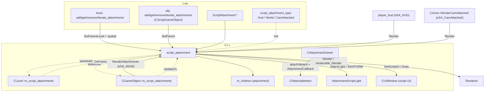

# Script: скриптовые вложения и биндер — script_attachment, CAttachmentOwner, CScriptBinder (порционы 45–46)

> **Модуль:** `xrGame` · **Файлы:** `script_attachment_manager.h` (241), `script_attachment_manager.cpp` (1185), `script_attachment_script.cpp` (128), `attachment_owner.h` (44), `attachment_owner.cpp` (210), `attachment_owner_inline.h` (18) · `script_binder.h` (39), `script_binder.cpp` (276), `script_binder_inline.h` (14), `script_binder_object.h` (39), `script_binder_object.cpp` (70), `script_binder_object_wrapper.h` (43), `script_binder_object_wrapper.cpp` (132), `script_binder_object_script.cpp` (38) · **Порционы 45–46, итерация 5**
>
> **Связанные точки:** `GameObject.cpp` (attachments — [порц. 3](game-object.md) §4.8), `Level.cpp:1435–1488` (level-хранилище), `level_script.cpp:2374–2400` / `2672–2677` (глобальные Lua-функции), `script_game_object.cpp:1357–1383` + `script_game_object_script3.cpp:701–705` (Lua-методы обёртки), `player_hud.cpp` / `HUDManager.cpp` / `Actor.cpp` (обходы рендера — [actor-hud.md](actor-hud.md)); **бinder:** `GameObject.h:53–56` + `GameObject.cpp:163/389/464/498/1092` (пробросы — [game-object-net.md §15](game-object-net.md), порц. 4), `script_game_object.cpp:341–349` (`bind_object`/`binded_object` — [script-game-object.md §4.9](script-game-object.md), порц. 17), `gamedata/scripts/bind_monster.script` (пример Lua-binder'а)

> **Страница:** три слоя скриптовой обвязки на `CGameObject`. **`CAttachmentOwner`** — C++-миксин для инвентарных навесок (`CAttachableItem`: фонарь/ПДА/прицелы на оружии): секции из ltx `attachable_items`, привязка предмета к кости визуала. **`script_attachment`** — полноценный Lua-объект (не `CObject`), висящий в одном из трёх хранилищ: на уровне (`CLevel`), на объекте (`CGameObject::m_script_attachments`) или на другом вложении (`m_children`); owns модель, тип (`eSA_HUD`/`eSA_World`/`eSA_CamAttached`), offset-трансформ, скриптовый свет/UI, анимации и bone-callback'и. **`CScriptBinder`** — миксин-мост C++↔Lua: владеет `CScriptBinderObject*`, создаваемым Lua-функцией из ltx-ключа `script_binding`, и пробрасывает в него весь жизненный цикл объекта (reload/spawn/update/save/load) под `try/catch`; в MP привязка не устанавливается.

**Чего это не делает**: не документирует сам метод `CGameObject::add/remove/get/iterate_attachment` и `update_visbox*` — они в [game-object.md](game-object.md) §4.8 (порц. 3); `CAttachableItem` (предметная сторона) — в [inventory-item.md](inventory-item.md) §4; `AttachmentScriptLight`/`ScriptLight` — порц. 47; Lua-методы `CScriptGameObject` целиком — итерация 14 ([script-game-object.md](script-game-object.md)); полный поток `CGameObject::net_Spawn`/`net_Destroy`/`net_Save` — [game-object-net.md](game-object-net.md) (порц. 4), здесь только binder-ветки; механика luabind `wrap_base`/`adopt<>` в общем виде — [scripting-boundary.md](../../architecture/scripting-boundary.md).

## 1. Назначение и место

```
CGameObject
 ├─ CAttachmentOwner ──────── m_attached_objects: CAttachableItem*   (C++-навески из инвентаря)
 └─ m_script_attachments ──── xr_map<shared_str, script_attachment*>  (Lua-вложения)
                                   │  или m_children (вложение на вложении)
CLevel::m_script_attachments ──────┘  (вложение на уровне, spatial-рендер)
```

| Слой | Класс | Хранилище | Кто рисует | Кто создаёт |
| --- | --- | --- | --- | --- |
| Инвентарные навески | `CAttachmentOwner` + `CAttachableItem` | `m_attached_objects` (vector) | `CAttachmentOwner::renderable_Render` → предмет | `attach()/detach()` из инвентаря/скрипта |
| Lua-вложения | `script_attachment` | map в `CLevel` / `CGameObject` / родительском `script_attachment` | по типу — §9 | Lua: `add_attachment`/`ScriptAttachment:add_attachment` |

Оба слоя висят на одном объекте независимо; у `CGameObject` есть `cast_attachment_owner()` (GameObject.h:73, возвращает `NULL` по умолчанию; `this` — `CActor`, `CAI_Stalker`, `CAI_Trader`).

## 2. Типы вложений (`script_attachment_type`)

`script_attachment_manager.h:9–15`:

| Значение | № | Назначение | Точка рендера |
| --- | --- | --- | --- |
| `eSA_HUD` | 0 | на руках/HUD-модели актёра или HUD-предмета | `player_hud` (§9) |
| `eSA_World` | 1 | в мире (на объекте или на уровне) | `RenderAttachments` / spatial-рендер |
| `eSA_CamAttached` | 2 | привязка к камере (прицелы-навески) | `CActor::RenderCamAttached` |
| `eSA_undefined` | 3 | невалидный маркер (граница клампа, в Lua не экспортируется) | — |

`SetType(u16)` (h:188): `m_type = type < eSA_undefined ? type : eSA_World` — всё ≥ `eSA_undefined` перекладывается в World. Дефолт в ctor — `eSA_World` (cpp:83).

## 3. Данные класса (`script_attachment_manager.h`)

`class script_attachment : public IRenderable, public ISpatial` (h:48–51).

| Поле | Тип | Где | Описание |
| --- | --- | --- | --- |
| `m_name` | `shared_str` | h:53 | ключ в родительском хранилище |
| `m_offset` | `Fmatrix` | h:55 | итоговый offset (пересчёт §6) |
| `m_attachment_offset[4]` | `Fvector` | h:56 | `[0]` позиция, `[1]` ротация (градусы), `[2]` scale (дефолт 1,1,1), `[3]` origin |
| `m_kinematics` | `IKinematics*` | h:58 | кинематика модели (≠ `renderable.visual` только по типу) |
| `m_model_name` / `m_current_motion` | `shared_str` | h:59–60 | текущая модель/анимация (дефолт `"idle"`, cpp:85) |
| `m_parent_bone` | `u16` | h:61 | кость родителя, к которой привязано |
| `m_script_ui_func` / `m_script_ui` | `LPCSTR` / `CUIWindow*` | h:63–64 | Lua-функция → 3D UI-окно |
| `m_script_ui_mat` / `m_script_ui_offset[4]` | `Fmatrix` / `Fvector[4]` | h:65–66 | transform UI (та же схема pos/rot/scale/origin) |
| `m_script_ui_bone` | `u16` | h:68 | кость для UI |
| `m_script_light` / `m_script_light_bone` | `AttachmentScriptLight*` / `u16` | h:70–71 | скриптовый свет (§10) |
| `m_bStopAtEndAnimIsRunning` / `m_anim_end` | `bool` / `u32` | h:73–74 | авто-возврат в `idle` (§12) |
| `m_type` | `u16` | h:76 | §2 |
| `m_parent_attachment` | `script_attachment*` | h:77 | родитель-вложение |
| `m_parent_object` | `CGameObject*` | h:78 | родитель-объект |
| `m_parent_level` | `bool` | h:79 | родитель — уровень (ровно один из трёх!) |
| `m_children` | `xr_map<shared_str, script_attachment*>` | h:80 | дочерние (owning) |
| `m_bone_callbacks` | `xr_map<u16, script_attachment_bone_cb*>` | h:81 | §11 |
| `m_userdata` | `luabind::object*` | h:83 | произвольная Lua-таблица (ленивая) |
| `m_last_upd_frame` | `u32` | h:85 | guard от двойного `Update` в кадре |

`script_attachment_bone_cb` (h:17–46): `{ m_bone_id (кость-источник у родителя, `BI_NONE` если functor), m_attachment_bone_id (кость внутри вложения), m_func (functor<Fmatrix>* или nullptr), m_attachment, m_mat (результат), m_overwrite }` — два ctor'а: functor-обёртка и «просто кость».

**Ctor** (cpp:55–91): `ISpatial(g_SpatialSpace)`, все offset'ы → тождественные, `spatial.type |= STYPE_RENDERABLE`, `LoadModel(model_name)` + `PlayMotion("idle", false)`.

**Dtor** (h:89–97): `spatial_unregister()`, `model_Delete(renderable.visual)`, `delete_data(m_children)`, `delete_data(m_bone_callbacks)`, `xr_delete(m_userdata)`.

## 4. Жизненный цикл: модель, имя, userdata

- **`LoadModel(model_name, keep_bc=false)`** (cpp:726–762): если имя не изменилось — return; `model_Delete`旧 → `model_Create`, `m_kinematics = dcast_PKinematics()`, `spatial_move()`; при `keep_bc && m_bone_callbacks.size() && count_prev <= LL_BoneCount()` — восстанавливает bone-callback'и и повторяет `PlayMotion(*m_current_motion, false)`; ставит kinematics-колбэк **`update_visbox_attachment`** (cpp:14–53) — для детей того же типа мержит их боксы/сферу в `k->GetBox()`/`visData.sphere` при `NeedUCalc()` (под `DEBUG_VISBOX` рисует OBB; определение макро выключено, cpp:8).
- **`SetName(name)`** (cpp:764–823): ветка по родителю (`m_parent_level` → `Level()`, `m_parent_object` → `obj->...`, `m_parent_attachment` → `m_children`): снимает старую запись **без** удаления (`remove_child(name, false)`); если под новым именем уже есть запись — `xr_delete` старого значения и подмена, иначе `emplace`; затем `m_name = name`. Актуальный переезд между родителями — через `SetParent` (§5), не через `SetName`.
- **Userdata** (cpp:825–853): `GetUserdata()` лениво создаёт `newtable`; `SetUserdata(obj)`: nil → `xr_delete` (удаление), не-table → `Msg("![Script Attachment]: ... Allowed types: table, nil")`, table → подмена.

## 5. Родительское дерево

Ровно **один** родитель из трёх вариантов; перепривязка снимает запись у старого (destroy=false, владение переходит) и ставит у нового:

| Метод | Где | Действие |
| --- | --- | --- |
| `SetParent(script_attachment*)` | cpp:409–433 | detach от attachment/object/level → `m_parent_attachment = att`, `att->AddChild(GetName(), this)`; `spatial_unregister()` |
| `SetParent(CGameObject*)` | cpp:435–459 | то же, но `m_parent_object = obj`, `obj->add_attachment(...)` |
| `SetParent(CScriptGameObject*)` | cpp:461–485 | то же через `&obj->object()` (Lua-точка) |
| `SetParentLevel()` | cpp:487–504 | `m_parent_level = true`, `Level().add_attachment(...)`, **`spatial_register()` + `spatial_move()`** (единственный вариант, где вложение spatial-зарегистрировано) |
| `GetParent()` | cpp:506–513 | таблица `{ object = CScriptGameObject|null, attachment = script_attachment|null, level = bool }` |
| `AddAttachment(name, model)` | cpp:93–100 | `xr_new` → `RemoveAttachment(name)` (замена) → `SetParent(this)` |
| `AddChild(name, att)` | cpp:515–521 | `R_ASSERT(att)`; `RemoveChild(name, true)`; `emplace` |
| `GetChild(name)` | cpp:523–533 | `find` в `m_children`, иначе `nullptr` |
| `RemoveChild(name, destroy=false)` | cpp:535–545 | `xr_delete` при destroy; `erase` |
| `RemoveAttachment(script_attachment*)` | cpp:102–106 | проверка `child->m_parent_attachment == this` → `RemoveChild(child->GetName(), true)` |
| `IterateAttachments(functor)` | cpp:547–555 | `functor(name, att) == true` → досрочный выход |

**Хранилища** (всё, куда можно положить вложение):

| Владелец | Файл | API |
| --- | --- | --- |
| `CGameObject` | GameObject.h:67,185–190,350; GameObject.cpp:865–939 | `add/get/remove_child/remove_attachment/iterate_attachments`, `GetAttachments()` — **подробно [game-object.md §4.8](game-object.md)** (порц. 3), включая `update_visbox`/`update_visbox_hud` |
| `CLevel` | Level.h:247–253,355; Level.cpp:1435–1488 | зеркальный набор: `add_attachment` (`R_ASSERT`, `remove_child(name,true)`, `emplace`), `get_attachment`, `remove_child(name, destroy)`, `remove_attachment(child)` (сверка указателя), `iterate_attachments`; удаляется в dtor'е (Level.cpp:291 `delete_data`) |
| `script_attachment` | §5 выше | `m_children` (h:233 `GetAttachments()` возвращает `&m_children` — тот же интерфейс) |

## 6. Трансформы и spatial

- **`RecalcOffset()`** (cpp:355–383): ротация градусы → радианы (`rotation.mul(PI/180.f)`); при заданном origin — `translate(-origin)` → `HPB` → `scale` → `translate(position)`; иначе `setHPB` → `translate_over(position)` → `mulB(scale)` → в `m_offset`; если `m_parent_level` — дополнительно `renderable.xform = m_offset; spatial_move()`.
- **Сеттеры** (cpp:385–407): `SetPosition/Rotation/Scale/Origin` пишут в `m_attachment_offset[i]` и зовут `RecalcOffset()`; `SetScale(float)` — из одного числа (h:129). Геттеры inline (h:121–134), `GetTransform()` = `renderable.xform` (h:229), `GetOffset()` = `m_offset` (h:230).
- **Spatial** (cpp:108–128): `spatial_register/move` — `sphere.P` = `xform · визуальная сфера`, `R` = `визуальный R × max(scale)`; `spatial_unregister` — делегат. Зарегистрирован только level-режим (§5).
- **`Box()`** (cpp:1014–1017) = `visual->dcast_PKinematics()->GetBox()`; **`GetCenter()`** (cpp:1019–1025) — центр визуальной сферы (или `{0,0,0}` без визуала).

## 7. Рендер и Update

**`renderable_Render()`** (cpp:130–167) — вызывается рендерером через spatial (**level-вложения**, `eSA_World`): свет → по кости `m_script_light->SetXFORM(xform · кость)`; UI — в R1 кладёт в `g_pGamePersistent->AttachmentUIsToRender` (IGame_Persistent.h:126; оттуда `HUDManager.cpp:195–198`), иначе `RenderUI()`; `UpdateTracks` + `CalculateBones`; `set_Transform` + `add_Visual`; рекурсия `children → Render(m_kinematics, &renderable.xform)`.

**`Render(IKinematics* model, Fmatrix* mat)`** (cpp:169–209) — внешний вход для **объектных** вложений: `xform = *mat` если `!model` или на вложении bone-callback №0 с реальной костью, иначе `xform = mat · BoneTransform(model)`; далее `mulB_43(m_offset)`, свет, кости (для анимированных **и** `eSA_CamAttached` всегда), `set_Transform`/`add_Visual`, рекурсия детей.

**`Update()`** (cpp:211–298):
1. guard `m_last_upd_frame == Device.dwFrame` (повторные вызовы в кадре игнорируются);
2. `m_script_ui->Update()`;
3. конец анимации (`m_bStopAtEndAnimIsRunning && dwTimeGlobal >= m_anim_end`) → `PlayMotion("idle")` (§12);
4. расчёт `m_bone_callbacks` (§11);
5. рекурсия `children → Update()`.

Вызывается из: `CGameObject::UpdateCL` (GameObject.cpp:1284–1288) — объектные; `CLevel::OnFrame` (Level.cpp:1176–1177) — level-вложения.

**`RenderUI()`** (cpp:300–333): если есть `m_script_ui` — `pttLIT` + cull `cmNONE`, матрица `xform · кость(m_script_ui_bone) · m_script_ui_mat` → `UIRender->CacheSetXformWorld` → `m_script_ui->Draw()` (cull/pointType восстанавливаются); затем дети.

## 8. Кости: запросы и видимость

| Метод | Где | Поведение |
| --- | --- | --- |
| `bone_id(name)` | cpp:660–667 | `LL_BoneID`, пустая строка → `BI_NONE` |
| `bone_name(id)` | cpp:708–712 | `LL_BoneName_dbg`, `BI_NONE` → `""` |
| `bone_transform(id)` | cpp:671–684 | `renderable.xform · LL_GetTransform(id)`; невалидный id → root-кость (+ отладочный `Msg`/`print_stack` под `-dbg print_bone_warnings`) |
| `bone_position/bone_direction(id)` | cpp:686–697 | `.c` / `getHPB` от `bone_transform` |
| `bone_parent(id)` | cpp:699–706 | `LL_GetData(id).GetParentID()`, root/невалидный → `BI_NONE` |
| `list_bones()` | cpp:715–724 | Lua-таблица `{ id = name }` из `LL_Bones()` («demonized: list all bones») |
| `SetParentBone(name)` | cpp:643–658 | у `m_parent_object` → `lua_game_object()->bone_id(name, m_type == eSA_HUD)`; у attachment → `parent->bone_id(name)`; иначе 0 |
| `SetBoneVisible/GetBoneVisible` | cpp:622–641 | `LL_SetBoneVisible`/`LL_GetBoneVisible` + `CalculateBones_Invalidate/CalculateBones`; невалидный id → `false` |

`BoneTransform(IKinematics*)` (cpp:557–565) — трансформ `m_parent_bone` у **внешней** модели (или root, если кость не влезла); используется в `Render` (§7).

## 9. Кто рисует какой тип

| Тип / владелец | Вызов | Где |
| --- | --- | --- |
| World, объектный | `CGameObject::renderable_Render → RenderAttachments()`: `att->Render(Visual()->dcast_PKinematics(), &XFORM())`; UI — R1 → очередь `AttachmentUIsToRender`, иначе `RenderUI()` | GameObject.cpp:754, 757–775 |
| World, level-вложение | spatial-рендер → `script_attachment::renderable_Render()` (§7) | cpp:130 |
| CamAttached | `CHUDManager::RenderCamAttached` → `CActor::RenderCamAttached`: первый глаз, `active_phase()==0`, флаги `set_HUD/set_CamAttached(TRUE)`, матрица камеры → `att->Render(nullptr, &cam)` | HUDManager.cpp:181; Actor.cpp:2184–2209 |
| CamAttached, UI | `RenderCamAttachedUIQuery` (есть ли хотя бы одно) / `RenderCamAttachedUI` → `att->RenderUI()` | HUDManager.cpp:214–225, 235–243 |
| HUD, на актёре | `player_hud::render_hud`: `parent_bone < 21` → **левая** рука (`m_model_2`/`m_transform_2`), иначе правая (`m_model`); `player_hud::render_item_ui` → `RenderUI()` | player_hud.cpp:978–994, 943–948 |
| HUD, на HUD-предмете | `attachable_hud_item::render` → `Render(m_model, &m_item_transform)`; `render_item_ui` → `RenderUI()` | player_hud.cpp:336–343, 355–362 |

## 10. Скриптовый свет

`AttachLight(AttachmentScriptLight*)` / `DetachLight()` / `GetLight()` (cpp:335–353): хранит указатель (`R_ASSERT` при attach, `DetachLight` возвращает и обнуляет). Позиция света обновляется **в каждом рендере** (§7): `SetXFORM(renderable.xform · трансформ m_script_light_bone)` (bone-фоллбэк — root). `SetScriptLightBone`/`GetScriptLightBone` — h:113–115. `AttachmentScriptLight : public ScriptLight` — script_light_inline.h:231 (свой `m_offset`, `SetPosition/SetDirection/SetXFORM`) — класс света порц. 47.

## 11. Bone-callback'и

`SetBoneCallback` ×6 перегрузок (cpp:933–1003) — «привязать кость вложения к кости/functor'у родителя»:

- строковые варианты резолвят имя кости родителя через `m_parent_object->lua_game_object()->bone_id(parent_bone, m_type == eSA_HUD)` или `m_parent_attachment->bone_id(...)`; без родителя — `Msg("![SetBoneCallback]: Parent has no bone with name %i", parent_bone)` (**`%i` для строки** — §25);
- ядро (cpp:967–983): проверка `bone_id < LL_BoneCount`, сброс прежнего колбэка, `m_bone_callbacks[bone_id] = new cb`, `LL_GetBoneInstance(...).set_callback(bctCustom, ScriptAttachmentBoneCallback, cb, overwrite)`;
- functor-вариант (cpp:985–1003): в `m_mat` сразу кладётся `mTransformHidden` (видимая поза без модификаторов);
- `RemoveBoneCallback` (cpp:1005–1012): `reset_callback` + `erase`.

**`ScriptAttachmentBoneCallback(CBoneInstance*)`** (cpp:925–931): `target = GetBoneVisible(bone) ? mTransform : mTransformHidden`; `target = cb->m_mat` — то есть **видимость кости внутри вложения переключает, какую позу получает модификатор**.

Сами `m_mat` обновляются в `Update` (cpp:225–289): functor-ветка → результат Lua-функции `(mTransformHidden, имя кости)`; иначе `m_mat` = трансформ `m_bone_id` **у родителя**: для `eSA_HUD` + `CHudItem`-родитель → `HudItemData()->m_model`; для `eSA_HUD` + `CActor` → `g_player_hud`: `bone < 21` → `m_model_2` (левая рука), иначе `m_model`; для объекта → `parent->Visual()->dcast_PKinematics()`; для attachment → `parent->m_kinematics`; невалидная кость → `Fidentity`.

## 12. Анимации

- **`PlayMotion(name, mixin=true, speed=1.f)`** (cpp:567–603): `ID_Cycle_Safe(name)`, фоллбэк `"idle"`; `PlayCycle(pid, M2, mixin, ...)` **на каждую партицию**; длина — `motion_length` (cpp:605–620): только при флаге `esmStopAtEnd` — root-motion длина / (`Dequantize(speed)` × `speed`) × 1000 мс; при `length > 0` ставит `m_bStopAtEndAnimIsRunning/m_anim_end`; `UpdateTracks` + `CalculateBones_Invalidate/CalculateBones`; возвращает длину (0 = «бесконечная»).
- `Update` (§7) по истечении `m_anim_end` сам возвращает `"idle"` — одноразовые анимации без скриптового цикла.
- ctor зовёт `PlayMotion("idle", false)` (cpp:90).

## 13. Скриптовый 3D UI

- **`SetScriptUI(ui_func)`** (cpp:855–875): Lua-функция → functor → результат должен быть `CUIDialogWndEx*` (кастится в `CUIWindow*`); иначе `Msg` об ошибке; дубликат имени игнорируется.
- **`RecalcScriptUIOffset()`** (cpp:877–899) и **сеттеры** `set_ui_position/rotation/scale/origin` (cpp:901–923) — та же схема pos/rot(градусы)/scale/origin, что `RecalcOffset` (§6), но в `m_script_ui_mat`; `SetScriptUIBone` — h:176–178.
- Рисование — `RenderUI()` (§7).

## 14. CAttachmentOwner — инвентарные навески (C++)

`attachment_owner.h:15–42`, поля: `m_attach_item_sections` (ltx-секции), `m_attached_objects` (`CAttachableItem*`, owning-контейнер).

| Метод | Где | Действие |
| --- | --- | --- |
| `reload(section)` | cpp:20–34 | из `pSettings[section]["attachable_items"]` (список через пробел) заполняет `m_attach_item_sections`; нет строки — чистит |
| `reinit()` | cpp:36–39 | `VERIFY(m_attached_objects.empty())` |
| `net_Destroy()` | cpp:41–53 | `R_ASSERT(attached_objects().empty())` (+ DEBUG-сообщение) |
| `renderable_Render()` | cpp:55–61 | перебор `m_attached_objects → renderable_Render()` (делегат визуалу предмета) |
| `attach(item)` | cpp:83–109 | дедуп по ID; `can_attach` → `smart_cast<CAttachableItem*>`; при первом — `add_visual_callback(AttachmentCallback)`; `set_bone_id(LL_BoneID(bone_name()))`; `push_back`; `setVisible(true)`; `afterAttach()` |
| `detach(item)` | cpp:111–133 | find по ID → `erase`; `afterDetach()`; при пустом списке — `remove_visual_callback` + `setVisible(false)` |
| `can_attach(item)` | cpp:145–161 | каст + `enabled()` + `can_be_allocated`-проверка `can_be_attached()`; секция ∈ `m_attach_item_sections`; такой секции ещё нет среди присоединённых |
| `reattach_items()` | cpp:163–177 | перевзятие `bone_id` для всех (после смены визуала) |
| `attachedItem(clsid/id/section)` | cpp:179–210 | линейный find; по секции дополнительно `!IsInvalid()` |
| `attached(item/sect)` | cpp:135–143 | `!= nullptr` от `attachedItem` |
| `attached_objects()` | inline.h:15 | константный доступ к вектору |

**`AttachmentCallback(IKinematics*)`** (cpp:63–81) — глобальный visual-callback: `XFORM предмета = XFORM владельца · (трансформ кости · offset предмета)` — т.е. **каждый кадр** позиционирует навеску по кости. Кости/offset самого `CAttachableItem` — [inventory-item.md §4](inventory-item.md).

Вызовы: `attach/detach` — из инвентаря/скрипта (`script_game_object_inventory_owner.cpp:1446`), `cast_attachment_owner`-диспетчеризация — `attachable_item.cpp:90,102` (`enable`), `InventoryOwner.cpp:99,104,171,331` делегирует `reload/reinit/net_Destroy/renderable_Render`.

## 15. Lua-поверхность

**Глобальные функции** (`level_script.cpp:2374–2400`, def'ы `2672–2677`):

| Lua | C++ | Что делает |
| --- | --- | --- |
| `add_attachment(name, model)` | `AddAttachment` → `SetParentLevel()` | вложение на уровне |
| `get_attachment(name)` | `Level().get_attachment` | `script_attachment*`/nil |
| `remove_attachment(name\|att)` | 2 перегрузки → `Level().remove_attachment` | |
| `iterate_attachments(f)` | `Level().iterate_attachments` | `f(name, att) == true` → стоп |

**Методы `CScriptGameObject`** (`script_game_object.cpp:1357–1383`, def'ы `script_game_object_script3.cpp:701–705`, «Lucy: Script Attachments»): те же пять, но `add_attachment` → `att->SetParent(&object())` (вложение на объект).

**Класс `ScriptAttachment`** (`script_attachment_script.cpp:8–127`) + enum `script_attachment_type` (`Hud`/`World`/`CamAttached`):

| Группа | Методы |
| --- | --- |
| parent | `set_parent` ×2 (`ScriptAttachment*`/`CScriptGameObject*`), `set_parent_level`, `get_parent` |
| child | `add_attachment`, `get_attachment`, `remove_attachment` ×2, `iterate_attachments` |
| offset | `set_position`/`set_rotation`/`set_origin`/`set_scale` ×2–3 (vector/floats), `get_position`/`get_rotation`/`get_origin`/`get_scale`, `get_transform`, `get_center` |
| bones | `bone_id`, `bone_name`, `bone_visible` ×2, `set_bone_visible` ×2, `bone_transform`/`bone_position`/`bone_direction` ×2, `bone_parent` ×2, `set_parent_bone` ×2, `get_parent_bone`, `list_bones` |
| bone callbacks | `bone_callback` ×6 (по id/имени × кость-родитель/имя/functor), `remove_bone_callback` ×2 |
| other | `set_type`, `get_type`, `set_model`, `get_model`, `set_name`, `get_name`, `play_motion` |
| script UI | `set_ui`, `get_ui`, `set_ui_bone` ×2, `get_ui_bone`, `set_ui_position/rotation/scale/origin` ×2, `get_ui_*` ×4 |
| light | `attach_light`, `detach_light`, `get_light`, `set_light_bone` ×2, `get_light_bone` |
| shaders | `get_shaders`, `get_default_shaders`, `set_shader`, `reset_shader` |
| userdata | свойство `userdata` (get/set, §4) |

**Шейдеры** (cpp:1027–1185): `GetShaders`/`GetDefaultShaders` возвращают Lua-таблицы `{ [id] = {shader=, texture=} }` по детям визуала (`get_children`/`get_children_invisible`, debug-шейдеры; без детей — один элемент с debug-шейдером, без визуала — `{error=true}`); `SetShaderTexture(id, shader, texture)` / `ResetShaderTexture(id)` — `id < 1` → применить ко всем детям, иначе по `getID()`.

## 16. Назначение: `CScriptBinder` — мост C++↔Lua

```
CGameObject : public CObject, public CUsableScriptObject, public CScriptBinder   (GameObject.h:53–56)
                     │                          │                      │
              базовый движок              use() для Lua        m_object → Lua-бinder
```

- `CScriptBinder` (`script_binder.h:15–37`) — миксин с единственным полем `m_object` (`CScriptBinderObject*`, h:18, NULL до привязки) и виртуальным жизненным циклом, зеркальным Lua-объекту.
- Привязка создаётся из ltx-секции объекта: ключ `script_binding` → Lua-функция → `obj:bind_object(object_binder(obj))` (§18).
- Вызовы из `CGameObject` (полная таблица — §19): `reload`/`reinit`/`shedule_Update` — только `!g_dedicated_server`; `net_Spawn`/`net_Destroy`/`save`/`load`/`net_SaveRelevant` — без гейтов; `net_Relcase` — **закомментирован**. Каркас `net_Spawn`/`net_Destroy` — [game-object-net.md §4–5](game-object-net.md) (порц. 4), здесь только binder-ветки.
- Единственный потребитель `object()` вне `CGameObject` — `CPhysicObject::net_Spawn` (PhysicObject.cpp:62): `!CScriptBinder::object()` входит в условие `SheduleUnregister()` — небрейкающийся физический объект без скриптовой привязки снимается со шедулинга.

## 17. Данные и API (`script_binder.h` 39, `script_binder_inline.h` 14)

| Метод | script_binder.cpp | Поведение |
| --- | --- | --- |
| ctor / dtor | 22–30 | `init()`; dtor — `VERIFY(!m_object)` (привязка должна быть снята до dtor) |
| `init()` | 32–35 | `m_object = 0` |
| `clear()` | 37–48 | `try { xr_delete(m_object) } catch (...) { m_object = 0 }` + `init()` — грубое снятие привязки |
| `reinit()` | 50–75 | `m_object->reinit()`; исключение → `clear()`; блоки `DEBUG_MEMORY_MANAGER` (Msg разницы `Memory.mem_usage()`) |
| `Load(section)` | 77–79 | **пустая; не вызывается никем** (`CGameObject::Load` не делегирует) — мёртвый виртуал |
| `reload(section)` | 81–132 | привязка — §18; `#ifndef DBG_DISABLE_SCRIPTS` |
| `net_Spawn(DC)` | 134–164 | §19 |
| `net_Destroy()` | 166–183 | §19 |
| `set_object(object)` | 185–199 | §18 |
| `shedule_Update(dt)` | 201–214 | §19 |
| `save` / `load` | 216–244 | §19 |
| `net_SaveRelevant()` | 246–260 | §19 |
| `net_Relcase(CObject*)` | 262–276 | §19 |
| `object()` | inline.h:11–14 | `IC`-геттер `m_object`; включён из h:39 |

## 18. Привязка: `reload(section)` → `script_binding` → `set_object`

1. `CGameObject::net_Spawn` → `reload(*cNameSect())`, затем `if (!g_dedicated_server) CScriptBinder::reload(*cNameSect())` (GameObject.cpp:387–389), далее `reinit()` + `CScriptBinder::reinit()` (L391–393).
2. `CScriptBinder::reload` (cpp:81–132): `VERIFY(!m_object)` (L89 — повторный `reload` падает в debug); нет ключа `script_binding` в секции → return (L90–91); `ai().script_engine().functor(pSettings->r_string(section, "script_binding"), ...)` — не загрузился → лог `function %s is not loaded!` + return (L93–99); иначе `lua_function(game_object ? game_object->lua_game_object() : 0)` в `try/catch` (исключение → `clear()`, L103–111).
3. Lua-функция делает `obj:bind_object(binder)` → `CScriptGameObject::bind_object` (script_game_object.cpp:346–349) → `CScriptBinder::set_object` (cpp:185–199).
4. Если после functor `m_object` создан — `m_object->reload(section)` в `try/catch` → `clear()` (L113–123).

**`set_object` (cpp:185–199):**

| Режим | Поведение |
| --- | --- |
| `IsGameTypeSingle()` | `VERIFY2(!m_object, "Cannot bind to the object twice!")` + `_DEBUG`-Msg `Core object %s is binded...` + `m_object = object` |
| иначе (MP) | **`xr_delete(object)`** — Lua-binder уничтожается сразу, привязки нет |

- `bind_object` экспортирован с `adopt<2>()` (script_game_object_script2.cpp:226) — владение переходит C++ (`set_object`), Lua-GC объект не трогает; `binded_object()` (cpp:341–344: `object().object()`) — script_game_object_script3.cpp:59.
- Асимметрия гейтов: `reload` гейтится только `g_dedicated_server`, а `set_object` — `IsGameTypeSingle()`; в MP Lua-функция `script_binding` выполняется, а созданный биндер тут же удаляется.

## 19. Жизненный цикл: все вызовы с `try/catch → clear()`

| Метод | Вызывается из | Поведение / возврат |
| --- | --- | --- |
| `reinit()` | GameObject.cpp:393 (`!g_dedicated_server`) | `m_object->reinit()`; исключение → `clear()` |
| `net_Spawn(DC)` | GameObject.cpp:464 (DEBUG) / 471 (release) | `smart_cast<CSE_ALifeObject*>`; `object && m_object` → `m_object->net_Spawn(object)` (возврат Lua); исключение → `clear()`; иначе/после — **`return TRUE`** (ошибка скрипта не блокирует спавн) |
| `net_Destroy()` | GameObject.cpp:163 | `_DEBUG`-Msg `Core object %s is UNbinded...`, `m_object->net_Destroy()`, затем безусловный `xr_delete(m_object)`; вызывается **до** `xr_delete(m_lua_game_object)` — Lua-binder рушится раньше Lua-обёртки объекта |
| `shedule_Update(dt)` | GameObject.cpp:1091–1092 (`!g_dedicated_server`) | каждый кадр, если `m_object` |
| `save` / `load` | GameObject.cpp:498 / 525 (в chunk'ах `net_Save`/`net_Load`) | делегирует `m_object->save/load` |
| `net_SaveRelevant()` | GameObject.cpp:1095–1098 | `return m_object->net_SaveRelevant()`; нет объекта/исключение → **FALSE**; `CGameObject` возвращает **только** это — наследники OR-ят своё (`CBaseMonster::net_SaveRelevant` = inherited \|\| `PPhysicsShell()`, base_monster_net.cpp:17–19) |
| `net_Relcase(CObject*)` | **закомментирован** (GameObject.cpp:1160–1164, demonized: *«Causes more allocations for lua gc…»*) | `m_object->net_Relcase(game_object->lua_game_object())` — на практике не вызывается |

`catch (...)` — грубый перехват: любое исключение (Lua или C++) уничтожает привязку (`clear()` = `xr_delete` + null); объект продолжает жить без скриптовой части.

## 20. Режимы и асимметрии

| Режим / флаг | Эффект |
| --- | --- |
| MP (`IsGameTypeSingle() == false`) | `set_object` удаляет Lua-binder (cpp:195–198); `reload` при этом отрабатывает (гейт только dedicated) |
| `g_dedicated_server` | `reload`/`reinit`/`shedule_Update` не вызываются (GameObject.cpp:388, 392, 1091); `net_Spawn`/`save`/`load` — вызываются |
| `DBG_DISABLE_SCRIPTS` (script_binder.cpp:19–20) | `//#define` закомментирован (*«comment next string when commiting»*) — при раскомментировании тело `reload` целиком исчезает, биндер никогда не создаётся |
| DEBUG vs release в `CGameObject::net_Spawn` | release (GameObject.cpp:466–470): сначала `_G.CGameObject_NetSpawn(lua_game_object())`, затем `CScriptBinder::net_Spawn`; DEBUG (L464): только `CScriptBinder::net_Spawn` — **`_G.CGameObject_NetSpawn` в DEBUG не вызывается** |
| `net_spawn_after` (searchlight.cpp:170–178, WeaponStatMgun.cpp:409–417) | ключ ltx-секции → Lua-функтор **после** чтения конфигов движком; комментарий: *«net_spawn() of CScriptBinderObjectWrapper runs first. This allows overriding configs read in engine net_Spawn()»* — основной binder-`net_spawn` отработал в `inherited::net_Spawn`, второй хук перекрывает прочитанное |

## 21. `CScriptBinderObject` — базовая Lua-привязка

`script_binder_object.h` (39) / `script_binder_object.cpp` (70):

- `typedef CSE_ALifeObject* SpawnType` (h:20); публичное `CScriptGameObject* m_object` (h:21) — back-reference на Lua-обёртку.
- Виртуальные хуки (h:26–36): `reinit`, `reload(section)`, `net_Spawn` → `true` (cpp:34–37), `net_Destroy`, `net_Import`, `net_Export`, `shedule_Update`, `save`, `load`, `net_SaveRelevant` → `false` (cpp:63–66), `net_Relcase(CScriptGameObject*)`.
- Все дефолты — no-op (cpp:26–70); dtor в `_DEBUG` логирует `Destroying binded object %s` (cpp:18–24).
- `DECLARE_SCRIPT_REGISTER_FUNCTION` (h:38) — авто-регистрация в Lua (механика реестра — итерация 14/18).
- `CScriptBinder` зовёт эти виртуалы (§19); рабочие реализации приходят из Lua через wrapper (§22).

## 22. `CScriptBinderObjectWrapper` — luabind `wrap_base`

`script_binder_object_wrapper.h` (43) / `script_binder_object_wrapper.cpp` (132):

- `class CScriptBinderObjectWrapper : public CScriptBinderObject, public ::luabind::wrap_base` (h:16).
- Паттерн на каждый метод (h:21–42): виртуальная `method()` → `::luabind::call_member<T>(this, "lua_name", ...)` (cpp:23–132) — диспетчеризация в переопределение Lua-класса; статическая `method_static(...)` → прямой вызов `CScriptBinderObject::method(...)` — базовая C++-реализация для «Lua не переопределила».
- Регистрация (`script_binder_object_script.cpp:18–38`): `class_<CScriptBinderObject, CScriptBinderObjectWrapper>("object_binder")` + `def_readonly("object", &m_object)` + `constructor<CScriptGameObject*>()` + по `.def` на каждый метод с парой `&C::method, &Wrapper::method_static`.

## 23. Lua-поверхность: `object_binder` и `bind_object`

| C++ (`CScriptBinderObject`) | Lua (`object_binder`) | C++ (`CScriptBinderObject`) | Lua (`object_binder`) |
| --- | --- | --- | --- |
| `reinit` | `reinit` | `save` | `save` |
| `reload` | `reload` | `load` | `load` |
| `net_Spawn` | `net_spawn` | `net_SaveRelevant` | `net_save_relevant` |
| `net_Destroy` | `net_destroy` | `net_Relcase` | `net_Relcase` (**с большой R**) |
| `net_Import` / `net_Export` | `net_import` / `net_export` | `shedule_Update` | **`update`** |
| `m_object` (field) | `object` (`def_readonly`) | ctor | `object_binder(CScriptGameObject*)` |

- `CScriptGameObject::bind_object` / `binded_object` — script_game_object.cpp:341–349 (обзор API — [script-game-object.md §4.9](script-game-object.md), порц. 17); экспорты: script_game_object_script2.cpp:226 (`adopt<2>`), script_game_object_script3.cpp:59.
- **Пример** `gamedata/scripts/bind_monster.script`: `bind(obj)` (L5–7) → `obj:bind_object(generic_object_binder(obj))`; `class "generic_object_binder" (object_binder)` (L12); переопределения вызывают базу явно (`object_binder.reinit(self)` L19, `object_binder.update(self, delta)` L51), `net_spawn` проверяет возврат базы (L295–297), есть `net_save_relevant` (L403); MP-патч `aaaa_script_fixes_mp.script:1295–1297` монкей-патчит `net_destroy`.
- `net_Import`/`net_Export` экспортируются в Lua, но у `CScriptBinder` **нет** одноимённых методов — движок их не вызывает (§25, п. 15).
- В репозитории ltx-ключей `script_binding` нет (базовые конфиги игры отсутствуют — только мод-оверлеи); ключевой пример `net_spawn_after` — §20.

## 24. Связи



```mermaid
graph TD
    subgraph Lua
        SBIND["ltx: script_binding → функция"]
        OB["object_binder (Lua-класс)<br/>reinit/reload/net_spawn/update/save/load/…"]
        BIND["obj:bind_object(binder)<br/>CScriptGameObject::bind_object"]
    end
    subgraph C++
        SB["CScriptBinder (миксин CGameObject)"]
        SBO["CScriptBinderObject"]
        WRAP["CScriptBinderObjectWrapper<br/>(luabind wrap_base)"]
        GO2["CGameObject-вызовы:<br/>reload/net_Spawn/net_Destroy/<br/>shedule_Update/save/load"]
    end
    SBIND -->|functor(lua_game_object())| OB
    OB -->|adopt<2>| BIND
    BIND -->|set_object (Single)| SB
    SB -->|m_object| SBO
    WRAP -.наследует + wrap_base.-> SBO
    OB -.класс Lua.-> WRAP
    GO2 -->|try/catch → clear| SB
    SB -.->|net_SaveRelevant / save / load| PKT["NET_Packet / IReader"]
    SBO -.-> CSE["CSE_ALifeObject (net_Spawn)"]
```

**Связи с другими страницами:** `CGameObject`-хранилище и `update_visbox*` — [game-object.md §4.8](game-object.md) (порц. 3); `delete_data(m_script_attachments)` в dtor — [game-object-net.md](game-object-net.md), Level.cpp:291; обходы `eSA_HUD`/`eSA_CamAttached` — [actor-hud.md](actor-hud.md) (порц. 32); `CAttachableItem` — [inventory-item.md §4](inventory-item.md) (порц. 10); `CScriptGameObject::AddAttachment` — [script-game-object.md](script-game-object.md) (порц. 17); `AttachmentScriptLight`/`ScriptLight` — порц. 47; Lua-функции уровня — [level-скрипты](../../architecture/scripting-boundary.md). **Бinder:** пробросы жизненного цикла и `save`/`load`-chunk'и — [game-object-net.md §4–7/§15](game-object-net.md) (порц. 4); `bind_object`/`binded_object` как Lua API — [script-game-object.md §4.9](script-game-object.md) (порц. 17); `CScriptBinder` в иерархии `CGameObject` — [object-model.md](../../architecture/object-model.md); пример Lua-биндера — `gamedata/scripts/bind_monster.script`.

## 25. Замечания к плану

1. **`script_attachment.h` из плана не существует** — класс `script_attachment` целиком в `script_attachment_manager.h` (241) вместе с enum и `script_attachment_bone_cb`; фактические размеры: manager.h 241, manager.cpp 1185, script.cpp 128.
2. **`CAttachmentOwner` план относит к порц. 10**, но фактически документируется здесь (§14); [inventory-item.md](inventory-item.md) ссылается на эту страницу («порц. 29» — старая нумерация, не переписывается).
3. **`CGameObject`-attachments/`update_visbox*`/`eSA_*` из плана («порц. 3»)** уже раскрыты в [game-object.md §4.8](game-object.md); здесь — только сводка (§5, §2) плюс **level-хранилище `CLevel` (Level.cpp:1435–1488), которого в порц. 3 не было**.
4. В плане упомянуты только `eSA_World`/`eSA_HUD`; фактически есть ещё **`eSA_CamAttached`** (полноценный тип рендера, §9) и невалидный `eSA_undefined` (граница клампа `SetType`).
5. **`m_script_ui_scale`** (Fvector2, h:67) инициализируется (cpp:69), но больше нигде не используется — scale UI берётся из `m_script_ui_offset[2]`.
6. **Оба `.cpp` начинаются с `#pragma once`** (script_attachment_manager.cpp:1, script_attachment_script.cpp:1) — бесполезная директива для файла трансляции.
7. **Формат-баг в `Msg`**: `"Parent has no bone with name %i"` получает `LPCSTR parent_bone` (cpp:947, 964) — `%i` вместо `%s`.
8. **Магическое `bone < 21`** в ветке `eSA_HUD`+`CActor` (cpp:265) и в `player_hud::render_hud` (player_hud.cpp:987) — порог «левая рука» (`g_player_hud->m_model_2`), жёстко связан с устройством `player_hud`.
9. **`Update`-рекурсия не имеет защиты от циклов** в дереве parent/child — цикл `SetParent` дал бы бесконечную рекурсию; корректность обеспечивается только снятием записи у старого родителя (§5).
10. **`PlayMotion` игнорирует возврат `PlayCycle`** (cpp:581–583, результат в неиспользуемую `CBlend* B`) и проигрывает цикл на **всех** партициях модели.
11. **`iterate_attachments` двоякий**: и в `CLevel`, и в `CScriptGameObject` останавливается по `true` (Level.cpp:1485–1487, script_game_object.cpp:1380–1383), но **не** в `script_attachment::IterateAttachments` — тот же паттерн (cpp:547–555, всё же есть `return`) — единообразен; отличие только в источнике map'ы.
12. Размеры файлов в плане не указывались — все §-таблицы выше сверены с фактическими (241/1185/128, 44/210/18).
13. **План (п. 46): `script_binder.h` (37), `script_binder_inline.h` (22)** — фактически 39 и 14 строк; `script_binder_object.cpp` план обозначил как «L22–276» (имеется в виду `script_binder.cpp`), сам файл — 70 строк. Также в перечне плана не хватает `script_binder_object_wrapper.h` (43).
14. **`CScriptBinder::Load(LPCSTR)` — мёртвый виртуал** (script_binder.cpp:77–79, пустое тело): `CGameObject::Load` (GameObject.cpp:87–97) вызывает только `inherited::Load`, прямых вызовов `CScriptBinder::Load` в коде нет.
15. **`net_Import`/`net_Export` у `CScriptBinderObject` не вызываются движком**: у `CScriptBinder` нет одноимённых методов, из `CGameObject` тоже; экспортированы в Lua (`.def("net_import"/"net_export")`), но в `gamedata` не используются — «сиротские» виртуалы.
16. **`net_Relcase` мёртв на практике**: единственное место вызова закомментировано в `CGameObject::net_Relcase` (GameObject.cpp:1160–1164, комментарий demonized про lua-gc), поэтому Lua-метод `net_Relcase` из binder-жизненного цикла никогда не прилетает.
17. **Асимметрия гейтов**: `reload`/`reinit`/`shedule_Update` гейтятся `g_dedicated_server`, а `set_object` — `IsGameTypeSingle()`; в MP скриптовая функция `script_binding` при спавне **выполняется** (GameObject.cpp:389), но созданный binder сразу удаляется в `set_object` (cpp:195–198) — лишняя работа в MP.
18. **`_G.CGameObject_NetSpawn` вызывается только в release-ветке** `CGameObject::net_Spawn` (GameObject.cpp:466–470); в DEBUG (L464) — только `CScriptBinder::net_Spawn`, глобальный Lua-хук спавна не вызывается.
19. **`net_Spawn` возвращает TRUE после исключения**: `catch → clear()` проваливается в общий `return (TRUE)` (script_binder.cpp:149–163) — ошибка Lua-binder'а не может завалить спавн, объект живёт без привязки (fail-open). Аналогично `net_SaveRelevant` → FALSE (т.е. не сохранять) — fail-closed.
20. **Lua-имена с нарушением стиля**: `net_Relcase` — CamelCase среди snake_case-методов; `shedule_Update` экспортируется как `update` (таблица §23).
21. **`save`/`load` у `CGameObject` пусты** (GameObject.cpp:544–550) — весь payload chunk'а `net_Save`/`net_Load` идёт через `CScriptBinder::save/load` (уже раскрыто в [game-object-net.md §7](game-object-net.md), здесь — источник).

## 26. Краткое резюме

`script_attachment` — «самодельный» Lua-объект (не `CObject`), встроенный в пространство рендера через `IRenderable + ISpatial`: живёт ровно в одном из трёх хранилищ (level / объект / родительское вложение), у которого берётся имя-ключ и который отвечает за владение (dtor `delete_data(m_children)`). Тип определяет **кто** его рисует: World — `RenderAttachments` (объект) или spatial-рендер (level), HUD — `player_hud` с разбивкой по рукам по порогу `parent_bone < 21`, CamAttached — `CActor::RenderCamAttached` в первом глазу. Offset собирается градусной HPB-композицией с origin-сдвигом (`RecalcOffset`); поверх — скриптовый свет (матрица на кости в каждом рендере), 3D UI (Lua-функция → `CUIWindow` на кости), анимации (`PlayMotion` с авто-возвратом в `idle` по `esmStopAtEnd`) и bone-callback'и, которые каждый `Update` пересчитывают из кости родителя (с HUD-спецификой: две модели рук у `g_player_hud`) или из Lua-functor'а, а сам колбэк при переключении видимости кости подменяет `mTransform`/`mTransformHidden`. Дерево parent/child поддерживает перепривязку с передачей владения; level-вложения дополнительно spatial-зарегистрированы. Параллельно существует **`CAttachmentOwner`** — старый C++-слой для инвентарных навесок (`CAttachableItem` на костях визуала через `AttachmentCallback`, секции из ltx `attachable_items`), не пересекающийся со скриптовым слоем. Lua даёт три входа: глобальные функции уровня, методы `CScriptGameObject` и сам класс `ScriptAttachment` (~60 методов: parent/child/offset/bones/callbacks/UI/light/shaders/userdata).

**Порц. 46 — `CScriptBinder`**: миксин третьей базы `CGameObject` (GameObject.h:56), владеющий единственным `CScriptBinderObject*`. Привязка рождается в `reload(section)` через ltx-ключ `script_binding` → Lua-функция → `bind_object` (`adopt<2>`), при этом `set_object` в MP просто `xr_delete` — биндер существует только в Single. Дальше весь жизненный цикл объекта (reload/reinit/net_Spawn/net_Destroy/shedule_Update/save/load/net_SaveRelevant) — это виртуальные пробы `CScriptBinder`, каждая обёрнута в `try/catch → clear()`: любое Lua-исключение молча уничтожает привязку (спавн при этом возвращает TRUE — fail-open, сохранение — FALSE — fail-closed). Сторону Lua представляет иерархия `CScriptBinderObject` (no-op-база) → `CScriptBinderObjectWrapper` (`luabind::wrap_base`: виртуал → `call_member`, `*_static` → база), зарегистрированная как класс `object_binder` c 11 методами (`shedule_Update` экспортируется как `update`, `net_Relcase` — с CamelCase). `net_Relcase` мёртв (вызов закомментирован в `CGameObject`), `net_Import`/`net_Export` не вызываются движком, `CScriptBinder::Load` — пустая; гейты разнобои: dedicated — для reload/shedule, `IsGameTypeSingle()` — для set_object. `g_dedicated_server` и DEBUG-ветка `net_Spawn` дополнительно меняют картину (нет `_G.CGameObject_NetSpawn` в DEBUG).

*Порционы 45–46 (итерация 5) · следующие: порц. 47 — `CScriptObject` и прочее (actions/sound/effector/zone/imgui/wallmarks), страница та же.*
