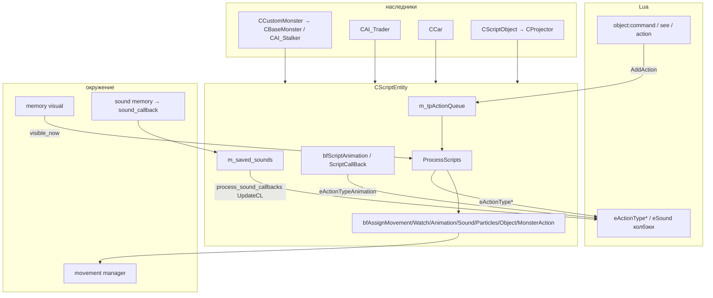
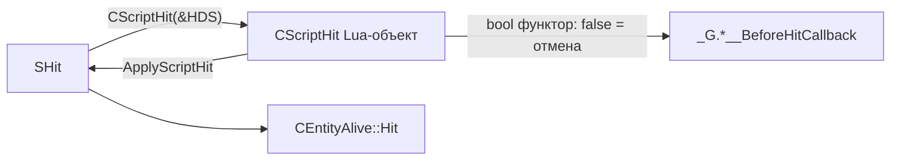
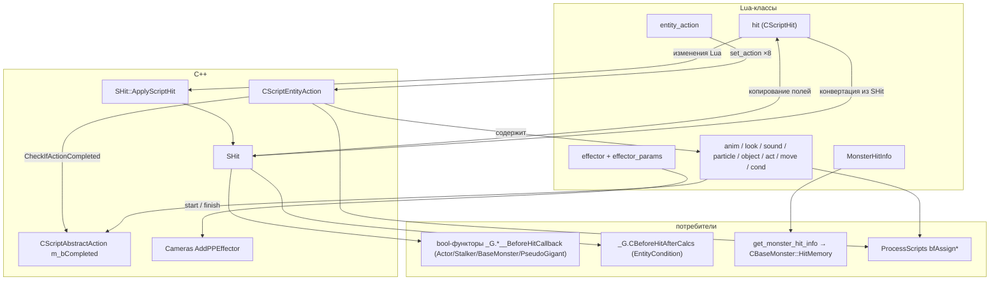

# Script: CScriptEntity — скриптовая сущность (порционы 43–44)

> **Модуль:** `xrGame` · **Файлы:** `script_entity.h` (127), `script_entity.cpp` (769), `script_entity_inline.h` (15), `script_entity_space.h` (24), `script_entity_action.h` (74) + `.cpp` (14) + `_script.cpp` (40) + `_inline.h` (203) · **Порционы 43–44, итерация 5**
>
> **Порцион 44 (файлы):** `script_hit.h` (39) / `_inline.h` (49) / `.cpp` (14) / `_script.cpp` (47), `script_monster_hit_info.h` (30) / `_script.cpp` (37), action-семейство: `script_abstract_action` (22/14/19), `script_animation_action` (49/65/14/52), `script_watch_action` (65/71/32/48), `script_sound_action` (77/149/35/61), `script_particle_action` (55/75/25/33), `script_object_action` (41/58/21/55), `script_monster_action` (33/30/20/33), `script_movement_action` (136/130/141/118), `script_action_condition` (43/28/14/34), `script_effector` (30/15/37/75) + `_wrapper` (22/24), по схеме `.h` / `_inline.h` / `.cpp` / `_script.cpp`

> **Страница:** `CScriptEntity` — миксин «скриптового управления» объектом: Lua ставит объект под контроль (`SetScriptControl`) и наполняет очередь **действий** (`CScriptEntityAction` — «пакет» из восьми под-действий), а C++ каждый тик исполняет голову очереди (`ProcessScripts` → `bfAssign*`) и перекачивает события (анимация/звук/частицы) обратно в Lua-колбэки. Также: проверки видимости для скриптов (`see`), отложенные звуки (`process_sound_callbacks`). Порцион 44 добавляет: `CScriptHit` (Lua-обёртка `SHit` для BeforeHit-колбэков), `CScriptMonsterHitInfo` и все action-классы (`move`/`look`/`anim`/`sound`/`particle`/`object`/`act`/`cond`/`entity_action`/`effector`) — §15–§27.

**Чего это не делает**: не планирует поведение (планнеры стalker/монстров — итерация 6); полный Lua API обёртки `CScriptGameObject` — итерация 14 ([script-game-object.md](script-game-object.md)); сама механика Lua-колбэков `eHit`/`eSound` — [script-game-object.md](script-game-object.md), [actor.md](actor.md).

## 1. Назначение и место

`CScriptEntity` — **не** `CObject`-наследник: простой класс-миксин, который мешается в игровой класс и получает back-references `m_object` (`CGameObject*`) и `m_monster` (`CCustomMonster*`, может быть `NULL`).

**Прямые наследники** (`public CScriptEntity`):

| Класс | Где | Примечание |
| --- | --- | --- |
| `CCustomMonster` | `CustomMonster.h:36` | через него — весь AI: `CBaseMonster` (`base_monster.h:58`), `CAI_Stalker` (`ai_stalker.h:89–94`) |
| `CAI_Trader` | `ai/trader/ai_trader.h:25–27` | трейдер-персонаж |
| `CCar` | `Car.h:45–47` | машина (Lua-управление транспортом) |
| `CScriptObject` | `script_object.h:14–16` | от него — `CProjector` (`searchlight.h:22`, `PROJECTOR_NEW`) |

## 2. Данные класса (`script_entity.h`)

| Поле | Тип | Где | Описание |
| --- | --- | --- | --- |
| `m_object` (private) | `CGameObject*` | h:52 | back-reference, заполняется в `_construct` |
| `m_monster` (private) | `CCustomMonster*` | h:53 | `NULL`, если объект не монстр |
| `m_initialized` | `bool` | h:54 | `true` после `net_Spawn` до `net_Destroy` |
| `m_can_capture` | `bool` | h:56 | разрешён ли захват скриптом (см. §4) |
| `m_tpActionQueue` (protected) | `xr_deque<CScriptEntityAction*>` | h:49,59 | **очередь действий** (owns) |
| `m_bScriptControl` | `bool` | h:60 | объект под Lua-контролем |
| `m_caScriptName` | `shared_str` | h:61 | имя захватившего скрипта |
| `m_tpNextAnimation` | `MotionID` | h:62 | анимация, подготовленная `bfAssignAnimation` |
| `m_use_animation_movement_controller` | `bool` | h:63 | создавать ли anim-movement-controller |
| `m_tpCurrentEntityAction` | `CScriptEntityAction*` | h:64 | голова очереди, которую уже `initialize()` |
| `m_tpScriptAnimation` (public) | `MotionID` | h:67 | реально играющий цикл |
| `m_current_sound` (protected) | `ref_sound*` | h:70 | текущий звук под-действия (owned) |
| `m_saved_sounds` (protected) | `xr_vector<CSavedSound>` | h:71 | очередь звуков до Lua (см. §9) |
| `CSavedSound` | структура h:27–46 | | `{ m_game_object_id, m_sound_type, m_position, m_sound_power }` |

## 3. Жизненный цикл

| Метод | Где | Действие |
| --- | --- | --- |
| `CScriptEntity()` | cpp:35–39 | `m_initialized = false`, `m_use_animation_movement_controller = false` |
| `~CScriptEntity()` | cpp:41–44 | `ResetScriptData()` — очередь чистится |
| `init()` | cpp:46–50 | `m_current_sound = 0`, `ResetScriptData()` |
| `_construct()` | cpp:52–62 | `m_object = smart_cast<CGameObject*>(this)` (`VERIFY`), `m_monster = smart_cast<CCustomMonster*>(this)`, `init()`, возвращает `m_object`; вызывается из цепочки `_construct` наследника (см. [game-object.md](game-object.md), [custom-monster.md](custom-monster.md)) |
| `reinit()` | cpp:91–96 | `ResetScriptData()` + `set_script_capture()` (снимает «запрет» захвата) |
| `net_Spawn(CSE_Abstract*)` | cpp:622–629 | `m_initialized = true`, `object().setVisible(TRUE)`, `setEnabled(TRUE)`, `return TRUE` (каркасные вызовы — порц. 3–4) |
| `net_Destroy()` | cpp:604–607 | `m_initialized = false` |
| `shedule_Update(u32)` | cpp:631–635 | **только** `if (m_bScriptControl) ProcessScripts()` |
| `UpdateCL()` | cpp:705–708 | только `bfScriptAnimation()` (продвижение скриптовой анимации каждый кадр) |
| `cast_script_entity()` | h:82 | `return this` — маркер для smart_cast |
| `object() const` | inline.h:11–15 | `VERIFY(m_object); return *m_object` |
| `ResetScriptData(void* = 0)` | cpp:64–71 | `ClearActionQueue()`, `m_caScriptName = ""`, `m_bScriptControl = false`, `m_use_animation_movement_controller = false` |
| `ClearActionQueue()` | cpp:73–88 | `vfFinishAction(front)` (если очередь не пуста), затем `xr_delete` всех, `m_tpScriptAnimation`/`m_tpNextAnimation` invalidate, `m_tpCurrentEntityAction = 0` |

## 4. Script control: захват и освобождение

**`SetScriptControl(bScriptControl, caScriptName)`** (cpp:98–138):

1. **Валидация последовательности** (cpp:100–117): разрешены только переходы «взять → отдать»; «отдать» — только тем же скриптом (или если имя пусто); иначе Lua-ошибка `"Invalid sequence of taking an entity under script control"` и выход.
2. `if (bScriptControl && !can_script_capture()) return;` (cpp:119) — захват запрещён, пока `m_can_capture == false`.
3. **Visual-callback**: при взятии — `object().add_visual_callback(&ActionCallback)`, при отдаче — `remove_visual_callback` (cpp:121–124). `ActionCallback` (cpp:203–232) гоняется из обновления кинематики и каждый кадр докачивает звуки/частицы текущего действия (`vfUpdateSounds`/`vfUpdateParticles` **внутри `try/catch(...)`** — комментарий Lain: «Fix crash due to lua gc in second thread»).
4. Фиксация `m_bScriptControl`/`m_caScriptName`; при освобождении — `ResetScriptData(this)` (cpp:136–137).

`GetScriptControl()` (cpp:140–143) — геттер; `GetScriptControlName()` (cpp:145–148) — `*m_caScriptName`.

**`m_can_capture`** (h:121–122): `set_script_capture(bool val = true)` / `can_script_capture()`.
- `reinit()` ставит `true` (cpp:95);
- `false` ставят **состояния атаки бьюрера** — `burer_state_attack_gravi_inline.h:20/74`, `..._shield_inline.h:16/66`, `..._tele_inline.h:38/139` (на время спец-способности Lua-контроль невозможен);
- в Lua экспортирован только `can_script_capture` (`script_game_object_script2.cpp:268`);
- **не путать** с `CControlManagerCustom::script_capture(EControlType)` (`control_manager_custom.cpp:425`) — это другой механизм (захват control-каналов монстра, итерация 6).

## 5. Очередь действий: CScriptEntityAction

`CScriptEntityAction` (`script_entity_action.h:21–72`) — **пакет одновременных** под-действий:

| Под-действие | Поле | Тип |
| --- | --- | --- |
| движение | `m_tMovementAction` | `CScriptMovementAction` |
| наблюдение (поворот головы) | `m_tWatchAction` | `CScriptWatchAction` |
| анимация | `m_tAnimationAction` | `CScriptAnimationAction` |
| звук | `m_tSoundAction` | `CScriptSoundAction` |
| частицы | `m_tParticleAction` | `CScriptParticleAction` |
| объект (взаимодействие) | `m_tObjectAction` | `CScriptObjectAction` |
| условие/таймаут | `m_tActionCondition` | `CScriptActionCondition` |
| действие монстра | `m_tMonsterAction` | `CScriptMonsterAction` |
| пользовательские данные | `m_user_data` | `void*` |

Плюс `CheckIf*Completed()`/`initialize()`/`SetAction(...)` (все inline; `CheckIfActionCompleted()` — «все под-действия завершены **и** условие/таймаут не сработали»). Протокол завершения и Lua-экспорт `entity_action` — §15 (порц. 44); сами action-классы — §16–§27.

| Метод очереди | Где | Описание |
| --- | --- | --- |
| `AddAction(const CScriptEntityAction*, bool bHighPriority = false)` | cpp:176–193 | копия в хвост; **high-priority**: если очередь не пуста — текущая голова копируется на новый объект, старая «дофинишивается» (`vfFinishAction`) и удаляется, копия возвращается на голову, новое действие вставляется **в начало** (текущее сдвигается на 1). Если очередь была пуста и `m_initialized` — немедленный `ProcessScripts()` |
| `GetCurrentAction()` | cpp:195–201 | голова очереди или `0` |
| `GetActionCount()` / `GetActionByIndex(i)` | cpp:710–718 | размер / прямой индекс в deque |
| `vfFinishAction(action)` | cpp:255–264 | убивает `m_current_sound` (`destroy` + `xr_delete`) и, если `!m_bAutoRemove`, частицы `CParticlesObject::Destroy` |

## 6. ProcessScripts — ядро диспетчера (cpp:266–367)

Вызывается из `shedule_Update` (под контролем), из `AddAction` (первая очередь) и из `ScriptCallBack` (конец анимации).

1. **Дозапуск завершённых**: пока голова `CheckIfActionCompleted()` → `vfFinishAction` → Lua-колбэк **`eActionTypeRemoved`** (`object().callback(GameObject::eActionTypeRemoved)` — `if (true)` вместо `psAI_Flags.is(aiLua)`, cpp:300) → `xr_delete` + erase.
2. Очередь пуста → выход; `l_tpEntityAction == 0` → `ResetScriptData()` + выход (cpp:309–322).
3. **Исполнение под-действий** (в `try/catch`, при исключении — `ResetScriptData()`, cpp:324–366), по порядку: `bfAssignWatch` → `bfAssignAnimation` → `bfAssignSound` → `bfAssignParticles` → `bfAssignObject` → `bfAssignMovement` → (если анимация не завершена) `bfScriptAnimation` → `bfAssignMonsterAction`.
4. Для каждого под-действия отслеживается **переход `!completed → completed`** (старое значение в `l_bCompleted`) и по нему летит Lua-колбэк: `eActionTypeWatch` / `eActionTypeSound` / `eActionTypeParticle` / `eActionTypeObject` / `eActionTypeMovement` (с аргументом `-1`). Анимация завершается отдельно — в `ScriptCallBack` (§8), колбэк `eActionTypeAnimation`.

**`EActionType`** (`script_entity_space.h:13–23`): `eActionTypeMovement=0`, `Watch`, `Animation`, `Sound`, `Particle`, `Object`, `eActionTypeCount`, `eActionTypeRemoved` — значения, передаваемые в Lua-колбэки `eActionType*`.

## 7. bfAssign* — исполнители под-действий (база)

| Метод | Где | Базовое поведение |
| --- | --- | --- |
| `bfAssignWatch` | cpp:369–372 | **заглушка**: `GetCurrentAction() && !watch.m_bCompleted` |
| `bfAssignObject` | cpp:484–487 | **заглушка**: то же для `m_tObjectAction` |
| `bfAssignMonsterAction` | cpp:374–380 | **заглушка**: `!monster.m_bCompleted` |
| `bfAssignAnimation` | cpp:382–396 | invalidate `m_tpNextAnimation`; если завершена → false; пустое имя → true (ничего не играть); иначе `ID_Cycle_Safe(name)` → `m_tpNextAnimation` + копирование `m_use_animation_movement_controller` (само воспроизведение — §8) |
| `bfAssignSound` | cpp:417–453 | конечный автомат: нет `m_current_sound` → создать `ref_sound` (`create(name, st_Effect, sound_type)`) либо завершить действие (пустое имя); есть звук, но нет `_feedback()` → если ещё не `m_bStartedToPlay` → `play_at_pos(GetUpdatedMatrix(...))` (+`sm_Looped` если `m_bLooped`), иначе **завершить** (разовый звук перестал звучать — действие кончено) |
| `bfAssignParticles` | cpp:455–482 | нет системы → завершена; первая итерация → `UpdateParent(GetUpdatedMatrix(...))` + `play_at_pos`, `m_bStartedToPlay = true`; вторая → `m_bCompleted = true` |
| `bfAssignMovement` | cpp:489–602 | см. ниже |

**`bfAssignMovement`** — единственный «по-настоящему» работающий в базе:

1. Уже завершено → false; мёртвый `CEntityAlive` → завершить и false (cpp:493–501).
2. `!m_monster` → Lua-ошибка `"Cannot assign a movement action not to a monster!"` (cpp:503–507) — монстр-овнер обязателен.
3. `switch (m_tGoalType)` (cpp:509–596):

| `eGoalType` | Настройка `movement()` |
| --- | --- |
| `eGoalTypeObject` | `ePathTypeLevelPath`, dest-позиция = `m_tpObjectToGo->Position()`, dest-вершина из `ai_location` |
| `eGoalTypePatrolPath` | `ePathTypePatrolPath`, `patrol().set_path(path, path_name)`, `set_start_type`/`set_route_type`/`set_random`, опционально `set_previous_point` |
| `eGoalTypeFollowLeader`, `eGoalTypePathPosition` | `ePathTypeLevelPath`, dest-позиция; вершина через `level_graph().vertex(...)` с фолбэком `check_position_in_direction` (в DEBUG — `THROW2`, если вершины нет) |
| `eGoalTypePathNodePosition` | dest-позиция + `set_dest_vertex(m_tNodeID)` |
| `eGoalTypeNoPathPosition` | прямая 2-точечная detail-траектория (resize(2): текущая → dest); завершение, когда `similar(pos, .2f)` |
| `default` | `set_desirable_speed(0)`, `m_bCompleted = true` |

4. Завершение: `movement().actual_all() && movement().path_completed()` → `m_bCompleted` (cpp:598–599).

**Переопределения наследников** — §12.

## 8. Анимация: bfScriptAnimation, GetUpdatedMatrix, ScriptCallBack

**`GetUpdatedMatrix(bone, posOffset, angleOffset)`** (cpp:398–415): `setHPB(angleOffset)`, `c = posOffset`; если задана кость — `mulA_43(bone.mTransform)` и `mulA_43(object().XFORM())` (итог: мировая матрица точки на кости). Используется звуками/частицами (§7) и `ActionCallback`.

**`bfScriptAnimation()`** (cpp:654–703, вызывается из `UpdateCL` и `ProcessScripts`):

- без контроля/текущего действия — при необходимости дозапустить `ProcessScripts()`;
- если действие с непустой анимацией не завершено и `m_tpScriptAnimation != m_tpNextAnimation` → `ID_Cycle(name)`, по всем `MAX_PARTS` частям `LL_PlayCycle(i, anim, TRUE, ScriptCallBack, this)`; **первая** полученный blend получает `ScriptCallBack`; при `m_use_animation_movement_controller` — `create_anim_mov_ctrl(blend, 0, true)` (cpp:692–693);
- иначе invalidate `m_tpScriptAnimation` → false.

**`ScriptCallBack(CBlend*)`** (cpp:637–652): по завершении blend (и `!B->bone_or_part`) → Lua-колбэк **`eActionTypeAnimation`**, `m_tpScriptAnimation.invalidate()`, `m_tAnimationAction.m_bCompleted = true`, и если очередь не пуста — `ProcessScripts()` (переход к следующему действию).

## 9. Звук: отложенные события до Lua

**Цепочка**: `IGame_Level::SoundEvent_Dispatch` → `CCustomMonster::feel_sound_new` (порц. 42) → `memory().sound().feel_sound_new` → `CSoundMemoryManager` → **`m_object->sound_callback(...)`** (`sound_memory_manager.cpp:150`).

**`sound_callback(object, sound_type, position, power)`** (cpp:720–736): если отправитель — `CGameObject` **и** у объекта есть Lua-колбэк `GameObject::eSound` → `m_saved_sounds.push_back(CSavedSound(ID, type, pos, power))`.

**`process_sound_callbacks()`** (cpp:753–769): по всем `m_saved_sounds` — `object().callback(GameObject::eSound)(lua_game_object, id, type, position, power)`, затем `clear()`.

**Такт**: вызывается **только из `CCustomMonster::UpdateCL`** (`CustomMonster.cpp:456`) — звуки копятся в кадре и отдаются Lua разом (не из `shedule_Update`).

## 10. Видимость и враги для скриптов

| Метод | Где | Поведение |
| --- | --- | --- |
| `CheckObjectVisibility(const CGameObject*)` | cpp:150–156 | `!m_monster` → `false`; иначе `m_monster->memory().visual().visible_now(tpObject)` |
| `CheckTypeVisibility(section_name)` | cpp:160–174 | `!m_monster` → `false`; линейный проход по `memory().visual().objects()` — есть ли объект с `cNameSect() == section_name` |
| `CheckIfCompleted() const` | h:95 | виртуальный `return false` — **переопределений в репозитории нет** |
| `GetCurrentEnemy()` / `GetCurrentCorpse()` | cpp:738–746 | заглушки `return 0` (переопределяет AI-слой, итерация 6) |
| `get_enemy_strength()` | cpp:748–751 | заглушка `return 0` |

## 11. Прочее

- **`GetPatrolPathName()`** (cpp:609–620): в DEBUG — ошибка, если объект не под контролем; возвращает `m_tMovementAction.m_path_name` **последнего** элемента очереди (`back()`), иначе `""`.
- **`GetActionCount`/`GetActionByIndex`** — прямой доступ к deque (Lua может пройти по очереди).
- **`sound_callback`** пропускает отправителей, не являющихся `CGameObject` (cpp:722–723).

## 12. Переопределения наследников

| Класс | Файл | Что переопределяет |
| --- | --- | --- |
| `CAI_Stalker` | `ai/stalker/ai_stalker_script_entity.cpp:52–333` | `ResetScriptData`, `bfAssignMovement`, `bfAssignWatch`, `bfAssignObject`, `bfAssignAnimation` (реальная работа: object-handler/sight/анимационные пары сталкера) |
| `CBaseMonster` | `ai/monsters/basemonster/base_monster_script.cpp:113–599` | `bfAssignMovement`, `bfAssignObject`, `bfAssignWatch`, `bfAssignAnimation`, `bfAssignSound`, `bfAssignMonsterAction`, `vfFinishAction` (контрол-менеджер монстра) |
| `CAI_Trader` | `ai/trader/ai_trader.cpp:71` | `bfAssignSound` (доп. логика поверх базы) |
| `CCar` | `CarInput.cpp:56, 84` | `bfAssignMovement` (управление машиной), `bfAssignObject` |
| `CProjector` | `searchlight.cpp:306, 327` | `bfAssignWatch` (поворот прожектора), `bfAssignObject` |

## 13. Lua-поверхность (через `CScriptGameObject`, порц. 15)

| Lua | C++ | Где экспорта |
| --- | --- | --- |
| `command(action[, high_priority])` | `CScriptGameObject::AddAction` → `cast_script_entity()->AddAction` (ошибка `"CSciptEntity : cannot access class member AddAction!"`, если не скриптовая сущность) | `script_game_object.cpp:203–210`, `script_game_object_script2.cpp:152` |
| `see(game_object)` / `see(section)` | `CheckObjectVisibility` / `CheckTypeVisibility` | `script_game_object_script2.cpp:140–141` |
| `action()` | `GetCurrentAction` | `script_game_object_script2.cpp:153` |
| `can_script_capture()` | `CScriptEntity::can_script_capture` | `script_game_object.cpp:159`, `script2.cpp:268` |

**Lua-колбэки объекта**, которые дёргает класс: `eActionTypeMovement/Watch/Animation/Sound/Particle/Object/Removed` (§6, §8) и `eSound` (§9) — см. [script-game-object.md](script-game-object.md).

## 14. Связи

- **Наследники и их переопределения** — §12; `CCustomMonster` (каркас, `UpdateCL`) — [custom-monster.md](custom-monster.md) (порц. 9); сталкер — итерация 6.
- **Lua-обёртка** `CScriptGameObject::AddAction/see/action` — [script-game-object.md](script-game-object.md) (порц. 15).
- **Под-действия** `CScript*Action`, их Lua-экспорт и `CScriptHit` — §15–§27 (порц. 44).
- **Звуковая цепочка** до `sound_callback` — [feel.md](feel.md) (порц. 42), [xr-engine/level.md](../xr-engine/level.md).
- **Сетевые вызовы** (`net_Spawn`/`net_Destroy`) — каркасные, общая схема — порц. 3–4 ([game-object-net.md](game-object-net.md)).
- **Анимационный движок** (`ID_Cycle`, `LL_PlayCycle`, `CBlend`, `create_anim_mov_ctrl`) — [xr-engine](../xr-engine/index.md) / порц. 31 ([actor-animation.md](actor-animation.md)).

## 15. CScriptEntityAction: протокол завершения и Lua-экспорт (порц. 44)

**Поля** (`script_entity_action.h:24–33`): 8 под-действий (§5) + `void* m_user_data` + **`bool m_started`** — латч «действие уже исполнялось».

**`SetAction(...)`** (inline:22–66) — 9 перегрузок: 8 по типу под-действия + `SetAction(void*)` для user_data; внутри — банальное присваивание копии шаблоном `SetAction(t, tt)`.

**`initialize()`** (inline:158–168): `m_started = false` + `initialize()` каждого под-действия — movement, watch, animation (пусто), sound (сбрасывает `m_bStartedToPlay`), particle (пусто), object (пусто), condition (`m_tStartTime = Device.dwTimeGlobal`). **`m_tMonsterAction.initialize()` нет** — у `CScriptMonsterAction` такого метода вообще не существует (§24).

**`CheckIfActionCompleted()`** (inline:119–156) — ядро протокола:

1. **Латч `m_started`**: первый вызов всегда возвращает `false` — действие должно «стартовать» в `ProcessScripts` (§6), только потом начинаются проверки.
2. Если **`m_dwFlags == 0 && m_tLifeTime < 0`** (ни одного флага, таймера нет) → `true` только когда завершены **все семь** под-действий (movement, watch, animation, sound, particle, object, monster).
3. Иначе — XOR-снятие с копии `l_dwFlags` каждого флага, чьё под-действие завершено (или сработал таймер), и возврат `!l_dwFlags`: действие готово, когда **выполнены все явно перечисленные условия**.
4. **Краевой случай**: `m_dwFlags == 0`, но `m_tLifeTime >= 0` → ветка 2 не срабатывает, флагов нет → возврат `true` немедленно: чисто таймерный `cond` с флагами 0 считается выполненным (таймер не проверяется вообще, пока флаг `TIME_FLAG` не задан явно).

**Чекеры** (inline:73–117): `CheckIf*Completed()` — просто `m_bCompleted` соответствующего под-действия; `CheckIfTimeOver()` — `m_tLifeTime >= 0 && m_tStartTime + m_tLifeTime < Device.dwTimeGlobal`. **Геттеры** (inline:170–203): `move()/look()/anim()/particle()/object()/cond()` — const-доступ к под-действиям, `data()` — user_data.

**Lua-экспорт** (`script_entity_action_script.cpp`, 40 строк): класс **`entity_action`**:

| Lua | C++ |
| --- | --- |
| `entity_action()` / `entity_action(other)` | ctor / copy-ctor |
| `set_action(x)` ×8 | `SetAction` (movement/watch/animation/sound/particle/object/condition/monster) |
| `move()`, `look()`, `anim()`, `sound()`, `particle()`, `object()` | `CheckIf*Completed()` |
| `time()` | `CheckIfTimeOver()` |
| `all()` / `completed()` | `CheckIfActionCompleted()` |

`m_user_data` в Lua не экспортирован (только через `SetAction(void*)` из C++).

## 16. CScriptAbstractAction — база всех под-действий

`script_abstract_action.h` (22) / `_inline.h` (14) / `.cpp` (19): единственный член **`bool m_bCompleted`** + `virtual completed()` (возврат `m_bCompleted`), дефолтный ctor ставит **`m_bCompleted = true`** (inline:11–14), dtor пустой. У action-классов нет Lua-экспорта своего (нет `DECLARE_SCRIPT_REGISTER_FUNCTION` и `_script.cpp`) — в Lua они видны только как аргументы `entity_action:set_action(...)`.

**Протокол завершения** (сквозной для §19–§26): «пустое» действие (дефолтный ctor) обычно `completed = true` — оно ничего не делает и сразу проходит; любой `Set*`/`initialize`-путь ставит `completed = false`, а исполнитель (`bfAssign*` §7, `ScriptCallBack` §8, контрол-менеджер монстра §12) выставляет `true` по окончании. Исключения: `CScriptParticleAction` дефолтно `false` (§22), `CScriptAnimationAction::SetMentalState` ставит `true` сразу (§19).

## 17. CScriptHit — Lua-обёртка SHit и ApplyScriptHit

**Файлы**: `script_hit.h` (39), `_inline.h` (49), `.cpp` (14 — только dtor), `_script.cpp` (47).

**Поля** (`h:20–27`):

| Поле | Тип | Смысл |
| --- | --- | --- |
| `m_fPower` | `float` | сила удара (дефолт 100) |
| `m_tDirection` | `Fvector` | направление (дефолт `(1,0,0)`) |
| `m_caBoneName` | `shared_str` | имя кости (`bone` property) |
| `m_tpDraftsman` | `CScriptGameObject*` | кто нанёс |
| `m_fImpulse` | `float` | импульс (дефолт 100) |
| `m_tHitType` | `int` | `ALife::EHitType` (дефолт `eHitTypeWound`) |
| `m_tpWeaponID` | `u16` | ID оружия |
| `bulletId` | `u32` | ID пули (дефолт `u32(-1)`) |

**Конструкторы** (inline:13–39): `()` — дефолтные значения; `(const CScriptHit*)` — копия; **`(const SHit*)`** — конвертация из C++-хита: `power`, `direction()`, `who` через `smart_cast<const CGameObject*>(who)->lua_game_object()`, `impulse`, `weaponID`, `hit_type`, `BulletID`; **`m_caBoneName` не копируется**. `get_bone_name()`/`set_bone_name()` (inline:41–49).

**`SHit::ApplyScriptHit(CScriptHit*)`** (`Hit.cpp:150–160`) — обратная запись в C++-структуру: `power`, `impulse`, `dir`, `hit_type`, `who` (через `m_tpDraftsman->object()`), `whoID` (`->ID()`), `weaponID`; **`BulletID` закомментирован** — `bullet_id` из Lua обратно не переносится.

**Схема «BeforeHit»-колбэков** (общий паттерн: скопировать `SHit → CScriptHit`, дать Lua поменять, `ApplyScriptHit` обратно; возврат `false` из bool-функтора — отмена хита целиком):

| Вызов | Где | Lua-функтор | Особенность |
| --- | --- | --- | --- |
| `CActor::Hit` | `Actor.cpp:683–692` | `_G.CActor__BeforeHitCallback` (bool) | только SP (`IsGameTypeSingle`), далее `HitArtefactsOnBelt` |
| `CAI_Stalker::Hit` | `ai_stalker_fire.cpp:408–423` | `_G.CAI_Stalker__BeforeHitCallback` (bool) | под guard-ом `m_hit_callback`; отдельно read-only `_G.CAI_Stalker__OnCriticallyWounded` (L396–401, `void`) |
| `CBaseMonster::Hit` | `base_monster.cpp:471–482` | `_G.CBaseMonster__BeforeHitCallback` (bool) | монстры |
| `CPseudoGigant::Hit` | `pseudo_gigant.cpp:325–341` | `_G.CPseudoGigant__BeforeHitCallback` (bool) + `_G.CPseudoGigant__HitCallback` (void) | псевдогигант |
| `CEntityCondition::ConditionHit` | `EntityCondition.cpp:428–441` | `_G.CBeforeHitAfterCalcs` (void) | **после** расчёта брони (`HitOutfitEffect`); `power` = `hit_power * hit_part` (множитель вычитается обратно L437–441) |
| `CScriptGameObject::Hit` | `script_game_object2.cpp:173–190` | — (Lua сама шлёт) | обратный путь: Lua → `SHit` → `GE_HIT` — [script-game-object.md](script-game-object.md) |

**Lua-класс `hit`** (`script_hit_script.cpp`): enum **`hit_type`** (10 значений + `dummy` = `eHitTypeMax`): `burn`, `shock`, `strike`, `wound`, `radiation`, `telepatic`, `chemical_burn`, `explosion`, `fire_wound`, `light_burn`; поля `power`/`direction`/`draftsman`/`impulse`/`type`/`weapon_id` — read-write, `bullet_id` — read-only; `bone` — property (get/set) + метод `bone(...)`; ctors `()` и `(const hit*)`.

## 18. CScriptMonsterHitInfo

**Файлы**: `script_monster_hit_info.h` (30 — класс целиком с inline-корпусом, отдельного `.cpp` нет), `script_monster_hit_info_script.cpp` (37 — Lua-экспорт).

**Класс** (`h:7–30`): `{ CScriptGameObject* who; Fvector direction; int time; }`, дефолтный ctor: `who = 0`, `time = 0`, `direction = (0,0,1)`; `set(who, direction, time)`.

**Lua-класс `MonsterHitInfo`** (`_script.cpp:18–21`): поля `who`/`direction`/`time` — read-write. В том же файле экспортируется пустой `struct CMonsterSpace` с enum'ами: `sounds.sound_script` (`MonsterSound::eMonsterSoundScript`) и `head_anim.head_anim_normal/angry/glad/kind` (`MonsterSpace::eHeadAnim*`) — «случайные» соседи в модуле регистрации.

**Потребитель**: `CScriptGameObject::GetMonsterHitInfo()` (`script_game_object_use2.cpp:315–335`) → Lua **`get_monster_hit_info()`** (`script_game_object_script2.cpp:225`, обёрнут в `SAFE_WRAP`): требует `smart_cast<CBaseMonster*>` **и** `HitMemory.is_hit()`, иначе — Lua-ошибка `"cannot access class member GetMonsterHitInfo!"`; заполняет из `HitMemory.get_last_hit_object()/get_last_hit_dir()/get_last_hit_time()`. Сама `CHitMemoryManager` (память монстра о полученных ударах) — итерация 6.

## 19. CScriptAnimationAction — Lua `anim`

`script_animation_action.h` (49) / `_inline.h` (65) / `.cpp` (14) / `_script.cpp` (52).

**Поля**: `m_caAnimationToPlay`, `m_tMentalState` (`EMentalState`), `m_tGoalType` (`eGoalTypeAnimation` | `eGoalTypeMental`), `m_use_animation_movement_controller`, `m_tAnimAction` (`EScriptMonsterAnimAction`), `anim_index`.

**Логика** (inline): дефолтный ctor — mental `Danger`, goal `Mental`, `eAA_NoAction`, **`completed = true`**; `SetAnimation(name)` — goal `Animation`, `completed = false` (это задача — воспроизвести цикл); `SetMentalState(s)` — goal `Mental`, **`completed = true`** немедленно (ментальное состояние — «режим», а не задача); monster-ctor `(EScriptMonsterAnimAction, int index)` — `completed = false`; `initialize()` пустой. Исполнение: `bfAssignAnimation` (§7) + `bfScriptAnimation`/`ScriptCallBack` (§8) в базе; монстр-вариант — `bfAssignAnimation` `CBaseMonster` (§12).

**Lua `anim`**: enum `type` (`free`/`danger`/`panic` → `eMentalState*`), enum `monster` (10: `stand_idle`, `capture_prepare`, `sit_idle`, `lie_idle`, `eat`, `sleep`, `rest`, `attack`, `look_around`, `turn` → `eAA_*`); ctors `()`, `(LPCSTR)`, `(LPCSTR, bool)`, `(EMentalState)`, `(EScriptMonsterAnimAction, int)`; методы `anim` (SetAnimation), `type` (SetMentalState), `completed`.

## 20. CScriptWatchAction — Lua `look`

`script_watch_action.h` (65) / `_inline.h` (71) / `.cpp` (32) / `_script.cpp` (48).

**Поля**: `m_tpObjectToWatch`, `m_tWatchType` (`SightManager::ESightType`), `m_tGoalType` (**5 типов**: `Object`, `WatchType`, `Direction`, `Current`, `Dummy`), `m_tWatchVector`, `m_bone_to_watch` + **searchlight-поля**: `m_tTargetPoint`, `vel_bone_x`, `vel_bone_y`.

**Логика**: дефолтный ctor (**в .cpp:14–21**) — object `0`, тип `eSightTypeCurrentDirection`, goal `eGoalTypeCurrent`, **`completed = true`**; `SetWatchObject` (**.cpp:27–32**) — из `CScriptGameObject*` в `CObject*`, goal `Object`, `completed = false`. Остальные ctor'ы/сеттеры — inline. Исполнение: `bfAssignWatch` в базе — заглушка (§7), реальная работа в переопределениях `CAI_Stalker`/`CBaseMonster`/`CProjector` (§12).

**Lua `look`**: enum `look` (7): `path_dir`, `search`, `danger` (`eSightTypeCover`), `point`, `fire_point`, `cur_dir`, `direction`; ctors `()`, `(ESightType)`, `(ESightType, Fvector&)`, `(ESightType, obj)`, `(ESightType, obj, bone)` + 2 searchlight-перегрузки `(Fvector&, vel1, vel2)` / `(obj, vel1, vel2)`; методы `object`, `direct` (SetWatchDirection), `type`, `bone`, `completed`.

## 21. CScriptSoundAction — Lua `sound`

`script_sound_action.h` (77) / `_inline.h` (149) / `.cpp` (35) / `_script.cpp` (61).

**Поля** (11): `m_caSoundToPlay`, `m_caBoneName`, `m_tGoalType` (`SoundAttached` | `SoundPosition` | `Dummy`), `m_bLooped`, `m_bStartedToPlay`, `m_tSoundPosition`, `m_tSoundAngles`, `m_sound_type` (`ESoundTypes`), `m_monster_sound` (`MonsterSound::EType`), `m_monster_sound_delay`, `m_tHeadAnimType`.

**`SetSound(LPCSTR)` (.cpp:18–35)** — единственная «умная» логика класса: `FS.exist("$game_sounds$\<name>.ogg")` → есть: `completed = false` (играем); **нет файла: Lua-ошибка `"File not found"` + `completed = true`** — действие молча само-завершается, `ProcessScripts` (§6) сразу идёт дальше. Сеттер `SetSound(const CScriptSound&)` (inline:113–119) копирует имя без проверки.

**ctor'ы**: 7 базовых (bone/position-варианты: `LPCSTR`-имя или `CScriptSound*`); **monster-specific** `(MonsterSound::EType[, delay])` — `completed = false`, исполняется контрол-менеджером монстра (§12); **trader-specific** `(LPCSTR, LPCSTR, EMonsterHeadAnimType)` — head-анимация трейдера. `initialize()` сбрасывает `m_bStartedToPlay`. Дефолтный — `completed = true`, goal `Dummy`. Исполнение в базе — `bfAssignSound` (конечный автомат, §7).

**Lua `sound`**: enum `type` (9 monster-звуков: `idle`, `eat`, `attack`, `attack_hit`, `take_damage`, `die`, `threaten`, `steal`, `panic`); **17 перегрузок ctor** (14 базовых + 2 monster + 1 trader); методы `set_sound` ×2, `set_sound_type`, `set_bone`, `set_position`, `set_angles`, `completed`.

## 22. CScriptParticleAction — Lua `particle`

`script_particle_action.h` (55) / `_inline.h` (75) / `.cpp` (25) / `_script.cpp` (33).

**Поля**: `m_caParticleToRun`, `m_caBoneName`, `m_tGoalType` (`ParticleAttached` | `ParticlePosition` | `Dummy`), `m_tpParticleSystem` (`CParticlesObject*`), `m_bStartedToPlay`, `m_tParticlePosition/Angles/Velocity`, `m_bAutoRemove`.

**Логика**: дефолтный ctor (inline:11–23) — goal `Dummy`, **`completed = false`** (единственный «пустой» с `false`; снимается `bfAssignParticles` при отсутствии системы, §7), `m_bAutoRemove = true`; `SetParticle` (.cpp:18–25) — `CParticlesObject::Create(name, autoRemove)`, `completed = false`; **dtor (.cpp:13–16) НЕ удаляет систему** — `xr_delete` закомментирован, уборка целиком на `vfFinishAction` (§5, `!m_bAutoRemove` → `CParticlesObject::Destroy`). Сеттеры position/bone/angles/velocity — `completed = false`. `initialize()` пустой. Исполнение — `bfAssignParticles` (§7).

**Lua `particle`**: ctors 6 (`(LPCSTR[, bone][, CParticleParams][, bAutoRemove])`); методы `set_particle`, `set_bone`, `set_position`, `set_angles`, `set_velocity`, `completed`.

## 23. CScriptObjectAction — Lua `object`

`script_object_action.h` (41) / `_inline.h` (58) / `.cpp` (21) / `_script.cpp` (55).

**Поля**: `m_tpObject` (`CObject*`), `m_tGoalType` (`MonsterSpace::EObjectAction` — тут goal = **тип манипуляции**), `m_dwQueueSize`, `m_caBoneName`.

**Логика**: дефолтный ctor — queue `0`, object `0`, goal `eObjectActionIdle`, **`completed = true`**; `SetObject(CScriptGameObject*)` (.cpp:17–21) — в `CObject*`, `completed = false`; `SetObject(LPCSTR bone)`/`SetObjectAction`/`SetQueueSize` (inline) — `completed = false`. Исполнение: `bfAssignObject` в базе — заглушка (§7), реально — `CAI_Stalker`/`CBaseMonster`/`CCar`/`CProjector` (§12).

**Lua `object`**: enum `state` (21: `idle`, `show`, `hide`, `take`, `drop`, `strap`, `aim1/2`, `reload`+`reload1`, `reload2`, `fire1/2`, `switch1/2`, `activate`, `deactivate`, `use`, `turn_on`, `turn_off`, `dummy`; `reload` и `reload1` — дубли `eObjectActionReload1`); ctors 5 (`()`, `(obj, state[, queue])`, `(state)`, `(bone, state)`); методы `action` (SetObjectAction), `object` ×2 (bone/obj), `completed`.

## 24. CScriptMonsterAction — Lua `act`

`script_monster_action.h` (33) / `_inline.h` (30) / `.cpp` (20) / `_script.cpp` (33).

**Поля**: `m_tAction` (`EScriptMonsterGlobalAction`), `m_tObject` (`CObject*`). Дефолтный ctor — `eGA_None`, **`completed = true`**; параметрические — `completed = false`; `SetObject` (.cpp:17–20) — конвертация `CScriptGameObject*` → `CObject*`. **Нет `initialize()`** — поэтому отсутствует в `CScriptEntityAction::initialize()` (§15). Исполнение: `bfAssignMonsterAction` в базе — заглушка `!monster.m_bCompleted` (§7), реальная работа — `CBaseMonster::bfAssignMonsterAction` (§12).

**Lua `act`**: enum `type` (4: `rest`, `eat`, `attack`, `panic` → `eGA_*`; значения `eGA_None` нет); ctors `()`, `(action)`, `(action, obj)`. Методов-сеттеров нет — только ctor'ы.

## 25. CScriptMovementAction — Lua `move`

`script_movement_action.h` (136) / `_inline.h` (130) / `.cpp` (141) / `_script.cpp` (118).

**`EGoalType`** (8): `Object`, `PatrolPath`, `PathPosition`, `NoPathPosition`, `PathNodePosition`, `Input`, `JumpToPosition`, `FollowLeader` (+`Dummy`). **`EInputKeys`**: в C++-enum 11 констант (`None`=1<<0, `Forward`, `Back`, `Left`, `Right`, `ShiftUp/Down`, `Breaks`, `EngineOn/Off`, `Dummy`=1<<10); в Lua-энум `input` экспортированы **10** (без `Dummy`).

**Поля** (19): `m_path_name`, `m_tBodyState`, `m_tMovementType`, `m_tPathType`, `m_tpObjectToGo`, `m_path` (`const CPatrolPath*`), `m_tPatrolPathStart/Stop`, `m_tDestinationPosition`, `m_tNodeID`, `m_tGoalType`, `m_fSpeed`, `m_bRandom`, `m_tInputKeys`, `m_tMoveAction`, `m_tSpeedParam`, `m_previous_patrol_point`, `m_fDistToEnd`, `m_jump_factor`.

**Конструкторы и какой goal ставят** (.cpp:46–127): дефолтный — stand/stand/smooth, patrol nearest/continue/random, speed 0, goal `Dummy`, **`completed = true`**; `(Fvector*, speed)` → `NoPathPosition`; `(…, CScriptGameObject*)` → goal `Object` (через `SetObjectToGo`, `.cpp:133–141`, `completed = false`); `(…, CPatrolPathParams*)` → goal `PatrolPath` (через `SetPatrolPath`, inline:82–88); `(…, Fvector*)` → goal `PathPosition` (через `SetPosition`, inline:90–95); `(EInputKeys[, speed])` → goal `Input` (через `SetInputKeys`, inline:121–126) — базовые ctor'ы целиком в `.cpp` (только `(…, CScriptGameObject*/Fvector*[, speed])` и `(EInputKeys…)` — в `_inline.h`); monster-перегрузки: `(eMA_Jump, …)` → **`JumpToPosition`**, `(eMA_WalkWithLeader|eMA_RunWithLeader, …)` → **`FollowLeader`**, `(act, node_id, pos, dist)` → `PathNodePosition` (`completed = false`), остальные monster-ctor'ы goal не трогают (остаётся `Dummy` — до `bfAssignMovement`!). Все setter'ы — inline, `Set*` выставляют `completed = false` там же, где меняют цель. Исполнение — `bfAssignMovement` (§7).

**Lua `move`**: enum `body` (`crouch`/`standing`), `move` (`walk`/`run`/`stand`), `path` (**дубли**: `line`=`curve`=Smooth, `criteria`=`curve_criteria`=SmoothCriteria, `dodge`=SmoothDodge), `input` (10), `monster` (8: `walk_fwd`, `walk_bkwd`, `run_fwd`, `drag`, `jump`, `steal`, `walk_with_leader`, `run_with_leader`), `monster_speed_param` (`default`/`force`); **18 перегрузок ctor** (базовые + монстер); методы `body`, `move` (SetMovementType), `path`, `object`, `patrol`, `position`, `input`, `completed`.

## 26. CScriptActionCondition — Lua `cond`

`script_action_condition.h` (43) / `_inline.h` (28) / `.cpp` (14) / `_script.cpp` (34).

**`EActionFlags`** (h:17–27, битовая маска): `MOVEMENT_FLAG` (1<<0), `WATCH_FLAG`, `ANIMATION_FLAG`, `SOUND_FLAG`, `PARTICLE_FLAG` (1<<4), `OBJECT_FLAG`, `TIME_FLAG` (1<<6), `ACT_FLAG` (1<<7). **Поля**: `m_dwFlags`, `m_tLifeTime`, `m_tStartTime` (оба `ALife::_TIME_ID`). Ctor `(flags, dTime = -1)`; `initialize()` — `m_tStartTime = Device.dwTimeGlobal` (единственный полезный метод, вызывается из `CScriptEntityAction::initialize()`, §15).

Роль в протоколе завершения — §15 (флаги = «какие под-действия обязательны», `m_tLifeTime` — таймаут через `CheckIfTimeOver`).

**Lua `cond`**: enum `cond` — **7 из 8 флагов** (`move_end`, `look_end`, `anim_end`, `sound_end`, `object_end`, `time_end`, `act_end`; **`PARTICLE_FLAG` не экспортирован**); ctors `()`, `(u32)`, `(u32, double)`; методов нет.

## 27. CScriptEffector — Lua `effector`

`script_effector.h` (30) / `_inline.h` (15) / `.cpp` (37) / `_script.cpp` (75); плюс **`script_effector_wrapper.h` (22) + `.cpp` (24) + `_inline.h` (14)** — не упомянуты в плане.

**Класс**: наследник `CEffectorPP` (xrEngine, пост-процесс камеры), поле `m_tEffectorType` (`EEffectorPPType`); `Process(SPPInfo&)` (BOOL) → `process(SPPInfo*)` → `inherited::Process(*pp)` (.cpp:19–27); **`Add()`** — `Actor()->Cameras().AddPPEffector(this)`; **`Remove()`** — `Actor()->Cameras().RemovePPEffector(m_tEffectorType)` (.cpp:29–37); dtor логирует `Msg("CScriptEffector::~CScriptEffector() called")`.

**Wrapper** (`CScriptEffectorWrapper : public CScriptEffector, public luabind::wrap_base`): `process` переопределён — `call_member<bool>(this, "process", pp)` — Lua **переопределяет** обработку кадра; `process_static` — вызов базовой C++-реализации (Lua вызывает её через `effector:process(...)` для «родительской» логики).

**Lua-экспорт** (`_script.cpp`, 75 строк): подклассы `SPPInfo` — **`duality`** (`h`/`v`), **`color`** (`r`/`g`/`b`), **`noise`** (`intensity`/`grain`/`fps`), все с `(v1..v3)`-ctor'ами и `set`; **`effector_params`** (сам `SPPInfo`): `blur`, `gray`, `dual`, `noise`, `color_base`, `color_gray`, `color_add`, `assign`; класс **`effector`** (обёрнут в wrapper): ctor `(int type, float time)`, **`start`** (`Add`, `adopt<1>` — Lua передаёт владение объектом), **`finish`** (`Remove`, `adopt<1>`), **`process`** (Lua-переопределяемый через wrapper).

## 28. Связи (порцион 44)

- **`CScriptHit` в потоке урона** — [actor.md](actor.md) (порц. 21), [wounds-death.md](wounds-death.md) (`ApplyScriptHit` в таблице создания хитов), [script-game-object.md](script-game-object.md) (`CScriptGameObject::Hit` → `GE_HIT`).
- **`bfAssign*` и исполнение под-действий** — §6–§8 этой же страницы; переопределения наследников — §12.
- **`HitMemory` монстра** (источник `MonsterHitInfo`) — итерация 6.
- **`CEffectorPP`/`CameraManager`** (xrEngine) — [xr-engine](../xr-engine/index.md); `ActorEffector` актёра — [actor-camera.md](actor-camera.md).
- **`CScriptSound`** (импортимый Lua-звук, аргумент `sound`-action) — итерация 14 ([script-game-object.md](script-game-object.md)).

## 29. Замечания к плану

1. **`process_sound_callbacks` вызывается из `CCustomMonster::UpdateCL`** (`CustomMonster.cpp:456`), а не из `shedule_Update`.
2. **`bfAssignWatch`/`bfAssignObject`/`bfAssignMonsterAction` в базе — почти заглушки** (только проверка «не завершено»): план перечисляет их наравне с остальными, но реальная логика живёт исключительно в переопределениях (§12).
3. **`CheckIfCompleted()`** (h:95) — виртуальный `return false` без единого переопределения в репозитории.
4. **Lua-имена отличаются от C++**: `AddAction` → `command`, `Check*Visibility` → `see`, `GetCurrentAction` → `action` — в плане перечислены C++-имена.
5. **`m_can_capture`**: `set_script_capture(false)` ставят только состояния атаки бьюрера (`burer_state_attack_*_inline.h`); `reinit()` возвращает `true`; в Lua экспортирован лишь геттер `can_script_capture`.
6. Размеры `script_entity.h/.cpp/inline/space` (127/769/15/24) совпали с планом.
7. `CScriptEntityAction` (queue-head, h:21–72) в плане 43 не назван отдельным файлом, но без него `ProcessScripts` нечитаем — описан в §5; action-файлы (`script_*_action.*`) — порц. 44.

**Порцион 44:**

8. **`script_monster_hit_info.cpp` (37) в плане — фактически `script_monster_hit_info_script.cpp`** (37): отдельного не-скриптового `.cpp` нет, тело класса целиком в `script_monster_hit_info.h` (inline).
9. **`CScriptEntityAction::initialize()` не вызывает `m_tMonsterAction.initialize()`** (inline:158–168) — у `CScriptMonsterAction` метода `initialize()` не существует вовсе.
10. **`CScriptActionCondition::PARTICLE_FLAG` не экспортирован в Lua** — enum `cond` содержит 7 из 8 флагов (`_script.cpp:20–29`).
11. **Краевой случай протокола**: при `m_dwFlags == 0 && m_tLifeTime >= 0` `CheckIfActionCompleted()` возвращает `true`, не проверяя под-действия (inline:144–155) — таймер срабатывает только через явный `TIME_FLAG`.
12. **`SetMentalState` выставляет `m_bCompleted = true` сразу** (animation_inline:54–60) — ментальное состояние это «режим», не задача; `CScriptParticleAction` дефолтно `completed = false` — единственный среди пустых (снимается `bfAssignParticles`).
13. **`CScriptHit(const SHit*)` не копирует кость** (`m_caBoneName`), а **`BulletID` обратно в `SHit` не пишется** — `ApplyScriptHit` L159 закомментирован.
14. **Дубли Lua-энумов**: `move.path` — `line` и `curve` оба `eDetailPathTypeSmooth`, `criteria` и `curve_criteria` оба `SmoothCriteria`; `object.state` — `reload` и `reload1` оба `eObjectActionReload1`.
15. **В плане перечислен только `script_effector.cpp` (37)**, но рабочая часть — `script_effector_wrapper.*` (22/24) и `script_effector_script.cpp` (75) с Lua-классом `effector` (`start`/`finish` с `adopt<1>`) и подклассами `SPPInfo` (`effector_params`).
16. **Monster-ctor'ы `CScriptMovementAction` не ставят `m_tGoalType`** (кроме jump/follow-leader/path-node) — goal остаётся `Dummy` до первого `bfAssignMovement`; `CScriptSoundAction::SetSound(LPCSTR)` завершает действие при отсутствии `.ogg` (файл-чек в `.cpp`, не inline).
17. Размеры всех файлов порц. 44 совпали с планом (39/49/14/47, 30/37, 14, 37, 35); `CScriptMonsterHitInfo` + соседний экспорт enum'ов `MonsterSpace` — в одном `script_register`.

## 30. Краткое резюме

`CScriptEntity` — миксин скриптового управления для `CCustomMonster`/`CAI_Trader`/`CCar`/`CScriptObject`: Lua захватывает объект (`SetScriptControl` + visual-callback `ActionCallback`) и пушит в `m_tpActionQueue` пакеты `CScriptEntityAction` (8 под-действий одновременно). Каждый `shedule_Update` (под контролем) `ProcessScripts` дозапускает завершённые действия (Lua `eActionTypeRemoved`), затем диспетчеризует `bfAssign*`: база реально исполняет только движение (5 goal-типов, `movement()` менеджеры), звук (конечный автомат `play_at_pos`/завершение по пропаже feedback) и частицы (play → complete); watch/object/monster — заглушки, переопределённые в сталкере/монстре/машине/прожекторе. Анимация играет из `UpdateCL` через `bfScriptAnimation` (`LL_PlayCycle` + `ScriptCallBack` → `eActionTypeAnimation`). Звуки приходят от `feel_sound_new` → `sound_memory` → `sound_callback` и копятся в `m_saved_sounds`, а `process_sound_callbacks` (из `UpdateCL`) отдаёт их в Lua `eSound`. Видимость для скриптов — `CheckObjectVisibility`/`CheckTypeVisibility` через зрительную память монстра (Lua `see`).

**Порцион 44**: под-действия — наследники `CScriptAbstractAction` (`m_bCompleted`, дефолт `true`), собираемые в пакет `entity_action` (`set_action` ×8); готовность пакета — `CheckIfActionCompleted()` с маской флагов `cond` (`m_dwFlags`) и таймаутом (`m_tLifeTime`, латч `m_started`). Каждый action-класс имеет короткий Lua-имя (`move`/`look`/`anim`/`sound`/`particle`/`object`/`act`/`cond`), «умные» места — файл-чек звука (`SetSound` → `.ogg` существование) и создание `CParticlesObject` в `SetParticle` (уборка — в `vfFinishAction`). `CScriptHit` — Lua-обёртка `SHit` для семи BeforeHit-функторов (`_G.CActor__BeforeHitCallback`, `_G.CAI_Stalker__*`, `_G.CBaseMonster__*`, `_G.CPseudoGigant__*`, `_G.CBeforeHitAfterCalcs` — после расчёта брони) с обратной записью через `SHit::ApplyScriptHit`; `CScriptMonsterHitInfo` — снимок `HitMemory` монстра для Lua `get_monster_hit_info`; `CScriptEffector` — Lua-переопределяемый пост-процесс камеры (`start`/`finish` → `Cameras().AddPPEffector`).

*Порционы 43–44 (итерация 5) · следующие: порц. 45 — script-attachment.md (`CScriptAttachment`).*
