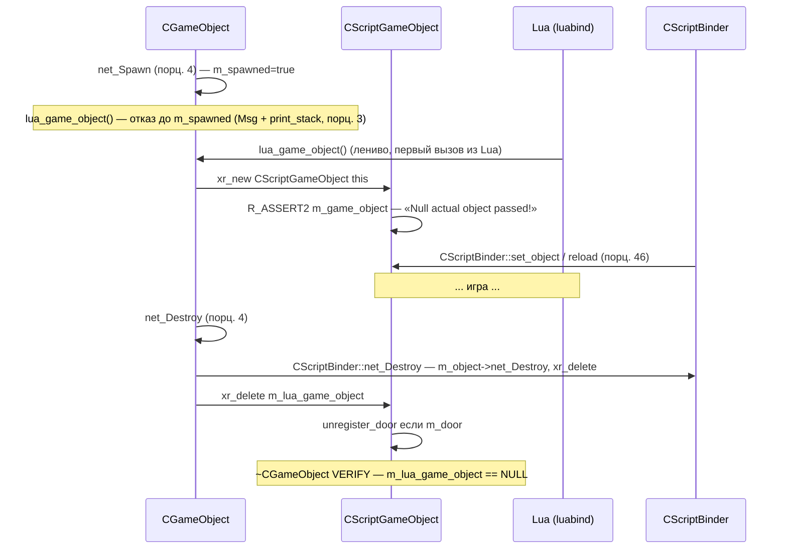
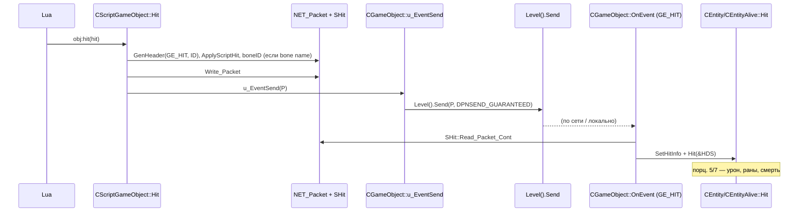

# Lua-обёртка CScriptGameObject: механика

> **Модуль:** `xrGame` · **Файлы:** `src/xrGame/script_game_object.h` (1135 стр.), `script_game_object.cpp` (1403), `script_game_object2.cpp` (724), `script_game_object3.cpp` (1969), `script_game_object4.cpp` (518), `script_game_object_inventory_owner.cpp` (2649), `script_game_object_script.cpp` (238), `script_game_object_script2.cpp` (139), `script_game_object_script3.cpp` (43892 байта), `script_game_object_use.cpp` (8911 байта), `script_game_object_use2.cpp` (12396 байта) · **Порцион 13/30, итерация 5**
>
> **Страница общая для порционов 13–18.** Здесь (порц. 13) — только **механика обёртки**: класс, жизненный цикл, back-reference, down-cast-паттерн, Lua-регистрация, `SAFE_WRAP`/BusyHandsDebug, DEBUG-режимы, `CScriptBinder`-мост. Группы API: инвентарь/торг — **порц. 14**, AI/память/монстры — **порц. 15**, прочее (анимация, кости, шлейфы, снаряды) — **порц. 16–17**, actor-специфика — **порц. 18**. Полная сводка Lua API — **итерация 14**.

## 1. Ответственность

`CScriptGameObject` — **единственный** класс, через который Lua-скрипты видят объекты мира. Это тонкая «шкурка» (wrapper) вокруг `CGameObject`: один экземпляр на «спавненный» объект, создаётся лениво, живёт ровно до `net_Destroy`.

Слой отвечает за:

- **обёртка «1 Lua-объект на 1 игровой объект»** — `m_game_object` (mutable-указатель на `CGameObject`), ленивое создание через [`lua_game_object()`](game-object.md) (порц. 3), уничтожение через `xr_delete(m_lua_game_object)` в `net_Destroy` (порц. 4);
- **валидность** — `is_valid()` по back-reference: обёртка валидна, пока `m_game_object->lua_game_object() == this`;
- **down-cast-паттерн** — большинство методов: `smart_cast<T*>(&object())` → NULL-ветка с `script_log(eLuaMessageTypeError, ...)` → делегирование в наследник. Обёртка **универсальна**: один класс обслуживает все ~1300 методов для всех типов объектов;
- **прямые делегирования** — методы, не требующие down-cast'а: `Position`/`Direction`/`ID`/`Mass`/`story_id` (макрос `BIND_FUNCTION10`), статы через `conditions()` (BIND-макросы L125–152), `Parent()`, `Name()`, `clsid()`, `Section()`;
- **Lua-регистрация** — `DECLARE_SCRIPT_REGISTER_FUNCTION` + три регистрационных файла (script2/3 + script.cpp): `class_<CScriptGameObject>`, enums (`relation`, `action_types`, `EPathType`, `ESelectionType`, `ACTOR_RELATIONS`, …), ~600 `.def`/`.property`;
- **защита от «Busy Hands»** — `SAFE_WRAP`/`SafeWrap` (h L1250–1347): обёртка вызова с проверкой `is_valid()` при `lua_busy_hands_debug`;
- **мост `CScriptBinder`** — `bind_object`/`binded_object` (со стороны обёртки; механика биндера — порц. 46, со стороны `CGameObject` — [game-object-net.md §15](game-object-net.md)).

**Чего НЕ делает**: не реализует никакой игровой логики (всё — делегирование); не владеет `CGameObject` (обёртка **не** владеет объектом, только ссылается); не сериализует своё состояние (`save`/`load` — в `CScriptBinder`); не управляет GC Lua (Lua-ссылки живут в `luabind`/сборщике; `adopt<>`-политики в регистрации определяют, кто владеет).

## 2. Место в архитектуре

```mermaid
graph TD
    subgraph Lua
        LU[Lua-скрипты gamedata/scripts]
        LB[luabind class_<CScriptGameObject>]
    end
    subgraph xrGame
        SGO[CScriptGameObject — ЭТОТ класс]
        GO[CGameObject]
        CE[CEntity — порц. 5]
        CA[CEntityAlive — порц. 7]
        AC[CActor — порц. 14–23]
        MO[CCustomMonster — порц. 9]
        II[CInventoryItemObject — порц. 10–12]
        SB[CScriptBinder — порц. 46]
    end
    LU -->|вызовы методов| LB
    LB -->|мембер-указатели, SAFE_WRAP| SGO
    SGO -->|m_game_object, 1:1| GO
    SGO -.smart_cast down-cast.-> CE
    SGO -.smart_cast down-cast.-> CA
    SGO -.smart_cast down-cast.-> AC
    SGO -.smart_cast down-cast.-> MO
    SGO -.smart_cast down-cast.-> II
    SGO -->|bind_object| SB
    GO -->|lua_game_object() — порц. 3| SGO
    GO -->|CScriptBinder::net_Destroy — порц. 4| SB
```

- **Создаётся/удаляется только `CGameObject`** — `lua_game_object()` (L1044–1056, [game-object.md](game-object.md)) лениво `xr_new<CScriptGameObject>(this)`; `CGameObject::net_Destroy` (L165) — `xr_delete(m_lua_game_object)`. Обёртка никогда не создаётся сама.
- **Зависит от:** `CGameObject` (порц. 3), `CEntity`/`CEntityAlive` (порц. 5/7), `CActor` (порц. 14–23), `CCustomMonster` (порц. 9), `CInventoryItemObject`/`CInventoryBox` (порц. 10–12), `CScriptBinder` (порц. 46), `CScriptHit`/`CScriptEntityAction`/`CScriptSoundInfo`/`CScriptMonsterHitInfo` (порц. 28), `CScriptBinderObject` (порц. 46), `CScriptEntity` (порц. 28), `CScriptActionPlanner` (DEBUG, ит. 6), `script_attachment` (порц. 29), `CScriptIniFile`.
- **Кто вызывает обёртку:** `luabind` (все методы), `CGameObject` (back-reference в `is_valid`/`object()`), `CScriptBinder` (reload/net_Spawn/net_Destroy/set_object/save/load/net_Relcase — §15 [game-object-net.md](game-object-net.md)), наследники `CGameObject` через `lua_game_object()` (например, `CEntityAlive::Die` — `callback(eDeath)(lua_game_object(), ...)`, порц. 7).
- **Карта модулей:** [module-map](../../architecture/module-map.md), [object-model](../../architecture/object-model.md) (обновляется порц. 30), [dependencies](../../architecture/dependencies.md).

## 3. Публичный API

### 3.1 Механика (порц. 13, эта страница)

| Метод                                                                                           | Возврат                | Назначение                                                               |
| ----------------------------------------------------------------------------------------------- | ---------------------- | ------------------------------------------------------------------------ |
| `CScriptGameObject(CGameObject*)`                                                               | —                      | Единственный публичный ctor (use.cpp L63–68); private copy-ctor (h L178) |
| `~CScriptGameObject()`                                                                          | —                      | unregister_door при `m_door` (use.cpp L70–76)                            |
| `is_valid()`                                                                                    | `bool`                 | Back-reference-проверка (h L186–195)                                     |
| `object()`                                                                                      | `CGameObject&`         | Доступ к обёрнутому объекту, DEBUG-проверка (cpp L1385–1402)             |
| `operator CObject*()`                                                                           | `CObject*`             | Явный down-cast (2.cpp L195–198)                                         |
| `Parent()`                                                                                      | `CScriptGameObject*`   | Обёртка родителя через `H_Parent()` (use.cpp L78–85)                     |
| `Hit(CScriptHit*)`                                                                              | —                      | Скриптовый удар → `GE_HIT`-пакет (2.cpp L173–190)                        |
| `clsid()`                                                                                       | `int`                  | Скриптовый CLSID (use.cpp L87–91)                                        |
| `Name()` / `cName()` / `Section()`                                                              | `LPCSTR`/`shared_str`  | Имена (use.cpp L93–106)                                                  |
| `Kill(CScriptGameObject*, bool)`                                                                | —                      | Убийство через `CEntity::KillEntity` (use.cpp L108–123)                  |
| `Alive()`                                                                                       | `bool`                 | `CEntity::g_Alive()` (use.cpp L125–135)                                  |
| `play_cycle(anim[, mix_in])`                                                                    | —                      | Циклическая анимация (2.cpp L149–171)                                    |
| `Center/Xform/bounding_box(bool bHud)`                                                          | `Fvector/Fmatrix/Fbox` | Геометрия, HUD-ветка через `CHudItem` (cpp L58–105)                      |
| `Position/Direction/Mass/ID/getVisible/getEnabled/story_id`                                     | —                      | BIND-макросы → прямые делегирования (cpp L107–123)                       |
| `GetHealth/SetHealth/ChangeHealth` + psy/power/satiety/radiation/morale/bleeding/circumspection | —                      | BIND-макросы → `CEntityAlive::conditions()` (cpp L125–152)               |
| `GetScriptControl/SetScriptControl/GetActionCount/...`                                          | —                      | BIND-макросы → `CScriptEntity` (cpp L154–159)                            |
| `set_fov/set_range`                                                                             | —                      | → `CCustomMonster` (cpp L1186–1208)                                      |
| `bind_object`/`binded_object`                                                                   | —                      | Мост `CScriptBinder` (cpp L341–349)                                      |
| `AddAttachment/GetAttachment/RemoveAttachment/IterateAttachments`                               | —                      | Скриптовые вложения (cpp L1357–1383, порц. 29)                           |
| `GetShaders/GetDefaultShaders/SetShaderTexture/ResetShaderTexture`                              | `luabind::object`      | «Shader/Textures Magic» (cpp L1406–1520)                                 |
| `set_fastcall`/`set_const_force`                                                                | —                      | Физика-скрипты `Level().ph_commander_scripts()` (use.cpp L229–238+)      |
| `DestroyObject()`                                                                               | —                      | → `CGameObject::DestroyObject` (3.cpp L2100–2103)                        |

### 3.2 Группы API (каркас; детали — порционы 14–18, полная сводка — ит. 14)

| Группа                         | Примеры методов                                                                                                                                                                                                                                | Файл-основание                                                                                     | Порцион |
| ------------------------------ | ---------------------------------------------------------------------------------------------------------------------------------------------------------------------------------------------------------------------------------------------- | -------------------------------------------------------------------------------------------------- | ------- |
| Инвентарь/торг/персонаж        | `Cost`, `GetObjectByName/ByIndex/ById`, `GiveInfoPortion`, `GiveTaskToActor`, `Money`, `TransferItem`, `CharacterName/Icon/Rank/Reputation/Community`, `GetStartDialog`, `StartTrade`/`StartUpgrade`, `install_upgrade`                        | `script_game_object_inventory_owner.cpp` (2649 стр.), `script_game_object_use2.cpp`                | **14**  |
| AI/память/монстры              | `AddAction/ResetActionQueue`, `GetBestEnemy/Danger/Item`, `memory_time/position/remove_links`, `set_fov/set_range`, `ChangeTeam`, `set_body_state/set_movement_type/...`, `best_cover/safe_cover`, `set_patrol_path`, `memory_visible_objects` | `script_game_object3.cpp` (1969), `script_game_object2.cpp`, `script_game_object_smart_covers.cpp` | **15**  |
| Прочее: анимация/кости/снаряды | `play_cycle`, `add_animation/clear_animations`, `bone_id/bone_name/bone_transform/bone_position/bone_direction/bone_parent/list_bones`, `set_item`, `aim_time/sniper_*`, `GetAmmoElapsed`, `hud_fire_point/bone*`                              | `script_game_object2.cpp`, `script_game_object4.cpp`, `script_game_object.cpp`                     | **16**  |
| Прочее: эффекты/транспорт      | `start_particles/stop_particles`, `get_helicopter/get_car/get_stmgun/get_projector`, `set_color_animator`, `PhantomSetEnemy`, `get_physics_shell`, `explode`                                                                                   | `script_game_object2.cpp`, `script_game_object4.cpp`                                               | **17**  |
| Actor-специфика                | `SetActorPosition/Direction`, `GetMovementSpeed/SetMovementSpeed`, `DisableHitMarks`, `GetActorObjectLookingAt`, `GetActorMaxWeight/...`, `get_scope_ui`, `ActorLookAtPoint`                                                                   | `script_game_object2.cpp`, `script_game_object3.cpp`, `script_game_object_use2.cpp`                | **18**  |

## 4. Внутреннее устройство

### 4.1 Класс и поля

`class CScriptGameObject` (h L175–1245) — **без виртуальных методов** (кроме виртуального деструктора), **без наследования** (пустой базовый), **одиночное** поле:

| Поле            | Тип                    | Назначение                                                                                                                                                                         |
| --------------- | ---------------------- | ---------------------------------------------------------------------------------------------------------------------------------------------------------------------------------- |
| `m_game_object` | `mutable CGameObject*` | Единственное поле. `mutable`, потому что `object()` — `const`-метод, но должен проверять back-reference через `CGameObject::lua_game_object()` (которая не const в `CGameObject`). |
| `m_door`        | `doors::door*`         | Привязка к smart-двери; в деструкторе вызывает `unregister_door()` (use.cpp L70–76).                                                                                               |

- **Private copy-ctor** (h L178): `CScriptGameObject(CScriptGameObject const&)` — объявлен, но **не определён** — обёртки не копируются.
- **`DECLARE_SCRIPT_REGISTER_FUNCTION`** (h L1244): макрос `script_bind_macroses.h` (ит. 14) — объявляет статик `script_register_game_object()`, который собирает все `script_register_game_objectN` (script2.cpp L37+, script3.cpp, script.cpp).

### 4.2 Жизненный цикл



- **Ctor** (use.cpp L63–68): `m_game_object(game_object)`, `m_door(0)`; `R_ASSERT2(m_game_object, "Null actual object passed!")`.
- **Dtor** (use.cpp L70–76): `m_door` → `unregister_door()` (3.cpp, порц. 15/17).
- **Обёртка не имеет `init`/`reinit`/`reload`** — это методы `CScriptBinder`, вызываемые со стороны `CGameObject` (game-object-net.md §15).

### 4.3 Валидность: `is_valid()` и `object()`

**`is_valid()`** (h L186–195, inline):

```cpp
if (!m_game_object) return false;
if (m_game_object->lua_game_object() != this) return false;  // back-reference
return true;
```

Механика: `CGameObject::lua_game_object()` (L1044–1056, порц. 3) лениво создаёт обёртку **и** хранит её в `m_lua_game_object` (mutable поле `CGameObject`). Если `CGameObject` удалён (через `net_Destroy` → `xr_delete(m_lua_game_object)`), обёртка, удерживаемая Lua-скриптом, остаётся, но её back-reference разорвана (либо `m_game_object` дangling, либо `m_lua_game_object` больше не указывает на эту обёртку) → `is_valid() == false`.

**`object()`** (cpp L1385–1402):

- **DEBUG**: `__try { if (m_game_object && m_game_object->lua_game_object() == this) return (*m_game_object); } __except (EXCEPTION_EXECUTE_HANDLER) {}` — SEH-защита от чтения за дangling-указателем (само обращение к `lua_game_object()` по мёртвому `m_game_object` может упасть; `__try/__except` ловит). При сбое — `script_log(eLuaMessageTypeError, "you are trying to use a destroyed object [%x]", m_game_object)` + `THROW2(..., "Probably, you are trying to use a destroyed object!")`.
- **Release**: `static CGameObject* m_game_object_dummy = NULL;` — если `!m_game_object` или back-reference не сходится → **возвращает `*m_game_object_dummy`, то есть NULL-dereference** (гарантированный crash). Намеренно: в release «мёртвый» объект лучше упастись сразу, чем вести себя неопределённо.

**`operator CObject*()`** (2.cpp L195–198): `return (&object());` — прямой down-cast в `CObject*`. Над ним `#pragma todo("Dima to Dima : find out why user defined conversion operators work incorrect")` (2.cpp L193) — автор не понимал, почему неявные преобразования работают некорректно в luabind.

### 4.4 Down-cast-паттерн (основа всех методов)

Типичный метод обёртки:

```cpp
void CScriptGameObject::set_fov(float new_fov)          // cpp L1186–1196
{
    CCustomMonster* monster = smart_cast<CCustomMonster*>(&this->object());
    if (!monster)
    {
        ai().script_engine().script_log(ScriptStorage::eLuaMessageTypeError,
            "CCustomMonster : cannot access class member set_fov!");
        return;
    }
    monster->set_fov(new_fov);
}
```

Варианты NULL-ветки (наблюдаются в коде):

1. **`script_log` + return/return default** — большинство (`set_fov`, `Kill`, `Alive`, `GetRelationType`, `memory_position`, `explode`, `best_weapon`, ...);
2. **`script_log` + `NODEFAULT`** — редкий (например, `get_helicopter` L250–252, `get_hanging_lamp` L261–263) — `NODEFAULT` прерывает трассировку стека в debug-сборке, но **возврат продолжается** (может вернуть nullptr);
3. **тихий return** — например, `PhantomSetEnemy` (3.cpp L1276–1283) — без лога.

Прямые делегирования **без** down-cast'а — макросы `BIND_FUNCTION10/01/02` (cpp L107–159):

```cpp
BIND_FUNCTION10(&object(), CScriptGameObject::Position, CGameObject, Position, Fvector, Fvector());
// раскладывается (script_bind_macroses.h) в:
Fvector CScriptGameObject::Position() const { return (object().Position()); }
```

`Fvector()`/`-1`/`false` — fallback-значения, используемые `SafeWrap`/luabind при невалидном объекте (см. §4.7).

Специфические down-cast-ы:

- **`Kill`** (use.cpp L108–123): `smart_cast<CEntity*>`; `!AlreadyDie()` → `KillEntity(who ? who->object().ID() : object().ID(), bypass_actor_check ? 1 : 0)`; иначе log «attempt to kill dead object %s». Параметр `bypass_actor_check` — форк AVO (коммент в h L240).
- **`GetRelationType`** (use.cpp L137–157): два down-cast'а (`this` + `who`), оба должны быть `CEntityAlive` → `tfGetRelationType` (порц. 7).
- **`CheckObjectVisibility`** (cpp L311–335): тройной down-cast — `CEntityAlive` (проверка `g_Alive()`), затем `CScriptEntity` → `CheckObjectVisibility`, иначе `CActor` → `memory().visual().visible_now(...)`.
- **`Parent()`** (use.cpp L78–85): `smart_cast<CGameObject*>(object().H_Parent())` → `lua_game_object()` родителя (ленивая обёртка родителя).

### 4.5 Механика `Hit`

`Hit(CScriptHit* tpLuaHit)` (2.cpp L173–190):

1. `NET_Packet P; SHit HS;` — локальный пакет;
2. `HS.GenHeader(GE_HIT, object().ID())` — заголовок события «удар по этому объекту»;
3. `HS.ApplyScriptHit(&tLuaHit)` — копирует поля `CScriptHit` (порц. 28) в `SHit`;
4. если `m_caBoneName` не пусто — `IKinematics* V = smart_cast<IKinematics*>(object().Visual())`; `HS.boneID = V->LL_BoneID(name)`;
5. `HS.p_in_bone_space = Fvector().set(0,0,0)`;
6. `HS.Write_Packet(P)` → `object().u_EventSend(P)` (`Level().Send`, порц. 4) — удар идёт **сетевым событием** (даже в Single — через `OnEvent` → `SHit::Read_Packet_Cont` → `Hit(&HDS)`, game-object-net.md §6).

Полный разбор `CScriptHit`/`SHit` — порц. 28.

### 4.6 `clsid()`, `Name()`, `Section()`

- **`clsid()`** (use.cpp L87–91): `if (!this) return -1; return object().clsid();` — `CGameObject::clsid()` (L257–263, порц. 3) в DEBUG `THROW(m_script_clsid >= 0)`, то есть вызов до `reload()` упадёт. Значение — `script_clsid(CLS_ID)` из [фабрики](class-registry.md) (порц. 2) — **индекс в отсортированном векторе**.
- **`Name()`** (L93–96): `*object().cName()` — «игровое имя».
- **`cName()`** (L98–101): `shared_str` (копия).
- **`Section()`** (L103–106): `*object().cNameSect()` — имя секции `game.ltx`.

### 4.7 Lua-регистрация и `SAFE_WRAP` / BusyHandsDebug

**Три регистрационных файла:**

| Файл                                          | Содержимое                                                                                                                                                                                                                                                                                                                                                                                                                                                                                                                                                                                                                                                                                               |
| --------------------------------------------- | -------------------------------------------------------------------------------------------------------------------------------------------------------------------------------------------------------------------------------------------------------------------------------------------------------------------------------------------------------------------------------------------------------------------------------------------------------------------------------------------------------------------------------------------------------------------------------------------------------------------------------------------------------------------------------------------------------- |
| `script_game_object_script2.cpp` (139 стр.)   | `script_register_game_object1(class_<CScriptGameObject> &&instance)`: enums `relation` (friend/neutral/enemy/dummy), `action_types`, `EPathType`, `ESelectionType`; properties `health`/`psy_health`/`power`/`satiety`/`radiation`/`morale`/`bleeding` (getter+setter через BIND-макросы); `xform`/`bounding_box`/`center`/`position`/`direction`/`clsid`/`id`/`story_id`/`section`/`name`/`parent`/`mass`/`cost`/...; `kill`/`hit`/`play_cycle`; `get_enemy`/`get_corpse`/`memory_*`/`best_*`/`bind_object` (`adopt<2>`) /`motivation_action_manager` (→ `CScriptActionPlanner`, DEBUG); `set_actor_position`/`set_npc_position`; `disable_hit_marks`; `get/set_movement_speed`; `vertex_in_direction`. |
| `script_game_object_script3.cpp` (~44K байта) | `script_register_game_object2(...)`: инвентарь/торг/персонаж (порц. 14), AI (порц. 15), `get_actor_relation_flags`/`set_actor_relation_flags` + enum `ACTOR_RELATIONS`, `sound_voice_prefix`, `is_inv_box_empty`/`deadbody_*`/`inv_box_*`, `destroy_object`, ammo-методы, `set_spatial_type`, `safe_cover`/`spawn_ini`/`memory_remove_links`/`memory_visible_objects` (`return_stl_iterator`), `set_fastcall`/`set_const_force`, `inside`, `info_add/info_clear`.                                                                                                                                                                                                                                        |
| `script_game_object_script.cpp` (238 стр.)    | Доп. регистрации (details — порц. 14–18).                                                                                                                                                                                                                                                                                                                                                                                                                                                                                                                                                                                                                                                                |

Все три вызывается из `script_register_game_object()` (макрос `DECLARE_SCRIPT_REGISTER_FUNCTION`, h L1244), который регистрирует класс в `luabind` при старте `CScriptEngine` (ит. 14).

**`SAFE_WRAP`** (h L1346–1347):

```cpp
#define SAFE_WRAP(func) static_cast<typename SafeWrap<decltype(func), func>::type>(SafeWrap<decltype(func), func>::call)
```

Превращает мембер-указатель `Ret(T::*)(Args...)` в **free function** `Ret(*)(T*, Args...)`, которую luabind принимает как `.def`. Магия в `SafeWrapBase::execute` (h L1288–1313):

```cpp
if (lua_busy_hands_debug)
{
    bool is_valid = false;
    if (instance != nullptr)
    {
        if constexpr (has_is_valid<InstanceT>::value)
            is_valid = instance->is_valid();   // CScriptGameObject — имеет
        else
            is_valid = true;                    // классы без is_valid — «непусто = валидно»
    }
    if (!is_valid)
        log_and_callback("Accessing destroyed object");   // лог + lua_error_not_crash
}
return (instance->*memFunc)(...);   // вызов СЛЕДУЕТ В ЛЮБОМ СЛУЧАЕ («Sayonara»)
```

Ключевые детали:

- **`has_is_valid`** (h L1251–1256): SFINAE-детекция `T->is_valid()` — обёртка универсальна для классов с и без `is_valid()`;
- **`lua_busy_hands_debug`** — extern BOOL (h L1247), определение в `console_commands.cpp` L88–92: **`= TRUE` по умолчанию**; команда консоли `lua_busy_hands_debug 0/1` (L2581–2585, `CMD4`); опция UI `errors` (`options_modded_exes_errors.script`);
- **`log_and_callback`** (h L1280–1284): `script_log(eLuaMessageTypeError, "[BusyHandsDebug] Error: %s", error)` + `ai().script_engine().lua_error_not_crash(lua)` (`script_engine.cpp` L235–249): если `!lua_busy_hands_debug` — no-op; иначе лог «[BusyHandsDebug] Runtime Error» + **сброс Lua-стека** через `get_lua_stack(L)` (объявление h L1248; реализация — ит. 14) и очистку;
- **`handle_invalid`** (h L1260–1273): компиляторная формальность — «недостигаемо, но нужно удовлетворить компилятор»: reference-возврат → `*nullptr` (гарантированный crash), value → `Ret()`;
- **важно**: при невалидном объекте `SAFE_WRAP` **не предотвращает** вызов — только логирует и «сбрасывает» Lua; фактический вызов `instance->*memFunc(...)` выполняется и в DEBUG упадёт в `object()` (§4.3), в release — crash на dummy-NULL. Это **диагностический**, а не защитный механизм (см. README changelog: «lua_busy_hands_debug command to debug common "Busy Hands" errors»).

### 4.8 DEBUG-режимы

1. **`script_planner`** (h L126–151, `#ifdef DEBUG`): typedef `CActionPlanner<CScriptGameObject, false, CActionBase<CScriptGameObject>, CPropertyEvaluator<CScriptGameObject>, ...*>` — планировщик действий для DEBUG-отладки AI. Используется в `action_planner()` (use.cpp L159–175): `smart_cast<CAI_Stalker*>` → `brain()` → `CScriptActionPlanner` (порц. 15; сам планировщик — ит. 6).
2. **`object()` `__try/__except` + `THROW2`** (§4.3) — только DEBUG; release — dummy-NULL.
3. **`lua_busy_hands_debug`** — сборка-независимый (в release тоже), по умолчанию **включён** (§4.7).
4. **`print_bone_warnings`** (cpp L161): `BOOL print_bone_warnings = TRUE;` — глобал-флаг предупреждений о костях (используется в bone-методах, порц. 16).

### 4.9 `CScriptBinder`-мост (со стороны обёртки)

Со стороны `CScriptGameObject` (cpp L341–349):

```cpp
CScriptBinderObject* CScriptGameObject::binded_object() { return (object().object()); }
void CScriptGameObject::bind_object(CScriptBinderObject* game_object) { object().set_object(game_object); }
```

`CScriptBinderObject` — пользовательский Lua-объект (форк), привязанный к игровому объекту для сериализации/жизненного цикла скриптового состояния. Полная механика `CScriptBinder` (`reload`/`net_Spawn`/`net_Destroy`/`set_object`/`shedule_Update`/`save`/`load`/`net_SaveRelevant`/`net_Relcase`, `try/catch`-обёртки) — **порц. 46** (обещание итерации 5); со стороны `CGameObject` уже разобрано в [game-object-net.md §15](game-object-net.md) (порц. 4).

### 4.10 Сетевые «обёртки» — что именно делает обёртка

Обёртка **не имеет** своих `net_Spawn`/`net_Destroy`/`save`/`load`/`net_SaveRelevant`/`net_Relcase`. Всё это — методы `CScriptBinder`, вызываемые `CGameObject` в своём `net_Spawn`/`net_Destroy`/`net_Save` (game-object-net.md §4–7). Обёртка участвует пассивно:

- **`net_Spawn`** (CGameObject L267–481, порц. 4): `CScriptBinder::net_Spawn(DC)` в конце — если есть `m_object` (CScriptBinderObject) — `m_object->net_Spawn(object)` (форк: привязка в Single, см. game-object-net.md §12.6).
- **`net_Destroy`** (L114–167): `CScriptBinder::net_Destroy()` → `m_object->net_Destroy()` + `xr_delete(m_object)`; затем `xr_delete(m_lua_game_object)` — **обёртка умирает здесь**.
- **`save`/`load`** (L544–550): **пустые** в `CGameObject`; payload — `CScriptBinder::save/load` → `m_object->save/load`.
- **`net_SaveRelevant`** (L1095–1098): `return CScriptBinder::net_SaveRelevant();` → `m_object->net_SaveRelevant()`.

## 5. Взаимодействие

**Кто вызывает `CScriptGameObject`:**

| Вызывающий                                  | Что вызывает                                                                                                               | Где                                 |
| ------------------------------------------- | -------------------------------------------------------------------------------------------------------------------------- | ----------------------------------- |
| `luabind` (Lua-скрипты)                     | Все методы через `.def`/`.property`                                                                                        | script2/3/script.cpp                |
| `CGameObject::lua_game_object()`            | `xr_new<CScriptGameObject>(this)`                                                                                          | GameObject.cpp L1044–1056 (порц. 3) |
| `CGameObject::net_Destroy()`                | `xr_delete(m_lua_game_object)`                                                                                             | GameObject.cpp L165 (порц. 4)       |
| `CGameObject::is_valid`-проверка (обратная) | `lua_game_object() == this`                                                                                                | h L192, cpp L1389                   |
| `CScriptBinder` (порц. 46)                  | `reload`/`net_Spawn`/`net_Destroy`/`set_object`/`save`/`load`/`net_SaveRelevant`/`net_Relcase` — через `lua_game_object()` | game-object-net.md §15              |
| Наследники `CGameObject`                    | `lua_game_object()` в колбэках (например, `CEntityAlive::Die` → `callback(eDeath)(lua_game_object(), ...)`)                | порц. 7                             |

**Кого вызывает `CScriptGameObject`:**

| Вызываемое                                                                                                                                                                                   | Через что                | Порцион   |
| -------------------------------------------------------------------------------------------------------------------------------------------------------------------------------------------- | ------------------------ | --------- |
| `CGameObject` (базовые: `Position`, `ID`, `H_Parent`, `XFORM`, `u_EventSend`, `DestroyObject`, `cName`, `cNameSect`, `clsid`, `callback`, `spawn_ini`, `add/get/remove/iterate_attachments`) | `object()` + прямые/BIND | 3–4       |
| `CEntity` (`KillEntity`, `AlreadyDie`, `g_Alive`, `g_Team/Squad/Group`, `GetMaxHealth`, `GetLevelDeathTime`)                                                                                 | down-cast                | 5         |
| `CEntityAlive` (`conditions()`, `ffGetFov/Range`, `tfGetRelationType`, `DisableHitMarks`, `character_physics_support()`)                                                                     | down-cast                | 7, 18     |
| `CActor` (`cam_Active()`, `ForceTransform`, `memory().visual()`)                                                                                                                             | down-cast                | 14–23     |
| `CCustomMonster` (`memory()`, `movement()`, `set_fov/range`, `ChangeTeam`, `GetCurrentEnemy/Corpse`, `invulnerable`, `animation_movement_controlled`)                                        | down-cast                | 9, 15     |
| `CInventoryItemObject`/`CInventoryItem`/`CInventoryBox`/`CInventoryOwner`                                                                                                                    | down-cast                | 10–12, 14 |
| `CScriptEntity` (`SetScriptControl`, `AddAction`, `GetCurrentAction`)                                                                                                                        | down-cast / BIND         | 28        |
| `CScriptBinder` (`set_object`, `object()`)                                                                                                                                                   | напрямую                 | 46        |
| `CScriptHit` / `CScriptEntityAction` / `CScriptSoundInfo` / `CScriptMonsterHitInfo`                                                                                                          | аргументы/возврат        | 28        |
| `CScriptIniFile`, `script_attachment`, `CScriptActionPlanner`                                                                                                                                | аргументы/возврат        | 29, ит. 6 |
| `ai().script_engine()` (`script_log`, `lua_error_not_crash`, `lua`, `functor`)                                                                                                               | напрямую                 | ит. 14    |
| `Level().ph_commander_scripts()` (`set_fastcall`)                                                                                                                                            | напрямую                 | ит. 12    |
| `ai().level_graph()` (`vertex_position`, `farthest_vertex_in_direction`)                                                                                                                     | `vertex_in_direction`    | 6         |

## 6. Потоки

### 6.1 Вызов метода из Lua

```mermaid
sequenceDiagram
    participant LU as Lua-скрипт
    participant LB as luabind
    participant SW as SAFE_WRAP (free fn)
    participant S as CScriptGameObject
    participant O as CGameObject
    participant T as CCustomMonster (или другой)

    LU->>LB: monster:set_fov(90)
    LB->>SW: CScriptGameObject::set_fov (memfn → free fn)
    SW->>S: is_valid()? (если lua_busy_hands_debug)
    alt невалидно
        SW->>LU: log_and_callback "Accessing destroyed object"
        SW->>S: вызов СЛЕДУЕТ (не предотвращается)
    end
    S->>O: object() — DEBUG: __try + back-reference; release: dummy-NULL
    S->>T: smart_cast<CCustomMonster*>(&object())
    alt smart_cast = NULL
        S->>LU: script_log "CCustomMonster : cannot access class member set_fov!"
        S-->>LB: return (void)
    else
        S->>T: monster->set_fov(new_fov)
    end
```

### 6.2 `Hit` — скриптовый удар



### 6.3 Жизненный цикл обёртки (см. §4.2 — mermaid sequence)

## 7. Конфигурация

- **`lua_busy_hands_debug`** — команда консоли `lua_busy_hands_debug 0/1` (console_commands.cpp L2581–2585), дефолт `TRUE` (L90); UI-опция в `errors` (`gamedata/scripts/options_modded_exes_errors.script`, текст `ui_mm_modded_exes.xml`).
- **`print_bone_warnings`** (cpp L161) — глобал, `TRUE`; управляет bone-warning-логами (порц. 16).
- **`game.ltx`** — секции объектов: `class` key → CLSID (порц. 2), `script_binding` key → секция `CScriptBinderObject` (game-object-net.md §15).
- **`script.ltx`** — настройка Lua-движка (ит. 14).

## 8. Ограничения / дебаг

1. **`is_valid()` не защищает от dangling `m_game_object`** — сама проверка `m_game_object->lua_game_object()` обращается к памяти `CGameObject`, которая может быть уже освобождена. В DEBUG `object()` ловит это через `__try/__except`; в release — crash. `is_valid()` полагается на то, что `CGameObject` ещё жив (т.е. back-reference читама) — **неполная защита**; надёжная защита — только `SAFE_WRAP`-лог + дисциплина Lua-скриптов (не держать ссылки на удалённые объекты).
2. **Release-`object()` возвращает `*NULL`** (static dummy) — гарантированный segfault при обращении к мёртвому объекту. Намеренно: «лучше упасть сразу, чем вести себя неопределённо».
3. **`SAFE_WRAP` не предотвращает вызов** (§4.7) — только логирует и сбрасывает Lua-стек; фактический вызов выполняется. Диагностический, не защитный механизм.
4. **`lua_busy_hands_debug` включён по умолчанию** (`= TRUE` в console_commands.cpp L90) — каждый `SAFE_WRAP`-вызов делает проверку `is_valid()` (back-reference read) — **накладное** на горячих путях. Отключается `lua_busy_hands_debug 0`.
5. **`m_door`** — единственное поле, кроме `m_game_object`; управление дверью — в `register_door`/`unregister_door`/`on_door_is_*` (3.cpp, порц. 15/17). Деструктор обёртки вызывает `unregister_door()` — если `m_door` указывает на мёртвую дверь, crash.
6. **Private copy-ctor без определения** — попытка копирования обёртки → линк-ошибка (намеренно).
7. **`operator CObject*()`** — `#pragma todo` (2.cpp L193): автор не понимал, почему неявные преобразования работают некорректно в luabind.
8. **Down-cast через `smart_cast`** — RTTI-based (в отличие от `cast_*` в `CGameObject`, порц. 3). Если RTTI отключено — не скомпилируется; в этом форке RTTI включено.
9. **NULL-ветки неоднородны** — 3 варианта (§4.4): `script_log`+return, `script_log`+`NODEFAULT`, тихий return. В некоторых методах (`PhantomSetEnemy`) — вообще без лога.
10. **`NODEFAULT` в NULL-ветках** — прерывает трассировку стека в debug, но **не** предотвращает возврат; может вернуть nullptr без предупреждения.
11. **`print_bone_warnings`** — глобал, не инициализируется в `init`-стиле; дефолт `TRUE` в .cpp (L161).
12. **`#pragma todo` L193** — «find out why user defined conversion operators work incorrect» — нерешённая проблема автора.
13. **`handle_invalid`** — `*nullptr` для reference-возвратов (h L1267) — гарантированный crash, но «недостигаемо» (коммент L1263).
14. **`CScriptGameObject` не имеет `virtual` методов** (кроме dtor) — полиморфизм не нужен (одна обёртка на один тип объекта).
15. **`DECLARE_SCRIPT_REGISTER_FUNCTION`** — макрос, конкретика — ит. 14 (здесь только что он делает: собирает 3 регистрационных файла).

## 9. Ссылки

- [game-object.md](game-object.md) — `CGameObject`: `lua_game_object()`, `clsid()`, `callback()`, `FootStepCallback` (порц. 3)
- [game-object-net.md](game-object-net.md) — `net_Spawn`/`net_Destroy`, `CScriptBinder` §15 (порц. 4)
- [class-registry.md](class-registry.md) — `script_clsid`, `register_script_classes` (порц. 2)
- [entity.md](entity.md) — `CEntity::KillEntity`, `g_Alive` (порц. 5)
- [entity-alive.md](entity-alive.md) — `CEntityAlive::conditions()`, `tfGetRelationType` (порц. 7)
- [custom-monster.md](custom-monster.md) — `CCustomMonster` (порц. 9)
- [inventory-item.md](inventory-item.md) — `CInventoryItemObject` (порц. 10)
- [script-entity.md](script-entity.md) — `CScriptEntity`, `CScriptHit` (порц. 28)
- [script-attachment.md](script-attachment.md) — `script_attachment` (порц. 29)
- [actor.md](actor.md) — `CActor` (порц. 14)
- [index.md](index.md) — карта модуля, статусы порционов
- [object-model.md](../../architecture/object-model.md) — иерархия (обновляется порц. 30)
- [module-map.md](../../architecture/module-map.md), [dependencies.md](../../architecture/dependencies.md)

## 10. Источник

| Файл                                                | Строк | Содержание                                                                                                                                                                                                                                      |
| --------------------------------------------------- | ----- | ----------------------------------------------------------------------------------------------------------------------------------------------------------------------------------------------------------------------------------------------- |
| `src/xrGame/script_game_object.h`                   | 1135  | Класс, поля, `is_valid`, `SafeWrap`, `DECLARE_SCRIPT_REGISTER_FUNCTION`, ~1300 деклараций методов                                                                                                                                               |
| `src/xrGame/script_game_object.cpp`                 | 1403  | BIND-макросы, `object()`, `Center/Xform/bounding_box`, `bind_object`, `set_fov/range`, `vertex_in_direction`, `Use/StartTrade/StartUpgrade`, `AddAttachment`..., `GetShaders`, `memory_remove_links`                                            |
| `src/xrGame/script_game_object2.cpp`                | 724   | `Hit`, `operator CObject*`, `GetBestEnemy/Danger/Item`, `memory_time/position`, `set_fov/range`, `play_cycle`, `SetActorPosition/Direction`, `SetNpcPosition`, `DisableHitMarks`, `GetMovementSpeed/SetMovementSpeed`, `explode`, `best_weapon` |
| `src/xrGame/script_game_object3.cpp`                | 1969  | `ChangeTeam`, `GetEnemy/GetCorpse`, `GetInventoryObjectCount`, `GetActiveItem`, `GetObjectByName/ByIndex/ById`, `DestroyObject`, `IsInvBoxEmpty`, `memory_remove_links`, `cast_BottleItem`, actor-методы                                        |
| `src/xrGame/script_game_object4.cpp`                | 518   | `IsInvBoxEmpty`, `memory_remove_links`, `sound_voice_prefix`, прочее                                                                                                                                                                            |
| `src/xrGame/script_game_object_inventory_owner.cpp` | 2649  | Инвентарь/торг/персонаж (порц. 14)                                                                                                                                                                                                              |
| `src/xrGame/script_game_object_script.cpp`          | 238   | Lua-регистрация (details — порц. 14–18)                                                                                                                                                                                                         |
| `src/xrGame/script_game_object_script2.cpp`         | 139   | Lua-регистрация: enums, properties, core methods                                                                                                                                                                                                |
| `src/xrGame/script_game_object_script3.cpp`         | ~44K  | Lua-регистрация: инвентарь/AI/прочее (порц. 14–17)                                                                                                                                                                                              |
| `src/xrGame/script_game_object_use.cpp`             | ~238  | Ctor/dtor, `Parent`, `clsid`, `Name`, `cName`, `Section`, `Kill`, `Alive`, `GetRelationType`, `action_planner`, `set_enemy_callback`, `SetCallback`, `set_fastcall`                                                                             |
| `src/xrGame/script_game_object_use2.cpp`            | ~12K  | `GetSoundInfo`, `GetMonsterHitInfo`, `GetCurrentDirection`, прочее                                                                                                                                                                              |
| `src/xrGame/console_commands.cpp`                   | —     | `lua_busy_hands_debug` (L88–92, L2581–2585)                                                                                                                                                                                                     |

**Порционы 14–18** дописывают группы API в эту же страницу. Полная сводка Lua API — **итерация 14**.
