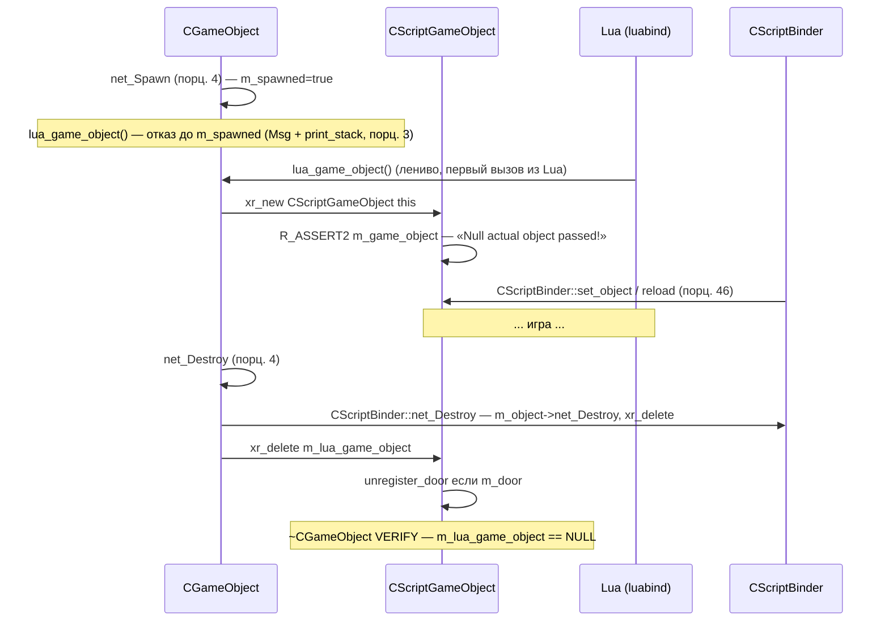
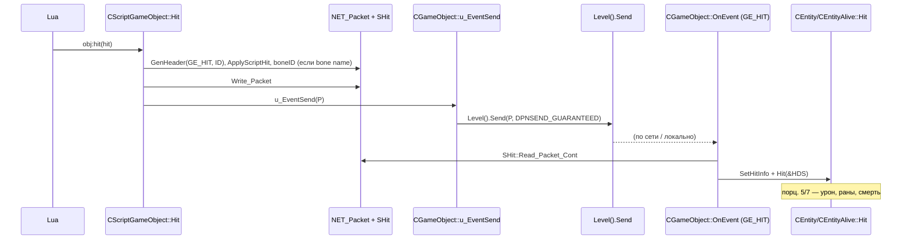

# Lua-обёртка CScriptGameObject: механика

> **Модуль:** `xrGame` · **Файлы:** `src/xrGame/script_game_object.h` (1352 стр.), `script_game_object.cpp` (1646), `script_game_object2.cpp` (816), `script_game_object3.cpp` (2229), `script_game_object4.cpp` (581), `script_game_object_trader.cpp` (69), `script_game_object_use.cpp` (266), `script_game_object_use2.cpp` (405), `script_game_object_smart_covers.cpp` (509), `script_game_object_inventory_owner.cpp` (3031), `script_game_object_script.cpp` (238), `script_game_object_script2.cpp` (139), `script_game_object_script3.cpp` (43892 байта) · **Порцион 13–17/30, итерация 5**
>
> **Страница общая для порционов 13–18.** Порц. 13 — **механика обёртки**: класс, жизненный цикл, back-reference, down-cast-паттерн, Lua-регистрация, `SAFE_WRAP`/BusyHandsDebug, DEBUG-режимы, `CScriptBinder`-мост. Порц. 14 — **базовый API** (§3.3): идентификация/геометрия, состояние/статы, script-control, инвентарь-базовые, use/trade, feel-обвязка, сетевые примитивы, AI-базовые, зоны/транспорт, оружие-базовые, actor-специфика, артефакты, space-restrictor, касты/тест-классы, физика. Порц. 15 — **инвентарь и персонаж** (§3.4): инфо-порции, разговоры/торговля, итерация инвентаря, предметы (перемещение/выброс/активация/торговля), деньги, отношения/симпатия, персонаж (имя/ранг/репутация/община), задачи, магазин, урон, ограничения движения, навески/фонарь/НВЗ, оружие-статусы, AI-stalker (гранаты/прицел/снайпинг/укрытия/бой), двери, расширенные экспорты (навески/апгрейды/коэфф. актёра/looking-at). Порц. 16 — **оружие, holder, снайпинг** (§3.5): пофайловый разбор `script_game_object3.cpp` (2229 стр.) — большинство методов уже в §3.3 (порц. 14) и §3.4 (порц. 15); здесь — сводная таблица распределения 3.cpp по группам + §4.12 (38 деталей реализации). Порц. 17 — **мир, эффекты, звук** (§3.6): пофайловый разбор `script_game_object2.cpp` (816), `script_game_object4.cpp` (581), `script_game_object_use*.cpp` (671), `script_game_object_smart_covers.cpp` (509), `script_game_object_trader.cpp` (69) — распределение по группам §3.3 + §4.13 (42 детали реализации). Lua-регистрация — **порц. 18**. Полная сводка Lua API — **итерация 14**.

## 1. Ответственность

`CScriptGameObject` — **единственный** класс, через который Lua-скрипты видят объекты мира. Это тонкая «шкурка» (wrapper) вокруг `CGameObject`: один экземпляр на «спавненный» объект, создаётся лениво, живёт ровно до `net_Destroy`.

Слой отвечает за:

- **обёртка «1 Lua-объект на 1 игровой объект»** — `m_game_object` (mutable-указатель на `CGameObject`), ленивое создание через [`lua_game_object()`](game-object.md) (порц. 3), уничтожение через `xr_delete(m_lua_game_object)` в `net_Destroy` (порц. 4);
- **валидность** — `is_valid()` по back-reference: обёртка валидна, пока `m_game_object->lua_game_object() == this`;
- **down-cast-паттерн** — большинство методов: `smart_cast<T*>(&object())` → NULL-ветка с `script_log(eLuaMessageTypeError, ...)` → делегирование в наследник. Обёртка **универсальна**: один класс обслуживает все ~1300 методов для всех типов объектов;
- **прямые делегирования** — методы, не требующие down-cast'а: `Position`/`Direction`/`ID`/`Mass`/`story_id` (макрос `BIND_FUNCTION10`), статы через `conditions()` (BIND-макросы L125–152), `Parent()`, `Name()`, `clsid()`, `Section()`;
- **Lua-регистрация** — `DECLARE_SCRIPT_REGISTER_FUNCTION` + три регистрационных файла (script2/3 + script.cpp): `class_<CScriptGameObject>`, enums (`relation`, `action_types`, `EPathType`, `ESelectionType`, `ACTOR_RELATIONS`, …), ~600 `.def`/`.property`;
- **защита от «Busy Hands»** — `SAFE_WRAP`/`SafeWrap` (h L1250–1347): обёртка вызова с проверкой `is_valid()` при `lua_busy_hands_debug`;
- **мост `CScriptBinder`** — `bind_object`/`binded_object` (со стороны обёртки; механика биндера — порц. 46, со стороны `CGameObject` — [game-object-net.md §15](game-object-net.md)).

**Чего НЕ делает**: не реализует никакой игровой логики (всё — делегирование); не владеет `CGameObject` (обёртка **не** владеет объектом, только ссылается); не сериализует своё состояние (`save`/`load` — в `CScriptBinder`); не управляет GC Lua (Lua-ссылки живут в `luabind`/сборщике; `adopt<>`-политики в регистрации определяют, кто владеет).

## 2. Место в архитектуре

```mermaid
graph TD
    subgraph Lua
        LU[Lua-скрипты gamedata/scripts]
        LB[luabind class_<CScriptGameObject>]
    end
    subgraph xrGame
        SGO[CScriptGameObject — ЭТОТ класс]
        GO[CGameObject]
        CE[CEntity — порц. 5]
        CA[CEntityAlive — порц. 7]
        AC[CActor — порц. 14–23]
        MO[CCustomMonster — порц. 9]
        II[CInventoryItemObject — порц. 10–12]
        SB[CScriptBinder — порц. 46]
    end
    LU -->|вызовы методов| LB
    LB -->|мембер-указатели, SAFE_WRAP| SGO
    SGO -->|m_game_object, 1:1| GO
    SGO -.smart_cast down-cast.-> CE
    SGO -.smart_cast down-cast.-> CA
    SGO -.smart_cast down-cast.-> AC
    SGO -.smart_cast down-cast.-> MO
    SGO -.smart_cast down-cast.-> II
    SGO -->|bind_object| SB
    GO -->|lua_game_object() — порц. 3| SGO
    GO -->|CScriptBinder::net_Destroy — порц. 4| SB
```

- **Создаётся/удаляется только `CGameObject`** — `lua_game_object()` (L1044–1056, [game-object.md](game-object.md)) лениво `xr_new<CScriptGameObject>(this)`; `CGameObject::net_Destroy` (L165) — `xr_delete(m_lua_game_object)`. Обёртка никогда не создаётся сама.
- **Зависит от:** `CGameObject` (порц. 3), `CEntity`/`CEntityAlive` (порц. 5/7), `CActor` (порц. 14–23), `CCustomMonster` (порц. 9), `CInventoryItemObject`/`CInventoryBox` (порц. 10–12), `CScriptBinder` (порц. 46), `CScriptHit`/`CScriptEntityAction`/`CScriptSoundInfo`/`CScriptMonsterHitInfo` (порц. 28), `CScriptBinderObject` (порц. 46), `CScriptEntity` (порц. 28), `CScriptActionPlanner` (DEBUG, ит. 6), `script_attachment` (порц. 29), `CScriptIniFile`.
- **Кто вызывает обёртку:** `luabind` (все методы), `CGameObject` (back-reference в `is_valid`/`object()`), `CScriptBinder` (reload/net_Spawn/net_Destroy/set_object/save/load/net_Relcase — §15 [game-object-net.md](game-object-net.md)), наследники `CGameObject` через `lua_game_object()` (например, `CEntityAlive::Die` — `callback(eDeath)(lua_game_object(), ...)`, порц. 7).
- **Карта модулей:** [module-map](../../architecture/module-map.md), [object-model](../../architecture/object-model.md) (обновляется порц. 30), [dependencies](../../architecture/dependencies.md).

## 3. Публичный API

### 3.1 Механика (порц. 13, эта страница)

| Метод                                                                                           | Возврат                | Назначение                                                               |
| ----------------------------------------------------------------------------------------------- | ---------------------- | ------------------------------------------------------------------------ |
| `CScriptGameObject(CGameObject*)`                                                               | —                      | Единственный публичный ctor (use.cpp L63–68); private copy-ctor (h L178) |
| `~CScriptGameObject()`                                                                          | —                      | unregister_door при `m_door` (use.cpp L70–76)                            |
| `is_valid()`                                                                                    | `bool`                 | Back-reference-проверка (h L186–195)                                     |
| `object()`                                                                                      | `CGameObject&`         | Доступ к обёрнутому объекту, DEBUG-проверка (cpp L1385–1402)             |
| `operator CObject*()`                                                                           | `CObject*`             | Явный down-cast (2.cpp L195–198)                                         |
| `Parent()`                                                                                      | `CScriptGameObject*`   | Обёртка родителя через `H_Parent()` (use.cpp L78–85)                     |
| `Hit(CScriptHit*)`                                                                              | —                      | Скриптовый удар → `GE_HIT`-пакет (2.cpp L173–190)                        |
| `clsid()`                                                                                       | `int`                  | Скриптовый CLSID (use.cpp L87–91)                                        |
| `Name()` / `cName()` / `Section()`                                                              | `LPCSTR`/`shared_str`  | Имена (use.cpp L93–106)                                                  |
| `Kill(CScriptGameObject*, bool)`                                                                | —                      | Убийство через `CEntity::KillEntity` (use.cpp L108–123)                  |
| `Alive()`                                                                                       | `bool`                 | `CEntity::g_Alive()` (use.cpp L125–135)                                  |
| `play_cycle(anim[, mix_in])`                                                                    | —                      | Циклическая анимация (2.cpp L149–171)                                    |
| `Center/Xform/bounding_box(bool bHud)`                                                          | `Fvector/Fmatrix/Fbox` | Геометрия, HUD-ветка через `CHudItem` (cpp L58–105)                      |
| `Position/Direction/Mass/ID/getVisible/getEnabled/story_id`                                     | —                      | BIND-макросы → прямые делегирования (cpp L107–123)                       |
| `GetHealth/SetHealth/ChangeHealth` + psy/power/satiety/radiation/morale/bleeding/circumspection | —                      | BIND-макросы → `CEntityAlive::conditions()` (cpp L125–152)               |
| `GetScriptControl/SetScriptControl/GetActionCount/...`                                          | —                      | BIND-макросы → `CScriptEntity` (cpp L154–159)                            |
| `set_fov/set_range`                                                                             | —                      | → `CCustomMonster` (cpp L1186–1208)                                      |
| `bind_object`/`binded_object`                                                                   | —                      | Мост `CScriptBinder` (cpp L341–349)                                      |
| `AddAttachment/GetAttachment/RemoveAttachment/IterateAttachments`                               | —                      | Скриптовые вложения (cpp L1357–1383, порц. 29)                           |
| `GetShaders/GetDefaultShaders/SetShaderTexture/ResetShaderTexture`                              | `luabind::object`      | «Shader/Textures Magic» (cpp L1406–1520)                                 |
| `set_fastcall`/`set_const_force`                                                                | —                      | Физика-скрипты `Level().ph_commander_scripts()` (use.cpp L229–238+)      |
| `DestroyObject()`                                                                               | —                      | → `CGameObject::DestroyObject` (3.cpp L2100–2103)                        |

### 3.2 Группы API (каркас; детали — порционы 14–18, полная сводка — ит. 14)

| Группа                         | Примеры методов                                                                                                                                                                                                                                | Файл-основание                                                                                     | Порцион |
| ------------------------------ | ---------------------------------------------------------------------------------------------------------------------------------------------------------------------------------------------------------------------------------------------- | -------------------------------------------------------------------------------------------------- | ------- |
| Инвентарь/торг/персонаж        | `Cost`, `GetObjectByName/ByIndex/ById`, `GiveInfoPortion`, `GiveTaskToActor`, `Money`, `TransferItem`, `CharacterName/Icon/Rank/Reputation/Community`, `GetStartDialog`, `StartTrade`/`StartUpgrade`, `install_upgrade`, `IterateInventory/Ruck/Belt`, `MoveItemToRuck/Slot/Belt`, `DropItem`, `GetGoodwill/SetGoodwill`, `GetSympathy/SetSympathy`, `GetActorMaxWeight/SetActorMaxWeight`, `GetActorJumpSpeed/...`, `Weapon_AddonAttach/Detach`, `InstallUpgrade/HasUpgrade` | `script_game_object_inventory_owner.cpp` (3031 стр.), `script_game_object_use2.cpp`                | **15**  |
| AI/память/монстры              | `AddAction/ResetActionQueue`, `GetBestEnemy/Danger/Item`, `memory_time/position/remove_links`, `set_fov/set_range`, `ChangeTeam`, `set_body_state/set_movement_type/...`, `best_cover/safe_cover`, `set_patrol_path`, `memory_visible_objects` | `script_game_object3.cpp` (1969), `script_game_object2.cpp`, `script_game_object_smart_covers.cpp` | **15**  |
| Оружие/holder/снайпинг (3.cpp) | `set_sight` ×10, `weapon_strapped/unstrapped`, `can_select_weapon`, `is_weapon_going_to_be_strapped`, `GetCurrentWeapon`, `WeaponInGrenadeMode`, `PlayHudMotion/SwitchState/GetState`, `AmmoGet/SetCount/AmmoBoxSize`, `AttachVehicle/DetachVehicle/GetAttachedVehicle`, `best_cover/safe_cover`, `set/get_enable_anomalies_*`, `inside_anomaly`, `g_fireParams`, `ForceSetPosition/Rotation/Angle`, `Set/GetRestrictionType`, `ForceSetRestrictionType` | `script_game_object3.cpp` (2229 стр.) | **16** |
| Мир/эффекты/звук (2.cpp)       | `explode`, `active_zone_contact`, `best_weapon`, `set_item` ×4, `play_cycle`, `GetBestEnemy/Danger/Item`, `memory_time/position`, `enable_memory_object`, `not_yet_visible_objects`, `visibility_threshold`, `enable_vision`, `vision_enabled`, `set/restore_sound_threshold`, `Set/GetStartDialog`, `RestoreDefaultStartDialog`, `SetActorPosition/Direction`, `SetNpcPosition`, `DisableHitMarks`, `Get/SetMovementSpeed`, `get_current_holder`, `set/restore_ignore_monster_threshold`, `set/restore_max_ignore_monster_distance`, `get_car`, `get_stmgun`, `get_projector`, `debug_planner`, `location_on_path`, `is_there_items_to_pickup`, `ResetBoneProtections`, `set/get_visual_name`, `get_current/max_weight`, `reload_weapon`, `get_talking_npc`, `get/set_scope_ui` | `script_game_object2.cpp` (816 стр.) | **17**  |
| Мир/эффекты/звук (4.cpp)       | `is_body_turning`, `add_sound` ×2, `add_combat_sound`, `remove_sound`, `set_sound_mask`, `play_sound` ×6, `active_sound_count`, `wounded(_set)`, `set_enable_movement_collision`, `sight_params`, `critically_wounded`, `IsInvBoxEmpty`, `inv_box_closed(_status)`, `inv_box_can_take(_status)`, `get_campfire`, `get_artefact`, `get_physics_object`, `enable_level_changer`, `is_level_changer_enabled`, `set_level_changer_invitation`, `start/stop_particles`, `SetHealthEx`, `cast_*` ×25, `Is*` ×22, `memory_remove_links` | `script_game_object4.cpp` (581 стр.) | **17**  |
| Use-действия/монстры (use*.cpp)| `SetTipText/Default`, `SetNonscriptUsable`, `GetCurrentDirection`, `Ctor/dtor`, `Parent`, `clsid`, `Name/cName/Section`, `Kill`, `Alive`, `GetRelationType`, `action_planner`, `set_enemy_callback` ×3, `SetCallback` ×3, `set_fastcall`, `set_const_force`, `set/get_force_anti_aim`, `burer_set/get_force_gravi_attack`, `poltergeist_set/get_actor_ignore`, `force_visibility_state`, `get_visibility_state`, `set_override_animation` ×2, `clear_override_animation`, `force/release_stand_sleep_animation`, `set_invisible`, `set_manual_invisibility`, `bloodsucker_drag_jump`, `set_enemy`, `set_vis_state`, `off_collision`, `set_alien_control`, `GetSoundInfo`, `GetMonsterHitInfo`, `skip_transfer_enemy`, `set_home` ×2, `remove_home`, `fake_death_fall_down/stand_up`, `berserk`, `set_custom/default_panic_threshold` | `script_game_object_use.cpp` (266), `use2.cpp` (405) | **17**  |
| Smart-укрытия (covers)         | `use_smart_covers_only(_set)`, `set_smart_cover_target_selector` ×3, `set_smart_cover_target_idle/lookout/fire/fire_no_lookout/default`, `in_smart_cover`, `set_dest_smart_cover(_id)`, `get_dest_smart_cover(_name)`, `set_dest_loophole(_id)`, `set_smart_cover_target(Fvector/obj/none)`, `in_loophole_fov`, `in_current_loophole_fov`, `in_loophole_range`, `in_current_loophole_range`, `idle_min/max_time`, `lookout_min/max_time`, `apply_loophole_direction_distance`, `movement_target_reached` | `script_game_object_smart_covers.cpp` (509 стр.) | **17**  |
| Trader-обвязка                 | `set_trader_global_anim`, `set_trader_head_anim`, `set_trader_sound`, `external_sound_start/stop` | `script_game_object_trader.cpp` (69 стр.) | **17**  |
| Actor-специфика                | `SetActorPosition/Direction`, `GetMovementSpeed/SetMovementSpeed`, `DisableHitMarks`, `GetActorObjectLookingAt`, `GetActorMaxWeight/...`, `get_scope_ui`, `ActorLookAtPoint`                                                                   | `script_game_object2.cpp`, `script_game_object3.cpp`, `script_game_object_use2.cpp`                | **18**  |

### 3.3 Базовый API (порц. 14, эта страница)

Порцион 14 покрывает **базовые поля/геттеры**, `net_*`-примитивы, `set_*`/`get_*` состояния, `feel_*`-обвязку и `use_*`-базовые методы. Методы распределены по файлам:

#### 3.3.1 Идентификация и геометрия (cpp L58–176, use.cpp L78–106)

| Метод | Возврат | Назначение |
|-------|---------|------------|
| `Name()` / `cName()` / `Section()` | `LPCSTR` / `shared_str` | Игровое имя, секция `game.ltx` (use.cpp L93–106) |
| `clsid()` | `int` | Скриптовый CLSID (use.cpp L87–91) |
| `Parent()` | `CScriptGameObject*` | Обёртка родителя через `H_Parent()` (use.cpp L78–85) |
| `Position()` / `Direction()` | `Fvector` | BIND-макросы → `CGameObject` (cpp L107–108) |
| `Center(bool bHud)` | `Fvector` | Центр; HUD-ветка через `CHudItem` (cpp L58–70) |
| `Xform(bool bHud)` | `Fmatrix` | Матрица; HUD-ветка (cpp L72–93) |
| `bounding_box(bool bHud)` | `Fbox` | Бокс; HUD-ветка (cpp L95–105) |
| `Mass()` | `float` | BIND → `CPhysicsShellHolder::GetMass` (cpp L109) |
| `ID()` | `u16` | BIND → `CGameObject::ID` (cpp L110) |
| `getVisible()` / `getEnabled()` | `BOOL` | BIND → `CGameObject` (cpp L111, L113) |
| `story_id()` | `_STORY_ID` | BIND → `CGameObject::story_id` (cpp L115) |
| `level_vertex_id()` / `game_vertex_id()` | `u32` | `ai_location()` (cpp L163–171) |
| `spawn_ini()` | `CScriptIniFile*` | INI-секция спавна (cpp L173–176) |
| `get_visual_name()` | `LPCSTR` | Имя визуала (2.cpp L719–722) |
| `set_visual_name(LPCSTR, bool)` | — | Смена визуала + `GE_CHANGE_VISUAL` (2.cpp L670–697) |
| `Angle()` | `Fvector` | HPB из `XFORM()` (3.cpp L2028–2033) |
| `ForceSetPosition(Fvector, bool)` | — | Физика-принудительная позиция (3.cpp L1954–1973) |
| `ForceSetRotation(Fvector, bool)` | — | Физика-принудительная ротация (3.cpp L1976–1997) |
| `ForceSetAngle(Fvector, bool)` | — | Физика-принудительный угол HPB (3.cpp L1999–2026) |
| `GetLuminocityHemi()` / `GetLuminocity()` | `float` | Освещённость из renderable (3.cpp L1934–1952) |
| `SetSpatialType(u32)` / `GetSpatialType()` | — | `spatial.type` (3.cpp L2090–2098) |
| `GetBulletCheckVisual()` / `SetBulletCheckVisual(bool)` | `bool` | Флаг bullet-check (cpp L758–767, `#ifdef CBULLETMANAGER_EX`) |

#### 3.3.2 Состояние: здоровье, статы, условия (cpp L116–159)

Все — BIND-макросы → `CEntityAlive::conditions()` (порц. 6/7):

| Метод | Тип |
|-------|-----|
| `GetHealth` / `SetHealth` / `ChangeHealth` | `float` |
| `GetPsyHealth` / `SetPsyHealth` / `ChangePsyHealth` | `float` |
| `GetPower` / `SetPower` / `ChangePower` | `float` |
| `GetSatiety` / `SetSatiety` / `ChangeSatiety` | `float` |
| `GetRadiation` / `SetRadiation` / `ChangeRadiation` | `float` |
| `GetMorale` / `SetMorale` / `ChangeMorale` | `float` |
| `GetBleeding` / `ChangeBleeding` | `float` |
| `ChangeCircumspection` | `float` |
| `MaxHealth` | `float` (BIND → `CEntity::GetMaxHealth`) |
| `DeathTime` | `u32` (BIND → `CEntity::GetLevelDeathTime`) |
| `Team` / `Squad` / `Group` | `int` (BIND → `CEntity`) |
| `GetFOV` / `GetRange` | `float` (BIND → `CEntityAlive::ffGetFov/Range`) |
| `Accuracy` | `float` (BIND → `CInventoryOwner::GetWeaponAccuracy`) |
| `set_health_restore_boost(float)` | — (3.cpp L195–203, `CEntityAlive::conditions()`) |
| `invulnerable()` / `invulnerable(bool)` | `bool` (cpp L1238–1262, `CCustomMonster`) |
| `wounded()` / `wounded(bool)` | `bool` (4.cpp L228–252, `CAI_Stalker`) |
| `critically_wounded()` | `bool` (4.cpp L291–302, `CCustomMonster`) |
| `GetCondition()` / `SetCondition(float)` | `float` (cpp L984–1007, `CInventoryItem`) |
| `GetPowerCritical()` | `float` (cpp L1009–1019, `CInventoryItem::GetLowestBatteryCharge`) |
| `WhoHitName()` / `WhoHitSectionName()` | `LPCSTR` (cpp L281–309, `CEntityAlive::conditions().GetWhoHitLastTime()`) |
| `GetPsyFactor()` / `SetPsyFactor(float)` | `float` (cpp L1021–1043, `CPda`) |
| `IsDeviceEnabled()` / `SetDeviceEnabled(bool)` | `bool` (cpp L1046–1075, `CPda`/`CCustomDevice`) |

#### 3.3.3 Script-control и действия (cpp L154–224)

| Метод | Возврат | Назначение |
|-------|---------|------------|
| `SetScriptControl(LPCSTR, bool)` | — | BIND → `CScriptEntity::SetScriptControl` (cpp L154) |
| `GetScriptControl()` | `bool` | BIND → `CScriptEntity` (cpp L155) |
| `GetScriptControlName()` | `LPCSTR` | BIND → `CScriptEntity` (cpp L156) |
| `GetEnemyStrength()` | `int` | BIND → `CScriptEntity::get_enemy_strength` (cpp L157) |
| `GetActionCount()` | `u32` | BIND → `CScriptEntity` (cpp L158) |
| `can_script_capture()` | `bool` | BIND → `CScriptEntity` (cpp L159) |
| `ResetActionQueue()` | — | `CScriptEntity::ClearActionQueue` (cpp L182–190) |
| `GetCurrentAction()` | `CScriptEntityAction*` | `CScriptEntity::GetCurrentAction` (cpp L192–201) |
| `AddAction(const CScriptEntityAction*, bool)` | — | `CScriptEntity::AddAction` (cpp L203–211) |
| `GetActionByIndex(u32)` | `const CScriptEntityAction*` | `CScriptEntity` (cpp L213–224) |

#### 3.3.4 Инвентарь-базовые (cpp L944–1007, 3.cpp L1047–1164, 2.cpp L699–717)

| Метод | Возврат | Назначение |
|-------|---------|------------|
| `Cost()` | `u32` | Цена предмета (cpp L944–954, `CInventoryItem`) |
| `GetInvGridRect()` / `GetUpgrIconRect()` | `Frect` | Рект инвентаря (cpp L956–982) |
| `GetCondition()` / `SetCondition(float)` | `float` | Состояние предмета (cpp L984–1007) |
| `GetPowerCritical()` | `float` | Минимальный заряд батареи (cpp L1009–1019) |
| `GetInventoryObjectCount()` | `u32` | Кол-во предметов (3.cpp L1047–1058) |
| `GetActiveItem()` | `CScriptGameObject*` | Активный предмет (3.cpp L1060–1074) |
| `GetObjectByName(LPCSTR)` | `CScriptGameObject*` | Поиск по имени; ветка `CInventoryBox` (3.cpp L1076–1108) |
| `GetObjectByIndex(int)` | `CScriptGameObject*` | По индексу (3.cpp L1110–1128) |
| `GetObjectById(u16)` | `CScriptGameObject*` | По ID; ветка `CInventoryBox` (3.cpp L1130–1164) |
| `get_current_weight()` | `float` | `CInventoryOwner::inventory().TotalWeight()` (2.cpp L699–707) |
| `get_max_weight()` | `float` | `CInventoryOwner::inventory().GetMaxWeight()` (2.cpp L709–717) |
| `eat(CScriptGameObject*)` | — | `CInventoryOwner::inventory().Eat()` (cpp L1077–1103) |
| `IsInvBoxEmpty()` | `bool` | `CInventoryBox::IsEmpty()` (4.cpp L304–311) |
| `inv_box_closed(bool, LPCSTR)` / `inv_box_closed_status()` | `bool` | `CInventoryBox::set_closed/closed` (4.cpp L313–338) |
| `inv_box_can_take(bool)` / `inv_box_can_take_status()` | `bool` | `CInventoryBox::set_can_take/can_take` (4.cpp L340–365) |
| `deadbody_closed(bool)` / `deadbody_closed_status()` | `bool` | `CInventoryOwner` (3.cpp L294–316) |
| `deadbody_can_take(bool)` / `deadbody_can_take_status()` | `bool` | `CInventoryOwner` (3.cpp L342–364) |
| `SetRemainingUses(u8)` / `GetRemainingUses()` / `GetMaxUses()` | — | `CEatableItem` (3.cpp L2035–2072) |

#### 3.3.5 Use-действия и trade (cpp L1286–1355, use.cpp L23–48)

| Метод | Возврат | Назначение |
|-------|---------|------------|
| `Use(CScriptGameObject*)` | `bool` | `CGameObject::use()` + `CUIGameSP::StartCarBody` для actor+box/owner (cpp L1286–1317) |
| `StartTrade(CScriptGameObject*)` | — | `CUIGameSP::StartTrade` (cpp L1319–1336) |
| `StartUpgrade(CScriptGameObject*)` | — | `CUIGameSP::StartUpgrade` (cpp L1338–1355) |
| `SetTipText(LPCSTR)` | — | `CUsableScriptObject::set_tip_text` (use.cpp L23–30) |
| `SetTipTextDefault()` | — | `CUsableScriptObject::set_tip_text_default` (use.cpp L32–39) |
| `SetNonscriptUsable(bool)` | — | `CUsableScriptObject::set_nonscript_usable` (use.cpp L41–48) |
| `sell_condition(CScriptIniFile*, LPCSTR)` / `sell_condition(float, float)` | — | `CTradeParameters` (3.cpp L1374–1404) |
| `buy_condition(CScriptIniFile*, LPCSTR)` / `buy_condition(float, float)` | — | `CTradeParameters` (3.cpp L1406–1436) |
| `show_condition(CScriptIniFile*, LPCSTR)` | — | `CTradeParameters` (3.cpp L1438–1453) |
| `buy_supplies(CScriptIniFile*, LPCSTR)` | — | `CInventoryOwner::buy_supplies` (3.cpp L1455–1469) |
| `buy_item_condition_factor(float)` | — | `trade_parameters().buy_item_condition_factor` (3.cpp L1471–1482) |
| `buy_item_exponent(float)` / `sell_item_exponent(float)` | — | `trade_parameters()` (3.cpp L1484–1508) |
| `set_trader_global_anim(LPCSTR)` / `set_trader_head_anim(LPCSTR)` | — | `CAI_Trader::animation()` (trader.cpp L11–33) |
| `set_trader_sound(LPCSTR, LPCSTR)` | — | `CAI_Trader::animation()` (trader.cpp L35–45) |
| `external_sound_start(LPCSTR)` / `external_sound_stop()` | — | `CAI_Trader::animation()` (trader.cpp L47–68) |

#### 3.3.6 Feel-обвязка (cpp L311–335, 3.cpp L2074–2088)

| Метод | Возврат | Назначение |
|-------|---------|------------|
| `CheckObjectVisibility(const CScriptGameObject*)` | `bool` | Тройной down-cast: `CEntityAlive` → `CScriptEntity` / `CActor::memory().visual()` (cpp L311–335) |
| `CheckTypeVisibility(const char*)` | `bool` | `CCustomMonster::CheckTypeVisibility` (3.cpp L268–279) |
| `IterateFeelTouch(luabind::functor<bool>)` | — | Итерация `Feel::Touch::feel_touch` (3.cpp L2074–2088) |
| `inside(const Fvector&, float)` / `inside(const Fvector&)` | `bool` | `CSpaceRestrictor::inside(Fsphere)` (cpp L1105–1123) |
| `make_object_visible_somewhen(CScriptGameObject*)` | — | `CAI_Stalker::memory().make_object_visible_somewhen` (3.cpp L1353–1372) |
| `memory_remove_links(const CScriptGameObject*)` | — | `CCustomMonster::memory().remove_links` (4.cpp L568–580) |

#### 3.3.7 Сетевые примитивы и DestroyObject

| Метод | Возврат | Назначение |
|-------|---------|------------|
| `DestroyObject()` | — | `CGameObject::DestroyObject` (3.cpp L2100–2103) |
| `Kill(CScriptGameObject*, bool)` | — | `CEntity::KillEntity` (use.cpp L108–123) |
| `Alive()` | `bool` | `CEntity::g_Alive()` (use.cpp L125–135) |
| `GetRelationType(CScriptGameObject*)` | `ERelationType` | `CEntityAlive::tfGetRelationType` (use.cpp L137–157) |
| `Hit(CScriptHit*)` | — | `GE_HIT`-пакет → `u_EventSend` (2.cpp L173–190) |
| `set_fastcall(functor, object)` | — | `Level().ph_commander_scripts()` (use.cpp L229–236) |
| `set_const_force(Fvector, float, u32)` | — | `Level().ph_commander_physics_worldstep()` (use.cpp L238–266) |
| `set_enemy_callback(functor[, object])` | — | `CCustomMonster::memory().enemy().useful_callback()` (use.cpp L177–211) |
| `SetCallback(ECallbackType, functor[, object])` | — | `CGameObject::callback(type)` (use.cpp L213–227) |

#### 3.3.8 AI-базовые (3.cpp, 2.cpp)

| Метод | Возврат | Назначение |
|-------|---------|------------|
| `set_fov(float)` / `GetFOV()` | — / `float` | `CCustomMonster::set_fov` / `CEntityAlive::ffGetFov` (cpp L1186–1196, L122) |
| `set_range(float)` / `GetRange()` | — / `float` | `CCustomMonster::set_range` / `CEntityAlive::ffGetRange` (cpp L1198–1208, L123) |
| `ChangeTeam(u8, u8, u8)` | — | `CCustomMonster::ChangeTeam` (3.cpp L135–143) |
| `GetEnemy()` / `GetCorpse()` | `CScriptGameObject*` | `CCustomMonster::GetCurrentEnemy/Corpse` (3.cpp L234–266) |
| `GetBestEnemy()` / `GetBestDanger()` / `GetBestItem()` | — | `CCustomMonster::memory()` (2.cpp L200–232) |
| `memory_time(CScriptGameObject&)` / `memory_position(CScriptGameObject&)` | `u32` / `Fvector` | `CCustomMonster::memory()` (2.cpp L234–258) |
| `enable_memory_object(CScriptGameObject*, bool)` | — | `CCustomMonster::memory().enable` (2.cpp L260–268) |
| `not_yet_visible_objects()` | `const xr_vector<CNotYetVisibleObject>&` | `CCustomMonster::memory().visual()` (2.cpp L270–280) |
| `visibility_threshold()` / `enable_vision(bool)` / `vision_enabled()` | — | `CCustomMonster::memory().visual()` (2.cpp L282–316) |
| `set_sound_threshold(float)` / `restore_sound_threshold()` | — | `CCustomMonster::memory().sound()` (2.cpp L318–340) |
| `memory_visible_objects()` / `memory_sound_objects()` / `memory_hit_objects()` | `const xr_vector<...>&` | `CCustomMonster::memory()` (3.cpp L99–133) |
| `SetVisualMemoryEnabled(bool)` | — | `CCustomMonster::memory().visual().enable` (3.cpp L145–153) |
| `set_vision_speed(float)` / `set_view_distance_factor(float)` | — | `CCustomMonster::memory().visual()` (3.cpp L155–193) |
| `set_visible_enemy_bias(float, float)` / `set_hit_redirect(float, float)` | — | `CCustomMonster::memory().enemy()` (3.cpp L165–183) |
| `GetObjectVisibleDistance(CScriptGameObject*)` / `GetObjectLuminocity(CScriptGameObject*)` | `float` | `CCustomMonster::visual_memory()` (3.cpp L205–232) |
| `set_patrol_path(LPCSTR, ...)` / `inactualize_patrol_path()` | — | `CAI_Stalker::movement().patrol()` (3.cpp L547–566) |
| `set_previous_point(int)` / `set_start_point(int)` / `get_current_patrol_point_index()` | — / `u32` | `CCustomMonster::movement().patrol()` (cpp L351–381) |
| `set_patrol_extrapolate_callback(functor[, object])` | — | `CCustomMonster::movement().patrol().extrapolate_callback()` (cpp L1125–1160) |
| `extrapolate_length()` / `extrapolate_length(float)` | `float` / — | `CCustomMonster::movement().detail()` (cpp L1162–1184) |
| `set_dest_level_vertex_id(u32)` / `set_dest_game_vertex_id(u32)` | — | `CAI_Stalker::movement()` (3.cpp L568–615) |
| `set_desired_position()` / `set_desired_position(const Fvector*)` | — | `CAI_Stalker::movement()` (3.cpp L710–731) |
| `set_desired_direction()` / `set_desired_direction(const Fvector*)` | — | `CAI_Stalker::movement()` (3.cpp L733–767) |
| `set_body_state(EBodyState)` / `body_state()` / `target_body_state()` | — / `EBodyState` | `CAI_Stalker::movement()` (3.cpp L769–853) |
| `set_movement_type(EMovementType)` / `movement_type()` / `target_movement_type()` | — / `EMovementType` | `CAI_Stalker::movement()` (3.cpp L780–877) |
| `set_mental_state(EMentalState)` / `mental_state()` / `target_mental_state()` | — / `EMentalState` | `CAI_Stalker::movement()` (3.cpp L790–901) |
| `set_path_type(EPathType)` / `path_type()` | — / `EPathType` | `CAI_Stalker::movement()` (3.cpp L812–820, L904–914) |
| `set_detail_path_type(EDetailPathType)` / `detail_path_type()` | — / `EDetailPathType` | `CAI_Stalker::movement()` (3.cpp L822–830, L916–926) |
| `set_movement_selection_type(ESelectionType)` | — | `CAI_Stalker::movement().game_selector()` (3.cpp L617–624) |
| `best_cover(Fvector, Fvector, float, float, float)` / `safe_cover(Fvector, float, float)` | `const CCoverPoint*` | `ai().cover_manager().best_cover` (3.cpp L70–97) |
| `best_cover_invalidate()` | — | `CAI_Stalker::best_cover_invalidate` (3.cpp L665–676) |
| `GetCurrentSmartCoverName()` / `GetCurrentLoopholeId()` | `LPCSTR` | `CAI_Stalker::get_current_smart_cover/loophole` (3.cpp L678–708) |
| `affect_cover()` | `bool` | `CAI_Stalker::brain().affect_cover()` (3.cpp L652–663) |
| `is_there_items_to_pickup()` | `bool` | `CAI_Stalker::memory().item().selected()` (2.cpp L645–655) |
| `location_on_path(float, Fvector*)` | `u32` | `CCustomMonster::movement().detail()` (2.cpp L624–643) |
| `set_ignore_monster_threshold(float)` / `ignore_monster_threshold()` / `restore_ignore_monster_threshold()` | — / `float` | `CAI_Stalker::memory().enemy()` (2.cpp L506–529) |
| `set_max_ignore_monster_distance(float)` / `max_ignore_monster_distance()` / `restore_max_ignore_monster_distance()` | — / `float` | `CAI_Stalker::memory().enemy()` (2.cpp L543–577) |
| `vertex_in_direction(u32, Fvector, float)` | `u32` | `ai().level_graph().farthest_vertex_in_direction` (cpp L1210–1236) |
| `path_completed()` | `bool` | `CCustomMonster::movement().path_completed()` (3.cpp L1287–1297) |
| `patrol_path_make_inactual()` | — | `CCustomMonster::movement().patrol().make_inactual()` (3.cpp L1299–1309) |
| `head_orientation()` | `Fvector` | `CAI_Stalker::movement().head_orientation()` (3.cpp L1312–1323) |
| `is_body_turning()` | `bool` | `CCustomMonster`/`CAI_Stalker` yaw-сравнение (4.cpp L61–80) |
| `get_current_holder()` | `CHolderCustom*` | `CAI_Stalker::Holder()` / `CActor::Holder()` (2.cpp L488–504) |
| `weapon_strapped()` / `weapon_unstrapped()` | `bool` | `CAI_Stalker` (3.cpp L1258–1285) |
| `is_weapon_going_to_be_strapped(CScriptGameObject const*)` | `bool` | `CAI_Stalker` (3.cpp L1573–1591) |
| `can_select_weapon(bool)` / `can_select_weapon()` | — / `bool` | `CAI_Stalker` (3.cpp L318–340) |
| `get_actor_relation_flags()` / `set_actor_relation_flags(Flags32)` | `Flags32` / — | `CAI_Stalker::m_actor_relation_flags` (3.cpp L532–545) |
| `GetRank()` / `GetRankName()` | `CHARACTER_RANK_VALUE` / `LPCSTR` | `CAI_Stalker::Rank()` (3.cpp L626–650) |
| `GetPatrolPathName()` | `LPCSTR` | `CAI_Stalker`/`CScriptEntity` (3.cpp L424–441) |
| `set_sight(...)` — 10 перегрузок | — | `CAI_Stalker::sight().setup(...)` (3.cpp L928–1040) |
| `sight_params()` | `CSightParams` | `CAI_Stalker::sight().current_action()` (4.cpp L268–289) |
| `g_fireParams()` | `luabind::object` | `CActor`/`CAI_Stalker::g_fireParams` (3.cpp L1593–1613) |
| `set_enable_anomalies_pathfinding(bool)` / `get_enable_anomalies_pathfinding()` | — / `bool` | `CAI_Stalker` (3.cpp L2173–2194, `#ifdef GAME_OBJECT_EXTENDED_EXPORTS`) |
| `set_enable_anomalies_damage(bool)` / `get_enable_anomalies_damage()` | — / `bool` | `CAI_Stalker` (3.cpp L2195–2216) |
| `inside_anomaly()` | `bool` | `CAI_Stalker::inside_anomaly()` (3.cpp L2217–2227) |
| `set_enable_movement_collision(bool)` | — | `CAI_Stalker` (4.cpp L255–266) |
| `jump(Fvector, float)` | — | `CBaseMonster::jump` (3.cpp L1339–1350) |
| `info_add(LPCSTR)` / `info_clear()` | — | DEBUG: `DBG().object_info` (3.cpp L1325–1337) |

#### 3.3.9 Зоны, транспорт, прочее (3.cpp, 4.cpp, use2.cpp)

| Метод | Возврат | Назначение |
|-------|---------|------------|
| `EnableAnomaly()` / `DisableAnomaly()` / `IsEnabledAnomaly()` | — / `bool` | `CCustomZone::ZoneEnable/Disable/IsEnabled` (3.cpp L1166–1185) |
| `ChangeAnomalyIdlePart(LPCSTR, bool)` | — | `CCustomZone::ChangeIdleParticles` (3.cpp L1187–1192) |
| `GetAnomalyPower()` / `SetAnomalyPower(float)` | `float` | `CCustomZone::GetMaxPower/SetMaxPower` (3.cpp L1194–1206) |
| `GetAnomalyRadius()` / `SetAnomalyRadius(float)` | `float` | `CCustomZone::GetEffectiveRadius/SetEffectiveRadius` (3.cpp L1208–1220) |
| `MoveAnomaly(Fvector)` | — | `CCustomZone::MoveScript` (3.cpp L1222–1227) |
| `set_color_animator(LPCSTR, bool, int, float, int)` | — | `CTorch`/`CFlashlight::SetLanim` (3.cpp L1229–1242) |
| `reset_color_animator()` | — | `CTorch`/`CFlashlight::ResetLanim` (3.cpp L1244–1256) |
| `enable_level_changer(bool)` / `is_level_changer_enabled()` | — / `bool` | `CLevelChanger` (4.cpp L384–397) |
| `set_level_changer_invitation(LPCSTR)` | — | `CLevelChanger::SetLEvelChangerInvitationStr` (4.cpp L399–404) |
| `get_campfire()` / `get_artefact()` / `get_physics_object()` | `CZoneCampfire*` / `CArtefact*` / `CPhysicObject*` | smart-cast (4.cpp L367–380) |
| `get_helicopter()` / `get_car()` / `get_stmgun()` / `get_projector()` | `CHelicopter*` / `CCar*` / ... | smart-cast (cpp L244–275, 2.cpp L579–609) |
| `get_hanging_lamp()` / `get_custom_holder()` | `CHangingLamp*` / `CHolderCustom*` | smart-cast (cpp L256–275) |
| `get_physics_shell()` | `cphysics_shell_scripted*` | `CPhysicsShellHolder::PPhysicsShell()` (cpp L230–238) |
| `get_talking_npc()` | `CScriptGameObject*` | `CInventoryOwner::GetTalkPartner()` (2.cpp L744–760) |
| `GetCurrentWeapon()` | `CScriptGameObject*` | `CAI_Stalker::GetCurrentWeapon()` (3.cpp L281–292) |
| `GetCurrentOutfit()` / `GetCurrentOutfitProtection(int)` | `CScriptGameObject*` / `float` | `CInventoryOwner::GetOutfit()` (3.cpp L368–396) |
| `GetFood()` / `GetMedikit()` | `CScriptGameObject*` | `CAI_Stalker` (3.cpp L398–422) |
| `best_weapon()` | `CScriptGameObject*` | `CAI_Stalker::best_weapon()` + parent-check (2.cpp L82–103) |
| `set_item(MonsterSpace::EObjectAction[, CScriptGameObject*, u32, u32])` | — | `CObjectHandler::set_goal` (2.cpp L105–147) |
| `explode(u32)` | — | `CExplosive::GenExplodeEvent` (2.cpp L48–68) |
| `active_zone_contact(u16)` | `bool` | `CScriptZone::active_contact` (2.cpp L70–80) |
| `PhantomSetEnemy(CScriptGameObject*)` | — | `CPhantom::SetEnemy` (cpp L1276–1283) |
| `AttachVehicle(CScriptGameObject*, bool)` / `DetachVehicle(bool)` | — | `CActor::use_HolderEx` (3.cpp L1756–1796, `#ifdef GAME_OBJECT_EXTENDED_EXPORTS`) |
| `GetAttachedVehicle()` | `CScriptGameObject*` | `CActor::Holder()` / `CAI_Stalker::Holder()` (3.cpp L1798–1822) |
| `skip_transfer_enemy(bool)` | — | `CBaseMonster` (use2.cpp L339–343) |
| `set_home(LPCSTR/u32, float, float, bool, float)` | — | `CBaseMonster::Home->setup` (use2.cpp L345–355) |
| `remove_home()` | — | `CBaseMonster::Home->remove_home()` (use2.cpp L357–361) |
| `fake_death_fall_down()` / `fake_death_stand_up()` | `bool` / — | `CZombie` (use2.cpp L363–387) |
| `berserk()` | — | `CBaseMonster::set_berserk()` (use2.cpp L389–393) |
| `set_custom_panic_threshold(float)` / `set_default_panic_threshold()` | — | `CBaseMonster` (use2.cpp L395–405) |
| `GetMonsterHitInfo()` | `CScriptMonsterHitInfo` | `CBaseMonster::HitMemory` (use2.cpp L315–335) |
| `GetSoundInfo()` | `CScriptSoundInfo` | `CBaseMonster::sound()` (use2.cpp ~L280–313) |
| `add_sound(LPCSTR, u32, ESoundTypes, u32, u32, u32[, LPCSTR])` | `u32` | `CCustomMonster::sound().add` (4.cpp L86–119) |
| `add_combat_sound(...)` | `u32` | `CAI_Stalker::sound().add` + `CStalkerSoundData` (4.cpp L100–113) |
| `remove_sound(u32)` | — | `CCustomMonster::sound().remove` (4.cpp L121–129) |
| `set_sound_mask(u32)` | — | `CCustomMonster::sound().set_sound_mask` (4.cpp L131–146) |
| `play_sound(u32[, u32, u32, u32, u32, u32])` | — | `CCustomMonster::sound().play` (4.cpp L148–208) |
| `active_sound_count(bool)` | `int` | `CCustomMonster::sound().active_sound_count` (4.cpp L210–226) |
| `sound_prefix()` / `sound_prefix(LPCSTR)` | `LPCSTR` / — | `CCustomMonster::sound().sound_prefix` (3.cpp L1547–1571) |
| `start_particles(LPCSTR, LPCSTR)` / `stop_particles(LPCSTR, LPCSTR)` | — | `CParticlesPlayer` (4.cpp L406–445) |
| `get_smart_cover_description()` | `LPCSTR` | `smart_cover::object::cover().description()` (cpp L1264–1274) |

#### 3.3.10 Оружие-базовые (cpp L773–938, 2.cpp L728–816, 3.cpp L1824–1880)

| Метод | Возврат | Назначение |
|-------|---------|------------|
| `GetAmmoElapsed()` / `SetAmmoElapsed(int)` | `u32` / — | `CWeapon`/`CWeaponStatMgun` (cpp L773–803) |
| `GetAmmoCount(u8)` / `SetAmmoType(u8)` / `GetAmmoType()` / `HasAmmoType(u8)` | — | `CWeapon`/`CWeaponStatMgun` (cpp L806–904) |
| `SetMainWeaponType(u32)` / `SetWeaponType(u32)` / `GetMainWeaponType()` / `GetWeaponType()` | — | `CWeapon::set_ef_*` (cpp L858–888) |
| `GetWeaponSubstate()` | `u8` | `CWeapon::m_sub_state` (cpp L906–912) |
| `GetSuitableAmmoTotal()` | `u32` | `CWeapon::GetSuitableAmmoTotal` (cpp L916–922) |
| `SetQueueSize(u32)` | — | `CWeaponMagazined::SetQueueSize` (cpp L928–938) |
| `AmmoGetCount()` / `AmmoSetCount(u16)` / `AmmoBoxSize()` | `u16` / — / `u16` | `CWeaponAmmo` (3.cpp L1617–1642, `#ifdef GAME_OBJECT_EXTENDED_EXPORTS`) |
| `PlayHudMotion(LPCSTR, bool, u32, float, float)` | `u32` | `CWeapon`/`CHudItem::PlayHUDMotion` (3.cpp L1824–1843) |
| `SwitchState(u32)` / `GetState()` | — / `u32` | `CWeapon`/`CHudItem` (3.cpp L1845–1880) |
| `WeaponInGrenadeMode()` | `bool` | `CWeaponMagazinedWGrenade::m_bGrenadeMode` (3.cpp L1882–1889) |
| `reload_weapon()` | — | `CActor::inventory().ActiveItem()->cast_weapon()->Action(kWPN_RELOAD)` (2.cpp L728–741) |
| `get_scope_ui()` / `set_scope_ui(LPCSTR)` | `luabind::object` / — | `CWeapon::ZoomTexture()` / `SetUIScope` (2.cpp L763–816) |

#### 3.3.11 Actor-специфика (2.cpp, use2.cpp)

| Метод | Возврат | Назначение |
|-------|---------|------------|
| `SetActorPosition(Fvector, bool, bool)` | — | `CActor` XFORM/ForceTransform (2.cpp L363–390) |
| `SetNpcPosition(Fvector)` | — | `CCustomMonster::ForceTransform` (2.cpp L392–408) |
| `SetActorDirection(float[, float, float])` / `SetActorDirection(const Fvector&)` | — | `CActor::cam_Active()->Set` (2.cpp L411–437) |
| `DisableHitMarks(bool)` / `DisableHitMarks()` | — / `bool` | `CActor::DisableHitMarks` (2.cpp L439–460) |
| `GetMovementSpeed()` / `SetMovementSpeed(Fvector)` | `Fvector` / — | `CActor::character_physics_support()->movement()` (2.cpp L462–486) |
| `play_cycle(LPCSTR[, bool])` | — | `IKinematicsAnimated::PlayCycle` (2.cpp L149–171) |
| `ResetBoneProtections(LPCSTR, LPCSTR)` | — | `CAI_Stalker::ResetBoneProtections` (2.cpp L657–664) |
| `add_animation(LPCSTR, bool, bool)` / `add_animation(LPCSTR, bool, Fvector, Fvector, bool)` | — | `CAI_Stalker::animation().add_script_animation` (3.cpp L443–506) |
| `clear_animations()` / `animation_count()` | — / `int` | `CAI_Stalker::animation()` (3.cpp L508–530) |
| `bone_id(LPCSTR, bool)` | `u16` | `IKinematics::LL_BoneID` (cpp L557–580) |
| `bone_transform(u16, bool)` / `bone_position(u16, bool)` / `bone_direction(u16, bool)` | `Fmatrix` / `Fvector` | `IKinematics` (cpp L582–634) |
| `bone_parent(u16, bool)` / `bone_name(u16, bool)` | `u16` / `LPCSTR` | `IKinematics` (cpp L636–680) |
| `set_bone_visible(u16, bool, bool, bool)` / `is_bone_visible(u16, bool)` | — / `bool` | `IKinematics::LL_Set/GetBoneVisible` (cpp L682–728) |
| `list_bones(bool)` | `luabind::object` | `IKinematics::LL_Bones()` (cpp L731–755) |
| `SetBoneVisible(LPCSTR, bool, bool, bool)` / `IsBoneVisible(LPCSTR, bool)` | — / `bool` | `IKinematics` (3.cpp L1891–1932) |
| `hud_fire_point()` / `hud_fire_point2()` / `hud_fire_point_silencer()` | `Fvector` | `CHudItem::HudItemData()->m_measures` (cpp L417–433) |
| `set_hud_fire_point(Fvector)` / `set_hud_fire_point2(Fvector)` / `set_hud_fire_point_silencer(Fvector)` | — | `CHudItem` (cpp L435–461) |
| `hud_fire_bone()` / `hud_fire_bone2()` / `hud_fire_bone_silencer()` | `u16` | `CHudItem` (cpp L463–479) |
| `hud_fire_bone_name()` / `hud_fire_bone2_name()` / `hud_fire_bone_silencer_name()` | `LPCSTR` | `bone_name()` (cpp L481–494) |
| `set_hud_fire_bone(u16/LPCSTR)` / `set_hud_fire_bone2(u16/LPCSTR)` / `set_hud_fire_bone_silencer(u16/LPCSTR)` | — | `CHudItem` (cpp L496–536) |
| `hud_inertion_enabled()` / `set_hud_inertion_enabled(bool)` | `bool` / — | `CHudItem` (cpp L537–555) |
| `GetShaders(bool)` / `GetDefaultShaders(bool)` | `luabind::object` | `IRenderVisual::getDebugShader/Texture` (cpp L1406–1518) |
| `SetShaderTexture(int, LPCSTR, LPCSTR, bool)` / `ResetShaderTexture(int, bool)` | — | `IRenderVisual::Set/ResetShaderTexture` (cpp L1596–1646) |
| `AddAttachment(LPCSTR, LPCSTR)` / `GetAttachment(LPCSTR)` / `RemoveAttachment(LPCSTR/script_attachment*)` / `IterateAttachments(functor)` | — | `CGameObject` attachments (cpp L1357–1383, порц. 29) |
| `bind_object(CScriptBinderObject*)` / `binded_object()` | — | `CScriptBinder`-мост (cpp L341–349, порц. 46) |
| `action_planner<T>()` | `T*` | `CAI_Stalker::brain()` (use.cpp L159–175, DEBUG) |
| `operator CObject*()` | `CObject*` | Down-cast (2.cpp L195–198) |

#### 3.3.12 Артефакты и расширенные экспорты (3.cpp, `#ifdef GAME_OBJECT_EXTENDED_EXPORTS`)

| Метод | Возврат | Назначение |
|-------|---------|------------|
| `GetArtefactHealthRestoreSpeed()` / `SetArtefactHealthRestoreSpeed(float)` | `float` | `CArtefact::GetHealthPower/SetHealthPower` (3.cpp L1644–1698) |
| `GetArtefactRadiationRestoreSpeed()` / `SetArtefactRadiationRestoreSpeed(float)` | `float` | `CArtefact` (3.cpp L1652–1706) |
| `GetArtefactSatietyRestoreSpeed()` / `SetArtefactSatietyRestoreSpeed(float)` | `float` | `CArtefact` (3.cpp L1660–1714) |
| `GetArtefactPowerRestoreSpeed()` / `SetArtefactPowerRestoreSpeed(float)` | `float` | `CArtefact` (3.cpp L1668–1722) |
| `GetArtefactBleedingRestoreSpeed()` / `SetArtefactBleedingRestoreSpeed(float)` | `float` | `CArtefact` (3.cpp L1676–1728) |
| `GetArtefactImmunity(EHitType)` / `SetArtefactImmunity(EHitType, float)` | `float` | `CArtefact::GetImmunity/SetImmunity` (3.cpp L1684–1738) |
| `GetArtefactAdditionalInventoryWeight()` / `SetArtefactAdditionalInventoryWeight(float)` | `float` | `CArtefact::m_additional_weight` (3.cpp L1740–1754) |

#### 3.3.13 Space-restrictor (3.cpp L2105–2170)

| Метод | Возврат | Назначение |
|-------|---------|------------|
| `GetRestrictionType()` | `u8` | `CSpaceRestrictor::m_space_restrictor_type` (3.cpp L2105–2112) |
| `SetRestrictionType(u8)` | — | `CSpaceRestrictor` + `Level().space_restriction_manager().register_restrictor` (3.cpp L2114–2123) |
| `ForceSetRestrictionType(u8)` | — | Полный register/unregister (3.cpp L2125–2157) |
| `InvalidateRestrictions()` | — | `CCustomMonster::movement().restrictions().actual(false)` (3.cpp L2159–2170) |

#### 3.3.14 Касты и тест-классы (4.cpp L510–580)

| Метод | Возврат | Назначение |
|-------|---------|------------|
| `cast_Actor()` / `cast_Car()` / `cast_Heli()` / `cast_InventoryOwner()` / `cast_InventoryBox()` / `cast_CustomZone()` / `cast_TorridZone()` / `cast_MosquitoBald()` / `cast_ZoneCampfire()` / `cast_InventoryItem()` / `cast_CustomOutfit()` / `cast_Helmet()` / `cast_Artefact()` / `cast_Ammo()` / `cast_Weapon()` / `cast_Knife()` / `cast_WeaponMagazined()` / `cast_WeaponMagazinedWGrenade()` / `cast_Missile()` / `cast_Explosive()` / `cast_Medkit()` / `cast_EatableItem()` / `cast_Antirad()` / `cast_FoodItem()` / `cast_BottleItem()` | Соответствующий тип / `nullptr` | `smart_cast` (4.cpp L521–565) |
| `IsEntityAlive()` / `IsInventoryItem()` / `IsInventoryOwner()` / `IsActor()` / `IsCustomMonster()` / `IsWeapon()` / `IsCustomOutfit()` / `IsHelmet()` / `IsScope()` / `IsSilencer()` / `IsGrenadeLauncher()` / `IsWeaponMagazined()` / `IsSpaceRestrictor()` / `IsStalker()` / `IsAnomaly()` / `IsMonster()` / `IsTrader()` / `IsHudItem()` / `IsArtefact()` / `IsAmmo()` / `IsWeaponGL()` / `IsInventoryBox()` | `bool` | `#define TEST_OBJECT_CLASS` (4.cpp L461–507, `#ifdef GAME_OBJECT_TESTING_EXPORTS`) |

#### 3.3.15 Физика и shell (use.cpp L238–266, 3.cpp L1954–2026)

| Метод | Возврат | Назначение |
|-------|---------|------------|
| `set_const_force(const Fvector&, float, u32)` | — | `CPHConstForceAction` + `CPHExpireOnStepCondition` (use.cpp L238–266) |
| `set_fastcall(functor, object)` | — | `CPHScriptGameObjectCondition` + `CPHDummiAction` (use.cpp L229–236) |
| `get_physics_shell()` | `cphysics_shell_scripted*` | `CPhysicsShellHolder::PPhysicsShell()` (cpp L230–238) |
| `ForceSetPosition(Fvector, bool)` | — | `CPhysicsShell::SetGlTransformDynamic` (3.cpp L1954–1973) |
| `ForceSetRotation(Fvector, bool)` | — | `CPhysicsShell::SetGlTransformDynamic` (3.cpp L1976–1997) |
| `ForceSetAngle(Fvector, bool)` | — | `CPhysicsShell::SetGlTransformDynamic` (3.cpp L1999–2026) |
| `SetHealthEx(float)` | — | `CEntity::SetfHealth` (4.cpp L449–455, `#ifdef GAME_OBJECT_TESTING_EXPORTS`) |

### 3.4 Инвентарь и персонаж (порц. 15, `script_game_object_inventory_owner.cpp`, 3031 стр.)

Порцион 15 покрывает API «инвентарь-владельца» (CInventoryOwner), персонажа (имя/ранг/репутация/община), денег, отношений (goodwill/relation), разговоров (talk), предметов (перемещение/выброс/торговля), слотов/ремня, весов, задач (GameTaskManager) и «расширенных экспортов» (`#ifdef GAME_OBJECT_EXTENDED_EXPORTS`: навески/апгрейды/коэфф. актёра). Основной down-cast — `CInventoryOwner` (инвентарь/персонаж) и `CActor` (вес/коэфф. движения); отдельные — `CAI_Stalker` (снайпинг/гранаты/укрытия), `CWeaponMagazined` (магазин/навески), `CCustomOutfit`/`CBackpack` (доп. вес), `CTorch` (фонарь), `CCustomMonster` (ограничения движения), `CEntityAlive` (урон/статгер).

#### 3.4.1 Инфо-порции (информация)

| Метод | Возврат | Назначение |
|-------|---------|------------|
| `GiveInfoPortion(LPCSTR)` / `DisableInfoPortion(LPCSTR)` | `bool` | `CInventoryOwner::TransferInfo(id, true/false)` (L69–83) |
| `HasInfo(LPCSTR)` / `DontHasInfo(LPCSTR)` | `bool` | `CInventoryOwner::HasInfo` (L136–150) |

#### 3.4.2 Разговоры и торговля (talk/trade)

| Метод | Возврат | Назначение |
|-------|---------|------------|
| `IsTalking()` / `StopTalk()` / `EnableTalk()` / `DisableTalk()` / `IsTalkEnabled()` | `bool` / — | `CInventoryOwner` talk-флаги (L152–185) |
| `EnableTrade()` / `DisableTrade()` / `IsTradeEnabled()` | — / `bool` | `CInventoryOwner` trade-флаги (L187–206) |
| `EnableInvUpgrade()` / `DisableInvUpgrade()` / `IsInvUpgradeEnabled()` | — / `bool` | `CInventoryOwner` upgrade-флаги (L208–227) |
| `RunTalkDialog(CScriptGameObject*, bool)` | — | `CActor::RunTalkDialog` (L1153–1167) |
| `AllowBreakTalkDialog(bool)` | — | `CInventoryOwner::bDisableBreakDialog = !b` (L1146–1151) |
| `SwitchToTrade()` / `SwitchToUpgrade()` | — | `CUIGameSP::TalkMenu->SwitchTo*` (только single, L1111–1139) |
| `SwitchToTalk()` | — | **пустой** — `R_ASSERT("switch_to_talk called ;")` (L1141–1144) |
| `AddIconedTalkMessage(caption, text, tex[, templ])` | — | → free fn `_AddIconedTalkMessage` → `TalkMenu->AddIconedMessage` (L87–102) |
| `GiveGameNews(caption, news, tex, delay, show_time[, type])` | — | → free fn `_give_news` → `Actor()->AddGameNews[_deffered]` (L106–134) |

#### 3.4.3 Итерация инвентаря

| Метод | Возврат | Назначение |
|-------|---------|------------|
| `ForEachInventoryItems(functor)` | — | `AddAvailableItems` → список, callback `(lua_obj, this)`; `true` — стоп (L229–253) |
| `IterateInventory(functor, obj)` | — | Обход `inventory().m_all`; callback `(obj, lua_obj)` (L256–271) |
| `IterateRuck(functor, obj)` | — | Обход `inventory().m_ruck` (L273–288) |
| `IterateBelt(functor, obj)` | — | Обход `inventory().m_belt` (L290–305) |
| `IterateInventoryBox(functor, obj)` | — | Обход `CInventoryBox::m_items` (ID) → `Level().Objects.net_Find` (L307–326) |

Важно: `ForEachInventoryItems` передаёт в functor **`CGameObject`** (через `lua_game_object()`), а не `CInventoryItem`. `Iterate*` — **все предметы** (включая невидимые), `ForEachInventoryItems` — только «доступные» (`AddAvailableItems`).

#### 3.4.4 Предметы: перемещение, выброс, активация, торговля

| Метод | Возврат | Назначение |
|-------|---------|------------|
| `MarkItemDropped(CScriptGameObject*, bool)` | — | `CInventoryItem::SetDropManual` (L328–347) |
| `MarkedDropped(CScriptGameObject*)` | `bool` | `CInventoryItem::GetDropManual` (L349–368) |
| `DropItem(CScriptGameObject*)` | — | Пакет `GE_OWNERSHIP_REJECT` (L445–460) |
| `DropItemAndTeleport(CScriptGameObject*, Fvector)` | — | `DropItem` + пакет `GE_CHANGE_POS` (L462–470) |
| `MakeItemActive(CScriptGameObject*)` | — | Пакеты `GEG_PLAYER_ITEM2SLOT` + `GEG_PLAYER_ACTIVATE_SLOT` (L472–496) |
| `MoveItemToRuck(CScriptGameObject*)` | — | `CanPutInRuck` → пакет `GEG_PLAYER_ITEM2RUCK` (L498–516) |
| `MoveItemToSlot(CScriptGameObject*, u16, bool)` | — | Пакет `GEG_PLAYER_ITEM2SLOT` (L518–554) |
| `MoveItemToBelt(CScriptGameObject*)` | — | `CanPutInBelt` → пакет `GEG_PLAYER_ITEM2BELT` (L556–574) |
| `ItemAllowTrade(CScriptGameObject*)` / `ItemDenyTrade(CScriptGameObject*)` | — | `CInventoryItem::AllowTrade/DenyTrade` (L576–600) |
| `TransferItem(CScriptGameObject*, CScriptGameObject*)` | — | Пакеты `GE_TRADE_SELL` + `GE_TRADE_BUY` (L603–629) |
| `TakeItem(CScriptGameObject*)` | — | Если есть parent → `GE_TRADE_SELL/BUY`; если нет → `Game().SendPickUpEvent` (L631–674) |
| `ItemOnBelt(u32)` | `CScriptGameObject*` | `inventory().m_belt.at(id)` (L2399–2418) |
| `IsOnBelt(CScriptGameObject*)` | `bool` | `inventory().InBelt(item)` (L2421–2440) |
| `BeltSize()` | `u32` | `inventory().m_belt.size()` (L2442–2453) |
| `item_in_slot(u32)` | `CScriptGameObject*` | `inventory().ItemFromSlot(id)` (L1637–1649) |
| `active_slot()` / `activate_slot(u32)` | `u32` / — | `inventory().GetActiveSlot/Activate` (L1673–1695) |
| `active_device()` / `show_device(bool)` / `hide_device(bool)` / `force_hide_device()` | `CScriptGameObject*` / — | `ItemFromSlot(DETECTOR_SLOT)` + `CCustomDevice` (L1559–1635) |

#### 3.4.5 Деньги

| Метод | Возврат | Назначение |
|-------|---------|------------|
| `Money()` | `u32` | `CInventoryOwner::get_money()` (L676–681) |
| `GiveMoney(int)` | — | → free fn `GiveMoneySafe` (L735–741) |
| `TransferMoney(int, CScriptGameObject*)` | — | Проверка `money >= 0`, `GiveMoneySafe` обоим (L710–733) |

`GiveMoneySafe` (free fn, L684–708): overflow/underflow защита — `u32 max` cap при положительном, `0` cap при отрицательном. `TransferMoney` передаёт **реальную** разницу (после cap-а), а не запрошенную сумму.

#### 3.4.6 Отношения и симпатия

| Метод | Возврат | Назначение |
|-------|---------|------------|
| `GetGoodwill(CScriptGameObject*)` | `int` | `RELATION_REGISTRY().GetGoodwill` (L746–757) |
| `SetGoodwill(int, CScriptGameObject*)` | — | `RELATION_REGISTRY().SetGoodwill` (L759–770) |
| `ForceSetGoodwill(int, CScriptGameObject*)` | — | `RELATION_REGISTRY().ForceSetGoodwill` (L772–783) |
| `ChangeGoodwill(int, CScriptGameObject*)` | — | `RELATION_REGISTRY().ChangeGoodwill` (L785–796) |
| `SetRelation(ERelationType, CScriptGameObject*)` | — | `RELATION_REGISTRY().SetRelationType` (L800–820) |
| `GetAttitude(CScriptGameObject*)` | `int` | `RELATION_REGISTRY().GetAttitude` (L882–889) |
| `GetSympathy()` / `SetSympathy(float)` | `float` / — | `CInventoryOwner::Sympathy/CharacterInfo().SetSympathy` (L822–846) |
| `GetCommunityGoodwill_obj(LPCSTR)` / `SetCommunityGoodwill_obj(LPCSTR, int)` | `int` / — | `RELATION_REGISTRY()` по индексу общины (L848–878) |

#### 3.4.7 Персонаж: имя, ранг, репутация, община, иконка

| Метод | Возврат | Назначение |
|-------|---------|------------|
| `ProfileName()` | `LPCSTR` | `CharacterInfo().Profile()` (L893–908) |
| `CharacterName()` | `LPCSTR` | `CInventoryOwner::Name()` (L910–921) |
| `CharacterIcon()` / `SetCharacterIcon(LPCSTR)` | `LPCSTR` / — | `CInventoryOwner::IconName/SetIcon` (L923–934, L2809–2820) |
| `CharacterRank()` | `int` | `CInventoryOwner::Rank` / `CBaseMonster::Rank` (L936–952) |
| `SetCharacterRank(int)` / `ChangeCharacterRank(int)` | — | `CInventoryOwner::SetRank/ChangeRank` (L976–1000) |
| `CharacterReputation()` / `SetCharacterReputation(int)` / `ChangeCharacterReputation(int)` | `int` / — | `CInventoryOwner::Reputation` (L1002–1039) |
| `CharacterCommunity()` | `LPCSTR` | `CharacterInfo().Community().id()` (L1041–1052) |
| `SetCharacterCommunity(LPCSTR, int, int)` | — | `SetCommunity` + `entity->ChangeTeam` (L1054–1075) |
| `CharacterDialogs()` | `luabind::object` | Lua-таблица dialog IDs (L954–974) |
| `sound_voice_prefix()` | `LPCSTR` | `SpecificCharacter().sound_voice_prefix()` (L1077–1088) |

#### 3.4.8 Задачи (GameTask)

| Метод | Возврат | Назначение |
|-------|---------|------------|
| `GetGameTaskState(LPCSTR)` | `ETaskState` | `Level().GameTaskManager().HasGameTask` (L1092–1101) |
| `SetGameTaskState(ETaskState, LPCSTR)` | — | `GameTaskManager().SetTaskState` (L1103–1107) |
| `GiveTaskToActor(CGameTask*, u32, bool, u32)` | — | `GameTaskManager().GiveGameTaskToActor` (L1651–1654) |
| `GetTask(LPCSTR, bool)` | `CGameTask*` | `GameTaskManager().HasGameTask` (L1656–1659) |
| `SetActiveTask(CGameTask*)` / `IsActiveTask(CGameTask*)` | — / `bool` | `GameTaskManager().SetActiveTask/ActiveTask` (L1661–1671) |

#### 3.4.9 Магазин (weapon magazine)

| Метод | Возврат | Назначение |
|-------|---------|------------|
| `UnloadMagazine(bool)` | — | `CWeaponMagazined::UnloadMagazine`; skip если `hammer_is_clutched` (L370–394) |
| `ForceUnloadMagazine(bool)` | — | Без проверки hammer (L396–415) |

Оба: `#ifdef STATIONARYMGUN_NEW` — ветка `CWeaponStatMgun` (L372–379, L398–404).

#### 3.4.10 Урон и can_be_harmed

| Метод | Возврат | Назначение |
|-------|---------|------------|
| `SetCanBeHarmed(bool)` / `CanBeHarmed()` | — / `bool` | `CEntityAlive::conditions().SetCanBeHarmedState/CanBeHarmed` (L419–443) |
| `is_hit_anim_playing()` | `bool` | `CEntityAlive::character_physics_support()->is_hit_anim_playing` (L1947–1958) |

#### 3.4.11 Ограничения движения (monster)

| Метод | Возврат | Назначение |
|-------|---------|------------|
| `add_restrictions(LPCSTR, LPCSTR)` / `remove_restrictions(LPCSTR, LPCSTR)` / `remove_all_restrictions()` | — | `CCustomMonster::movement().restrictions()` (L1199–1239) |
| `in_restrictions()` / `out_restrictions()` / `base_in_restrictions()` / `base_out_restrictions()` | `LPCSTR` | `restrictions().in/out/base_in/base_out` (L1241–1287) |
| `accessible_position(Fvector)` / `accessible_vertex_id(u32)` | `bool` | `restrictions().accessible` (L1289–1315) |
| `accessible_nearest(Fvector, Fvector&)` | `u32` | `restrictions().accessible_nearest` (L1317–1333) |
| `enable_movement(bool)` / `movement_enabled()` | — / `bool` | `CCustomMonster::movement().enable_movement/enabled` (L1697–1721) |
| `construct_restriction_vector` (free fn) | — | Парсинг `shared_str` → `xr_vector<_OBJECT_ID>` через `FindObjectByName` (L1185–1197) |

#### 3.4.12 Навески, фонарь, ночное зрение

| Метод | Возврат | Назначение |
|-------|---------|------------|
| `enable_attachable_item(bool)` / `attachable_item_enabled()` | — / `bool` | `CAttachableItem::enable/enabled` (L1335–1357) |
| `attachable_item_load_attach(LPCSTR)` | — | `CAttachableItem::load_attach_position` + `reattach_items` (L1432–1450) |
| `night_vision_allowed(bool)` / `enable_night_vision(bool)` / `night_vision_enabled()` | — / `bool` | `CActor::SetNightVisionAllowed/SwitchNightVision/GetNightVisionStatus` (L1359–1393) |
| `enable_torch(bool)` / `torch_enabled()` / `update_torch()` | — / `bool` | `CTorch::Switch/torch_active/UpdateCL` (L1395–1430) |

#### 3.4.13 Оружие: статус навесок, show/hide, аним-слот

| Метод | Возврат | Назначение |
|-------|---------|------------|
| `Weapon_GrenadeLauncher_Status()` / `Weapon_Scope_Status()` / `Weapon_Silencer_Status()` | `int` | `CWeapon::get_*Status` (L1470–1504) |
| `Weapon_IsGrenadeLauncherAttached()` / `Weapon_IsScopeAttached()` / `Weapon_IsSilencerAttached()` | `bool` | `CWeapon::Is*Attached` (L1506–1540) |
| `RestoreWeapon()` / `HideWeapon()` | — | `Actor()->SetWeaponHideState(INV_STATE_BLOCK_ALL, false/true)` (L1452–1468) |
| `animation_slot()` | `int` | `CHudItem::animation_slot()` (L1547–1557) |
| `AllowSprint(bool)` | — | `Actor()->SetCantRunState(!b)` (L1542–1545) |

#### 3.4.14 AI Stalker: гранаты, прицел, снайпинг, укрытия, бой

| Метод | Возврат | Назначение |
|-------|---------|------------|
| `can_throw_grenades()` / `can_throw_grenades(bool)` | `bool` / — | `CAI_Stalker::can_throw_grenades` (L1723–1747) |
| `throw_time_interval()` / `throw_time_interval(u32)` | `u32` / — | `CAI_Stalker::throw_time_interval` (L1749–1773) |
| `group_throw_time_interval()` / `group_throw_time_interval(u32)` | `u32` / — | `agent_manager().member().throw_time_interval` (L1775–1799) |
| `aim_time(CScriptGameObject*)` / `aim_time(CScriptGameObject*, u32)` | `u32` / — | `CAI_Stalker::aim_time(weapon)` (L1801–1841) |
| `special_danger_move()` / `special_danger_move(bool)` | `bool` / — | `CAI_Stalker::animation().special_danger_move` (L1843–1867) |
| `sniper_update_rate()` / `sniper_update_rate(bool)` | `bool` / — | `CAI_Stalker::sniper_update_rate` (L1869–1893) |
| `sniper_fire_mode()` / `sniper_fire_mode(bool)` | `bool` / — | `CAI_Stalker::sniper_fire_mode` (L1895–1919) |
| `set_aim_params(float, float, float, float)` | — | `CAI_Stalker::set_aim_params` (L1921–1932) |
| `set_fire_queue_scale(float, float)` | — | `CAI_Stalker::set_fire_queue_scale` (L1934–1945) |
| `set_movement_hold(bool)` | — | `CAI_Stalker::movement_hold` (L1960–1971) |
| `can_kill_enemy()` / `can_kill_member()` | `bool` | `CAI_Stalker::can_kill_*`; **early-return** если `!ActiveItem()` (L1973–2005) |
| `fire_make_sense()` | `bool` | `CAI_Stalker::fire_make_sense` (L2007–2018) |
| `aim_bone_id()` / `aim_bone_id(LPCSTR)` | `LPCSTR` / — | `CAI_Stalker::aim_bone_id` (L2020–2044) |
| `register_in_combat()` / `unregister_in_combat()` | — | `agent_manager().member().register/unregister_in_combat` (L2046–2070) |
| `make_enemy_visible(CScriptGameObject*)` | — | `CAI_Stalker::memory().make_object_visible_somewhen` (L2077–2103) |
| `find_best_cover(Fvector)` | `CCoverPoint const*` | `CAI_Stalker::find_best_cover` (L2105–2116) |
| `suitable_smart_cover(CScriptGameObject*)` | `bool` | `smart_cover::object::cover().can_fire` + `INV_SLOT_3` check (L2118–2156) |
| `take_items_enabled()` / `take_items_enabled(bool)` | `bool` / — | `CAI_Stalker::take_items_enabled` (L2158–2182) |
| `death_sound_enabled()` / `death_sound_enabled(bool)` | `bool` / — | `CAI_Stalker::death_sound_enabled` (L2196–2220) |
| `SetPlayShHdRldSounds(bool)` | — | `CInventoryOwner::SetPlayShHdRldSounds` (L2184–2194) |

#### 3.4.15 Двери (door)

| Метод | Возврат | Назначение |
|-------|---------|------------|
| `register_door()` / `unregister_door()` | — | `ai().doors().register/unregister_door` (L2222–2239) |
| `on_door_is_open()` / `on_door_is_closed()` | — | `ai().doors().on_door_is_*` (L2241–2253) |
| `is_door_locked_for_npc()` / `lock_door_for_npc()` / `unlock_door_for_npc()` | `bool` / — | `ai().doors().lock/unlock/is_locked` (L2255–2275) |
| `is_door_blocked_by_npc()` | `bool` | `ai().doors().is_door_blocked` (L2277–2283) |

Все методы используют поле `m_door` (устанавливается в `register_door`, сбрасывается в `unregister_door` и деструкторе).

#### 3.4.16 Расширенные экспорты (`#ifdef GAME_OBJECT_EXTENDED_EXPORTS`, L2286–3030)

| Метод | Возврат | Назначение |
|-------|---------|------------|
| `Weapon_AddonAttach(CScriptGameObject*)` | — | `CWeaponMagazined::Attach` (L2287–2307) |
| `Weapon_AddonDetach(LPCSTR, bool)` | — | `CWeaponMagazined::Detach` (L2309–2323) |
| `Weapon_SetCurrentScope(u8)` / `Weapon_GetCurrentScope()` | — / `u8` | `CWeaponMagazined::m_cur_scope` (L2325–2348) |
| `InstallUpgrade(LPCSTR)` / `HasUpgrade(LPCSTR)` | `bool` | `inventory_upgrade_manager().upgrade_install` / `CInventoryItem::has_upgrade` (L2350–2380) |
| `IterateInstalledUpgrades(functor)` | — | Обход `CInventoryItem::get_upgrades()` (L2382–2396) |
| `GetActorMaxWeight()` / `SetActorMaxWeight(float)` | `float` / — | `CActor::inventory().Get/SetMaxWeight` (L2455–2477) |
| `GetActorMaxWalkWeight()` / `SetActorMaxWalkWeight(float)` | `float` / — | `CActor::conditions().Max/SetMaxWalkWeight` (L2480–2502) |
| `GetAdditionalMaxWeight()` / `SetAdditionalMaxWeight(float)` | `float` / — | `CCustomOutfit`/`CBackpack::m_additional_weight2` (L2506–2554) |
| `GetAdditionalMaxWalkWeight()` / `SetAdditionalMaxWalkWeight(float)` | `float` / — | `CCustomOutfit`/`CBackpack::m_additional_weight` (L2523–2572) |
| `GetTotalWeight()` / `UpdateWeight()` / `GetTotalWeightForceUpdate()` | `float` / — | `inventory().TotalWeight/CalcTotalWeight` (L2576–2612) |
| `Weight()` / `SetWeight(float)` | `float` / — | `CInventoryItem::Weight/SetWeight` (L2615–2637) |
| `GetActorVisibility()` | `float` | `CActor::GetVisibility` (L2639–2649) |
| `GetActorJumpSpeed()` / `SetActorJumpSpeed(float)` | `float` / — | `CActor::m_fJumpSpeed` + `movement()->SetJumpUpVelocity` (L2651–2674) |
| `GetActorSprintKoef()` / `SetActorSprintKoef(float)` | `float` / — | `CActor::m_fSprintFactor` (L2676–2698) |
| `GetActorRunCoef()` / `SetActorRunCoef(float)` | `float` / — | `CActor::m_fRunFactor` (L2700–2722) |
| `GetActorRunBackCoef()` / `SetActorRunBackCoef(float)` | `float` / — | `CActor::m_fRunBackFactor` (L2724–2746) |
| `SetActorCamBoxYOffset(u32, float)` | — | `CActor::set_actor_box_y_offset` (L2748–2758) |
| `GetActorWalkAccel()` / `SetActorWalkAccel(float)` | `float` / — | `CActor::m_fWalkAccel` (L2761–2782) |
| `GetActorWalkBackCoef()` / `SetActorWalkBackCoef(float)` | `float` / — | `CActor::m_fWalkBackFactor` (L2785–2806) |
| `GetActorLookoutCoef()` / `SetActorLookoutCoef(float)` | `float` / — | `CActor::m_fLookoutFactor` (L2823–2844) |
| `GetActorDamageStaggerTimeFactor()` / `SetActorDamageStaggerTimeFactor(float)` | `float` / — | `CActor::DamageStaggerTimeFactor` (L2847–2868) |
| `GetActorCrouchCoef()` / `SetActorCrouchCoef(float)` | `float` / — | `CActor::m_fCrouchFactor` (L2871–2892) |
| `GetActorClimbCoef()` / `SetActorClimbCoef(float)` | `float` / — | `CActor::m_fClimbFactor` (L2893–2914) |
| `GetActorWalkStrafeCoef()` / `SetActorWalkStrafeCoef(float)` | `float` / — | `CActor::m_fWalk_StrafeFactor` (L2915–2936) |
| `GetActorRunStrafeCoef()` / `SetActorRunStrafeCoef(float)` | `float` / — | `CActor::m_fRun_StrafeFactor` (L2937–2958) |
| `GetActorSprintStrafeCoef()` / `SetActorSprintStrafeCoef(float)` | `float` / — | `CActor::m_fSprint_StrafeFactor` (L2959–2980) |
| `GetActorObjectLookingAt()` | `CScriptGameObject*` | `CActor::ObjectWeLookingAt()` (L2982–2996) |
| `GetActorPersonLookingAt()` | `CScriptGameObject*` | `CActor::PersonWeLookingAt()` + `cast_game_object` (L2998–3016) |
| `GetActorDefaultActionForObject()` | `LPCSTR` | `CActor::GetDefaultActionForObject()` (L3018–3028) |
| `ActorLookAtPoint(Fvector)` / `ActorStopLookAtPoint()` | — | `CCameraFirstEye::LookAtPoint/StopLookAtPoint` (L1169–1181) |

### 3.5 Оружие, holder, снайпинг (порц. 16, `script_game_object3.cpp`, 2229 стр.)

Порцион 16 покрывает `script_game_object3.cpp` — «третий» файл обёртки. **Большинство его методов уже разобрано в §3.3 (порц. 14)** по группам: AI/движение/память/укрытия (§3.3.8), зоны/транспорт/снаряды (§3.3.9), оружие-базовые (§3.3.10), артефакты/расш. экспорты (§3.3.12), space-restrictor (§3.3.13), физика (§3.3.15). Здесь — **сводный пофайловый разбор 3.cpp** и **детали, которые не покрыты** предыдущими порционами.

**Распределение 3.cpp по группам (все — уже в §3.3):**

| Группы §3.3 | Методы из 3.cpp (по line-области) |
| --- | --- |
| §3.3.1 Идентификация/геометрия | `Angle` (L2028), `ForceSetPosition/Rotation/Angle` (L1954–2026), `GetLuminocityHemi/GetLuminocity` (L1934–1952), `SetSpatialType/GetSpatialType` (L2090–2098) |
| §3.3.2 Состояние/статы | `set_health_restore_boost` (L195–203) |
| §3.3.4 Инвентарь-базовые | `deadbody_closed(_status)` (L294–316), `deadbody_can_take(_status)` (L342–364), `GetCurrentOutfit` (L368–379), `GetCurrentOutfitProtection` (L382–396), `GetInventoryObjectCount` (L1047–1058), `GetActiveItem` (L1060–1074), `GetObjectByName/ByIndex/ById` (L1076–1164), `SetRemainingUses/GetRemainingUses/GetMaxUses` (L2035–2072) |
| §3.3.5 Use/trade | `sell_condition`/`buy_condition`/`show_condition`/`buy_supplies`/`buy_item_*`/`sell_item_exponent` (L1374–1508) + **free-function дубли** (L1510–1545) |
| §3.3.6 Feel-обвязка | `CheckTypeVisibility` (L268–279), `memory_visible/sound/hit_objects` (L99–133), `make_object_visible_somewhen` (L1353–1372), `IterateFeelTouch` (L2074–2088) |
| §3.3.7 Сетевые примитивы | `DestroyObject` (L2100–2103) |
| §3.3.8 AI-базовые | `best_cover`/`safe_cover` (L70–97), `ChangeTeam` (L135–143), `SetVisualMemoryEnabled`/`set_vision_speed`/`set_visible_enemy_bias`/`set_hit_redirect`/`set_view_distance_factor` (L145–193), `GetObjectVisibleDistance/Luminocity` (L205–232), `GetEnemy`/`GetCorpse` (L234–266), `GetCurrentWeapon` (L281–292), `can_select_weapon(_status)` (L318–340), `GetFood`/`GetMedikit` (L398–422), `GetPatrolPathName` (L424–441), `add_animation`/`clear_animations`/`animation_count` (L443–530), `get/set_actor_relation_flags` (L532–545), `set_patrol_path`/`inactualize_patrol_path` (L547–566), `set_dest_level/game_vertex_id` (L568–615), `set_movement_selection_type` (L617–624), `GetRank`/`GetRankName` (L626–650), `affect_cover`/`best_cover_invalidate` (L652–676), `GetCurrentSmartCoverName`/`GetCurrentLoopholeId` (L678–708), `set_desired_position/direction` (L710–767), `set/body_state`/`movement_type`/`mental_state`/`path_type`/`detail_path_type` + getters (L769–926), `set_sight` ×10 (L928–1040), `weapon_strapped`/`weapon_unstrapped` (L1258–1285), `path_completed`/`patrol_path_make_inactual` (L1287–1309), `head_orientation` (L1312–1323), `info_add`/`info_clear` (L1325–1337), `jump` (L1339–1350), `sound_prefix(_set)` (L1547–1571), `is_weapon_going_to_be_strapped` (L1573–1591), `g_fireParams` (L1593–1613), `set/get_enable_anomalies_pathfinding/damage` + `inside_anomaly` (L2172–2227) |
| §3.3.9 Зоны/транспорт/снаряды | `EnableAnomaly`/`DisableAnomaly`/`IsEnabledAnomaly`/`ChangeAnomalyIdlePart`/`Get/SetAnomalyPower`/`Get/SetAnomalyRadius`/`MoveAnomaly` (L1166–1227), `set_color_animator`/`reset_color_animator` (L1229–1256) |
| §3.3.10 Оружие-базовые | `AmmoGetCount`/`AmmoSetCount`/`AmmoBoxSize` (L1617–1642), `PlayHudMotion` (L1824–1843), `SwitchState`/`GetState` (L1845–1880), `WeaponInGrenadeMode` (L1882–1889) |
| §3.3.11 Actor-специфика | `SetBoneVisible`/`IsBoneVisible` (L1891–1932) |
| §3.3.12 Артефакты/расш. экспорты | `Get/SetArtefact*RestoreSpeed` ×5, `Get/SetArtefactImmunity`, `Get/SetArtefactAdditionalInventoryWeight` (L1644–1754), `AttachVehicle`/`DetachVehicle`/`GetAttachedVehicle` (L1756–1822) |
| §3.3.13 Space-restrictor | `GetRestrictionType`/`SetRestrictionType`/`ForceSetRestrictionType`/`InvalidateRestrictions` (L2105–2170) |
| §3.3.15 Физика | `ForceSetPosition`/`ForceSetRotation`/`ForceSetAngle` (L1954–2026) |

**Детали реализации (по 3.cpp) — §4.12.** Ниже — что **не** введено порц. 16 как новое (всё уже в §3.3):

#### 3.5.1 Свод: что покрывает 3.cpp

| Тема | Методы (line) | Документация |
| --- | --- | --- |
| Укрытия (cover) | `best_cover`/`safe_cover`/`best_cover_invalidate`/`affect_cover`/`GetCurrentSmartCoverName`/`GetCurrentLoopholeId` (L70–97, L652–708) | §3.3.8 |
| Память монстра (memory) | `memory_visible/sound/hit_objects`/`SetVisualMemoryEnabled`/`set_vision_speed`/`set_view_distance_factor`/`set_visible_enemy_bias`/`set_hit_redirect`/`GetObjectVisibleDistance`/`GetObjectLuminocity`/`CheckTypeVisibility` (L99–279) | §3.3.6, §3.3.8 |
| Движение stalker (movement) | `set_patrol_path`/`set_dest_*`/`set_desired_*`/`set_body_state`/`set_movement_type`/`set_mental_state`/`set_path_type`/`set_detail_path_type`/`set_movement_selection_type` + getters (L547–926) | §3.3.8 |
| Прицел/снайпинг (sight) | `set_sight` ×10 перегрузок (L928–1040), `g_fireParams` (L1593–1613) | §3.3.8 |
| Оружие-статусы | `weapon_strapped`/`weapon_unstrapped`/`can_select_weapon`/`is_weapon_going_to_be_strapped`/`GetCurrentWeapon`/`WeaponInGrenadeMode` (L281–340, L1258–1285, L1573–1591, L1882–1889) | §3.3.8, §3.3.10 |
| HUD-анимации/состояния | `PlayHudMotion`/`SwitchState`/`GetState` (L1824–1880) | §3.3.10 |
| Holder/транспорт | `AttachVehicle`/`DetachVehicle`/`GetAttachedVehicle` (L1756–1822, `#ifdef GAME_OBJECT_EXTENDED_EXPORTS`) | §3.3.9 |
| Аномалии (zone) | `EnableAnomaly`…`MoveAnomaly` (L1166–1227), `set/get_enable_anomalies_pathfinding/damage`/`inside_anomaly` (L2172–2227) | §3.3.8, §3.3.9 |
| Артефакты | `Get/SetArtefact*` ×13 (L1644–1754) | §3.3.12 |
| Space-restrictor | `Get/SetRestrictionType`/`ForceSetRestrictionType`/`InvalidateRestrictions` (L2105–2170) | §3.3.13 |
| Trade-условия | `sell/buy/show_condition`/`buy_supplies`/`buy/sell_item_*` (L1374–1508) + free-fn дубли (L1510–1545) | §3.3.5 |
| Снаряды (ammo) | `AmmoGetCount`/`AmmoSetCount`/`AmmoBoxSize` (L1617–1642, `#ifdef GAME_OBJECT_EXTENDED_EXPORTS`) | §3.3.10 |
| Физика/позиция | `ForceSetPosition/Rotation/Angle`/`Angle`/`GetLuminocity*`/`Set/GetSpatialType` (L1934–2098) | §3.3.1, §3.3.15 |

**Вывод:** `script_game_object3.cpp` как файл **полностью покрыт** §3.3 (порц. 14) + §3.4 (порц. 15 — инвентарь/персонаж из другого файла, `inventory_owner.cpp`). Порц. 16 **не добавляет** новых API-методов — он фиксирует пофайловую сводку 3.cpp и детали реализации (§4.12). Новых групп API в 3.cpp, не охваченных порц. 14/15, **нет**: всё оружие/holder/снайпинг уже в §3.3.8/§3.3.9/§3.3.10.

### 3.6 Мир, эффекты, звук (порц. 17)

Порцион 17 покрывает **остаточные** файлы обёртки, не вошедшие в порционы 13–16: `script_game_object2.cpp` (816 стр.), `script_game_object4.cpp` (581), `script_game_object_use.cpp` (266), `script_game_object_use2.cpp` (405), `script_game_object_smart_covers.cpp` (509), `script_game_object_trader.cpp` (69). Как и порц. 16, **большинство методов уже разобраны в §3.3 (порц. 14)** по группам. Здесь — сводный пофайловый разбор и детали, не покрытые предыдущими порционами.

**Распределение 2.cpp по группам (все — уже в §3.3):**

| Группы §3.3 | Методы из 2.cpp (по line-области) |
| --- | --- |
| §3.3.1 Идентификация/геометрия | `get_visual_name` (L719), `set_visual_name` (L670–697) |
| §3.3.2 Состояние/статы | `wounded`/`wounded(bool)` (L228–252), `critically_wounded` (4.cpp L291) |
| §3.3.4 Инвентарь-базовые | `get_current_weight`/`get_max_weight` (L699–717), `IsInvBoxEmpty` (4.cpp L304), `inv_box_closed/can_take` (4.cpp L313–365), `best_weapon` (L82–103), `get_talking_npc` (L744–760) |
| §3.3.5 Use/trade | `set_item` ×4 (L105–147), `set_trader_global_anim/head_anim/sound`, `external_sound_start/stop` (trader.cpp L11–68) |
| §3.3.6 Feel-обвязка | `Hit` (L173–190), `set_enemy_callback` ×3 (use.cpp L177–211), `memory_remove_links` (4.cpp L568) |
| §3.3.7 Сетевые примитивы | `Kill` (use.cpp L108–123), `Alive` (use.cpp L125–135), `GetRelationType` (use.cpp L137–157), `SetCallback` ×3 (use.cpp L213–227), `set_fastcall` (use.cpp L229–236), `set_const_force` (use.cpp L238–266) |
| §3.3.8 AI-базовые | `GetBestEnemy/Danger/Item` (L200–232), `memory_time/position` (L234–258), `enable_memory_object` (L260–268), `not_yet_visible_objects` (L270–280), `visibility_threshold`/`enable_vision`/`vision_enabled` (L282–316), `set/restore_sound_threshold` (L318–340), `SetStartDialog`/`GetStartDialog`/`RestoreDefaultStartDialog` (L342–361), `set_ignore_monster_threshold` ×3 (L506–529), `set_max_ignore_monster_distance` ×3 (L543–577), `is_there_items_to_pickup` (L645–655), `location_on_path` (L624–643), `ResetBoneProtections` (L657–664), `get_current_holder` (L488–504), `is_body_turning` (4.cpp L61–80), `sight_params` (4.cpp L268–289), `set_enable_movement_collision` (4.cpp L255–266) |
| §3.3.9 Зоны/транспорт/снаряды | `explode` (L48–68), `active_zone_contact` (L70–80), `get_car` (L579–589), `get_stmgun` (L592–602), `get_projector` (L605–609), `get_campfire`/`get_artefact`/`get_physics_object` (4.cpp L367–380), `enable_level_changer`/`is_level_changer_enabled`/`set_level_changer_invitation` (4.cpp L384–404), `start/stop_particles` (4.cpp L406–445) |
| §3.3.10 Оружие-базовые | `reload_weapon` (L728–741), `get_scope_ui`/`set_scope_ui` (L763–816) |
| §3.3.11 Actor-специфика | `SetActorPosition` (L363–390), `SetNpcPosition` (L392–408), `SetActorDirection` ×4 (L411–437), `DisableHitMarks` ×2 (L439–460), `GetMovementSpeed`/`SetMovementSpeed` (L462–486), `play_cycle` ×2 (L149–171), `GetCurrentDirection` (use.cpp L51–61) |
| §3.3.12 Артефакты/расш. экспорты | `SetHealthEx` (4.cpp L449–455, `#ifdef GAME_OBJECT_TESTING_EXPORTS`) |
| §3.3.14 Касты/тест-классы | `cast_*` ×25 (4.cpp L521–565), `Is*` ×22 (4.cpp L461–507, `#ifdef GAME_OBJECT_TESTING_EXPORTS`) |
| §3.3.15 Физика | `set_fastcall` (use.cpp L229–236), `set_const_force` (use.cpp L238–266) |

**Распределение 4.cpp по группам (все — уже в §3.3):**

| Группы §3.3 | Методы из 4.cpp (по line-области) |
| --- | --- |
| §3.3.2 Состояние/статы | `wounded`/`wounded(bool)` (L228–252), `critically_wounded` (L291–302) |
| §3.3.4 Инвентарь-базовые | `IsInvBoxEmpty` (L304–311), `inv_box_closed(_status)` (L313–338), `inv_box_can_take(_status)` (L340–365) |
| §3.3.8 AI-базовые | `is_body_turning` (L61–80), `sight_params` (L268–289), `set_enable_movement_collision` (L255–266), `memory_remove_links` (L568–580) |
| §3.3.8 Звук (sound) | `add_sound` ×2 (L86–119), `add_combat_sound` (L100–113), `remove_sound` (L121–129), `set_sound_mask` (L131–146), `play_sound` ×6 (L148–208), `active_sound_count` (L210–226) |
| §3.3.9 Зоны/транспорт | `get_campfire`/`get_artefact`/`get_physics_object` (L367–380), `enable_level_changer`/`is_level_changer_enabled`/`set_level_changer_invitation` (L384–404), `start/stop_particles` (L406–445) |
| §3.3.12 Артефакты/расш. экспорты | `SetHealthEx` (L449–455, `#ifdef GAME_OBJECT_TESTING_EXPORTS`) |
| §3.3.14 Касты/тест-классы | `TEST_OBJECT_CLASS` ×22 (L461–507), `SPECIFIC_CAST` ×25 (L511–565) |

**Распределение use.cpp/use2.cpp по группам (все — уже в §3.3):**

| Группы §3.3 | Методы (по файлу) |
| --- | --- |
| §3.3.1 Идентификация/геометрия | use.cpp: `Ctor` (L63–68), `Dtor` (L70–76), `Parent` (L78–85), `clsid` (L87–91), `Name/cName/Section` (L93–106) |
| §3.3.5 Use/trade | use.cpp: `SetTipText` (L23–30), `SetTipTextDefault` (L32–39), `SetNonscriptUsable` (L41–48); use2.cpp: `GetCurrentDirection` (L51–61, `CProjector`) |
| §3.3.7 Сетевые примитивы | use.cpp: `Kill` (L108–123), `Alive` (L125–135), `GetRelationType` (L137–157), `action_planner` (L159–175), `set_enemy_callback` ×3 (L177–211), `SetCallback` ×3 (L213–227), `set_fastcall` (L229–236), `set_const_force` (L238–266) |
| §3.3.8 AI-базовые | use2.cpp: `set/get_force_anti_aim` (L16–40, `CBaseMonster`), `burer_set/get_force_gravi_attack` (L42–66, `CBurer`), `poltergeist_set/get_actor_ignore` (L71–95, `CPoltergeist`), `force_visibility_state`/`get_visibility_state` (L100–124, `CAI_Bloodsucker`), `set_override_animation` ×2 (L126–148, `CBaseMonster`), `clear_override_animation` (L150–160), `force/release_stand_sleep_animation` (L162–186, `CAI_Bloodsucker`), `set_invisible` (L188–199), `set_manual_invisibility` (L201–211), `bloodsucker_drag_jump` (L213–229), `set_enemy` (L231–243), `set_vis_state` (L245–262), `off_collision` (L264–274), `set_alien_control` (L276–287), `GetSoundInfo` (L289–313), `GetMonsterHitInfo` (L315–335), `skip_transfer_enemy` (L339–343), `set_home` ×2 (L345–355), `remove_home` (L357–361), `fake_death_fall_down/stand_up` (L363–387, `CZombie`), `berserk` (L389–393), `set_custom/default_panic_threshold` (L395–405) |

**Распределение smart_covers.cpp по группам (все — уже в §3.3.8):**

| Методы (по line-области) |
| --- |
| `use_smart_covers_only` ×2 (L17–41), `set_smart_cover_target_selector` ×3 (L43–84), `set_smart_cover_target_idle` (L86–104), `set_smart_cover_target_lookout` (L106–124), `set_smart_cover_target_fire` (L126–144), `set_smart_cover_target_fire_no_lookout` (L146–164), `set_smart_cover_target_default(bool)` (L166–184), `in_smart_cover` (L186–197), `set_dest_smart_cover(LPCSTR)` (L199–210), `set_dest_smart_cover()` (L212–223), `get_dest_smart_cover` (L225–236), `get_dest_smart_cover_name` (L238–249), `set_dest_loophole(LPCSTR)` (L251–262), `set_dest_loophole()` (L264–275), `set_smart_cover_target(Fvector)` (L277–288), `set_smart_cover_target()` (L290–301), `set_smart_cover_target(CScriptGameObject*)` (L303–314), `in_loophole_fov` (L316–327), `in_current_loophole_fov` (L329–340), `in_loophole_range` (L342–353), `in_current_loophole_range` (L355–366), `idle_min_time` ×2 (L368–392), `idle_max_time` ×2 (L394–418), `lookout_min_time` ×2 (L420–444), `lookout_max_time` ×2 (L446–470), `apply_loophole_direction_distance` ×2 (L472–496), `movement_target_reached` (L498–509) |

**Распределение trader.cpp по группам (все — уже в §3.3.5):**

| Методы (по line-области) |
| --- |
| `set_trader_global_anim` (L11–21), `set_trader_head_anim` (L23–33), `set_trader_sound` (L35–45), `external_sound_start` (L47–57), `external_sound_stop` (L59–68) |

**Вывод:** как и `script_game_object3.cpp` (порц. 16), файлы 2.cpp/4.cpp/use.cpp/use2.cpp/smart_covers.cpp/trader.cpp **полностью покрыты** §3.3 (порц. 14). Порц. 17 **не добавляет** новых API-методов — он фиксирует пофайловую сводку всех остаточных файлов и детали реализации (§4.13).

## 4. Внутреннее устройство

### 4.1 Класс и поля

`class CScriptGameObject` (h L175–1245) — **без виртуальных методов** (кроме виртуального деструктора), **без наследования** (пустой базовый), **одиночное** поле:

| Поле            | Тип                    | Назначение                                                                                                                                                                         |
| --------------- | ---------------------- | ---------------------------------------------------------------------------------------------------------------------------------------------------------------------------------- |
| `m_game_object` | `mutable CGameObject*` | Единственное поле. `mutable`, потому что `object()` — `const`-метод, но должен проверять back-reference через `CGameObject::lua_game_object()` (которая не const в `CGameObject`). |
| `m_door`        | `doors::door*`         | Привязка к smart-двери; в деструкторе вызывает `unregister_door()` (use.cpp L70–76).                                                                                               |

- **Private copy-ctor** (h L178): `CScriptGameObject(CScriptGameObject const&)` — объявлен, но **не определён** — обёртки не копируются.
- **`DECLARE_SCRIPT_REGISTER_FUNCTION`** (h L1244): макрос `script_bind_macroses.h` (ит. 14) — объявляет статик `script_register_game_object()`, который собирает все `script_register_game_objectN` (script2.cpp L37+, script3.cpp, script.cpp).

### 4.2 Жизненный цикл



- **Ctor** (use.cpp L63–68): `m_game_object(game_object)`, `m_door(0)`; `R_ASSERT2(m_game_object, "Null actual object passed!")`.
- **Dtor** (use.cpp L70–76): `m_door` → `unregister_door()` (3.cpp, порц. 15/17).
- **Обёртка не имеет `init`/`reinit`/`reload`** — это методы `CScriptBinder`, вызываемые со стороны `CGameObject` (game-object-net.md §15).

### 4.3 Валидность: `is_valid()` и `object()`

**`is_valid()`** (h L186–195, inline):

```cpp
if (!m_game_object) return false;
if (m_game_object->lua_game_object() != this) return false;  // back-reference
return true;
```

Механика: `CGameObject::lua_game_object()` (L1044–1056, порц. 3) лениво создаёт обёртку **и** хранит её в `m_lua_game_object` (mutable поле `CGameObject`). Если `CGameObject` удалён (через `net_Destroy` → `xr_delete(m_lua_game_object)`), обёртка, удерживаемая Lua-скриптом, остаётся, но её back-reference разорвана (либо `m_game_object` дangling, либо `m_lua_game_object` больше не указывает на эту обёртку) → `is_valid() == false`.

**`object()`** (cpp L1385–1402):

- **DEBUG**: `__try { if (m_game_object && m_game_object->lua_game_object() == this) return (*m_game_object); } __except (EXCEPTION_EXECUTE_HANDLER) {}` — SEH-защита от чтения за дangling-указателем (само обращение к `lua_game_object()` по мёртвому `m_game_object` может упасть; `__try/__except` ловит). При сбое — `script_log(eLuaMessageTypeError, "you are trying to use a destroyed object [%x]", m_game_object)` + `THROW2(..., "Probably, you are trying to use a destroyed object!")`.
- **Release**: `static CGameObject* m_game_object_dummy = NULL;` — если `!m_game_object` или back-reference не сходится → **возвращает `*m_game_object_dummy`, то есть NULL-dereference** (гарантированный crash). Намеренно: в release «мёртвый» объект лучше упастись сразу, чем вести себя неопределённо.

**`operator CObject*()`** (2.cpp L195–198): `return (&object());` — прямой down-cast в `CObject*`. Над ним `#pragma todo("Dima to Dima : find out why user defined conversion operators work incorrect")` (2.cpp L193) — автор не понимал, почему неявные преобразования работают некорректно в luabind.

### 4.4 Down-cast-паттерн (основа всех методов)

Типичный метод обёртки:

```cpp
void CScriptGameObject::set_fov(float new_fov)          // cpp L1186–1196
{
    CCustomMonster* monster = smart_cast<CCustomMonster*>(&this->object());
    if (!monster)
    {
        ai().script_engine().script_log(ScriptStorage::eLuaMessageTypeError,
            "CCustomMonster : cannot access class member set_fov!");
        return;
    }
    monster->set_fov(new_fov);
}
```

Варианты NULL-ветки (наблюдаются в коде):

1. **`script_log` + return/return default** — большинство (`set_fov`, `Kill`, `Alive`, `GetRelationType`, `memory_position`, `explode`, `best_weapon`, ...);
2. **`script_log` + `NODEFAULT`** — редкий (например, `get_helicopter` L250–252, `get_hanging_lamp` L261–263) — `NODEFAULT` прерывает трассировку стека в debug-сборке, но **возврат продолжается** (может вернуть nullptr);
3. **тихий return** — например, `PhantomSetEnemy` (3.cpp L1276–1283) — без лога.

Прямые делегирования **без** down-cast'а — макросы `BIND_FUNCTION10/01/02` (cpp L107–159):

```cpp
BIND_FUNCTION10(&object(), CScriptGameObject::Position, CGameObject, Position, Fvector, Fvector());
// раскладывается (script_bind_macroses.h) в:
Fvector CScriptGameObject::Position() const { return (object().Position()); }
```

`Fvector()`/`-1`/`false` — fallback-значения, используемые `SafeWrap`/luabind при невалидном объекте (см. §4.7).

Специфические down-cast-ы:

- **`Kill`** (use.cpp L108–123): `smart_cast<CEntity*>`; `!AlreadyDie()` → `KillEntity(who ? who->object().ID() : object().ID(), bypass_actor_check ? 1 : 0)`; иначе log «attempt to kill dead object %s». Параметр `bypass_actor_check` — форк AVO (коммент в h L240).
- **`GetRelationType`** (use.cpp L137–157): два down-cast'а (`this` + `who`), оба должны быть `CEntityAlive` → `tfGetRelationType` (порц. 7).
- **`CheckObjectVisibility`** (cpp L311–335): тройной down-cast — `CEntityAlive` (проверка `g_Alive()`), затем `CScriptEntity` → `CheckObjectVisibility`, иначе `CActor` → `memory().visual().visible_now(...)`.
- **`Parent()`** (use.cpp L78–85): `smart_cast<CGameObject*>(object().H_Parent())` → `lua_game_object()` родителя (ленивая обёртка родителя).

### 4.5 Механика `Hit`

`Hit(CScriptHit* tpLuaHit)` (2.cpp L173–190):

1. `NET_Packet P; SHit HS;` — локальный пакет;
2. `HS.GenHeader(GE_HIT, object().ID())` — заголовок события «удар по этому объекту»;
3. `HS.ApplyScriptHit(&tLuaHit)` — копирует поля `CScriptHit` (порц. 28) в `SHit`;
4. если `m_caBoneName` не пусто — `IKinematics* V = smart_cast<IKinematics*>(object().Visual())`; `HS.boneID = V->LL_BoneID(name)`;
5. `HS.p_in_bone_space = Fvector().set(0,0,0)`;
6. `HS.Write_Packet(P)` → `object().u_EventSend(P)` (`Level().Send`, порц. 4) — удар идёт **сетевым событием** (даже в Single — через `OnEvent` → `SHit::Read_Packet_Cont` → `Hit(&HDS)`, game-object-net.md §6).

Полный разбор `CScriptHit`/`SHit` — порц. 28.

### 4.6 `clsid()`, `Name()`, `Section()`

- **`clsid()`** (use.cpp L87–91): `if (!this) return -1; return object().clsid();` — `CGameObject::clsid()` (L257–263, порц. 3) в DEBUG `THROW(m_script_clsid >= 0)`, то есть вызов до `reload()` упадёт. Значение — `script_clsid(CLS_ID)` из [фабрики](class-registry.md) (порц. 2) — **индекс в отсортированном векторе**.
- **`Name()`** (L93–96): `*object().cName()` — «игровое имя».
- **`cName()`** (L98–101): `shared_str` (копия).
- **`Section()`** (L103–106): `*object().cNameSect()` — имя секции `game.ltx`.

### 4.7 Lua-регистрация и `SAFE_WRAP` / BusyHandsDebug

**Три регистрационных файла:**

| Файл                                          | Содержимое                                                                                                                                                                                                                                                                                                                                                                                                                                                                                                                                                                                                                                                                                               |
| --------------------------------------------- | -------------------------------------------------------------------------------------------------------------------------------------------------------------------------------------------------------------------------------------------------------------------------------------------------------------------------------------------------------------------------------------------------------------------------------------------------------------------------------------------------------------------------------------------------------------------------------------------------------------------------------------------------------------------------------------------------------- |
| `script_game_object_script2.cpp` (139 стр.)   | `script_register_game_object1(class_<CScriptGameObject> &&instance)`: enums `relation` (friend/neutral/enemy/dummy), `action_types`, `EPathType`, `ESelectionType`; properties `health`/`psy_health`/`power`/`satiety`/`radiation`/`morale`/`bleeding` (getter+setter через BIND-макросы); `xform`/`bounding_box`/`center`/`position`/`direction`/`clsid`/`id`/`story_id`/`section`/`name`/`parent`/`mass`/`cost`/...; `kill`/`hit`/`play_cycle`; `get_enemy`/`get_corpse`/`memory_*`/`best_*`/`bind_object` (`adopt<2>`) /`motivation_action_manager` (→ `CScriptActionPlanner`, DEBUG); `set_actor_position`/`set_npc_position`; `disable_hit_marks`; `get/set_movement_speed`; `vertex_in_direction`. |
| `script_game_object_script3.cpp` (~44K байта) | `script_register_game_object2(...)`: инвентарь/торг/персонаж (порц. 14), AI (порц. 15), `get_actor_relation_flags`/`set_actor_relation_flags` + enum `ACTOR_RELATIONS`, `sound_voice_prefix`, `is_inv_box_empty`/`deadbody_*`/`inv_box_*`, `destroy_object`, ammo-методы, `set_spatial_type`, `safe_cover`/`spawn_ini`/`memory_remove_links`/`memory_visible_objects` (`return_stl_iterator`), `set_fastcall`/`set_const_force`, `inside`, `info_add/info_clear`.                                                                                                                                                                                                                                        |
| `script_game_object_script.cpp` (238 стр.)    | Доп. регистрации (details — порц. 14–18).                                                                                                                                                                                                                                                                                                                                                                                                                                                                                                                                                                                                                                                                |

Все три вызывается из `script_register_game_object()` (макрос `DECLARE_SCRIPT_REGISTER_FUNCTION`, h L1244), который регистрирует класс в `luabind` при старте `CScriptEngine` (ит. 14).

**`SAFE_WRAP`** (h L1346–1347):

```cpp
#define SAFE_WRAP(func) static_cast<typename SafeWrap<decltype(func), func>::type>(SafeWrap<decltype(func), func>::call)
```

Превращает мембер-указатель `Ret(T::*)(Args...)` в **free function** `Ret(*)(T*, Args...)`, которую luabind принимает как `.def`. Магия в `SafeWrapBase::execute` (h L1288–1313):

```cpp
if (lua_busy_hands_debug)
{
    bool is_valid = false;
    if (instance != nullptr)
    {
        if constexpr (has_is_valid<InstanceT>::value)
            is_valid = instance->is_valid();   // CScriptGameObject — имеет
        else
            is_valid = true;                    // классы без is_valid — «непусто = валидно»
    }
    if (!is_valid)
        log_and_callback("Accessing destroyed object");   // лог + lua_error_not_crash
}
return (instance->*memFunc)(...);   // вызов СЛЕДУЕТ В ЛЮБОМ СЛУЧАЕ («Sayonara»)
```

Ключевые детали:

- **`has_is_valid`** (h L1251–1256): SFINAE-детекция `T->is_valid()` — обёртка универсальна для классов с и без `is_valid()`;
- **`lua_busy_hands_debug`** — extern BOOL (h L1247), определение в `console_commands.cpp` L88–92: **`= TRUE` по умолчанию**; команда консоли `lua_busy_hands_debug 0/1` (L2581–2585, `CMD4`); опция UI `errors` (`options_modded_exes_errors.script`);
- **`log_and_callback`** (h L1280–1284): `script_log(eLuaMessageTypeError, "[BusyHandsDebug] Error: %s", error)` + `ai().script_engine().lua_error_not_crash(lua)` (`script_engine.cpp` L235–249): если `!lua_busy_hands_debug` — no-op; иначе лог «[BusyHandsDebug] Runtime Error» + **сброс Lua-стека** через `get_lua_stack(L)` (объявление h L1248; реализация — ит. 14) и очистку;
- **`handle_invalid`** (h L1260–1273): компиляторная формальность — «недостигаемо, но нужно удовлетворить компилятор»: reference-возврат → `*nullptr` (гарантированный crash), value → `Ret()`;
- **важно**: при невалидном объекте `SAFE_WRAP` **не предотвращает** вызов — только логирует и «сбрасывает» Lua; фактический вызов `instance->*memFunc(...)` выполняется и в DEBUG упадёт в `object()` (§4.3), в release — crash на dummy-NULL. Это **диагностический**, а не защитный механизм (см. README changelog: «lua_busy_hands_debug command to debug common "Busy Hands" errors»).

### 4.8 DEBUG-режимы

1. **`script_planner`** (h L126–151, `#ifdef DEBUG`): typedef `CActionPlanner<CScriptGameObject, false, CActionBase<CScriptGameObject>, CPropertyEvaluator<CScriptGameObject>, ...*>` — планировщик действий для DEBUG-отладки AI. Используется в `action_planner()` (use.cpp L159–175): `smart_cast<CAI_Stalker*>` → `brain()` → `CScriptActionPlanner` (порц. 15; сам планировщик — ит. 6).
2. **`object()` `__try/__except` + `THROW2`** (§4.3) — только DEBUG; release — dummy-NULL.
3. **`lua_busy_hands_debug`** — сборка-независимый (в release тоже), по умолчанию **включён** (§4.7).
4. **`print_bone_warnings`** (cpp L161): `BOOL print_bone_warnings = TRUE;` — глобал-флаг предупреждений о костях (используется в bone-методах, порц. 16).

### 4.9 `CScriptBinder`-мост (со стороны обёртки)

Со стороны `CScriptGameObject` (cpp L341–349):

```cpp
CScriptBinderObject* CScriptGameObject::binded_object() { return (object().object()); }
void CScriptGameObject::bind_object(CScriptBinderObject* game_object) { object().set_object(game_object); }
```

`CScriptBinderObject` — пользовательский Lua-объект (форк), привязанный к игровому объекту для сериализации/жизненного цикла скриптового состояния. Полная механика `CScriptBinder` (`reload`/`net_Spawn`/`net_Destroy`/`set_object`/`shedule_Update`/`save`/`load`/`net_SaveRelevant`/`net_Relcase`, `try/catch`-обёртки) — **порц. 46** (обещание итерации 5); со стороны `CGameObject` уже разобрано в [game-object-net.md §15](game-object-net.md) (порц. 4).

### 4.10 Сетевые «обёртки» — что именно делает обёртка

Обёртка **не имеет** своих `net_Spawn`/`net_Destroy`/`save`/`load`/`net_SaveRelevant`/`net_Relcase`. Всё это — методы `CScriptBinder`, вызываемые `CGameObject` в своём `net_Spawn`/`net_Destroy`/`net_Save` (game-object-net.md §4–7). Обёртка участвует пассивно:

- **`net_Spawn`** (CGameObject L267–481, порц. 4): `CScriptBinder::net_Spawn(DC)` в конце — если есть `m_object` (CScriptBinderObject) — `m_object->net_Spawn(object)` (форк: привязка в Single, см. game-object-net.md §12.6).
- **`net_Destroy`** (L114–167): `CScriptBinder::net_Destroy()` → `m_object->net_Destroy()` + `xr_delete(m_object)`; затем `xr_delete(m_lua_game_object)` — **обёртка умирает здесь**.
- **`save`/`load`** (L544–550): **пустые** в `CGameObject`; payload — `CScriptBinder::save/load` → `m_object->save/load`.
- **`net_SaveRelevant`** (L1095–1098): `return CScriptBinder::net_SaveRelevant();` → `m_object->net_SaveRelevant()`.

### 4.11 Детали реализации порц. 15 (инвентарь/персонаж)

1. **Free functions как «мост»**: `_AddIconedTalkMessage` (L85–102) и `_give_news` (L104–134) — **не-членовые** функции, вызываемые из методов-членов. Это позволяет Lua-скриптам вызывать их как глобальные (через `luabind::object`), а не только как методы. `GiveGameNews` (L106–115) — 2 перегрузки: 5-arg (type=0) и 6-arg.
2. **`GiveMoneySafe`** (free fn, L684–708): **overflow/underflow-защита** — при положительном `money` проверяет `u32 max - current < u_money` → cap at max; при отрицательном — `abs` через `long long` (защита от `INT_MIN`), `current < deduction` → cap at 0. `TransferMoney` (L710–733) передаёт **реальную** разницу после cap-а, а не запрошенную сумму (комментарий: «Leave negative money transfer possibility intact, unknown how it is used in 3rd party»).
3. **`MoveItemToSlot`** (L518–554): **закомментирована** проверка `CanPutInSlot` (L530–537, комментарий «Have a crash if you want») — намеренный bypass: проверка вызывала crash в некоторых случаях.
4. **`TakeItem`** (L631–674): **двойная логика** — если `pIItem->object().H_Parent()` существует: parent → `CInventoryOwner`/`CInventoryBox` → `GE_TRADE_SELL` + `GE_TRADE_BUY`; если нет parent → `Game().SendPickUpEvent` (подбор с земли). Ветка «Unknown parent type» (L666) — `script_log` + `return` (без действия).
5. **`UnloadMagazine`** (L370–394) vs **`ForceUnloadMagazine`** (L396–415): разница — `UnloadMagazine` проверяет `stalker->hammer_is_clutched()` (не разряжать при заклиненном затворе), `ForceUnloadMagazine` — нет. Оба: `#ifdef STATIONARYMGUN_NEW` → ветка `CWeaponStatMgun`.
6. **`can_kill_enemy`/`can_kill_member`** (L1973–2005): **early-return** `false` если `!stalker->inventory().ActiveItem()` — без оружия нет выстрела. Комментарий: «Callable from script at any time; the engine's own readers (CObjectActionFire) only run with a weapon out».
7. **`suitable_smart_cover`** (L2118–2156): логика — `cover.can_fire()` → `true` (из укрытия можно стрелять); иначе → проверка `ActiveItem()->BaseSlot() == INV_SLOT_3` (снайперская винтовка) или `best_weapon()->BaseSlot() == INV_SLOT_3`.
8. **`CharacterDialogs`** (L954–974): создаёт **новый Lua-таблица** при каждом вызове (не кэшируется) — O(n) аллокация на каждый вызов из Lua.
9. **`ItemOnBelt`** (L2399–2418): `belt->at(item_id)` — **bounds check** `belt->size() < item_id` (L2410) — если ID вне диапазона → `script_log` + `return 0`. В отличие от `m_belt[item_id]` (без проверки).
10. **`SwitchToTalk`** (L1141–1144): **пустой** — только `R_ASSERT("switch_to_talk called ;")`. Намеренно: переключение на разговор — только через `RunTalkDialog` (L1153).
11. **`SetCharacterCommunity`** (L1054–1075): **два** действия — `pInventoryOwner->SetCommunity(community.index())` + `entity->ChangeTeam(community.team(), squad, group)`. Если община не найдена (`community.index() < 0`) → `script_log` + `return` (без изменения).
12. **`accessible_vertex_id`** (L1301–1315): **двойная проверка** — `ai().level_graph().valid_vertex_id` + `THROW2` (L1312–1313). Вторая проверка избыточна (первая уже вернула `false` при невалидном).
13. **Двери** (L2222–2283): все методы используют `m_door` (поле класса, §4.1). `register_door` — **идемпотентен** (проверка `if (!m_door)`); `unregister_door` — **идемпотентен** (`if (m_door)`). Деструктор обёртки вызывает `unregister_door()` — если `m_door` указывает на мёртвую дверь → crash (ограничение §8.5).
14. **`GetAdditionalMaxWeight`/`SetAdditionalMaxWeight`** (L2506–2554): **два** down-cast — `CCustomOutfit` **и** `CBackpack` — если ни один → ошибка; если оба → **только** `CCustomOutfit` (проверка `if (outfit)` первая, `if (pBackpack)` — только если `!outfit`).
15. **`ActorLookAtPoint`** (L1169–1181): **два** down-cast — `CCameraBase*` → `CCameraFirstEye*` — если камера не `CCameraFirstEye` → `smart_cast` вернёт `NULL` → **crash** (нет NULL-проверки).
16. **`GetActorPersonLookingAt`** (L2998–3016): **три** уровня — `CActor::PersonWeLookingAt()` → `cast_game_object()` → `lua_game_object()`. Каждый уровень проверяет NULL.
17. **Коэффициенты актёра** (L2651–2980): **прямое** чтение/запись полей `CActor` (`m_fJumpSpeed`, `m_fSprintFactor`, `m_fRunFactor`, …) — **без** делегирования в методы `CActor`. `SetActorJumpSpeed` (L2663–2674) — **единственное** исключение: также вызывает `movement()->SetJumpUpVelocity` (синхронизация физики).
18. **`UpdateWeight`** (L2589–2599): `const`-метод, но вызывает `CalcTotalWeight()` (мутающий) — **const-correctness** нарушена (намеренно: «demonized: force update of weight»).
19. **`#include` внутри файла**: L1090 `#include "GameTaskManager.h"` — **не** в начале файла (после метода `sound_voice_prefix`). Некомфортно для чтения, но компилируется.
20. **`#ifdef GAME_OBJECT_EXTENDED_EXPORTS`** (L2286–3030): **745 строк** — весь блок расширенных экспортов (навески/апгрейды/коэфф. актёра/looking-at) **не компилируется** без этого define. В стандартной сборке (без define) эти методы **недоступны** из Lua.

### 4.12 Детали реализации порц. 16 (`script_game_object3.cpp`)

1. **`#include "CustomOutfit.h"` внутри файла** (L366) — между методами `deadbody_can_take_status` и `GetCurrentOutfit`. Не в начале файла. Компилируется, но нечитабельно.
2. **`GetObjectVisibleDistance`/`GetObjectLuminocity`** (L205–232): **нет NULL-проверки** после `smart_cast` — при невалидном `obj` или не-`CCustomMonster` → **NULL-dereference** (crash). В отличие от большинства методов, которые возвращают 0/лог.
3. **`GetEnemy`/`GetCorpse`** (L234–266): двойная проверка — `GetCurrentEnemy() && !getDestroy()`. Возврат `lua_game_object()` текущего врага/трупа.
4. **`GetCurrentOutfitProtection`** (L382–396): `GetOutfit()` → `smart_cast<CCustomOutfit*>` → `GetDefHitTypeProtection(EHitType)`. Если outfit не `CCustomOutfit` → 0.0.
5. **`GetFood`/`GetMedikit`** (L398–422): `CAI_Stalker::GetFood()` → `&object()` → `lua_game_object()`. **Двойное** `&`/`lua_game_object()`.
6. **`GetPatrolPathName`** (L424–441): **двойная ветка** — `CAI_Stalker` → `movement().patrol().path_name()`; иначе → `CScriptEntity::GetPatrolPathName()`.
7. **`add_animation` ×2** (L443–506): **проверка smart_cover** — если `movement().current_params().cover()` → `script_log` (но **не** return — анимация всё равно добавляется!); если `animation().global_selector()` → `script_log` + **return** (анимация НЕ добавляется). Асимметрия.
8. **`animation_count`** (L520–530): лог-сообщение «cannot access class member **clear_animations**» — **ошибка в тексте** (назван чужой метод).
9. **`get_actor_relation_flags`/`set_actor_relation_flags`** (L532–545): `THROW(stalker)` — **исключение** при не-`CAI_Stalker` (в отличие от остальных методов — `script_log`).
10. **`set_dest_level_vertex_id`** (L568–596): **двойная проверка** — `valid_vertex_id` + `accessible`. `DEBUG`-лог с `current_action().m_action_name`.
11. **`set_dest_game_vertex_id`** (L598–615): только `valid_vertex_id` (без `accessible`-проверки) — **асимметрия** с level-версией.
12. **`set_movement_selection_type`** (L617–624): **нет NULL-check** после `smart_cast` — `stalker->movement()` при NULL → **crash**.
13. **`set_body_state`** (L769–778): `THROW` при не-`eBodyStateStand`/`eBodyStateCrouch`.
14. **`set_mental_state`** (L790–810): `#if 0` — **закомментированный DEBUG-блок** (проверка «set_mental_state during universal combat»).
15. **`set_desired_direction`** (L743–767): **normalize** — `fsimilar(magnitude, 0)` → log «zero direction»; `fsimilar(magnitude, 1)` → log «non-normalized»; в любом случае `normalize_safe()`.
16. **`set_sight` ×10** (L928–1040): **VERIFY2** при не-единичном векторе (`_abs(mag - 1) > 0.01`) + `normalize()`. Фолбэк, не ошибка.
17. **`weapon_strapped`/`weapon_unstrapped`** (L1258–1285): **закомментированный** `Msg` (debug-лог).
18. **`head_orientation`** (L1312–1323): возврат `Fvector().set(flt_max, flt_max, flt_max)` при не-`CAI_Stalker` — **максимальное значение** как «неопределено» (не 0).
19. **`info_add`/`info_clear`** (L1325–1337): **только DEBUG** (`#ifdef DEBUG`).
20. **`jump`** (L1339–1350): `CBaseMonster` (не `CAI_Stalker`/`CCustomMonster`) — более широкий down-cast.
21. **Free-function дубли** (L1510–1545): `sell_condition`/`buy_condition`/`show_condition` — **не-членовые** функции (без `CScriptGameObject::`), используют `default_trade_parameters()`. Дублируют методы класса (L1374–1453). Вероятно legacy/ошибка.
22. **`g_fireParams`** (L1593–1613): создаёт **новый Lua-таблицу** `::luabind::newtable` на каждый вызов; `cast_actor()` → `cast_stalker()` — двойная ветка.
23. **`#ifdef GAME_OBJECT_EXTENDED_EXPORTS`** (L1616–2228): ~612 строк — ammo/артефакты/holder/HUD-states/bones/luminocity/physics/restrictions/anomalies. **Не компилируется** без define.
24. **`AmmoGetCount`/`AmmoSetCount`/`AmmoBoxSize`** (L1617–1642): прямое чтение/запись `CWeaponAmmo::m_boxCurr`/`m_boxSize` — **без** делегирования.
25. **`AttachVehicle`/`DetachVehicle`** (L1756–1796): **двойная ветка** — `CActor::use_HolderEx` + `#ifdef HOLDERCUSTOM_NEW` `CAI_Stalker::use_HolderEx`. Оба вызова при обоих условиях.
26. **`GetAttachedVehicle`** (L1798–1822): `#ifdef HOLDERCUSTOM_NEW` → `CAI_Stalker::Holder()`; иначе → `CActor::Holder()`.
27. **`PlayHudMotion`** (L1824–1843): `cast_weapon()` → `cast_inventory_item()->cast_hud_item()` — двойная ветка.
28. **`SwitchState`/`GetState`** (L1845–1880): `cast_weapon()` → `cast_inventory_item()->cast_hud_item()`. `GetState` fallback — `65535` (`0xFFFF`).
29. **`SetBoneVisible`/`IsBoneVisible`** (L1891–1932): `bHud` → `CHudItem::HudItemData()->m_model`; иначе → `Visual()->dcast_PKinematics()`. `LL_BoneID` по имени.
30. **`ForceSetPosition/Rotation/Angle`** (L1954–2026): **мутируют `object().XFORM()` напрямую** + `CPhysicsShell::SetGlTransformDynamic` + `character_physics_support()->ForceTransform` — три синхронные операции. `ForceSetAngle` (L2007–2009): `shell->Enable()` **до** `if (shell)` — **NULL-dereference** при отсутствии shell.
31. **`Angle`** (L2028–2033): `XFORM().getHPB(ang.x, ang.y, ang.z)` — возврат HPB.
32. **`SetRemainingUses`/`GetRemainingUses`/`GetMaxUses`** (L2035–2072): `cast_inventory_item()->cast_eatable_item()`.
33. **`IterateFeelTouch`** (L2074–2088): `Feel::Touch` — итерация `feel_touch` вектора, callback с `ID()`.
34. **`SetRestrictionType`** (L2114–2123): **не deregister старый тип** (только register новый) — в отличие от `ForceSetRestrictionType` (L2125–2157), который делает unregister + register. **Асимметрия**.
35. **`ForceSetRestrictionType`** (L2125–2157): **switch** — валидные типы (`eDefaultRestrictorTypeNone/Out/In`, `eRestrictorTypeNone/In/Out`), иначе → log + return. Unregister old (если не None) + register new (если не None).
36. **`InvalidateRestrictions`** (L2159–2170): только `CCustomMonster` (не `CActor`) → `movement().restrictions().actual(false)`.
37. **`set/get_enable_anomalies_pathfinding/damage`** (L2172–2216): прямой доступ к `CAI_Stalker::m_enable_anomalies_pathfinding/damage`.
38. **`inside_anomaly`** (L2217–2227): `CAI_Stalker::inside_anomaly()`.

### 4.13 Детали реализации порц. 17 (2.cpp, 4.cpp, use.cpp, use2.cpp, smart_covers.cpp, trader.cpp)

1. **`explode`** (2.cpp L48–68): `smart_cast<CExplosive*>` → `FindNormal` → `SetInitiator` → `GenExplodeEvent`. Проверка `H_Parent()` — объект с родителем **не может** взорваться (log + return).
2. **`best_weapon`** (2.cpp L82–103): **extra security** (коммент «Alundaio») — после `best_weapon()` проверяет `H_Parent()` и `ID()` — если parent не совпадает с `object().ID()` → return 0. Защита от dangling weapon.
3. **`set_item` ×4** (2.cpp L105–147): все 4 перегрузки → `CObjectHandler::set_goal`. Перегрузки с `queue_size`/`queue_interval` — **асимметрия**: 3-arg передаёт `queue_size` дважды (в `queue_size` и `queue_interval`), 4-arg — корректно.
4. **`GetBestDanger`** (2.cpp L211–221): возвращает `const CDangerObject*` (не `CScriptGameObject*`) — **неконсистентность** с `GetBestEnemy`/`GetBestItem` (которые возвращают `CScriptGameObject*`).
5. **`not_yet_visible_objects`** (2.cpp L270–280): **NULL-ветка с `NODEFAULT`** — при не-`CCustomMonster` → log + `NODEFAULT`, но **возврат продолжается** к `monster->memory()` → **NULL-dereference** (crash).
6. **`visibility_threshold`** (2.cpp L282–292): аналогично — `NODEFAULT` + возврат к `monster->memory()` → **NULL-dereference**.
7. **`SetStartDialog`/`GetStartDialog`/`RestoreDefaultStartDialog`** (2.cpp L342–361): `smart_cast<CAI_PhraseDialogManager*>` — **тихий return** (без log) при NULL.
8. **`SetActorPosition`** (2.cpp L363–390): **двойная ветка** — `bskip_collision_correct` → прямой `XFORM().set` + `movement()->SetPosition/SetVelocity`; иначе → `ForceTransform`. `bkeep_speed` — не обнулять velocity.
9. **`SetNpcPosition`** (2.cpp L392–408): `CCustomMonster` (не `CAI_Stalker`) — `movement().detail().make_inactual()` + `animation_movement_controlled()` → `destroy_anim_mov_ctrl()` + `ForceTransform`.
10. **`SetActorDirection` ×4** (2.cpp L411–437): все → `cam_Active()->Set(dir, pitch, roll)`. 3 перегрузки с fallback-параметрами (pitch=0, roll=0).
11. **`GetMovementSpeed`** (2.cpp L462–473): **закомментированный** `actor->GetMovementSpeed()` — используется `character_physics_support()->movement()->GetVelocity()` вместо.
12. **`get_current_holder`** (2.cpp L488–504): **двойная ветка** — `#ifdef HOLDERCUSTOM_NEW` → `CAI_Stalker::Holder()`; иначе → `CActor::Holder()`.
13. **`set_visual_name`** (2.cpp L670–697): **двойная ветка** — `CActor::ChangeVisual` / `CAI_Stalker::ChangeVisual`; иначе → `cNameVisual_set` + `CalculateBones_Invalidate/CalculateBones`. Отправляет `GE_CHANGE_VISUAL` **до** ветки.
14. **`reload_weapon`** (2.cpp L728–741): `CActor` → `inventory().ActiveItem()` → `cast_weapon()` → `Action(kWPN_RELOAD, CMD_START)`.
15. **`get_scope_ui`** (2.cpp L763–797): создаёт **новый Lua-таблица** на каждый вызов; `ZoomTexture()->GetChildWndList()` → итерация `CUIStatic`. Если нет scope texture → log + пустая таблица.
16. **`set_scope_ui`** (2.cpp L799–816): **закомментированный** блок проверки `ZoomTexture()` (L808–813) — намеренный bypass.
17. **`is_body_turning`** (4.cpp L61–80): **двойная ветка** — `CAI_Stalker` → проверка `head_orientation` + `body_orientation` yaw; иначе `CCustomMonster` → только `body_orientation` yaw.
18. **`add_sound`** (4.cpp L86–119): 2 перегрузки — с/без `bone_name` (fallback `"bip01_head"`).
19. **`add_combat_sound`** (4.cpp L100–113): `CAI_Stalker` (не `CCustomMonster`) — создаёт `CStalkerSoundData`.
20. **`set_sound_mask`** (4.cpp L131–146): **VERIFY2** — `entity_alive->g_Alive()` — «Stalkers talk after death??? Say why??» (лог + assert, не return).
21. **`play_sound` ×6** (4.cpp L148–208): 6 перегрузок с fallback-параметрами (max_start_time, min_start_time, max_stop_time, min_stop_time, id).
22. **`in_smart_cover`** (smart_covers.cpp L186–197): **ошибка в типе возврата** — `return ("")` при NULL-ветке (строка вместо bool). Компилируется (пустая строка → false), но некорректно.
23. **`set_smart_cover_target_idle/lookout/fire/fire_no_lookout/default`** (smart_covers.cpp L86–184): **проверка `g_Alive()`** — log + return при мёртвом stalker. Единственные методы smart_covers с alive-проверкой.
24. **`set_smart_cover_target_selector`** ×3 (smart_covers.cpp L43–84): 3 перегрузки — без functor (очистка), с functor, с functor+object. Все → `CScriptCallbackEx<void>`.
25. **`set_smart_cover_target`** ×3 (smart_covers.cpp L277–314): 3 перегрузки — `Fvector` (позиция выстрела), без аргументов (очистка), `CScriptGameObject*` (цель). **Асимметрия**: `set_dest_smart_cover()` (L212) очищает `cover_id("")`, а `set_smart_cover_target()` (L290) очищает `cover_fire_position(0)`.
26. **`movement_target_reached`** (smart_covers.cpp L498–509): `current_params().equal_to_target(target_params())` — сравнение параметрических структур.
27. **`set_invisible`** (use2.cpp L188–199): `CAI_Bloodsucker` — `val ? manual_activate() : manual_deactivate()`. Имя misleading (не про визуальную невидимость, а про активацию/деактивацию).
28. **`set_vis_state`** (use2.cpp L245–262): `val == 1` → `set_vis()`; `val == -1` → `set_invis()`. Прочие значения — **игнорируются** (без else).
29. **`set_manual_invisibility`** (use2.cpp L201–211): лог-сообщение «cannot access class member **set_manual_invisible**» — **ошибка в тексте** (назван `set_manual_invisible`, а метод `set_manual_invisibility`).
30. **`bloodsucker_drag_jump`** (use2.cpp L213–229): `smart_cast<CEntityAlive*>` от `CGameObject*` — **может** быть NULL (не проверяется) → `monster->set_drag_jump(entity_alive, ...)` с NULL → **crash**.
31. **`set_enemy`** (use2.cpp L231–243): аналогично — `smart_cast<CEntityAlive*>` без NULL-check → `monster->SetEnemy(entity_alive)` с NULL → **crash**.
32. **`GetSoundInfo`** (use2.cpp L289–313): `CBaseMonster` (не `CAI_Bloodsucker`) — `SoundMemory.IsRememberSound()` → `GetSound` → `CScriptSoundInfo::set`. Если `who` → `getDestroy()` → NULL (защита от dangling).
33. **`GetMonsterHitInfo`** (use2.cpp L315–335): аналогично — `HitMemory.is_hit` → `get_last_hit_object` → `CScriptMonsterHitInfo::set`.
34. **`skip_transfer_enemy`/`set_home` ×2/`remove_home`/`berserk`/`set_custom/default_panic_threshold`** (use2.cpp L339–405): **тихий return** при не-`CBaseMonster` (без log).
35. **`set_home`** (use2.cpp L345–355): 2 перегрузки — `LPCSTR` (имя) и `u32` (level ID). Обе → `Home->setup`.
36. **`TEST_OBJECT_CLASS` ×22** (4.cpp L461–507): макрос — `smart_cast<B*>` → bool. Только 22 из ~40 классов активны (остальные закомментированы).
37. **`SPECIFIC_CAST` ×25** (4.cpp L511–565): макрос — `smart_cast<B*>` → pointer. 5 методов (`cast_Medkit/EatableItem/Antirad/FoodItem/BottleItem`) — **не** через макрос (двойной cast через `CInventoryItem`).
38. **`#ifdef GAME_OBJECT_TESTING_EXPORTS`** (4.cpp L448–507): ~60 строк — `SetHealthEx` + `TEST_OBJECT_CLASS` ×22. **Не компилируется** без define.
39. **`#include` внутри файла** (2.cpp L666–668): `stalker_animation_manager.h`, `CharacterPhysicsSupport.h`, `PhysicsShellHolder.h` — **не** в начале файла (после `ResetBoneProtections`).
40. **`#include` внутри файла** (2.cpp L724–726): `Inventory.h`, `Weapon.h`, `xr_level_controller.h` — **не** в начале файла (перед `reload_weapon`).
41. **`#include` внутри файла** (4.cpp L382): `level_changer.h` — **не** в начале файла (перед `enable_level_changer`).
42. **trader.cpp** (69 стр.): все 5 методов — `smart_cast<CAI_Trader*>` → `animation()`. Тихий return (без log) при NULL.

## 5. Взаимодействие

**Кто вызывает `CScriptGameObject`:**

| Вызывающий                                  | Что вызывает                                                                                                               | Где                                 |
| ------------------------------------------- | -------------------------------------------------------------------------------------------------------------------------- | ----------------------------------- |
| `luabind` (Lua-скрипты)                     | Все методы через `.def`/`.property`                                                                                        | script2/3/script.cpp                |
| `CGameObject::lua_game_object()`            | `xr_new<CScriptGameObject>(this)`                                                                                          | GameObject.cpp L1044–1056 (порц. 3) |
| `CGameObject::net_Destroy()`                | `xr_delete(m_lua_game_object)`                                                                                             | GameObject.cpp L165 (порц. 4)       |
| `CGameObject::is_valid`-проверка (обратная) | `lua_game_object() == this`                                                                                                | h L192, cpp L1389                   |
| `CScriptBinder` (порц. 46)                  | `reload`/`net_Spawn`/`net_Destroy`/`set_object`/`save`/`load`/`net_SaveRelevant`/`net_Relcase` — через `lua_game_object()` | game-object-net.md §15              |
| Наследники `CGameObject`                    | `lua_game_object()` в колбэках (например, `CEntityAlive::Die` → `callback(eDeath)(lua_game_object(), ...)`)                | порц. 7                             |

**Кого вызывает `CScriptGameObject`:**

| Вызываемое                                                                                                                                                                                   | Через что                | Порцион   |
| -------------------------------------------------------------------------------------------------------------------------------------------------------------------------------------------- | ------------------------ | --------- |
| `CGameObject` (базовые: `Position`, `ID`, `H_Parent`, `XFORM`, `u_EventSend`, `DestroyObject`, `cName`, `cNameSect`, `clsid`, `callback`, `spawn_ini`, `add/get/remove/iterate_attachments`, `spatial.type`, `renderable_ROS`) | `object()` + прямые/BIND | 3–4, 16 |
| `CEntity` (`KillEntity`, `AlreadyDie`, `g_Alive`, `g_Team/Squad/Group`, `GetMaxHealth`, `GetLevelDeathTime`)                                                                                 | down-cast                | 5         |
| `CEntityAlive` (`conditions()`, `ffGetFov/Range`, `tfGetRelationType`, `DisableHitMarks`, `character_physics_support()`)                                                                     | down-cast                | 7, 18     |
| `CActor` (`cam_Active()`, `ForceTransform`, `memory().visual()`)                                                                                                                             | down-cast                | 14–23     |
| `CCustomMonster` (`memory()`, `movement()`, `set_fov/range`, `ChangeTeam`, `GetCurrentEnemy/Corpse`, `invulnerable`, `animation_movement_controlled`, `visual_memory`, `sound`, `CheckTypeVisibility`) | down-cast                | 9, 15, 16 |
| `CInventoryItemObject`/`CInventoryItem`/`CInventoryBox`/`CInventoryOwner`                                                                                                                    | down-cast                | 10–12, 15 |
| `RELATION_REGISTRY()` (`GetGoodwill/SetGoodwill/ForceSetGoodwill/ChangeGoodwill/SetRelationType/GetAttitude/GetCommunityGoodwill/SetCommunityGoodwill`)                                   | напрямую                 | 15        |
| `Level().GameTaskManager()` (`HasGameTask/SetTaskState/GiveGameTaskToActor/SetActiveTask/ActiveTask`)                                                                                          | напрямую                 | 15        |
| `CWeaponMagazined` (`UnloadMagazine/Attach/Detach/m_cur_scope`)                                                                                                                                | down-cast                | 15        |
| `CCustomOutfit`/`CBackpack` (`m_additional_weight/2`)                                                                                                                                          | down-cast                | 15        |
| `CTorch` (`Switch/torch_active/UpdateCL/SetLanim/ResetLanim`)                                                                                                                                    | down-cast                | 15, 16    |
| `CFlashlight` (`SetLanim/ResetLanim`)                                                                                                                                                               | down-cast                | 16        |
| `CAI_Stalker` (`movement()`, `sight()`, `animation()`, `weapon_strapped/unstrapped`, `can_select_weapon`, `GetCurrentWeapon`, `best_cover_invalidate`, `get_current_smart_cover/loophole`, `Holder`, `use_HolderEx`, `m_enable_anomalies_*`, `inside_anomaly`, `Rank`, `CharacterInfo`, `m_actor_relation_flags`, `aim_time`, `g_fireParams`, `jump`, `best_weapon`, `set_goal`, `memory().enemy()`, `wounded`, `set_enable_movement_collision`, `ChangeVisual`, `ResetBoneProtections`, `sound()`, `use_smart_covers_only`, `movement().target_selector/idle/lookout/fire/cover_id/cover_loophole_id/cover_fire_position/in_fov/in_range/idle_min/max_time/lookout_min/max_time/apply_loophole_direction_distance/current_params/target_params/equal_to_target`) | down-cast                | 16, 17    |
| `CBaseMonster` (`jump`, `Home`, `set_berserk`, `set_custom_panic_threshold`, `set_force_anti_aim`, `SoundMemory`, `HitMemory`, `anim()`)                                                                                                                       | down-cast                | 16, 17    |
| `CHolderCustom` (`use_HolderEx`, `Holder`)                                                                                                                                                          | down-cast                | 16        |
| `CWeaponAmmo` (`m_boxCurr`, `m_boxSize`)                                                                                                                                                           | down-cast                | 16        |
| `CWeapon`/`CHudItem` (`PlayHUDMotion`, `SwitchState`, `GetState`, `HudAnimationExist`, `HudItemData`, `m_model`)                                                                                    | down-cast/cast           | 16        |
| `CWeaponMagazinedWGrenade` (`m_bGrenadeMode`)                                                                                                                                                       | down-cast                | 16        |
| `CEatableItem` (`SetRemainingUses`, `GetRemainingUses`, `GetMaxUses`)                                                                                                                              | down-cast/cast           | 16        |
| `CArtefact` (`Get/Set*Power`, `GetImmunity`, `m_additional_weight`)                                                                                                                                | down-cast                | 16        |
| `CSpaceRestrictor` (`m_space_restrictor_type`)                                                                                                                                                      | down-cast                | 16        |
| `CPhysicsShellHolder`/`CPhysicsShell`/`CCharacterPhysicsSupport` (`PPhysicsShell`, `SetGlTransformDynamic`, `Enable`, `ForceTransform`)                                                            | cast/down-cast           | 16        |
| `Feel::Touch` (`feel_touch`)                                                                                                                                                                       | down-cast                | 16        |
| `CCustomZone` (`ZoneEnable/Disable/IsEnabled/ChangeIdleParticles/GetMaxPower/SetMaxPower/GetEffectiveRadius/SetEffectiveRadius/MoveScript`)                                                    | down-cast                | 16        |
| `CTradeParameters`/`CInventoryOwner` (`trade_parameters`, `buy_supplies`)                                                                                                                          | down-cast                | 16        |
| `CActor` (`cam_Active()`, `ForceTransform`, `memory().visual()`, `use_HolderEx`, `Holder`, `inventory`, `conditions`, `m_f*Factor`)                                                              | down-cast                | 14–23, 16 |
| `IKinematics` (`LL_BoneID`, `LL_GetBoneVisible`, `LL_SetBoneVisible`, `LL_Bones`)                                                                                                                  | down-cast                | 16        |
| `CCameraFirstEye` (`LookAtPoint/StopLookAtPoint`)                                                                                                                                                | down-cast                | 15        |
| `Game().SendPickUpEvent`                                                                                                                                                                        | напрямую                 | 15        |
| `ai().doors()` (`register/unregister_door/on_door_is_*/lock/unlock/is_door_locked/is_door_blocked`)                                                                                              | напрямую                 | 15        |
| `ai().alife().inventory_upgrade_manager()` (`upgrade_install`)                                                                                                                                  | напрямую                 | 15        |
| `CScriptEntity` (`SetScriptControl`, `AddAction`, `GetCurrentAction`)                                                                                                                        | down-cast / BIND         | 28        |
| `CExplosive` (`FindNormal`, `SetInitiator`, `GenExplodeEvent`)                                                                                                                                | down-cast                | 17        |
| `CScriptZone` (`active_contact`)                                                                                                                                                              | down-cast                | 17        |
| `CObjectHandler` (`set_goal`)                                                                                                                                                                 | down-cast                | 17        |
| `IKinematicsAnimated` (`ID_Cycle`, `PlayCycle`)                                                                                                                                               | down-cast                | 17        |
| `CAI_PhraseDialogManager` (`SetStartDialog`, `GetStartDialog`, `RestoreDefaultStartDialog`)                                                                                                  | down-cast                | 17        |
| `CCar` / `CHelicopter` / `CWeaponStatMgun` / `CProjector` (`Holder`, `GetCurrentDirection`)                                                                                                    | down-cast                | 17        |
| `CCustomMonster` (`memory()`, `movement()`, `sound()`, `animation_movement_controlled`, `destroy_anim_mov_ctrl`, `critically_wounded`, `detail().location_on_path`)                                  | down-cast                | 9, 15, 16, 17 |
| `CZoneCampfire` / `CArtefact` / `CPhysicObject` / `CLevelChanger` / `CParticlesPlayer`                                                                                                        | down-cast                | 17        |
| `CBurer` / `CPoltergeist` / `CAI_Bloodsucker` / `CZombie` (`set_force_gravi_attack`, `set_actor_ignore`, `force_visibility_state`, `manual_activate/deactivate`, `set_manual_control`, `set_drag_jump`, `SetEnemy`, `set_vis/set_invis`, `set_collision_off`, `set_alien_control`, `force/release_stand_sleep_animation`) | down-cast                | 17        |
| `CInventoryBox` (`IsEmpty`, `set_closed`, `closed`, `set_can_take`, `can_take`)                                                                                                               | down-cast                | 17        |
| `CUsableScriptObject` (`set_tip_text`, `set_tip_text_default`, `set_nonscript_usable`)                                                                                                         | down-cast                | 17        |
| `CAI_Trader` (`animation()`)                                                                                                                                                                   | down-cast                | 17        |
| `CStalkerSoundData` (конструктор)                                                                                                                                                             | напрямую                 | 17        |
| `CScriptCallbackEx<void>` (`set`, конструктор)                                                                                                                                               | напрямую                 | 17        |
| `CPHScriptGameObjectCondition` / `CPHDummiAction` / `CPHSriptReqGObjComparer` / `CPHConstForceAction` / `CPHExpireOnStepCondition`                                                             | напрямую                 | 17        |
| `CScriptBinder` (`set_object`, `object()`)                                                                                                                                                   | напрямую                 | 46        |
| `CScriptHit` / `CScriptEntityAction` / `CScriptSoundInfo` / `CScriptMonsterHitInfo`                                                                                                          | аргументы/возврат        | 28        |
| `CScriptIniFile`, `script_attachment`, `CScriptActionPlanner`                                                                                                                                | аргументы/возврат        | 29, ит. 6 |
| `ai().script_engine()` (`script_log`, `lua_error_not_crash`, `lua`, `functor`)                                                                                                               | напрямую                 | ит. 14    |
| `Level().ph_commander_scripts()` (`set_fastcall`)                                                                                                                                            | напрямую                 | ит. 12    |
| `ai().level_graph()` (`vertex_position`, `farthest_vertex_in_direction`)                                                                                                                     | `vertex_in_direction`    | 6         |

## 6. Потоки

### 6.1 Вызов метода из Lua

```mermaid
sequenceDiagram
    participant LU as Lua-скрипт
    participant LB as luabind
    participant SW as SAFE_WRAP (free fn)
    participant S as CScriptGameObject
    participant O as CGameObject
    participant T as CCustomMonster (или другой)

    LU->>LB: monster:set_fov(90)
    LB->>SW: CScriptGameObject::set_fov (memfn → free fn)
    SW->>S: is_valid()? (если lua_busy_hands_debug)
    alt невалидно
        SW->>LU: log_and_callback "Accessing destroyed object"
        SW->>S: вызов СЛЕДУЕТ (не предотвращается)
    end
    S->>O: object() — DEBUG: __try + back-reference; release: dummy-NULL
    S->>T: smart_cast<CCustomMonster*>(&object())
    alt smart_cast = NULL
        S->>LU: script_log "CCustomMonster : cannot access class member set_fov!"
        S-->>LB: return (void)
    else
        S->>T: monster->set_fov(new_fov)
    end
```

### 6.2 `Hit` — скриптовый удар



### 6.3 Жизненный цикл обёртки (см. §4.2 — mermaid sequence)

## 7. Конфигурация

- **`lua_busy_hands_debug`** — команда консоли `lua_busy_hands_debug 0/1` (console_commands.cpp L2581–2585), дефолт `TRUE` (L90); UI-опция в `errors` (`gamedata/scripts/options_modded_exes_errors.script`, текст `ui_mm_modded_exes.xml`).
- **`print_bone_warnings`** (cpp L161) — глобал, `TRUE`; управляет bone-warning-логами (порц. 16).
- **`game.ltx`** — секции объектов: `class` key → CLSID (порц. 2), `script_binding` key → секция `CScriptBinderObject` (game-object-net.md §15).
- **`script.ltx`** — настройка Lua-движка (ит. 14).

## 8. Ограничения / дебаг

1. **`is_valid()` не защищает от dangling `m_game_object`** — сама проверка `m_game_object->lua_game_object()` обращается к памяти `CGameObject`, которая может быть уже освобождена. В DEBUG `object()` ловит это через `__try/__except`; в release — crash. `is_valid()` полагается на то, что `CGameObject` ещё жив (т.е. back-reference читама) — **неполная защита**; надёжная защита — только `SAFE_WRAP`-лог + дисциплина Lua-скриптов (не держать ссылки на удалённые объекты).
2. **Release-`object()` возвращает `*NULL`** (static dummy) — гарантированный segfault при обращении к мёртвому объекту. Намеренно: «лучше упасть сразу, чем вести себя неопределённо».
3. **`SAFE_WRAP` не предотвращает вызов** (§4.7) — только логирует и сбрасывает Lua-стек; фактический вызов выполняется. Диагностический, не защитный механизм.
4. **`lua_busy_hands_debug` включён по умолчанию** (`= TRUE` в console_commands.cpp L90) — каждый `SAFE_WRAP`-вызов делает проверку `is_valid()` (back-reference read) — **накладное** на горячих путях. Отключается `lua_busy_hands_debug 0`.
5. **`m_door`** — единственное поле, кроме `m_game_object`; управление дверью — в `register_door`/`unregister_door`/`on_door_is_*` (3.cpp, порц. 15/17). Деструктор обёртки вызывает `unregister_door()` — если `m_door` указывает на мёртвую дверь, crash.
6. **Private copy-ctor без определения** — попытка копирования обёртки → линк-ошибка (намеренно).
7. **`operator CObject*()`** — `#pragma todo` (2.cpp L193): автор не понимал, почему неявные преобразования работают некорректно в luabind.
8. **Down-cast через `smart_cast`** — RTTI-based (в отличие от `cast_*` в `CGameObject`, порц. 3). Если RTTI отключено — не скомпилируется; в этом форке RTTI включено.
9. **NULL-ветки неоднородны** — 3 варианта (§4.4): `script_log`+return, `script_log`+`NODEFAULT`, тихий return. В некоторых методах (`PhantomSetEnemy`) — вообще без лога.
10. **`NODEFAULT` в NULL-ветках** — прерывает трассировку стека в debug, но **не** предотвращает возврат; может вернуть nullptr без предупреждения.
11. **`print_bone_warnings`** — глобал, не инициализируется в `init`-стиле; дефолт `TRUE` в .cpp (L161).
12. **`#pragma todo` L193** — «find out why user defined conversion operators work incorrect» — нерешённая проблема автора.
13. **`handle_invalid`** — `*nullptr` для reference-возвратов (h L1267) — гарантированный crash, но «недостигаемо» (коммент L1263).
14. **`CScriptGameObject` не имеет `virtual` методов** (кроме dtor) — полиморфизм не нужен (одна обёртка на один тип объекта).
15. **`DECLARE_SCRIPT_REGISTER_FUNCTION`** — макрос, конкретика — ит. 14 (здесь только что он делает: собирает 3 регистрационных файла).

## 9. Ссылки

- [game-object.md](game-object.md) — `CGameObject`: `lua_game_object()`, `clsid()`, `callback()`, `FootStepCallback` (порц. 3)
- [game-object-net.md](game-object-net.md) — `net_Spawn`/`net_Destroy`, `CScriptBinder` §15 (порц. 4)
- [class-registry.md](class-registry.md) — `script_clsid`, `register_script_classes` (порц. 2)
- [entity.md](entity.md) — `CEntity::KillEntity`, `g_Alive` (порц. 5)
- [entity-alive.md](entity-alive.md) — `CEntityAlive::conditions()`, `tfGetRelationType` (порц. 7)
- [custom-monster.md](custom-monster.md) — `CCustomMonster` (порц. 9)
- [inventory-item.md](inventory-item.md) — `CInventoryItemObject` (порц. 10)
- [script-entity.md](script-entity.md) — `CScriptEntity`, `CScriptHit` (порц. 28)
- [script-attachment.md](script-attachment.md) — `script_attachment` (порц. 29)
- [actor.md](actor.md) — `CActor` (порц. 14)
- [index.md](index.md) — карта модуля, статусы порционов
- [object-model.md](../../architecture/object-model.md) — иерархия (обновляется порц. 30)
- [module-map.md](../../architecture/module-map.md), [dependencies.md](../../architecture/dependencies.md)

## 10. Источник

| Файл                                                | Строк | Содержание                                                                                                                                                                                                                                      |
| --------------------------------------------------- | ----- | ----------------------------------------------------------------------------------------------------------------------------------------------------------------------------------------------------------------------------------------------- |
| `src/xrGame/script_game_object.h`                   | 1135  | Класс, поля, `is_valid`, `SafeWrap`, `DECLARE_SCRIPT_REGISTER_FUNCTION`, ~1300 деклараций методов                                                                                                                                               |
| `src/xrGame/script_game_object.cpp`                 | 1403  | BIND-макросы, `object()`, `Center/Xform/bounding_box`, `bind_object`, `set_fov/range`, `vertex_in_direction`, `Use/StartTrade/StartUpgrade`, `AddAttachment`..., `GetShaders`, `memory_remove_links`                                            |
| `src/xrGame/script_game_object2.cpp`                | 816   | **Порц. 17**: пофайловый разбор. Мир: `explode`, `active_zone_contact`, `best_weapon`, `set_item` ×4, `play_cycle`, `GetBestEnemy/Danger/Item`, `memory_time/position`, `enable_memory_object`, `not_yet_visible_objects`, `visibility_threshold`, `enable_vision`, `vision_enabled`, `set/restore_sound_threshold`, `Set/GetStartDialog`, `RestoreDefaultStartDialog`. Actor: `SetActorPosition/Direction` ×4, `SetNpcPosition`, `DisableHitMarks`, `Get/SetMovementSpeed`, `ResetBoneProtections`, `get_current_holder`. Прочее: `get_car/stmgun/projector`, `debug_planner` (DEBUG), `location_on_path`, `is_there_items_to_pickup`, `set/get_visual_name`, `get_current/max_weight`, `reload_weapon`, `get_talking_npc`, `get/set_scope_ui`, `Hit`, `operator CObject*`, `set/restore_ignore_monster_threshold`, `set/restore_max_ignore_monster_distance` |
| `src/xrGame/script_game_object3.cpp`                | 2229  | **Порц. 16**: пофайловый разбор. AI-укрытия (`best_cover/safe_cover/affect_cover/GetCurrentSmartCoverName/GetCurrentLoopholeId`), память монстра (`memory_*`, `SetVisualMemoryEnabled`, `set_vision_speed`, `set_view_distance_factor`, `GetObjectVisibleDistance/Luminocity`, `CheckTypeVisibility`), движение stalker (`set_patrol_path`, `set_dest_*`, `set_desired_*`, `set_body/movement/mental_state`, `set_path/detail_path_type`, `set_movement_selection_type`), прицел (`set_sight` ×10, `g_fireParams`), оружие-статусы (`weapon_strapped/unstrapped`, `can_select_weapon`, `is_weapon_going_to_be_strapped`, `GetCurrentWeapon`, `WeaponInGrenadeMode`), HUD-анимации (`PlayHudMotion`, `SwitchState`, `GetState`), holder/транспорт (`AttachVehicle/DetachVehicle/GetAttachedVehicle`, `#ifdef GAME_OBJECT_EXTENDED_EXPORTS`), аномалии (`EnableAnomaly`…`MoveAnomaly`, `set/get_enable_anomalies_*`, `inside_anomaly`), артефакты (`Get/SetArtefact*` ×13), space-restrictor (`Get/SetRestrictionType`, `ForceSetRestrictionType`, `InvalidateRestrictions`), trade-условия (`sell/buy/show_condition`, `buy_supplies`, `buy/sell_item_*` + free-fn дубли), снаряды (`AmmoGet/SetCount/AmmoBoxSize`), физика/позиция (`ForceSetPosition/Rotation/Angle`, `Angle`, `GetLuminocity*`, `Set/GetSpatialType`), инвентарь (`deadbody_*`, `GetCurrentOutfit/Protection`, `GetFood/Medikit`, `GetInventoryObjectCount`, `GetActiveItem`, `GetObjectByName/ByIndex/ById`, `Set/GetRemainingUses`, `GetMaxUses`), feel (`IterateFeelTouch`, `make_object_visible_somewhen`), звук (`sound_prefix`), прочее (`ChangeTeam`, `GetEnemy/GetCorpse`, `GetPatrolPathName`, `add_animation/clear_animations/animation_count`, `get/set_actor_relation_flags`, `GetRank/GetRankName`, `path_completed`, `patrol_path_make_inactual`, `head_orientation`, `info_add/info_clear` (DEBUG), `jump`, `SetBoneVisible/IsBoneVisible`, `GetLuminocity*`, `Set/GetSpatialType`, `DestroyObject`, `InvalidateRestrictions`). **§4.12**: 38 деталей реализации. |
| `src/xrGame/script_game_object4.cpp`                | 581   | **Порц. 17**: пофайловый разбор. Звук: `add_sound` ×2, `add_combat_sound`, `remove_sound`, `set_sound_mask`, `play_sound` ×6, `active_sound_count`. Состояние: `wounded(_set)`, `critically_wounded`, `set_enable_movement_collision`. AI: `is_body_turning`, `sight_params`, `memory_remove_links`. Инвентарь-box: `IsInvBoxEmpty`, `inv_box_closed(_status)`, `inv_box_can_take(_status)`. Транспорт/зоны: `get_campfire/artefact/physics_object`, `enable_level_changer`, `is_level_changer_enabled`, `set_level_changer_invitation`. Эффекты: `start/stop_particles`. Тест/касты: `SetHealthEx` (`#ifdef GAME_OBJECT_TESTING_EXPORTS`), `TEST_OBJECT_CLASS` ×22, `SPECIFIC_CAST` ×25 |
| `src/xrGame/script_game_object_inventory_owner.cpp` | 3031  | Инвентарь/торг/персонаж (порц. 15): инфо-порции, разговоры, итерация, предметы, деньги, отношения, персонаж, задачи, магазин, урон, ограничения, навески, НВЗ/фонарь, оружие-статусы, AI-stalker (гранаты/прицел/снайпинг/укрытия), двери, расширенные экспорты (навески/апгрейды/коэфф. актёра/looking-at) |
| `src/xrGame/script_game_object_script.cpp`          | 238   | Lua-регистрация (details — порц. 14–18)                                                                                                                                                                                                         |
| `src/xrGame/script_game_object_script2.cpp`         | 139   | Lua-регистрация: enums, properties, core methods                                                                                                                                                                                                |
| `src/xrGame/script_game_object_script3.cpp`         | ~44K  | Lua-регистрация: инвентарь/AI/прочее (порц. 14–17)                                                                                                                                                                                              |
| `src/xrGame/script_game_object_use.cpp`             | 266   | **Порц. 17**: Ctor/dtor, `Parent`, `clsid`, `Name/cName/Section`, `Kill`, `Alive`, `GetRelationType`, `action_planner` (DEBUG), `set_enemy_callback` ×3, `SetCallback` ×3, `set_fastcall`, `set_const_force`, `SetTipText/Default`, `SetNonscriptUsable`, `GetCurrentDirection` |
| `src/xrGame/script_game_object_use2.cpp`            | 405   | **Порц. 17**: Монстры: `set/get_force_anti_aim`, `burer_set/get_force_gravi_attack`, `poltergeist_set/get_actor_ignore`, `force_visibility_state`, `get_visibility_state`, `set_override_animation` ×2, `clear_override_animation`, `force/release_stand_sleep_animation`, `set_invisible`, `set_manual_invisibility`, `bloodsucker_drag_jump`, `set_enemy`, `set_vis_state`, `off_collision`, `set_alien_control`. Info: `GetSoundInfo`, `GetMonsterHitInfo`. CBaseMonster: `skip_transfer_enemy`, `set_home` ×2, `remove_home`, `fake_death_fall_down/stand_up` (CZombie), `berserk`, `set_custom/default_panic_threshold` |
| `src/xrGame/script_game_object_smart_covers.cpp`    | 509   | **Порц. 17**: Smart-укрытия: `use_smart_covers_only(_set)`, `set_smart_cover_target_selector` ×3, `set_smart_cover_target_idle/lookout/fire/fire_no_lookout/default`, `in_smart_cover`, `set_dest_smart_cover(_id)`, `get_dest_smart_cover(_name)`, `set_dest_loophole(_id)`, `set_smart_cover_target(Fvector/obj/none)`, `in_loophole_fov`, `in_current_loophole_fov`, `in_loophole_range`, `in_current_loophole_range`, `idle_min/max_time`, `lookout_min/max_time`, `apply_loophole_direction_distance`, `movement_target_reached` |
| `src/xrGame/script_game_object_trader.cpp`          | 69    | **Порц. 17**: Trader-обвязка: `set_trader_global_anim`, `set_trader_head_anim`, `set_trader_sound`, `external_sound_start/stop` |
| `src/xrGame/console_commands.cpp`                   | —     | `lua_busy_hands_debug` (L88–92, L2581–2585)                                                                                                                                                                                                     |

**Порционы 14–18** дописывают группы API в эту же страницу. Полная сводка Lua API — **итерация 14**.
