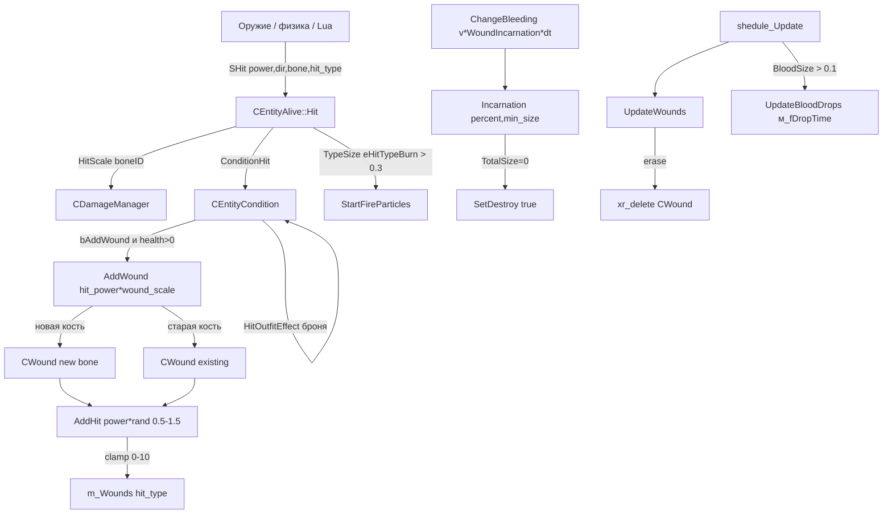
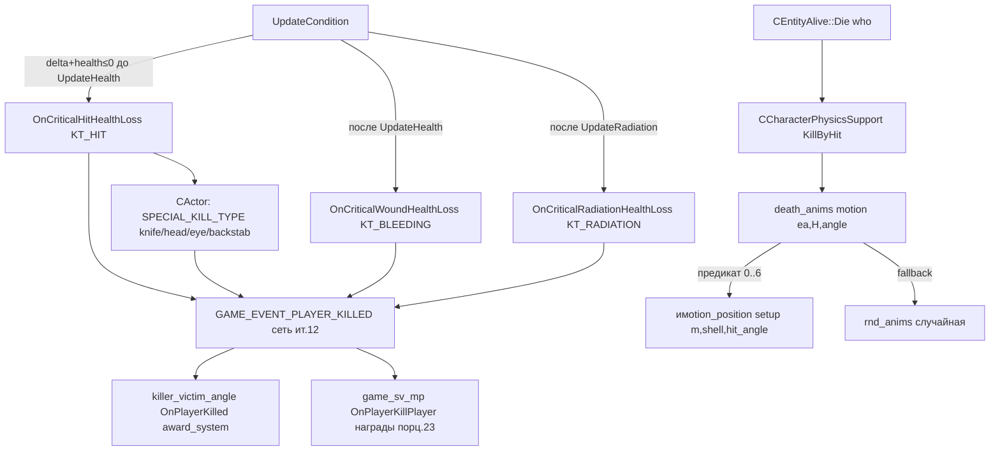

# Травмы, раны, смерть

> **Модуль:** `xrGame` · **Файлы:** `src/xrGame/Wound.h` (58 стр.), `src/xrGame/Wound.cpp` (101 стр.), `src/xrGame/Hit.h` (89 стр.), `src/xrGame/Hit.cpp`, `src/xrGame/game_base_kill_type.h`, `src/xrGame/death_anims.h` + `death_anims.cpp` (185 стр.) + `death_anims_predicates.cpp` (342 стр.), `src/xrGame/damage_manager.h`/`damage_manager.cpp` (150 стр.) + `damage_manager_inline.h`, `src/xrGame/killer_victim_velocity_angle.h` · **Порцион 8/30, итерация 5**

**Границы:** пайплайн урона `CEntityAlive::Hit()`/`Die()` — [порц. 7](entity-alive.md) §4.4–4.5 (здесь только «что делает каждая часть», без повторения конвейера); статы и условия (`CEntityCondition`) — [порц. 6](entity-condition.md) (ещё заглушка; ранение/заживление через `ConditionHit`/`ChangeBleeding` описаны как контракт); AI-внутренности — итерация 6; оружие — итерация 8; сетевой транспорт (`Level_*`, `GE_HIT*`) — итерация 12; полный Lua API — итерация 14 (механика обёртки — [порц. 13](script-game-object.md)).

## 1. Ответственность

Порцион покрывает **данные и правила** вокруг урона живого существа — то, что не является ни объектом мира, ни конвейером `CEntityAlive::Hit()`:

- **`CWound`** — рана на конкретной кости: вектор размеров по типам ударов (`ALife::EHitType`), накопление (`AddHit`), заживление (`Incarnation`), «кровоточивость» (`BloodSize`), сериализация в q8-сжатом формате. Это **данные**, владелец — `CEntityCondition::m_WoundVector` (порц. 6);
- **`SHit`** — структура-«валюта» урона: снаряд/удар, передаваемый от стрела/физики/скрипта в `Hit()`. Полные поля, сеть (`GE_HIT`/`GE_HIT_STATISTIC`) и `ApplyScriptHit` (мост Lua);
- **`CDamageManager`** (через `CEntity`, [entity.md](entity.md)) — масштабирование урона и раны **по костям** из ini: hit/wound/aim-факторы, хранящиеся в параметрах `CBoneInstance`;
- **`death_anims`** — выбор анимации смерти по обстоятельствам (7 предикатов: инерция, дробовик, хедшот, снайперка, граната + случайный fallback), направление падения и угол;
- **`KILL_TYPE` / `SPECIAL_KILL_TYPE` / `KILL_RES`** — классификация смерти (удар/кровотечение/радиация; хедшот/заслон/нож/PDA/KIR и т.д.) и её потребитель — награды MP (award_system);
- **`killer_victim_angle`** (award_system) — угол «стрелок→жертва» на момент смерти для наград.

**Что НЕ делает:** не считает статы (порц. 6); не конвейерит урон (`Hit()`/`Die()` — порц. 7); не выбирает AI-поведение при ранении (ит. 6); не сериализует транспорт (ит. 12 — здесь только сигнатуры пакетов `SHit::Read/Write_Packet` и `CWound::save/load`).

## 2. Место в архитектуре

```
CObject (xrEngine)                          — xr-object.md
└─ CGameObject                             — game-object.md
   └─ CEntity                              — entity.md
      │  ├─ CDamageManager                 — ЭТОТ порцион (§4.4)
      │  └─ CEntityCondition               — порц. 6
      │     └─ m_WoundVector: CWound*[]    — ЭТОТ порцион (§4.1)
      └─ CEntityAlive                      — порц. 7 (Hit/Die, StartFireParticles, UpdateBloodDrops)
         ├─ CActor                          — порц. 14–23 (OnCritical*HealthLoss, backstab)
         └─ CCustomMonster                  — порц. 9
Связанно:
  CCharacterPhysicsSupport                 — ит. 7; владеет death_anims m_death_anims,
                                              вызывает motion() в KillByHit
  SHit                                     — «валюта урона», создаётся оружием/физикой/Lua,
                                              потребляется CEntityAlive::Hit
  killer_victim_angle (award_system)       — OnPlayerKilled: KILL_TYPE + SPECIAL_KILL_TYPE → награды
```

`CWound` — **не наследник `CObject`**, не объект мира; живёт в стеке/куче внутри `CEntityCondition` и сериализуется как часть `conditions().save/load` (порц. 6/7). `SHit` — тривиальная структура, живёт на стеке вызывающего.

## 3. Публичный API

### CWound (Wound.h)

| Метод                                       | Сигнатура                                    | Назначение                                                                                                       |
| ------------------------------------------- | -------------------------------------------- | ---------------------------------------------------------------------------------------------------------------- |
| ctor                                        | `CWound(u16 bone_num)`                       | инициализация: `m_Wounds` размером `ALife::eHitTypeMax`, все 0                                                   |
| `save` / `load`                             | `(NET_Packet&)` / `(IReader&)`               | bone_num как **u8**, каждый размер — `w_float_q8/r_float_q8(0, WOUND_MAX)` (§4.1.3)                              |
| `TotalSize`                                 | `float ()`                                   | сумма всех типов раны                                                                                            |
| `TypeSize`                                  | `float (EHitType)`                           | размер одного типа (например, `eHitTypeBurn` — для частиц огня, порц. 7 §4.7)                                    |
| `BloodSize`                                 | `float ()`                                   | `m_Wounds[eHitTypeWound] + m_Wounds[eHitTypeFireWound]` — «кол-во кровавых ран», управляет частотой капель крови |
| `AddHit`                                    | `void (float hit_power, EHitType)`           | `m_Wounds[type] += power`, clamp в `[0, WOUND_MAX=10.f]`                                                         |
| `Incarnation`                               | `void (float percent, float min_wound_size)` | заживление, §4.1.2                                                                                               |
| `GetBoneNum` / `SetBoneNum`                 | `u16 ()` / `(u16)`                           | кость раны                                                                                                       |
| `GetParticleBoneNum` / `SetParticleBoneNum` | `u16 ()` / `(u16)`                           | кость, на которой отыгрывается партикл (может отличаться от кости раны)                                          |
| `GetParticleName` / `SetParticleName`       | `const shared_str&` / `(shared_str)`         | имя партикла (огонь, порц. 7)                                                                                    |
| `SetDestroy` / `GetDestroy`                 | `void (bool)` / `bool`                       | флаг удаления в `UpdateWounds` (порц. 6)                                                                         |
| `m_fDropTime`                               | `float` (public)                             | время следующего «кап» крови (порц. 7 §4.7)                                                                      |

### SHit (Hit.h) — структура, не класс-объект

| Метод                                                                                           | Сигнатура                                                                                                                                                            | Назначение                                                                                      |
| ----------------------------------------------------------------------------------------------- | -------------------------------------------------------------------------------------------------------------------------------------------------------------------- | ----------------------------------------------------------------------------------------------- |
| ctor полный                                                                                     | `SHit(power, dir, who, element, p_in_bone_space, impulse, hit_type, armor_piercing, AimBullet)`                                                                      | `add_wound = true` по умолчанию                                                                 |
| `invalidate`                                                                                    | `void ()`                                                                                                                                                            | `power = -phInfinity`, `boneID = BI_NONE`, `hit_type = ALife::eHitTypeMax`, `add_wound = false` |
| `is_valide`                                                                                     | `bool () const`                                                                                                                                                      | `hit_type != ALife::eHitTypeMax`                                                                |
| `damage` / `direction` / `initiator` / `bone` / `bone_space_position` / `phys_impulse` / `type` | inline-аксессоры                                                                                                                                                     | VERIFY(`is_valide`)                                                                             |
| `ApplyScriptHit`                                                                                | `void (CScriptHit*)`                                                                                                                                                 | перенос полей из Lua-обёртки: power, impulse, dir, hit_type, who/whoID, weaponID                |
| `GenHeader`                                                                                     | `void (u16 PacketType, u16 ID)`                                                                                                                                      | `Time = Level().timeServer()`, `PACKET_TYPE`, `DestID` — заголовок `GE_HIT`/`GE_HIT_STATISTIC`  |
| `Read_Packet` / `Write_Packet`                                                                  | `(NET_Packet)` / `(NET_Packet&)`                                                                                                                                     | полный пакет (с SenderID для `GE_HIT_STATISTIC`), формат §4.2.2                                 |
| `Read_Packet_Cont` / `Write_Packet_Cont`                                                        | `(NET_Packet)` / `(NET_Packet&)`                                                                                                                                     | «continuation» — то же без whoID/weaponID (они уже были в основном пакете)                      |
| Поля                                                                                            | `Time, PACKET_TYPE, DestID, power, dir, who, whoID, weaponID, boneID, p_in_bone_space, impulse, hit_type, armor_piercing, add_wound, aim_bullet, BulletID, SenderID` | `who` — указатель, валидный **только локально** (в сети — `whoID`)                              |

### death_anims (death_anims.h)

| Сущность                             | Сигнатура                                                                                                                                                                        | Назначение                                                                |
| ------------------------------------ | -------------------------------------------------------------------------------------------------------------------------------------------------------------------------------- | ------------------------------------------------------------------------- |
| `rnd_motion`                         | `setup(IKinematicsAnimated*, LPCSTR)`, `MotionID motion() const`                                                                                                                 | случайный из списка motion-имён (разделитель — список из `_GetItemCount`) |
| `type_motion::edirection`            | enum `{ front, back, left, right, not_definite }`, `dirs_number=4`                                                                                                               | направления падения                                                       |
| `type_motion::dir`                   | `static edirection (CEntityAlive&, const SHit&, float& angle)`                                                                                                                   | направление + угол по направлению удара, §4.3.2                           |
| `type_motion::predicate`             | `virtual bool (CEntityAlive&, const SHit&, MotionID&, float&) const = 0`                                                                                                         | предикат «эта ли анимация смерти» (§4.3.3)                                |
| `death_anims`                        | `anims: types_number = 7` типов + `rnd_anims`; `setup(IKinematicsAnimated*, LPCSTR section, CInifile const*)`; `MotionID motion(CEntityAlive&, const SHit&, float& angle) const` | выбор анимации смерти, §4.3.1                                             |
| `#ifdef DEBUG BOOL death_anim_debug` | extern                                                                                                                                                                           | переключатель диагностики в DEBUG-сборках                                 |

### CDamageManager (damage_manager.h)

| Метод        | Сигнатура                                                                              | Назначение                                                  |
| ------------ | -------------------------------------------------------------------------------------- | ----------------------------------------------------------- |
| `_construct` | `DLL_Pure* ()`                                                                         | `m_object = smart_cast<CObject*>(this)` (мixin в `CEntity`) |
| `reload`     | `(LPCSTR section, CInifile const*)` / `(LPCSTR section, LPCSTR line, CInifile const*)` | загрузка §4.4.2                                             |
| `HitScale`   | `(int element, float& hit_scale, float& wound_scale, bool aim_bullet=false)`           | масштаб урона/раны по кости, §4.4.3                         |

### Enum'ы (game_base_kill_type.h)

```cpp
enum KILL_TYPE { KT_HIT=0, KT_BLEEDING, KT_RADIATION, KT_FORCEDWORD=u32(-1) };
enum SPECIAL_KILL_TYPE { SKT_NONE=0, SKT_HEADSHOT, SKT_BACKSTAB, SKT_KNIFEKILL,
                         SKT_PDA, SKT_KIR /*Kill in Row*/, SKT_NEWRANK, SKT_EYESHOT, SKT_FORCEDWORD };
enum KILL_RES { KR_NONE=0, KR_SELF, KR_TEAMMATE, KR_TEAMMATE_CRITICAL,
                KR_RIVAL, KR_RIVAL_CRITICAL, KR_FORCEDWORD };
```

`KILL_TYPE` — **почему** умер (удар / истёк кровью / радиация). `SPECIAL_KILL_TYPE` — **как именно** (хедшот, заслон, нож, PDA, серия KIR, новый ранг, выстрел в глаз). `KILL_RES` — **отношение жертвы к стрелку** (для наград: свой/чужой/критичный). `KT_FORCEDWORD`/`SKT_FORCEDWORD` — «заполнитель», чтобы switch не падал на не-валидных значениях.

### killer_victim_angle (award_system)

`killer_victim_angle : player_state_param` — хранит `m_killer_victim_angle_cos`; метод `OnPlayerKilled(u16 killer_id, u16 target_id, u16 weapon_id, std::pair<KILL_TYPE, SPECIAL_KILL_TYPE> kill_type)` — вызывается из MP-обвязки (порц. 23) при событии `GAME_EVENT_PLAYER_KILLED` для расчёта наград (в т.ч. SKT_BACKSTAB, KIR-серии).

## 4. Внутреннее устройство

### 4.1 CWound — рана на кости

#### 4.1.1 Поля

| Поле                 | Тип                                                      | Назначение                                                                |
| -------------------- | -------------------------------------------------------- | ------------------------------------------------------------------------- |
| `m_iBoneNum`         | `u16`                                                    | кость, где появилась рана (в `save` пишется как **u8** — см. §8)          |
| `m_iParticleBoneNum` | `u16` (init `BI_NONE`)                                   | кость, на которой отыгрывается партикл (для `StartFireParticles` порц. 7) |
| `m_sParticleName`    | `shared_str` (init `""`)                                 | имя партикла                                                              |
| `m_Wounds`           | `HitImmunity::HitTypeSVec` (размер `ALife::eHitTypeMax`) | размеры по типам ударов (wound/fire_wound/burn/explosion/…)               |
| `m_bToBeDestroy`     | `bool` (init `false`)                                    | флаг «зашилась», удаляется в `CEntityCondition::UpdateWounds` (порц. 6)   |
| `m_fDropTime`        | `float` (init `0`, **public**)                           | время следующего «кап» крови (порц. 7 §4.7)                               |

#### 4.1.2 Заживление — `Incarnation(percent, min_wound_size)`

```
if TotalSize() == 0: все m_Wounds[i] = 0; return
for each i:
    m_Wounds[i] -= percent          // ЛИНЕЙНО, не пропорционально
    if m_Wounds[i] < min_wound_size: m_Wounds[i] = 0
```

Комментарий в коде гласит «заживить все раны пропорционально их размеру», но **пропорциональная часть закомментирована** (`/* *m_Wounds[i]*/`). Реальное поведение — вычитание `percent` из **каждой** компоненты одинаково; маленькие раны закрываются быстрее больших (порог `min_wound_size` из ini `min_wound_size` порц. 6). Это осознанное решение, не баг.

Вызывается из `CEntityCondition::ChangeBleeding(percent)` (порц. 6) с `percent = change_v().m_fV_WoundIncarnation * m_fDeltaTime` — т.е. скорость заживления зависит от статов (медицина, кровь). После `Incarnation` — если `TotalSize()` стал 0 → `SetDestroy(true)`; фактическое удаление — в `UpdateWounds()` (порц. 6).

#### 4.1.3 Сериализация

```
save:  w_u8((u8)m_iBoneNum)          // u16 → u8, потеря для bone_num > 255 (§8)
       for i < eHitTypeMax: w_float_q8(m_Wounds[i], 0.f, WOUND_MAX)
load:  m_iBoneNum = (u8)r_u8()
       for i: m_Wounds[i] = r_float_q8(0.f, WOUND_MAX); VERIFY(0 ≤ v ≤ 10)
```

`WOUND_MAX = 10.f` — `#define` в `Wound.cpp` (L31), не в хедере.

### 4.2 SHit — валюта урона

#### 4.2.1 Локальный путь

Создаётся оружием (снаряд/дрель), физикой (осколки, взрыв) или Lua (`CScriptHit` → `ApplyScriptHit`). Потребляется в `CEntityAlive::Hit(SHit*)` (порц. 7 §4.4). Ключевые поля для логики ранения:

- `power` — сила; `add_wound` — флаг «оставлять рану» (по умолчанию `true` в полном ctor; `false` после `invalidate()`);
- `boneID` — кость попадания (`BI_NONE` — «не по кости», например радиация);
- `hit_type` — тип удара (`ALife::EHitType`): `eHitTypeWound`, `eHitTypeFireWound`, `eHitTypeBurn`, `eHitTypeExplosion`, `eHitTypeWound_2` (нож) и др.;
- `armor_piercing` — пробитие брони (для `HitOutfitEffect` порц. 6);
- `aim_bullet` — «прицельный» выстрел (влияет на hit-фактор, §4.4.3);
- `impulse` — физический импульс (в `CCharacterPhysicsSupport`, ит. 7);
- `who` / `whoID` / `weaponID` — инициатор и его оружие.

`is_valide()` = `hit_type != ALife::eHitTypeMax` — «пустой» хит имеет тип `eHitTypeMax` и `power = -phInfinity`.

#### 4.2.2 Формат пакета (сеть — ит. 12, здесь только сигнатура)

```
GenHeader(PacketType, ID): Time = Level().timeServer(); PACKET_TYPE; DestID
Write_Packet:  whoID, weaponID, dir, power, boneID, p_in_bone_space, impulse,
               [aim_bullet — только IsGameTypeSingle()],
               hit_type,
               [armor_piercing — только для eHitTypeFireWound],
               BulletID
               [SenderID — только для GE_HIT_STATISTIC]
Read_Packet / Read_Packet_Cont — симметрично
```

Асимметрии формата: `aim_bullet` в MP всегда `false`; `armor_piercing` передаётся только для огнестрельных ран — для остальных типов на принимающей стороне остаётся 0.

### 4.3 death_anims — выбор анимации смерти

#### 4.3.1 `death_anims::motion(ea, H, angle)`

```
angle = 0
if anims.empty(): return rnd_anims.motion()   // DEBUG: Msg "no death motions loaded"
for each type_motion in anims:
    if predicate(ea, H, m, angle) && m.valid(): return m
return rnd_anims.motion()                       // fallback
```

Предикаты идут **по порядку в `anims`** — первый вернувший `true` побеждает. Порядок установки в `setup` (death_anims_predicates.cpp L320–341):

| idx | класс          | ini-строка             | условие (кратко)                                                                                                                                            |
| --- | -------------- | ---------------------- | ----------------------------------------------------------------------------------------------------------------------------------------------------------- |
| 0   | `type_motion0` | `kill_enertion`        | инерция: удар в голову, стрелок = текущий контроль, скорость жертвы ≥ 3.65, направлен в сторону стрелка (угол < 20°), направление = `front`, дистанция ≤ 30 |
| 1   | `type_motion1` | `kill_burst`           | **всегда false** («изрешатить пулями» — заглушка)                                                                                                           |
| 2   | `type_motion2` | `kill_shortgun`        | дробовик: `CWeaponShotgun`/`CWeaponAutomaticShotgun`, дистанция ≤ 20, направление = `dir()`                                                                 |
| 3   | `type_motion6` | `kill_grenade`         | граната: `hit_type == eHitTypeExplosion` **или** оружие — `CExplosive` (осколок)                                                                            |
| 4   | `type_motion4` | `kill_sniper_headshot` | снайперка (`is_snipper`: `CWeaponMagazined` + `IsZoomed` + `IsScopeAttached`) + удар в голову                                                               |
| 5   | `type_motion5` | `kill_sniper_body`     | снайперка + **не** в голову                                                                                                                                 |
| 6   | `type_motion3` | `kill_headshot`        | хедшот (любой), кроме случая 5                                                                                                                              |

`rnd_anims` — список из ini-строки `random_death_animations`.

Важно: `setup` вызывается из `CCharacterPhysicsSupport` (ит. 7) — `m_death_anims.setup(ka, *e->s_name, pSettings)` (L205) и при `reinit` (L1293). Выбор анимации — в `KillByHit` (CharacterPhysicsSupport.cpp L482): `MotionID m = m_death_anims.motion(m_EntityAlife, H, hit_angle)`; если стрелок ранен/в укрытии → `m = MotionID()` (без анимации).

#### 4.3.2 `type_motion::dir(ea, H, angle)` — направление падения

```
dir = H.direction(); dir.y = 0; m = |dir|
if m == 0: return random(front..right)
dir /= m
z_dir = (ea.XFORM().k.x, 0, ea.XFORM().k.z).normalize_safe()   // «вперёд» персонажа
x_dir = (ea.XFORM().i.x, 0, ea.XFORM().i.z).normalize_safe()   // «налево»
front_factor = dir · z_dir
sidefactor   = dir · x_dir
if |front_factor| > M_SQRT1_2:          // ~45° — «с фронта/сзади»
    sign = front_factor < 0 ? -1 : 1
    angle = atan2(-sign * sidefactor, sign * front_factor)
    return sign < 0 ? front : back
else:                                    // «сбоку»
    sign = sidefactor > 0 ? 1 : -1
    angle = atan2(sign * front_factor, sign * sidefactor)
    return sign > 0 ? left : right
```

`angle` — угол поворота тела при падении, используется `imotion_position` (ит. 7).

#### 4.3.3 Предикаты — детали

- `is_bone_head(K, bone)` — `bone == bip01_neck` **или** `bone` — потомок `bip01_head` (`find_in_parents`).
- `is_snipper(weaponID)` — `CWeaponMagazined` + `IsZoomed()` + `IsScopeAttached()`.
- `global_hit_position(gp, ea, H)` — мировая координата точки удара: `K->LL_GetTransform(H.bone()).transform_tiny(gp, H.bone_space_position())` → `ea.XFORM().transform_tiny(gp)`.
- `type_motion0` (инерция) — единственный, использующий `CCharacterPhysicsSupport::movement()->GetVelocity()` и `Type() != etBitting`; жёсткий порог `min_stalker_speed = 3.65`, `front_angle_cos = cos(20°)`, `max_distance = 30`.
- Все предикаты **требуют** `H.initiator() == Level().CurrentControlEntity()` (кроме 2/6) — анимации смерти «от игрока» только для локального стрелка.

### 4.4 CDamageManager — масштабирование по костям

#### 4.4.1 Хранение

Параметры урона **не** в самом `CDamageManager`, а в `CBoneInstance` (ит. 3) через `set_param(i, value)`:

| param | значение                                                 | из ini    |
| ----- | -------------------------------------------------------- | --------- |
| 0     | `hit_scale` (базовый)                                    | элемент 0 |
| 1     | (не используется в `HitScale`)                           | элемент 1 |
| 2     | `wound_scale`                                            | элемент 2 |
| 3     | `aim_bullet_scale` (или = hit_scale, если < 4 элементов) | элемент 3 |

#### 4.4.2 `reload`

```
m_default_hit_factor = m_default_wound_factor = 1.f
if section exists && line "default":
    m_default_hit_factor    = atof(item0)
    m_default_wound_factor  = atof(item2)
init_bones(section, ini):   // для всех костей: param0 = default_hit, param1 = 1, param2 = default_wound
load_section(section, ini): // для каждой строки кроме "default":
    bone = LL_BoneID(name); if BI_NONE → Debug.fatal
    param0 = atof(item0); param1 = atoi(item1); param2 = atof(item2)
    param3 = (_GetItemCount < 4) ? atof(item0) : atof(item3)
    if bone == 0 && (param0 == 0 || param2 == 0): R_ASSERT2 — «root bone cannot be zero»
```

Вторая перегрузка `reload(section, line, ini)` — индириктирование: `line` указывает на **имя** реальной секции; если нет — `reload(section, 0)`.

#### 4.4.3 `HitScale(element, hit_scale, wound_scale, aim_bullet)`

```
if element == BI_NONE: hit_scale = 1.f * m_default_hit_factor; wound_scale = 1.f * m_default_wound_factor; return
scale = 0
if aim_bullet: scale = bone.param(3)
if !aim_bullet || scale == 0: scale = bone.param(0)
hit_scale = scale
wound_scale = bone.param(2)
```

Вызывается в `CEntityAlive::Hit` (порц. 7): `CDamageManager::HitScale(HDS.boneID, conditions().hit_bone_scale(), conditions().wound_bone_scale(), HDS.aim_bullet)` — и масштаб урона, и масштаб раны идут **в разные** поля `CEntityCondition` (порц. 6).

### 4.5 Классификация смерти

#### 4.5.1 `KILL_TYPE` — почему умер

Определяется в `CEntityCondition::UpdateCondition` (порц. 6) — **три стадии**, в порядке приоритета:

1. `m_fDeltaHealth + GetHealth() ≤ 0` **до** `UpdateHealth()` → `OnCriticalHitHealthLoss()` → `KT_HIT`;
2. после `UpdateHealth()` (т.е. учтено кровотечение) → `OnCriticalWoundHealthLoss()` → `KT_BLEEDING`;
3. после `UpdatePower()`/`UpdateRadiation()` → `OnCriticalRadiationHealthLoss()` → `KT_RADIATION`.

Для `CActor` (порц. 19/23) эти виртуалы (entity_alive.h L180–186) переопределены в `Actor_Network.cpp`: шлют `GAME_EVENT_PLAYER_KILLED` с `KILL_TYPE` и `SPECIAL_KILL_TYPE` (§4.5.2).

#### 4.5.2 `SPECIAL_KILL_TYPE` — как именно (только MP, `CActor`)

Из `CActor::OnCriticalHitHealthLoss` (Actor_Network.cpp L1862–1907):

```
SpecialHit = SKT_NONE
if pLastHittingWeapon — CWeaponKnife:            SpecialHit = SKT_KNIFEKILL
if m_s16LastHittedElement > 0:
    if == m_head и оружие — CWeaponMagazined:    SpecialHit = SKT_HEADSHOT + пакет GEG_PLAYER_PLAY_HEADSHOT_PARTICLE
    if == m_eye_left/right:                      SpecialHit = SKT_EYESHOT
    else: обход родителей кости → если дошёл до m_head: SpecialHit = SKT_HEADSHOT
if m_bWasBackStabbed:                             SpecialHit = SKT_BACKSTAB   // перекрывает всё выше
```

`m_bWasBackStabbed` (actor.cpp L726–743): ставится при `hit_type == eHitTypeWound_2` (нож) + кость из `Check_for_BackStab_Bone` (head/neck/spine1-2/clavicle) + **направление удара** — в локальной системе `dotproduct((0,0,1), -dir) < -0.707` (т.е. удар сзади под углом > 45°) + жертва не бессмертна. При backstab `hit_power` принудительно = `100000.f` (мгновенная смерть).

`SKT_KIR` (Kill in Row) и `SKT_NEWRANK` — на стороне сервера/наград (порц. 23), не в `CActor::OnCritical*`.

#### 4.5.3 Потребители

- `game_sv_mp::OnPlayerKillPlayer` / `game_cl_mp` (порц. 23) — раздача наград;
- `killer_victim_angle::OnPlayerKilled` (award_system) — cos угла «стрелок→жертва» для наград «за выстрел сзади/сбоку»;
- `rewarding_state_events` — события награждения;
- `best_scores_helper` — статистика.

## 5. Взаимодействие

| Кто                                      | Что делает                                                                                                                                   | Ссылка                         |
| ---------------------------------------- | -------------------------------------------------------------------------------------------------------------------------------------------- | ------------------------------ |
| `CEntityAlive::Hit` (порц. 7)            | создаёт `CWound` через `conditions().ConditionHit(&HDS)`; `HitScale` из `CDamageManager`; `StartFireParticles` по `TypeSize(eHitTypeBurn)`   | entity-alive.md §4.4           |
| `CEntityCondition` (порц. 6)             | владеет `m_WoundVector`; `ChangeBleeding` → `Incarnation`; `UpdateWounds` — удаление заживших; `m_fV_WoundIncarnation` — скорость заживления | entity-condition.md (заглушка) |
| `CEntityAlive::shedule_Update` (порц. 7) | тик: `UpdateWounds`, `UpdateFireParticles`, `UpdateBloodDrops` (по `BloodSize`)                                                              | entity-alive.md §4.7           |
| `CCharacterPhysicsSupport` (ит. 7)       | владеет `death_anims m_death_anims`; `KillByHit` → `motion()` → `imotion_position`                                                           | physics.md                     |
| `CActor` (порц. 14–23)                   | `OnCritical*HealthLoss` → `KILL_TYPE`/`SPECIAL_KILL_TYPE` → сеть; backstab-логика                                                            | actor-net.md / actor-mp.md     |
| Оружие (ит. 8)                           | создаёт `SHit` (снаряд, дробь, нож, взрыв)                                                                                                   | weapon-*.md                    |
| Lua (ит. 14)                             | `CScriptHit` → `SHit::ApplyScriptHit`                                                                                                        | script-game-object.md          |
| `CSE_Abstract*` (ит. 11)                 | аргумент `net_Spawn` — не относится к ранам                                                                                                  | —                              |
| `CParticlesObject` (ит. 4)               | «соседний объект» — капли/огонь (порц. 7 §4.7)                                                                                               | —                              |

## 6. Потоки

### 6.1 Удар → рана → кровь → заживление



### 6.2 Смерть → KILL_TYPE → анимация



## 7. Конфигурация

### 7.1 death_anims — секция сущности (pSettings)

```ini
[сущность]
kill_enertion        = motion1, motion2
kill_burst           = motionX          ; заглушка, всегда false
kill_shortgun        = motionA / motionB / motionC / motionD   ; front/back/left/right
kill_grenade         = ...
kill_sniper_headshot = ...
kill_sniper_body     = ...
kill_headshot        = ...
random_death_animations = m1, m2, m3
```

Формат строки типа: `/`-разделённые списки motion-имён, порядок = `front/back/left/right` (`anims[i]`, i=0..3). Внутри списка — `,`-разделённые варианты (случайный выбор `rnd_motion`). Имя motion резолвится через `IKinematicsAnimated::LL_MotionID` — VERIFY2 при отсутствии.

### 7.2 CDamageManager — секция урона

```ini
[урон_секция]
default  = 1.0  0  0.8     ; hit_factor, (не используется), wound_factor
bip01_head   = 2.0  1  1.5  2.5    ; hit, ?, wound, aim_bullet
bip01_spine1 = 0.5  0  0.3
...
```

- `default` — базовые множители для **всех** костей;
- строки костей переопределяют;
- элемент 3 (aim) — опциональный, если нет — = элемент 0;
- **R_ASSERT**: для `bone == 0` (root) hit_scale и wound_scale **не могут** быть 0;
- `BI_NONE` при `LL_BoneID` → `Debug.fatal`.

### 7.3 CEntityAlive (статические, из ini сущности)

| Ключ               | Дефолт | Назначение                                       |
| ------------------ | ------ | ------------------------------------------------ |
| `start_blood_size` | 0.3    | порог: `BloodSize >` → начать капают             |
| `stop_blood_size`  | 0.1    | порог: `<` → остановить капли                    |
| `start_burn_size`  | 0.3    | порог: `TypeSize(eHitTypeBurn) >` → начать огонь |
| `stop_burn_size`   | 0.1    | порог: `<` → остановить огонь                    |

Загружаются в `CEntityAlive::Load` (порц. 7), но **управляют** логикой ран (порц. 7 §4.7).

### 7.4 CEntityCondition (раны)

| Ключ                                      | Дефолт  | Назначение                     |
| ----------------------------------------- | ------- | ------------------------------ |
| `min_wound_size`                          | 0.00001 | порог в `Incarnation`: `<` → 0 |
| (из `change_v()`) `m_fV_WoundIncarnation` | —       | скорость заживления (порц. 6)  |

## 8. Ограничения и дебаг

- **`CWound::save` пишет `m_iBoneNum` как u8** (поле u16) — для `bone_num > 255` потеря данных. На практике скелеты < 64 костей, но это латентный баг.
- **`Incarnation` — линейное, не пропорциональное** заживление (комментарий в коде обещает пропорциональность, но `*m_Wounds[i]` закомментирован). Маленькие раны закрываются непропорционально быстро.
- **`aim_bullet` в `SHit`** — только SP (`IsGameTypeSingle()`); в MP всегда `false`, т.е. `aim_bullet_scale` (param 3) в MP не работает.
- **`armor_piercing`** в пакете — только для `eHitTypeFireWound`; для остальных типов на принимающей стороне = 0 (асимметрия формата).
- **`type_motion1` («изрешатить пулями»)** — заглушка, всегда `return false`; ini-строка `kill_burst` читается, но не используется.
- **`m_Wounds` — `HitTypeSVec`** из `hit_immunity.h` — размер фиксирован `ALife::eHitTypeMax`; при изменении перечисления типов ударов (ит. 6) меняется формат сериализации.
- **DEBUG:** `death_anim_debug` (extern bool, death_anims.cpp L10) — включает `Msg` при загрузке/выборе анимаций; `type_motion_diagnostic` печатает dir/motion/bone/obj/model; `SHit::_dump()` — дамп структуры.
- **`CActor::OnCriticalHitHealthLoss`** (MP) — `m_s16LastHittedElement` обход родителей до `m_head`: если кость — потомок головы, считается хедшотом. Это **не** `is_bone_head` из death_anims (там `find_in_parents(head, bone)`, тут ручной цикл по `GetParentID`).
- **Backstab** — только `eHitTypeWound_2` (нож), только для перечисленных костей, только при угле > 45° сзади; `hit_power` принудительно 100000 (мгновенная смерть).
- **`KT_FORCEDWORD`/`SKT_FORCEDWORD` = `u32(-1)`** — «заполнитель» для switch, не реальный тип.
