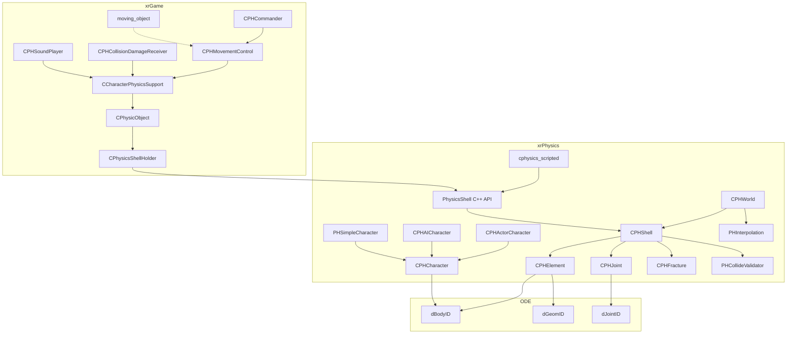

# Физика (xrPhysics + PH-слой xrGame)

> Итерация 7, порцион 1. Модули: `xrPhysics/` (~150 файлов, ~27K строк), `xrGame/PH*` (~35 файлов, ~11K строк).

`xrPhysics` — обвязка **ODE** (Open Dynamics Engine): мир, shell'ы, элементы, суставы, персонажи, коллизии. `xrGame/PH*` — игровая обвязка: shell holder, движение, урон, звук.

## Что делает

- Создаёт и управляет ODE-миром (`CPHWorld`): тела, геометрии, суставы, шаги симуляции.
- Представляет игровые объекты как **shell'ы** (`CPHShell`): набор элементов (`CPHElement`) + суставов (`CPHJoint`), привязанных к костям скелета.
- Обеспечивает **движение персонажей** (`CPHCharacter` → `CPHActorCharacter` / `CPHAICharacter` / `PHSimpleCharacter`): капсула/цилиндр, коллизии, ступени, подъёмник.
- Обрабатывает **коллизии и урон**: `PHCollideValidator`, `PHContactBodyEffector`, `CPHCollisionDamageReceiver`, `CPHSoundPlayer`.
- Поддерживает **разрушение** (fracture): `CPHFracture` — разрыв элемента на две части по силе/моменту.
- Сетевая синхронизация: `PHInterpolation` (сплайн), `PHShellNetState`, `PHElementNetState`.
- Lua-биндинг: `cphysics_scripted` (портал для скриптов).

## Чего НЕ делает

- Не строит статическую модель уровня (`level.cform`) — это xrCDB.
- Не рисует — только отвечает на «что/где лежит», «сколько скорость», «где контакт».
- Не управляет анимацией — `PhysicsShellAnimator` лишь синхронизирует геометрию с костьми.
- Не строит путь — пейтфиндинг (ит. 8) использует результат физики (позиция, коллизия), но не наоборот.
- Не хранит состояние инвентаря/здоровья — это `CDamageManager`, `CInventory`.

## Архитектура

## Структура файлов

### `xrPhysics/` — ODE-обвязка

| Группа | Файлы |
|--------|-------|
| Ядро мира | `Physics.h/cpp`, `PHWorld.h/cpp`, `PHObject.h/cpp`, `PHDefs.h`, `PHUpdateObject.h`, `phvalide.h/cpp`, `ph_valid_ode.h`, `ode_redefine.h`, `ode_include.h`, `SpaceUtils.h`, `matrix_utils.h`, `MathUtils.h/cpp`, `params.h/cpp` |
| Shell | `PHShell.h/cpp`, `PHElement.h/cpp/inline`, `PHJoint.h/cpp`, `PHDynamicData.h/cpp`, `PHMoveStorage.h/cpp`, `PHActivationShape.h/cpp`, `PHShellActivate.cpp`, `PHShellBuildJoint.h`, `PHStaticGeomShell.h/cpp`, `PHSplitedShell.h/cpp`, `PHShellSplitter.h/cpp`, `PHShellNetState.cpp`, `PHElementNetState.cpp`, `PHJointDestroyInfo.h/cpp`, `PHFracture.h/cpp`, `PHIsland.h/cpp`, `PHInterpolation.h/cpp` |
| C++ API | `PhysicsShell.h/cpp`, `PhysicsCommon.h`, `PhysicsExternalCommon.h/cpp`, `PhysicsShellAnimator.h/cpp`, `PhysicsShellAnimatorBoneData.h`, `IPhysicsShellHolder.h`, `IPHWorld.h`, `IPHStaticGeomShell.h`, `IPHCapture.h`, `ShellHit.cpp` |
| Персонажи | `PHCharacter.h/cpp`, `PHActorCharacter.h/cpp/inline`, `PHAICharacter.h/cpp`, `PHSimpleCharacter.h/cpp/inline`, `MovementBoxDynamicActivate.h/cpp` |
| Коллизии/эффекты | `PHCollideValidator.h/cpp`, `PHContactBodyEffector.h/cpp`, `PHDisabling.h/cpp`, `PHCapture.h/cpp`, `PHBaseBodyEffector.h` |
| Скрипты | `physics_scripted.h/cpp`, `iphysics_scripted.h`, `physics_world_scripted.cpp`, `physics_element_scripted.h/cpp`, `physics_shell_scripted.cpp`, `physics_joint_scripted.h/cpp` |
| Отладка | `debug_output.h`, `xrPhysics.h/cpp` (DllMain) |

### `xrGame/PH*` — игровая обвязка

| Группа | Файлы |
|--------|-------|
| Shell holder | `PhysicsShellHolder.h/cpp`, `PhysicObject.h/cpp`, `PhysicObject_script.cpp`, `PhysicsSkeletonObject.h/cpp`, `CharacterPhysicsSupport.h/cpp`, `PHShellCreator.h/cpp`, `DestroyablePhysicsObject.h/cpp`, `PhysicsGamePars.h/cpp` |
| Движение | `PHMovementControl.h/cpp`, `PHMovementDynamicActivate.cpp`, `PHCommander.h/cpp` |
| Урон/звук | `PHCollisionDamageReceiver.h/cpp`, `PHSoundPlayer.h/cpp`, `PHDestroyable.h/cpp`, `PHDestroyableNotificate.h/cpp` |
| Скрипты/утилиты | `PHScriptCall.h/cpp`, `PHSimpleCalls.h/cpp`, `PHSimpleCallsScript.cpp`, `PHReqComparer.h`, `PHDebug.h/cpp` |
| Движение сущностей | `moving_object.h/cpp/inline`, `moving_objects.h/cpp/inline/impl`, `moving_objects_dynamic.cpp`, `moving_objects_dynamic_collision.cpp`, `moving_objects_static.cpp` |
| Скрипты физики | `physics_game.h/cpp`, `physics_element_scripted.h/cpp`, `physics_shell_scripted.cpp`, `physics_shell_animated.h/cpp`, `physics_joint_scripted.h/cpp`, `physics_world_scripted.cpp` |

## Связи

- **xrEngine** → `xrPhysics`: `IPhysicsShellHolder`, `IPHWorld`, `IObjectPhysicsCollision` (facade'ы, ит. 2: `collide-physics.md`).
- **xrGame** → `xrPhysics`: `CPhysicsShellHolder` → `PhysicsShell` (C++ API).
- **xrGame/ALIFE** (ит. 6): `CAI_Stalker` / `CBaseMonster` → `CCharacterPhysicsSupport` → `CPHCharacter`.
- **xrNetServer** (ит. 12): `PHInterpolation`, `PHShellNetState` — сетевая синхронизация.

## Порционы итерации 7

| # | Порцион | Страницы |
|---|---------|----------|
| 1 | Точка входа, мир, базовые типы | [index](index.md), [ph-world](ph-world.md), [ph-object](ph-object.md) |
| 2 | C++ API и Lua-скрипты | [shell-api](shell-api.md) |
| 3 | CPHShell и элементы | [shell](shell.md) |
| 4 | Суставы, трещины, острова | [joints-fracture](joints-fracture.md) |
| 5 | Персонажи | [characters](characters.md) |
| 6 | Коллизии, эффекты, дисейблинг | [collide-effects](collide-effects.md) |
| 7 | Игровая обвязка: shell holder | [physics-shells](../game/physics-shells.md) |
| 8 | Игровая обвязка: движение и урон | [physics-movement-damage](../game/physics-movement-damage.md) |
| 9 | Движение сущностей (moving_object) | [moving-objects](../game/moving-objects.md) |
| 10 | Связность + арх. страницы | [index-consistency](index-consistency.md) |

---

Порцион 1 (итерация 7). Далее: порц. 2 — C++ API и Lua-скрипты ([shell-api.md](shell-api.md)).
