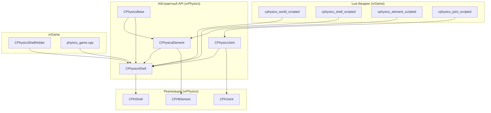

# C++ API и Lua-скрипты

> Итерация 7, порцион 2. Файлы: `PhysicsShell.h` (482 строк), `PhysicsShell.cpp`, `PhysicsCommon.h`, `PhysicsExternalCommon.h/cpp`, `PhysicsShellAnimator.h/cpp` + `PhysicsShellAnimatorBoneData.h`, `physics_scripted.h/cpp`, `iphysics_scripted.h`, `IPhysicsShellHolder.h`, `IPHWorld.h`, `IPHStaticGeomShell.h`, `IPHCapture.h`, `ShellHit.cpp`, `physics_world_scripted.h/cpp`, `physics_element_scripted.h/cpp`, `physics_shell_scripted.h/cpp`, `physics_joint_scripted.h/cpp`, `physics_game.h/cpp` (xrGame).

`CPhysicsBase` / `CPhysicsElement` / `CPhysicsJoint` / `CPhysicsShell` — абстрактный C++ API, через который `xrGame` управляет физикой. Lua-биндинг — через `cphysics_*_scripted` обёртки.

## Архитектура API



## CPhysicsBase — базовый абстрактный класс

`PhysicsShell.h:55-138`. Наследует `iphysics_scripted_class` (Lua-биндинг).

### Методы активации

| Метод | Назначение |
|-------|------------|
| `Activate(const Fmatrix& m0, float dt01, const Fmatrix& m2, bool disable)` | Активация с интерполяцией (2 позиции + время) |
| `Activate(const Fmatrix& transform, const Fvector& lin_vel, const Fvector& ang_vel, bool disable)` | Активация с трансформом и скоростями |
| `Activate(bool disable, bool not_set_bone_callbacks)` | Активация без параметров |
| `Activate(const Fmatrix& form, bool disable)` | Активация с трансформом |
| `Deactivate()` | Деактивация |
| `Enable()` | Включение |

### Методы трансформа

| Метод | Назначение |
|-------|------------|
| `XFORM()` | Локальный трансформ (in parent space) |
| `get_xform(Fmatrix&)` | Получить трансформ |
| `InterpolateGlobalTransform(Fmatrix*)` | Интерполированный глобальный трансформ |
| `InterpolateGlobalPosition(Fvector*)` | Интерполированная глобальная позиция |
| `GetGlobalPositionDynamic(Fvector*)` | Глобальная позиция (динамическая) |
| `TransformPosition(const Fmatrix&, motion_history_state)` | Перемещение с учётом истории движения |
| `SetTransform(const Fmatrix&, motion_history_state)` | Установка трансформа |

### Методы массы и плотности

| Метод | Назначение |
|-------|------------|
| `setMass(float)` | Установить массу |
| `setDensity(float)` | Установить плотность |
| `getMass()` | Получить массу |
| `getDensity()` | Получить плотность |
| `getVolume()` | Получить объём |
| `get_Extensions(const Fvector& axis, float center_prg, float& lo, float& hi)` | Расширения вдоль оси |
| `get_Box(Fvector& sz, Fvector& c)` | AABB (размер + центр) |

### Методы сил и импульсов

| Метод | Назначение |
|-------|------------|
| `applyForce(const Fvector& dir, float val)` | Приложить силу |
| `applyForce(float x, float y, float z)` | Приложить силу (компоненты) |
| `applyTorque(const Fvector& dir, float val)` | Приложить момент |
| `applyTorque(float x, float y, float z)` | Приложить момент (компоненты) |
| `applyRelForce(const Fvector& dir, float val)` | Относительная сила |
| `applyRelForce(float x, float y, float z)` | Относительная сила (компоненты) |
| `applyRelTorque(const Fvector& dir, float val)` | Относительный момент |
| `applyRelTorque(float x, float y, float z)` | Относительный момент (компоненты) |
| `applyImpulse(const Fvector& dir, float val)` | Импульс |
| `setTorque(const Fvector&)` | Установить момент |
| `setForce(const Fvector&)` | Установить силу |
| `applyGravityAccel(const Fvector&)` | Ускорение гравитации |
| `SetAirResistance(float linear, float angular)` | Сопротивление воздуха |
| `GetAirResistance(float&, float&)` | Получить сопротивление |
| `set_DynamicLimits(float l, float w)` | Лимиты скоростей |
| `set_DynamicScales(float l, float w)` | Масштабы скоростей |

### Методы колбэков

| Метод | Назначение |
|-------|------------|
| `set_ContactCallback(ContactCallbackFun*)` | Колбэк контакта |
| `set_ObjectContactCallback(ObjectContactCallbackFun*)` | Колбэк контакта объекта |
| `add_ObjectContactCallback(...)` / `remove_ObjectContactCallback(...)` | Добавление/удаление колбэка |
| `set_CallbackData(void*)` / `get_CallbackData()` | Пользовательские данные колбэка |
| `set_PhysicsRefObject(IPhysicsShellHolder*)` | Ссылка на holder |

### Методы скоростей

| Метод | Назначение |
|-------|------------|
| `set_LinearVel(const Fvector&)` | Установить линейную скорость |
| `set_AngularVel(const Fvector&)` | Установить угловую скорость |

### Прочие

| Метод | Назначение |
|-------|------------|
| `SetAnimated(bool)` | Включить/выключить анимацию |
| `set_ApplyByGravity(bool)` | Применять гравитацию |
| `get_ApplyByGravity()` | Гравитация включена? |
| `SetMaterial(u16)` / `SetMaterial(LPCSTR)` | Материал |
| `set_DisableParams(const SAllDDOParams&)` | Параметры дисейблинга |
| `isBreakable()` / `isEnabled()` / `isActive()` / `isFullActive()` | Статусы |
| `net_Import(NET_Packet&)` / `net_Export(NET_Packet&)` | Сетевая сериализация |

### DEBUG

| Метод | Назначение |
|-------|------------|
| `dbg_draw_velocity(float scale, u32 color)` | Отрисовка скорости |
| `dbg_draw_force(float scale, u32 color)` | Отрисовка силы |
| `dbg_draw_geometry(float scale, u32 color, Flags32)` | Отрисовка геометрии |

## CPhysicsElement — абстрактный элемент

`PhysicsShell.h:142-209`. Наследует `CPhysicsBase` + `IPhysicsElement`.

### Поля

| Поле | Тип | Назначение |
|------|-----|------------|
| `m_SelfID` | `u16` | ID элемента (bone_id) |
| `m_fScale` | `float` | Масштаб |

### Методы геометрии

| Метод | Назначение |
|-------|------------|
| `add_Sphere(const Fsphere&)` | Добавить сферу |
| `add_Box(const Fobb&)` | Добавить бокс |
| `add_Cylinder(const Fcylinder&)` | Добавить цилиндр |
| `add_Shape(const SBoneShape&)` | Добавить форму (bone shape) |
| `add_Shape(const SBoneShape&, const Fmatrix& offset)` | Добавить форму с офсетом |
| `last_geom()` | Последняя геометрия |
| `geometry(u16)` | Геометрия по индексу |
| `add_geom(CODEGeom*)` / `remove_geom(CODEGeom*)` | Добавление/удаление геометрии |
| `numberOfGeoms()` | Число геометрий |
| `has_geoms()` | Есть геометрии? |

### Методы массы

| Метод | Назначение |
|-------|------------|
| `add_Mass(const SBoneShape&, const Fmatrix& offset, const Fvector& mass_center, float mass, CPHFracture*)` | Добавить массу |
| `set_BoxMass(const Fobb&, float mass)` | Масса бокса |
| `setInertia(const dMass&)` / `addInertia(const dMass&)` | Инерция |
| `setMassMC(float M, const Fvector& mass_center)` | Масса + центр |
| `setDensityMC(float M, const Fvector& mass_center)` | Плотность + центр |
| `set_local_mass_center(const Fvector&)` | Локальный центр массы |
| `mass_Center()` / `local_mass_Center()` | Центр массы |
| `getMassTensor()` | Тензор массы |
| `getRadius()` | Радиус |

### Методы импульсов

| Метод | Назначение |
|-------|------------|
| `applyImpulseVsMC(const Fvector& pos, const Fvector& dir, float val)` | Импульс относительно центра массы |
| `applyImpulseVsGF(const Fvector& pos, const Fvector& dir, float val)` | Импульс относительно глобального фрейма |
| `applyImpulseTrace(const Fvector& pos, const Fvector& dir, float val, const u16 id)` | Импульс (trace) |

### Методы трещин

| Метод | Назначение |
|-------|------------|
| `setGeomFracturable(CPHFracture&)` | Сделать геометрию разрушаемой |
| `Fracture(u16 num)` | Трещина по индексу |

### Прочие

| Метод | Назначение |
|-------|------------|
| `PhysicsShell()` | Родительский shell |
| `PhysicsRefObject()` | `IPhysicsShellHolder*` |
| `SetScale(float)` | Масштаб |
| `set_ContactCallback(...)` | Колбэк контакта |
| `setQuaternion(const Fquaternion&)` | Quaternion |
| `GetGlobalTransformDynamic(Fmatrix*)` | Глобальный трансформ |
| `get_MaxAreaDir(Fvector&)` | Направление максимальной площади |
| `get_ObjectContactCallback()` | Колбэк контакта объекта |
| `Fix()` / `ReleaseFixed()` / `isFixed()` | Фиксация |
| `GetPointVel(Fvector&, const Fvector& point)` | Скорость точки |
| `set_ParentElement(CPhysicsElement*)` | Родительский элемент |

## CPhysicsJoint — абстрактный сустав

`PhysicsShell.h:219-311`. Наследует `iphysics_scripted_class`.

### Типы суставов

```cpp
enum enumType {
    ball,          // шарнир
    hinge,         // петля (1 ось)
    hinge2,        // петля (2 оси, колёса)
    full_control,  // полный контроль (3 оси, углы Эйлера)
    slider         // слайдер
};
```

### Система координат

```cpp
enum eVs {
    vs_first,   // в координатах первого элемента
    vs_second,  // в координатах второго элемента
    vs_global   // в глобальных координатах
};
```

### Методы

| Метод | Назначение |
|-------|------------|
| `BoneID()` / `SetBoneID(u16)` | ID кости |
| `PFirst_element()` / `PSecond_element()` | Элементы |
| `GetAxesNumber()` | Число осей |
| `Activate()` / `Deactivate()` | Активация/деактивация |
| `Create()` / `RunSimulation()` | Создание / запуск симуляции |
| `SetBackRef(CPhysicsJoint**)` | Обратная ссылка |
| `SetAnchor(const Fvector&)` / `SetAnchor(float, float, float)` | Якорь |
| `SetAnchorVsFirstElement(...)` / `SetAnchorVsSecondElement(...)` | Якорь относительно элемента |
| `SetAxisDir(const Fvector&, int axis)` / `SetAxisDir(float, float, float, int)` | Направление оси |
| `SetAxisDirVsFirstElement(...)` / `SetAxisDirVsSecondElement(...)` | Ось относительно элемента |
| `SetLimits(float lo, float hi, int axis)` / `SetLimitsVs...` | Лимиты угла |
| `SetHiLimitDynamic(int axis, float)` / `SetLoLimitDynamic(int axis, float)` | Динамические лимиты |
| `SetAxisSDfactors(float spring, float damping, int axis)` | Пружина/демпфер оси |
| `SetJointSDfactors(float spring, float damping)` | Пружина/демпфер сустава |
| `SetJointFudgefactorActive(float)` | Fudge factor |
| `SetBreakable(float force, float torque)` | Разрушаемость |
| `JointDestroyInfo()` | Информация о разрушении |
| `isBreakable()` | Разрушаемый? |
| `SetForceAndVelocity(float force, float vel, int axis)` | Сила + скорость |
| `GetMaxForceAndVelocity(float&, float&, int axis)` | Максимальная сила/скорость |
| `GetAxisAngle(int axis)` / `GetAxisAngleRate(int axis)` | Угол / скорость угла |
| `GetAxisSDfactors(...)` / `GetJointSDfactors(...)` | Получить пружину/демпфер |
| `GetLimits(float&, float&, int axis)` | Получить лимиты |
| `GetAxisDir(int, Fvector&, eVs&)` / `GetAxisDirDynamic(int, Fvector&)` | Направление оси |
| `GetAnchorDynamic(Fvector&)` | Якорь (динамический) |
| `IsWheelJoint()` / `IsHingeJoint()` | Тип сустава |
| `SetForce(float, int axis)` / `SetVelocity(float, int axis)` | Сила / скорость |

## CPhysicsShell — абстрактный shell

`PhysicsShell.h:317-442`. Наследует `CPhysicsBase` + `IPhysicsShell`.

### Поля

| Поле | Тип | Назначение |
|------|-----|------------|
| `m_pKinematics` | `IKinematics*` | Кинематика (скелет) |

### Методы элементов и суставов

| Метод | Назначение |
|-------|------------|
| `add_Element(CPhysicsElement*)` | Добавить элемент |
| `add_Joint(CPhysicsJoint*)` | Добавить сустав |
| `get_Element(u16 bone_id)` / `get_Element(LPCSTR)` / `get_ElementByStoreOrder(u16)` | Элемент |
| `get_PhysicsParrentElement(u16)` | Родительский элемент |
| `get_ElementsNumber()` | Число элементов |
| `get_ElementSync(u16)` | `CPHSynchronize*` (сеть) |
| `get_Joint(u16)` / `get_Joint(LPCSTR)` / `get_JointByStoreOrder(u16)` | Сустав |
| `get_JointsNumber()` | Число суставов |
| `get_GeomByID(u16)` | Геометрия по bone_id |
| `Elements()` | `ELEMENT_STORAGE&` |

### Методы коллизий

| Метод | Назначение |
|-------|------------|
| `GetCLGroup()` / `RegisterToCLGroup(CGID)` | Группа коллизий |
| `IsGroupObject()` | Объект группы? |
| `SetIgnoreStatic()` / `SetIgnoreDynamic()` | Игнорировать статику/динамику |
| `SetRagDoll()` / `SetIgnoreRagDoll()` | Ragdoll |
| `SetIgnoreAnimated()` | Игнорировать анимированные |
| `SetSmall()` / `SetIgnoreSmall()` | Маленький объект |
| `collide_bits()` / `collide_class_bits()` | Маски коллизий |
| `DisableCollision()` / `EnableCollision()` | Коллизии вкл/выкл |
| `SetDeadBody()` | Мёртвое тело |
| `CollideAll()` | Коллизия со всеми |

### Методы разрушения

| Метод | Назначение |
|-------|------------|
| `isFractured()` | Разрушен? |
| `SplitterHolder()` / `SplitterHolderActivate()` / `SplitterHolderDeactivate()` | Splitter |
| `SplitProcess(PHSHELL_PAIR_VECTOR&)` | Процесс разделения |
| `BlockBreaking()` / `UnblockBreaking()` / `IsBreakingBlocked()` | Блокировка разрушения |

### Методы импульсов

| Метод | Назначение |
|-------|------------|
| `applyImpulseTrace(const Fvector& pos, const Fvector& dir, float val)` | Импульс (trace) |
| `applyImpulseTrace(const Fvector& pos, const Fvector& dir, float val, const u16 id)` | Импульс (trace, ID) |
| `applyHit(const Fvector& pos, const Fvector& dir, float val, const u16 id, ALife::EHitType)` | Удар (тип) |

### Методы анимации

| Метод | Назначение |
|-------|------------|
| `PPhysicsShellAnimator()` | `CPhysicsShellAnimator*` |
| `CreateShellAnimator(CInifile*, LPCSTR section)` | Создать аниматор |
| `AnimatorOnFrame()` | Обновление аниматора |
| `GetBonesCallback()` / `GetStaticObjectBonesCallback()` | Колбэки костей |
| `SetBonesCallbacksOverwrite(bool)` | Переопределение колбэков |
| `ToAnimBonesPositions(motion_history_state)` | Позиции анимационных костей |
| `AnimToVelocityState(float dt, float l_limit, float a_limit)` | Анимация → скорость |
| `SetCallbacks()` / `ResetCallbacks(u16, Flags64&)` / `EnabledCallbacks(BOOL)` / `ZeroCallbacks()` | Колбэки |

### Методы симуляции

| Метод | Назначение |
|-------|------------|
| `RunSimulation(bool place_current_forms)` | Запуск симуляции |
| `PureStep(float step)` | Чистый шаг |
| `Update()` | Обновление |
| `UpdateRoot()` | Обновление корня |
| `Freeze()` / `UnFreeze()` | Freeze |
| `Disable()` | Отключение |
| `NetInterpolationModeON()` / `NetInterpolationModeOFF()` | Сетевая интерполяция |
| `SetGlTransformDynamic(const Fmatrix&)` | GL трансформ |

### Методы трассировки

| Метод | Назначение |
|-------|------------|
| `AddTracedGeom(u16 element, u16 geom)` | Добавить трассируемую геометрию |
| `SetAllGeomTraced()` | Все геометрии трассируемые |
| `ClearTracedGeoms()` | Очистка |
| `DisableGeomTrace()` / `EnableGeomTrace()` | Трассировка вкл/выкл |
| `HasTracedGeoms()` | Есть трассируемые? |

### Методы построения

| Метод | Назначение |
|-------|------------|
| `build_FromKinematics(IKinematics*, BONE_P_MAP*)` | Построение из кинематики |
| `preBuild_FromKinematics(IKinematics*, BONE_P_MAP*)` | Предпостроение |
| `Build(bool disable)` | Построение |
| `ActivatingBonePoses(IKinematics&)` | Позиции костей при активации |
| `SetMaxAABBRadius(float)` | Максимальный радиус AABB |

### Прочие

| Метод | Назначение |
|-------|------------|
| `setMass1(float)` | Масса |
| `SmoothElementsInertia(float k)` | Сглаживание инерции |
| `setEquelInertiaForEls(const dMass&)` / `addEquelInertiaToEls(const dMass&)` | Равная инерция |
| `MassAddBox(float mass, const Fvector& full_size)` | Масса бокса |
| `NearestToPoint(const Fvector&, NearestToPointCallback*)` | Ближайший элемент |
| `PIsland()` | `CPHIsland*` |
| `set_JointResistance(float)` | Сопротивление суставов |
| `ObjectInRoot()` / `ObjectToRootForm(const Fmatrix&)` | Объект в корне |
| `SetPrefereExactIntegration()` / `SetForceExactIntegration()` | Точная интеграция |

## Фабрики

```cpp
// PhysicsShell.h:450-464
CPhysicsJoint* P_create_Joint(CPhysicsJoint::enumType type, CPhysicsElement* first, CPhysicsElement* second);
CPhysicsElement* P_create_Element();
CPhysicsShell* P_create_Shell();
CPhysicsShell* P_create_splited_Shell();
CPhysicsShell* P_build_Shell(IPhysicsShellHolder* obj, bool not_active_state, LPCSTR fixed_bones);
CPhysicsShell* P_build_Shell(IPhysicsShellHolder* obj, bool not_active_state, U16Vec& fixed_bones);
CPhysicsShell* P_build_Shell(IPhysicsShellHolder* obj, bool not_active_state, BONE_P_MAP* bone_map, LPCSTR fixed_bones);
extern "C" CPhysicsShell* __stdcall P_build_Shell(IPhysicsShellHolder* obj, bool not_active_state, BONE_P_MAP* bone_map = 0, bool not_set_bone_callbacks = false);
CPhysicsShell* P_build_SimpleShell(IPhysicsShellHolder* obj, float mass, bool not_active_state);
void ApplySpawnIniToPhysicShell(CInifile const* ini, CPhysicsShell* physics_shell, bool fixed);
void fix_bones(LPCSTR fixed_bones, CPhysicsShell* shell);
extern "C" void __stdcall destroy_physics_shell(CPhysicsShell* & p);
extern "C" bool __stdcall can_create_phys_shell(string1024& reason, IPhysicsShellHolder& O);
void phys_shell_verify_object_model(IPhysicsShellHolder& O);
void phys_shell_verify_model(IKinematics& K);
bool shape_is_physic(const SBoneShape& shape);
bool has_physics_collision_shapes(IKinematics& K);
```

## IPhysicsShellHolder — facade для xrGame

`IPhysicsShellHolder.h`. Абстрактный класс, реализованный `CPhysicsShellHolder` (порц. 7).

### Методы

| Метод | Назначение |
|-------|------------|
| `ObjectXFORM()` / `ObjectPosition()` | Трансформ / позиция |
| `ObjectName()` / `ObjectNameVisual()` / `ObjectNameSect()` | Имена |
| `ObjectGetDestroy()` | Уничтожается? |
| `ObjectGetCollisionHitCallback()` | `ICollisionHitCallback*` |
| `ObjectID()` | ID |
| `ObjectCollisionModel()` | `ICollisionForm*` |
| `ObjectKinematics()` | `IKinematics*` |
| `ObjectCastIDamageSource()` | `IDamageSource*` |
| `ObjectProcessingDeactivate()` / `ObjectProcessingActivate()` | Processing |
| `ObjectSpatialMove()` | Spatial move |
| `ObjectPPhysicsShell()` | `CPhysicsShell*&` |
| `enable_notificate()` | Уведомления |
| `has_parent_object()` | Есть родитель? |
| `on_physics_disable()` | При отключении физики |
| `PHCapture()` | `IPHCapture*` |
| `IsInventoryItem()` / `IsActor()` / `IsStalker()` | Тип объекта |
| `HideAllWeapons(bool)` | Скрыть оружие |
| `MovementCollisionEnable(bool)` | Коллизии движения |
| `ObjectPhSoundPlayer()` | `CPHSoundPlayer*` |
| `ObjectPhCollisionDamageReceiver()` | `ICollisionDamageReceiver*` |
| `BonceDamagerCallback(float& damage_factor)` | Колбэк урона |

## IPHWorld — facade для мира

`IPHWorld.h`. Реализован `CPHWorld` (порц. 1).

### Методы

| Метод | Назначение |
|-------|------------|
| `Gravity()` / `SetGravity(float)` | Гравитация |
| `Processing()` | Идёт processing? |
| `CalcNumSteps(u32 dTime)` | Число шагов |
| `StepsNum()` | Счётчик шагов |
| `FrameTime()` | Время кадра |
| `Freeze()` / `UnFreeze()` | Freeze |
| `Step()` | Шаг |
| `SetStep(float)` | Фиксированный шаг |
| `StepNumIterations(int)` | Итерации |
| `set_default_contact_shotmark(...)` / `set_default_character_contact_shotmark(...)` | Колбэки контактов |
| `set_step_time_callback(...)` | Колбэк времени |
| `set_update_callback(IPHWorldUpdateCallbck*)` | Колбэк обновления |

### IPHWorldUpdateCallbck

```cpp
class IPHWorldUpdateCallbck {
    virtual void update_step() = 0;
    virtual void phys_shell_relcase(CPhysicsShell* sh) = 0;
};
```

Реализован `CPHCommander` (порц. 8).

## IPHCapture — захват объекта персонажем

`IPHCapture.h`.

```cpp
class IPHCapture {
    virtual bool Failed() = 0;
    virtual void RemoveConnection(IPhysicsShellHolder* O) = 0;
    virtual void Release() = 0;
};

XRPHYSICS_API IPHCapture* phcapture_create(CPHCharacter* ch, IPhysicsShellHolder* object, NearestToPointCallback* cb);
XRPHYSICS_API IPHCapture* phcapture_create(CPHCharacter* ch, IPhysicsShellHolder* object, u16 element);
XRPHYSICS_API void phcapture_destroy(IPHCapture* & c);
```

Реализован `CPHCapture` (порц. 6).

## IPHStaticGeomShell — статическая геометрия

`IPHStaticGeomShell.h`. Пустой интерфейс (только деструктор).

```cpp
XRPHYSICS_API IPHStaticGeomShell* P_BuildStaticGeomShell(IPhysicsShellHolder* obj, ObjectContactCallbackFun* cb);
XRPHYSICS_API IPHStaticGeomShell* P_BuildLeaderGeomShell(IClimableObject* obj, ObjectContactCallbackFun* cb, const Fobb& b);
XRPHYSICS_API void DestroyStaticGeomShell(IPHStaticGeomShell* & p);
```

Реализован `CPHStaticGeomShell` (порц. 3).

## Lua-биндинг

### Архитектура

```
iphysics_scripted (abstract)
    ├── set(iphysics_game_scripted*) / get()
    └── iphysics_scripted_class (abstract)
            └── get_scripted() → iphysics_scripted&

cphysics_scripted (конкретный, в CPHWorld)
    └── m_game_scripted: iphysics_game_scripted*

cphysics_game_scripted<T> (template, в xrGame)
    ├── iphysics_game_scripted
    ├── physics_impl() → T&
    └── get_script_wrapper<T>() → обёртка (lazy creation)
```

### Обёртки (xrGame)

| Класс | Обёртывает | Методы |
|-------|------------|--------|
| `cphysics_world_scripted` | `IPHWorld` | `Gravity()`, `SetGravity(float)`, `AddCall(CPHCondition*, CPHAction*)` |
| `cphysics_shell_scripted` | `CPhysicsShell` | `applyForce`, `applyTorque`, `setForceExactIntegration`, `get_Element`, `get_Joint`, `BlockBreaking`, `UnblockBreaking`, `get_LinearVel`, `set_LinearVel`, `get_AngularVel`, `set_AngularVel`, `freeze`, `unfreeze` |
| `cphysics_element_scripted` | `CPhysicsElement` | `applyForce`, `applyTorque`, `isBreakable`, `get_LinearVel`, `get_AngularVel`, `getMass`, `getDensity`, `getVolume`, `Fix`, `ReleaseFixed`, `isFixed`, `GetGlobalTransformDynamic` |
| `cphysics_joint_scripted` | `CPhysicsJoint` | (см. `physics_joint_scripted.h`) |

### DECLARE_SCRIPT_REGISTER_FUNCTION

Макрос для регистрации в Lua-пространстве (`script_export_space.h`). Каждый `cphysics_*_scripted` имеет `DECLARE_SCRIPT_REGISTER_FUNCTION` в конце класса.

## physics_game.cpp (xrGame)

`PhysicsGamePars.h`: `ContactShotMark`, `CharacterContactShotMark` — глобальные колбэки контактов.

### TContactShotMark<Pars>

Шаблонный колбэк контакта. Вызывается при коллизии:

1. `ContactShotMarkGetEffectPars(c, data, vel_cret, b_invert_normal)` — получение параметров.
2. **Wallmark**: если `vel_cret > Pars::vel_cret_wallmark` и есть `CollideMarks` — `CPHWallMarksCall`.
3. **Sound**: если `vel_cret > Pars::vel_cret_sound` и расстояние < 70м — воспроизведение звука.
4. **Particles**: если `vel_cret > Pars::vel_cret_particles` и расстояние < 70м — `CPHParticlesPlayCall` / `CPHLiquidParticlesPlayCall`.

### EffectPars / CharacterEffectPars

```cpp
struct EffectPars {
    static const float vel_cret_sound;      // порог звука
    static const float vel_cret_particles;  // порог частиц
    static const float vel_cret_wallmark;   // порог wallmark
};
struct CharacterEffectPars {
    static const float vel_cret_sound;
    static const float vel_cret_particles;
    static const float vel_cret_wallmark;
};
```

### CPHCommander

`CPHCommander` (порц. 8) — система запросов (condition → action). Используется `physics_game.cpp` для отложенного воспроизведения эффектов (частицы, wallmark, звук).

## ShellHit.cpp

`CPHShell::applyHit(const Fvector& pos, const Fvector& dir, float val, const u16 id, ALife::EHitType hit_type)`:

1. Если `id == -1` — return.
2. Если нет kinematics — `applyImpulseTrace`.
3. Switch по `hit_type`:
   - `eHitTypeExplosion` → `ExplosionHit(pos, dir, val, id)`:
     - `EnableObject(0)`.
     - `impulse = val / sqrt(sqrt(num_elements))`.
     - Для каждого элемента: для каждой геометрии — случайный импульс.
   - default → `applyImpulseTrace(pos, dir, val, id)`.

## Связи

- **xrGame** → `CPhysicsShell`: `P_build_Shell`, `P_build_SimpleShell`, `destroy_physics_shell`.
- **xrGame** → `IPhysicsShellHolder`: реализован `CPhysicsShellHolder` (порц. 7).
- **xrGame** → `IPHWorld`: реализован `CPHWorld` (порц. 1).
- **xrGame** → `cphysics_*_scripted`: Lua-биндинг.
- **CPHShell** (порц. 3) → `CPhysicsShell`: реализация.
- **CPHElement** (порц. 3) → `CPhysicsElement`: реализация.
- **CPHJoint** (порц. 4) → `CPhysicsJoint`: реализация.
- **CPHCapture** (порц. 6) → `IPHCapture`: реализация.
- **CPHStaticGeomShell** (порц. 3) → `IPHStaticGeomShell`: реализация.
- **CPHCommander** (порц. 8) → `IPHWorldUpdateCallbck`: реализация.

## Замечания к плану

- `PhysicsShell.h` — 482 строки, полностью абстрактный API. Реализация — в `CPHShell`/`CPHElement`/`CPHJoint`.
- `PhysicsShellAnimator` — 20 строк, хранит `m_bones_data` (вектор `CPhysicsShellAnimatorBoneData`), `m_pPhysicsShell`, `m_StartXFORM`. `OnFrame()` — обновление.
- `PhysicsShellAnimatorBoneData` — 10 строк: `dJointID m_anim_fixed_dJointID`, `CPHElement* m_element`.
- `ShellHit.cpp` — 65 строк, `applyHit` + `ExplosionHit`.
- `physics_game.cpp` — 328 строк, `TContactShotMark<Pars>` + колбэки.

---

Порцион 2 (итерация 7). Далее: порц. 3 — CPHShell и элементы ([shell.md](shell.md)).
