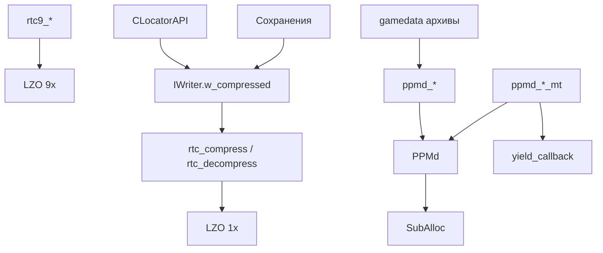
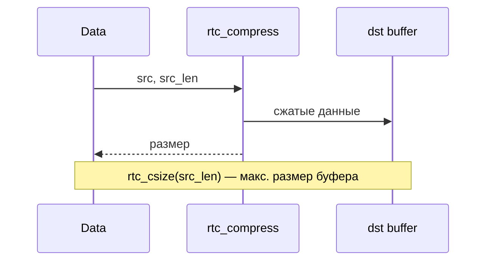

# xrCore: Сжатие

LZO (основной), LZHUF, PPMd (включая multi-thread и trained).

## Ответственность

- **LZO** (`rt_compressor`) — основной алгоритм сжатия для LTX-чунков, сохранений, сети.
- **LZO 9x** (`rtc9_*`) — высококомпрессивный вариант (медленнее).
- **LZHUF** (`lzhuf.h`) — старый алгоритм (наследие).
- **PPMd** (`ppmd_compressor.h`) — PPMd-сжатие, включая multi-thread (`ppmd_*_mt`) и trained model.

## Место в архитектуре

Нижний слой. `rtc_compress/decompress` — используется `CLocatorAPI` (chunk'ы LTX), `IWriter::w_compressed`, сохранения. PPMd — для **архивов gamedata** (высокая компрессия).

## Публичный API

### LZO (основной)

```cpp
// rt_compressor.h
extern XRCORE_API void rtc_initialize();
extern XRCORE_API u32 rtc_compress(void* dst, u32 dst_len, const void* src, u32 src_len);
extern XRCORE_API u32 rtc_decompress(void* dst, u32 dst_len, const void* src, u32 src_len);
extern XRCORE_API u32 rtc_csize(u32 in);   // максимальный размер после сжатия
```

### LZO 9x (высокая компрессия)

```cpp
extern XRCORE_API void rtc9_initialize();
extern XRCORE_API void rtc9_uninitialize();
extern XRCORE_API u32 rtc9_compress(void* dst, u32 dst_len, const void* src, u32 src_len);
extern XRCORE_API u32 rtc9_decompress(void* dst, u32 dst_len, const void* src, u32 src_len);
extern XRCORE_API u32 rtc9_csize(u32 in);
```

### LZHUF (наследие)

```cpp
// lzhuf.h
extern XRCORE_API unsigned _writeLZ(int hf, void* d, unsigned size);
extern XRCORE_API unsigned _readLZ(int hf, void*& d, unsigned size);
extern XRCORE_API void _compressLZ(u8** dest, unsigned* dest_sz, void* src, unsigned src_sz);
extern XRCORE_API void _decompressLZ(u8** dest, unsigned* dest_sz, void* src, unsigned src_sz);
```

### PPMd

```cpp
// ppmd_compressor.h
namespace compression { namespace ppmd { class stream; } }

XRCORE_API u32 ppmd_compress(void* dest_buffer, u32 dest_buffer_size, const void* source_buffer, u32 source_buffer_size);
XRCORE_API u32 ppmd_trained_compress(void* dest_buffer, u32 dest_buffer_size, const void* source_buffer, u32 source_buffer_size, compression::ppmd::stream* tmodel);
XRCORE_API u32 ppmd_decompress(void* dest_buffer, u32 dest_buffer_size, const void* source_buffer, u32 source_buffer_size);
XRCORE_API u32 ppmd_trained_decompress(void* dest_buffer, u32 dest_buffer_size, const void* source_buffer, u32 source_buffer_size, compression::ppmd::stream* tmodel);

typedef fastdelegate::FastDelegate<void()> ppmd_yield_callback_t;
XRCORE_API u32 ppmd_compress_mt(void* dest_buffer, u32 dest_buffer_size, const void* source_buffer, u32 source_buffer_size, ppmd_yield_callback_t ycb);
XRCORE_API u32 ppmd_decompress_mt(void* dest_buffer, u32 dest_buffer_size, const void* source_buffer, u32 source_buffer_size, ppmd_yield_callback_t ycb);
```

### PPMd stream

```cpp
// compression_ppmd_stream.h
namespace compression { namespace ppmd {
    class stream {
        u32 m_buffer_size;
        u8* m_buffer;
        u8* m_pointer;
    public:
        inline stream(const void* buffer, u32 buffer_size);
        inline void put_char(u8 object);
        inline int get_char();
        inline void rewind();
        inline u8* buffer() const;
        inline u32 tell() const;
    };
}}
```

## Внутреннее устройство

### Файлы

| Файл                                                               | Назначение                       |
| ------------------------------------------------------------------ | -------------------------------- |
| `rt_compressor.h/.cpp`                                             | LZO-обёртка                      |
| `rt_compressor9.cpp`                                               | LZO 9x                           |
| `rt_lzo1x.h`, `rt_lzo1x_1.cpp`, `rt_lzo1x_9x.cpp`                  | LZO 1x (компрессия/декомпрессия) |
| `rt_lzo1x_c.ch`, `rt_lzo1x_d.ch`                                   | LZO (C)                          |
| `rt_lzo1x_d1/2/3.cpp`                                              | LZO decomp (варианты)            |
| `rt_lzo_init.cpp`                                                  | инициализация                    |
| `rt_lzo_conf.h`, `rt_lzodefs.h`, `rt_lzo_config.h`, `rt_lzodict.h` | LZO-конфиги                      |
| `rt_lzo_ptr.h`, `rt_lzo_swd.ch`, `rt_lzo_mchw.ch`, `rt_lzoconf.h`  | LZO internals                    |
| `rt_miniacc.h`, `rt_config1x.h`                                    | LZO miniacc                      |
| `lzhuf.h`, `LzHuf.cpp`                                             | LZHUF                            |
| `PPMd.h`, `PPMdType.h`                                             | PPMd-типы                        |
| `ppmd_compressor.h/.cpp`                                           | PPMd-обёртка                     |
| `compression_ppmd_stream.h/.cpp`                                   | PPMd stream                      |
| `SubAlloc.hpp`                                                     | PPMd sub-allocator               |
| `lzo_compressor.h/.cpp`                                            | альтернативная LZO-обёртка       |

### LZO

- `rtc_initialize()` — вызывается из `xrCore::_initialize` (после `Memory._initialize`).
- `rtc_csize(in)` — **максимальный** размер после сжатия (буфер должен быть таким).
- LZO 1x — быстрый, ~2-3x компрессия. LZO 9x — медленный, ~4-5x.

### PPMd

- **PPMd** — PPM (Prediction by Partial Matching), высокая компрессия.
- **Trained model** — `tmodel` (`compression::ppmd::stream*`) — предобученная модель. `ppmd_trained_compress/decompress` — используют её.
- **Multi-thread** — `ppmd_*_mt` с `yield_callback` (кооперативная многопоточность).
- **Sub-allocator** (`SubAlloc.hpp`) — аллокатор PPMd (UNIT_SIZE=12, N_INDEXES, free-list).

### Интеграция с FS

`IWriter::w_compressed(ptr, count)` → `rtc_compress` (LZO). Chunk ID помечается `CFS_CompressMark` (бит 31). При чтении `find_chunk` возвращает `bCompressed=TRUE` → `r_chunk` распаковывает.

## Два алгоритма, две задачи

В движке два основных алгоритма, и они **не взаимозаменяемы** — их выбирают по тому, когда данные читаются:

|                       | **LZO 1x** (`rtc_*`)                                                  | **PPMd** (`ppmd_*`)                                                           |
| --------------------- | --------------------------------------------------------------------- | ----------------------------------------------------------------------------- |
| Скорость              | очень быстрый (тысячи МБ/с)                                           | медленный (на порядки)                                                        |
| Степень сжатия        | скромная (~1.1–1.5x на реальных данных)                               | высокая (4–10x и более на повторяющихся данных)                               |
| Когда данные читаются | часто, в рантайме                                                     | один раз, при загрузке                                                        |
| Где используется      | чанки LTX (`w_chunk` с `CFS_CompressMark`), `CLocatorAPI`, сохранения | архивы конфигов/скриншотов/гamedata-данных, которые распаковываются на старте |

Правило выбора: **читается каждый кадр/секунду → LZO; сжимается один раз и читается редко → PPMd.** Платить CPU каждый раз при чтении чанка LTX ради экономии дискового места — неверный обмен; наоборот, заставлять PPMd разворачиваться на горячем пути — тоже неверно.

LZO 9x (`rtc9_*`) — промежуточный вариант: медленнее LZO 1x, сильнее сжимает. Единственное реальное применение в репозитории — `xrNetServer/NET_Compressor.cpp`, где он выбран как ENCODE/DECODE для сетевого потока.

LZHUF (`_compressLZ`/`_decompressLZ` из `LzHuf.cpp`) — это **не LZO**, а наследие X-Ray 1.5. Именно через него идёт `IWriter::w_compressed` и декомпрессия чанков (`FS.cpp:291-303, 348-368`) — т.е. «чанки сжатые» в LTX на самом деле LZHUF. Для новых данных использовать не нужно: это легаси, оставшееся в коде ради совместимости со старыми файлами.

## `rtc_csize` — почему это важно

LZO **может увеличить данные**: если вход несжимаемый (случайные байты, уже сжатое видео и т.п.), выход будет чуть больше входа. Поэтому при ручном вызове `rtc_compress` размер выходного буфера заранее неизвестен — он известен только как верхняя граница.

`rtc_csize(in)` и возвращает эту границу — `in + in/64 + 16 + 3` (`rt_compressor.cpp:20-24`). Корректный шаблон:

```cpp
u32 cap = rtc_csize(src_len);
xr_alloc_buffer(BUF, cap);
u32 out_size = rtc_compress(BUF, cap, src, src_len);  // out_size <= cap
```

Пропуск `rtc_csize` и выделение «на глаз» — классический источник переполнения буфера при сжатии. В `IWriter::w_compressed` эта забота спрятана: `_compressLZ` сам аллокирует выходной буфер (`LzHuf.cpp:725-732`), поэтому через `w_compressed`/`w_chunk` с `CFS_CompressMark` размер считать не нужно.

## PPMd: trained model и multi-thread

**Trained model.** `trained_model` — глобальный `compression::ppmd::stream*` (`Model.cpp:30`). Это предобученное дерево контекстов PPMd: при `ppmd_trained_compress`/`ppmd_trained_decompress` начальный корневой контекст модели инициализируется из этой модели вместо «пустого» 256-символьного (`Model.cpp:1238-1253`). Модель «знает» частые паттерны gamedata, поэтому сжимает сильнее. Уничтожается в `xrCore::_destroy` (`xrCore.cpp:194-201`).

**Multi-thread — это кооперативный yield, а не фоновые потоки.** `ppmd_compress_mt`/`ppmd_decompress_mt` разбивают вход на куски по 100 КБ (`compress_chunk_size`, `ppmd_compressor.cpp:121`) и **после каждого куска вызывают `ycb()`** (`ppmd_compressor.cpp:153-154`). Это не preemptive параллелизм — функция сама решает, когда отдать управление. Пример использования — `xrGame/configs_dumper.cpp:248-263`:

```cpp
ppmd_yield_callback_t ts_cb;
if (m_yield_cb)
    ts_cb.bind(this, &configs_dumper::switch_thread);
m_buffer_for_compress_size = ppmd_compress_mt(
    m_buffer_for_compress,
    m_buffer_for_compress_capacity,
    m_dump_result.pointer(),
    m_dump_result.size(),
    ts_cb
);
```

`switch_thread` переключает на другой поток, и сжатие продолжается позже — так тяжёлый PPMd не блокирует кадр. Без `ycb` (или с `NULL`) функция просто делает всю работу подряд.

## Пример: как сжать данные при записи в файл

Пошагово, как устроено сжатие чанка в LTX-подобном файле:

```cpp
// запись: чанк с меткой сжатия (бит 31)
W.open_chunk(my_chunk_id | CFS_CompressMark);
W.w(data, size);            // w_compressed внутри: LZHUF -> w(sжатое)
W.close_chunk();

// чтение:
IReader* R = FS.r_open("file.ltx");
IReader* C = R->open_chunk(my_chunk_id | CFS_CompressMark);
// open_chunk -> find_chunk видит CFS_CompressMark
//            -> _decompressLZ -> CTempReader (в памяти)
C->r(...);
C->close();                 // обязательно — self-deleting reader
R->close();
```

Внутри: `open_chunk` → `find_chunk(ID, &bCompressed)` → если `bCompressed`, данные `_decompressLZ`-ятся в `CTempReader` (RAM) (`FS.cpp:348-368`). Метка сжатия — это просто бит 31 в ID чанка (`CFS_CompressMark = 1<<31`, `FS.h:8`), отдельной структуры «заголовок сжатия» нет.

## Когда что использовать (шпаргалка)

| Задача                                      | Алгоритм                                                |
| ------------------------------------------- | ------------------------------------------------------- |
| Чанк в LTX/level/sound, читаемый в рантайме | LZO-чанк через `w_chunk(id                              | CFS_CompressMark)` (LZHUF под капотом) — не менять |
| Ручное сжатие в рантайме (сохранения, сеть) | `rtc_compress` + `rtc_csize`                            |
| Сжатие архива конфигов/гamedata на старте   | `ppmd_compress` (+ `_mt` с yield, если на горячем пути) |
| Данные, сжатые и распаковываемые один раз   | PPMd, можно `trained`                                   |
| Сеть (сервер)                               | `rtc9_*` (как в `NET_Compressor`)                       |
| Новые «чужие» форматы                       | не LZHUF; не reinvent — один из выше                    |

## Взаимодействие



- **Кто использует**: `IWriter`/`IReader` (chunk сжатие), `CLocatorAPI` (LTX), PPMd — для архивов gamedata (высокая компрессия).
- **Зависимости**: `Memory`, `fastdelegate` (PPMd mt).

## Потоки данных



## Конфигурация

- `rtc_initialize()` — из `xrCore::_initialize`.
- `rtc9_initialize/uninitialize` — вручную (по необходимости).
- PPMd — `ppmd_compress_mt` с `yield_callback` (кооперативная).
- `trained_model` (глобальная) — инициализируется/уничтожается в `xrCore::_initialize/_destroy` (не `_EDITOR`).

## Ограничения / дебаг

- **`rtc_csize(in)`** — всегда вызывай перед сжатием, чтобы выделить буфер.
- LZO — **быстрый**, но компрессия ~2-3x. PPMd — **медленный**, 4-5x+.
- PPMd mt — кооперативный (yield callback), не preemptive.
- `SubAlloc.hpp` — статические переменные (не thread-safe для PPMd без синхронизации).
- LZHUF — устаревший, не использовать для новых данных.
