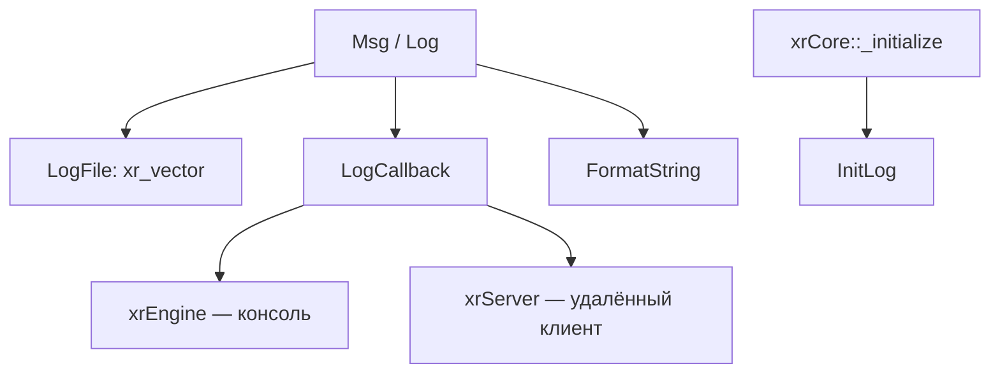
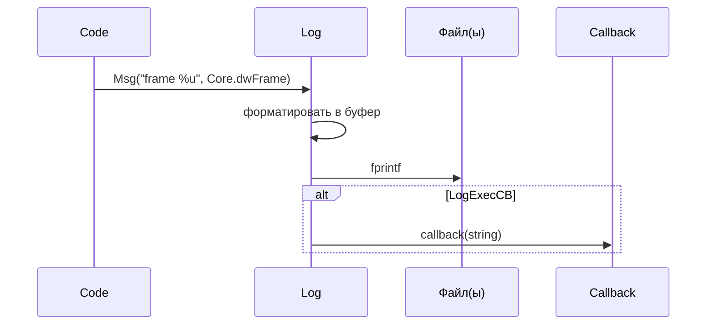

# xrCore: Логирование

`Msg`/`Log` — единственный канал вывода в консоль и файл.

## Ответственность

- Форматированный вывод в **два** канала одновременно: файл логирования и (опционально) callback.
- Утилиты: `FormatString`, `LogWinErr`.
- Управление: `CreateLog`/`InitLog`/`CloseLog`/`FlushLog`, `SetLogCB`.

## Место в архитектуре

Нижний слой. `Msg`/`Log` — **самые используемые функции** во всём движке. Вызываются из `xrCore::_initialize` (до инициализации FS) и из любого модуля.

## Два канала вывода

Каждое сообщение `Msg`/`Log` одновременно попадает в **два** независимых канала:

1. **Файл** — строка копится в глобальный вектор `LogFile` (это буфер, а не «открытый файл на каждое сообщение»). В точке синхронизации `FlushLog()` весь `LogFile` пишется в один файл (`logFName` — обычно `$logs$/AppName_UserName.log`). Пока `FlushLog` не вызван — сообщение живёт только в памяти.
2. **Callback** — если установлен `SetLogCB(cb)` и `LogExecCB == TRUE`, то **каждая** строка сразу передаётся в callback (консоль xrEngine, удалённый клиент xrServer, Lua-логгер). Это мгновенный вывод, не ждущий `FlushLog`.

Почему это удобно: **один вызов `Msg` — и лог и в файле (при `FlushLog`), и в консоли (сразу)**. Не нужно дублировать вывод. Callback устанавливается снаружи: `CEngine::Initialize` (xrEngine) → консоль; `xrServer` → удалённый клиент; Lua-логгер → свой буфер (см. раздел «Взаимодействие» ниже).

## `Msg` vs `Log` — когда что

|                | `Msg`                                                 | `Log`                                                                                |
| -------------- | ----------------------------------------------------- | ------------------------------------------------------------------------------------ |
| Форматирование | **Да** — как `printf`: `Msg(fmt, ...)`                | **Нет** для `msg`; только `dop` форматируется (u32/int/float/Fvector/Fmatrix/LPCSTR) |
| Пример         | `Msg("frame %u, pos %f %f %f", frame, VPUSH(pos))`    | `Log("frame", frame)` → выведет `"frame 12345"`                                      |
| Когда          | Любой форматированный вывод (основной случай)         | Когда уже есть готовая строка `msg` и нужно приложить одно значение `dop`            |
| Под капотом    | Форматирует в `string2048`, затем вызывает `Log(buf)` | Разбивает по `\n`, вызывает `AddOne` на каждую строку                                |

**Практическое правило**: для форматированного вывода — почти всегда `Msg`. `Log(msg, dop)` — для случаев «у меня строка-метка и одно число/вектор» (например, `Log("mem", mem_usage())`). `LogWinErr(msg, err)` — для Windows-кодов ошибок (через `Debug.error2string`).

## Когда лог ещё не создан

`Msg`/`Log` пишут в callback **сразу** (если установлен), а в файл — только при `FlushLog`. Поэтому:

- **До `InitLog()`** (который вызывается из `xrCore::_initialize` после `Memory._initialize`): `LogFile` пуст, и `FlushLog` напишет ничего. Но callback уже может быть установлен (если `SetLogCB` вызван раньше) — тогда `Msg` попадёт только в callback.
- **Почему это важно**: если вы пишете `Msg` в конструкторе объекта, который создаётся **до** `xrCore::_initialize` — сообщение **не** попадёт в файл (только в callback, если есть). Для ранней отладки либо убедитесь, что `InitLog` уже вызван, либо опирайтесь на callback.
- **Порядок в `xrCore::_initialize`**: `Memory._initialize` → `InitLog` → `_initialize_cpu` → ... → `FS._initialize` → `SetLogCB(cb)`. То есть `Msg` работает **до** `FS._initialize`, но callback (`SetLogCB`) ставится **после** — до этого момента callback не активен, и `Msg` пишет только в буфер `LogFile`.

## Типичные паттерны логирования

Реальные примеры из движка:

```cpp
// 1. Старт — xrCore.cpp:164-168, сразу после FS._initialize:
Msg("'%s' build %d, %s\n", "xrCore", build_id, build_date);
Msg("%s version %s\n", get_modded_exes_name(), get_modded_exes_version_string().c_str());
Msg("Game started: %s\n", timeInDMYHMSMMM().c_str());
// Почему так: это первая информация, которая попадёт в файл — метка сборки и время старта.

// 2. Ошибка — LogWinErr (log.cpp:259):
LogWinErr("CreateFile", GetLastError());
// Почему: Windows-код ошибки нечитаем; Debug.error2string превращает его в текст.

// 3. Отладка с вектором — типично для физики/камеры:
Msg("pos: %f %f %f\n", VPUSH(obj.position()));
// VPUSH раскладывается в (x, y, z) — см. макрос выше.
```

## Как добавить свой лог-файл

`LogFile` — глобальный `xr_vector<xr_string>`; `FlushLog` пишет **все** его элементы в один `logFName`. Чтобы добавить **отдельный** файл для отладки конкретного модуля, проще всего не трогать `LogFile`, а писать напрямую через `FS.w_open` в свой файл — но тогда это уже не `Msg`. Если нужен именно канал `Msg`-файла для подмодуля:

1. Убедитесь, что `FS._initialize` уже прошёл (иначе `FS.w_open` не работает).
2. В точке, где нужен дамп (например, при выходе из модуля или по команде консоли), откройте свой файл:
   ```cpp
   IWriter* f = FS.w_open("$logs$/my_module.log");
   if (f) {
       for (const auto& s : LogFile) f->w_string(s.c_str());
       FS.w_close(f);
   }
   ```
3. Либо вызовите `FlushLog()` — он сам переписывает `LogFile` в основной `logFName` (см. `log.cpp` `FlushLog`).

> На практике чаще всего достаточно одного общего `engine.log`; отдельные файлы создаются для тяжёлых подсистем (рендер, физика), когда общий лог раздувается. `LogFile` **не thread-safe** — защищается `logCS` внутри `AddOne`/`FlushLog`.

## Почему `Msg` — `__cdecl`, а не `__stdcall`

`Msg` — variadic-функция (`void Msg(const char* format, ...)`). Для variadic функций вызывающий **обязан** сам очищать стек (не знает, сколько аргументов передавалось). `__cdecl` — именно тот calling convention, где **вызывающий** очищает стек; `__stdcall` — где **вызываемый** (а он не знает, сколько аргументов, в variadic-функции). Поэтому variadic-функции на x86 **всегда** `__cdecl`. В 64-битном ABI (MS x64) calling convention для аргументов другой (регистры), но сигнатура `__cdecl` в коде — исторический след из 32-битной эры, и `Msg` так и объявлен.

## Публичный API

```cpp
// log.h
void XRCORE_API __cdecl Msg(LPCSTR format, ...);
void XRCORE_API Log(LPCSTR msg);
void XRCORE_API Log(LPCSTR msg, LPCSTR dop);
void XRCORE_API Log(LPCSTR msg, u32 dop);
void XRCORE_API Log(LPCSTR msg, int dop);
void XRCORE_API Log(LPCSTR msg, float dop);
void XRCORE_API Log(LPCSTR msg, const Fvector& dop);
void XRCORE_API Log(LPCSTR msg, const Fmatrix& dop);
void XRCORE_API LogWinErr(LPCSTR msg, long err_code);

typedef void (*LogCallback)(LPCSTR string);
LogCallback XRCORE_API SetLogCB(LogCallback cb);
void XRCORE_API CreateLog(BOOL no_log = FALSE);
void InitLog();
void CloseLog();
void XRCORE_API FlushLog();

extern XRCORE_API xr_vector<xr_string> LogFile;   // список файлов логирования
extern XRCORE_API BOOL LogExecCB;                 // флаг: использовать callback

xr_string FormatString(LPCSTR fmt, ...);
```

**Макрос**: `VPUSH(a)` = `((a).x), ((a).y), ((a).z)` — для `Msg("vec: %f %f %f", VPUSH(v))`.

## Внутреннее устройство

### Файлы

| Файл      | Назначение |
| --------- | ---------- |
| `log.h`   | интерфейс  |
| `log.cpp` | реализация |

### Механика

Реальная реализация (`log.cpp`):

1. **`Msg(format, ...)`** — `__cdecl` (varargs). Форматирует в локальный `string2048 buf` через `_vsnprintf`, затем вызывает `Log(buf)`. Если `sz == 0` (пусто) — не пишет.
2. **`Log(s)`** — разбивает `s` по `\n` на строки и вызывает `AddOne(split)` на каждую (в т.ч. на последнюю, даже без `\n`). Пустая строка между `\n\n` заменяется на пробел.
3. **`AddOne(split)`** — под `logCS`:
   - (DEBUG) `OutputDebugString`;
   - если `logTimestamps` — вставляет `[HH:MM:SS]` в начало (сохраняя «console-mark»-первый символ, если есть);
   - **дедупликация**: если строка == предыдущей (`last_str.equal`), не добавляет новую, а у последней строки в `LogFile` дописывает ` [N]` (счётчик повторов);
   - иначе — `LogFile.push_back(...)`;
   - затем, если `LogExecCB && LogCB` — **сразу** `LogCB(split)` (callback).
4. **`FlushLog()`** — под `logCS`: `FS.w_open(logFName)` → пишет **все** строки `LogFile` в файл → `FS.w_close`. Если `no_log` — ничего.
5. **`InitLog()`** — только `LogFile.reserve(10000)` (выделает буфер под строки). Вызывается из `xrCore::_initialize`.
6. **`CreateLog(nl)`** — ставит `no_log = nl`, считает имя `log_file_name = "AppName_UserName.log"`, и (если не `no_log`) переименовывает существующий лог в `.bkp` и создаёт пустой `logFName` через `FS.w_open`.
7. **`SetLogCB(cb)`** — ставит callback, возвращает предыдущий.
8. **`CloseLog()`** — `FlushLog` + `LogFile.clear()`.

> Ключевой момент: **`Msg`/`Log` не пишут в файл напрямую** — они копят в `LogFile` (в памяти), а на диск попадает только при `FlushLog`. Callback же вызывается на каждую строку сразу.

### Файлы логирования

`LogFile` — `xr_vector<xr_string>` — **буфер строк в памяти**, а не «открытый файл». Физический файл создаётся/заполняется:

- **Имя**: `log_file_name = Core.ApplicationName + "_" + Core.UserName + ".log"` (см. `CreateLog`), лежит в `$logs$/` если папка существует.
- **Заполнение**: только `FlushLog()` (и `CloseLog`).
- `commandline.txt` — доп. параметры командной строки (см. [Временны́е/системные](system.md)), не лог-файл.
- `no_log` (статический флаг) — если `TRUE`, `FlushLog` и `CreateLog` не трогают диск (только callback).

### Взаимосвязь с `xrCore::_initialize`

```cpp
// xrCore.cpp — порядок (упрощённо):
Memory._initialize(strstr(Params, "-mem_debug") ? TRUE : FALSE);
DUMP_PHASE;
InitLog();            // ← LogFile.reserve(10000), ДО FS
_initialize_cpu();
rtc_initialize();
// ... FS._initialize(flags, 0, fs_fname) ...
SetLogCB(cb);         // ← callback ставится ПОСЛЕ FS
```

То есть `Msg`/`Log` работают **до** `FS._initialize` (пишут в буфер `LogFile` + в callback, если уже стоит), но **callback** (`SetLogCB`) ставится **после** `FS._initialize` — до этого момента `Msg` копит строки только в `LogFile`, и на диск они попадут при первом `FlushLog`.

> `logTimestamps` — глобальный флаг (по умолчанию `FALSE`); если включить, `AddOne` вставляет `[HH:MM:SS]` в каждую строку.

## Взаимодействие



- **Кто устанавливает callback**: `CEngine::Initialize` (xrEngine) — выводит в консоль; `xrServer` — в удалённый клиент.
- **Зависимости**: `Memory` (буферы), `xr_string`.

## Потоки данных



## Конфигурация

- `no_log` (аргумент `CreateLog`) — не создавать файлы (только callback).
- `-no_log` (в `Core.Params`) — см. [Временны́е/системные](system.md).
- `commandline.txt` — доп. параметры.

## Ограничения / дебаг

- `Msg` — `__cdecl` (не `__stdcall`) — varargs, см. раздел «Почему `Msg` — `__cdecl`, а не `__stdcall`» выше.
- `Msg` форматирует в **`string2048`** — строки длиннее 2048 символов **обрежутся** без ошибки. Для длинных — `FormatString` или разбивка.
- `Log` **не форматирует** `msg` — только `dop` (u32/int/float/Fvector/Fmatrix/LPCSTR). Для форматирования — `Msg` или `FormatString`.
- `FormatString` — тоже **`string2048`** (обрезка > 2048), возвращает `xr_string`.
- `LogWinErr` — через `Debug.error2string(err_code)`, не `FormatMessage` напрямую.
- `LogFile` — глобальный вектор строк (буфер), **не thread-safe**; защищается `logCS` внутри `AddOne`/`FlushLog`.
- `Msg` до `InitLog` — копит в `LogFile` (в памяти), на диск — только при `FlushLog`; в callback — сразу (если установлен).
- Дедупликация: одинаковые подряд идущие строки схлопываются в `LogFile` с меткой ` [N]` (см. `AddOne`).
