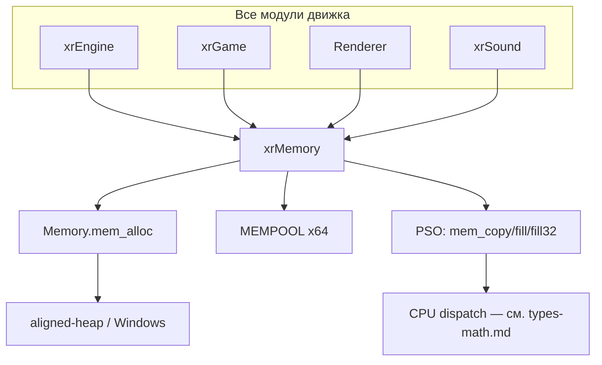
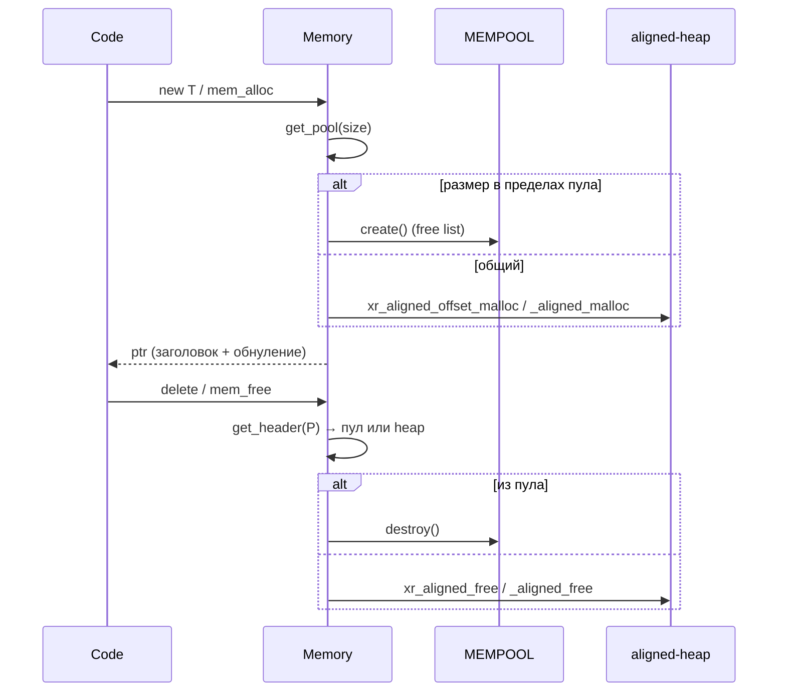

# xrCore: Память

Единый аллокатор, пулы, отладочный учёт выделений.

## Зачем нужен единый аллокатор

Если каждый модуль выделял бы память своим `malloc`, было бы невозможно:

- **отследить утечки** — нет единого места, где видно «кто что выдел»;
- **посчитать потребление** — нет единого счётчика;
- **гарантировать источник** — нельзя обеспечить, чтобы память пришла из нужного пула / с нужным выравниванием;
- **дебажить** — нельзя вешать единый hook на все выделения.

Поэтому в `xrCore` **все** `new`/`delete`/выделения уходят в одну точку — `Memory.mem_alloc`. Это «единая касса»: любой байт памяти в движке прошёл через неё, и любой байт можно найти, посчитать и проверить. Конкретно:

- глобальные `operator new/delete` переопределены и вызывают `Memory.mem_alloc` (см. раздел «Публичный API» ниже);
- макросы `xr_alloc`/`xr_free`/`xr_malloc` тоже — туда же;
- даже `str_container` (основа `shared_str`) создаётся через `xr_new` → `Memory`.

Итог: «единая касса» = единая точка контроля. Всё остальное в этом файле — детали того, что происходит _внутри_ этой кассы.

## Ответственность

- Единая точка выделения памяти для всего движка (глобальный `operator new/delete`).
- Подсистема «именованных» выделений (`DEBUG_MEMORY_NAME`) и отладочного учёта.
- Фиксированные пулы `MEMPOOL` (64 шт.) для частых мелких объектов.
- PSO-функции `mem_copy`/`mem_fill`/`mem_fill32` (выбираются по CPU — см. [Типы и математика](types-math.md)).
- Мониторинг памяти (debug) — `memory_monitor.h`.

## Место в архитектуре

Нижний слой — [Карта модулей](../../architecture/module-map.md). Ни от кого внутри движка не зависит; **все** другие модули включают `xrMemory.h` (прямая или через `xrCore.h`).

## Публичный API

### Singleton `Memory` (тип `xrMemory`)

```cpp
extern XRCORE_API xrMemory Memory;
```

| Метод                                                                    | Назначение                                                                     |
| ------------------------------------------------------------------------ | ------------------------------------------------------------------------------ |
| `_initialize(BOOL debug_mode=FALSE)`                                     | вызывается из `xrCore::_initialize`                                            |
| `_destroy()`                                                             | обратная очистка                                                               |
| `mem_alloc(size, name?)` / `mem_realloc(p, size, name?)` / `mem_free(p)` | базовые операции (с именем при `DEBUG_MEMORY_NAME`)                            |
| `mem_usage()`                                                            | текущее занятое                                                                |
| `mem_compact()`                                                          | компактизация                                                                  |
| `mem_statistic(LPCSTR fn)`                                               | дамп статистики в файл (debug)                                                 |
| `dbg_register(p, size, name)` / `dbg_unregister(p)` / `dbg_check()`      | отладочный учёт (только `DEBUG_MEMORY_MANAGER`)                                |
| `mem_copy`, `mem_fill`, `mem_fill32`                                     | PSO-указатели (`pso_MemCopy`/`pso_MemFill`/`pso_MemFill32` — `xrMemory_pso.h`) |
| `mem_counter_set/get`                                                    | счётчик (debug)                                                                |

### Глобальный `operator new/delete`

```cpp
// xrMemory.h, MSVC
IC void* operator new(size_t size) { return Memory.mem_alloc(size ? size : 1, "C++ NEW"); }
IC void operator delete(void* p) { xr_free(p); }
IC void* operator new[](size_t size) { return Memory.mem_alloc(size ? size : 1, "C++ NEW"); }
IC void operator delete[](void* p) { xr_free(p); }
```

**Важно**: все `new`/`delete` в движке уходят в `Memory`. Отключается `NO_XRNEW` или под Borland.

### Макросы и функции

| Макрос / функция                          | Что делает                                                                          |
| ----------------------------------------- | ----------------------------------------------------------------------------------- |
| `ZeroMemory(a,b)`                         | `Memory.mem_fill(a, 0, b)`                                                          |
| `FillMemory(a,b,c)`                       | `Memory.mem_fill(a, c, b)`                                                          |
| `CopyMemory(a,b,c)`                       | `memcpy(a,b,c)`                                                                     |
| `xr_alloc<T>(count)`                      | `Memory.mem_alloc(count*sizeof(T), typeid(T).name())` (имя при `DEBUG_MEMORY_NAME`) |
| `xr_free<T*&>(P)`                         | `Memory.mem_free`, ставит `P = NULL`                                                |
| `xr_malloc(size)` / `xr_realloc(P, size)` | C-подобные                                                                          |
| `xr_strdup(const char*)`                  | `new char[n]` + copy                                                                |

> **Внимание**: `xr_free<T*&>(P)` принимает **ссылку на указатель** (`T*&`), а не сам указатель. Это сделано, чтобы обнулить `P` после освобождения (защита от dangling pointer).
>
> ```cpp
> Fvector* arr = xr_alloc<Fvector>(100);
> // ...
> xr_free<Fvector*>(arr);   // ✅ arr становится NULL
>
> // НЕПРАВИЛЬНО:
> // Fvector tmp = ...; xr_free<Fvector*>(&tmp);  // освободит стек — UB
> // xr_free<Fvector*>(arr); xr_free<Fvector*>(arr); // второй раз — двойное освобождение
> ```

### Пулы

```cpp
const u32 mem_pools_count = 64;
const u32 mem_pools_ebase = 32;
const u32 mem_generic = mem_pools_count + 1;
extern MEMPOOL mem_pools[mem_pools_count];
```

`MEMPOOL` (`xrMEMORY_POOL.h`):

```cpp
class MEMPOOL {
    xrCriticalSection cs;
    u32 s_sector;   // размер сектора (крупных) выделений
    u32 s_element;  // размер элемента
    u32 s_count;    // = s_sector / s_element
    u32 s_offset;   // размер заголовка
    u32 block_count;
    u8* list;       // free list

    void _initialize(u32 element, u32 sector, u32 header);
    void* create();
    void destroy(void*& P);
};
```

Внутри — классический free list: первый `u32` элемента = указатель на следующий свободный.

### Окружение и статистика

| Функция                                                     | Назначение                                                            |
| ----------------------------------------------------------- | --------------------------------------------------------------------- |
| `vminfo(size_t* free, size_t* reserved, size_t* committed)` | Windows VirtualMemory info                                            |
| `log_vminfo()`                                              | лог виртуальной памяти                                                |
| `memory_monitor` (debug)                                    | `monitor_alloc`, `monitor_free`, `make_checkpoint`, `flush_each_time` |

## Как работает `mem_alloc`

Разберём по шагам, что происходит при `Memory.mem_alloc(size, name)` (реализация — `xrMemory_subst_msvc.cpp`):

1. **Счётчик вызовов** — `stat_calls++` (для статистики).
2. **`PURE_ALLOC`-ветка** (включена в `DEBUG`-сборках и `XRCORE_STATIC`): если `g_use_pure_alloc` — сразу `_aligned_malloc(size, 16)` + `memset 0` + учёт в `memory_monitor`. Это «чистый» путь без пулов; используется, чтобы упростить дебаг (см. раздел «Отладочные режимы»).
3. **Заголовок** — под выделяемый блок резервируется **1 байт заголовка** перед ним (там живёт id пула; `acc_header(P) = P-1`). Это позволяет `mem_free` по одному указателю понять, из какого пула/heap пришёл блок.
4. **Выбор пула** — `get_pool(1 + size + footer)` вычисляет `pid = size / 32`. Если `pid < 64` — блок идёт **из пула №pid**; иначе — `mem_generic` (общий aligned-heap).
5. **Выделение**:
   - _generic_ (`mem_generic`) — `xr_aligned_offset_malloc(1+size+footer, 16, 1)` → выравнивание 16 байт, offset 1. В `DEBUG`/`XRCORE_STATIC` это фактически `_aligned_malloc` (см. шаг 2).
   - _pooled_ — `mem_pools[pid].create()` — берёт элемент из free list пула, без обращения в Windows.
6. **Учёт** — при `DEBUG_MEMORY_MANAGER` и `debug_mode`: `dbg_register(_ptr, size, name)`; при `USE_MEMORY_MONITOR`: `memory_monitor::monitor_alloc`.
7. **Обнуление** — `memset(_ptr, 0, size)` и возврат указателя (без заголовка).

`mem_free` зеркально: читает header → знает, пул или generic → `mem_pools[pid].destroy()` / `xr_aligned_free` → `dbg_unregister`/`monitor_free`.

**Пример**: `xr_alloc<Fvector>(100)` → `sizeof(Fvector)=12` → `size=1200`, имя `typeid(Fvector).name()` (при `DEBUG_MEMORY_NAME`). `get_pool(1+1200) = 1201/32 = 37` → блок из **пула №37** (элемент 32·38 = 1216 байт — как раз ≥ 1201). В `DEBUG`-сборке (`PURE_ALLOC`) — просто `_aligned_malloc(1200, 16)`.

## Как работают пулы `MEMPOOL`

Конкретно, как настраиваются 64 пула (из `xrMemory::_initialize`):

```cpp
u32 element = mem_pools_ebase;            // 32
u32 sector  = mem_pools_ebase * 4096;      // 131072 = 128 КБ
for (u32 pid = 0; pid < mem_pools_count; pid++) {
    mem_pools[pid]._initialize(element, sector, 0x1);
    element += mem_pools_ebase;            // 32, 64, 96, ...
}
```

Итого:

| Пул № | `s_element` (байт) | `s_sector` (байт) | Элементов в секторе |
| ----- | ------------------ | ----------------- | ------------------- |
| 0     | 32                 | 131072            | 4096                |
| 1     | 64                 | 131072            | 2048                |
| 3     | 128                | 131072            | 1024                |
| 37    | 1216               | 131072            | 107                 |
| 63    | 2048               | 131072            | 64                  |

**Суть**: выделяя `size` байт, движок берёт `pid = size / 32` и обращается к пулу №pid. Пулы имеют фиксированный размер элемента (32·(pid+1)), поэтому запрос «64 байта» попадает в пул №1 (элемент 64) — и берётся из free list, **без обращения в Windows heap**. Это быстро: нет системного вызова, нет фрагментации heap'а, блоки выравниваются по 16 байт заранее.

Если `size` больше, чем покрывают 64 пула (≥ 2048·32), `get_pool` вернёт `mem_generic` — и блок пойдёт в общий aligned-heap. Пулы — только для **мелких** выделений фиксированного размера; для переменной длины — обычный аллокатор (см. раздел «Ограничения / дебаг»).

> Пулы инициализируются только если в `Core.Params` **нет** `-pure_alloc` (и не Borland). Флаг `-pure_alloc` отключает пулы и форсирует `PURE_ALLOC`-путь.

## Отладочные режимы

| Режим                       | Определитель                                                      | Что даёт                                                                                                                                  | Когда включать                                                                                                                                                                                                                                                                                                    |
| --------------------------- | ----------------------------------------------------------------- | ----------------------------------------------------------------------------------------------------------------------------------------- | ----------------------------------------------------------------------------------------------------------------------------------------------------------------------------------------------------------------------------------------------------------------------------------------------------------------- |
| `USE_MEMORY_MONITOR`        | `DEBUG` + `!_EDITOR` (auto)                                       | Включает `DEBUG_MEMORY_NAME` + `memory_monitor`                                                                                           | **По умолчанию в DEBUG-сборках.** Легковесный учёт: `monitor_alloc/free` пишут размер+имя в буфер; `make_checkpoint(name)` снимает «фотку», `flush_each_time(true)` — сбрасывает. Включите, чтобы видеть рост памяти по меткам без полноты `DEBUG_MEMORY_MANAGER`.                                                |
| `DEBUG_MEMORY_NAME`         | auto (следует за `USE_MEMORY_MONITOR` или `DEBUG_MEMORY_MANAGER`) | Имена выделений (`_name` в `mem_alloc`)                                                                                                   | **Включите, если подозреваете утечку в конкретном модуле.** Тогда `mem_alloc(size, "xr_malloc")` / `xr_alloc<T>` / `operator new` ("C++ NEW") сохраняют имя, и `mem_statistic` показывает **по имени**, кто сколько держит. Без этого режима имя не передаётся.                                                   |
| `DEBUG_MEMORY_MANAGER`      | вручную (`#if 0` по умолчанию, `xrMemory.h`)                      | Полный учёт: `debug_info` (std::vector\<mdbg\>), `dbg_register/unregister/check`, `mem_statistic`-дамп, stack trace, `-memo`/`-mem_debug` | **Точечно, на время поиска.** Медленный (каждый аллок — в `debug_info` под мьютексом). Включите, когда `memory_monitor` показал рост, но не дал имени, и нужен **полный дамп** всех живых выделений с размерами и именами. Запускайте с `-mem_debug` в `Core.Params`, чтобы `debug_mode=TRUE` и учёт реально шёл. |
| `PROFILE_CRITICAL_SECTIONS` | вручную                                                           | Профилирование мьютексов                                                                                                                  | Только при подозрении на contention в `debug_cs`/пулах.                                                                                                                                                                                                                                                           |
| `NO_XRNEW`                  | вручную                                                           | Отключает подмену `new/delete`                                                                                                            | Чтобы сравнить поведение с «чистым» CRT (редко).                                                                                                                                                                                                                                                                  |

## Как найти утечку — пошаговый сценарий

1. **Соберите DEBUG** (не `_EDITOR`) — тогда `USE_MEMORY_MONITOR` уже включён автоматически.
2. **Включите имена**: убедитесь, что `DEBUG_MEMORY_NAME` задан (следует из `USE_MEMORY_MONITOR`). Если нет — раскомментируйте в `xrMemory.h`.
3. **Для полного дампа** (если мониторинга мало): раскомментируйте `#define DEBUG_MEMORY_MANAGER` в `xrMemory.h` (там `#if 0`), пересоберите, и добавьте `-mem_debug` в `Core.Params` (чтобы `Memory._initialize(TRUE)` → `debug_mode=TRUE` → `dbg_register` реально работает).
4. **Запустите игру**, воспроизведите сценарий, где память растёт (например, загрузка уровня → выход).
5. **Сделайте чекпоинт** до и после (через `memory_monitor::make_checkpoint("before")` / `("after")`) — или просто дамп на выходе.
6. **Вызовите `Memory.mem_statistic("dump.txt")`** — это `mem_compact()` + запись в файл: секция по пулам (`POOL:`), секция по `debug_info` (каждое живое выделение: адрес, размер, **имя**), секция free-list'ов пулов.
7. **Откройте `dump.txt`**, ищите имя, которого «много» и которое не освобождается после сценария. Имя подскажет, какой модуль/тип (`"C++ NEW"`, `"xr_malloc"`, `typeid(T).name()`).
8. **Исправьте**, затем повторите шаг 6 и убедитесь, что строка исчезла.

> `mem_statistic` работает только при `DEBUG_MEMORY_MANAGER` **и** `debug_mode` (т.е. с `-mem_debug`); иначе `return` на первой строке.

## Внутреннее устройство

### Файлы

| Файл                                    | Назначение                                             |
| --------------------------------------- | ------------------------------------------------------ |
| `xrMemory.h`                            | интерфейс                                              |
| `xrMemory.cpp`                          | реализация (`_initialize`, пулы, `mem_statistic`)      |
| `xrMemory_subst_msvc.cpp`               | MSVC: `mem_alloc`/`mem_free`/`mem_realloc`, `get_pool` |
| `xrMemory_subst_borland.cpp`            | Borland-вариант                                        |
| `xrMemory_align.cpp/h`                  | выравнивание (`xr_aligned_offset_malloc`)              |
| `xrMemory_DEBUG.cpp`                    | отладочный учёт                                        |
| `xrMemory_pso.h`                        | PSO-типы                                               |
| `xrMemory_pso_Copy.cpp`                 | реализация `mem_copy`                                  |
| `xrMemory_pso_Fill.cpp`                 | реализация `mem_fill`                                  |
| `xrMemory_pso_Fill32.cpp`               | реализация `mem_fill32`                                |
| `xrMemory_pure.h`                       | флаг `PURE_ALLOC`                                      |
| `xrMEMORY_POOL.h` + `xrMemory_POOL.cpp` | `MEMPOOL`                                              |
| `memory_allocation_stats.cpp`           | статистика                                             |
| `memory_monitor.cpp/h`                  | debug-мониторинг                                       |
| `memory_usage.cpp`                      | учёт                                                   |

### Отладочный учёт (`DEBUG_MEMORY_MANAGER`)

```cpp
struct mdbg { void* _p; size_t _size; const char* _name; u32 _dummy; };
// xrMemory::debug_info — std::vector<mdbg>, защищён debug_cs
```

`dbg_check()` — проверка на утечки/повторы. `dump_phase()` — дамп фазы.

## Взаимодействие



- **Кто использует**: буквально весь код движка. Любой `new`/`delete` → `Memory.mem_alloc/free`.
- **Зависимости**: только Windows API.
- **Взаимосвязь с PSO**: `mem_copy`/`mem_fill` — указатели на функции, выбранные по CPU в runtime.

## Потоки данных



## Конфигурация

- Команда `-mem_debug` (в `Core.Params`) → `Memory._initialize(TRUE)` → `debug_mode=TRUE` (нужно для `DEBUG_MEMORY_MANAGER`).
- `-pure_alloc` — отключает инициализацию пулов и форсирует `PURE_ALLOC`-путь.
- `-memo` — при `DEBUG_MEMORY_MANAGER`: если **есть** в `Params` — `g_bMEMO=TRUE` (учёт выключен); если нет — `mem_initialized=TRUE`.
- `USE_MEMORY_MONITOR` — `DEBUG`-сборки (не `_EDITOR`).
- Пулы: размер секторов/элементов задаётся в `xrMemory.cpp` (`_initialize`): сектор 128 КБ для всех, элемент `32·(pid+1)`.

## Ограничения / дебаг

- **Не использовать `malloc/free` напрямую** — только через `Memory` или `xr_alloc/xr_free`. Иначе отладочный учёт не увидит.
- `xr_free<T*&>(P)` принимает **ссылку на указатель** и обнуляет его — не передавать временный (см. блок «Внимание» в разделе «Макросы и функции»).
- Пулы `MEMPOOL` — только фиксированный размер элемента; для переменной длины — обычный аллокатор.
- `DEBUG_MEMORY_MANAGER` по умолчанию выключен (`#if 0`) — включать осторожно, замедляет.
- `memory_monitor` (debug) — `make_checkpoint(name)` + `flush_each_time(true)` перед выходом (см. `xrCore::_destroy` / `DllMainXrCore`).
