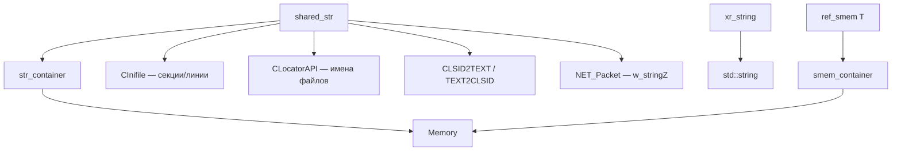
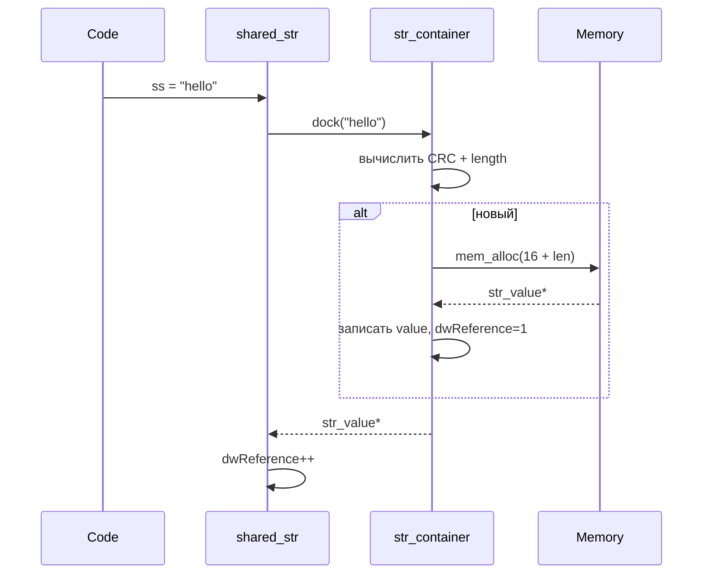

# xrCore: Строки

Два разных механизма: `shared_str` (interned, CRC-based) и `xr_string` (обычный `std::string`).

## Ответственность

- **`shared_str`**: интернированные строки с CRC-идентификатором. Сравнение = сравнение указателей. Основной механизм имён в движке.
- **`xr_string`**: обёртка над `std::string` (см. [Типы и математика](types-math.md) — `vector.h`/`_stl_extensions.h`). Для временных строк и буферов.
- **`smem_container`** (`xrsharedmem.h`): аналогичный механизм, но для **байтовых буферов** (не строк) — `ref_smem<T>`.
- Конкатенации: `strconcat`, `STRCONCAT`, `xr_strconcat` (`string_concatenations.h`).
- Утилиты: `_Trim`, `_GetItem`, `_SequenceToList`, `xr_strlwr`, `IsUTF8`, `UTF8_to_CP1251`.

## Место в архитектуре

Нижний слой. `shared_str` — **фундаментальный тип** для имён файлов, секций INI, секций LTX, CLSID-имён и т.д. (см. [Модель объектов](../../architecture/object-model.md), [INI / конфиги](inifile.md), [Локализатор](locator.md)).

## `shared_str` vs `xr_string` — когда что использовать

Два типа решают разные задачи. Коротко: **`shared_str` — для «имён»**, **`xr_string` — для «содержимого»**.

| Критерий          | `shared_str`                                                          | `xr_string`                                                                 |
| ----------------- | --------------------------------------------------------------------- | --------------------------------------------------------------------------- |
| Что это           | Интернированное «имя» — указатель в `str_container`                   | Обычная строка (обёртка над `std::string`)                                  |
| Сравнение         | По указателю (`==` — `p_ == rhs.p_`), O(1)                            | По содержимому, O(n)                                                        |
| Частота сравнений | **Высокая** (имена секций, файлов, CLSID — сравниваются постоянно)    | Низкая / нет                                                                |
| Размер            | Живёт всю сессию, длина < 4096 (проверка в `dock`)                    | Любой, в т.ч. большой                                                       |
| Временность       | Долгоживущее (имя уровня, секции)                                     | Временное (буфер форматирования, лог-строка)                                |
| Цена присваивания | `dock`: CRC + поиск + (при новом) аллок                               | Копия байтов                                                                |
| Типичный пример   | `FS.r_open("levels/test.ltx")` — имя файла, которое ищут и сравнивают | Буфер для `Msg`/`FormatString` — формируется на лету, используется один раз |

**Правило**: если строку **сравнивают** и она **долгоживущая** → `shared_str`. Если строку **форматируют/изменяют** и она **временная** → `xr_string`. Смешивать не нужно: `shared_str` не для буферов, `xr_string` не для имён, которые должны «схлопываться» при сравнении.

## Публичный API

### `str_value` (внутреннее представление)

```cpp
struct XRCORE_API str_value {
    u32 dwReference;   // счётчик ссылок
    u32 dwLength;      // длина
    u32 dwCRC;         // CRC32 содержимого
    str_value* next;   // для free-list
    char value[];      // Flexible Array Member
};
```

Сравнение: `str_value_cmp` — по `dwCRC` (для set/map). `str_hash_function` — `dwCRC`.

### `str_container` (singleton `g_pStringContainer`)

```cpp
class XRCORE_API str_container {
    xrCriticalSection cs;
    str_container_impl* impl;
public:
    str_value* dock(str_c value);   // интернирование (возвращает nullptr, если value==nullptr)
    void clean();                  // очистить
    void dump();
    void dump(IWriter* W);
    void verify();
    u32 stat_economy(u32& count);
};
extern XRCORE_API str_container* g_pStringContainer;
```

`dock(value)` — находит или создаёт `str_value` в контейнере. **CRC + length** — ключ.

### `shared_str`

```cpp
class shared_str {
    str_value* p_;
    void _set(str_c rhs);       // интернирование через g_pStringContainer->dock
    void _set(shared_str const& rhs);
    const str_value* _get() const;

    shared_str();
    shared_str(str_c rhs);
    shared_str(shared_str const& rhs);
    ~shared_str();

    shared_str& operator=(str_c rhs);
    shared_str& operator=(shared_str const& rhs);

    str_c operator*() const;    // p_->value
    bool operator!() const;     // p_ == 0
    char operator[](size_t id);
    str_c c_str() const;
    u32 size() const;
    void swap(shared_str& rhs);
    bool equal(const shared_str& rhs) const { return (p_ == rhs.p_); }
    shared_str& __cdecl printf(const char* format, ...);  // буфер 4096
};
```

**Важные свойства**:

- **Сравнение операторами `==`/`!=`/`<`/`>` — по указателям** (interned). Разные `shared_str` с одинаковым содержимым **равны** (один `str_value`).
- `xr_strcmp(a, b)` — сначала `equal` (быстрый путь), иначе по содержимому.
- `std::hash<shared_str>` — хеш по `str_value*`.

### Свободные функции

| Функция                            | Назначение                                   |
| ---------------------------------- | -------------------------------------------- |
| `xr_strlen(shared_str&)`           | размер                                       |
| `xr_strcmp(a, b)` (4 перегрузки)   | сравнение                                    |
| `xr_strlwr(xr_string&)`            | нижний регистр (std)                         |
| `xr_strlwr(shared_str&)`           | нижний регистр (через `xr_strdup`/`xr_free`) |
| `IsUTF8(const char*)`              | проверка UTF-8                               |
| `UTF8_to_CP1251(xr_string const&)` | конвертация UTF-8 → CP1251                   |
| `str_c`                            | `typedef const char*`                        |

### `smem_container` / `ref_smem<T>` (`xrsharedmem.h`)

Аналогичный механизм, но для **байтовых массивов** (не строк). `smem_value` — `xr_atomic_u32 dwReference` (атомарный), `dwCRC`, `dwLength`, `u8 value[]`. `ref_smem<T>` — шаблонная обёртка: `create(CRC, length, ptr)`, `operator*` → `T*`, `operator[]` → `T&`.

### Конкатенации (`string_concatenations.h`)

| Функция / макрос                   | Назначение                                              |
| ---------------------------------- | ------------------------------------------------------- |
| `strconcat(dest_sz, dest, S1..S6)` | до 6 строк, фиксированный буфер                         |
| `STRCONCAT(dest, ...)`             | variadic, `_alloca`, проверка stack overflow            |
| `xr_strconcat(receiver, args...)`  | variadic template (C++11), `static_assert` на `char[N]` |

### Утилиты (`xr_trims.h`)

`_Trim`, `_TrimLeft`, `_TrimRight`, `_ChangeSymbol`, `_GetItem`, `_GetItems`, `_SetPos`, `_CopyVal`, `_ParseItem` (token list), `_ReplaceItem(s)`, `_SequenceToList`, `_ListToSequence`, `FloatTimeToStrTime`/`StrTimeToFloatTime`.

## Внутреннее устройство

### Файлы

| Файл                           | Назначение                                 |
| ------------------------------ | ------------------------------------------ |
| `xrstring.h`                   | `shared_str`, `str_value`, `str_container` |
| `xrstring.cpp`                 | реализация                                 |
| `xrsharedmem.h/.cpp`           | `smem_container`, `ref_smem<T>`            |
| `string_concatenations.h/.cpp` | конкатенации                               |
| `xr_trims.h/.cpp`              | утилиты строк                              |
| `dump_string.h/.cpp`           | дамп строк (debug)                         |
| `mezz_stringbuffer.h/.cpp`     | буфер строк                                |

### Интернирование на пальцах: что происходит со строкой `"hello"`

Весь механизм — в `str_container::dock` (`xrstring.cpp`) и `shared_str::_set`/`_dec` (`xrstring.h`). Разберём пошагово.

**Шаг 1. Первый `shared_str s1 = "hello"`:**

1. Конструктор → `_set(str_c)` → `g_pStringContainer->dock("hello")`.
2. `dock` под критсекцией `cs`: считает `s_len = 5`, проверяет `HEADER + 6 < 4096` (иначе `VERIFY` падает — строки ≥ ~4096 байт не поддерживаются).
3. Считает `dwCRC = crc32("hello", 5)` (CRC32 содержимого, не включая нуль-терминатор).
4. `impl->find` — идёт в хеш-массив `buffer[dwCRC % 262144]` (массив из 256 КБ указателей) и по цепочке `next` ищет `str_value` с **тем же CRC И тем же length И тем же содержимым** (`memcmp`).
5. Не найдено → `Memory.mem_alloc(HEADER + 6)` (HEADER = 12 + `sizeof(void*)`), копирует байты строки в `value[]`, ставит `dwReference = 0`, вставляет в цепочку хеш-массива (`impl->insert`).
6. Возврат в `_set`: `v->dwReference++` → **`dwReference = 1`**. `s1.p_` теперь указывает на единственный `str_value` для `"hello"`.

**Шаг 2. Второй `shared_str s2 = "hello"`:**

1. `dock("hello")` снова считает CRC → **тот же** `dwCRC`.
2. `find` находит уже существующий `str_value` (CRC + length + `memcmp` совпали).
3. Новая аллокация **не** создаётся. Возврат в `_set`: `v->dwReference++` → **`dwReference = 2`**.
4. `s1.p_ == s2.p_` — **один и тот же указатель**. Поэтому `s1 == s2` — сравнение по указателю, O(1), и `true`.

**Шаг 3. Уничтожение `s2`:**

1. `~shared_str()` → `_dec()`: `p_->dwReference--` → **`dwReference = 1`**. Так как ≠ 0 — `str_value` **не** освобождается (ещё держит `s1`).
2. Уничтожение `s1` → `dwReference--` → **0** → `p_ = 0`. Сам `str_value` из хеш-массива будет убран при `clean()` (собирает мусор, когда `dwReference == 0`).

> Ключевой момент: **одинаковое содержимое → один `str_value` → один указатель → `==` по указателю**. Именно так `ss1 == ss2` работает за O(1). Счётчик `dwReference` гарантирует, что `str_value` живёт, пока на него есть хотя бы один `shared_str`.

### Почему CRC, а не хеш-таблица с полным сравнением

`dwCRC` — **быстрый предфильтр**, а не «точное сравнение»:

- `dwCRC` — CRC32 содержимого (32 бита). Он **не уникален**: разные строки могут иметь одинаковый CRC (коллизия). Поэтому `dwCRC` — только **первый этап** поиска.
- `str_container_impl::find` использует CRC как **индекс** хеш-массива (`buffer[dwCRC % 262144]`), а затем **по цепочке** проверяет **полное совпадение**: `dwCRC == И dwLength == И !memcmp(value, str, len)`. Только когда все три совпали — это «та самая» строка.
- **Коллизии разрешены**: две разные строки с одним CRC будут висеть в одной цепочке, но `memcmp` их различит → **два разных `str_value`**. Так что «коллизия CRC ≠ совпадение строк».

Зачем CRC вообще, если есть `memcmp`? Потому что CRC даёт **O(1) доступ** к нужной цепочке (без обхода всего контейнера), а `memcmp` — точное подтверждение внутри короткой цепочки. Это классическая схема «хеш + проверка содержимого».

> `str_value_cmp` / `str_hash_function` (для set/map) — по `dwCRC` (быстрый путь). Точное сравнение — по содержимому (`memcmp`). `shared_str::operator==` — по указателю (самый быстрый путь, т.к. интернирование уже гарантировало единственность).

### Что будет, если использовать `shared_str` неправильно

- **Временная строка** (форматируется каждый кадр, живёт один кадр): каждое присваивание — это `dock` → CRC + поиск по хеш-цепочке + (если содержимое новое каждый раз) аллок `Memory.mem_alloc`. Это **дорого** для одноразовых данных. Используйте `xr_string` или `string_N` буфер. `shared_str` для имён, а не для буферов.
- **Очень длинные строки** (≥ 4096 байт): `VERIFY(HEADER + len < 4096)` в `dock` **упадёт** в DEBUG. `shared_str` не рассчитан на большие блоки — это для «имён». Для больших данных — `xr_string` / `IReader` / `ref_smem`.
- **`printf` с обрезкой 4096**: `shared_str::printf` форматирует в локальный `buf[4096]`, и если результат длиннее — **обрезка без ошибки** (`_vsnprintf` возвращает бы бы wanted, а буфер молча обрезается). Если вы форматируете длинное сообщение в `shared_str` — оно может усесться без предупреждения.
- **Сравнение `==` до интернирования**: `==` — по указателю. Если два `shared_str` с одинаковым содержимым были созданы **в разное время**, но содержимое уже было интернировано ранее — это **один** `str_value`, один указатель, `==` → `true`. Но если вы сравниваете `shared_str` с `const char*` через `==` — компилятор приведёт `const char*` к `shared_str` (конструктор → `dock`), и тогда сравнение тоже по указателю. Для «точек» сравнения используйте `xr_strcmp` (сначала `equal` — быстрый путь по указателю, иначе по содержимому).

### Как читать лог-сообщение с `shared_str`

`shared_str` не является `const char*` — это обёртка. Чтобы вывести в лог, нужно «развернуть» его в `const char*` через `operator*` (или `c_str()`):

```cpp
shared_str ss = "levels/test.ltx";
Msg("file: %s", *ss);   // ✅ *ss — это const char* (p_->value)
// Msg("file: %s", ss); // ❌ ss — это shared_str, а не const char* — не скомпилируется
```

Почему `*ss` — это `const char*`: `operator*() const { return p_ ? p_->value : 0; }` — возвращает указатель на байты `str_value::value[]`. Если `ss` пуст (`p_ == 0`) — возвращает `0` (`nullptr`), и `Msg` с `%s` на `nullptr` — UB. Перед выводом проверьте `if (ss)` (т.е. `!ss` / `operator!()`).

### `smem_container` — то же самое, но для байтовых буферов

`smem_container` / `ref_smem<T>` (`xrsharedmem.h`) — **аналогичный механизм интернирования, но для произвольных байтовых массивов, а не строк**.

- `smem_value` — как `str_value`, но `dwReference` — **атомарный** (`xr_atomic_u32`), т.е. `ref_smem<T>` thread-safe по счётчику.
- `ref_smem<T>::create(CRC, length, ptr)` — интернирует указатель на буфер по CRC+length; `operator*` → `T*`, `operator[]` → `T&`.
- **Где используется**: например, в `SkeletonX` (`src/Layers/xrRender/SkeletonX.h`) — `ref_smem<vertBoned1W> Vertices1W`, `ref_smem<u16> m_Indices` — общие вершинные/индексные буферы скелетов, которые несколько мешей могут шарить, не копируя байты. Механизм тот же (CRC + length + refcount), но данные — не строка, а массив структур/индексов.

## Взаимодействие



- **Кто использует**: `CInifile` (имена секций/линий), `CLocatorAPI` (имя файла в `archive.path`), `NET_Packet` (`w_stringZ`/`r_stringZ`), `CLASS_ID` (текстовое представление), Lua-биндинг (имена).
- **Зависимости**: `Memory`, `CRC32` (`crc32.cpp`), `xrSyncronize` (critical section).

## Потоки данных



## Конфигурация

- Глобальный: `g_pStringContainer` — инициализируется при загрузке DLL (конструктор).
- `PROFILE_CRITICAL_SECTIONS` — именованный критсек `str_container`.

## Ограничения / дебаг

- **`shared_str` — не для временных строк**. Каждое присваивание = `dock` (CRC + поиск). Для буферов — `xr_string` или `string16..string4096`.
- **Сравнение `==` = указатель**. Если строка ещё не интернирована (другой `shared_str` с тем же содержимым, но созданный до интернирования первого) — **могут быть разные указатели**. На практике: одинаковое содержимое → один `str_value` → один указатель.
- `operator[]` **без проверки границ** — `p_->value[id]`.
- `printf` — буфер 4096, обрезка без ошибки.
- `UTF8_to_CP1251` — если строка не UTF-8 или конвертация не удалась → возвращает исходную.
- `smem_container` — `dwReference` атомарный (`xr_atomic_u32`), т.е. `ref_smem<T>` thread-safe по счётчику.
