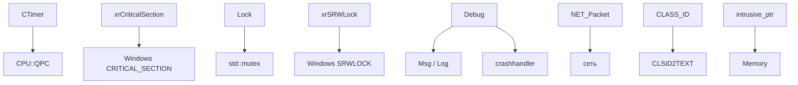
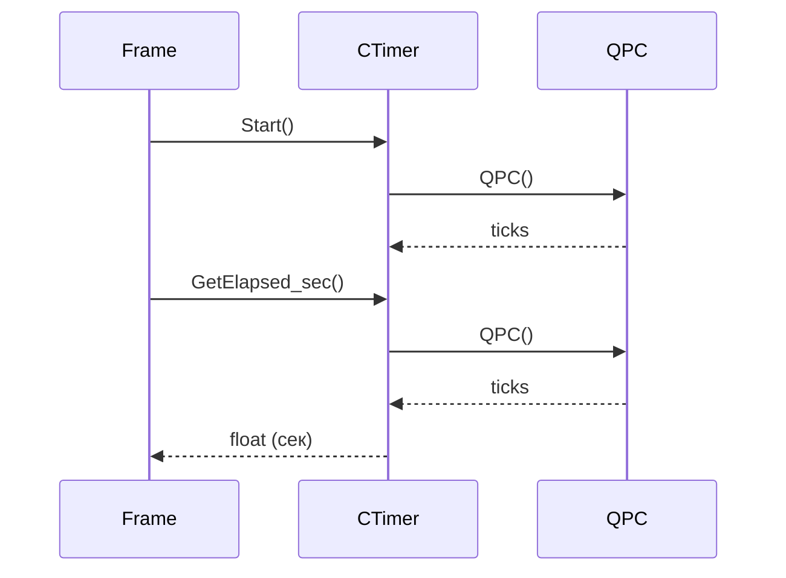

# xrCore: Временны́е/системные

Таймеры, синхронизация, CPU, отладка, misc.

## Ответственность

- **Таймеры** (`FTimer.h`): `CTimerBase`, `CTimer`, `CTimer_paused`, `CStatTimer`, `pauseMngr`.
- **Синхронизация** (`xrSyncronize.h`, `Lock.hpp`, `ScopeLock.hpp`): критические секции, RAII-guard'ы, SRW-locks.
- **CPU** (`_math.h`, `cpuid.h`): `CPU::QPC()`, `CPU::GetCLK()`, `_processor_info`, `_initialize_cpu`.
- **Отладка** (`xrDebug.h`, `xrDebug_macros.h`): `Debug.fail`, `R_ASSERT`, `VERIFY`, `FATAL`, `soft_fail`.
- **Misc**: `clsid.h` (CLASS_ID), `intrusive_ptr.h`, `net_utils.h` (NET_Packet), `profiler.h`, `crc32.cpp`, `xrPool.h`, `SubAlloc.hpp`.

## Место в архитектуре

Нижний слой. Эти компоненты — **инфраструктура**, используемая всеми другими модулями.

## Публичный API

### Таймеры

#### `CTimerBase`

```cpp
class XRCORE_API CTimerBase {
    u64 qwStartTime, qwPausedTime, qwPauseAccum;
    bool bPause;
public:
    ICF void Start();
    ICF u64 GetElapsed_ticks() const;
    ICF u32 GetElapsed_ms() const;
    ICF float GetElapsed_sec() const;  // FPU m64 → float
    ICF void Dump() const;  // Msg
};
```

Основано на `CPU::QPC()` (QueryPerformanceCounter).

#### `CTimer` (с time factor)

```cpp
class XRCORE_API CTimer : public CTimerBase {
    float m_time_factor;  // масштаб времени (1.0 = реалтайм)
    u64 m_real_ticks, m_ticks;
public:
    ICF void Start();
    ICF const float& time_factor() const;
    ICF void time_factor(const float& tf);  // изменить масштаб
    ICF u64 GetElapsed_ticks() const;
    ICF u32 GetElapsed_ms() const;
    ICF float GetElapsed_sec() const;
};
```

`time_factor(2.0)` — время идёт в 2 раза быстрее.

#### `CTimer_paused_ex` / `CTimer_paused`

```cpp
class XRCORE_API CTimer_paused_ex : public CTimer {
    u64 save_clock;
public:
    ICF bool Paused() const;
    ICF void Pause(bool b);  // пауза/резюме
};

class XRCORE_API CTimer_paused : public CTimer_paused_ex {
public:
    CTimer_paused() { g_pauseMngr().Register(*this); }
    ~CTimer_paused() { g_pauseMngr().UnRegister(*this); }
};
```

#### `pauseMngr`

```cpp
class XRCORE_API pauseMngr {
    xr_vector<CTimer_paused*> m_timers;
    bool m_paused;
public:
    bool Paused() { return m_paused; }
    void Pause(bool b);  // пауза всех зарегистрированных
    void Register(CTimer_paused& t);
    void UnRegister(CTimer_paused& t);
};
extern XRCORE_API pauseMngr& g_pauseMngr();
```

#### `CStatTimer`

```cpp
extern XRCORE_API BOOL g_bEnableStatGather;
class XRCORE_API CStatTimer {
    CTimer T;
    u64 accum; float result; u32 count;
public:
    void FrameStart(); void FrameEnd();
    ICF void Begin();  // если g_bEnableStatGather
    ICF void End();
    ICF u64 GetElapsed_ticks() const;
    ICF u32 GetElapsed_ms() const;
    ICF float GetElapsed_sec() const;
};
```

Счётчик времени по кадрам (статистика).

### Синхронизация

#### `xrCriticalSection`

```cpp
class XRCORE_API xrCriticalSection : xray::noncopyable {
    void* pmutex;
public:
    class raii {  // RAII
        xrCriticalSection* critical_section;
    public:
        raii(xrCriticalSection*);
        ~raii();
    };
    xrCriticalSection();  // или с id при PROFILE_CRITICAL_SECTIONS
    ~xrCriticalSection();
    void Enter();
    void Leave();
    BOOL TryEnter();
    bool IsValid();
};
```

#### `xrCriticalSectionGuard` (RAII)

```cpp
class xrCriticalSectionGuard : xray::noncopyable {
    xrCriticalSection* critical_section;
public:
    void Enter(); void Leave();
    xrCriticalSectionGuard(xrCriticalSection* cs);
    xrCriticalSectionGuard(xrCriticalSection& cs);
    ~xrCriticalSectionGuard();  // Leave
};
```

#### `xrCriticalSectionTryGuard` (non-blocking)

```cpp
class xrCriticalSectionTryGuard : xray::noncopyable {
    xrCriticalSection* critical_section;
    bool owned;
public:
    xrCriticalSectionTryGuard(xrCriticalSection* cs);
    xrCriticalSectionTryGuard(xrCriticalSection& cs);
    bool owns_lock() const;
    ~xrCriticalSectionTryGuard();  // Leave если owned
};
```

#### `xrSRWLock` (Reader-Writer)

```cpp
class XRCORE_API xrSRWLock {
    SRWLOCK smutex;
public:
    void AcquireExclusive(); void ReleaseExclusive();
    void AcquireShared(); void ReleaseShared();
    BOOL TryAcquireExclusive(); BOOL TryAcquireShared();
};

class XRCORE_API xrSRWLockGuard {
    xrSRWLock* lock; bool shared;
public:
    xrSRWLockGuard(xrSRWLock& lock, bool shared = false);
    xrSRWLockGuard(xrSRWLock* lock, bool shared = false);
    ~xrSRWLockGuard();
};
```

#### `Lock` (простой)

```cpp
class Lock : xray::noncopyable {
    struct LockImpl* impl;
    std::atomic_int lockCounter;
public:
    Lock();
    ~Lock();
    void Enter();
    bool TryEnter();
    void Leave();
    bool IsLocked() const;
};

class ScopeLock : xray::noncopyable {  // RAII
    Lock* syncObject;
public:
    ScopeLock(Lock* SyncObject);
    ~ScopeLock();
};
```

### CPU

#### `CPU` namespace (`_math.h`)

```cpp
namespace CPU {
    extern u32 clk_per_second;
    extern u32 clk_per_milisec;
    extern u32 clk_per_microsec;
    extern u32 qpc_freq;
    extern u32 qpc_overhead;
    extern _processor_info ID;

    IC u64 QPC();      // QueryPerformanceCounter
    IC u64 GetCLK();   // RDTSC
}
```

#### `_processor_info` (`cpuid.h`)

Заполняется `CPUID` при старте:

- VENDOR, Family, Model, Stepping
- Флаги: SSE, SSSE3, SSE2, SSE3, SSE4.1, SSE4.2, AVX, AVX2
- `clk_per_second`, `clk_per_milisec`, `clk_per_microsec`
- `qpc_freq`, `qpc_overhead`

`_initialize_cpu()` — вызывается из `xrCore::_initialize` (после `Memory._initialize`).

### Отладка

#### `xrDebug` (singleton `Debug`)

```cpp
class XRCORE_API xrDebug {
    crashhandler* handler;
    on_dialog* m_on_dialog;
public:
    void _initialize(const bool& dedicated);
    void _destroy();
    crashhandler* get_crashhandler();
    void set_crashhandler(crashhandler* _handler);
    on_dialog* get_on_dialog();
    void set_on_dialog(on_dialog* on_dialog);
    LPCSTR error2string(long code);
    void gather_info(...);
    void fail(const char* e1, const char* file, int line, const char* function, bool& ignore_always);
    // ... перегрузки fail (e2, e3, e4)
    void soft_fail(LPCSTR e1, ...);  // не падает, только лог
    void error(long code, ...);
    void _cdecl fatal(const char* file, int line, const char* function, const char* F, ...);
    void backend(const char* reason, ...);
    void do_exit(const std::string& message);
};
extern XRCORE_API xrDebug Debug;
XRCORE_API void LogStackTrace(LPCSTR header);
```

#### Макросы (`xrDebug_macros.h`)

| Макрос                         | Назначение                                                      |
| ------------------------------ | --------------------------------------------------------------- |
| `R_ASSERT(expr)`               | `Debug.fail` при `!expr`                                        |
| `R_ASSERT2/3/4(expr, e2, ...)` | с доп. сообщениями                                              |
| `R_CHK(expr)`                  | `Debug.error` при `FAILED(hr)` (HRESULT)                        |
| `FATAL(desc)`                  | `Debug.fatal`                                                   |
| `VERIFY(expr)`                 | debug: `Debug.fail`; release: `soft_fail` или пустой (см. ниже) |
| `VERIFY2/3/4`                  | с доп. сообщениями                                              |
| `CHK_DX(expr)`                 | debug: `Debug.error`; release: пустой                           |
| `NODEFAULT`                    | `FATAL("nodefault reached")` или `__assume(0)`                  |
| `CHECK_OR_EXIT(expr, msg)`     | `Debug.do_exit`                                                 |
| `TODO(x)`, `FIXME(x)`          | `#pragma message`                                               |
| `STATIC_CHECK(expr, msg)`      | compile-time                                                    |

**Режимы `VERIFY`**:

- `DEBUG` + `NON_FATAL_VERIFY` → `soft_fail` (не падает).
- `DEBUG` (без `NON_FATAL_VERIFY`) → `fail` (падает).
- Release + `USE_VERIFY_IN_RELEASE` → `soft_fail`.
- Release (без) → пустой.

### Misc

#### `CLASS_ID` (`clsid.h`)

```cpp
typedef u64 CLASS_ID;
#define MK_CLSID(a,b,c,d,e,f,g,h) CLASS_ID(...)
#define MK_CLSID_INV(a,b,c,d,e,f,g,h) MK_CLSID(h,g,f,e,d,c,b,a)
extern XRCORE_API void __stdcall CLSID2TEXT(CLASS_ID id, LPSTR text);
extern XRCORE_API CLASS_ID __stdcall TEXT2CLSID(LPCSTR text);
```

8-байтовый ID (8 × u8). `CLSID2TEXT`/`TEXT2CLSID` — текстовое представление.

#### `intrusive_ptr` (`intrusive_ptr.h`)

См. [Строки](strings.md) — `intrusive_ptr<T>` — intrusive smart pointer (C++17). `intrusive_base`, `intrusive_base_deferred`, `intrusive_base_strict`.

#### `NET_Packet` (`net_utils.h`)

```cpp
const u32 NET_PacketSizeLimit = 16 * 1024;
struct NET_Buffer { BYTE data[NET_PacketSizeLimit]; u32 count; };

class XRCORE_API NET_Packet {
    IIniFileStream* inistream;
    NET_Buffer B;
    u32 r_pos; u32 timeReceive; bool w_allow;
public:
    void construct(const void* data, unsigned size);
    IC void write_start();
    IC void w_begin(u16 type);
    IC void w(const void* p, u32 count);
    void w_seek(u32 pos, const void* p, u32 count);
    IC u32 w_tell();
    IC void w_float, w_vec3, w_vec4, w_u64, w_s64, w_u32, w_s32, w_u16, w_s16, w_u8, w_s8;
    IC void w_float_q16, w_float_q8, w_angle16, w_angle8, w_dir, w_sdir;
    IC void w_stringZ(LPCSTR S); IC void w_stringZ(const shared_str& p);
    IC void w_matrix(Fmatrix& M);
    IC void w_clientID(ClientID& C);
    IC void w_chunk_open8/16(u32& position);
    IC void w_chunk_close8/16(u32 position);
    void read_start();
    u32 r_begin(u16& type);
    void r_seek(u32 pos); u32 r_tell();
    IC void r(void* p, u32 count);
    BOOL r_eof(); u32 r_elapsed(); void r_advance(u32 size);
    void r_vec3, r_vec4, r_float, r_u64, r_s64, r_u32, r_s32, r_u16, r_s16, r_u8, r_s8;
    Fvector r_vec3(); Fvector4 r_vec4(); float r_float(); u64 r_u64(); ...
    void r_stringZ(LPSTR S); void r_stringZ(xr_string&); void r_stringZ(shared_str&);
    void skip_stringZ();
    void r_matrix(Fmatrix& M); void r_clientID(ClientID& C);
};
```

Бинарный пакет для сети (16 КБ лимит). `w_*`/`r_*` — аналогично `IWriter`/`IReader`, но с `INI_W` (дублирование в INI-файл для отладки).

#### `ClientID` (`client_id.h`)

```cpp
class ClientID {
    u32 id;
public:
    u32 value() const; void set(u32 v);
    bool compare(u32 v) const;
    bool operator ==, !=, <;
};
```

#### `profiler.h`

```cpp
#define PROFILER_NONE   (0)
#define PROFILER_OPTICK (1)
#if !defined(XRCORE_PROFILER)
    #define XRCORE_PROFILER PROFILER_NONE
#endif
// макросы: PROF_THREAD, PROF_FRAME, PROF_EVENT, START_PROFILE, STOP_PROFILE
```

#### `crc32.cpp`

```cpp
XRCORE_API u32 crc32(const void* P, u32 len);
XRCORE_API u32 crc32(const void* P, u32 len, u32 starting_crc);
XRCORE_API u32 path_crc32(const char* path, u32 len);
```

#### `xrPool.h`

```cpp
template <class T, int granularity>
class poolSS {
    T* list;
    xr_vector<T*> blocks;
public:
    T* create();  // placement new
    void destroy(T*& P);
    void clear();
};
```

Pool с фиксированным размером (granularity).

## Внутреннее устройство

### Файлы

| Файл                                        | Назначение                        |
| ------------------------------------------- | --------------------------------- |
| `FTimer.h/.cpp`                             | таймеры                           |
| `xrSyncronize.h/.cpp`                       | критические секции                |
| `Lock.hpp/.cpp`                             | `Lock`                            |
| `ScopeLock.hpp/.cpp`                        | `ScopeLock`                       |
| `_math.h/.cpp`                              | `CPU`, `_initialize_cpu`, FPU     |
| `cpuid.h/.cpp`                              | `_processor_info`                 |
| `xrDebug.h/.cpp`                            | `xrDebug`                         |
| `xrDebug_macros.h`                          | макросы                           |
| `xrDebugNew.cpp`                            | альтернативная реализация         |
| `clsid.h/.cpp`                              | CLASS_ID                          |
| `intrusive_ptr.h`                           | intrusive smart pointer           |
| `net_utils.h/.cpp`                          | NET_Packet                        |
| `client_id.h`                               | ClientID                          |
| `profiler.h`                                | profiler                          |
| `crc32.cpp`                                 | CRC32                             |
| `xrPool.h`                                  | pool                              |
| `SubAlloc.hpp`                              | PPMd sub-allocator                |
| `memory_monitor.h/.cpp`                     | debug-мониторинг                  |
| `xrMEMORY_POOL.h`, `xrMemory_POOL.cpp`      | MEMPOOL (см. [Память](memory.md)) |
| `xrMemory_pso.h` + `pso_*.cpp`              | PSO (см. [Память](memory.md))     |
| `xr_shared.h/.cpp`                          | misc                              |
| `xr_resource.h`                             | ресурс                            |
| `xrCore_platform.h`                         | платформенные определения         |
| `ChooseTypes.H`                             | выбор типов                       |
| `resource.h`                                | ресурс                            |
| `FixedMap.h`, `FixedSet.h`, `FixedVector.h` | фиксированные контейнеры          |
| `buffer_vector.h/.inline`                   | буферный вектор                   |
| `_noncopyable.h`                            | `xray::noncopyable`               |
| `_type_traits.h`                            | type traits                       |
| `_thread_types.h`                           | атомарные типы                    |
| `_flags.h`                                  | `Flags8/16/32/64`                 |
| `_random.h`                                 | RNG                               |
| `_bitwise.h`                                | bitwise операции                  |
| `_color.h`                                  | Fcolor                            |
| `_compressed_normal.h/.cpp`                 | `pvCompress`/`pvDecompress`       |

## Таймеры — иерархия и когда что использовать

Иерархия (`FTimer.h`):

```
CTimerBase        — «сырые» тики QPC: Start / GetElapsed_ticks / _ms / _sec
  └─ CTimer       — + time_factor (масштаб времени)
       └─ CTimer_paused_ex — + Pause(bool) вручную
            └─ CTimer_paused — авторегистрация в g_pauseMngr()
```

Ключевые моменты по каждой ступени:

- **`CTimerBase`** — просто «стоп-секунды на QPC»: `qwStartTime = CPU::QPC() - qwPauseAccum` при `Start()`, дальше `GetElapsed_ticks() = CPU::QPC() - qwStartTime - CPU::qpc_overhead - qwPauseAccum`. `qpc_overhead` — калибровочная константа (см. `_processor_info`).
- **`CTimer`** — поверх этого **масштабирует время**: `GetElapsed_ticks` умножает дельту реальных тиков на `time_factor` (`FTimer.h:75-83`). `time_factor(2.0)` — время идёт вдвое быстрее, `time_factor(0.5)` — вдвое медленнее. Для **профайлинга/тестов**, где нужно ускорить или замедлить «игровое» время, не трогая реальные тайминги.
- **`CTimer_paused_ex`** — умеет **паузу**: `Pause(true)` запоминает `qwPausedTime`, `Pause(false)` прибавляет к `qwPauseAccum` время, проведённое в паузе (`FTimer.h:163-180`). Пока `bPause` — `GetElapsed_ticks` возвращает замороженное значение.
- **`CTimer_paused`** — отличается от `_ex` **одной строкой**: в конструкторе вызывает `g_pauseMngr().Register(*this)`, в деструкторе — `UnRegister` (`FTimer.h:183-188`).

Когда что:

| Задача                                                                                      | Таймер                                                                                                                                                             |
| ------------------------------------------------------------------------------------------- | ------------------------------------------------------------------------------------------------------------------------------------------------------------------ |
| «Сколько реально прошло секунд с `Start()`» (профайлинг, замер)                             | `CTimer` (factor = 1) или даже `CTimerBase`                                                                                                                        |
| Нужно ускорить/замедлить игровое время (тесты, реплей)                                      | `CTimer` + `time_factor(...)`                                                                                                                                      |
| Игровые таймеры, которые **должны останавливаться при паузе игры**                          | `CTimer_paused` (авто-через `pauseMngr`)                                                                                                                           |
| Игровые таймеры, пауза которыми **управляется явно** (например, пауза только на этой сцене) | `CTimer_paused_ex` + ручной `Pause(...)`                                                                                                                           |
| Статистика «сколько этот участок занимает в среднем за кадр»                                | `CStatTimer` (`Begin`/`End` вокруг участка, `FrameStart`/`FrameEnd` в конце кадра; `FrameEnd` считает скользящее среднее с коэффициентом 0.01, `FTimer.cpp:19-24`) |

## `pauseMngr` — как работает пауза всех таймеров

`pauseMngr` — один глобальный экземпляр (`g_pauseMngr()`, `FTimer.cpp:26-30`), хранит `xr_vector<CTimer_paused*>`. Механика (`FTimer.cpp:37-58`):

- `CTimer_paused` при создании **сам** вызывает `Register(*this)` — код, который создаёт такой таймер, об этом не думает.
- `pauseMngr::Pause(true)` — проходит по всем зарегистрированным и вызывает `Pause(true)` на каждом; `Pause(false)` — аналогично возобновляет.
- `m_paused` — флаг «сейчас пауза», чтобы повторный `Pause(true)` не шёл по списку заново.

Итого: когда движок ставит игру на паузу (`g_pauseMngr().Pause(true)`), **все** `CTimer_paused` в системе автоматически останавливаются, и все `CTimer_paused_ex`, которым явно передали `Pause(true)`. Всё остальное (`CTimer`, `CTimerBase`) на паузу не реагирует — это и есть смысл разделения.

## Синхронизация: таблица выбора

| Примитив                         | Что под капотом                                                 | Рекурсивный?                                                                                                                                                                                                | Когда брать                                                                                                                           |
| -------------------------------- | --------------------------------------------------------------- | ----------------------------------------------------------------------------------------------------------------------------------------------------------------------------------------------------------- | ------------------------------------------------------------------------------------------------------------------------------------- |
| `xrCriticalSection`              | Windows `CRITICAL_SECTION`                                      | **Нет** — повторный `Enter` из того же потока = deadlock                                                                                                                                                    | Короткие секции, максимальная скорость, классика                                                                                      |
| `Lock` (+ `ScopeLock`)           | `CRITICAL_SECTION` в `LockImpl` + `std::atomic_int lockCounter` | **По факту нет** — `Enter()` делает `impl->Lock(); ++lockCounter;` (`Lock.cpp:62-66`); `lockCounter` — только счётчик для `IsLocked()`, повторный `Enter` из того же потока упадёт в `EnterCriticalSection` | Когда нужен RAII-`ScopeLock` и/или `IsLocked()`; `CONFIG_PROFILE_LOCKS` добавляет профилирование времени удержания                    |
| `xrSRWLock` (+ `xrSRWLockGuard`) | Windows `SRWLOCK`                                               | Нет                                                                                                                                                                                                         | **Много читателей, один писатель**: `AcquireShared()` не конфликтует с другими `AcquireShared()`, `AcquireExclusive()` — с кем угодно |

RAII-guards — «замок, который сам откроется при выходе из блока», даже при исключении:

```cpp
// xrCriticalSection + guard
xrCriticalSectionGuard guard(&cs);   // Enter в конструкторе
// ... код под замком ...
// ~guard() — Leave

// Lock + ScopeLock
ScopeLock sl(&my_lock);   // Enter в конструкторе
// ... код ...
// ~ScopeLock() — Leave

// Non-blocking вариант, если секцию не обязательно брать:
xrCriticalSectionTryGuard tg(&cs);
if (!tg.owns_lock()) { /* не удалось — альтернативный путь */ }
```

Правило дефолта: `xrCriticalSection` + `xrCriticalSectionGuard` для 95% случаев; `xrSRWLock` — только когда профиль показал, что читатели блокируют друг друга.

## `Debug.fail` vs `soft_fail` vs `error`

| Функция           | Что делает                                                                                                                       | Когда вызывается                                                              |
| ----------------- | -------------------------------------------------------------------------------------------------------------------------------- | ----------------------------------------------------------------------------- |
| `Debug.fail`      | `backend("assertion failed", …)` → **диалог** (Stop/Debug) → `RaiseException`/`TerminateProcess` (`xrDebug.cpp:100-126,156-177`) | `R_ASSERT`, `VERIFY` в debug без `NON_FATAL_VERIFY`                           |
| `Debug.soft_fail` | **Только `Msg("! VERIFY_FAILED: …")`** — не падает (`xrDebugNew.cpp:449-483`)                                                    | `VERIFY` при `NON_FATAL_VERIFY` (debug) или `USE_VERIFY_IN_RELEASE` (release) |
| `Debug.error`     | `backend(error2string(hr), …)` → тот же путь, что и `fail` (диалог/падение), но сообщение — расшифровка HRESULT                  | `R_CHK`, `CHK_DX` (debug)                                                     |
| `Debug.fatal`     | `backend("fatal error", …)` с `ignore_always=true` (нельзя «пропустить»)                                                         | `FATAL(...)`                                                                  |
| `Debug.do_exit`   | `FlushLog` → `MessageBox` → `TerminateProcess(1)` — **мягкий** выход без crash dump                                              | `CHECK_OR_EXIT(expr, msg)`                                                    |

**Важно про `fail`**: это не «просто log + abort». `backend` показывает модальный диалог с текстом ошибки, файлом, строкой и функцией; кнопка **Stop** → `TerminateProcess`/`RaiseException` (crash с minidump), кнопка **Debug** → `DEBUG_INVOKE` (вешает дебаггер, если есть). То есть `R_ASSERT` в debug-сборке — это **гарантированное падение** с диалогом, а не «проигнорировать и поехать дальше».

Режимы `VERIFY` (см. также «Конфигурация» ниже):

| Сборка  | Опция                   | Результат                                                      |
| ------- | ----------------------- | -------------------------------------------------------------- |
| Debug   | без `NON_FATAL_VERIFY`  | `Debug.fail` (падает)                                          |
| Debug   | `NON_FATAL_VERIFY`      | `Debug.soft_fail` (только log)                                 |
| Release | `USE_VERIFY_IN_RELEASE` | `Debug.soft_fail` (только log)                                 |
| Release | без                     | **пустой** `do {} while(0)` — проверка вообще не компилируется |

## `NET_Packet` — бинарный пакет для сети

`NET_Packet` (`net_utils.h`) — фиксированный буфер **16 КБ** (`NET_PacketSizeLimit`), поверх которого — тот же набор `w_*`/`r_*`, что у `IWriter`/`IReader`, включая квантование (`w_float_q16`, `w_angle16`, `w_dir`, `w_sdir` — те же формулы, что в файловой системе) и `w_matrix`/`w_clientID`.

Особенность, которой нет у `IWriter`: поле `IIniFileStream* inistream`. Если оно задано (отладочный режим), **каждая** `w_*` дополнительно дублирует запись в INI-поток через макрос `INI_W(...)`: `w_float` пишет и в буфер, и в `inistream->w_float(a)`. Это позволяет получить «человеческое» INI-представление любого сетевого пакета для отладки, не меняя код записи.

Типичный цикл записи/чтения:

```cpp
NET_Packet P;
// --- запись ---
P.write_start();
P.w_begin(123);          // u16 type-заголовок
P.w_u32(id);
P.w_vec3(pos);
P.w_stringZ(name.c_str());
// --- отправка: P.B.data, P.B.count ---

NET_Packet Q;  // полученный пакет
Q.read_start();
u16 type; Q.r_begin(type);   // type == 123
u32 id;    Q.r_u32(id);
Fvector pos; Q.r_vec3(pos);
shared_str name; Q.r_stringZ(name);
```

Лимит 16 КБ проверяется `VERIFY(B.count + count < NET_PacketSizeLimit)` в `w()` — переполнение = assert, а не «тихо отбросили хвост».

## `CLASS_ID` — 8 байт, 8 символов

`CLASS_ID` — это просто `u64`, который по построению читается как **8 ASCII-символов**: `MK_CLSID(a,b,c,d,e,f,g,h)` кладёт каждый `u8`-аргумент в свой байт (`clsid.h:8-9`). Поэтому в движке ID-классов объявляют читаемыми: `CLSID_GAME_LEVEL MK_CLSID('G','_','L','E','V','E','L',' ')` (`xrEngine/std_classes.h`) — и в дампах/логах ID выглядит как `"G_LEVEL "`, а не как `0x475f4c45...`. `CLSID2TEXT`/`TEXT2CLSID` — обратимые преобразования для отладки и конфигов. `MK_CLSID_INV` — тот же, но байты в обратном порядке (для случаев, когда ID хранится «наизнанку»).

## Профилирование: `XRCORE_PROFILER` и Optick

`profiler.h` — тонкая обёртка: макросы `PROF_THREAD` / `PROF_FRAME` / `PROF_EVENT` / `START_PROFILE` / `STOP_PROFILE` либо маппятся на **Optick** (внешний GPU/CPU-профайлер, `3rd party/optick-git`), либо (по умолчанию, `XRCORE_PROFILER == PROFILER_NONE`) на **пустые** `#define` — и код, использующий их, компилируется без накладных расходов.

```cpp
PROF_FRAME("Frame");        // разметка кадра (Optick: новая группа)
START_PROFILE("Physics");   // { PROF_EVENT("Physics")
// ... участок ...
STOP_PROFILE;               // }
```

Переключение на Optick — один `#define XRCORE_PROFILER PROFILER_OPTICK` в настройке сборки; в коде менять ничего не нужно.

## Взаимодействие



- **Кто использует**: все модули (таймеры, синхронизация, отладка).
- **Зависимости**: Windows API, `CPU`, `Memory`, `Msg`.

## Потоки данных



## Конфигурация

- `PROFILE_CRITICAL_SECTIONS` — именованные критсек'ы (профилирование).
- `CONFIG_PROFILE_LOCKS` — профилирование `Lock`.
- `XRCORE_PROFILER` — `PROFILER_NONE` / `PROFILER_OPTICK`.
- `NON_FATAL_VERIFY` — `VERIFY` не падает (debug).
- `USE_VERIFY_IN_RELEASE` — `VERIFY` в release (soft_fail).
- `ANONYMOUS_BUILD` — скрыть имена файлов/функций в отладке.

## Ограничения / дебаг

- **`CTimer`** — не thread-safe (один таймер на поток).
- **`pauseMngr`** — глобальный (все `CTimer_paused` в одном менеджере).
- **`xrCriticalSection`** — Windows CRITICAL_SECTION (не рекурсивный).
- **`Lock`** — `std::mutex` (C++11), рекурсивный (через `lockCounter`).
- **`NET_Packet`** — 16 КБ лимит, не thread-safe.
- **`Debug.fail`** — падает (crash). `soft_fail` — только лог.
- **`CPU::QPC`** — `QueryPerformanceCounter` (высокая точность, но `qpc_overhead` — калибровка).
- **`intrusive_ptr`** — C++17, `static_assert` на `intrusive_base_marker`.
