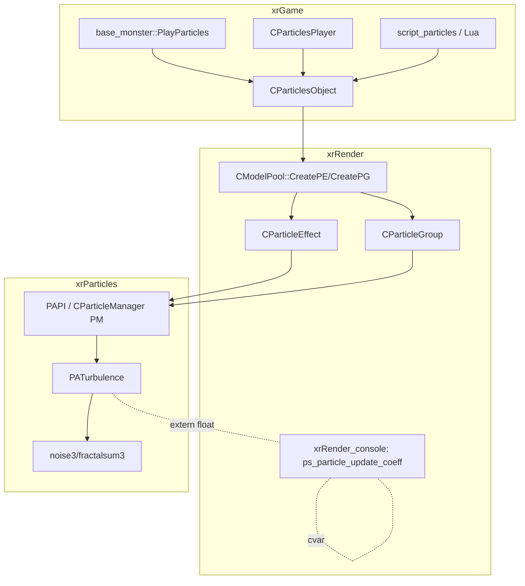

# xrParticles — Noise и связка с движком

> Порцион 4 итерации 4. Файлы: `noise.h/.cpp`, `PATurbulence`
> (`particle_actions_collection.cpp` L1671–1905), интеграция с
> xrEngine/xrRender/xrGame.

## 1. Ответственность

Три вещи:

1. **Перлин-шум** — `noise3`/`fractalsum3`/`turbulence3` в `noise.cpp`
   (классический 3D Perlin, «Texturing and Modeling»).
2. **Потребитель шума** — действие `PATurbulence`
   ([Actions: 29 подклассов](actions-actions.md)) — единственный вызывающий
   `fractalsum3` код во всём репозитории.
3. **Связка с движком** — как симуляция (`PAPI`) подключается к остальным
   модулям: `ps_particle_update_coeff` (xrRender), рантайм-обёртки
   `CParticleEffect`/`CParticleGroup` (xrRender), игровые объекты
   `CParticlesObject`/`CParticlesPlayer` (xrGame), Lua (`Script::Sound`-сосед
   `Particles`-экспорты в xrGame).

## 2. `noise.h/.cpp` — Перлин-шум

```cpp
float noise3(const Fvector& vec);                 // один октав, ~[-1; 1]·1.5
float fractalsum3(const Fvector& v, float freq, int octaves); // сумма октав
float turbulence3(const Fvector& v, float freq, int octaves); // сумма |октав|
```

- `B = 256`. Глобалы (file-scope, не члены класса):
  `static int p[B+B+2]` (перестановка), `static float g[B+B+2][3]`
  (128 единичных gradient-векторов, продублированы с хвостом).
- **`noise3Init()` — не объявлена в `noise.h`** (quirk: вызывается
  `extern void noise3Init();` из `particle_actions_collection.cpp` L1675).
  Инициализация: **`srand(1)` — фиксированный seed** (детерминированный шум
  для всех сессий и платформ), 128 случайных единичных векторов
  (отбраковка `|v|² > 1`), перестановка `p[]` **обменом каждой 2-й позиции**
  (`for (i = B; i > 0; i -= 2)` — только 128 обменов, не полный Fisher–Yates),
  дублирование `p[B+i] = p[i]`, `g[B+i] = g[i]` (i до `B+1` — хвост без
  wrap-around).
- **`noise3`**: классика — `PN_SETUP` (cell + frac; **`+ 10000.f`** — смещение
  против отрицательных индексов, `tt & (B-1)`), 8 углов куба, `S_CURVE`
  (smoothstep), 2-level lerp (x → y → z), результат × `1.5`.
  SSE-путь: `iFloor_SSE` (`_mm_cvtt_ss2si`); `_EDITOR`-путь: `iFloor`.
- **`fractalsum3`**: `sum += noise3(v*freq)/freq`, `freq *= 2.059` per октава,
  возврат `sum * boost` (`boost = freq` начальный) — т.е. фактический
  масштаб = `Σ noise3(v·fᵢ)/fᵢ · f₀`.
  Закомментированный `if (start) noise3Init();` (legacy — init вынесен
  наружу).
- **`turbulence3`**: аналогично, но `sum += |noise3|/freq` — **нигде не
  вызывается** (dead code).

| Функция  | Состояние                              |
| -------- | -------------------------------------- |
| `noise3` | активна (через `fractalsum3`)          |
| `fractalsum3` | активна (`PATurbulence`)         |
| `turbulence3` | **мёртвая** (0 вызовов)           |
| `noise3Init` | активна (lazy-init из `PATurbulence`), не в заголовке |

## 3. `PATurbulence` — шум в симуляции

Структура (`particle_actions_collection.h` L299–309):

```cpp
struct PATurbulence : public ParticleAction
{
    float frequency;  // частота (масштаб шума)
    int octaves;      // октавы (единственный s32 в IO)
    float magnitude;  // амплитуда
    float epsilon;    // смещение точки для градиента
    pVector offset;   // смещение (mad: pV = pos + offset*age)
    float age;        // состояние: age += dt (НЕ сериализуется, порц.3)
};
```

- **Lazy-init**: `static int noise_start = 1` (file-scope, общий на все
  экземпляры); в начале `Execute`: `if (noise_start) { noise_start = 0;
  noise3Init(); }`. Повторная `noise3Init` — невозможна (flag).
- **Поле**: `pV = m.pos + offset * age` (`pVector::mad`), затем 4 сэмпла:
  `d = noise(pV)`, `D.x = noise(pV + (ε,0,0))`, `D.y = noise(pV + (0,ε,0))`,
  `D.z = noise(pV + (0,0,ε))` — **центральный/предельный градиент** шума
  (4 вызова `fractalsum3` на частицу — дорого).
- **Обновление скорости**: `vel += (D - d) * magnitude`, затем
  **нормализация по исходной длине**: `vel *= |vel_old| / |vel_new|` —
  турбулентность **только поворачивает** скорость, длину не меняет
  (в отличие от, например, `PAExplosion`).
- **Два пути компиляции**:
  - `#ifndef _EDITOR` (рантайм): SSE — `_mm_load_fvector`/`_mm_store_fvector`
    (хелперы в том же .cpp, L1683–1706), длина через `sqrt_ss`-цепочка
    (хак pack/unpack для суммы квадратов), `magnitude * ps_particle_update_coeff`;
    `#ifdef _GPA_ENABLED` — `TAL_SCOPED_TASK_NAMED("PATurbulence::Execute()")`.
  - `_EDITOR`: скалярный, `magnitude` **без** `ps_particle_update_coeff`
    (quirk — редактор и рантайм дают разные результаты при coeff ≠ 1).
- **Мёртвый `PATurbulenceExecuteStream(LPVOID)`** (L1724–1791): копия
  рантайм-тела с `TES_PARAMS`, Win32-thread-callback — **0 вызовов**
  (филевый `#pragma comment(lib, "xrCPU_Pipe.lib")` и
  `#include "../xrCPU_Pipe/ttapi.h"` — единственный реальный use
  xrCPU_Pipe-хедера в модуле).
- **IO** (порц.3, `actions-io.md`): `frequency` (float), `octaves` (s32),
  `magnitude` (float), `epsilon` (float), `offset` (fvector3); **`age` не
  читается** — стартовое `age` = конструкторное 0.

## 4. Связка с движком

### 4.1 Граница модулей



- **Включений xrEngine/xrRender из `src/xrParticles/` нет** (stdafx тянет
  только `xrCore` + собственный `psystem.h`). Зависимость от
  `ps_particle_update_coeff` — **`extern float`**
  (`particle_actions_collection.cpp` L1721), резолвится линкером
  (`xrEngine.vcxproj` ссылается на `xrParticles.vcxproj`, cvar определён в
  xrRender — `xrRender_console.cpp` L370). Граф в
  [Зависимости](../../architecture/dependencies.md) (`PART → ENGINE`)
  отражает проектную ссылку vcxproj, а не `#include`.
- `ps_particle_update_coeff` (def `1.f`, консоль `particle_update_mod`,
  диапазон 0.04–10): масштабирует `magnitude` в SSE-путь `PATurbulence`
  **и** `CPEDef::GetUStep/GetFStep` (xrRender, `ParticleEffectDef.cpp` L52/57)
  — общий множитель темпа частиц (симуляция + анимация кадров).

### 4.2 Рантайм-обёртки (xrRender)

`CParticleEffect`/`CParticleGroup` — подробно
[Частицы и wallmarks](../renderer/particles-wallmarks.md). Здесь только
граница с PAPI:

- Создание: `CRender::model_CreatePE(name)` → `PSLibrary.FindPED(name)`
  (кэш `.pe`) → `CModelPool::CreatePE(SE)` → `Instance_Create(MT_PARTICLE_EFFECT)`
  + `Compile(SE)` (`ParticleEffect.cpp` в xrRender: ctor
  `ParticleManager()->CreateEffect(1)` + `CreateActionList()`,
  `LoadActions`, `SetMaxParticles`, колбэки birth/dead).
- `CRender::model_CreateParticles(name)` — та же логика с fallback
  `FindPGD` (`.pg`) → `CreatePG`.
- Тик: `CParticleEffect::OnFrame` — **fixed-step аккьюмьюлятор**
  (`uDT_STEP` × `ps_particle_update_coeff`, clamp ≤ 3 шага),
  `ParticleManager()->Update(...)` → `Execute` каждого действия.

### 4.3 Игровые объекты (xrGame)

- **`CParticlesObject`** (`ParticlesObject.h/.cpp`, `: CPS_Instance`):
  игровой «объект-частицы». Ctor: `Init` —
  `renderable.visual = Render->model_CreateParticles(name)` (`.pe` или `.pg`),
  `IParticleCustom* V`; `GetTimeLimit() > 0` → `m_iLifeTime = time_limit*1000`,
  иначе looped (`m_bLooped`, `m_iLifeTime = 0` — R_ASSERT при auto-remove для
  looped). `shedule.t_min/t_max = 20/50` мс (sheduler,
  [Sheduler](../xr-engine/scheduler.md)), `shedule_Scale = dist/200`
  (дальше — реже). `shedule_Update`: `V->OnFrame(dt)` **на main-потоке**
  (ветка `seqParallel` — закомментирована `if (0)` «DON'T WORK PROPERLY»,
  `PerformAllTheWork_mt` — мёртвая). `UpdateSpatial`: spatial-регистрация
  по `vis_data` визуала (STYPE_RENDERABLE). `Play/Stop/Play_at_pos/
  UpdateParent/SetXFORM` — делегаты `IParticleCustom`
  (`CParticleEffect::Play/Stop/UpdateParent`, порц.16 ит.3).
  `renderable_Render` — дублирует `OnFrame(dt)` + `add_Visual` (двойной тик,
  если объект в видимом проходе — quirk).
- **`CParticlesPlayer`** (`ParticlesPlayer.h/.cpp`) — наследник для
  «персональных» частиц (следы, дыхание), те же механизмы.
- **Источники создания**: `base_monster::PlayParticles(name, pos, dir, ...)`
  (monsters), `CPhantom::m_fly_particles`, `CPoltergeist::m_particles_object*`,
  `Crocket::m_pEngineParticles` — все через `CParticlesObject::Create`.
  Уничтожение: `CPS_Instance` (`PSI_destroy`, [Рендер-слой](../xr-engine/render.md)).
- **Dedicated**: `g_dedicated_server` — все методы early-return (частицы —
  клиентский визуал, на сервере только life-time `time_limit = 1.0`).

### 4.4 Lua

`Script::Particles`-экспорты — в xrGame (`script_particles*.cpp`,
`vfExportParticles` под `#ifndef ENGINE_BUILD`); xrParticles сам Lua не
видит. Lua-код играет частицы через те же `CParticlesObject`-обёртки
(см. [Lua Reference](../../api/lua-reference.md)).

## 5. Взаимодействие

- **Кто вызывает модуль**: только xrRender (`CParticleEffect`/`CParticleGroup`
  через `ParticleManager()`); xrGame — через рантайм-обёртки.
- **Кого вызывает**: xrCore (`Fvector`, `xr_malloc`, `IReader`/`IWriter`,
  `::Random`); линкер: cvar xrRender.
- **Не делает**: рендер частиц (xrRender), описания `.pe`/`.pg`
  (`CPEDef`/`CPGDef`, xrRender), редактор действий
  (`ParticleEffectActions.h/.cpp`, xrRender).

## 6. Потоки данных

```mermaid
sequenceDiagram
    participant GM as CParticlesObject (xrGame)
    participant PE as CParticleEffect (xrRender)
    participant PM as CParticleManager (xrParticles)
    participant TR as PATurbulence
    participant NS as noise3/fractalsum3
    Note over GM: Play() → IParticleCustom::Play()
    loop Per frame (sheduler 20–50 мс, scale dist/200)
        GM->>PE: OnFrame(dt)
        PE->>PE: fixed-step (uDT_STEP * ps_particle_update_coeff)
        PE->>PM: Update(effect, alist, dt)
        PM->>TR: Execute(pe, dt, tm_max)
        TR->>NS: fractalsum3 ×4 (pV, pV+ε·X/Y/Z)
        NS-->>TR: d, D
        TR->>TR: vel += (D-d)*mag*coeff; normalize
        PM->>PE: GetParticles → Render (xrRender)
    end
```

## 7. Конфигурация

| Параметр | Где | Значение |
| -------- | --- | -------- |
| `ps_particle_update_coeff` | xrRender (`xrRender_console.cpp` L370), cvar `particle_update_mod` | def 1.0, диапазон 0.04–10 |
| `frequency`/`octaves`/`magnitude`/`epsilon`/`offset` | поля `PATurbulence`, из `.pe` (IO порц.3) | per-эффект |
| seed шума | `noise3Init`: `srand(1)` | **хардкод 1** |

## 8. Известные ограничения и дебаг

- **`noise3Init` не в `noise.h`** — вызывается через `extern`-объявление в
  `particle_actions_collection.cpp`; при добавлении нового потребителя
  шума его не видно из заголовка.
- **`srand(1)`** — детерминированный шум во всех сессиях/платформах;
  `rand()` — C-рандом (не `::Random`), порядок вызовов чувствителен
  к компилятору (128 обменов перестановкой — только 128, не полный
  Fisher–Yates — распределение хуже, чем принято).
- **`+ 10000.f` в `PN_SETUP`** — смещение координат: частицы дальше
  ±10000 от начала координат получают смещённый шум (не критично —
  уровень меньше).
- **`turbulence3`** — dead code (0 вызовов).
- **`PATurbulenceExecuteStream`** — мёртвый Win32-thread-callback
  (0 вызовов); тянет `xrCPU_Pipe.lib` + `ttapi.h` (фактически неиспользуемые).
- **`_EDITOR`-путь без `ps_particle_update_coeff`** — редактор и рантайм
  дают разные `magnitude` при coeff ≠ 1 (порц.2).
- **4 сэмпла `fractalsum3` на частицу** (каждый — `octaves` октавов) —
  `PATurbulence` — самое тяжёлое действие; `octaves` в `.pe` — прямая
  цена кадра.
- **`CParticlesObject::renderable_Render`** дублирует `OnFrame`
  (в `shedule_Update` уже вызывался) — double-тик, если объект
  рендерится в кадре.
- **`PerformAllTheWork_mt`** (MT-ветка `seqParallel`) — закомментирована
  `if (0)` «DON'T WORK PROPERLY»; MT-обновление частиц не работает.
