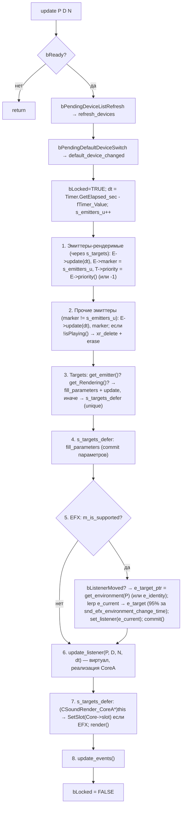

# xrSound — Core: ядро

> Порцион 6 итерации 4. Файлы: `SoundRender_Core.h`, `SoundRender_Core.cpp`,
> `SoundRender_Core_Processor.cpp`, `SoundRender_Core_StartStop.cpp`,
> `SoundRender_Core_SourceManager.cpp`.

## 1. Ответственность

Средний, device-независимый слой звука: `CSoundRender_Core` реализует
`CSound_manager_interface` ([interface.md](interface.md), порц. 5) и владеет
тремя контейнерами — **sources** (ресурсы, кэшируются навсегда), **emitters**
(активные экземпляры звука, симулируются каждый кадр) и **targets** (конечная
точка воспроизведения на устройстве). Здесь: жизненный цикл `ref_sound_data`,
кадровый тик `update`, загрузка геометрии окружения/окклюзии, поиск
реверберационного окружения в точке пространства, внутреннее `i_*`-API
(start/stop/priority cull).

**НЕ делает**: OpenAL/EFX-устройство (`CSoundRender_CoreA`,
[devices-misc.md](devices-misc.md), порц. 10), internals Source/Target/Cache
([source-target.md](source-target.md), порц. 8), state-машину Emitter
([emitter.md](emitter.md), порц. 9), данные `SoundEnvironment_LIB`/EFX-пресеты
([core-processor-env.md](core-processor-env.md), порц. 7).

## 2. Класс и поля

`CSoundRender_Core : public CSound_manager_interface` (`SoundRender_Core.h`).
Наследник — `CSoundRender_CoreA` (порц. 10). Глобал `CSoundRender_Core*
SoundRender` определён в `SoundRender_Core.cpp` (обе глобалы — `nullptr`
до `_create`).

| Поле                                        | Тип                          | Назначение                                                                                  |
| ------------------------------------------- | ---------------------------- | ------------------------------------------------------------------------------------------- |
| `bLocked`                                   | `volatile BOOL`              | Лatch на время `update` — `ref_sound`-методы `VERIFY(!i_locked())`                            |
| `bPresent` / `bReady`                       | `BOOL`                       | Модуль создан / инициализирован (кэш+env загружены)                                          |
| `bUserEnvironment`                          | `BOOL`                       | `_EDITOR`: включён ручной env (`set_user_env`)                                               |
| `m_is_supported`                            | `bool`                       | Есть EFX-расширение (ставит CoreA, порц. 10)                                                 |
| `Timer` / `fTimer_Value` / `fTimer_Delta`   | `CTimer` / `float` ×2        | Моноотонный таймер симуляции; `fTimer_Delta` = dt кадра                                      |
| `Handler`                                   | `sound_event*`               | Callback на события (`set_handler`)                                                          |
| `geom_DB`                                   | `CDB::COLLIDER`              | AABB-коллайдер для ray-запросов (non-editor; в `_EDITOR` — `ETOOLS`)                         |
| `geom_MODEL` / `geom_SOM` / `geom_ENV`      | `CDB::MODEL*`                | Геометрия окклюзии / sound-occlusion / окружения (см. §6)                                    |
| `e_current` / `e_identity` / `e_target_ptr` | `CSoundRender_Environment` ×3| Текущий (сглаживаемый) / identity / указатель на цель EFX-окружения (init `&e_identity`)     |
| `s_events`                                  | `xr_vector<event>`           | Очередь событий `pair<ref_sound_data_ptr, float>`, сливается в `update_events`               |
| `s_sources`                                 | `xr_unordered_map<xr_string, CSoundRender_Source*>` | Кэш ресурсов: имя (lower, без ext) → source. **Никогда не удаляется** |
| `s_emitters`                                | `xr_vector<CSoundRender_Emitter*>` | Активные эмиттеры (симуляция)                                                           |
| `s_emitters_u`                              | `u32`                        | Marker-update: инкрементится в `update`; сравнивается с `emitter->marker`                    |
| `s_targets` / `s_targets_defer`             | `xr_vector<CSoundRender_Target*>` ×2 | Конечные точки воспроизведения / очередь «начать рендерить» в этом же кадре           |
| `s_targets_pu`                              | `u32`                        | parameters-update counter (объявлен; активное использование закомментировано)                |
| `s_environment`                             | `SoundEnvironment_LIB*`      | Библиотека окружений из `sEnvironment.xr` (данные — порц. 7)                                |
| `s_user_environment`                         | `CSoundRender_Environment`   | Ручной env (`_EDITOR`)                                                                       |
| `cache` / `cache_bytes_per_line`            | `CSoundRender_Cache` / `u32` | LRU-кэш стриминга (internals — порц. 8)                                                       |
| `m_iPauseCounter`                           | `int`                        | Счётчик pause. **Init = 1** (quirk, §8)                                                      |
| `bPendingDefaultDeviceSwitch` / `bPendingDeviceListRefresh` | `volatile BOOL` ×2 | Ставятся `CNotificationClient` (COM-поток), читаются в начале `update` |
| `pSysNotification`                           | `CNotificationClient*`       | COM-клиент device-change (объявление — порц. 5, реализация — порц. 10)                       |

Конструктор: `bReady = bPresent = FALSE`, `e_target_ptr = &e_identity`,
`m_iPauseCounter = 1`, `xr_new<CNotificationClient>()`. Деструктор:
`xr_delete(geom_ENV/geom_SOM)` (non-editor; `_EDITOR` — `ETOOLS::destroy_model`),
`xr_delete(pSysNotification)`.

## 3. Init / teardown

| Метод      | Тело                                                                                                                        |
| ---------- | --------------------------------------------------------------------------------------------------------------------------- |
| `_initialize(stage)` | `Timer.Start()`, `env_load()`, `bPresent = TRUE`, init кэша: `cache_bytes_per_line = (sdef_target_block/8) · 276400/1000` (= 50 байт/KB-строка при 400 мс/276.4 KB/s), `cache.initialize(psSoundCacheSizeMB·1024, …)`, `bReady = TRUE`; `-prefetch_sounds` в `Core.Params` → `i_create_all_sources()`. **Абстрактный** — реализует CoreA (порц. 10). |
| `_clear`   | `bReady = FALSE`, `cache.destroy()`, `env_unload()`, `xr_delete` всех `s_sources` + `s_emitters`, `clear()`, обнуление глобалов `g_target_temp_data` / `g_target_temp_data_16`. **Абстрактный** (CoreA). |
| `_restart` | Консольная `snd_restart` (ит.2 порц.12): пересоздать кэш + `env_apply()` (→ `bListenerMoved = TRUE`, EFX пересчитается). |
| `switch_device` / `refresh_devices` | Пустые виртуальные по умолчанию; реализация — CoreA (порц. 10). |

`env_load`/`env_unload` — только `SoundEnvironment_LIB`
(`$game_data$/sEnvironment.xr`, `SNDENV_FILENAME`); геометрия приходит отдельно
из уровня (см. §6).

## 4. Жизненный цикл `ref_sound_data`

| Метод            | Тело                                                                                                                                    |
| ---------------- | --------------------------------------------------------------------------------------------------------------------------------------- |
| `create`         | `xr_new<ref_sound_data>(fName, sound_type, game_type)` → конструктор вызывает `_create_data` (ниже).                                     |
| `attach_tail`    | До 2 «хвостов» в `fn_attached[0..1]` (обрезка ext, lower). 3-й — DEBUG `Msg` + skip. Для каждого: `i_create_source` (кэш), `dwBytesTotal += s->bytes_total()`, `fTimeTotal += s->length_sec()`; если уже играет — `feedback()->fTimeToStop += length_sec()`; затем `i_destroy_source` (**no-op** — источник остаётся в кэше). |
| `clone`          | Копирует `handle`/`dwBytesTotal`/`fTimeTotal`/`fn_attached`; `g_type = (game_type == sg_SourceType) ? handle->game_type() : game_type`.  |
| `destroy`        | Если `feedback` — `stop(FALSE)` (эмиттер очистит сам), `S._p = 0` (`ref_sound_data` уничтожается через ref-count).                       |
| `_create_data`   | (protected) lower+обрезка ext → `i_create_source` → `g_type`/`s_type` по аргументам, `feedback = g_object = g_userdata = 0`, `dwBytesTotal`/`fTimeTotal` из ресурса. |
| `_destroy_data`  | (protected) если `feedback` — `stop(FALSE)`, `R_ASSERT(0==feedback)`, `i_destroy_source(handle)` (no-op), `handle = NULL`.               |

`play` / `play_at_pos` / `play_no_feedback` (все `if (!bPresent || !S._handle()) return`):

- **`play(S, O, flags, delay)`**: `S._p->g_object = O`; если уже есть
  `feedback` → `rewind()` (повтор с начала), иначе `i_play(&S, flags &
  sm_Looped, delay)`; `sm_2D` или стерео-ресурс → `switch_to_2D()`;
  `sm_Intro` → `switch_to_Intro()`.
- **`play_at_pos`**: то же + `set_position(pos)`.
- **`play_no_feedback(S, O, flags, delay, pos, vol, freq, range)`**: «разовый»
  звук — создаёт **временный** `ref_sound_data` (копия
  `handle`/`g_type`/`dwBytesTotal`/`fTimeTotal`/`fn_attached`, `g_object = O`),
  `i_play` на нём, применяет `sm_2D`/`sm_Intro`/`pos`/`vol`/`freq`/`range`,
  затем **`S._p = orig`** — оригинальный `ref_sound` сохраняет свой feedback
  (quirk: эмиттер принадлежит временному data, который `ref_sound` больше не
  держит — см. [interface.md](interface.md) §3 и [emitter.md](emitter.md)).

`stop_emitters` — `stop(FALSE)` по всем; `restart_emitters` — `i_start(E)` для
каждого, у которого есть `target`; `pause_emitters(val)` — см. §8.
`object_relcase(obj)` — обнуляет `g_object` у эмиттеров, чей
`owner_data->g_object == obj` (вызов при уничтожении объекта; сам эмиттер
продолжает играть).

## 5. Кадровый тик `update(P, D, N)`

Вызов из `SoundProcessor::OnFrame` (xrEngine, ит.2 порц.12) — позиция/направление/верх
камеры. Порядок (вся функция под `bLocked = TRUE`…`FALSE`):



- **Шаг 1** обновляет в первую очередь эмиттеров, уже привязанных к targets
  (им нужен точный порядок — `E->update` может остановить самого себя,
  поэтому `get_emitter()` перепроверяется после `update`).
- **Шаг 2** — «остальные» эмиттеры по marker (один `update` на кадр на
  эмиттер; остановленные удаляются из `s_emitters`).
- **Шаг 3–4** — подготовка targets: уже рендерящиеся получают
  `fill_parameters`+`update`, только-только привязанные уходят в
  `s_targets_defer` (удаление дублей через `std::unique`), их параметры
  коммитятся до запуска рендера.
- **Шаг 5** — EFX (только если `m_is_supported`): при перемещении слушателя
  (`bListenerMoved`, ставится `update_listener`/`env_apply`) цель окружения
  пересчитывается `get_environment(P)` (§7); затем **экспоненциальный
  сглаживание** `e_current.lerp(e_current, *e_target_ptr, alpha)`, где
  `alpha = 1 - exp(log(0.95) · dt / 1.66)` — за `snd_efx_environment_change_time`
  секунд доходит до 95% цели (комментарий «demonized»). `set_listener`/`commit`
  — виртуалы CoreA (порц. 10).
- **Шаг 7** — запуск отложенных targets: **down-cast `this` в
  `CSoundRender_CoreA`** ради `slot` (EFX-реверб-слот; internals — порц. 10).
- **Шаг 8** — `update_events`: статический `g_saved_event_count = s_events.size()`,
  по каждому `Handler(E.first, E.second)`, затем `clear_not_free()`.

## 6. Внутренний API `i_*`

| Метод                        | Тело                                                                                                                                  |
| ---------------------------- | ------------------------------------------------------------------------------------------------------------------------------------- |
| `i_play(S, _loop, delay)`    | `VERIFY(S->_p->feedback == 0)`; `xr_new<CSoundRender_Emitter>`, `S->_p->feedback = E`, `E->start(S, _loop, delay)`, push в `s_emitters`. (internals `start` — порц. 9) |
| `i_start(E)`                 | **Приоритетный cull**: ищет target с **минимальным** `priority`; отменяет его текущего эмиттера (`cancel()`); `E->target = T`, `T->start(E)`, `T->priority = E->priority()`. Затем блок `v2v3v4`: если привязанный эмиттер 3D и `dist(listener, source.position) > p_source.max_distance` → `cancel()`. |
| `i_stop(E)`                  | `R_ASSERT(E == E->target->get_emitter())`; `target->stop()`, `E->target = NULL`.                                                       |
| `i_rewind(E)`                | То же assert; `target->rewind()`.                                                                                                       |
| `i_allow_play(E)`            | TRUE, если есть target с `priority < E->priority()` (есть «слабее» — можно начать).                                                     |
| `i_locked` / `is_ready`      | `bLocked` / `bReady`.                                                                                                                   |
| `i_create_source(name)`      | Кэш: lower + обрезка ext; найден — вернуть; иначе `xr_new<CSoundRender_Source>`, `load(id)`, `insert`.                                    |
| `i_destroy_source(S)`        | **Полный no-op** («No actual destroy at all») — источники живут до `_clear` (кэш навсегда).                                             |
| `i_create_all_sources`       | `-prefetch_sounds`: `FS.file_list($game_sounds$, "*.ogg")`, **`tbb::parallel_for_each`** с общим `Lock` (find под ScopeLock, `load` без замка, `insert` под замком); `Msg` с итогом. |

## 7. Окружение и окклюзия

### `set_geometry_env(IReader*)`

Chunk 0 — имена окружений (строки → `s_environment->GetID`, `R_ASSERT(id>=0)`);
chunk 1 — CFORM-геометрия (копируется в `xr_malloc`): `hdrCFORM` + вершины +
`CDB::TRI`; по каждой треугольник: `dummy = ids[id_back] << 16 | ids[id_front]`
(remap индексов-имён в id'ы). `geom_ENV->build(...)`.

### `set_geometry_som(IReader*)`

SOM-файл: chunk 0 = версия (`VERIFY(version==0)`), chunk 1 — полигоны
`SOM_poly { v1, v2, v3, u32 b2sided, float occ }`. По каждому:
`CDB::Collector::add_face_packed_D(v1,v2,v3, *(u32*)&occ, 0.01f)` —
**`float occ` bit-cast в `u32` dummy**; `b2sided` → зеркальный треугольник
`v3,v2,v1`. `geom_SOM = MODEL::build(...)`.

### `set_geometry_occ(CDB::MODEL* M)`

Закрытие кросс-обязательства ит.2 порц.6 — `IGame_Level::Load` (xrEngine)
прокидывает уровень: `geom_MODEL = M`. Всё, что больше, — ниже.

### `get_environment(P)`

Если `bUserEnvironment` (`_EDITOR`) → `&s_user_environment`. Иначе ray
**вниз** `(0,-1,0)` на 1000 юнитов в `geom_ENV` (`OPT_ONLYNEAREST`); ближайший
треугольник: `tri_norm.mknormal(…)`; если `dir · tri_norm < 0` → front id
`(dummy & 0xffff)`, иначе back id `(dummy >> 16)`. Возврат
`s_environment->Get(id)`. Мисс / нет `geom_ENV` → **static** `identity`
(`set_identity()`).

### `get_occlusion_to(hear_pt, snd_pt, dispersion = 0.2f)`

(Кросс-обязательство ит.3 порц.4.) Ray от `snd_pt + random_dir·dispersion`
к `hear_pt` по `geom_SOM` (`OPT_CULL`): произведение всех `dummy`-float'ов
попавших треугольников. Нет `geom_SOM` → `1.f`.

### `get_occlusion(P, R, occ)`

Ray от `listener_position()` к `P + random_dir·R`:

1. **Кэш-полигон**: `occ[0..2]` = вершины ранее найденного ближайшего
   треугольника `geom_MODEL`; `CDB::TestRayTri` — если попадание в пределах
   range → `occ_value = psSoundOcclusionScale` (0.5), полный тест пропускать.
2. Иначе полный ray в `geom_MODEL` (`OPT_ONLYNEAREST`): кэш 3 вершин в `occ`,
   `occ_value = psSoundOcclusionScale`.
3. Затем **всегда** ray в `geom_SOM` (`OPT_CULL`): умножение на все попавшие
   `dummy`-float'ы.

Смысл: `geom_MODEL` даёт бинарный «стена/нет» с фиксированным масштабом
`psSoundOcclusionScale`, `geom_SOM` — настраиваемые per-полигон коэффициенты.

### `env_apply`

`bListenerMoved = TRUE` — сигнал EFX-блоку в `update` пересчитать цель
окружения.

### `update_listener(P, D, N, dt)`

**Пустой в Core** — виртуал, реализация CoreA (порц. 10: `alListener*`).

## 8. Пауза, статистика, `_EDITOR`

### `pause_emitters(val)`

```cpp
m_iPauseCounter += val ? +1 : -1;
VERIFY(m_iPauseCounter >= 0);
for (E : s_emitters)
    ((CSoundRender_Emitter*)E)->pause(val, val ? m_iPauseCounter : m_iPauseCounter + 1);
return m_iPauseCounter;
```

**Quirk**: инициализация `m_iPauseCounter = 1`, а не 0 — первый
`pause(false)` (unpause) при счётчике 1 уйдёт в `VERIFY(0>=0)` и передаст
`id = m_iPauseCounter + 1 = 1`. Счётчик — вложенность pause: пока `> 0`,
эмиттеры «заморожены». (internals `pause` — порц. 9.)

### `statistic(dest, ext)`

Закрытие кросс-обязательства ит.2 порц.12 (`CSound_stats_ext`):

- `dest` (`CSound_stats`): `_rendered` = targets с эмиттером и
  `get_Rendering()`, `_simulated = s_emitters.size()`, `_cache_hits/misses`
  из `cache` (затем `stats_clear()` — счётчики за кадр), `_events =
  g_saved_event_count` (заполен в `update_events`).
- `ext` (`CSound_stats_ext`): `append(SItem)` по каждому эмиттеру —
  `_3D = !b2D`, `_rendered = !!target`, `params = p_source`,
  `volume = smooth_volume`; с `owner_data`: имя из `source()->fname`,
  `g_object`, `g_type`, `s_type`; без — `game_object = 0`, `type = st_Effect`.
  (читается `CStats` — ит.2 порц.12; устройство — порц. 10).

### `_EDITOR`-только

| Метод                        | Тело                                                                                       |
| ---------------------------- | ------------------------------------------------------------------------------------------- |
| `set_user_env(E)`            | **Unsafe-cast** `CSound_environment*` → `CSoundRender_Environment*` (см. §1 quirk); копия в `s_user_environment`, `bUserEnvironment = TRUE`, `env_apply()`. |
| `refresh_env_library`        | `env_unload` + `env_load` + `env_apply`.                                                     |
| `refresh_sources`            | `stop(FALSE)` всех эмиттеров; по `s_sources`: `unload()` + `load(*fname)` (перезагрузка файлов). |
| `set_environment_size` / `set_environment` | **Пустые заглушки**.                                                          |

`get_env_library()` — инлайновый getter `s_environment`.

## 9. Взаимодействие

- **xrEngine**: `SoundProcessor::OnFrame` → `update` (кадр); `IGame_Level::Load`
  → `set_geometry_occ` (+ env/som из уровня); консоль `snd_restart` →
  `_restart`; статистика `CStats` → `statistic`; device-change →
  `switch_device`/`refresh_devices` (CoreA).
- **xrGame**: `ref_sound` в объектах, `Feel::Sound` (ит.2 порц.9),
  `SoundEvent_Register` (ит.2 порц.6), `object_relcase` при уничтожении объекта.
- **Внутри xrSound**: `CSoundRender_CoreA` наследует Core и реализует
  чистые виртуалы (`_initialize`/`_clear` — порц. 10, `update_listener`/
  `set_listener`/`get_listener`/`commit`/`set_master_volume` — порц. 10);
  Emitter/Source/Target/Cache — порц. 8–9; `SoundEnvironment_LIB` — порц. 7.
- **Далее в итерации 4**: [core-processor-env.md](core-processor-env.md)
  (порц. 7), [source-target.md](source-target.md) (порц. 8),
  [emitter.md](emitter.md) (порц. 9), [devices-misc.md](devices-misc.md) (порц. 10).
